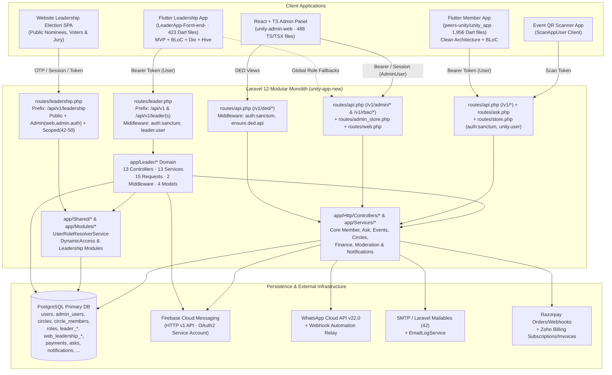
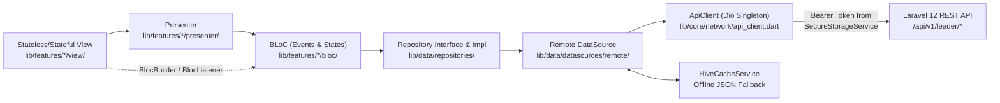

# 01 — Existing System Architecture

> **Audit Scope:** Multi-repository production architecture across the Laravel 12 Backend Monolith, Flutter Leadership Mobile App, Flutter Member Mobile App, React + TypeScript Admin Panel, and Embedded Website Leadership Portal.  
> **Mode:** Strict Read-Only Discovery & Evidence-Based Documentation.  
> **Related Deliverables:** [README.md](./README.md) · [02-existing-leadership-app-audit.md](./02-existing-leadership-app-audit.md) · [03-existing-backend-api-inventory.md](./03-existing-backend-api-inventory.md) · [05-existing-infrastructure-and-integration.md](./05-existing-infrastructure-and-integration.md) · [06-complete-role-hierarchy.md](./06-complete-role-hierarchy.md)

---

## 1. Executive Architectural Overview

**FACT:** Peers Global (Peers Unity) operates a **shared-database, multi-product modular ecosystem** backed by a single **PHP 8.2 / Laravel 12** monolith (`unity-app-new`) and **PostgreSQL**, serving five distinct client surfaces through explicit route namespaces and domain boundaries codified in [DEVELOPER_RULES.md](file:///c:/Users/malic/OneDrive/Documents/GitHub/unity-app-new/DEVELOPER_RULES.md#L34-L55) and [bootstrap/app.php](file:///c:/Users/malic/OneDrive/Documents/GitHub/unity-app-new/bootstrap/app.php#L25-L48).

| # | Ecosystem Component | Repository Path & Active Branch | Tech Stack & Architecture | Scale (Verified Files) | Implementation Status |
|---:|---|---|---|---|---|
| 1 | **Core Backend & API Monolith** | `c:\Users\malic\OneDrive\Documents\GitHub\unity-app-new` (`develop`) | PHP `^8.2`, Laravel `^12.0`, PostgreSQL, Laravel Sanctum `^4.2`, Laravel Reverb `^1.7`, DomPDF `^3.1`, Endroid QR `^6.0`, Razorpay `^2.9` ([composer.json](file:///c:/Users/malic/OneDrive/Documents/GitHub/unity-app-new/composer.json#L8-L20)) | Modular monolith (`app/Leader/`, `app/Modules/`, `app/Shared/`, `app/Services/`, `routes/*.php`) | `Partially Implemented` (Core live; severe RBAC/scope/metric defects — see [42-rbac-security-audit.md](./42-rbac-security-audit.md)) |
| 2 | **Flutter Leadership / Admin Mobile App** | `D:\office project\LeaderApp-Fornt-end-` (`api-integration`) | Flutter (SDK `^3.12.0`, version `1.0.0+4`), Material 3 (`LibreFranklin`), MVP + `flutter_bloc ^8.1.6`, `dio ^5.8.0+1`, `hive`, `flutter_secure_storage`, `firebase_messaging ^17.0.1`, Shorebird ([pubspec.yaml](file:///D:/office%20project/LeaderApp-Fornt-end-/pubspec.yaml#L19-L56)) | **423 Dart files** across `lib/core`, `lib/data` (10 datasources/repos), 24 `lib/features/*` modules, and 25 test files | `Partially Implemented` (UI shell & 6 audit fix rounds built; unrouted/fallback APIs & scope gaps remain) |
| 3 | **Flutter Member Mobile App** | `D:\office project\peers-unity\unity_app` | Flutter (SDK `^3.12.0`, version `2.0.5+77`), Clean Architecture (`data` / `domain` / `presentation`) + `flutter_bloc ^9.1.1`, `dio ^5.7.0`, Razorpay, Agora RTC, Syncfusion PDF, Shorebird ([pubspec.yaml](file:///D:/office%20project/peers-unity/unity_app/pubspec.yaml#L19-L90)) | **1,956 Dart files** across **26 feature modules** (powers member-facing 35 platform activities) | `Fully Implemented` (Production member experience) |
| 4 | **React + TypeScript Admin Web Panel** | `D:\office project\unity-admin-web` (`peersglobal-admin-redesign`) | React + TypeScript + Vite SPA | **488 `.ts`/`.tsx` files** across 50+ feature modules, 58 API services, Dynamic RBAC UI, Pending Requests hub, Finance & Store admin | `Partially Implemented` (Broad coverage; several `/api/v1/admin/*` backend routes lack guard enforcement) |
| 5 | **Website Leadership Election Portal** | Embedded in `unity-app-new` (`resources/js/leadership-admin/`, `routes/leadership.php`, `routes/web.php`) & mirrored in `unity-admin-web/src/features/webLeadership/` | React SPA + Laravel Blade shells + 23 `web_leadership_*` PostgreSQL tables | 14 controllers + 23 Eloquent models in `app/Models/Leadership/` | `Partially Implemented` (Complete campaign/nomination/voting/jury pipeline; session vs token auth split) |

> [!IMPORTANT]
> **Workbook vs. Production Architecture Discrepancy (`WORKBOOK REQUIREMENT` vs `FACT`):**  
> Sheet 1 (`Peers Activity (Side-by-Side)`) and Sheet 3 (`Technical Architecture Specs`) of `PEERS UNITY — MASTER ACTIVITY & ARCHITECTURE DIRECTORY.xlsx` list AWS/serverless/polyglot component names such as `PdfGeneratorLambda`, `ElasticSearchIndexer`, `CollabRoomSocketService`, `HlsVideoTranscoder`, `S3MediaService`, and `Firestore`/`Mongo`-style JSON keys.  
> **FACT:** None of those AWS Lambda, Elasticsearch, or Cloud Firestore services exist in production. All persistence lives in **PostgreSQL**, PDFs are rendered synchronously/in-process via **DomPDF** ([CertificateGeneratorService.php](file:///c:/Users/malic/OneDrive/Documents/GitHub/unity-app-new/app/Services/Certifications/CertificateGeneratorService.php), [LeaderReportPdfGenerator.php](file:///c:/Users/malic/OneDrive/Documents/GitHub/unity-app-new/app/Leader/Services/LeaderReportPdfGenerator.php)), search uses **PostgreSQL `ILIKE`**, real-time events use **Laravel Reverb**, and Firebase is used **strictly for FCM push notifications** (`firebase_core` + `firebase_messaging` + HTTP v1 [FcmService.php](file:///c:/Users/malic/OneDrive/Documents/GitHub/unity-app-new/app/Services/Firebase/FcmService.php)) plus Google Sign-In on the Member App. Per Mandate §2 (*Enhance, Never Duplicate*), all enhancements must build on the existing Laravel 12 + PostgreSQL + FCM stack.

---

## 2. End-to-End Ecosystem Topology

---

## 3. Backend Domain & Route Isolation (`unity-app-new`)

### 3.1 Product Boundary Architecture
**FACT:** [DEVELOPER_RULES.md](file:///c:/Users/malic/OneDrive/Documents/GitHub/unity-app-new/DEVELOPER_RULES.md#L38-L55) defines six explicit product domains sharing the Laravel 12 codebase:
1. **Member App** (`/api/v1/*`, `routes/ask.php`, `routes/store.php`)
2. **Leader App** (`routes/leader.php` + `app/Leader/*`, plus newer scoped endpoints in `routes/leadership.php` lines 309–333)
3. **Admin Panel** (`/api/v1/admin/*`, `/api/v1/rbac/*`, `routes/admin_store.php`, and Blade routes in `routes/web.php`)
4. **DED Module** (`/api/v1/ded/*` in `routes/api.php` lines 465–554, backed by `DedDashboardController`, `DedPendingRequestsController`, `DistrictAnalyticsService`, `DistrictScopeService`)
5. **Scan App** (`/api/v1/scan-app/*`, `EnsureScanAppUser`)
6. **Shared / Integration Infrastructure** (`app/Shared/Services/UserRoleResolverService.php`, `app/Shared/OrganizationalScope/OrganizationalScopeService.php`, `app/Shared/Authorization/EffectiveAccessResolverService.php`)

### 3.2 Route Mounting in `bootstrap/app.php`
**FACT:** [bootstrap/app.php](file:///c:/Users/malic/OneDrive/Documents/GitHub/unity-app-new/bootstrap/app.php#L26-L48) registers all route files as follows:

| Route File | Mounted Prefix | Middleware Group | Primary Consumers | Key Architectural Notes |
|---|---|---|---|---|
| [routes/web.php](file:///c:/Users/malic/OneDrive/Documents/GitHub/unity-app-new/routes/web.php) | `/` | `web` | Blade Admin, Public Event/Support/Election SPAs | Enforces `admin.auth`, `admin.role`, `admin.circle`, `admin.permission` on `/admin/*` |
| [routes/api.php](file:///c:/Users/malic/OneDrive/Documents/GitHub/unity-app-new/routes/api.php) | `/api` (internal `/v1`) | `api` | Member App, React Admin, DED, Scan App, Webhooks | Also `require`s `routes/ask.php`, `routes/store.php`, `routes/admin_store.php` |
| [routes/leader.php](file:///c:/Users/malic/OneDrive/Documents/GitHub/unity-app-new/routes/leader.php) | `/api/v1` | `api` + `['auth:sanctum', 'leader.user']` | Flutter Leadership App | Exposes both root `/api/v1/*` and `/api/v1/leader(s)/*` aliases |
| [routes/leadership.php](file:///c:/Users/malic/OneDrive/Documents/GitHub/unity-app-new/routes/leadership.php) | `/api/v1/leadership` | `api` | Election Portal + Scoped Leadership APIs (42–50) | **FACT:** Admin election routes (`L155-303`) use `['web', 'admin.auth']` session cookies; `GET circles` (`L317`) collides with public `GET circles` (`L111`)! |
| `routes/ask.php` | `/api/asks` & `/api/v1/asks` | `api` + `auth:sanctum` | Member App, Leader App, React Admin | Unified Ask Discovery Engine (`collaboration`, `help`, `referral`) |
| `routes/store.php` / `routes/admin_store.php` | `/api/v1/*` & `/api/admin/v1/*` | `api` + `auth:sanctum` | Member Coin Store & React Store Admin | E-commerce catalog, coin wallet, maker-checker wallet adjustments |

### 3.3 Dual Principal Model (`App\Models\User` vs `App\Models\AdminUser`)
**FACT:** One of the most consequential architectural realities in `unity-app-new` is its **two-table identity model**:
- **`users` (`App\Models\User`)**: Represents every Peer and mobile Leader. Authenticated by **Member App** (`EnsureUnityUser` / `unity.user`) and **Leader App** (`EnsureLeaderUser` / `leader.user`).
- **`admin_users` (`App\Models\AdminUser`)**: Represents Web Admin accounts, DED accounts (`/api/v1/ded/*` via `EnsureDedApiAccess` / `ensure.ded.api`), and Dynamic RBAC role holders (`admin_user_roles.user_id`).
- **Cross-Table Bridging (`Implemented but Incorrect`)**:
  - [LeaderAuthService.php](file:///c:/Users/malic/OneDrive/Documents/GitHub/unity-app-new/app/Leader/Services/LeaderAuthService.php#L368-L408) (`ensureLeaderUserFromAdminAccount`) auto-creates a shadow `users` row when an eligible `AdminUser` requests a Leader App OTP.
  - Conversely, [EnsureAdminAuthenticated.php](file:///c:/Users/malic/OneDrive/Documents/GitHub/unity-app-new/app/Http/Middleware/EnsureAdminAuthenticated.php#L32-L53) auto-creates an `AdminUser` row for *any* authenticated `User` hitting `admin.auth`!
  - Because **DED APIs (`/api/v1/ded/*`) require an `AdminUser` token** while **Leader App APIs (`/api/v1/leader/*`) require a `User` token**, a District Executive Director signed into the Flutter Leadership App (`User` token) **cannot directly call `/api/v1/ded/*`** unless either `/api/v1/ded/*` accepts scoped `User` tokens or `DistrictAnalyticsService` is exposed through `app/Leader/`! (Detailed in [03-existing-backend-api-inventory.md](./03-existing-backend-api-inventory.md) and [47-api-enhancement-recommendations.md](./47-api-enhancement-recommendations.md)).

---

## 4. Flutter Leadership App Architecture (`LeaderApp-Fornt-end-`)

**FACT:** Located at `D:\office project\LeaderApp-Fornt-end-` on branch `api-integration`, the existing Leadership App uses a clean **MVP + BLoC + Repository + RemoteDataSource** architecture ([main.dart](file:///D:/office%20project/LeaderApp-Fornt-end-/lib/main.dart), [app.dart](file:///D:/office%20project/LeaderApp-Fornt-end-/lib/app.dart)):

### 4.1 Core Architectural Layers
1. **Bootstrap & Gatekeeping (`lib/main.dart`, `lib/features/splash/view/splash_view.dart`)**:
   - Initializes `Firebase.initializeApp`, `HiveCacheService`, `AppFormatters` (`intl` + `timezone`), `splash.json` Lottie, `SessionManager().loadPersistedSession()`, and `PushNotificationService.instance.initialize()`.
   - `SplashView` queries `GET /api/v1/leader/system/app-config?product=leader` via [app_config_service.dart](file:///D:/office%20project/LeaderApp-Fornt-end-/lib/core/services/app_config_service.dart#L21-L69) to enforce role-aware Maintenance Mode (`MaintenanceView`), Play Store In-App Updates / App Store force updates, and routes to `/home` (`DashboardView`) or `/login` (`LoginView`).
2. **Session & Permission Engine (`lib/core/helpers/session_manager.dart`, `lib/core/models/leader_permissions.dart`)**:
   - Stores JWT/Sanctum `access_token` in `FlutterSecureStorage` and serializes `UserSession` + `LeaderPermissions` (21 boolean flags + `enabledCapabilities`) in Hive.
   - Drives dynamic bottom-bar tab visibility (`Home`, `Peers`, `Circles` [`canAccessTeamsTab`], `Finance` [`canAccessFinanceTab`], `Reports` [`canAccessReportsTab`]) and action buttons.
3. **Data Layer (`lib/data/datasources/remote/` & `lib/data/repositories/`)**:
   - 10 paired datasources & repositories: `auth`, `dashboard`, `peers`, `teams`, `activities`, `referrals`, `finance`, `reports`, `circulars`, `role_matrix`.
   - **Architectural Debt (`Implemented but Incorrect`)**: `DashboardRemoteDataSource` and `ActivitiesRemoteDataSource` make secondary client-side fan-out calls to `/api/v1/admin/*` (`pending-requests`, `leads`, `posts`) when the signed-in role is `superAdmin` or `countryDirector`, creating divergent behavior between global and scoped roles instead of relying on a single server-scoped `/api/v1/leader/*` contract.
4. **Three Competing Leader API Generations in Backend (`FACT`)**:
   - **Generation 1 (`routes/leader.php` → `app/Leader/*`)**: Actively called by the Flutter Leadership App today (66 route registrations). Rich feature set, but suffers from synthetic dashboard/finance numbers, unrouted `PUT /peers/{id}` & `POST /circulars`, unused `leader.can`, and horizontal IDORs.
   - **Generation 2 (`/api/v1/ded/*` → `DistrictAnalyticsService`)**: Built for DED web/mobile views (`AdminUser` guard). Contains genuine district role drilldowns (`industry-directors`, `founders`, `directors`, `chairs`, `vice-chairs`, `secretaries`, `members`) and `circle_subscriptions` revenue sums, **not yet integrated** into the Flutter Leadership App.
   - **Generation 3 (`routes/leadership.php` lines 309–333 → `App\Modules\Leadership\Controllers\*`, APIs 42–50)**: Newer enterprise DynamicAccess-scoped read endpoints (`/api/v1/leadership/me`, `dashboard`, `circles`, `peers`, `activities`, `events`, `reports`) using `OrganizationalScopeService` and field-level masking, **not yet called** by the Flutter Leadership App (`Implemented but Not Integrated`).

---

## 5. Summary of Architectural Strengths vs. Systemic Risks

| Dimension | What Already Works Well (Retain & Reuse) | What Requires Targeted Remediation (Enhance, Do Not Rebuild) |
|---|---|---|
| **Domain Isolation** | `app/Leader/` cleanly isolates Leader mobile controllers, services, requests, and models from Member App controllers. | Wire existing `CheckLeaderCapability` (`leader.can`) middleware onto `routes/leader.php`; route existing `LeaderPeersController::update` and `LeaderCircularsController::publish`. |
| **Mobile App Architecture** | Clean MVP + BLoC separation, Material 3 `LibreFranklin` design system, responsive button/chart fixes, typed `NotificationNavigator`, brand vocabulary test suite. | Remove client-side 7-call `/admin/*` fan-outs in `DashboardRemoteDataSource`, add 401 session-expiry handling in `ApiClient`, sync `UserRole` enum with backend's 13 canonical roles, remove remaining hardcoded model defaults. |
| **Role & RBAC Engine** | Rich PostgreSQL RBAC schema (`roles`, `role_data_scope`, `leader_role_capabilities`, `user_organizational_assignments`) and centralized `UserRoleResolverService`. | Reconcile the 3 competing role key conventions (`camelCase` vs `snake_case`), add `committee_leader` & `global_founder` normalization, fix `DynamicRbacSeeder` capability leaks, and lock down unauthenticated `/api/v1/rbac/*` & `/api/v1/admin/*` routes. |
| **Activities & Moderation** | All 35 workbook activities have real PostgreSQL tables/services in `unity-app-new` and Member App screens; `PendingRequestAdminController` already unifies 10 moderation queues with stage-aware Circle Join approvals. | Fix `coin_claims` vs `coin_claim_requests` table mismatch, add `leader_interest_submissions` review columns, enforce `approve_peer_requests` capability, and expose a focused Role-Aware Action Center in the Leadership App. |
| **Finance & Analytics** | Real `payments`, `finance_ledger_transactions`, `circle_subscriptions`, `finance_wallets`, and `finance_commission_configs` tables exist in PostgreSQL. | Eliminate `5%` deal-value fake revenue in `LeaderDashboardService`, `orWhereHas` cross-circle double-counting in `LeaderFinanceService`, and `price * peers` estimates in `LeaderTeamsService`; return `null` (`—` in UI) when authoritative revenue is unavailable. |
