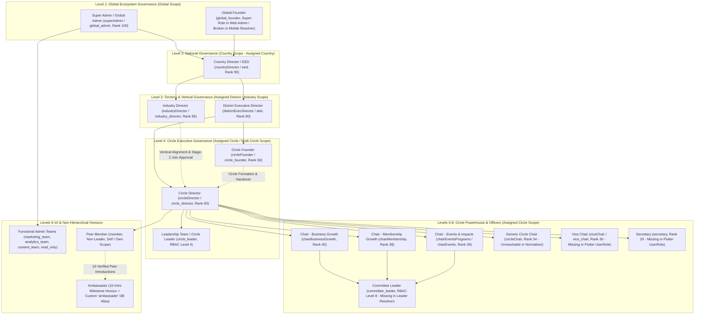

# 06 — Complete Role Hierarchy & Cross-Surface Taxonomy Reconciliation

> **Audit Scope:** Peers Global Unity Platform (`unity-app-new` Laravel 12 Backend, `LeaderApp-Fornt-end-` Flutter Leadership App, `unity-admin-web` React Admin Portal, and PostgreSQL Schema)  
> **Overall Status:** `Implemented but Incorrect` (Four partially overlapping role taxonomies with unmapped keys, unreachable enum branches, and frontend enum gaps)  
> **Related Deliverables:** [07-role-wise-responsibilities.md](./07-role-wise-responsibilities.md) · [08-master-role-permission-matrix.md](./08-master-role-permission-matrix.md) · [09-organizational-data-scope-matrix.md](./09-organizational-data-scope-matrix.md) · [10-role-wise-screen-access.md](./10-role-wise-screen-access.md) · [11-approval-and-delegation-authority.md](./11-approval-and-delegation-authority.md)

---

## 1. Executive Summary & Architectural Diagnosis

**FACT:** Across the Peers Global Unity ecosystem, leadership identity is **not** governed by a single canonical role registry. Instead, **four distinct role surfaces** operate simultaneously and are bridged at runtime through string-stripping normalizers and ad-hoc alias arrays:

1. **Shared & Leader App Role Resolver (`camelCase`, 13 keys):** [UserRoleResolverService.php](file:///c:/Users/malic/OneDrive/Documents/GitHub/unity-app-new/app/Shared/Services/UserRoleResolverService.php#L16-L115) and [LeaderPermissionService.php](file:///c:/Users/malic/OneDrive/Documents/GitHub/unity-app-new/app/Leader/Services/LeaderPermissionService.php#L119-L230).
2. **Dynamic RBAC & Enterprise Access Catalog (`snake_case`, 19 seeded keys + 7 dynamic/custom keys):** `roles` table seeded by [RoleHierarchySeeder.php](file:///c:/Users/malic/OneDrive/Documents/GitHub/unity-app-new/database/seeders/RoleHierarchySeeder.php#L41-L72) and [DynamicRbacSeeder.php](file:///c:/Users/malic/OneDrive/Documents/GitHub/unity-app-new/database/seeders/DynamicRbacSeeder.php#L167-L210), with runtime helpers in [Role.php](file:///c:/Users/malic/OneDrive/Documents/GitHub/unity-app-new/app/Models/Role.php#L180-L202), [AdminAccess.php](file:///c:/Users/malic/OneDrive/Documents/GitHub/unity-app-new/app/Support/AdminAccess.php#L20-L79), and [AccessConstants.php](file:///c:/Users/malic/OneDrive/Documents/GitHub/unity-app-new/app/Shared/Authorization/AccessConstants.php#L102-L298).
3. **PostgreSQL Circle Membership & Circle JSON Storage (`snake_case` enum + FK columns + JSONB):** `circle_member_role_enum` enforced in [OrganizationalAssignmentSyncService.php](file:///c:/Users/malic/OneDrive/Documents/GitHub/unity-app-new/app/Modules/DynamicAccess/Services/OrganizationalAssignmentSyncService.php#L284-L300) and [CircleMember.php](file:///c:/Users/malic/OneDrive/Documents/GitHub/unity-app-new/app/Models/CircleMember.php#L20-L120), plus direct foreign-key columns and `calendar` JSONB on `circles` ([Circle.php](file:///c:/Users/malic/OneDrive/Documents/GitHub/unity-app-new/app/Models/Circle.php#L46-L157)).
4. **Client Frontend Taxonomies (Flutter `UserRole` enum & React Admin `ROLE_GROUPS`):** [user_role.dart](file:///D:/office%20project/LeaderApp-Fornt-end-/lib/core/enums/user_role.dart#L1-L75) (only 10 enum values), stale onboarding docs in [README.md](file:///D:/office%20project/LeaderApp-Fornt-end-/README.md#L29-L39), and [roleAccess.ts](file:///D:/office%20project/unity-admin-web/src/utils/roleAccess.ts#L13-L300) (19 `ROLE_GROUPS` with hardcoded environment UUIDs).

> [!IMPORTANT]
> **Hard Architecture Rule (Preserve Backend Role IDs):** No new role identifiers should be invented. Enhancements must reconcile existing canonical keys across `UserRoleResolverService` and `roles.key`, treating backend assignment records (`admin_user_roles`, `user_organizational_assignments`, `admin_ded_districts`, `industry_director_assignments`, `circles`, `circle_members`) as the single source of truth.

---

## 2. Organizational Role Hierarchy & Scope Diagram

---

## 3. Master Cross-Surface Role Reconciliation Matrix

**FACT:** The table below reconciles every role across all four technical surfaces, citing exact rank integers, `roles` table codes/levels, PostgreSQL enum values, Flutter `UserRole` mappings, and React Admin `ROLE_GROUPS` UUIDs.

| # | Canonical Role Concept | Surface A: `UserRoleResolverService` Key & Rank ([UserRoleResolverService.php](file:///c:/Users/malic/OneDrive/Documents/GitHub/unity-app-new/app/Shared/Services/UserRoleResolverService.php#L16-L115)) | Surface B: `roles` Table `key`, `role_code`, Level & Type ([RoleHierarchySeeder.php](file:///c:/Users/malic/OneDrive/Documents/GitHub/unity-app-new/database/seeders/RoleHierarchySeeder.php#L41-L72)) | Surface C: `circle_member_role_enum` & `circles` Storage ([CircleMember.php](file:///c:/Users/malic/OneDrive/Documents/GitHub/unity-app-new/app/Models/CircleMember.php#L20-L120)) | Surface D1: Flutter `UserRole` ([user_role.dart](file:///D:/office%20project/LeaderApp-Fornt-end-/lib/core/enums/user_role.dart#L2-L13)) | Surface D2: React Admin `ROLE_GROUPS` ([roleAccess.ts](file:///D:/office%20project/unity-admin-web/src/utils/roleAccess.ts#L13-L300)) | Audit Status |
|---:|---|---|---|---|---|---|---|
| 1 | **Super Admin / Global Admin** | `superAdmin` (`100`, `is_leader: true`, `'Global Scope'`) | `global_admin` (`SA`, L1, `admin`, `global`) | Constant `ROLE_GLOBAL_ADMIN = 'global_admin'` (not in PG enum) | `UserRole.superAdmin` (`'Super Admin'`) | Handled via `isUserSuperAdmin()` (`super_admin`, `global_admin`) | `Fully Implemented` |
| 2 | **Global Founder** | **Unmapped!** `normalizeRoleKey('global_founder')` returns `'global_founder'` (`is_leader: false` unless `AdminUser` fast-path!) | `global_founder` (on-the-fly in [Role.php](file:///c:/Users/malic/OneDrive/Documents/GitHub/unity-app-new/app/Models/Role.php#L182), `AdminAccess::SUPER_ROLE_KEYS`) | None | None (falls back to `circleChair` unless label contains `admin`) | Handled via `isSuperAdminRole` in Web Admin | `Implemented but Incorrect` |
| 3 | **Country Director / EED** | `countryDirector` (`90`, `is_leader: true`, `'Country Scope'`) | `eed` (`EED`, L2, `leadership`, `country`) | Constant `ROLE_EED = 'eed'`; `circles.eed_user_id` | `UserRole.countryDirector` (`'Country Director'`) | `eed` (`'EED'`), UUIDs: `048fa24f-ef7b-402a-a92c-569df73ec78e`, `4c5fea6e-795b-4df3-b5d2-54f29e0888db` | `Implemented but Incorrect` (Scope unfiltered!) |
| 4 | **Industry Director** | `industryDirector` (`85`, `is_leader: true`, `'Industry Scope'`) | `industry_director` (`ID`, L3, `leadership`, `industry`) | Constant `ROLE_INDUSTRY_DIRECTOR = 'industry_director'`; `circles.industry_director_user_id` | `UserRole.industryDirector` (`'Industry Director'`) | `industry_director`, UUIDs: `390d6937-8c99-481c-85fd-3580a8100ce8`, `d4245e1e-f598-4d0b-8aae-5ae68d1710ea`, `0b90db61-0883-47dc-9d19-e2ab9ffb0563` | `Partially Implemented` |
| 5 | **District Executive Director (DED)** | `districtExecDirector` (`80`, `is_leader: true`, `'District Scope'`) | `ded` (`DED`, L3, `leadership`, `district`) | Constant `ROLE_DED = 'ded'`; `circles.ded_user_id` | `UserRole.districtExecDirector` (`'District Exec Director'`) | `ded`, UUIDs: `47aedecc-c312-4727-a31c-83a0fbe6e93f`, `2ee9a07b-c64d-4fc2-8b5f-3127d9785f6a`, `01931000-0000-7000-8000-000000000001` | `Partially Implemented` |
| 6 | **Circle Director** | `circleDirector` (`60`, `is_leader: true`, `'Own Circle'`) | `circle_director` (`CD`, L4, `leadership`, `circle`) + dynamic `cd`, `director` | PG enum `'director'`; `circles.director_user_id`, `circle_director_user_id`, `calendar.leadership.*` | `UserRole.circleDirector` (`'Circle Director'`) | `circle_director`, UUIDs: `b70d6344-d142-4007-815a-c6393a5e5a4b`, `f4646a9b-8ec7-4b2a-9999-8f3f0e710830`, `0013d3b9-3078-49da-93c9-fa90fa5149b2` | `Fully Implemented` |
| 7 | **Circle Founder** | `circleFounder` (`50`, `is_leader: true`, `'Own Circle'`) | `circle_founder` (`CF`, L4, `leadership`, `circle`) + dynamic `cf`, `founder` | PG enum `'founder'`; `circles.founder_user_id`, `circle_founder_user_id`, `calendar.leadership.*` | `UserRole.circleFounder` (`'Circle Founder'`) | `circle_founder`, UUIDs: `0ce4cbe4-1621-44fc-b7ee-bec15518a3da`, `4e8a4915-7b6a-422e-92f4-62e4ac1f5a76`, `91710b30-32c3-48a6-8762-d7b63c4ceefc` | `Fully Implemented` |
| 8 | **Circle Leader / Leadership Team** | **Unmapped!** `normalizeRoleKey('circle_leader')` falls through (`is_leader: false`) | `circle_leader` (`CL`, L4, `leadership`, `circle`) | Not in PG enum | **Absent** (falls back to `UserRole.circleChair`) | `circle_leader` (`'Circle Leader'`, alias `leadership_team`), UUIDs: `05b1fcec-0fa8-4d6d-b55a-1fb7a439e5d7`, `309f1015-18e1-4261-a345-e7696cc67aea` | `Implemented but Not Integrated` |
| 9 | **Chair — Business Growth Committee** | `chairBusinessGrowth` (`40`, `is_leader: true`, `'Own Circle'`) | `chair_business_growth_committee` (`CBG`, L5, `DynamicRbacSeeder` L184) | Normalized to PG enum `'committee_leader'` (`OrganizationalAssignmentSyncService.php:293`) or `'chair'`; `circles.business_growth_committee_chair_user_id` + `calendar` JSON | `UserRole.chairBusinessGrowth` (`'Chair - Business Growth'`) | `chair_business_growth_committee`, UUIDs: `d024091c-50a3-418d-a64c-6f978eee143e`, `32120618-0942-43ca-a95c-6abdc98f039a`, `e932a30a-4642-4d2e-9852-53766312e957` | `Implemented but Incorrect` (RBAC sync mismatch) |
| 10 | **Chair — Membership Growth Committee** | `chairMembership` (`38`, `is_leader: true`, `'Own Circle'`) | `chair_membership_growth_committee` (`CMG`, L5, `DynamicRbacSeeder` L190) | Normalized to `'committee_leader'` or `'chair'`; `circles.membership_growth_committee_chair_user_id` + `calendar` JSON | `UserRole.chairMembership` (`'Chair - Membership'`; stale `chairPeerExperience` in `README.md`) | `chair_membership_growth_committee`, UUIDs: `dc6b0330-a4bd-4431-81f7-8c89bd926b2a`, `1454e712-0453-4659-95c2-3c820fc0725f`, `553af86c-684b-4c3c-9761-d12afc193cf1` | `Implemented but Incorrect` |
| 11 | **Chair — Events & Impacts Committee** | `chairEventsPrograms` (`36`, `is_leader: true`, `'Own Circle'`) | `chair_events_impacts_committee` (`CEI`, L5, `DynamicRbacSeeder` L196) | Normalized to `'committee_leader'` or `'chair'`; `circles.events_impacts_committee_chair_user_id` + `calendar` JSON | `UserRole.chairEvents` (`'Chair - Events & Programs'`; stale `chairOperationsTech` in `README.md`) | `chair_events_impacts_committee`, UUIDs: `4b604e24-1856-453c-bc22-a16ccf638f0c`, `385752e6-358c-46e5-8f51-281734553d93`, `a3200289-c293-4590-a22a-705cc84b8ed0` | `Implemented but Incorrect` (Key drift) |
| 12 | **Generic Circle Chair** | `circleChair` (`34`, `is_leader: true`, `'Own Circle'` — **UNREACHABLE** via `normalizeRoleKey()`!) | `chair` (`CHR`, L5, `leadership`, `circle`) | PG enum `'chair'`; `circles.chair_user_id` (mapped to `chairBusinessGrowth` at L321!) | `UserRole.circleChair` (`'Circle Chair'`) | `chair` (`'Circle Chair'`), UUIDs: `8f100834-5dfa-4d34-8f52-6e339365eb41`, `d1762bfd-ac32-46a5-bc98-17c25ed7e9f0` | `Implemented but Incorrect` |
| 13 | **Vice Chair** | `viceChair` (`30`, `is_leader: true`, `'Own Circle'`) | `vice_chair` (`VC`, L6, `leadership`, `circle`) | PG enum `'vice_chair'`; `circles.vice_chair_user_id`, `calendar.leadership.vice_chair_user_id` | **Missing in `UserRole` enum!** Silently coerced to `UserRole.circleChair` ([session_manager.dart](file:///D:/office%20project/LeaderApp-Fornt-end-/lib/core/helpers/session_manager.dart#L62)) | `vice_chair`, UUIDs: `1f9f3e22-9de2-4dac-8d41-d3011f2ec1d1`, `5bd134ea-0f19-4181-b072-bab3ff911ccc` | `Partially Implemented` |
| 14 | **Secretary** | `secretary` (`20`, `is_leader: true`, `'Own Circle'`) | `secretary` (`SEC`, L7, `leadership`, `circle`) | PG enum `'secretary'`; `circles.secretary_user_id`, `calendar.leadership.secretary_user_id` | **Missing in `UserRole` enum!** Silently coerced to `UserRole.circleChair` | `secretary`, UUIDs: `0e76aa19-d7ad-4644-ae7d-3047c81701aa`, `a84e0e1d-c984-4332-9f7c-ca4179f17652` | `Partially Implemented` |
| 15 | **Committee Leader** | **Missing!** Not in `ROLE_HIERARCHY_RANK` or `normalizeRoleKey()` -> fails `EnsureLeaderUser` (`403`)! | `committee_leader` (`CML`, L8, `leadership`, `circle`) | PG enum `'committee_leader'`; `circles.powerhouse_user_id` | **Missing in `UserRole` enum!** | `committee_leader`, UUIDs: `709b0c51-94f7-439c-a6c7-336daf3b560b`, `7797efd0-6f8d-4a4c-9dc0-088482447f02` | `Implemented but Incorrect` |
| 16 | **Functional Admin Staff** (`marketing_team`, `analytics_team`, `content_team`, `read_only`) | Unmapped on `User`, **EXCEPT** `LeaderPermissionService::resolveUserRole(AdminUser)` returns `superAdmin` for ANY `AdminUser`! | `marketing_team` (`MKT`), `analytics_team` (`ANA`), `content_team` (`CNT`), `read_only` (`RO`) — L9, `functional` | None | None | 4 `ROLE_GROUPS` (`7895a9a3-...`, `621b9e18-...`, `93c6c462-...`, `1eee0f74-...`, etc.) | `Implemented but Incorrect` |
| 17 | **Ambassador** | **Not a role** (Growth Milestone Honour for 10 Peer Introductions) | Not seeded; typo alias `'ambassador' => 'ambassader'` in [RolePermissionMatrixController.php](file:///c:/Users/malic/OneDrive/Documents/GitHub/unity-app-new/app/Http/Controllers/Admin/Rbac/RolePermissionMatrixController.php#L76-L77) | None | **Absent** | `ambessader` (`'Ambessader'`), UUID: `e09ddd1c-8cf6-43e0-9de6-cfed96e43237` | `Requires Business Confirmation` |
| 18 | **Peer Member** | `member` (no rank, `is_leader: false`, `'Own Circle'`) | `member` (`MBR`, L10, `leadership`, `own`) + dynamic `user` | PG enum `'member'` (`CircleMember::ROLE_MEMBER`) | Excluded (`EnsureLeaderUser` blocks `403`) | `member` (`'Circle Member'`), UUIDs: `f195134d-...`, `95645284-...`, `14f5c8cc-...` | `Fully Implemented` |

---

## 4. Deep Dive into Each Role Surface & Resolution Mechanics

### 4.1 Surface A — `UserRoleResolverService` (`camelCase` Hierarchy & Precedence)

**FACT:** [UserRoleResolverService.php](file:///c:/Users/malic/OneDrive/Documents/GitHub/unity-app-new/app/Shared/Services/UserRoleResolverService.php#L16-L396) defines `ROLE_HIERARCHY_RANK` with 12 leader keys (`100` down to `20`) plus fallback `'member'`. When `resolveUserRole(User|AdminUser $user)` ([L122-L382](file:///c:/Users/malic/OneDrive/Documents/GitHub/unity-app-new/app/Shared/Services/UserRoleResolverService.php#L122-L382)) executes, it evaluates candidate roles in an **8-step precedence sequence** that mixes fast-return short-circuits with candidate-rank maxing:

1. **Direct `AdminUser` Model Fast-Path ([L124-L134](file:///c:/Users/malic/OneDrive/Documents/GitHub/unity-app-new/app/Shared/Services/UserRoleResolverService.php#L124-L134)):** Checks if `$user` is an `AdminUser` whose `role` normalizes to `superAdmin` or passes `AdminAccess::isGlobalAdmin($user)` / `AdminAccess::isSuper($user)`.
   - **Critical Divergence (`Implemented but Incorrect`):** [LeaderPermissionService.php](file:///c:/Users/malic/OneDrive/Documents/GitHub/unity-app-new/app/Leader/Services/LeaderPermissionService.php#L289-L298) wraps `UserRoleResolverService` and **unconditionally returns `role => 'superAdmin'`, `regional_scope => 'Global Scope'` for ANY `AdminUser` instance** — even `read_only`, `content_team`, or circle-scoped admins!
2. **Linked `AdminUser` Lookup ([L140-L174](file:///c:/Users/malic/OneDrive/Documents/GitHub/unity-app-new/app/Shared/Services/UserRoleResolverService.php#L140-L174)):** Matches `admin_users.id = $user->id OR LOWER(admin_users.email) = LOWER($user->email)`. Fast-returns `superAdmin` if super/global; otherwise pushes normalized `$adminUser->role` into `$candidateRoles` (with special logic suppressing `districtExecDirector` if an active `industry_director_assignments` row exists at [L148-L163](file:///c:/Users/malic/OneDrive/Documents/GitHub/unity-app-new/app/Shared/Services/UserRoleResolverService.php#L148-L163)).
3. **Legacy `users.role` Column ([L176-L189](file:///c:/Users/malic/OneDrive/Documents/GitHub/unity-app-new/app/Shared/Services/UserRoleResolverService.php#L176-L189)):** Fast-returns `superAdmin` or appends normalized `$user->role` to `$candidateRoles`.
4. **Dynamic RBAC `admin_user_roles` Join ([L191-L230](file:///c:/Users/malic/OneDrive/Documents/GitHub/unity-app-new/app/Shared/Services/UserRoleResolverService.php#L191-L230)):** Queries `admin_user_roles` joined to `roles` where `user_id IN ($user->id, $adminUser?->id)` and inspects `roles.key`, `roles.name`, and `roles.role_code`.
   - **Short-Circuit Bug (`Implemented but Incorrect`):** If **any** leader role matches in `admin_user_roles`, [L222-L229](file:///c:/Users/malic/OneDrive/Documents/GitHub/unity-app-new/app/Shared/Services/UserRoleResolverService.php#L222-L229) **returns immediately**, ignoring higher-ranked assignments in `circles`, `circle_members`, or `admin_ded_districts` (e.g., an `admin_user_roles` entry for `secretary` masks a `circles.ded_user_id` assignment!). Furthermore, `admin_user_roles.expires_at` is **never checked**.
5. **`industry_director_assignments` Table ([L232-L237](file:///c:/Users/malic/OneDrive/Documents/GitHub/unity-app-new/app/Shared/Services/UserRoleResolverService.php#L232-L237)):** Appends `industryDirector` (`85`) if `is_active = true`.
6. **`circles` Direct Columns & `circles.calendar` JSONB ([L240-L325](file:///c:/Users/malic/OneDrive/Documents/GitHub/unity-app-new/app/Shared/Services/UserRoleResolverService.php#L240-L325)):** Checks direct FK columns and `calendar->leadership` JSON.
   - **Scalability Bug (`Implemented but Incorrect`):** Line 283 executes `Circle::query()->whereNull('deleted_at')->get()`, loading **every non-deleted circle row in PostgreSQL into PHP memory** on every uncached role check!
   - **Unreachable `circleChair` Bug (`Implemented but Incorrect`):** Line 50 of `normalizeRoleKey()` maps `'circlechair'`, `'circle_chair'`, and `'chair'` to `'chairBusinessGrowth'`, and [L321-L323](file:///c:/Users/malic/OneDrive/Documents/GitHub/unity-app-new/app/Shared/Services/UserRoleResolverService.php#L321-L323) maps `circles.chair_user_id` to `'chairBusinessGrowth'`. Consequently, `circleChair` (Rank `34`) is **completely unreachable** via `normalizeRoleKey()`, and its `getRoleLabel()` at [L109](file:///c:/Users/malic/OneDrive/Documents/GitHub/unity-app-new/app/Shared/Services/UserRoleResolverService.php#L109) also returns `'Chair - Business Growth Committee'`.
7. **`circle_members` Table ([L328-L350](file:///c:/Users/malic/OneDrive/Documents/GitHub/unity-app-new/app/Shared/Services/UserRoleResolverService.php#L328-L350)):** Inspects `circle_members.role` and `circle_members.role_id -> roles.key` where `deleted_at IS NULL`.
   - **Security Bug (`Implemented but Incorrect`):** Does **not** filter `status = 'approved'` or `left_at IS NULL`. A `pending`, `rejected`, or departed `circle_members` row carrying a leader `role` grants full Leader App portal entry (`is_leader = true`)!
8. **`admin_ded_districts` Table ([L353-L359](file:///c:/Users/malic/OneDrive/Documents/GitHub/unity-app-new/app/Shared/Services/UserRoleResolverService.php#L353-L359)):** Appends `districtExecDirector` (`80`), then picks the highest `ROLE_HIERARCHY_RANK` from `$candidateRoles` ([L361-L374](file:///c:/Users/malic/OneDrive/Documents/GitHub/unity-app-new/app/Shared/Services/UserRoleResolverService.php#L361-L374)), or falls back to `'member'` (`is_leader: false`, [L376-L381](file:///c:/Users/malic/OneDrive/Documents/GitHub/unity-app-new/app/Shared/Services/UserRoleResolverService.php#L376-L381)).

---

### 4.2 Surface B — Dynamic RBAC `roles` Table (`snake_case` Seeded + Runtime Keys)

**FACT:** The `roles` table ([Role.php](file:///c:/Users/malic/OneDrive/Documents/GitHub/unity-app-new/app/Models/Role.php#L17-L202)) stores governance metadata including `hierarchy_level`, `parent_role_id`, `role_type` (`admin` | `leadership` | `functional`), `default_scope`, `role_code`, `max_members`, `lifespan_months`, `term_duration_days`, `grace_period_days`, `auto_expire`, and `renewable`.

- **19 Seeded Keys** ([RoleHierarchySeeder.php](file:///c:/Users/malic/OneDrive/Documents/GitHub/unity-app-new/database/seeders/RoleHierarchySeeder.php#L41-L72) + [DynamicRbacSeeder.php](file:///c:/Users/malic/OneDrive/Documents/GitHub/unity-app-new/database/seeders/DynamicRbacSeeder.php#L167-L210)):
  - **Level 1 (`admin`, `global`):** `global_admin` (`SA`)
  - **Level 2 (`leadership`, `country`):** `eed` (`EED`)
  - **Level 3 (`leadership`, `district` / `industry`):** `ded` (`DED`), `industry_director` (`ID`)
  - **Level 4 (`leadership`, `circle`):** `circle_leader` (`CL`), `circle_director` (`CD`), `circle_founder` (`CF`)
  - **Level 5 (`leadership`, `circle`):** `chair` (`CHR`), `chair_business_growth_committee` (`CBG`), `chair_membership_growth_committee` (`CMG`), `chair_events_impacts_committee` (`CEI`)
  - **Level 6 (`leadership`, `circle`):** `vice_chair` (`VC`)
  - **Level 7 (`leadership`, `circle`):** `secretary` (`SEC`)
  - **Level 8 (`leadership`, `circle`):** `committee_leader` (`CML`)
  - **Level 9 (`functional`):** `marketing_team` (`MKT`), `analytics_team` (`ANA`), `content_team` (`CNT`), `read_only` (`RO`)
  - **Level 10 (`leadership`, `own`):** `member` (`MBR`)
- **6 On-the-Fly Auto-Created Keys:** `global_founder`, `cd`, `cf`, `founder`, `director` via `Role::mustIdByKey()` ([Role.php](file:///c:/Users/malic/OneDrive/Documents/GitHub/unity-app-new/app/Models/Role.php#L182-L192)); `user` via [RoleHierarchyController.php](file:///c:/Users/malic/OneDrive/Documents/GitHub/unity-app-new/app/Http/Controllers/Admin/Rbac/RoleHierarchyController.php#L1607).
- **Custom Role Creation Surface:** `POST /api/v1/leader/roles` ([LeaderRoleMatrixService.php](file:///c:/Users/malic/OneDrive/Documents/GitHub/unity-app-new/app/Leader/Services/LeaderRoleMatrixService.php#L108-L148)) creates rows in both `leader_role_capabilities` and `roles` using `Str::camel($label)` / `Str::snake($label)`.

---

### 4.3 Surface C — PostgreSQL `circle_member_role_enum`, `circles` Columns & `calendar` JSON

**FACT:** Circle-level leadership is redundantly persisted across three physical structures in PostgreSQL:

1. **PostgreSQL `circle_member_role_enum`** ([OrganizationalAssignmentSyncService.php](file:///c:/Users/malic/OneDrive/Documents/GitHub/unity-app-new/app/Modules/DynamicAccess/Services/OrganizationalAssignmentSyncService.php#L284-L300)):
   - Valid enum literals: `'member'`, `'founder'`, `'director'`, `'chair'`, `'vice_chair'`, `'secretary'`, `'committee_leader'`.
   - **Crash Bug (`Implemented but Incorrect`):** [LeadershipController.php](file:///c:/Users/malic/OneDrive/Documents/GitHub/unity-app-new/app/Http/Controllers/Api/V1/Admin/LeadershipController.php#L63-L88) (`POST /api/v1/admin/leadership/assignments`) writes `'circle_founder'`, `'circle_director'`, `'ded'`, and `'id'` directly to `circle_members.role`, causing a PostgreSQL enum constraint crash! Similarly, [BuildYourOwnCircleApprovalService.php](file:///c:/Users/malic/OneDrive/Documents/GitHub/unity-app-new/app/Services/Circles/BuildYourOwnCircleApprovalService.php#L144-L151) passes `'ded'` and `'industry_director'` to `addLeaderMember()`.
   - Minor unstandardized strings referenced in read queries: `'co_director'` ([LeaderTeamsService.php](file:///c:/Users/malic/OneDrive/Documents/GitHub/unity-app-new/app/Leader/Services/LeaderTeamsService.php#L832)), `'joint_secretary'` (accidentally normalized to `'secretary'` via `str_contains($raw, 'secretary')` in `UserRoleResolverService` L54!), and `'treasurer'` ([LeadershipSummaryService.php](file:///c:/Users/malic/OneDrive/Documents/GitHub/unity-app-new/app/Services/Admin/Circles/LeadershipSummaryService.php#L119)).
2. **Direct Columns on `circles`** ([Circle.php](file:///c:/Users/malic/OneDrive/Documents/GitHub/unity-app-new/app/Models/Circle.php#L46-L157)):
   - `founder_user_id`, `circle_founder_user_id`, `director_user_id`, `circle_director_user_id`, `industry_director_user_id`, `ded_user_id`, `eed_user_id`, `chair_user_id`, `vice_chair_user_id`, `secretary_user_id`, `business_growth_committee_chair_user_id`, `membership_growth_committee_chair_user_id`, `events_impacts_committee_chair_user_id`, plus `powerhouse_user_id` ([CircleManagementController.php](file:///c:/Users/malic/OneDrive/Documents/GitHub/unity-app-new/app/Http/Controllers/Api/V1/Admin/CircleManagementController.php#L655)).
3. **`circles.calendar` JSONB** ([UserRoleResolverService.php](file:///c:/Users/malic/OneDrive/Documents/GitHub/unity-app-new/app/Shared/Services/UserRoleResolverService.php#L285-L324), [OrganizationalAssignmentSyncService.php](file:///c:/Users/malic/OneDrive/Documents/GitHub/unity-app-new/app/Modules/DynamicAccess/Services/OrganizationalAssignmentSyncService.php#L302-L353)):
   - `calendar.leadership.{founder_user_id, circle_founder_user_id, director_user_id, circle_director_user_id, chair_user_id, vice_chair_user_id, secretary_user_id}`
   - `calendar.leadership.{business_growth_committee_chair_user_id, membership_growth_committee_chair_user_id, events_impacts_committee_chair_user_id}` and nested `{..._chair.id}` objects
   - `calendar.leadership_roles[]` array of `{role_key, user_id, assigned_at}`.

---

### 4.4 Surface D — Flutter `UserRole` Enum, Stale `README.md`, and React Admin `roleAccess.ts`

1. **Flutter Leadership App `UserRole` ([user_role.dart](file:///D:/office%20project/LeaderApp-Fornt-end-/lib/core/enums/user_role.dart#L1-L75)) — `Implemented but Incorrect`:**
   - **FACT:** Defines **only 10 values**: `chairBusinessGrowth`, `chairMembership`, `chairEvents`, `circleChair`, `circleFounder`, `circleDirector`, `industryDirector`, `districtExecDirector`, `countryDirector`, `superAdmin`.
   - **Missing Roles:** `viceChair`, `secretary`, and `committeeLeader` do **not** exist in `UserRole`. When a Vice Chair or Secretary logs in (`GET /api/v1/leader/auth/me` returns `role: "viceChair"` or `"secretary"`), `UserRole.fromLabel()` returns `null`, and [session_manager.dart](file:///D:/office%20project/LeaderApp-Fornt-end-/lib/core/helpers/session_manager.dart#L60-L63) falls back to **`UserRole.circleChair`**! If `permissions` are not loaded from the server payload, `_resolvePredefinedPermissions(UserRole.circleChair)` ([L319-L334](file:///D:/office%20project/LeaderApp-Fornt-end-/lib/core/helpers/session_manager.dart#L319-L334)) wrongly grants `canAccessTeamsTab: true` and `canSubmitReports: true` to Vice Chairs and Secretaries.
   - **Key Naming Drift:** Flutter uses `UserRole.chairEvents` (`'Chair - Events & Programs'`), whereas the backend canonical key is `chairEventsPrograms` (`'Chair - Events & Impacts Committee'`) and `roles.key` is `chair_events_impacts_committee`.
   - **Substring Collision Hazard:** `UserRole.fromLabel()` ([user_role.dart](file:///D:/office%20project/LeaderApp-Fornt-end-/lib/core/enums/user_role.dart#L48-L52)) checks `clean.contains('district')` and `clean.contains('industry')` before exact enum matching, and `SessionManager.isSuperAdmin` ([session_manager.dart](file:///D:/office%20project/LeaderApp-Fornt-end-/lib/core/helpers/session_manager.dart#L242-L245)) checks `customRoleLabel?.toLowerCase().contains('admin') ?? false` — meaning any custom role with `"admin"` in its label (e.g., `"Circle Admin Assistant"`) gets `LeaderPermissions.allGranted` in the mobile UI!
   - **Stale Onboarding Documentation:** [README.md](file:///D:/office%20project/LeaderApp-Fornt-end-/README.md#L38-L39) documents `chairPeerExperience` (*Circle Chair - Peer Experience*) and `chairOperationsTech` (*Circle Chair - Operations & Tech*). **FACT:** Neither identifier exists anywhere in `lib/` or in the Laravel backend.
2. **React Admin Web `ROLE_GROUPS` ([roleAccess.ts](file:///D:/office%20project/unity-admin-web/src/utils/roleAccess.ts#L13-L300)) — `Requires Enhancement`:**
   - **FACT:** Hardcodes **19 `ROLE_GROUPS`** (`ded`, `industry_director`, `circle_director`, `circle_founder`, `chair`, `chair_business_growth_committee`, `chair_membership_growth_committee`, `chair_events_impacts_committee`, `circle_leader`, `eed`, `vice_chair`, `secretary`, `committee_leader`, `member`, `analytics_team`, `content_team`, `marketing_team`, `read_only`, `ambessader`) alongside **43 hardcoded environment UUIDs** and `localStorage` caches (`peers_rbac_v3_*`), omitting `global_admin` and `global_founder` from `ROLE_GROUPS` (handled separately by `isSuperAdminRole`).

---

## 5. Explicit Audit of Special, Functional & Non-Existent Roles

### 5.1 `Global Founder` (`global_founder`) — `Implemented but Incorrect`
- **FACT:** Included in `AdminAccess::SUPER_ROLE_KEYS` ([AdminAccess.php](file:///c:/Users/malic/OneDrive/Documents/GitHub/unity-app-new/app/Support/AdminAccess.php#L20-L23)), `PermissionService::isSuperAdmin()` & `hasGlobalScope()` ([PermissionService.php](file:///c:/Users/malic/OneDrive/Documents/GitHub/unity-app-new/app/Services/Admin/PermissionService.php#L50)), `ScopeCascadeResolver` ([L82](file:///c:/Users/malic/OneDrive/Documents/GitHub/unity-app-new/app/Support/ScopeCascadeResolver.php#L82)), and auto-provisioned via `Role::mustIdByKey('global_founder')` ([Role.php](file:///c:/Users/malic/OneDrive/Documents/GitHub/unity-app-new/app/Models/Role.php#L182)).
- **Bugs:**
  1. `UserRoleResolverService::normalizeRoleKey('global_founder')` ([UserRoleResolverService.php](file:///c:/Users/malic/OneDrive/Documents/GitHub/unity-app-new/app/Shared/Services/UserRoleResolverService.php#L34-L56)) has **no branch** for `global_founder` or `globalfounder`; it falls through to `default => 'global_founder'`, where `isLeaderRole('global_founder') === false`. A `User` holding `global_founder` without a linked `AdminUser` row is rejected by `EnsureLeaderUser` (`403`)!
  2. `AdminRoleMiddleware` ([AdminRoleMiddleware.php](file:///c:/Users/malic/OneDrive/Documents/GitHub/unity-app-new/app/Http/Middleware/AdminRoleMiddleware.php#L35)) only auto-passes `'global_admin'`, blocking `'global_founder'` on routes guarded by `admin.role:...`.

### 5.2 `Committee Leader` (`committee_leader`) — `Implemented but Incorrect`
- **FACT:** Seeded at Level 8 in `RoleHierarchySeeder` (`CML`, [L59](file:///c:/Users/malic/OneDrive/Documents/GitHub/unity-app-new/database/seeders/RoleHierarchySeeder.php#L59)) and `DynamicRbacSeeder` ([L178](file:///c:/Users/malic/OneDrive/Documents/GitHub/unity-app-new/database/seeders/DynamicRbacSeeder.php#L178)), present in PostgreSQL `circle_member_role_enum`, `CircleMember::ROLE_COMMITTEE_LEADER` ([L32](file:///c:/Users/malic/OneDrive/Documents/GitHub/unity-app-new/app/Models/CircleMember.php#L32)), `AdminAccess::CIRCLE_ROLE_PRIORITY` ([L47](file:///c:/Users/malic/OneDrive/Documents/GitHub/unity-app-new/app/Support/AdminAccess.php#L47)), and `AccessConstants::defaultScopeForRole` (`'committee'`, [L313](file:///c:/Users/malic/OneDrive/Documents/GitHub/unity-app-new/app/Shared/Authorization/AccessConstants.php#L313)).
- **Bug:** Completely absent from `UserRoleResolverService::normalizeRoleKey()`, `ROLE_HIERARCHY_RANK`, `LeaderPermissionService::getDefaultRoleCapabilities()`, and Flutter `UserRole`. Worse, `OrganizationalAssignmentSyncService::normalizeCircleMemberEnumRole()` ([L293](file:///c:/Users/malic/OneDrive/Documents/GitHub/unity-app-new/app/Modules/DynamicAccess/Services/OrganizationalAssignmentSyncService.php#L293)) normalizes all three committee chair keys (`chair_business_growth_committee`, `chair_membership_growth_committee`, `chair_events_impacts_committee`) into `circle_members.role = 'committee_leader'` — locking out any committee chair whose `role_id` or `circles.calendar` JSON is unset!

### 5.3 `Leadership Team` (`circle_leader`) — `Implemented but Not Integrated`
- **FACT:** Seeded at Level 4 (`CL`, `Circle Leader`) in [RoleHierarchySeeder.php](file:///c:/Users/malic/OneDrive/Documents/GitHub/unity-app-new/database/seeders/RoleHierarchySeeder.php#L51) and mapped in [roleAccess.ts](file:///D:/office%20project/unity-admin-web/src/utils/roleAccess.ts#L151-L167) with alias `leadership_team`. Used in Web Admin RBAC grouping, while `PATCH /api/v1/admin/circles/{id}/assign-leadership-team` ([CircleManagementController.php](file:///c:/Users/malic/OneDrive/Documents/GitHub/unity-app-new/app/Http/Controllers/Api/V1/Admin/CircleManagementController.php#L646-L660)) assigns concrete circle officer columns (`chair`, `vice_chair`, `secretary`, `committee_leader`). Not mapped in `UserRoleResolverService`.

### 5.4 `Ambassador` — `Requires Business Confirmation`
- **FACT (Hard Rule Compliance):** `Ambassador` is **NOT** a standard hierarchical RBAC role in `UserRoleResolverService` or `RoleHierarchySeeder`:
  1. **Primary Backend Meaning:** Track-1 Growth Milestone Honour awarded at **10 verified Peer introductions** in `ContributionMilestoneResolver.php:30` and `Track1GrowthHonoursSeeder.php:39`.
  2. **Custom DB Role Typo Alias:** [RolePermissionMatrixController.php](file:///c:/Users/malic/OneDrive/Documents/GitHub/unity-app-new/app/Http/Controllers/Admin/Rbac/RolePermissionMatrixController.php#L76-L77) hardcodes `'ambassador' => 'ambassader'` and [roleAccess.ts](file:///D:/office%20project/unity-admin-web/src/utils/roleAccess.ts#L290-L299) defines `backendKey: 'ambessader'` (`UUID: e09ddd1c-8cf6-43e0-9de6-cfed96e43237`) to match a custom role row manually created in PostgreSQL.
- **BUSINESS DECISION REQUIRED:** Confirm whether Ambassador remains strictly an earned recognition badge on Peer/Leader profiles or requires an assignable outreach capability set without geographic hierarchy rank.

### 5.5 Functional Admin Roles (`marketing_team`, `analytics_team`, `content_team`, `read_only`) — `Partially Implemented`
- **FACT:** Seeded at Level 9 (`role_type = 'functional'`) in [RoleHierarchySeeder.php](file:///c:/Users/malic/OneDrive/Documents/GitHub/unity-app-new/database/seeders/RoleHierarchySeeder.php#L60-L65) for React/Blade Web Admin staff. They are **not** mobile circle/territory leadership roles (`isLeaderRole() === false` for `User` models), though `LeaderAuthService::ensureLeaderUserFromAdminAccount()` rightly excludes them while `LeaderPermissionService::resolveUserRole(AdminUser)` erroneously treats any `AdminUser` instance as `superAdmin`.

### 5.6 Confirmed Non-Existent Roles (`State Director`, `Area Director`, `Project Chair`) — `Not Implemented`
- **NOT IMPLEMENTED:** Repository-wide static inspection confirms that **`State Director`** (`state_director` / `stateDirector`), **`Area Director`** (`area_director` / `areaDirector`), and **`Project Chair`** (`project_chair` / `projectChair`) **do not exist** in any controller, service, model, migration, seeder, or frontend enum.
- **FACT:** `'state'` and `'area'` exist **solely as organizational scope levels** in [AccessConstants.php](file:///c:/Users/malic/OneDrive/Documents/GitHub/unity-app-new/app/Shared/Authorization/AccessConstants.php#L20-L29) (`SCOPE_HIERARCHY`: `country => 80`, `state => 70`, `district => 60`, `area => 50`) and [OrganizationalScopeService.php](file:///c:/Users/malic/OneDrive/Documents/GitHub/unity-app-new/app/Shared/OrganizationalScope/OrganizationalScopeService.php). Per the Executive Director Scope Rule, Area/District/State/Country coverage must be driven by assignment scope (`user_organizational_assignments`), not by proliferating duplicate role titles.

---

## 6. Minimum-Change Remediation Recommendations

1. **RECOMMENDATION (Unify Backend Role Normalizer Without Renaming Keys):**
   - In [UserRoleResolverService.php](file:///c:/Users/malic/OneDrive/Documents/GitHub/unity-app-new/app/Shared/Services/UserRoleResolverService.php#L16-L115), map `'global_founder'` -> `'superAdmin'`, preserve `'circleChair'` (`Rank 34`) for generic `'chair'`/`'circle_chair'` instead of collapsing into `'chairBusinessGrowth'`, add `'committeeLeader'` (`Rank 15`, normalizing `'committee_leader'`), enforce `status = 'approved'` and `left_at IS NULL` on `circle_members`, check `admin_user_roles.expires_at`, remove the early return on `admin_user_roles` so highest rank wins, and replace `Circle::query()->get()` with targeted JSONB `WHERE` queries.
2. **RECOMMENDATION (Fix `AdminUser` Super-Admin Escalation):**
   - In [LeaderPermissionService.php](file:///c:/Users/malic/OneDrive/Documents/GitHub/unity-app-new/app/Leader/Services/LeaderPermissionService.php#L289-L298), delegate `AdminUser` resolution to `UserRoleResolverService::resolveUserRole($user)` instead of hardcoding `'superAdmin'`.
3. **RECOMMENDATION (Align Flutter `UserRole` & `README.md`):**
   - Add `viceChair('Vice Chair')`, `secretary('Secretary')`, and `committeeLeader('Committee Leader')` to [user_role.dart](file:///D:/office%20project/LeaderApp-Fornt-end-/lib/core/enums/user_role.dart), accept `chairEventsPrograms` cleanly without substring collisions, remove `customRoleLabel.contains('admin')` from `SessionManager.isSuperAdmin`, and update [README.md](file:///D:/office%20project/LeaderApp-Fornt-end-/README.md#L29-L39) to match canonical backend keys.
