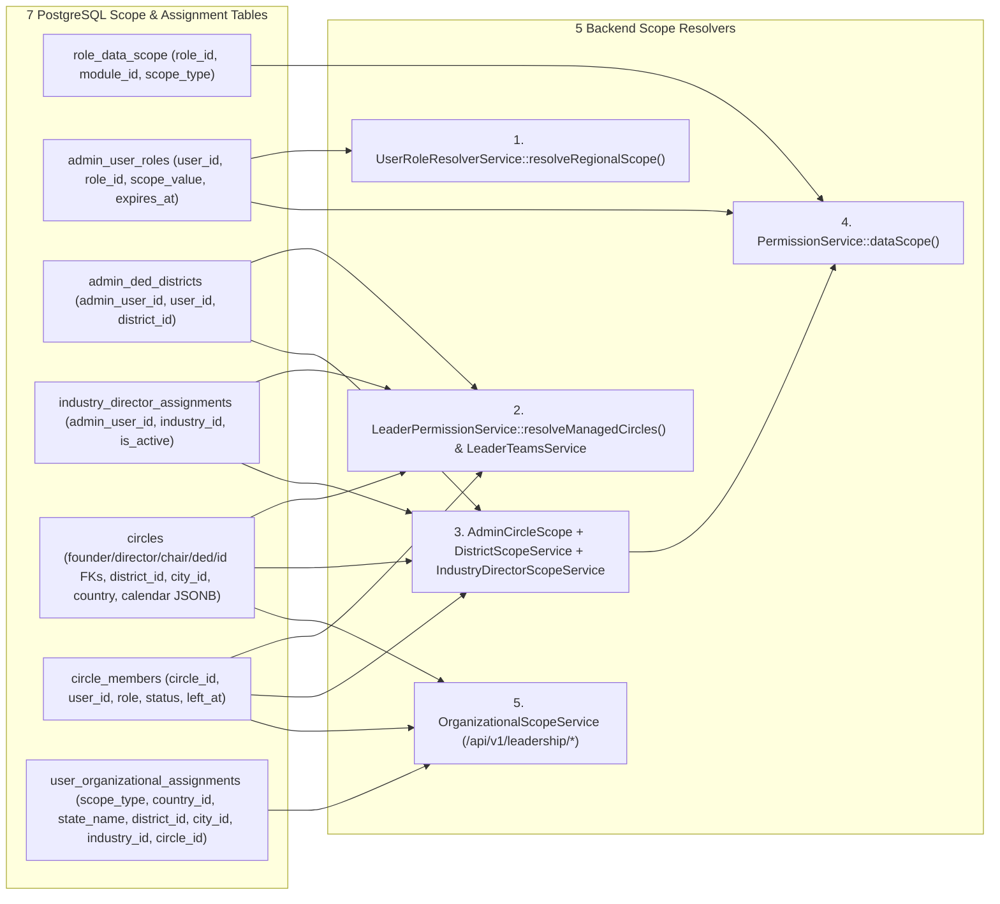

# 09 — Organizational Data Scope Matrix & Multi-Circle Deduplication Architecture

> **Audit Scope:** Complete analysis of all 9 organizational scopes (`Global`, `Country`, `State`, `District`, `Area`, `Industry`, `Circle`, `Multi-Circle`, `Individual/Self`), all 7 scope storage tables, all 5 backend scope resolvers, All-Circles Peer deduplication, and horizontal IDOR vulnerabilities  
> **Overall Status:** `Implemented but Incorrect` (Five diverging scope resolvers, unfiltered `countryDirector` scope, `LIKE '%1%'` industry bug, static `$cachedCircleIds` cross-request cache poisoning, `status != 'rejected'` circle leak, and query-param IDOR bypasses)  
> **Related Deliverables:** [06-complete-role-hierarchy.md](./06-complete-role-hierarchy.md) · [07-role-wise-responsibilities.md](./07-role-wise-responsibilities.md) · [08-master-role-permission-matrix.md](./08-master-role-permission-matrix.md) · [10-role-wise-screen-access.md](./10-role-wise-screen-access.md) · [11-approval-and-delegation-authority.md](./11-approval-and-delegation-authority.md)

---

## 1. Executive Summary & Hard Scope Principles

**FACT:** Organizational data scoping in `unity-app-new` is fragmented across **five separate PHP scope-resolution engines** that read from **seven partially synchronized database tables**. Because each subsystem (`app/Leader/*`, `/api/v1/ded/*`, Web Admin `AdminCircleScope`, Dynamic RBAC `PermissionService`, and Enterprise `OrganizationalScopeService`) implements its own query filters, identical leaders receive different circle and peer sets depending on which endpoint they call.

> [!IMPORTANT]
> **Mandatory Scope & Counting Rules:**
> 1. **Executive Scope Strictly From Assignment:** Territory (`Area`, `District`, `State`, `Country`) and vertical (`Industry`) access must resolve **exclusively** from active assignment records — never inferred from a role's display name.
> 2. **All-Circles Peer Deduplication Rule:** Whenever a leader views KPIs, peer counts, or analytics across multiple Circles (`All Circles` pill or regional/global scope), Peer totals **must** count `COUNT(DISTINCT users.id)` of eligible Peers within the authorized scope — **never** summing per-circle `circle_members` counts, which double-counts multi-circle Peers.
> 3. **Strict Intersection on Filter Params:** Client-supplied `?circle_id`, `?district_id`, `?industry_id`, or `?scope=global` parameters must **always** be intersected (`array_intersect`) with the server-resolved `$scopedCircleIds` — never trusted to widen scope.

---

## 2. Scope Resolution & Storage Architecture Diagram

---

## 3. Inventory of the 7 Scope & Assignment Storage Tables

| # | Table Name | Eloquent Model & Source File | Scope Columns & Constraints | Audit Status & Critical Quirks |
|---:|---|---|---|---|
| 1 | **`role_data_scope`** | [RoleDataScope.php](file:///c:/Users/malic/OneDrive/Documents/GitHub/unity-app-new/app/Models/RoleDataScope.php) ([migration](file:///c:/Users/malic/OneDrive/Documents/GitHub/unity-app-new/database/migrations/2026_08_05_000007_create_role_data_scope_table.php)) | `id` (UUID), `role_id` (FK `roles.id`), `module_id` (nullable FK `admin_modules.id`), `scope_type` (`global`, `country`, `district`, `industry`, `circle`, `own`), `custom_filter` (`jsonb`). Unique `(role_id, module_id)`. | `Partially Implemented` — Omits `state`, `area`, and `multi_circle` from `SCOPE_TYPES`; read by `PermissionService::dataScope()`, ignored by `LeaderPeersService`/`LeaderDashboardService`. |
| 2 | **`admin_user_roles`** | Pivot on `AdminUser` ([migration](file:///c:/Users/malic/OneDrive/Documents/GitHub/unity-app-new/database/migrations/2026_08_07_000001_add_columns_to_admin_user_roles.php)) | `user_id` (`admin_users.id`), `role_id` (`roles.id`), `scope_value` (`varchar(255)`), `assigned_by`, `assigned_at`, `expires_at`, `is_primary` (`bool`), `notes`. | `Implemented but Incorrect` — `scope_value` stores free-text country name (defaulting to `'India'`) rather than FK UUID; `expires_at` is **never checked** at runtime! |
| 3 | **`admin_ded_districts`** | [AdminDedDistrict.php](file:///c:/Users/malic/OneDrive/Documents/GitHub/unity-app-new/app/Models/AdminDedDistrict.php) | `id` (UUID), `admin_user_id`, `user_id`, `district_id` (FK `districts.id`), `assigned_by_admin_id`, `notes`. | `Partially Implemented` — Supports multiple rows per DED in `DistrictScopeService`, **but** `LeaderPermissionService.php:527` calls `.value('district_id')`, truncating multi-district DEDs to 1 district! |
| 4 | **`industry_director_assignments`** | [IndustryDirectorAssignment.php](file:///c:/Users/malic/OneDrive/Documents/GitHub/unity-app-new/app/Models/IndustryDirectorAssignment.php) ([SQL DDL](file:///c:/Users/malic/OneDrive/Documents/GitHub/unity-app-new/database/sql/industry_director_assignments.sql)) | `id` (UUID), `admin_user_id` (`admin_users.id`), `industry_id` (`bigint` FK `circle_categories.id`), `assigned_by`, `is_active` (`bool`). | `Partially Implemented` — Lacks `user_id` column in SQL DDL (`UserRoleResolverService` L153 guards `Schema::hasColumn('user_id')`) and lacks `city_id`/`district_id` for city-sector scoping! |
| 5 | **`circles`** | [Circle.php](file:///c:/Users/malic/OneDrive/Documents/GitHub/unity-app-new/app/Models/Circle.php#L46-L157) | `founder_user_id`, `circle_founder_user_id`, `director_user_id`, `circle_director_user_id`, `industry_director_user_id`, `ded_user_id`, `eed_user_id`, `chair_user_id`, `vice_chair_user_id`, `secretary_user_id`, 3 `*_committee_chair_user_id` cols, `district_id`, `city_id`, `country`, `industry_tags` (`json`), `calendar` (`jsonb`). | `Implemented but Incorrect` — Dual columns (`founder_user_id` vs `circle_founder_user_id`; `director_user_id` vs `circle_director_user_id`) + `calendar.leadership` JSON drift out of sync across controllers. |
| 6 | **`circle_members`** | [CircleMember.php](file:///c:/Users/malic/OneDrive/Documents/GitHub/unity-app-new/app/Models/CircleMember.php#L20-L120) | `id` (UUID), `circle_id`, `user_id`, `role` (`circle_member_role_enum`), `role_id`, `status` (`circle_member_status_enum`), `level_1..4_category_id`, `joined_at`, `left_at`, `deleted_at`. | `Implemented but Incorrect` — Several resolvers forget `status = 'approved'` and `left_at IS NULL`. |
| 7 | **`user_organizational_assignments`** | Read via `Schema::hasTable` in [OrganizationalScopeService.php](file:///c:/Users/malic/OneDrive/Documents/GitHub/unity-app-new/app/Shared/OrganizationalScope/OrganizationalScopeService.php) & [EffectiveAccessResolverService.php](file:///c:/Users/malic/OneDrive/Documents/GitHub/unity-app-new/app/Shared/Authorization/EffectiveAccessResolverService.php) | `user_id`, `admin_user_id`, `role_id`, `scope_type`, `country_id`, `state_name`, `district_id`, `city_id`, `industry_id`, `circle_id`, `committee_key`, `is_primary`, `status`, `starts_at`, `ends_at`. | `Implemented but Not Integrated` — **No migration exists** in `database/migrations/` (alongside `role_scope_policies`, `user_permission_overrides`, `field_permissions`); only consumed by `/api/v1/leadership/*` (APIs 44–50), **not** by `/api/v1/leader/*`! |

---

## 4. Master 9-Scope × 5-Resolver Comparison Matrix

**FACT:** Comparison of how all 9 organizational scopes behave across all 5 backend scope engines:

| # | Scope Level | Resolver 1: `UserRoleResolverService` ([L387-L396](file:///c:/Users/malic/OneDrive/Documents/GitHub/unity-app-new/app/Shared/Services/UserRoleResolverService.php#L387-L396)) | Resolver 2: `LeaderPermissionService::resolveManagedCircles()` ([L509-L586](file:///c:/Users/malic/OneDrive/Documents/GitHub/unity-app-new/app/Leader/Services/LeaderPermissionService.php#L509-L586)) & `LeaderTeamsService` | Resolver 3: `AdminCircleScope` ([L180-L481](file:///c:/Users/malic/OneDrive/Documents/GitHub/unity-app-new/app/Support/AdminCircleScope.php#L180-L481)), `DistrictScopeService` & `IndustryDirectorScopeService` | Resolver 4: `PermissionService::dataScope()` ([L587-L811](file:///c:/Users/malic/OneDrive/Documents/GitHub/unity-app-new/app/Services/Admin/PermissionService.php#L587-L811)) | Resolver 5: `OrganizationalScopeService` ([L1-L683](file:///c:/Users/malic/OneDrive/Documents/GitHub/unity-app-new/app/Shared/OrganizationalScope/OrganizationalScopeService.php)) | Status |
|---:|---|---|---|---|---|---|---|
| 1 | **Global** | `'Global Scope'` (`superAdmin`) | Returns all non-deleted `circles` (`$scopedCircleIds = null` in `LeaderTeamsService`) | `resolveScopedCircleIds()` returns `null` (unrestricted) for `isSuper()` | `DataScopeResult('global', isUnrestricted: true)` | `is_global: true` (`SCOPE_HIERARCHY['global'] = 100`) | `Fully Implemented` |
| 2 | **Country** | `'Country Scope'` (`countryDirector`) | **BUG (L517):** Treated identically to `superAdmin` — **zero country filter!** | **BUG (`AdminAccess.php:20`):** `'eed'` is in `SUPER_ROLE_KEYS`, granting **unrestricted global access**! | Reads `admin_user_roles.scope_value` (fallback `'India'`), filters `circles.country = $country` ([L704-L725](file:///c:/Users/malic/OneDrive/Documents/GitHub/unity-app-new/app/Services/Admin/PermissionService.php#L704-L725)) | Filters `circles.country` / `country_id` (`rank 80`) | `Implemented but Incorrect` |
| 3 | **State** | *Not supported* | *Not supported* | *Not supported* | *Not supported* (`RoleDataScope` omits `state`) | Supported via `state_names` -> `cities.state` / `users.state` (`rank 70`) | `Partially Implemented` |
| 4 | **District** | `'District Scope'` (`districtExecDirector`) | Calls `AdminCircleScope::getDedCircleIds($admin)`, fallback `.value('district_id')` (1 district only!) + `circles.ded_user_id`; `LeaderTeamsService` has `?district_id` IDOR! | `DistrictScopeService` ([L18-L57](file:///c:/Users/malic/OneDrive/Documents/GitHub/unity-app-new/app/Services/Api/Ded/DistrictScopeService.php#L18-L57)) maps `admin_ded_districts.district_id` -> `districts` + `cities` -> `circles` & `users` | Delegates to `AdminCircleScope::getDedCircleIds()` + `DistrictScopeService::applyUsersScope()` ([L728-L742](file:///c:/Users/malic/OneDrive/Documents/GitHub/unity-app-new/app/Services/Admin/PermissionService.php#L728-L742)) | `district_ids` -> `districts` + `cities` -> `circles` & `users` (`rank 60`) | `Implemented but Incorrect` |
| 5 | **Area** | *Not supported* | *Not supported* | *Not supported* | *Not supported* | Defined in `AccessConstants::SCOPE_HIERARCHY` (`area => 50`), mapped via `city_ids` | `Partially Implemented` |
| 6 | **Industry** | `'Industry Scope'` (`industryDirector`) | Uses `assignedIndustryIdsForAdmin()` + `industry_director_user_id` + **BUG (L558):** `industry_tags LIKE "%{$indId}%"` + wrongly checks `chair_user_id`! | `IndustryDirectorScopeService` maps L1 `industry_id` -> L2/L3/L4 `circle_categories` -> `circle_category_mappings`, `industry_tags`, & user category FKs | Delegates to `IndustryDirectorScopeService` ([L745-L756](file:///c:/Users/malic/OneDrive/Documents/GitHub/unity-app-new/app/Services/Admin/PermissionService.php#L745-L756)) | `industry_ids` -> L1–L4 categories & `circle_category_mappings` (`rank 55`) | `Implemented but Incorrect` |
| 7 | **Circle** | `'Own Circle'` (CF, CD, Chairs, VC, SEC) | **BUGS (L564–573):** Omits `vice_chair_user_id`, `secretary_user_id`, committee chair cols & `calendar` JSON; L571 `orWhereHas('members', status != 'rejected')` leaks circles where leader is just a regular/pending member! | `AdminCircleScope::resolveAdminCircles()` checks linked `User` -> `circle_members` (`status = 'approved'`, leader roles) + `founder_user_id`/`director_user_id` | `AdminCircleScope::resolveScopedCircleIds($admin)` ([L759-L779](file:///c:/Users/malic/OneDrive/Documents/GitHub/unity-app-new/app/Services/Admin/PermissionService.php#L759-L779)) | `circle_ids` (`rank 40`) / `committee` (`rank 30`) | `Implemented but Incorrect` |
| 8 | **Multi-Circle** | Returns `'Own Circle'` string even when leader manages `N > 1` circles | Returns `Collection<Circle>` of `N` circles, **but** no per-circle role label is attached (`managed_circles` is flat!) | Returns `string[]` of `N` circle UUIDs (poisoned across requests by static `$cachedCircleIds`!) | Returns `DataScopeResult('circle', circleIds: [...])` | Explicit `multi_circle` (`rank 45`) unioning multiple `circle_ids` | `Requires Enhancement` |
| 9 | **Individual / Self** | `'Own Circle'` (`member`, `is_leader: false`) | Blocked by `EnsureLeaderUser` (`403`) | N/A | Linked `User` by `LOWER(email)` -> `[$user->id]` ([L782-L793](file:///c:/Users/malic/OneDrive/Documents/GitHub/unity-app-new/app/Services/Admin/PermissionService.php#L782-L793)) | `self_only = true` (`[$user->id]`, `rank 10`) | `Fully Implemented` |

---

## 5. Deep Analysis of Scope Bugs, Leaks & Deduplication Rules

### 5.1 Deduplicated All-Circles Peer Rule & Multi-Circle Attribution Bugs
1. **All-Circles Peer Counting (`Partially Implemented`):**
   - **FACT:** In [LeaderDashboardService.php](file:///c:/Users/malic/OneDrive/Documents/GitHub/unity-app-new/app/Leader/Services/LeaderDashboardService.php#L290-L298), `$scopedMemberUserIds` is resolved as a distinct array of `users.id` across `$scopedCircleIds`, so `total_peers` counts deduplicated users.
   - **Risk in Circle Summing:** Any client or report that sums `CircleTeamModel.peersCount` across `Circles & Teams` cards will double-count `multi_circle_peer` / `charter_peer` users who hold seats in 2+ Circles. **RECOMMENDATION:** Backend summary endpoints (`GET /teams/summary`, `GET /dashboard/summary`, `GET /ded/dashboard`) must remain the sole source for aggregate `unique_eligible_peers_count`.
2. **Multi-Circle Primary Circle Display Collapse (`Implemented but Incorrect`):**
   - **FACT:** In `LeaderPeersService::formatPeerCard()` ([L497-L506](file:///c:/Users/malic/OneDrive/Documents/GitHub/unity-app-new/app/Leader/Services/LeaderPeersService.php#L497-L506)), `LeaderPeersService::getPeer()` ([L644-L650](file:///c:/Users/malic/OneDrive/Documents/GitHub/unity-app-new/app/Leader/Services/LeaderPeersService.php#L644-L650)), and `LeaderDashboardService::getTopImpacters()` ([L897-L902](file:///c:/Users/malic/OneDrive/Documents/GitHub/unity-app-new/app/Leader/Services/LeaderDashboardService.php#L897-L902)), a multi-circle Peer is formatted using `$u->circleMembers->first()?->circle` without intersecting `$scopedCircleIds`. A Circle Director of *Circle B* viewing a Peer who joined *Circle A* first sees *Circle A*'s name on the Peer card!
3. **Cross-Circle Revenue Over-Attribution (`Implemented but Incorrect` — Violates Authoritative Finance Rule):**
   - **FACT:** [LeaderFinanceService.php](file:///c:/Users/malic/OneDrive/Documents/GitHub/unity-app-new/app/Leader/Services/LeaderFinanceService.php#L77-L79) filters `payments` via `whereIn('circle_id', $targetCircleIds)->orWhereHas('user.circleMembers', fn($cm) => $cm->whereIn('circle_id', $targetCircleIds))`. If a Peer belongs to Circle A and Circle B (or paid a platform-level Unity fee with `circle_id = NULL`), **100% of their lifetime payments are attributed to Circle A AND again to Circle B**!

### 5.2 Five Verified Backend Scope-Resolver Bugs
1. **`countryDirector` Unfiltered Global Access Bug (`Implemented but Incorrect`):**
   - **FACT:** [LeaderPermissionService.php](file:///c:/Users/malic/OneDrive/Documents/GitHub/unity-app-new/app/Leader/Services/LeaderPermissionService.php#L516-L518) checks `if (in_array($role, ['superAdmin', 'countryDirector'], true)) { return $query->orderBy('name')->get(); }`, and [AdminAccess.php](file:///c:/Users/malic/OneDrive/Documents/GitHub/unity-app-new/app/Support/AdminAccess.php#L20-L23) puts `'eed'` inside `SUPER_ROLE_KEYS`. Country Directors in India, UAE, or USA would each see **all global circles and peers** instead of their assigned country!
2. **Substring `LIKE '%1%'` Industry Tag Bug (`Implemented but Incorrect`):**
   - **FACT:** [LeaderPermissionService.php](file:///c:/Users/malic/OneDrive/Documents/GitHub/unity-app-new/app/Leader/Services/LeaderPermissionService.php#L557-L559) runs `$q->orWhereJsonContains('industry_tags', $indId)->orWhere('industry_tags', 'like', "%{$indId}%");`. For `industry_id = 1`, `LIKE '%1%'` matches `10`, `11`, `12`...`19`, `21`, `31`, and any UUID/text containing digit `1`! Additionally, L553 includes `->orWhere('chair_user_id', $user->id)` inside the `industryDirector` branch.
3. **Static `$cachedCircleIds` Cross-Request Poisoning (`Implemented but Incorrect`):**
   - **FACT:** [AdminCircleScope.php](file:///c:/Users/malic/OneDrive/Documents/GitHub/unity-app-new/app/Support/AdminCircleScope.php#L184) declares `private static ?array $cachedCircleIds = null;` and returns `self::$cachedCircleIds` on lines 192–195 **without keying by `$admin->id`**. In long-lived workers, queue jobs, tests, or multi-admin calls in one PHP lifecycle, Admin B inherits Admin A's scoped circles!
4. **Own-Circle `status != 'rejected'` Member-Circle Escalation Leak (`Implemented but Incorrect`):**
   - **FACT:** [LeaderPermissionService.php](file:///c:/Users/malic/OneDrive/Documents/GitHub/unity-app-new/app/Leader/Services/LeaderPermissionService.php#L564-L573) resolves managed circles for Circle roles using `orWhereHas('members', fn($m) => $m->where('user_id', $user->id)->where('status', '!=', 'rejected'))` **without filtering `circle_members.role` or `status = 'approved'`**. If a leader is a Chair in *Circle A* and merely a regular `member` (or even a `pending` applicant!) in *Circle B*, `resolveManagedCircles()` grants them leadership scope over *Circle B*! Conversely, lines 566–570 omit `vice_chair_user_id`, `secretary_user_id`, all 3 `*_committee_chair_user_id` columns, and `calendar->leadership` JSON.
5. **Multi-Assignment Flattening Gap (`Requires Enhancement`):**
   - **FACT:** `GET /api/v1/leader/auth/me` returns a single collapsed `role`, a static `regional_scope` label, and a flat `managed_circles` list without per-assignment role, geography ID, industry ID, or tenure dates (causing Profile on device to render 44 identical `"Active Leadership Assignment"` rows — [LEADER_APP_ROLE_AND_SCOPE_MATRIX.md](file:///D:/office%20project/LeaderApp-Fornt-end-/documents/audit/LEADER_APP_ROLE_AND_SCOPE_MATRIX.md#L58-L60)).

---

## 6. Endpoint-by-Endpoint Scope Enforcement vs Horizontal IDOR Audit (`/api/v1/leader/*`)

| Endpoint Family | Service Method & File | Scope Enforcement Status | Exact Vulnerability / Behavior (`FACT`) |
|---|---|---|---|
| `GET /dashboard/summary`, `/top-impacters` | [LeaderDashboardService.php](file:///c:/Users/malic/OneDrive/Documents/GitHub/unity-app-new/app/Leader/Services/LeaderDashboardService.php#L47-L270) | `Partially Implemented` | Validates `?circle_id` against `$scopedCircleIds` (L73), **but** treats `countryDirector` as global (L67). |
| `GET /peers` | `LeaderPeersService::listPeers()` ([L288-L330](file:///c:/Users/malic/OneDrive/Documents/GitHub/unity-app-new/app/Leader/Services/LeaderPeersService.php#L288-L330)) | `Implemented but Incorrect` | **CRITICAL IDOR:** `?scope=global` or `?circle_id=all` dumps **all platform users** for any Chair/VC/SEC; `?circle_id=<uuid>` or `?district_id=<uuid>` queries arbitrary circles/districts! |
| `GET /peers/{id}`, `/meetings`, `/activities`, `POST /wishes` | `LeaderPeersService::getPeer()` ([L629](file:///c:/Users/malic/OneDrive/Documents/GitHub/unity-app-new/app/Leader/Services/LeaderPeersService.php#L629)) | `Implemented but Incorrect` | **IDOR:** Zero circle/scope check on `{id}`; exposes unmasked PII of unrelated circles to any CF/CD (`manage_peers`). |
| `GET /peers/celebrations` | `LeaderPeersService::getCelebrations()` ([L812](file:///c:/Users/malic/OneDrive/Documents/GitHub/unity-app-new/app/Leader/Services/LeaderPeersService.php#L812)) | `Fully Implemented` | Properly restricts non-global leaders to `$scopedCircleIds`. |
| `GET|POST|DELETE /leader/members/{member_id}/*` | `LeaderMember360Service::resolveMember()` ([L34-L82](file:///c:/Users/malic/OneDrive/Documents/GitHub/unity-app-new/app/Leader/Services/LeaderMember360Service.php#L34-L82)) | `Fully Implemented` (Scope) / `Bug` (Cap) | Properly returns `403` if `{member_id}` is outside `$scopedCircleIds` (missing `manage_peers` check on post/creative delete). |
| `GET /teams/summary`, `/industries`, `/circles` | [LeaderTeamsService.php](file:///c:/Users/malic/OneDrive/Documents/GitHub/unity-app-new/app/Leader/Services/LeaderTeamsService.php#L28-L102) | `Implemented but Incorrect` | Enforces circle/industry scope, **except** `resolveDedDistrictId()` (L30) trusts raw `?district_id=<uuid>` (**DED District IDOR**). |
| `GET /teams/circles/{id}`, `/peers`, `/sub-industries`, `/events`, `POST /refer-category` | `LeaderTeamsService` ([L1227-L1927](file:///c:/Users/malic/OneDrive/Documents/GitHub/unity-app-new/app/Leader/Services/LeaderTeamsService.php#L1227-L1927)) | `Implemented but Incorrect` | **IDOR:** Zero verification that `{id}` is in `$scopedCircleIds`! |
| `GET /teams/contacts` | `LeaderTeamsService::getUserContacts()` ([L1942-L1947](file:///c:/Users/malic/OneDrive/Documents/GitHub/unity-app-new/app/Leader/Services/LeaderTeamsService.php#L1942-L1947)) | `Implemented but Incorrect` | **CRITICAL LEAK:** Drops `where('user_id', $user->id)` when leader has `0` rows, returning up to 500 global `contact_posts`! |
| `GET /activities`, `/export`, `/impacts` | `LeaderActivitiesService::resolveActivityScope()` ([L270](file:///c:/Users/malic/OneDrive/Documents/GitHub/unity-app-new/app/Leader/Services/LeaderActivitiesService.php#L270)) | `Partially Implemented` | Scoped on list/export; **IDOR** on `GET /activities/{type}/{id}` (`showDetail` L2485) and unscoped target peer on `POST /p2p-meetings` & `/referrals`. |
| `GET /ask-flows*` | [LeaderAskFlowService.php](file:///c:/Users/malic/OneDrive/Documents/GitHub/unity-app-new/app/Leader/Services/LeaderAskFlowService.php#L73-L481) | `Implemented but Incorrect` | **Global Data Leak:** Zero `$user` or circle/district/industry filtering — returns all platform `asks`. |
| `GET /finance/summary`, `/transactions` | [LeaderFinanceService.php](file:///c:/Users/malic/OneDrive/Documents/GitHub/unity-app-new/app/Leader/Services/LeaderFinanceService.php#L67-L343) | `Implemented but Incorrect` | **IDOR** on `?circle_id=<uuid>`; unscoped global sum on `circle_budget` when `circle_id` omitted (L339); global `active_tenures` leak when `$targetCircleIds` is empty (L319). |
| `GET /reports`, `POST /reports/submit`, `GET /reports/{id}/file` | [LeaderReportsService.php](file:///c:/Users/malic/OneDrive/Documents/GitHub/unity-app-new/app/Leader/Services/LeaderReportsService.php#L48-L445) | `Implemented but Incorrect` | **IDOR** on `?circle_id=<uuid>` (L48), unverified `circle_id` on `submit` (L118), omitted `$user` on `renderReportPdf` (L393), and unauthenticated `/api/v1/files/{id}/download`! |
| `GET|POST /leader/pending-requests*` | [PendingRequestAdminController.php](file:///c:/Users/malic/OneDrive/Documents/GitHub/unity-app-new/app/Http/Controllers/Api/Admin/PendingRequestAdminController.php#L1367-L1606) | `Fully Implemented` | Enforces `resolveLeaderScope()`, `filterResultsByLeaderScope()`, and `denyIfOutsideLeaderScope()`. |

---

## 7. Minimum-Change Consolidation Recommendations

1. **RECOMMENDATION (Single Authoritative Scope Service):** Centralize scope calculation into one shared method (`OrganizationalScopeService::resolveForUser(User|AdminUser $actor)`) consumed by `LeaderPermissionService`, `LeaderTeamsService`, `LeaderDashboardService`, `LeaderPeersService`, `LeaderFinanceService`, `LeaderReportsService`, `LeaderAskFlowService`, and `AdminCircleScope` (keying `$cachedCircleIds[(string) $admin->id]`).
2. **RECOMMENDATION (Enforce Country, Multi-District & Leader-Role Circle Filters):**
   - Remove `'eed'` from `AdminAccess::SUPER_ROLE_KEYS` and filter `countryDirector` by assigned `country` / `country_id`.
   - Replace `.value('district_id')` in `LeaderPermissionService.php:527` with `->pluck('district_id')->all()`.
   - Remove `LIKE "%{$indId}%"` on `industry_tags` (`L558`), using `circle_category_mappings` and JSON array containment only.
   - Restrict Circle-role managed circles (`L564-L573`) to approved leadership rows (`status = 'approved'`, `left_at IS NULL`, `role IN ('founder','director','chair','vice_chair','secretary','committee_leader')`) plus all direct leader FK columns and `calendar->leadership`.
3. **RECOMMENDATION (Return Structured `assignments[]` Payload on `/leader/auth/me`):** Return `assignments: [{ assignment_id, role_key, role_label, scope_type, scope_id, scope_name, breadcrumb, starts_at, ends_at, is_primary }]` so multi-role / multi-circle / multi-district executives can switch active context cleanly without conflating permissions across assignments.
