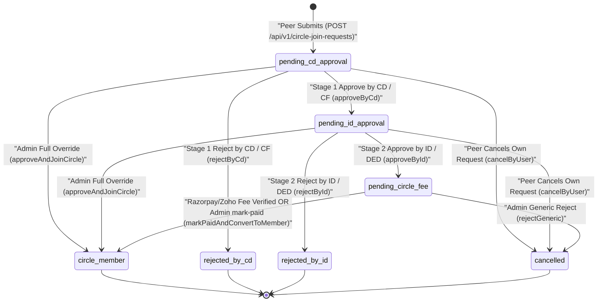
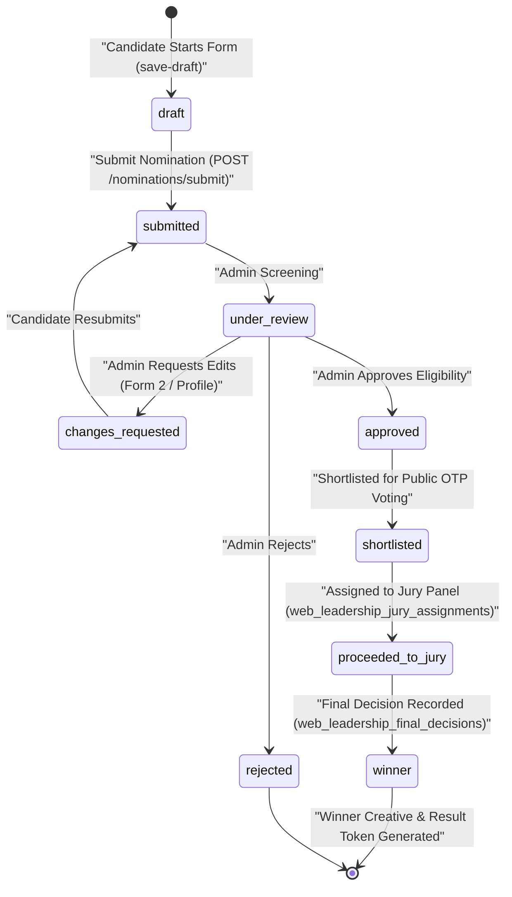
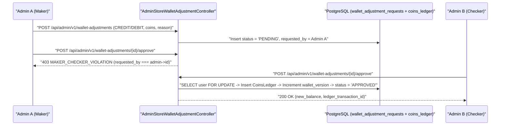

# 11 — Approval, Multi-Stage Moderation, Maker-Checker & Delegation Authority

> **Audit Scope:** Complete state-machine, authority, and lifecycle reference for Circle Join Requests, Build Your Own Circle, Unified Pending Requests (10 Admin/Leader categories & 5 DED categories), In-App Leader Interest vs Website Leadership Elections (`web_leadership_*`), Store Wallet Maker-Checker, Tenure Bonus Approvals, `WorkflowApprovalRule`, Delegation, Escalation, and Role Tenure Expiry  
> **Overall Status:** `Partially Implemented` (Core multi-stage Circle Join and Maker-Checker state machines work; `WorkflowApprovalRule` is unwired at runtime, role `expires_at` is never enforced, `/api/v1/admin/*` & `/api/v1/leadership/admin/*` lack role guards, and delegation/escalation engines are `Missing`)  
> **Related Deliverables:** [06-complete-role-hierarchy.md](./06-complete-role-hierarchy.md) · [07-role-wise-responsibilities.md](./07-role-wise-responsibilities.md) · [08-master-role-permission-matrix.md](./08-master-role-permission-matrix.md) · [09-organizational-data-scope-matrix.md](./09-organizational-data-scope-matrix.md) · [10-role-wise-screen-access.md](./10-role-wise-screen-access.md)

---

## 1. Workflow 1 — Circle Join Requests (`circle_join_requests`)

**FACT:** Managed by [CircleJoinRequestService.php](file:///c:/Users/malic/OneDrive/Documents/GitHub/unity-app-new/app/Services/Circles/CircleJoinRequestService.php#L29-L623), [CircleJoinRequestAdminController.php](file:///c:/Users/malic/OneDrive/Documents/GitHub/unity-app-new/app/Http/Controllers/Api/V1/Admin/CircleJoinRequestAdminController.php), [PendingRequestAdminController.php](file:///c:/Users/malic/OneDrive/Documents/GitHub/unity-app-new/app/Http/Controllers/Api/Admin/PendingRequestAdminController.php#L1607-L1755), and [DedPendingRequestsController.php](file:///c:/Users/malic/OneDrive/Documents/GitHub/unity-app-new/app/Http/Controllers/Api/V1/Ded/DedPendingRequestsController.php).

### 1.1 State Machine Diagram

### 1.2 Stage-by-Stage Authority & Column Transitions

| Stage / Transition | Required Current `status` | Authorized Roles | Method & Endpoint(s) | Exact DB Updates & Side Effects (`FACT`) |
|---|---|---|---|---|
| **0. Submission** | None (or re-uses active) | Any authenticated `User` not already `approved` in Circle | `POST /api/v1/circle-join-requests` (`submitRequest` [L29-L102](file:///c:/Users/malic/OneDrive/Documents/GitHub/unity-app-new/app/Services/Circles/CircleJoinRequestService.php#L29-L102)) | Sets `status = 'pending_cd_approval'`, resolves L1–L4 category hierarchy. **BUG (L99):** Submission notification to CD/CF is **intentionally commented out**! |
| **1. Stage-1 Circle Clearance** | `pending_cd_approval` | `circleDirector`, `circleFounder` (own Circle), `countryDirector`, `superAdmin` | `POST /api/v1/leader/pending-requests/circle_joining_requests/{id}/approve`, `POST /api/v1/admin/circle-join-requests/{id}/cd-approve` (`approveByCd` [L152-L199](file:///c:/Users/malic/OneDrive/Documents/GitHub/unity-app-new/app/Services/Circles/CircleJoinRequestService.php#L152-L199)) | Sets `status = 'pending_id_approval'`, `cd_approved_by`, `cd_approved_at`; sends `sendCdApprovedToUser` + congratulations notification. (`rejectByCd` sets `rejected_by_cd`, `cd_rejected_by`, `cd_rejection_reason`.) |
| **2. Stage-2 Industry / DED Clearance** | `pending_id_approval` | `industryDirector` (assigned category/circle), `districtExecDirector` (assigned district), `countryDirector`, `superAdmin` | `POST /api/v1/leader/pending-requests/circle_joining_requests/{id}/approve` (filtered to `pending_id_approval` for ID/DED at [L1625](file:///c:/Users/malic/OneDrive/Documents/GitHub/unity-app-new/app/Http/Controllers/Api/Admin/PendingRequestAdminController.php#L1625)), `POST .../id-approve`, `POST /api/v1/ded/pending-requests/circle-joining-requests/{id}/ded-approve` | `approveById` ([L227-L274](file:///c:/Users/malic/OneDrive/Documents/GitHub/unity-app-new/app/Services/Circles/CircleJoinRequestService.php#L227-L274)) sets `status = 'pending_circle_fee'`, `id_approved_by`, `id_approved_at` (can also assign `circle_id` if previously category-only!). DED endpoint updates `ded_approval_status = 'approved'`, `ded_approved_by`, `ded_approved_at`. |
| **3. Circle Fee Payment & Enrollment** | `pending_circle_fee` | Applicant `User` (checkout) OR `superAdmin` (`mark-paid`) | `POST /api/v1/circle-join-requests/{id}/payment/verify` (`CircleJoinPaymentService`), `PATCH /api/v1/admin/circle-join-requests/{id}/mark-paid` (`markPaidAndConvertToMember` [L340-L390](file:///c:/Users/malic/OneDrive/Documents/GitHub/unity-app-new/app/Services/Circles/CircleJoinRequestService.php#L340-L390)) | Creates/restores `circle_members` (`status = 'approved'`, `role = 'member'`), sets `status = 'circle_member'` (or `'paid'`), `fee_marked_at`, `fee_paid_at`, syncs `circle_member_category_selections` & `joined_circle_categories`. |
| **4. Single-Step Full Admin Override** | `pending_cd_approval`, `pending_id_approval`, or `pending_circle_fee` | `superAdmin` / Web Admin | `approveAndJoinCircle()` ([L392-L552](file:///c:/Users/malic/OneDrive/Documents/GitHub/unity-app-new/app/Services/Circles/CircleJoinRequestService.php#L392-L552)) | Fills `cd_approved_*`, `id_approved_*`, `ded_approval_status = 'approved'`, `fee_paid_at`, creates `circle_members` (`status = 'approved'`), and sets `users.active_circle_id` in one DB transaction. |

---

## 2. Workflow 2 — Build Your Own Circle (`user_circle_requests`)

**FACT:** Handled by [UserCircleRequestController.php](file:///c:/Users/malic/OneDrive/Documents/GitHub/unity-app-new/app/Http/Controllers/Api/UserCircleRequestController.php), [UserCircleRequestAdminController.php](file:///c:/Users/malic/OneDrive/Documents/GitHub/unity-app-new/app/Http/Controllers/Api/V1/Admin/UserCircleRequestAdminController.php), and [BuildYourOwnCircleApprovalService.php](file:///c:/Users/malic/OneDrive/Documents/GitHub/unity-app-new/app/Services/Circles/BuildYourOwnCircleApprovalService.php#L35-L176).

- **Statuses on `user_circle_requests`:** `pending` -> `under_review` -> `approved` | `rejected` | `cancelled` (with minimum nominee count configurable via `PUT /api/v1/admin/user-circle-requests/config/minimum-nominees` stored alongside `user_circle_request_nominees`).
- **Automated Provisioning on `POST /api/v1/admin/user-circle-requests/{id}/approve`:**
  1. Generates unique `circles.slug`, resolves `city_id`, sets `founder_user_id = $circleRequest->user_id`, `circle_founder_user_id = $founderId`, `status = 'active'`, `calendar.leadership`, and syncs Level-1 `circle_categories` + `industry_tags`.
  2. Adds applicant as `circle_members` Founder (`addFounderMember`), optionally attaches `ded_user_id` and `industry_director_user_id`, runs `Circle::syncLeadershipFromMembers($circle->id)`, sets `created_circle_id`, and updates founder's `active_circle_id`.
  3. Nominees in `user_circle_request_nominees` remain strictly as recommended nominees (not auto-enrolled without consent/payment).
- **Verified Code Bugs (`Implemented but Incorrect`):**
  1. **Undefined Variable Bug ([BuildYourOwnCircleApprovalService.php](file:///c:/Users/malic/OneDrive/Documents/GitHub/unity-app-new/app/Services/Circles/BuildYourOwnCircleApprovalService.php#L139-L140)):** Method parameter is `$circleRequest`, yet lines 139–140 read `$request->founder_category_id` and `$request->founder_subcategory_id` (`Undefined variable $request`)!
  2. **PostgreSQL Enum Bug ([L145, L150](file:///c:/Users/malic/OneDrive/Documents/GitHub/unity-app-new/app/Services/Circles/BuildYourOwnCircleApprovalService.php#L145)):** Calls `$this->addLeaderMember($circle->id, $dedUserId, 'ded')` and `'industry_director'`, neither of which is in `circle_member_role_enum`!
  3. **Missing Admin Guard:** `/api/v1/admin/user-circle-requests/*` sits inside the under-protected `/api/v1/admin/*` group (`['auth:sanctum', 'unity.user']`).

---

## 3. Workflow 3 — Unified Pending Requests Moderation Queues

### 3.1 `PendingRequestAdminController` — All 10 Categories (`/api/v1/admin/pending-requests/*` & `/api/v1/leader/pending-requests/*`)

**FACT:** [PendingRequestAdminController.php](file:///c:/Users/malic/OneDrive/Documents/GitHub/unity-app-new/app/Http/Controllers/Api/Admin/PendingRequestAdminController.php#L38-L165) aggregates **10 moderation categories**, broadcasting `PendingRequestChangedEvent` on approve/reject. On `/leader/pending-requests/*`, `resolveLeaderScope()` ([L1367-L1432](file:///c:/Users/malic/OneDrive/Documents/GitHub/unity-app-new/app/Http/Controllers/Api/Admin/PendingRequestAdminController.php#L1367-L1432)) restricts moderation strictly to `superAdmin`, `countryDirector`, `districtExecDirector`, `circleDirector`, `circleFounder`, and `industryDirector` (returning `403` to Chairs, Vice Chairs, and Secretaries):

| # | Category Key | Underlying Table(s) | Approval Handler & Side Effects | Audit Status & Quirks |
|---:|---|---|---|---|
| 1 | `circle_joining_requests` | `circle_join_requests` | Delegates to `CircleJoinRequestService` (`approveByCd` for CD/CF; `approveById` for ID/DED; full override for Admin). | `Fully Implemented` (Stage-filtered at [L1624-L1629](file:///c:/Users/malic/OneDrive/Documents/GitHub/unity-app-new/app/Http/Controllers/Api/Admin/PendingRequestAdminController.php#L1624-L1629)). |
| 2 | `visitor_registrations` | `visitor_registrations` | Marks `status = 'approved'` (awards coins in `DedPendingRequestsController` / `VisitorRegistrationsController`). | `Partially Implemented` (Generic `processApproval` in `PendingRequestAdminController` updates `status` directly without invoking coin award!). |
| 3 | `coin_claims` | `coin_claims` (list) vs `coin_claim_requests` (approve) | Updates `status = 'approved'` / `'rejected'`. | `Implemented but Incorrect` — `fetchCoinClaims()` ([L1834](file:///c:/Users/malic/OneDrive/Documents/GitHub/unity-app-new/app/Http/Controllers/Api/Admin/PendingRequestAdminController.php#L1834)) checks `Schema::hasTable('coin_claims')`, whereas the actual model `CoinClaimRequest` uses `coin_claim_requests`, AND generic `processApproval` does not credit `coins_ledger`! |
| 4 | `certifications` | `certification_submissions` (plus legacy fallbacks) | `approveCertificationSubmission()` generates PDF via `CertificateGeneratorService` + sends certificate email. | `Fully Implemented` |
| 5 | `pending_impacts` | `impacts` | Delegates to `ImpactService::approveImpact()` / `rejectImpact()` (credits `life_impact_histories`, `users.life_impacted_count`, coins, timeline post, push alert). | `Fully Implemented` |
| 6 | `ad_booking_requests` | `ad_bookings` | Generic `status = 'approved'` / `'rejected'`. | `Requires Enhancement` — Should be HQ Admin/Marketing only, not shown to Circle leaders when applicant email matches circle! |
| 7 | `account_deletion_requests` | `account_deletion_requests` (+ `account_deletion_emails` in summary) | Generic `status = 'approved'` / `'rejected'`. | `Requires Enhancement` — Compliance/HQ Super Admin action; should be excluded from Circle leader queues! |
| 8 | `event_joining_requests` | `event_registration_requests` / `event_joining_requests` / `event_registrations` | Marks `status = 'approved'`. | `Implemented but Incorrect` — `denyIfOutsideLeaderScope()` ([L1582-L1605](file:///c:/Users/malic/OneDrive/Documents/GitHub/unity-app-new/app/Http/Controllers/Api/Admin/PendingRequestAdminController.php#L1582-L1605)) **only** checks scope on `circle_join_requests` and returns `null` (allow!) for IDs in all other 9 tables! |
| 9 | `circle_peer_referrals` | `circle_peer_referrals` + `peer_referrals` + `peer_recommendations` + `referrals` | Marks `status = 'approved'` (or updates `referrals.status_id`). | `Implemented but Incorrect` — Concatenating normal P2P `referrals` into pending moderation conflates peer-to-peer leads with open-category nominations! |
| 10 | `introduction_requests` | `introduction_requests` | Marks `status = 'approved'` / `'rejected'`. | `Partially Implemented` (Generic DB update skips `IntroductionRequestsController` introducer-linking logic). |

### 3.2 `DedPendingRequestsController` — All 5 DED Categories (`/api/v1/ded/pending-requests/*`)

**FACT:** Guarded by `['auth:sanctum', 'ensure.ded.api']` (`AdminUser` with `ded` role + assigned district), [DedPendingRequestsController.php](file:///c:/Users/malic/OneDrive/Documents/GitHub/unity-app-new/app/Http/Controllers/Api/V1/Ded/DedPendingRequestsController.php) -> `DedApiService` enforces district scoping across **5 categories**:
1. `visitor-registrations` (`GET`, `POST /{id}/approve` [awards coins], `POST /{id}/reject`)
2. `event-joining-requests` (`GET`, `POST /{id}/approve`, `POST /{id}/reject`)
3. `coin-claims` (`GET`, `POST /{id}/approve` [credits `coins_ledger`], `POST /{id}/reject`)
4. `circle-joining-requests` (`GET`, `POST /{id}/approve`, `POST /{id}/ded-approve`, `POST /{id}/reject`)
5. `pending-impacts` (`GET`, `POST /{id}/approve` [`ImpactService`], `POST /{id}/reject`)

---

## 4. Workflow 4 — In-App Leadership Interest vs Website Leadership Elections (`web_leadership_*`)

### 4.1 In-App "Become a Leader" Form (`leader_interest_submissions`) — `Implemented but Incorrect`
- **Submission:** `POST /api/v1/forms/leader-interest` ([LeaderInterestController.php](file:///c:/Users/malic/OneDrive/Documents/GitHub/unity-app-new/app/Http/Controllers/Api/V1/Forms/LeaderInterestController.php#L18-L62)) inserts into `leader_interest_submissions` (`applying_for`: `self`|`other`, `leadership_roles` array) and dispatches `BecomeLeaderSubmittedMail` + `BecomeLeaderAdminNotificationMail`.
- **Admin Review Bugs:** `PATCH /api/v1/admin/leadership/applications/{id}/approve` and `/reject` ([LeadershipController.php](file:///c:/Users/malic/OneDrive/Documents/GitHub/unity-app-new/app/Http/Controllers/Api/V1/Admin/LeadershipController.php#L35-L61)) write `status`, `admin_remarks`, `reviewed_by`, `reviewed_at` (columns absent from baseline `LeaderInterestSubmission::$fillable`), **do not provision any role assignment**, and lack `admin.role` middleware. Meanwhile `POST /api/v1/admin/leadership/assignments` (`L63-88`) and `DELETE .../assignments/{id}` (`L110-120`) crash PostgreSQL by writing invalid `circle_member_role_enum` (`circle_founder`, `ded`, `id`) and `circle_member_status_enum` (`inactive`) literals!

### 4.2 Website Leadership Election Portal (`23` `web_leadership_*` Tables) — `Partially Implemented`
**FACT:** Mounted in [routes/leadership.php](file:///c:/Users/malic/OneDrive/Documents/GitHub/unity-app-new/routes/leadership.php#L42-L303) over 23 pre-existing `web_leadership_*` tables:

- **Security Gaps (`Implemented but Incorrect`):**
  1. `/api/v1/leadership/admin/*` ([routes/leadership.php](file:///c:/Users/malic/OneDrive/Documents/GitHub/unity-app-new/routes/leadership.php#L155-L303)) only checks `['web', 'admin.auth']` with **zero role checks** (and `EnsureAdminAuthenticated` auto-creates `AdminUser` for any mobile user, exposing `DELETE /nominations/bulk` with `delete_all: true`!).
  2. Jury OTP (`JuryWebController.php:180`) and Candidate Result OTP (`VerificationService.php:380`) accept hardcoded master OTP `'123456'` in production.
  3. **Disconnect from RBAC:** Recording a `winner` in `web_leadership_final_decisions` generates celebratory creatives (`web_leadership_winner_creatives`) **without** automatically syncing the won role into `circles`, `circle_members`, `admin_user_roles`, or `finance_leader_tenures`!

---

## 5. Workflow 5 — Store Wallet Maker-Checker & Leader Tenure Bonus Approvals

### 5.1 Store Coin Wallet Maker-Checker (`wallet_adjustment_requests`) — `Fully Implemented`
**FACT:** [AdminStoreWalletAdjustmentController.php](file:///c:/Users/malic/OneDrive/Documents/GitHub/unity-app-new/app/Http/Controllers/Api/V1/Admin/Store/AdminStoreWalletAdjustmentController.php#L32-L138) implements strict two-person financial governance:

### 5.2 Leader Tenure Bonus Approvals (`finance_leader_bonus_awards`) — `Partially Implemented`
- **FACT:** Defined in [2026_11_02_151500_create_finance_leader_bonus_tables.php](file:///c:/Users/malic/OneDrive/Documents/GitHub/unity-app-new/database/migrations/2026_11_02_151500_create_finance_leader_bonus_tables.php#L68-L99) with `status` values: `in_progress` -> `pending_approval` -> `credited` | `expired` | `rejected`.
- Out of 21 seeded rules across `CD`, `CF`, `ID`, and `DED`, 19 have `requires_approval = false` (auto-eligible upon hitting metric threshold), while **2 qualitative rules require explicit Super Admin approval (`requires_approval = true`)**: `QUALITY_ZERO_DISPUTES_12M` (₹10,000) and `CF_CULTURE_LEGACY_6M` (₹25,000).

---

## 6. `WorkflowApprovalRule`, Delegation, Escalation & Tenure Expiry Audit

### 6.1 `WorkflowApprovalRule` (`workflow_approval_rules`) — `Implemented but Not Integrated`
- **FACT:** Model [WorkflowApprovalRule.php](file:///c:/Users/malic/OneDrive/Documents/GitHub/unity-app-new/app/Models/WorkflowApprovalRule.php#L12-L56) (`module_id`, `workflow_name`, `approver_role_id`, `step_order`, `is_active`) and CRUD endpoints (`/api/v1/admin/rbac/workflow-rules`) exist, **but zero runtime controllers or services ever query `workflow_approval_rules`**. All approval logic is hardcoded in domain services (`CircleJoinRequestService`, `ImpactService`, `PendingRequestAdminController`).

### 6.2 Delegation, Acting Roles, Reassignment & Escalation — `Missing`
- **Delegation / Acting Authority (`Missing`):** No table, column, or UI exists for a Circle Director, DED, or Industry Director on leave to delegate temporary approval authority to a Circle Founder, Vice Chair, or peer DED with start/end timestamps.
- **Queue Reassignment (`Missing` on Approvals):** Pending approval tables (`circle_join_requests`, `impacts`, `visitor_registrations`, `coin_claim_requests`, `certification_submissions`) lack an `assigned_to` column; manual assignment exists **only** on `support_tickets.assigned_to` and `web_leadership_jury_assignments`.
- **SLA & Automated Escalation (`Missing`):** None of the 25 scheduled cron commands in `routes/console.php` monitor aging `pending_cd_approval` or `pending_id_approval` requests or escalate unactioned items up the hierarchy (`CD -> DED/ID -> Country Director -> Super Admin`).

### 6.3 Role Lifespan & Tenure Expiry (`admin_user_roles.expires_at` & `finance_leader_tenures`) — `Implemented but Incorrect`
- **FACT:**
  1. `roles` defines `lifespan_months`, `term_duration_days`, `grace_period_days`, `auto_expire`, and `renewable` ([Role.php](file:///c:/Users/malic/OneDrive/Documents/GitHub/unity-app-new/app/Models/Role.php#L17-L60)).
  2. `admin_user_roles` stores `expires_at` ([migration](file:///c:/Users/malic/OneDrive/Documents/GitHub/unity-app-new/database/migrations/2026_08_07_000001_add_columns_to_admin_user_roles.php)), and [RoleLifespanController.php](file:///c:/Users/malic/OneDrive/Documents/GitHub/unity-app-new/app/Http/Controllers/Admin/Rbac/RoleLifespanController.php#L89-L185) reconstructs assignment durations from `admin_audit_logs`.
  3. `finance_leader_tenures` tracks commercial bonus tenures (`is_active`, `role_code`: `CF`, `CD`, `DED`, `ID`).
- **Critical Enforcement Gap (`Implemented but Incorrect`):** **Neither `UserRoleResolverService`, `AdminAccess`, `PermissionService`, nor `EnsureLeaderUser` checks `admin_user_roles.expires_at > now()` or `user_organizational_assignments.ends_at`**, and **none** of the 25 active cron jobs in `routes/console.php` expire leadership roles (unlike `memberships:expire` for member plans). Expired leaders retain full Leader App and Web Admin access indefinitely!

---

## 7. Minimum-Change Remediation Recommendations

1. **RECOMMENDATION (Enforce Scope & Service Delegation Across All 10 Pending Categories):** Update `PendingRequestAdminController::denyIfOutsideLeaderScope()` to verify circle/district ownership on **all 10 categories** (not just `circle_join_requests`), route `coin_claims` and `visitor_registrations` through `CoinsService` / `PendingRequestModerationService` so approvals actually credit coins, and remove HQ-only `ad_booking_requests` & `account_deletion_requests` from non-admin leader queues.
2. **RECOMMENDATION (Re-enable Join Request Notifications & Fix Build-Circle Bugs):** Restore `LeaderNotificationDispatcherService` dispatch in `CircleJoinRequestService::submitRequest()`, fix `$request->founder_category_id` -> `$circleRequest->founder_category_id` in `BuildYourOwnCircleApprovalService.php:139`, and stop writing `'ded'`/`'industry_director'` into `circle_members.role`.
3. **RECOMMENDATION (Enforce Tenure Expiry & Lightweight Acting Delegation):** Filter `WHERE (expires_at IS NULL OR expires_at > NOW())` in `UserRoleResolverService` and `PermissionService`, add a daily `leadership:expire-tenures` scheduler command with 30/7/1-day renewal reminders, and support time-bounded acting delegation via `user_organizational_assignments` (`delegated_from_user_id`, `starts_at`, `ends_at`).
