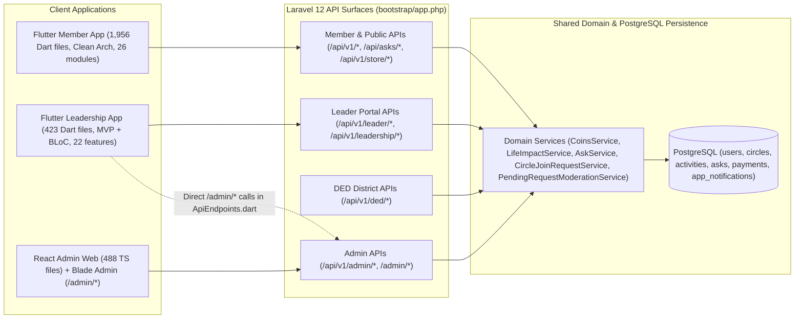

# 12 — Master 35 Activities Index & Architectural Synthesis

> **Document Scope:** Canonical cross-cutting index of all **35 Platform Activities** defined in `PEERS UNITY — MASTER ACTIVITY & ARCHITECTURE DIRECTORY.xlsx`, mapped side-by-side against the verified Laravel 12 backend (`unity-app-new`), Flutter Member App (`peers-unity/unity_app`), Flutter Leadership App (`LeaderApp-Fornt-end-`), and React Admin Web (`unity-admin-web`).
>
> **Related Audit Documents:** [README.md](./README.md) · [13-activity-input-forms-and-validation.md](./13-activity-input-forms-and-validation.md) · [14-activity-sub-activity-catalogue.md](./14-activity-sub-activity-catalogue.md) · [15-activity-database-and-metrics-mapping.md](./15-activity-database-and-metrics-mapping.md) · [16-activity-api-and-backend-mapping.md](./16-activity-api-and-backend-mapping.md) · [17-activity-output-and-deliverables.md](./17-activity-output-and-deliverables.md) · [18-activity-lifecycle-and-status-reference.md](./18-activity-lifecycle-and-status-reference.md) · [19-activity-to-role-access-matrix.md](./19-activity-to-role-access-matrix.md)

---

## 1. Executive Synthesis: Workbook Conceptual Architecture vs. Production Code Reality

### 1.1 Workbook Structure & Internal Count Discrepancy
- **WORKBOOK REQUIREMENT:** `PEERS UNITY — MASTER ACTIVITY & ARCHITECTURE DIRECTORY.xlsx` organizes the Peers Global ecosystem into **35 canonical activities** across three aligned sheets:
  1. `Peers Activity (Side-by-Side)` — reports `35` Total Platform Features, `32` Form Submission Modules, `35` Tracked DB Metrics, and `35` Mobile Screens Mapped.
  2. `Non-Tech Activity Guide` — reports `35` Total Member Actions and `33` Form-Based Actions.
  3. `Technical Architecture Specs` — reports `35` Dart Screen Modules and `35` Database Schemas.
- **FACT:** In actual source code, **29 of the 35 activities** accept direct user form/action mutations (including toggles/blocks), whereas **6 activities** (`#22` automatic impact aggregation path, `#28 Badges Earned`, `#33 Who Viewed My Profile`, `#34` audit timestamp view, `#35 Last Month Activity Summary`, plus automatic coin credits in `#23`) are derived, background-captured, or system-awarded — though `#22` (`POST /api/v1/impacts`) and `#23` (`POST /api/v1/coin-claims`) also include explicit member submission forms!

### 1.2 Conceptual Microservice Names vs. Actual Laravel 12 + PostgreSQL Monolith
- **WORKBOOK REQUIREMENT:** Sheet 1 (`Col 14`) and Sheet 3 (`Col 9`) describe cloud/microservice-styled components such as `PdfGeneratorLambda`, `ElasticSearchIndexer`, `CollabRoomSocketService`, `HlsVideoTranscoder`, `VideoStreamingCdnWorker`, `DynamicLinkResolver`, `SlackAlertWebhook`, and camelCase NoSQL-like metric keys (`dealsGiven`, `iCanHelpWith (String[])`, `unlockedBadgesArray`).
- **FACT:** The production backend in `c:\Users\malic\OneDrive\Documents\GitHub\unity-app-new` is a unified **PHP 8.2 / Laravel 12** application backed by **PostgreSQL** (`snake_case` relational tables + `jsonb` columns), **Laravel Sanctum** bearer/admin auth, **DomPDF** (`CertificateGeneratorService`, `LeaderReportPdfGenerator`), **PostgreSQL `ILIKE` + JSON queries** (no Elasticsearch cluster), **direct file uploads** via [FileUploadService.php](file:///c:/Users/malic/OneDrive/Documents/GitHub/unity-app-new/app/Services/Media/FileUploadService.php) (no HLS transcoder), **Firebase Cloud Messaging HTTP v1** ([FcmService.php](file:///c:/Users/malic/OneDrive/Documents/GitHub/unity-app-new/app/Services/Firebase/FcmService.php) — **zero Firestore** across all 4 repositories), and **Meta WhatsApp Cloud API v22.0 + webhook relay** ([WhatsappNotificationService.php](file:///c:/Users/malic/OneDrive/Documents/GitHub/unity-app-new/app/Services/Notifications/WhatsappNotificationService.php)).
- **RECOMMENDATION:** Preserve the existing Laravel 12 + PostgreSQL + Sanctum architecture (`Enhance, Never Duplicate` rule). Map workbook conceptual service names as logical responsibilities fulfilled by Laravel Services, Jobs, and Scheduled Commands rather than introducing AWS Lambda, Elasticsearch, or Firestore.

### 1.3 Cross-Application Architecture Reality (Member App vs. Leader App vs. Admin Web)

- **FACT (Member App):** Implements all 35 consumer-facing flows across 26 Clean Architecture feature folders in [api_endpoints.dart](file:///D:/office%20project/peers-unity/unity_app/lib/core/constants/api_endpoints.dart) and [store_api_endpoints.dart](file:///D:/office%20project/peers-unity/unity_app/lib/core/constants/store_api_endpoints.dart).
- **FACT (Leadership App):** Implements an MVP + BLoC governance shell ([api_endpoints.dart](file:///D:/office%20project/LeaderApp-Fornt-end-/lib/core/constants/api_endpoints.dart)) with Dashboard, Peers Directory, Member 360° drilldowns, Teams/Circles, Activity feeds (`leader_activities`, `member_activities`, `business_deals`, `p2p_meetings`, `referrals`, `testimonials`, `impacts`, `requirements`, `peers_by_coins`), Finance, Reports, Circulars, Notifications, and Role Matrix. However:
  1. Several UI components are **Implemented but Not Integrated** (e.g., [create_business_deal_bottom_sheet.dart](file:///D:/office%20project/LeaderApp-Fornt-end-/lib/features/business_deals/view/widgets/create_business_deal_bottom_sheet.dart) exists on disk while backend `POST /api/v1/leader/business-deals` exists, `[publish_circular_bottom_sheet.dart](file:///D:/office%20project/LeaderApp-Fornt-end-/lib/features/circulars/view/widgets/publish_circular_bottom_sheet.dart)` targets `/circulars/publish` which is unrouted because [LeaderCircularsController.php](file:///c:/Users/malic/OneDrive/Documents/GitHub/unity-app-new/app/Leader/Controllers/LeaderCircularsController.php) is unrouted, and [edit_peer_bottom_sheet.dart](file:///D:/office%20project/LeaderApp-Fornt-end-/lib/features/peer_profile/view/widgets/edit_peer_bottom_sheet.dart) lacks a routed `PUT/PATCH /leader/peers/{id}` endpoint).
  2. Leader App [api_endpoints.dart](file:///D:/office%20project/LeaderApp-Fornt-end-/lib/core/constants/api_endpoints.dart#L58-L83) directly calls `/api/v1/admin/*` endpoints (`adminLeadsCounts`, `adminPendingRequests`, `adminPosts`), which only work by accident due to the `P0` missing admin guard on `/api/v1/admin/*` in [routes/api.php](file:///c:/Users/malic/OneDrive/Documents/GitHub/unity-app-new/routes/api.php#L701-L1305)!
  3. Multiple `/api/v1/leader/*` endpoints suffer from horizontal scope bypasses (`?scope=global`, `?circle_id=<uuid>`), missing `leader.can` middleware enforcement, and synthetic dashboard/finance numbers ([LeaderDashboardService.php](file:///c:/Users/malic/OneDrive/Documents/GitHub/unity-app-new/app/Leader/Services/LeaderDashboardService.php#L733), [LeaderFinanceService.php](file:///c:/Users/malic/OneDrive/Documents/GitHub/unity-app-new/app/Leader/Services/LeaderFinanceService.php#L77-L79)).

---

## 2. Governance Tier Taxonomy for the 35 Activities

To prevent bloating the Flutter Leadership App with consumer-only Member App features (`Enhance, Never Duplicate` & `Super Admin Privacy Boundary` rules), every activity is classified into one of **5 Governance Tiers**:

1. **`Verification & Approval`** (11 activities): Activities generating pending governance items requiring circle, industry, district, or admin review/moderation (`#9`, `#10`, `#12`, `#13`, `#16`, `#17`, `#18`, `#20`, `#22`, `#23`, `#25`).
2. **`Leadership Oversight`** (14 activities): Core peer networking, commercial, circle, event, and recognition activities where Leaders monitor scoped KPIs, inspect Member 360° history, export/report, or log leader-to-peer actions (`#1`, `#2`, `#3`, `#4`, `#5`, `#6`, `#7`, `#8`, `#19`, `#21`, `#24`, `#27`, `#28`, `#35`).
3. **`Global Admin`** (6 activities): Platform-wide B2B leads, talent bureaus, billing plans, feedback, and helpdesk operations managed primarily in Admin Web, with optional read-only pipeline visibility for senior regional/global leaders (`#11`, `#14`, `#15`, `#30`, `#31`, `#32`).
4. **`Member-Only`** (2 activities): Personal member profile/media self-service where Leaders view only the resulting public profile attributes (`#26`, `#34`).
5. **`Not Needed in Leader App`** (2 activities): Strictly personal/privacy-protected member utilities (`#29 Blocked Users`, `#33 Who Viewed My Profile`) that **must never** be exposed as mobile surveillance feeds in the Leadership App, even for `superAdmin`.

---

## 3. Master 35-Activity Classification Table

> **FACT:** Every row preserves the exact numbering (`1`–`35`), exact workbook activity name, and workbook domain category from Sheet 1 of `PEERS UNITY — MASTER ACTIVITY & ARCHITECTURE DIRECTORY.xlsx`, linked to its dedicated deep-dive file in `./activities/`.

| # | Exact Workbook Activity Name & Deep-Dive Link | Workbook Domain Category | Primary Actor | Governance Tier | Member App Implementation | Leader App Implementation | Backend Implementation | Overall Status |
|---:|---|---|---|---|---|---|---|---|
| 1 | [Business Deals (Given & Received)](./activities/01-business-deals.md) | Revenue & Networking | Peer Member (Giver) | `Leadership Oversight` | `Fully Implemented` (`AddBusinessDealScreen`, `BusinessDealsScreen`) | `Partially Implemented` (`BusinessDealsView` + Member 360°; `CreateBusinessDealBottomSheet` orphaned; Dashboard estimates `5%` fake revenue) | `Implemented but Incorrect` (`BusinessDealController` works; no peer verification state; `LeaderActivitiesService::showDetail` has IDOR) | `Requires Enhancement` |
| 2 | [P2P Meetings (1-on-1s)](./activities/02-p2p-meetings.md) | Relationship Building | Peer Member (Initiator & Invitee) | `Leadership Oversight` | `Fully Implemented` (`AddP2pMeetingScreen`, `P2pMeetingsScreen` + Request/Reschedule flows) | `Partially Implemented` (`P2pMeetingsView`, `CreateP2pMeetingBottomSheet`, `LogP2pBottomSheet`; lacks request/reschedule view & circle scope check on `store`) | `Fully Implemented` (`P2pMeeting`, `P2PMeetingRequest`, `P2PMeetingRescheduleRequest`; Leader `showDetail` needs scope guard) | `Requires Enhancement` |
| 3 | [Normal Referrals (Given & Received Leads)](./activities/03-normal-referrals.md) | Lead Generation | Peer Member (Giver & Receiver) | `Leadership Oversight` | `Fully Implemented` (`AddReferralScreen`, `ReferralsScreen`, dynamic status update) | `Partially Implemented` (`ReferralsView`, `SendReferralBottomSheet`, `ReferCategoryBottomSheet`; lacks status update & circle scope on `refer-category`) | `Fully Implemented` (`Referral`, `ReferralStatus`, `PeerReferral` + DED referral reports; Leader scope gaps) | `Requires Enhancement` |
| 4 | ["I Can Help" Profiles & Tags](./activities/04-i-can-help-profiles-and-tags.md) | Peer Discovery | Peer Member (+ Admin for `user_tags`) | `Leadership Oversight` | `Fully Implemented` (`EditInterestsGoalsScreen`, `EditAdditionalInfoScreen`, `PeerProfileScreen`) | `Partially Implemented` (Read-only in `PeerProfileOverviewSection`; no tag search filter in `PeersView`) | `Fully Implemented` (`users.i_can_help_with`, `ProfileMatchService`, `AskMatchingService`, `UserTagAdminController`; PostgreSQL JSON/ILIKE instead of Elasticsearch) | `Requires Enhancement` |
| 5 | [Collaboration Asks](./activities/05-collaboration-asks.md) | Asks & Opportunities | Peer Member | `Leadership Oversight` | `Fully Implemented` (3-step wizard `AskStep1..3`, `PeersAsksHubScreen`, `AskCollaborationRoomScreen`) | `Implemented but Incorrect` (`RequirementsView`, `PeerCollaborationScreen`; `LeaderAskFlowService` leaks all global asks unscoped; Dashboard uses fake `60/25/15%` split) | `Partially Implemented` (Unified `asks` engine `flow='collaboration'` + legacy `collaboration_posts`; Leader ask service unscoped) | `Implemented but Incorrect` |
| 6 | [Get Help Asks](./activities/06-get-help-asks.md) | Asks & Opportunities | Peer Member | `Leadership Oversight` | `Fully Implemented` (`MyAsksScreen`, `AskHelpResponseScreen`, `AskHelpOutcomeScreen`) | `Implemented but Incorrect` (`PeerHelpScreen`, `PeerHelpDetailScreen`; global unscoped ask feed & synthetic dashboard split) | `Partially Implemented` (Unified `asks` engine `flow='help'` + `ask_responses`; Leader ask service unscoped) | `Implemented but Incorrect` |
| 7 | [Referral Asks ("Help Me Connect")](./activities/07-referral-asks.md) | Asks & Opportunities | Peer Member | `Leadership Oversight` | `Fully Implemented` (`MyAsksScreen`, `AskMatchesScreen`, `AskReferralContactScreen`, `AskReferralOutcomeScreen`) | `Implemented but Incorrect` (`PeerReferralScreen`, `PeerReferralDetailScreen`; global unscoped ask feed & synthetic dashboard split) | `Partially Implemented` (Unified `asks` engine `flow='referral'` merged with `referrals` in `AskFlowHubService`; Leader ask service unscoped) | `Implemented but Incorrect` |
| 8 | [Testimonials (Given & Received)](./activities/08-testimonials.md) | Social Proof & Reputation | Peer Member (Author) | `Leadership Oversight` | `Fully Implemented` (`AddTestimonialScreen`, `TestimonialsScreen`, `PeerTestimonialsScreen`) | `Partially Implemented` (`TestimonialsView`, `PeerTestimonialsScreen`; `storeTestimonial` routed on backend; workbook star rating not required in `StoreTestimonialRequest`) | `Partially Implemented` (`Testimonial` model + `Post` auto-creation; `rating` nullable and omitted from `StoreTestimonialRequest`) | `Requires Enhancement` |
| 9 | [Entrepreneur Certification Form](./activities/09-entrepreneur-certification-form.md) | Accreditation & Credibility | Peer Member / Public Applicant | `Verification & Approval` | `Fully Implemented` (`EntrepreneurCertificationScreen` — 25-question scored quiz, not document upload as workbook states) | `Partially Implemented` (Listed in `LeaderActivitiesView` & `pending-requests` category `certifications`; Dashboard splits total `70%/30%` synthetically) | `Fully Implemented` (Dual-write `EntrepreneurCertificationSubmission` + `CertificationSubmission` + DomPDF `CertificateGeneratorService`) | `Requires Business Confirmation` |
| 10 | [Leadership Certification Form](./activities/10-leadership-certification-form.md) | Accreditation & Credibility | Peer Member / Leader Applicant | `Verification & Approval` | `Fully Implemented` (`LeadershipCertificationScreen` — 25-question leadership quiz) | `Partially Implemented` (Listed in `LeaderActivitiesView` & `pending-requests` category `certifications`; synthetic `30%` dashboard split) | `Fully Implemented` (Dual-write `LeadershipCertificationSubmission` + `CertificationSubmission` + DomPDF seal/certificate) | `Requires Business Confirmation` |
| 11 | [Partner With Us Form](./activities/11-partner-with-us-form.md) | Strategic Partnerships | Corporate / Peer Applicant | `Global Admin` | `Fully Implemented` (`PartnerWithUsScreen`, `partner_with_us_form_fields.dart`; no pitch deck file upload in `SubmitPartnerWithUsRequest`) | `Partially Implemented` (Read-only lead feed via `/leader/leads/partner_with_us` / `/leader/activities/partners`; no dedicated triage UI) | `Partially Implemented` (`PartnerWithUsSubmission` + `LeadAdminApiController` + Admin Web; missing deck upload & CRM sync from workbook) | `Requires Enhancement` |
| 12 | [Brand Partner Form & Ads](./activities/12-brand-partner-form-and-ads.md) | Marketing & Monetization | Brand Partner / Peer Advertiser | `Verification & Approval` | `Fully Implemented` (`BecomeBrandPartnerScreen`, `AdvertiserDashboardScreen`, `BrandPartnerPaywallScreen`, in-feed banner ads) | `Partially Implemented` (`ad_booking_requests` in `pending-requests` API; no dedicated Advertiser/Ad review UI in Leader App) | `Fully Implemented` (3-tier backend: `BrandPartner`, `AdvertiserApplication`/`AdvertiserCampaign`, `Ad`/`AdBooking` + Admin Web `AdvertiserPage.tsx` & `AdsPage.tsx`) | `Not Required` *(full ad builder in Leader App; keep approval only for Global Admin)* |
| 13 | [Leadership Role Application Form](./activities/13-leadership-role-application-form.md) | Governance & Circles | Peer Member / Nominee | `Verification & Approval` | `Fully Implemented` (`LeadershipRoleScreen` -> `POST /api/v1/forms/leader-interest`) | `Implemented but Not Integrated` (Read-only `/leader/activities/leadership-interests`; no review/approval screen in Leader App) | `Implemented but Incorrect` (In-app `LeaderInterestSubmission` lacks `status` migration on base table & `/api/v1/admin/leadership/*` lacks admin middleware; separate 23-table `web_leadership_*` portal exists!) | `Implemented but Incorrect` |
| 14 | [Become a Speaker Form](./activities/14-become-a-speaker-form.md) | Thought Leadership | Peer Member / Public Speaker | `Global Admin` | `Fully Implemented` (`BecomeSpeakerScreen`; uploads profile `image`, lacks `video_showreel` field in `SubmitBecomeSpeakerRequest`) | `Partially Implemented` (Read-only `/leader/leads/become_speaker`; no Speaker Bureau directory UI) | `Partially Implemented` (`BecomeSpeakerSubmission` + `LeadAdminApiController`; **no** public Speaker Bureau Directory API/table) | `Partially Implemented` |
| 15 | [Become a Mentor Form](./activities/15-become-a-mentor-form.md) | Mentorship & Growth | Peer Member / Public Mentor | `Global Admin` | `Partially Implemented` (`BecomeMentorScreen` collects only 6 basic contact/LinkedIn fields — lacks domains/slots/bio from workbook) | `Partially Implemented` (Read-only `/leader/leads/become_mentor`; no Mentor Directory UI) | `Partially Implemented` (`BecomeMentorSubmission` stores 6 fields; **no** Mentor Directory or `MentorshipBookingService` calendar slot engine) | `Partially Implemented` |
| 16 | [Recommend a Peer Form](./activities/16-recommend-a-peer-form.md) | Social Proof & Reputation | Peer Member (Recommender) | `Verification & Approval` | `Fully Implemented` (`RecommendPeerScreen`, `RecommendPeerHistoryScreen` — prospective member referral, NOT character endorsement badge as workbook says!) | `Partially Implemented` (Wired in `ApiEndpoints.recommendPeerForm`, `/leader/activities/peer-recommendations`, and `circle_peer_referrals` queue) | `Fully Implemented` (`PeerRecommendation` + `PeerRecommendationService` + coins/impact reward; semantics differ from workbook character endorsement) | `Requires Business Confirmation` |
| 17 | [Register a Visitor Form](./activities/17-register-a-visitor-form.md) | Chapter Growth & Visitors | Peer Member (Host) | `Verification & Approval` | `Fully Implemented` (`RegisterVisitorScreen` + Event occurrence visitor registration) | `Partially Implemented` (Feed `/leader/activities/visitor-registrations` + `pending-requests` category `visitor_registrations`; needs dedicated visitor check-in/conversion UX) | `Partially Implemented` (`VisitorRegistration` + DED/Leader/Admin approval awarding coins; standalone form does not auto-dispatch QR pass unless booked via `EventRegistration`) | `Requires Enhancement` |
| 18 | [Vyapaar Jagat Story Form](./activities/18-vyapaar-jagat-story-form.md) | Media & Spotlight | Peer Member / Founder | `Verification & Approval` | `Fully Implemented` (`VyapaarJagatStoryScreen` -> `POST /api/v1/story-submission`) | `Partially Implemented` (Read-only `/leader/activities/vyapaar-jagat` & `/leader/leads/story_submissions`; editorial moderation stays in Admin Web) | `Fully Implemented` (`SmeBusinessStorySubmission`, `StorySubmissionsController` syncs `users.story_link` on approval; public `showSmeBusinessStory` lacks ownership check) | `Fully Implemented` *(Admin Web editorial flow; read-only in Leader App)* |
| 19 | [Joined Circles & Memberships](./activities/19-joined-circles-and-memberships.md) | Governance & Circles | Peer Member & Circle Leaders | `Leadership Oversight` | `Fully Implemented` (`CirclesScreen`, `CircleDetailScreen`, `CircleMembersScreen`, `CircleChatScreen`, `CircleLeadershipChatScreen`) | `Implemented but Incorrect` (`TeamsView`, `CircleDetailsView` tabs; `showCircle`/`circlePeers`/`subIndustries` have IDORs; `resolveManagedCircles` includes regular member circles; Chair assignment missing) | `Implemented but Incorrect` (`Circle`, `CircleMember`, `CircleSubscription`; `LeadershipCirclesController` collides with public `GET /leadership/circles`) | `Implemented but Incorrect` |
| 20 | [Circle Membership Requests & Build Circle](./activities/20-circle-membership-requests-and-build-circle.md) | Governance & Circles | Peer Member (Applicant / Founder) & CD/ID/DED/Admin | `Verification & Approval` | `Fully Implemented` (`CircleJoinScreen`, `JoinRequestStatusScreen`, `BuildCircleScreen`, `CircleRequestDetailScreen`) | `Partially Implemented` (`DashboardPendingPeersCard` + `pending-requests` category `circle_joining_requests` supports CD -> ID/DED approval; **no** `BuildCircle` `UserCircleRequest` review UI in Leader App) | `Fully Implemented` (`CircleJoinRequest` 3-stage pipeline CD -> ID/DED -> Fee + `UserCircleRequest` 40-nominee charter engine `BuildYourOwnCircleApprovalService`) | `Requires Enhancement` |
| 21 | [Attended Events & Registrations](./activities/21-attended-events-and-registrations.md) | Events & Tickets | Peer Member, Scanner & Event Chair | `Leadership Oversight` | `Fully Implemented` (`EventsScreen`, `MyEventsScreen`, `EventQrTicketScreen`, Razorpay checkout, post-event feedback) | `Partially Implemented` (`CircleEventsScreen`, `PeerEventsAttendanceScreen`, `event_joining_requests` approval; lacks QR scanner & circle meeting attendance marking UI; `reports/attendance-trend` returns `[]`) | `Fully Implemented` (`Event`, `EventOccurrence`, `EventRegistration`, `EventRegistrationRequest`, `ScanAppEventController`, `circle_meetings`/`attendance_records`) | `Requires Enhancement` |
| 22 | [Impact Activity & Life Impact Score](./activities/22-impact-activity-and-life-impact-score.md) | Recognition & Leaderboards | Peer Member & Approving Leaders | `Verification & Approval` | `Fully Implemented` (`LifeImpactScreen`, `AddImpactBottomSheet`, `ImpactGuidelinesScreen`, `LeaderboardScreen`) | `Implemented but Incorrect` (`ImpactsView`, `CreateImpactBottomSheet`, `DashboardTopImpacters`, `pending_impacts` approval; `LeaderDashboardService` fabricates `top_impacters` scores/names when zero!) | `Fully Implemented` (`Impact`, `ImpactAction`, `LifeImpactHistory`, `ImpactService` + automatic hooks across activities; fix `LeaderDashboardService` fabrication) | `Implemented but Incorrect` |
| 23 | [Coins Activity, Wallet & History](./activities/23-coins-activity-wallet-and-history.md) | Gamification & Rewards | Peer Member & Approving Leaders/Admin | `Verification & Approval` | `Fully Implemented` (`CoinsScreen`, `CoinMilestonesScreen`, `ClaimYourCoinScreen`, `ClaimCoinsFormScreen`, Coin Store) | `Implemented but Incorrect` (`PeersByCoinsView`, `PeerCoinsScreen`, `coin_claims` approval; `PendingRequestAdminController::fetchCoinClaims` queries `coin_claims` while `CoinClaimController` writes `coin_claim_requests`! Plus `DynamicRbacSeeder` grants `coin_payouts` to all roles) | `Implemented but Incorrect` (`CoinsLedger` SQL `coins_apply_transaction`, `CoinClaimRequest`, Store `WalletController`; table name mismatch in `fetchCoinClaims`) | `Implemented but Incorrect` |
| 24 | [Timeline Posts Created](./activities/24-timeline-posts-created.md) | Content & Feed | Peer Member | `Leadership Oversight` | `Fully Implemented` (`HomeScreen`, `CreatePostScreen`, likes, comments, saves, mentions, activity auto-posts) | `Partially Implemented` (Member 360° `PeerPostCard` + `/leader/activities/posts` + `DELETE` post/creative; lacks `manage_peers` guard on `deletePost`) | `Fully Implemented` (`Post`, `PostLike`, `PostComment`, `PostSave`, `PostMention`, `ActivityCreative`) | `Requires Enhancement` |
| 25 | [Deactivated / Hidden Posts](./activities/25-deactivated-hidden-posts.md) | Content & Feed | Admin Moderator (Trigger) / Peer Member (Viewer) | `Verification & Approval` | `Partially Implemented` (`DeactivatedPostsScreen` — read-only archive + post reporting; **no** self-restore/purge contrary to workbook!) | `Partially Implemented` (Leaders can `DELETE` member posts in Member 360°, which soft-deletes without invoking `PostDeactivationService` coin/impact reversal; no Post Reports queue in Leader App) | `Fully Implemented` (`PostDeactivationService` idempotently reverses Coins & Life Impact on Admin deactivate/restore + `PostReport`) | `Requires Business Confirmation` |
| 26 | [User Shorts / Videos (Uploaded or Not)](./activities/26-user-shorts-videos.md) | Content & Feed | Peer Member | `Member-Only` | `Partially Implemented` (`ShortsScreen`, `EditMediaPortfolioScreen` — single profile intro video per user, not multi-short library with view counter) | `Partially Implemented` (Peer profile displays `intro_video_url` via `AppVideoPlayer`; no upload/management needed in Leader App) | `Partially Implemented` (`users.profile_video_id` + `IntroVideoLike` + first-upload coin/impact reward; **no** multi-short table, HLS transcoder, or view counter) | `Not Required` *(in Leader App beyond viewing peer intro video)* |
| 27 | [Invited Friends / Introduced Peers](./activities/27-invited-friends-introduced-peers.md) | Community Growth | Peer Member (Introducer) | `Leadership Oversight` | `Fully Implemented` (`InviteContactsScreen`, `ContactInvitationsHistoryScreen`, `PeerIntroducedPeersScreen`, `PolaroidReferAndEarnScreen`) | `Implemented but Incorrect` (`PeerIntroducedByScreen`, `/leader/activities/introduced-peers`, `introduction_requests` approval; `GET /leader/contacts` leaks global `contact_posts` when leader has 0 rows!) | `Fully Implemented` (`users.introduced_by`, `ReferralData`, `ReferralLink`, `IntroductionRequest`, `ContactInvitation`, `UserContact`; fix `LeaderTeamsService::getUserContacts` leak) | `Implemented but Incorrect` |
| 28 | [Badges Earned](./activities/28-badges-earned.md) | Gamification & Rewards | System Engine / Admin | `Leadership Oversight` | `Fully Implemented` (`PeerProfileScreen` Badges, `CoinMilestonesScreen`, `LeaderboardScreen`) | `Fully Implemented` (`PeerBadgeDetailScreen` -> `GET /api/v1/leader/members/{member_id}/badges`, `ProfileMilestonesCard`) | `Fully Implemented` (`MilestoneBadge` across `life_impact`, `coins`, `member_introduction` + `UserMilestoneBadge` + `AwardRecognitionWhatsappService`) | `Fully Implemented` |
| 29 | [Blocked Users](./activities/29-blocked-users.md) | Privacy & Safety | Peer Member | `Not Needed in Leader App` | `Fully Implemented` (`BlockedUsersScreen` -> `/api/v1/blocked-peers`, `/api/v1/peers/{user}/block` + Speed Networking blocks) | `Not Required` (Correctly absent from Leader App per `Super Admin Privacy Boundary` rule) | `Fully Implemented` (`PeerBlock`, `PeerBlockService`, `SpeedNetworkingBlockedPeer`) | `Not Required` *(in Leader App — preserve strict privacy)* |
| 30 | [Submitted Feedback](./activities/30-submitted-feedback.md) | Support & Operations | Peer Member | `Global Admin` | `Fully Implemented` (`FeedbackScreen` -> `POST /api/v1/feedback` with category/subject/question/media + post-event `EventFeedback` 1–5 star rating) | `Not Required` (Platform product feedback is triaged by Global Admin/Product team; Event feedback summary can surface on Event Detail) | `Fully Implemented` (`FeedbackForm`, `FeedbackCategory`, `FeedbackMedia`, `EventFeedback`) | `Not Required` *(standalone in Leader App; Global Admin Web handles triage)* |
| 31 | [Help & Support Tickets](./activities/31-help-and-support-tickets.md) | Support & Operations | Peer Member / Leader (as caller) / Support Admin | `Global Admin` | `Fully Implemented` (`SubmitTicketScreen`, `TicketHistoryScreen` + Store threaded tickets `/api/v1/store/support/tickets`) | `Missing` (No Leader Support/Helpdesk screen in Leader App; Core `SupportTicketController` lacks multi-message conversation thread outside Store module) | `Partially Implemented` (`SupportTicket` + Store `StoreSupportTicketMessage` thread + Web `/support`; core mobile ticket lacks reply thread endpoint) | `Requires Enhancement` |
| 32 | [Membership Plan & Subscriptions](./activities/32-membership-plan-and-subscriptions.md) | Account & Billing | Peer Member & Finance/Circle Leaders | `Global Admin` *(Plans)* / `Leadership Oversight` *(Dues/Collections)* | `Fully Implemented` (`MembershipPaywallScreen`, `InvoiceListScreen`, Razorpay + Zoho Billing + Coin Store renewal) | `Implemented but Incorrect` (`FinanceView`, `PeerMembershipScreen`, `RecordPaymentBottomSheet`; `LeaderFinanceService` over-attributes multi-circle user payments via `orWhereHas('user.circleMembers')`, leaks global `circle_budget`, and lacks `manage_finance` guard on `record-offline`) | `Fully Implemented` *(Core Billing)* / `Implemented but Incorrect` *(Leader Finance)* (`MembershipPlan`, `UserMembership`, `Payment`, `CircleSubscription`, `ZohoInvoiceDocument`, `FinanceWallet`) | `Implemented but Incorrect` |
| 33 | [Who Viewed My Profile](./activities/33-who-viewed-my-profile.md) | Peer Discovery & Analytics | Peer Member (Background Telemetry) | `Not Needed in Leader App` | `Fully Implemented` (`WhoViewedMyProfileScreen` -> `POST /api/v1/profile/view`, `GET /api/v1/profile/views`) | `Not Required` (Correctly absent from Leader App per `Super Admin Privacy Boundary` rule) | `Fully Implemented` (`ProfileView` deduplicated per `(viewed_id, viewer_id)` with `PeerBlock` filtering + `ProfileViewedNotification`) | `Not Required` *(in Leader App — preserve strict privacy)* |
| 34 | [Profile Edit History & Last Updated](./activities/34-profile-edit-history-and-last-updated.md) | Profile & Identity | Peer Member (Self) & Admin | `Member-Only` *(Self-Edit)* / `Global Admin` *(Audit)* | `Fully Implemented` (`EditProfileOverviewScreen` + 8 modular edit sub-screens + Email/Phone OTP change) | `Implemented but Not Integrated` (Leader own-profile edit works; `EditPeerBottomSheet` exists in Leader App, but `LeaderPeersController::update` is **unrouted** and `formatPeerCard` ignores `hide_phone`/`hide_email`) | `Partially Implemented` (`users.updated_at` + `AdminAuditLog` for admin edits + `ContactChangeOtp`; **no** `profile_edit_histories` table for member self-edits) | `Partially Implemented` |
| 35 | [Last Month Activity Summary](./activities/35-last-month-activity-summary.md) | Performance & Reporting | System Aggregation / Peer Member & Leaders | `Leadership Oversight` | `Fully Implemented` (`LastMonthActivityScreen`, `ActivitySummaryScreen`, `GratitudeScriptScreen`) | `Partially Implemented` (`MemberActivitiesView`, `ReportsView`; `LeaderReportsService` injects hardcoded fake metrics `94.5%` / `₹18.5L` when omitted and caps roster at 20 with `0` stats!) | `Fully Implemented` *(Member)* / `Implemented but Incorrect` *(Leader Reports)* (`LastMonthActivityService` dynamically aggregates 9 streams; `LeaderReportsService` has IDOR + fake fallbacks) | `Requires Enhancement` |

---

## 4. Portfolio Summary by Status Classification (All 35 Activities)

| Overall Classification Status | Count | Activity Numbers | Architectural Takeaway |
|---|---:|---|---|
| `Fully Implemented` | 2 | `#18`, `#28` | End-to-end Member, Admin, and appropriate Leader read views operate cleanly on real PostgreSQL data. |
| `Partially Implemented` | 3 | `#14`, `#15`, `#34` | Core lead forms or timestamps exist, but public Speaker/Mentor directories, booking slots, or member self-edit history tables do not exist. |
| `Implemented but Incorrect` | 9 | `#5`, `#6`, `#7`, `#13`, `#19`, `#22`, `#23`, `#27`, `#32` | Backend/Leader App code exists on disk, but contains scope leaks (`LeaderAskFlowService`, `getUserContacts`, `showCircle`), synthetic KPIs (`LeaderDashboardService`, `LeaderFinanceService`), table mismatches (`coin_claims` vs `coin_claim_requests`), or missing RBAC middleware. |
| `Implemented but Not Integrated` | 0 *(top-level; 4 sub-flows)* | Sub-flows in `#1`, `#13`, `#34`, Circulars | Orphaned `CreateBusinessDealBottomSheet`, unrouted `LeaderPeersController::update`, unrouted `LeaderCircularsController::publish`, unused `CheckLeaderCapability` middleware. |
| `Missing` | 0 *(platform-wide; specific sub-capabilities missing)* | Tasks/SLAs/Escalations, Speaker/Mentor Directories | Zero of the 35 activities are completely missing across the platform, though Leader Helpdesk UI (`#31`) and cross-cutting SLA/escalation engines are missing. |
| `Requires Enhancement` | 12 | `#1`, `#2`, `#3`, `#4`, `#8`, `#11`, `#17`, `#20`, `#21`, `#24`, `#31`, `#35` | Solid Member App + Backend foundation; requires targeted Leader App scope hardening, real roster/attendance wiring, Build-Circle visibility, or support ticket threading. |
| `Requires Business Confirmation` | 4 | `#9`, `#10`, `#16`, `#25` | Code intentionally implements quiz-based certifications (`#9`, `#10`), prospective member referrals (`#16`), and admin-only post deactivation (`#25`), contradicting workbook prose. |
| `Not Required` *(in Leader App)* | 5 | `#12`, `#26`, `#29`, `#30`, `#33` | Consumer-only or privacy-protected features (`Blocked Users`, `Who Viewed My Profile`, Advertiser Campaign Builder, Shorts Recorder, Product Feedback) that must **not** be duplicated in the Leadership App. |

---

## 5. Key Cross-Cutting Architectural Rules for the 35 Activities

1. **Deduplicated All-Circles Metrics (`FACT` vs `RECOMMENDATION`):**
   - **FACT:** Multi-circle peers have multiple rows in `circle_members`. Summing per-circle activity or member counts across circles double-counts multi-circle peers, and [LeaderFinanceService.php](file:///c:/Users/malic/OneDrive/Documents/GitHub/unity-app-new/app/Leader/Services/LeaderFinanceService.php#L77-L79) currently uses `orWhereHas('user.circleMembers')`, multiplying a multi-circle peer's payments across every circle they belong to.
   - **RECOMMENDATION:** All-Circles views across activities `#1`–`#35` must resolve `DISTINCT user_id` within the leader's authorized organizational scope (`OrganizationalScopeService` / `resolveScopedCircleIds`) before aggregating counts or amounts, and finance queries must attribute payments strictly by `payments.circle_id` / `circle_subscriptions.circle_id` / `finance_ledger_transactions.circle_id`.
2. **Unified Action Center (`PendingRequestAdminController`) Consolidation:**
   - **FACT:** [PendingRequestAdminController.php](file:///c:/Users/malic/OneDrive/Documents/GitHub/unity-app-new/app/Http/Controllers/Api/Admin/PendingRequestAdminController.php) already aggregates 10 moderation categories (`circle_joining_requests`, `visitor_registrations`, `coin_claims`, `certifications`, `pending_impacts`, `ad_booking_requests`, `account_deletion_requests`, `event_joining_requests`, `circle_peer_referrals`, `introduction_requests`) under `/api/v1/leader/pending-requests`.
   - **RECOMMENDATION:** Fix the `coin_claims` -> `coin_claim_requests` table bug (`#23`), enforce role-specific approval capabilities (`leader.can`), and surface a dedicated **Action Center** in the Flutter Leadership App rather than calling `/api/v1/admin/pending-requests` with member tokens.
3. **Privacy & Surveillance Boundary (`#29`, `#33`, `#34`):**
   - **BUSINESS DECISION REQUIRED / HARD RULE:** Personal safety blocks (`peer_blocks`), personal profile visitor telemetry (`profile_views`), private phonebook sync (`user_contacts`), and peer privacy flags (`users.hide_phone`, `users.hide_email`) must remain protected. Fix [LeaderPeersService.php](file:///c:/Users/malic/OneDrive/Documents/GitHub/unity-app-new/app/Leader/Services/LeaderPeersService.php#L616-L617) so `formatPeerCard()` respects `hide_phone`/`hide_email` for non-authorized roles, and fix [LeaderTeamsService.php](file:///c:/Users/malic/OneDrive/Documents/GitHub/unity-app-new/app/Leader/Services/LeaderTeamsService.php#L1938-L1960) so `getUserContacts()` never leaks other users' `contact_posts`.
