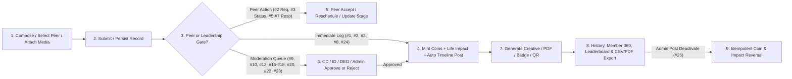

# 14 — Activity Sub-Activity Decomposition Catalogue

> **Document Scope:** Granular decomposition of all **35 Platform Activities** into **atomic sub-activities** (Create, Draft, Select Peer, Attach Proof/Media, Submit, Peer Accept/Reject/Reschedule, Update Lead Status, Moderation Approve/Reject, Coin/Impact Credit & Reversal, Creative/PDF Generation, Share, History, Leaderboard, Export), verified across **Member App**, **Leader App**, **Admin Web**, and **Laravel 12 Backend**.
>
> **Status Vocabulary Used:** `Fully Implemented` · `Partially Implemented` · `Implemented but Not Integrated` · `Implemented but Incorrect` · `Missing` · `Not Required` (plus `Requires Enhancement` / `Requires Business Confirmation` notes).
>
> **Related Audit Documents:** [12-master-35-activities-index.md](./12-master-35-activities-index.md) · [13-activity-input-forms-and-validation.md](./13-activity-input-forms-and-validation.md) · [16-activity-api-and-backend-mapping.md](./16-activity-api-and-backend-mapping.md) · [18-activity-lifecycle-and-status-reference.md](./18-activity-lifecycle-and-status-reference.md)

---

## 1. Cross-Cutting Sub-Activity Lifecycle Pattern

---

## 2. Atomic Sub-Activity Matrix Across All 35 Activities

### Group A: Core Peer-to-Peer Commercial & Networking Activities (`#1`–`#8`)

| Act # | Atomic Sub-Activity | Member App | Leader App | Admin Web | Backend | Evidence & Technical Notes (`FACT` / `WORKBOOK`) |
|---:|---|---|---|---|---|---|
| **1** | **1.1 Select Target Peer & Enter Deal (`₹`, New/Repeat, Date)** | `Fully Implemented` | `Implemented but Not Integrated` | `Not Required` | `Fully Implemented` | **FACT:** `AddBusinessDealScreen` works; Leader [create_business_deal_bottom_sheet.dart](file:///D:/office%20project/LeaderApp-Fornt-end-/lib/features/business_deals/view/widgets/create_business_deal_bottom_sheet.dart) exists on disk & `POST /leader/business-deals` is routed, but the sheet is orphaned in Leader UI. |
| **1** | **1.2 Attach Proof Receipt** | `Missing` | `Missing` | `Missing` | `Missing` | **WORKBOOK REQUIREMENT / NOT IMPLEMENTED:** Workbook Col 6 specifies `Proof receipt attachment`; `business_deals` has no file column. |
| **1** | **1.3 Counterparty Peer Verification** | `Missing` | `Missing` | `Missing` | `Missing` | **WORKBOOK REQUIREMENT / NOT IMPLEMENTED:** Workbook specifies `Deal Submitted -> Peer Verification`; code logs deals immediately with no verification state. |
| **1** | **1.4 Auto-Credit Coins, Life Impact & Public Feed Post** | `Fully Implemented` | `Partially Implemented` | `Fully Implemented` | `Fully Implemented` | **FACT:** [BusinessDealController.php](file:///c:/Users/malic/OneDrive/Documents/GitHub/unity-app-new/app/Http/Controllers/Api/BusinessDealController.php#L47-L89) creates `Post` (`source_type='business_deal'`), credits coins & impact, and notifies receiver. |
| **1** | **1.5 Deal History (Given/Received), Member 360°, Leaderboard & Export** | `Fully Implemented` | `Partially Implemented` | `Fully Implemented` | `Implemented but Incorrect` | **FACT:** Member has Given/Received + `/leaderboards/business-deals`; Leader has `BusinessDealsView` + `PeerBusinessDealsScreen`; Admin has CSV export; `LeaderActivitiesService::showDetail` has IDOR and `LeaderDashboardService` fakes `overall_revenue = deals * 0.05`. |
| **2** | **2.1 Send P2P Meeting Request (`scheduled_at`, `place`)** | `Fully Implemented` | `Not Required` | `Not Required` | `Fully Implemented` | **FACT:** `POST /api/v1/p2p-meeting-requests` (`P2PMeetingRequestService`). |
| **2** | **2.2 Peer Accept / Reject / Cancel / Propose Reschedule** | `Fully Implemented` | `Not Required` | `Not Required` | `Fully Implemented` | **FACT:** Inbox/Sent tabs + `/accept`, `/reject`, `/cancel`, `/reschedule` + `p2p_meeting_reschedule_requests` approve/reject. |
| **2** | **2.3 Log Completed 1-on-1 + Upload Selfie/Photo** | `Fully Implemented` | `Partially Implemented` | `Not Required` | `Fully Implemented` | **FACT:** Member `AddP2pMeetingScreen` uploads `media_file_ids` & links `p2p_meeting_request_id`; Leader `CreateP2pMeetingBottomSheet` / `LogP2pBottomSheet` logs text fields without photo or circle scope check. |
| **2** | **2.4 Speed Networking Auto-P2P Completion** | `Fully Implemented` | `Not Required` | `Fully Implemented` | `Fully Implemented` | **FACT:** `POST /api/v1/speed-networking/events/{eventId}/complete-p2p` (`SpeedNetworkingP2pService`). |
| **2** | **2.5 Dual-Avatar Creative Card, History, Leaderboard & Export** | `Partially Implemented` | `Partially Implemented` | `Fully Implemented` | `Partially Implemented` | **FACT:** Timeline post (`moderation_status='pending'`), `ActivityCreative`, `/leaderboards/p2p-meetings`, Admin export exist; dedicated `DualAvatarCanvasService` from workbook is handled via generic `activity_creatives`. |
| **3** | **3.1 Select Peer / Phonebook Prospect & Submit Referral Lead** | `Fully Implemented` | `Partially Implemented` | `Not Required` | `Fully Implemented` | **FACT:** Member `AddReferralScreen` + `contact_picker_sheet.dart`; Leader `SendReferralBottomSheet` (`POST /leader/referrals`). |
| **3** | **3.2 Receiver Updates Lead Pipeline Stage (`referral_status`)** | `Fully Implemented` | `Missing` | `Fully Implemented` | `Fully Implemented` | **FACT:** `PATCH /api/v1/activities/referrals/{id}/status` updates dynamic `status_id` (`Not Contacted`, `In Progress`, `Got Business`, `Lost`). |
| **3** | **3.3 Refer Candidate for Open Circle Category (`PeerReferral`)** | `Fully Implemented` | `Implemented but Incorrect` | `Fully Implemented` | `Implemented but Incorrect` | **FACT:** Member `/api/v1/peer-referrals` & Leader `ReferCategoryBottomSheet` (`POST /leader/teams/circles/{id}/refer-category` — missing circle scope check); moderated via `circle_peer_referrals` queue. |
| **3** | **3.4 Convert Closed-Won Referral to Business Deal** | `Partially Implemented` | `Missing` | `Not Required` | `Partially Implemented` | **FACT:** `StoreBusinessDealRequest` accepts optional `referral_id`, but automatic `DealConversionTrigger` on status change is manual. |
| **3** | **3.5 Given/Received Tabs, Direct Call/WhatsApp Actions, Reports & Leaderboard** | `Fully Implemented` | `Partially Implemented` | `Fully Implemented` | `Fully Implemented` | **FACT:** `ReferralsScreen`, Leader `ReferralsView`, DED `/ded/referral-report`, Admin `/admin/referral-report` + CSV export. |
| **4** | **4.1 Edit `i_can_help_with`, `i_am_looking_for` & `superpower`** | `Fully Implemented` | `Not Required` | `Fully Implemented` | `Fully Implemented` | **FACT:** `EditInterestsGoalsScreen` & `EditAdditionalInfoScreen` -> `PUT /api/v1/profile`; Admin `PeerEditorPage.tsx`. |
| **4** | **4.2 Compute Peer Match Score & Search by Capability Tags** | `Fully Implemented` | `Partially Implemented` | `Fully Implemented` | `Fully Implemented` | **FACT:** `ProfileMatchService` weights `i_can_help_with` <-> `i_am_looking_for` (`15%`); Leader `PeersView` searches text via PostgreSQL `ILIKE` but lacks dedicated tag filter chips. |
| **4** | **4.3 Admin Create & Assign System Peer Tags (`user_tags`)** | `Not Required` | `Not Required` | `Fully Implemented` | `Fully Implemented` | **FACT:** `UserTagsPage.tsx` -> `/api/v1/admin/user-tags/*` (`team_member` protected slug). |
| **5–7** | **5.1 Select Flow (`collaboration` / `help` / `referral`) & Sub-Type** | `Fully Implemented` | `Not Required` | `Fully Implemented` | `Fully Implemented` | **FACT:** `AskFlowSelectionScreen` -> `AskTypesScreen` (`/api/asks/flows/{flow}/types`); Admin configures options in `AskFlowConfigPage.tsx`. |
| **5–7** | **5.2 Save Draft, Dynamic Brief Answers, Target Filters & Visibility** | `Fully Implemented` | `Not Required` | `Not Required` | `Fully Implemented` | **FACT:** `POST /api/asks` -> `PUT /api/asks/{ask}` -> `PUT .../filters` -> `PUT .../visibility` (`all_peers`, `district`, `circle`). |
| **5–7** | **5.3 Publish Ask & Sync to Timeline (`ask_timeline_links`)** | `Fully Implemented` | `Not Required` | `Fully Implemented` | `Fully Implemented` | **FACT:** `POST /api/asks/{ask}/publish` (`AskService::ensureTimelinePost`). |
| **5–7** | **5.4 Algorithmic Peer Matching (`AskMatchingService`)** | `Fully Implemented` | `Missing` | `Partially Implemented` | `Fully Implemented` | **FACT:** Generates scored `ask_matches` (`suggested` -> `viewed` -> `interested` -> `connected` -> `dismissed`). |
| **5–7** | **5.5 Peer Respond / Offer Help / Pass Warm Intro Contact** | `Fully Implemented` | `Missing` | `Partially Implemented` | `Fully Implemented` | **FACT:** `POST /api/asks/{ask}/responses` + `ask_response_contacts` (`AskExpressInterestScreen`, `AskHelpResponseScreen`, `AskReferralContactScreen`). |
| **5–7** | **5.6 1-on-1 Collaboration Workspace Room (`#5`)** | `Partially Implemented` | `Not Required` | `Not Required` | `Partially Implemented` | **FACT:** `AskCollaborationRoomScreen` exists in Member App using REST/chat endpoints rather than a standalone `CollabRoomSocketService` microservice. |
| **5–7** | **5.7 Close & Thank Peer / Record Deal Value / Congratulate** | `Fully Implemented` | `Missing` | `Fully Implemented` | `Fully Implemented` | **FACT:** `POST /api/asks/{id}/close-and-thank` (`outcome_status`, `approx_deal_value`, `outcome_notes`) + `/congratulate`. |
| **5–7** | **5.8 Scoped Leadership Ask Oversight & Analytics** | `Not Required` | `Implemented but Incorrect` | `Fully Implemented` | `Implemented but Incorrect` | **FACT:** Leader `RequirementsView` & Member 360° Ask screens exist, but `LeaderAskFlowService` applies **zero scope filtering** (leaks all global asks) and `LeaderDashboardService` fakes `60/25/15%` open/in-progress/fulfilled counts! |
| **8** | **8.1 Write Testimonial + Optional Photo** | `Fully Implemented` | `Partially Implemented` | `Not Required` | `Partially Implemented` | **FACT:** `AddTestimonialScreen` & `POST /leader/testimonials` work; `rating` (1–5) is omitted from `StoreTestimonialRequest`. |
| **8** | **8.2 Auto-Post to Timeline (`moderation_status='pending'`) & Award Coins** | `Fully Implemented` | `Fully Implemented` | `Fully Implemented` | `Fully Implemented` | **FACT:** `TestimonialController@store` creates `Post` + `PostMention` + `CoinsService::rewardForActivity`. |
| **8** | **8.3 View Given/Received Testimonials, Member 360° Wall, Leaderboard & Export** | `Fully Implemented` | `Fully Implemented` | `Fully Implemented` | `Fully Implemented` | **FACT:** `TestimonialsScreen`, Leader `TestimonialsView` + `PeerTestimonialsScreen`, `/leaderboards/testimonials`, Admin CSV export. |

---

### Group B: Accreditation, Partnerships, Ads, Governance Applications & Story Forms (`#9`–`#18`)

| Act # | Atomic Sub-Activity | Member App | Leader App | Admin Web | Backend | Evidence & Technical Notes (`FACT` / `WORKBOOK`) |
|---:|---|---|---|---|---|---|
| **9–10** | **9.1 Load 25 Scored Quiz Questions & Submit Assessment** | `Fully Implemented` | `Not Required` | `Not Required` | `Fully Implemented` | **FACT:** `EntrepreneurCertificationScreen` (`#9`) & `LeadershipCertificationScreen` (`#10`) submit 25 answers scored by `CertificationQuestionsService` (dual-written to `certification_submissions`). |
| **9–10** | **9.2 Review & Approve/Reject Certification Submission** | `Not Required` | `Partially Implemented` | `Fully Implemented` | `Fully Implemented` | **FACT:** Admin `CertificationSubmissionsView.tsx` & `/api/v1/leader/pending-requests/certifications/{id}/approve\|reject`. |
| **9–10** | **9.3 Generate Numbered DomPDF Certificate & Email/Download** | `Fully Implemented` | `Missing` | `Fully Implemented` | `Fully Implemented` | **FACT:** `CertificateGeneratorService` generates PDF on approval, populates `certificate_download_url`, and sends email; Member views/downloads in app. |
| **11** | **11.1 Submit Strategic Partnership Proposal (`PartnerWithUs`)** | `Fully Implemented` | `Not Required` | `Not Required` | `Fully Implemented` | **FACT:** `PartnerWithUsScreen` -> `POST /api/v1/partner-with-us` (no pitch deck file upload). |
| **11** | **11.2 Triage Proposal Status (`new` -> `contacted`/`approved`/`rejected`)** | `Partially Implemented` | `Partially Implemented` | `Fully Implemented` | `Fully Implemented` | **FACT:** Admin `LeadsPage.tsx` (`PATCH /api/v1/admin/leads/partner_with_us/{id}/status`); read-only list in `/leader/leads/partner_with_us`. |
| **12** | **12.1 Browse Brand Partner Directory, Save Offers & Request Callback** | `Fully Implemented` | `Not Required` | `Fully Implemented` | `Fully Implemented` | **FACT:** `/api/v1/brand-partners/*`, `/callback-request`, `/save` (`BrandPartnersPage.tsx` in Admin). |
| **12** | **12.2 Advertiser Application + Email OTP + Asset Upload + Package Payment** | `Fully Implemented` | `Not Required` | `Fully Implemented` | `Fully Implemented` | **FACT:** `BecomeBrandPartnerScreen` -> `BrandPartnerPaywallScreen` -> Razorpay (`AdvertiserPublicApiController` / `AdvertiserPaymentApiController`). |
| **12** | **12.3 Admin Review Application/Assets/Campaigns (`changes_requested` / `approve` / `publish`)** | `Fully Implemented` | `Partially Implemented` | `Fully Implemented` | `Fully Implemented` | **FACT:** Full workflow in `AdvertiserPage.tsx` & `AdsPage.tsx`; `ad_booking_requests` also exposed in `PendingRequestAdminController`. |
| **12** | **12.4 Serve Sponsored Feed Banners & Track Impressions/Clicks (`CTR`)** | `Fully Implemented` | `Not Required` | `Fully Implemented` | `Fully Implemented` | **FACT:** `AdFeedService` injects ads into `PostController@feed`; `AdvertiserDashboardScreen` & `AdsAnalyticsTab.tsx` track views/clicks. |
| **13** | **13.1 Submit In-App Leader Role Interest (`self` or `other`)** | `Fully Implemented` | `Not Required` | `Not Required` | `Fully Implemented` | **FACT:** `LeadershipRoleScreen` -> `POST /api/v1/forms/leader-interest` + confirmation emails. |
| **13** | **13.2 Review & Approve In-App Leader Interest + Commission Role** | `Not Required` | `Implemented but Not Integrated` | `Implemented but Incorrect` | `Implemented but Incorrect` | **FACT:** `LeadershipController@applicationApprove` writes non-fillable/missing `status` column on `leader_interest_submissions`, has **no admin auth guard**, and `assignmentStore` crashes PostgreSQL `circle_member_role_enum` when writing `circle_founder`/`ded`/`id`! |
| **13** | **13.3 Website Leadership Campaign Nominations, Public OTP Voting, Jury Scoring & Winner Creatives** | `Not Required` | `Not Required` | `Fully Implemented` | `Implemented but Incorrect` | **FACT:** Complete 23-table `web_leadership_*` module (`WebLeadership` pages in React Admin + `/api/v1/leadership/*`), **but** `/api/v1/leadership/admin/*` lacks role checks and Jury/Result OTP accepts hardcoded `'123456'` in prod! |
| **14** | **14.1 Submit Become a Speaker Application + Headshot** | `Fully Implemented` | `Not Required` | `Not Required` | `Fully Implemented` | **FACT:** `BecomeSpeakerScreen` -> `POST /api/v1/become-a-speaker`. |
| **14** | **14.2 Admin Lead Triage vs. Public Speaker Bureau Directory** | `Partially Implemented` | `Partially Implemented` | `Fully Implemented` | `Partially Implemented` | **FACT:** Admin `LeadsPage.tsx` triages submissions; **Public Speaker Bureau Directory** from workbook (`SpeakerBureauDirectoryScreen`) is **Missing**. |
| **15** | **15.1 Submit Become a Mentor Application** | `Partially Implemented` | `Not Required` | `Not Required` | `Partially Implemented` | **FACT:** Collects 6 basic contact fields (`BecomeMentorController@submit`); domain/slot/bio fields from workbook are **Missing**. |
| **15** | **15.2 Public Mentor Directory & 1-on-1 Advisory Slot Booking** | `Missing` | `Missing` | `Missing` | `Missing` | **WORKBOOK REQUIREMENT / NOT IMPLEMENTED:** `MentorsDirectoryScreen`, `CalendarSlotManager`, and `MentorshipBookingService` do not exist. |
| **16** | **16.1 Submit Peer Recommendation & Auto-Reward Coins/Impact** | `Fully Implemented` | `Partially Implemented` | `Not Required` | `Fully Implemented` | **FACT:** `RecommendPeerScreen` -> `PeerRecommendationService::submit` awards coins/impact; Leader has `ApiEndpoints.recommendPeerForm`. |
| **16** | **16.2 Moderate Recommendation (`pending` -> `approved`/`contacted`/`converted`)** | `Fully Implemented` | `Partially Implemented` | `Fully Implemented` | `Fully Implemented` | **FACT:** History in `RecommendPeerHistoryScreen`; moderation in `AdminOpsController` & `circle_peer_referrals` queue. |
| **17** | **17.1 Submit Standalone Visitor Registration & Credit Host Impact** | `Fully Implemented` | `Not Required` | `Fully Implemented` | `Fully Implemented` | **FACT:** `RegisterVisitorScreen` -> `VisitorRegistrationController@store` immediately adds Life Impact (`coins_awarded=false` pending approval). |
| **17** | **17.2 Leader / DED / Admin Approve Visitor & Credit Host Coins** | `Fully Implemented` | `Partially Implemented` | `Fully Implemented` | `Fully Implemented` | **FACT:** `PendingRequestAdminController` (`visitor_registrations`) & `DedPendingRequestsController` approve and award coins. |
| **17** | **17.3 Issue Event Visitor QR Pass & Gate Check-In** | `Fully Implemented` | `Missing` | `Fully Implemented` | `Partially Implemented` | **FACT:** Works when registered via `/events/{id}/occurrences/{occ}/visitor-register` (`EventRegistration` QR pass + WhatsApp); standalone `visitor_registrations` row has no `visitorPassToken` QR column. |
| **18** | **18.1 Submit Multi-Screen Vyapaar Jagat Entrepreneur Story** | `Fully Implemented` | `Not Required` | `Not Required` | `Fully Implemented` | **FACT:** `VyapaarJagatStoryScreen` -> `POST /api/v1/story-submission`. |
| **18** | **18.2 Editorial Review, Approve with Published `story_link` & Sync Profile** | `Fully Implemented` | `Partially Implemented` | `Fully Implemented` | `Fully Implemented` | **FACT:** Admin `/admin/stories/{id}/approve` saves `story_link`, updates `users.story_link`, and notifies founder (`LastMonthActivityService` also counts approved stories). |

---

### Group C: Circles, Events, Impact, Coins, Content, Growth, Privacy & Operations (`#19`–`#35`)

| Act # | Atomic Sub-Activity | Member App | Leader App | Admin Web | Backend | Evidence & Technical Notes (`FACT` / `WORKBOOK`) |
|---:|---|---|---|---|---|---|
| **19** | **19.1 Browse Circles, Open/Closed Category Seats & Directory PDF** | `Fully Implemented` | `Implemented but Incorrect` | `Fully Implemented` | `Implemented but Incorrect` | **FACT:** Member `CirclesScreen` + `CircleDirectoryPdfPreviewScreen`; Leader `TeamsView` + `CircleDetailsView` (`showCircle`/`subIndustries` lack scope checks). |
| **19** | **19.2 Circle Group Chat & Circle Leadership Group Chat** | `Fully Implemented` | `Missing` | `Not Required` | `Fully Implemented` | **FACT:** `CircleChatScreen` & `CircleLeadershipChatScreen` (`/api/v1/circles/{circle}/leadership-group-chat/messages`) exist in Member App, not in Leader App. |
| **19** | **19.3 Assign Circle Leadership Roles (Founder, Director, 3 Chairs, VC, Secretary)** | `Not Required` | `Missing` | `Fully Implemented` | `Partially Implemented` | **FACT:** Admin `CircleEditorPage.tsx` calls `PATCH /api/v1/admin/circles/{id}/assign-*`; **zero chair-assignment endpoint exists in `app/Leader/`** despite `can_assign_circle_chair` flag! |
| **20** | **20.1 Submit Circle Join Request + Category Seat Selection** | `Fully Implemented` | `Not Required` | `Not Required` | `Fully Implemented` | **FACT:** `CircleJoinScreen` -> `POST /api/v1/circle-join-requests` (`status = 'pending_cd_approval'`). |
| **20** | **20.2 Stage 1 CD/CF Approval -> Stage 2 ID/DED Approval -> Stage 3 Circle Fee Payment** | `Fully Implemented` | `Partially Implemented` | `Fully Implemented` | `Fully Implemented` | **FACT:** `CircleJoinRequestService` enforces `pending_cd_approval` -> `pending_id_approval` -> `pending_circle_fee` -> Razorpay/Zoho `PaidCircleMembershipFinalizer` -> `circle_member`. Leader App needs dedicated multi-stage Pending Requests drawer UX. |
| **20** | **20.3 Submit "Build Your Own Circle" Proposal (40+ Founding Nominees) & Provision Circle** | `Fully Implemented` | `Missing` | `Fully Implemented` | `Fully Implemented` | **FACT:** `BuildCircleScreen` + `UserCircleRequestsPage.tsx` (`BuildYourOwnCircleApprovalService` provisions `Circle` & assigns Founder). |
| **21** | **21.1 Browse Events, Book Ticket (Free/Paid + Coupon) & Generate QR Pass + Invoice** | `Fully Implemented` | `Partially Implemented` | `Fully Implemented` | `Fully Implemented` | **FACT:** `EventsScreen`, `EventQrTicketScreen` (`endroid/qr-code`), event invoice PDF, WhatsApp QR pass (`WhatsAppEventPassesPage.tsx`). |
| **21** | **21.2 Approve Cross-Circle Event Joining Requests (`event_registration_requests`)** | `Fully Implemented` | `Partially Implemented` | `Fully Implemented` | `Fully Implemented` | **FACT:** Moderated via `PendingRequestAdminController` (`event_joining_requests`) & `DedPendingRequestsController`. |
| **21** | **21.3 Venue QR Check-In & Circle Meeting Attendance / Absence Warnings** | `Partially Implemented` | `Partially Implemented` | `Fully Implemented` | `Fully Implemented` | **FACT:** Dedicated Scanner API (`/api/v1/scan-app/*`) + Admin `TotalAttendanceTab.tsx` + `/admin/meetings/{id}/attendance`; Leader App views attendance in Member 360° & Report Roster, but lacks live attendance marking & `reports/attendance-trend` returns `[]`. |
| **22** | **22.1 Auto-Accumulate Life Impact History + Submit Manual Impact Activity** | `Fully Implemented` | `Fully Implemented` | `Fully Implemented` | `Fully Implemented` | **FACT:** `LifeImpactService` auto-credits across activities; manual `POST /api/v1/impacts` & `POST /api/v1/leader/impacts` create `impacts` rows. |
| **22** | **22.2 Leader / DED / Admin Approve Pending Impact -> Credit Score, Coins & Timeline Post** | `Not Required` | `Partially Implemented` | `Fully Implemented` | `Fully Implemented` | **FACT:** `ImpactService::approveImpact()` via `pending_impacts` queue + `ImpactRecognitionsTab.tsx` poster studio; fix `LeaderDashboardService::getTopImpacters` fake data! |
| **23** | **23.1 Auto-Mint Activity Coins (`coins_apply_transaction`) & View Wallet Ledger** | `Fully Implemented` | `Fully Implemented` | `Fully Implemented` | `Fully Implemented` | **FACT:** Immutable `coins_ledger` + `CoinsScreen` + Leader `PeersByCoinsView` / `PeerCoinsScreen`. |
| **23** | **23.2 Submit Manual Coin Claim (`CoinClaimRequest`) & Review/Approve** | `Fully Implemented` | `Implemented but Incorrect` | `Fully Implemented` | `Implemented but Incorrect` | **FACT:** `ClaimCoinsFormScreen` writes `coin_claim_requests`; `AdminOpsController` & `DedApiService` read `coin_claim_requests`, **but** `PendingRequestAdminController::fetchCoinClaims()` checks `coin_claims`! |
| **23** | **23.3 Redeem Coins in Peers Store & Renew Membership with Coins** | `Fully Implemented` | `Not Required` | `Fully Implemented` | `Fully Implemented` | **FACT:** Full 172-file `store` module in Member App + 18 `Store*Page.tsx` admin screens (`routes/store.php`, `routes/admin_store.php`). |
| **24** | **24.1 Compose Timeline Post (Text, Photo/Video, `@` Mentions, Audience) & Interact** | `Fully Implemented` | `Partially Implemented` | `Fully Implemented` | `Fully Implemented` | **FACT:** `CreatePostScreen`, likes, comments, saves; Leader views/deletes member posts in Member 360°. |
| **25** | **25.1 Report Post (`post_reports`) & Admin Deactivate/Restore with Coin/Impact Reversal** | `Partially Implemented` | `Implemented but Incorrect` | `Fully Implemented` | `Fully Implemented` | **FACT:** Member reports post & views `DeactivatedPostsScreen` (cannot self-restore); Admin `DeactivatePostModal.tsx` runs `PostDeactivationService` (reversing coins & impact); Leader `DELETE /leader/members/{id}/posts/{postId}` bypasses `PostDeactivationService` reversal & lacks `manage_peers` check! |
| **26** | **26.1 Upload/Delete Profile Intro Short Video & Like Peers' Intro Videos** | `Partially Implemented` | `Partially Implemented` | `Fully Implemented` | `Partially Implemented` | **FACT:** Single `users.profile_video_id` + `ShortsScreen` + `IntroVideoLike` + first-upload coin/impact reward; Leader views `intro_video_url` on `PeerProfileView`. |
| **27** | **27.1 Sync Phonebook, Send WhatsApp Invites, Share Referral Link & Claim Introducer** | `Fully Implemented` | `Implemented but Incorrect` | `Fully Implemented` | `Implemented but Incorrect` | **FACT:** `InviteContactsScreen`, `IntroductionRequest` moderation, `IntroductionCreativeService` all work; **CRITICAL:** `LeaderTeamsService::getUserContacts` leaks global `contact_posts` when leader has 0 rows! |
| **28** | **28.1 Evaluate Milestone Thresholds, Unlock Badges & Dispatch WhatsApp Honours** | `Fully Implemented` | `Fully Implemented` | `Fully Implemented` | `Fully Implemented` | **FACT:** `MilestoneBadgeService` + `PeerBadgeDetailScreen` + Admin `RecognitionPage.tsx` & `WhatsAppAwardsPage.tsx`. |
| **29** | **29.1 Block / Unblock Peer & Enforce Mutual Visibility Exclusion** | `Fully Implemented` | `Not Required` | `Not Required` | `Fully Implemented` | **FACT:** `BlockedUsersScreen` + `PeerBlockService` enforced across Deals, P2P, Referrals, Testimonials, Profile Views, and Speed Networking. |
| **30** | **30.1 Submit Platform Feedback (`FeedbackForm`) & Post-Event Ratings (`EventFeedback`)** | `Fully Implemented` | `Not Required` | `Fully Implemented` | `Fully Implemented` | **FACT:** `FeedbackScreen` + `EventFeedbackController` + Admin `/api/v1/admin/feedback`. |
| **31** | **31.1 Submit Help Ticket, Assign Agent, Exchange Replies & Resolve** | `Partially Implemented` | `Missing` | `Fully Implemented` | `Partially Implemented` | **FACT:** Store tickets have full `support_ticket_messages` threads + `sla_due_at`; core `/api/v1/support/tickets` is single-shot + Admin email reply (`SupportPage.tsx`), and Leader App has no Helpdesk screen. |
| **32** | **32.1 Subscribe/Renew Plan (Razorpay / Zoho / Coins), Download GST Invoice & Record Offline Fee** | `Fully Implemented` | `Implemented but Incorrect` | `Fully Implemented` | `Implemented but Incorrect` | **FACT:** Member checkout & PDF invoices work; Leader `FinanceView` + `RecordPaymentBottomSheet` suffer from multi-circle payment double-counting, global `circle_budget` leak, dropped `circle_id` on `record-offline`, and missing `manage_finance` guard. |
| **33** | **33.1 Log Deduplicated Profile Visit & List Recent Viewers** | `Fully Implemented` | `Not Required` | `Not Required` | `Fully Implemented` | **FACT:** `WhoViewedMyProfileScreen` -> `ProfileController@recordView` / `getViews`. |
| **34** | **34.1 Edit 8 Modular Profile Sections, Verify Contact OTP & Audit Changes** | `Fully Implemented` | `Implemented but Not Integrated` | `Fully Implemented` | `Partially Implemented` | **FACT:** Member 8-section edit + OTP contact change work; Admin edits write `admin_audit_logs`; Leader `EditPeerBottomSheet` is unrouted on backend; no member self-edit history table exists. |
| **35** | **35.1 Compile 9-Stream Rolling/Monthly ROI Summary, Gratitude Script & Circle Reports** | `Fully Implemented` | `Implemented but Incorrect` | `Fully Implemented` | `Implemented but Incorrect` | **FACT:** `LastMonthActivityService` & `PeerMonthlyImpactScriptService` work cleanly; Leader `ReportsView` / `LeaderReportsService` has circle IDOR, unauthenticated PDF download (`/api/v1/files/{id}/download`), 20-peer roster cap with zeroed stats, and hardcoded fake fallback metrics (`94.5%`, `₹18.5L`). |
