# 15 — Activity Database Schema, Metrics & Audit Mapping

> **Document Scope:** Complete entity-to-PostgreSQL persistence mapping for all **35 Platform Activities**, including Eloquent Models, actual PostgreSQL tables, primary/foreign keys, soft-deletes, status enums, ownership & organizational scope columns, audit/history tables, and a **side-by-side comparison of Workbook Database Metric Keys (Sheet 3) vs. Actual Laravel/PostgreSQL Columns & Dynamic Queries**.
>
> **Related Audit Documents:** [12-master-35-activities-index.md](./12-master-35-activities-index.md) · [16-activity-api-and-backend-mapping.md](./16-activity-api-and-backend-mapping.md) · [18-activity-lifecycle-and-status-reference.md](./18-activity-lifecycle-and-status-reference.md) · [41-master-reporting-and-metrics-reference.md](./41-master-reporting-and-metrics-reference.md) · [48-database-enhancement-recommendations.md](./48-database-enhancement-recommendations.md)

---

## 1. Core Entity-Relationship Diagram (PostgreSQL Persistence)

> **FACT:** Every primary domain table in `unity-app-new` uses `uuid` primary keys (`Str::uuid()` in Eloquent `booted()` hooks), except `coins_ledger` (`transaction_id` uuid PK) and hierarchical category lookup tables (`circle_categories.id`, `level4_categories.id` integer PKs). Website Leadership Portal tables strictly follow the `web_` prefix rule (`web_leadership_*`). **Zero Firestore** collections exist anywhere in the ecosystem.

```mermaid
erDiagram
    USERS ||--o{ CIRCLE_MEMBERS : "user_id"
    CIRCLES ||--o{ CIRCLE_MEMBERS : "circle_id"
    USERS ||--o{ BUSINESS_DEALS : "from_user_id_and_to_user_id"
    USERS ||--o{ P2P_MEETINGS : "initiator_and_peer_user_id"
    P2P_MEETING_REQUESTS ||--o| P2P_MEETINGS : "p2p_meeting_request_id"
    USERS ||--o{ REFERRALS : "from_user_id_and_to_user_id"
    REFERRAL_STATUS ||--o{ REFERRALS : "status_id"
    USERS ||--o{ ASKS : "user_id"
    ASK_FLOWS ||--o{ ASKS : "flow_id"
    ASK_TYPES ||--o{ ASKS : "type_id"
    ASKS ||--o{ ASK_ANSWERS : "ask_id"
    ASKS ||--o{ ASK_MATCHES : "ask_id"
    ASKS ||--o{ ASK_RESPONSES : "ask_id"
    USERS ||--o{ TESTIMONIALS : "from_user_id_and_to_user_id"
    USERS ||--o{ CERTIFICATION_SUBMISSIONS : "user_id"
    CIRCLES ||--o{ CIRCLE_JOIN_REQUESTS : "circle_id"
    USERS ||--o{ CIRCLE_JOIN_REQUESTS : "user_id"
    USERS ||--o{ USER_CIRCLE_REQUESTS : "user_id"
    USER_CIRCLE_REQUESTS ||--o{ USER_CIRCLE_REQUEST_NOMINEES : "user_circle_request_id"
    CIRCLES ||--o{ EVENTS : "circle_id"
    EVENTS ||--o{ EVENT_REGISTRATIONS : "event_id"
    USERS ||--o{ IMPACTS : "user_id_and_impacted_peer_id"
    USERS ||--o{ LIFE_IMPACT_HISTORIES : "user_id"
    USERS ||--o{ COINS_LEDGER : "user_id"
    USERS ||--o{ COIN_CLAIM_REQUESTS : "user_id"
    USERS ||--o{ POSTS : "user_id"
    MILESTONE_BADGES ||--o{ USER_MILESTONE_BADGES : "badge_id"
    USERS ||--o{ USER_MILESTONE_BADGES : "user_id"
    USERS ||--o{ PAYMENTS : "user_id"
    CIRCLES ||--o{ PAYMENTS : "circle_id"

    USERS {
        uuid id PK
        varchar email
        varchar phone
        bigint coins_balance
        int life_impacted_count
        int members_introduced_count
        jsonb i_can_help_with
        varchar membership_status
        timestamp updated_at
    }
    CIRCLES {
        uuid id PK
        varchar name
        uuid district_id FK
        uuid city_id FK
        uuid circle_founder_user_id FK
        uuid circle_director_user_id FK
        uuid industry_director_user_id FK
        uuid ded_user_id FK
        jsonb calendar
    }
    CIRCLE_MEMBERS {
        uuid id PK
        uuid circle_id FK
        uuid user_id FK
        varchar role
        varchar status
        timestamp deleted_at
    }
```

---

## 2. Master Entity-to-PostgreSQL Table Mapping (All 35 Activities)

| # | Activity | Eloquent Model(s) (`app/Models/*`) | PostgreSQL Table(s) | PK & Key Foreign Keys | SoftDeletes & Status Column / Enum | Ownership & Org Scope Resolution | Audit / History Table(s) |
|---:|---|---|---|---|---|---|---|
| 1 | [Business Deals](./activities/01-business-deals.md) | `BusinessDeal` | `business_deals` | PK `id` (uuid); FKs `from_user_id`, `to_user_id` -> `users.id`, `referral_id` -> `referrals.id` | `SoftDeletes` (`deleted_at` + `is_deleted` bool); **no** `status` column | Owned by `from_user_id` / `to_user_id`; scoped via `circle_members` of participants *(no `circle_id` on `business_deals`!)* | `posts` (`source_type='business_deal'`), `coins_ledger`, `life_impact_histories` |
| 2 | [P2P Meetings](./activities/02-p2p-meetings.md) | `P2pMeeting`, `P2PMeetingRequest`, `P2PMeetingRescheduleRequest` | `p2p_meetings`, `p2p_meeting_requests`, `p2p_meeting_reschedule_requests` | PK `id`; FKs `initiator_user_id`, `peer_user_id`, `p2p_meeting_request_id` | `p2p_meetings`: `SoftDeletes` + `is_deleted` (no status); `p2p_meeting_requests.status`: `pending\|accepted\|rejected\|cancelled\|reschedule_requested`; `reschedule.status`: `pending\|approved\|rejected` | Owned by `initiator_user_id` & `peer_user_id`; scoped via participants' `circle_members` | `p2p_meeting_requests` (`responded_at`, `logged_at`), `p2p_meeting_reschedule_requests` |
| 3 | [Normal Referrals](./activities/03-normal-referrals.md) | `Referral`, `ReferralStatus`, `PeerReferral` | `referrals`, `referral_status`, `peer_referrals` (`circle_peer_referrals`) | PK `id`; FKs `from_user_id`, `to_user_id` -> `users.id`, `status_id` -> `referral_status.id`; `peer_referrals.circle_id` | `referrals`: `SoftDeletes` + `is_deleted` + dynamic `status_id`; `peer_referrals.status`: `pending\|approved\|rejected` | `referrals` scoped via `from_user_id`/`to_user_id` `circle_members`; `peer_referrals` has direct `circle_id` & `main_circle_id` | `coins_ledger`, `life_impact_histories` |
| 4 | [I Can Help Profiles & Tags](./activities/04-i-can-help-profiles-and-tags.md) | `User`, `UserTag`, `UserTagAssignment`, `Tag` | `users`, `user_tags`, `user_tag_assignments`, `tags` | `users.id`; `user_tag_assignments` (`user_id`, `tag_id`) | `users.deleted_at`; `user_tags.is_active` (bool); `tags.is_approved` (bool) | Self-owned (`users.id`); scoped via `circle_members` / `district_id` / `main_business_category_id` | `admin_audit_logs` (on admin peer update) |
| 5 | [Collaboration Asks](./activities/05-collaboration-asks.md) | `Ask\Ask`, `AskFlow`, `AskType`, `AskAnswer`, `AskMatch`, `AskResponse`, `CollaborationPost` (legacy) | `asks` (`flow='collaboration'`), `ask_flows`, `ask_types`, `ask_answers`, `ask_matches`, `ask_responses`, `collaboration_posts` | PK `asks.id`; FKs `user_id`, `flow_id`, `type_id`, `visibility_circle_id`, `visibility_district_id` | `asks`: `SoftDeletes`, `status` ∈ `draft\|published\|in_progress\|fulfilled\|closed\|cancelled\|expired` | Owned by `asks.user_id`; explicit scope columns `visibility_type`, `visibility_circle_id`, `visibility_district_id` | `ask_status_histories`, `ask_response_status_histories`, `ask_timeline_links` |
| 6 | [Get Help Asks](./activities/06-get-help-asks.md) | `Ask\Ask` (`flow='help'`), `AskResponse`, `Requirement` (legacy) | `asks`, `ask_answers`, `ask_matches`, `ask_responses`, `requirements` | Same as `#5` | `asks.status` (7 states); `ask_responses.status` ∈ `pending\|accepted\|declined\|in_progress\|completed\|closed\|withdrawn`; `requirements.status` ∈ `open\|in_progress\|closed` | Owned by `asks.user_id` & `responder_user_id`; `visibility_*` columns | `ask_status_histories`, `ask_response_status_histories` |
| 7 | [Referral Asks](./activities/07-referral-asks.md) | `Ask\Ask` (`flow='referral'`), `AskResponse`, `AskResponseContact` | `asks`, `ask_answers`, `ask_matches`, `ask_responses`, `ask_response_contacts` | Same as `#5` + `ask_responses.introduced_peer_id` -> `users.id` | Same 7 `asks.status` states + 6 `ask_matches.status` states (`suggested..expired`) | Owned by `asks.user_id`; warm intro PII isolated in `ask_response_contacts` | `ask_status_histories`, `ask_response_status_histories` |
| 8 | [Testimonials](./activities/08-testimonials.md) | `Testimonial` | `testimonials` | PK `id`; FKs `from_user_id`, `to_user_id` -> `users.id`, `referral_id` -> `referrals.id` | `SoftDeletes` + `is_deleted` (bool); **no** `status` column | Owned by `from_user_id` / `to_user_id`; scoped via participants' `circle_members` | `posts` (`source_type='testimonial'`), `coins_ledger` |
| 9 | [Entrepreneur Certification](./activities/09-entrepreneur-certification-form.md) | `EntrepreneurCertificationSubmission`, `CertificationSubmission` | `entrepreneur_certification_submissions` + `certification_submissions` (`type='entrepreneur'`) | Shared UUID `id`; `certification_submissions.user_id` (nullable FK -> `users.id`), `approved_by`, `rejected_by` | `status` ∈ `new\|approved\|rejected` | Owned by `user_id` or matched `LOWER(email)`; scoped via applicant's `circle_members` in `PendingRequestAdminController` | `approved_by`, `approved_at`, `rejected_by`, `rejected_at`, `email_logs` |
| 10 | [Leadership Certification](./activities/10-leadership-certification-form.md) | `LeadershipCertificationSubmission`, `CertificationSubmission` | `leadership_certification_submissions` + `certification_submissions` (`type='leadership'`) | Shared UUID `id`; `user_id`, `approved_by`, `rejected_by` | `status` ∈ `new\|approved\|rejected` | Owned by `user_id` or `LOWER(email)`; scoped via applicant's `circle_members` | `approved_by`, `approved_at`, `rejected_by`, `rejected_at`, `email_logs` |
| 11 | [Partner With Us](./activities/11-partner-with-us-form.md) | `PartnerWithUsSubmission`, `Web\WebPartnership` | `partner_with_us_submissions`, `web_partnerships` | PK `id` (uuid); no `user_id` FK (matched by `email_id`) | `status` string (default `'new'`, updated to `contacted\|approved\|rejected`) | Global Admin lead pipeline (`city`, `industry` columns) | `updated_at`, `email_logs` |
| 12 | [Brand Partner & Ads](./activities/12-brand-partner-form-and-ads.md) | `BrandPartner`, `AdvertiserApplication`, `AdvertiserCampaign`, `Ad`, `AdBooking` (+ 12 sub-models) | `brand_partners`, `advertiser_applications`, `advertiser_campaigns`, `ads`, `ad_bookings`, `ad_views`, `ad_clicks` | PK `id`; `advertiser_applications.user_id`, `package_id`; `ad_bookings.user_id`, `ad_id` | `advertiser_applications.status` (9 states); `advertiser_campaigns.status` (11 states); `ad_bookings.status` (`pending\|approved\|rejected`) | Owned by `user_id`; Global Admin commercial module (`geo_targeting_rules` json) | `advertiser_application_status_histories`, `advertiser_campaign_status_histories` |
| 13 | [Leadership Role Application](./activities/13-leadership-role-application-form.md) | `LeaderInterestSubmission` + 23 `Leadership\*` models | `leader_interest_submissions` + 23 `web_leadership_*` tables (`web_leadership_campaigns`, `web_leadership_nominations`, `web_leadership_votes`, etc.) | `leader_interest_submissions.id`, `user_id`; `web_leadership_nominations.campaign_id`, `user_id` | **BUG:** `leader_interest_submissions` base table lacks `status` column (`Schema::hasColumn` guard); `web_leadership_nominations.status` has 9 states (`draft..winner`) | `leader_interest_submissions`: `user_id` + `contribute_city`; `web_leadership_campaign_scopes`: `country_id`, `district_id`, `industry_id`, `circle_id` | `web_leadership_nomination_history`, `web_leadership_audit_logs` |
| 14 | [Become a Speaker](./activities/14-become-a-speaker-form.md) | `BecomeSpeakerSubmission` | `become_speaker_submissions` | PK `id`; `image_file_id` -> `files.id` (no `user_id`; matched by `email`/`phone`) | `status` string (default `'new'`) | Global Admin talent lead (`city`) | `updated_at`, `email_logs` |
| 15 | [Become a Mentor](./activities/15-become-a-mentor-form.md) | `BecomeMentorSubmission` | `become_mentor_submissions` | PK `id` (no `user_id`; matched by `email`/`phone`) | `status` string (default `'new'`) | Global Admin mentorship lead (`city`) | `updated_at`, `email_logs` |
| 16 | [Recommend a Peer](./activities/16-recommend-a-peer-form.md) | `PeerRecommendation` | `peer_recommendations` | PK `id`; `user_id` -> `users.id`, `circle_id` -> `circles.id`, `main_business_category_id` | `status` ∈ `pending\|approved\|rejected\|contacted\|converted` | Owned by `user_id`; scoped by `circle_id`, `main_business_category_id`, or recommender's circle | `coins_ledger`, `life_impact_histories` |
| 17 | [Register a Visitor](./activities/17-register-a-visitor-form.md) | `VisitorRegistration`, `VisitorLead`, `EventRegistration` | `visitor_registrations`, `visitor_leads`, `event_registrations` | PK `id`; `user_id` -> `users.id`, `invited_by_user_id`, `reviewed_by_admin_user_id` | `visitor_registrations.status` ∈ `pending\|approved\|rejected` | Owned by `user_id`; scoped via host peer's `circle_members` / district (`DedApiService`) | `reviewed_by_admin_user_id`, `reviewed_at`, `coins_ledger`, `life_impact_histories` |
| 18 | [Vyapaar Jagat Story](./activities/18-vyapaar-jagat-story-form.md) | `SmeBusinessStorySubmission` | `sme_business_story_submissions` | PK `id`; `user_id` (nullable FK -> `users.id`), `approved_by` | `status` ∈ `new\|pending\|approved\|rejected` | Owned by `user_id` / `email`; Global Admin editorial moderation | `submitted_at`, `reviewed_at`, `approved_by`, `approved_at`, `email_logs` |
| 19 | [Joined Circles & Memberships](./activities/19-joined-circles-and-memberships.md) | `Circle`, `CircleMember`, `CircleSubscription`, `JoinedCircleCategory` | `circles`, `circle_members`, `circle_subscriptions`, `joined_circle_categories`, `circle_peer_memberships` | `circles.id`; `circle_members` (`circle_id`, `user_id`, `role_id`, `circle_subscription_id`) | `circles.status`: `pending\|active\|archived`; `circle_members`: `SoftDeletes`, `circle_member_status_enum` (`pending\|approved\|rejected`, optional `needs_attention\|under_review`) | Primary scope anchor: `circles.district_id`, `city_id`, `country`, `industry_director_user_id`, `ded_user_id`, `circle_director_user_id`, `circle_founder_user_id`, `calendar` JSONB | `admin_audit_logs`, `activity_logs` |
| 20 | [Circle Requests & Build Circle](./activities/20-circle-membership-requests-and-build-circle.md) | `CircleJoinRequest`, `UserCircleRequest`, `UserCircleRequestNominee` | `circle_join_requests`, `user_circle_requests`, `user_circle_request_nominees` | `circle_join_requests` (`user_id`, `circle_id`, `payment_id`); `user_circle_requests` (`user_id`, `created_circle_id`) | `circle_join_requests.status`: 8-state pipeline (`pending_cd_approval`..`circle_member`); `user_circle_requests`: `SoftDeletes`, `status` ∈ `pending\|under_review\|approved\|rejected\|cancelled` | `circle_join_requests` scoped by `circle_id` + `level1_category_id`; `user_circle_requests` by `city_id`/`category_id` (Global Admin charter) | Stage actor/timestamp columns (`cd_approved_by/at`, `id_approved_by/at`, `ded_approved_by/at`, `fee_paid_at`) |
| 21 | [Attended Events & Registrations](./activities/21-attended-events-and-registrations.md) | `Event`, `EventOccurrence`, `EventRegistration`, `EventRegistrationRequest`, `EventQrScanLog` | `events`, `event_occurrences`, `event_registrations`, `event_registration_requests`, `circle_meetings`, `attendance_records`, `absence_warnings` | `events` (`circle_id`, `created_by_user_id`); `event_registrations` (`event_id`, `occurrence_id`, `user_id`) | `events`: `SoftDeletes`, `scheduled\|completed\|cancelled\|approved\|rejected`; `event_registrations`: `SoftDeletes`, `status` (`registered\|pending\|cancelled\|rejected`), `checkin_status` (`pending\|checked_in`) | Scoped by `events.circle_id` + `visibility` + `circle_meetings.circle_id` | `event_qr_scan_logs`, `attendance_records`, `substitute_logs`, `absence_warnings` |
| 22 | [Impact Activity & Score](./activities/22-impact-activity-and-life-impact-score.md) | `Impact`, `ImpactAction`, `LifeImpactHistory`, `ImpactGuideline` | `impacts`, `impact_actions`, `life_impact_histories`, `life_impact_creatives` | `impacts` (`user_id`, `impacted_peer_id`, `approved_by`, `rejected_by`); `life_impact_histories` (`user_id`, `triggered_by_user_id`, `activity_id`) | `impacts.status` ∈ `pending\|approved\|rejected` | Owned by `user_id`; scoped via submitter's `circle_members` / district | `life_impact_histories` (immutable ledger + `users.life_impacted_count` cache) |
| 23 | [Coins, Wallet & Claims](./activities/23-coins-activity-wallet-and-history.md) | `CoinsLedger`, `CoinClaimRequest`, `WalletTransaction`, `Store\WalletAdjustmentRequest` | `coins_ledger`, `coin_claim_requests`, `wallet_transactions`, `wallet_adjustment_requests`, `award_coins_histories` | `coins_ledger.transaction_id` (PK), `user_id`, `activity_id`; `coin_claim_requests.id`, `user_id`, `reviewed_by_admin_id` | `coins_ledger`: immutable append-only; `coin_claim_requests.status` ∈ `pending\|approved\|rejected` | Owned by `user_id`; scoped via submitter's `circle_members` / district | `coins_ledger` (`balance_after`, `source_type`, `source_id`), `award_coins_histories` |
| 24 | [Timeline Posts Created](./activities/24-timeline-posts-created.md) | `Post`, `PostLike`, `PostComment`, `PostSave`, `PostMention`, `ActivityCreative` | `posts`, `post_likes`, `post_comments`, `post_saves`, `post_mentions`, `activity_creatives` | `posts.id`, `user_id`, `circle_id`, `source_id` | `posts`: `SoftDeletes` + `is_deleted`, `active`, `status` (`active\|inactive\|rejected\|hidden`), `moderation_status` (`approved\|pending\|rejected`) | Owned by `posts.user_id`; scoped by `circle_id` and author's `circle_members` | `deactivated_by`, `deactivated_at`, `deactivation_remarks` |
| 25 | [Deactivated / Hidden Posts](./activities/25-deactivated-hidden-posts.md) | `Post`, `PostReport`, `PostReportReason` | `posts` (filtered), `post_reports`, `post_report_reasons` | `post_reports` (`post_id`, `reporter_user_id`, `reason_id`, `reviewed_by_admin_user_id`) | `post_reports`: `SoftDeletes`, `status` ∈ `pending\|reviewed\|resolved\|dismissed` | Member views own deactivated `posts`; Admin moderates `post_reports` | `coins_ledger` & `life_impact_histories` reversal entries (`PostDeactivationService`) |
| 26 | [User Shorts / Videos](./activities/26-user-shorts-videos.md) | `User` (`profile_video_id`), `FileModel`, `IntroVideoLike`, `ActivityVideo`, `Tutorial` | `users`, `files`, `intro_video_likes`, `activity_videos`, `tutorials` | `users.profile_video_id` -> `files.id`; `intro_video_likes` (`user_id`, `video_owner_id`, `intro_video_id`) | Active if `users.profile_video_id IS NOT NULL`; `activity_videos.is_active` | Self-owned (`users.id`) | `coins_ledger` & `life_impact_histories` (`introduction_video`) |
| 27 | [Invited Friends / Introduced Peers](./activities/27-invited-friends-introduced-peers.md) | `User`, `ReferralData`, `ReferralLink`, `IntroductionRequest`, `ContactInvitation`, `UserContact` | `users`, `referraldata`, `referral_links`, `introduction_requests`, `contact_invitations`, `user_contacts`, `introduction_creatives` | `users.introduced_by`, `referred_by_user_id`; `introduction_requests` (`requester_id`, `introducer_id`, `reviewed_by`) | `introduction_requests.status` ∈ `pending\|approved\|rejected`; `referral_links.status` ∈ `active\|revoked\|expired` | `user_contacts` strictly private to `user_id`; `introduced_by` scoped via `circle_members` | `contact_invitations` (`whatsapp_status`, `whatsapp_sent_at`), `users.members_introduced_count` |
| 28 | [Badges Earned](./activities/28-badges-earned.md) | `MilestoneBadge`, `UserMilestoneBadge`, `MemberAwardSend` | `milestone_badges`, `user_milestone_badges`, `member_award_sends` | `user_milestone_badges` (`user_id`, `badge_id`) | `milestone_badges.is_active`; `user_milestone_badges.status` ∈ `earned\|revoked` | Owned by `user_id` + cached `users.coin_medal_rank`, `contribution_award_name` | `earned_at`, `revoked_at`, `member_award_sends` |
| 29 | [Blocked Users](./activities/29-blocked-users.md) | `PeerBlock`, `SpeedNetworkingBlockedPeer` | `peer_blocks`, `speed_networking_blocked_peers` | `peer_blocks` (`blocker_user_id`, `blocked_user_id` unique) | Active while row exists (hard deleted on unblock) | **Strictly private** to `blocker_user_id` | `created_at` |
| 30 | [Submitted Feedback](./activities/30-submitted-feedback.md) | `FeedbackForm`, `FeedbackCategory`, `FeedbackMedia`, `EventFeedback`, `Feedback` | `feedback_forms`, `feedback_categories`, `feedback_media`, `event_feedbacks`, `feedback` | `feedback_forms` (`user_id`, `category_id`); `event_feedbacks` (`event_id`, `occurrence_id`, `user_id`) | `feedback_forms.status` string | Owned by `user_id`; Global Admin product ops | `created_at`, `email_logs` |
| 31 | [Help & Support Tickets](./activities/31-help-and-support-tickets.md) | `SupportTicket`, `Store\StoreSupportTicket`, `Store\StoreSupportTicketMessage`, `ContactPost` | `support_tickets`, `support_ticket_messages`, `support_requests`, `contact_posts` | `support_tickets` (`user_id`, `order_id`, `media_file_id`, `assigned_to`) | Core `status`: `open\|in_progress\|resolved\|closed`; Store `status`: `OPEN\|WAITING_FOR_ADMIN\|RESOLVED\|CLOSED` | Owned by `user_id` / `email`; routed to Support Admin (`assigned_to`) | `support_ticket_messages`, `first_response_at`, `resolved_at`, `sla_due_at` |
| 32 | [Membership Plan & Subscriptions](./activities/32-membership-plan-and-subscriptions.md) | `MembershipPlan`, `UserMembership`, `Payment`, `ZohoInvoiceDocument`, `FinanceWallet`, `FinanceLedgerTransaction` | `membership_plans`, `user_memberships`, `payments`, `zoho_invoice_documents`, `finance_wallets`, `finance_ledger_transactions`, `membership_ledgers` | `user_memberships` (`user_id`, `membership_plan_id`, `payment_id`); `payments` (`user_id`, `membership_plan_id`, `circle_id`) | `user_memberships.status` ∈ `active\|queued\|expired\|cancelled`; `payments.status` ∈ `created\|pending\|success\|failed\|cancelled` (+ `'Paid'` in offline bug); `users.membership_status` | `payments.circle_id`, `circle_subscriptions.circle_id`, `finance_ledger_transactions.circle_id` | `finance_ledger_transactions`, `finance_policy_audit_logs`, `membership_ledgers` |
| 33 | [Who Viewed My Profile](./activities/33-who-viewed-my-profile.md) | `ProfileView` | `profile_views` | PK `id`; `viewed_id`, `viewer_id` -> `users.id` | Deduplicated per `(viewed_id, viewer_id)`; repeat visits `touch()` `updated_at` | **Strictly private** to `viewed_id` | `created_at`, `updated_at` |
| 34 | [Profile Edit History & Last Updated](./activities/34-profile-edit-history-and-last-updated.md) | `User`, `ContactChangeOtp`, `CustomCategoryRequest`, `AdminAuditLog` | `users`, `contact_change_otps`, `custom_category_requests`, `admin_audit_logs`, `user_activity_logs` | `users.id`; `contact_change_otps.user_id`; `admin_audit_logs.target_id` | `users.updated_at` timestamp; `contact_change_otps.consumed_at` | Self-owned (`users.id`); Admin edits audited in `admin_audit_logs` | `admin_audit_logs` (admin edits only), Laravel `Log::info('profile_update_saved')`, `contact_change_otps` |
| 35 | [Last Month Activity Summary](./activities/35-last-month-activity-summary.md) | Dynamic `LastMonthActivityService` + `LeaderReport` (for circle reports) | Dynamically queries 9 tables (`p2p_meetings`, `business_deals`, `referrals`, `testimonials`, `visitor_registrations`, `event_registrations`, `peer_recommendations`, `referraldata`, `requirements`, `asks`, `sme_business_story_submissions`); `leader_reports` | `leader_reports` (`id`, `circle_id`, `submitted_by_user_id`, `reviewed_by_user_id`) | Computed dynamically on-the-fly (`?month=&year=` or rolling 30d); `leader_reports.status` | Member summary owned by `user_id`; `leader_reports` scoped by `circle_id` | `leader_reports` (`submitted_at`, `reviewed_at`) |

---

## 3. Side-by-Side Comparison: Workbook Metric Keys (Sheet 3) vs. Actual Backend Columns & Queries

> **CRITICAL AUDIT FINDING:** None of the camelCase counter keys listed in Sheet 3 (`Col 6`) of `PEERS UNITY — MASTER ACTIVITY & ARCHITECTURE DIRECTORY.xlsx` exist as camelCase columns in PostgreSQL! Only **3 cached integer counters** exist on `users` (`coins_balance`, `life_impacted_count`, `members_introduced_count`); **all other counters are computed dynamically via SQL `COUNT` / `SUM` / `AVG` queries** in Resource/Service classes, and several workbook schema assumptions diverge sharply from actual code.

| # | Workbook Database Metric Keys & Schemas (Sheet 3 `Col 6`) | Actual PostgreSQL Columns & Dynamic Backend Queries (`FACT`) | Discrepancies, Bugs & Audit Flags |
|---:|---|---|---|
| 1 | `dealsGiven`, `dealsReceived`, `businessDealsCount`, `totalDealValueINR` | Dynamic `COUNT(*)` & `SUM(deal_amount)` on `business_deals` (`where is_deleted=false and deleted_at is null`) by `from_user_id` (given) & `to_user_id` (received) in `BusinessDealController` & `LeaderActivitiesService`. | **CRITICAL BUG (`LeaderDashboardService.php:733`):** Multiplies `SUM(business_deals.deal_amount) * 0.05` and labels it `overall_revenue`! Must be removed per `Authoritative Finance Rule`. |
| 2 | `p2pMeetingsCount`, `p2p_last_30_days`, `p2pMeetingHistory` | Dynamic `COUNT(*)` on `p2p_meetings` (`initiator_user_id = $id OR peer_user_id = $id`), filtered by `meeting_date >= now()->subDays(30)` in `LastMonthActivityService`. | **BUG (`LeaderReportsService.php:310`):** Reads non-existent `$user->p2p_meetings_count` attribute without `withCount`, returning `0` on every report roster row! |
| 3 | `referralsCount`, `referralsGiven`, `referralsReceived`, `leadsClosedWon` | Dynamic `COUNT(*)` on `referrals` (`from_user_id` / `to_user_id`), joined with `referral_status` (`Got Business`) for closed-won count (`ReferralController@stats`). | **BUG (`LeaderReportsService.php:311`):** Reads non-existent `$user->referrals_given_count` returning `0`. |
| 4 | `iCanHelpWith (String[])`, `profileSkillsIndexedCount` | `users.i_can_help_with` (`jsonb` array), `users.i_am_looking_for` (`jsonb`), `users.skills` (`jsonb`). No `profileSkillsIndexedCount` column. | Workbook assumes `ElasticSearchIndexer`; actual code uses PostgreSQL JSON arrays + `ProfileMatchService` PHP set-intersection scoring. |
| 5 | `listedRequirements`, `asksCollaborationOpen`, `asksCollaborationClosed` | Dynamic `COUNT(*)` on `asks` (`flow.code = 'collaboration'`) grouped by `asks.status`, plus legacy `collaboration_posts`. | **CRITICAL BUG (`LeaderDashboardService.php:784-786`):** Fabricates `open_asks = round(total * 0.6)`, `in_progress_asks = round(total * 0.25)`, `fulfilled_asks = round(total * 0.15)` instead of grouping by `asks.status`! |
| 6 | `getHelpAsksCount`, `helpResponsesReceived`, `helpOutcomeRating` | Dynamic `COUNT(*)` on `asks` (`flow.code = 'help'`) and `ask_responses` (`ask_id`). | `asks` stores `outcome_status` & `outcome_notes`, **not** a numeric `helpOutcomeRating` column. |
| 7 | `referralAsksCount`, `introsReceivedCount`, `askConversionRate` | Dynamic `COUNT(*)` on `asks` (`flow.code = 'referral'`) and `ask_responses` (`response_type IN ('can_introduce_peer','know_someone')`). | `AskFlowHubService::getGlobalFeed('referral')` merges `asks` (`flow='referral'`) with `referrals` rows; `askConversionRate` is not persisted. |
| 8 | `testimonialsCount`, `testimonialsGiven`, `testimonialsReceived`, `averageRating` | Dynamic `COUNT(*)` on `testimonials` (`from_user_id` / `to_user_id`). Column `testimonials.rating` is nullable. | **BUG:** `StoreTestimonialRequest` does not accept `rating`, so `AVG(rating)` is null/unused for mobile submissions. |
| 9 | `entrepreneurCertStatus`, `certIssuedDate`, `certDocStorageUrl` | `certification_submissions` (`certification_type='entrepreneur'`): `status`, `issued_at`, `certificate_file_path`, `certificate_download_url`, `total_score`, `percentage`. | **CRITICAL BUG (`LeaderDashboardService.php:789`):** Splits total certifications as `round(total * 0.7)` instead of filtering `certification_type = 'entrepreneur'`! |
| 10 | `leadershipCertStatus`, `leadershipMilestonesCompleted` | `certification_submissions` (`certification_type='leadership'`): `status`, `certification_level`, `total_score`, `percentage`. | **CRITICAL BUG (`LeaderDashboardService.php:790`):** Splits total certifications as `round(total * 0.3)` instead of filtering `certification_type = 'leadership'`! |
| 11 | `partnerProposalStatus`, `partnerTicketId`, `proposalSubmissionDate` | `partner_with_us_submissions`: `status` (`'new'`), `id` (uuid), `created_at`. | No `user_id` FK column; authenticated member lookup matches `email_id`. |
| 12 | `adCampaignId`, `impressionsCount`, `clicksCount`, `leadsCapturedCount` | `advertiser_campaigns.id`, `ad_views` / `brand_partner_views` (`COUNT`), `ad_clicks` / `brand_partner_clicks` (`COUNT`), `brand_partner_inquiries` (`COUNT`). | Split cleanly across 3 sub-modules (`brand_partners`, `advertiser_*`, `ads`/`ad_bookings`). |
| 13 | `leadershipApplicationStatus`, `appliedRoleTitle`, `reviewTimestamp` | In-app: `leader_interest_submissions` (`leadership_roles` json, `created_at`). Web portal: `web_leadership_nominations` (`status`, `campaign_id`, `reviewed_at`). | **SCHEMA BUG:** Base `leader_interest_submissions` table lacks `status`, `reviewed_by`, and `reviewed_at` columns (`LeaderActivitiesService.php:2383` guards `Schema::hasColumn`), causing `LeadershipController@applicationApprove` to fail or drop attributes! |
| 14 | `speakerStatus`, `speakerTopicsList`, `summitsDeliveredCount` | `become_speaker_submissions`: `status` (`'new'`), `topics_to_speak_on` (`text`). | `summitsDeliveredCount` is **NOT IMPLEMENTED** (no speaker engagements table). |
| 15 | `mentorStatus`, `mentorDomains`, `sessionsCompletedCount` | `become_mentor_submissions`: `status` (`'new'`). | `mentorDomains` and `sessionsCompletedCount` are **NOT IMPLEMENTED**. |
| 16 | `recommendedPeers`, `endorsementsGiven`, `endorsementsReceived` | `peer_recommendations` (`COUNT` by `user_id`). | `peer_recommendations` recommends **external/non-circle prospects** (`peer_name`, `peer_mobile`), so `endorsementsReceived` on an existing `User` profile does not exist! |
| 17 | `registeredVisitors`, `visitorAttendanceStatus`, `visitorPassToken` | `visitor_registrations` (`status`: `pending\|approved\|rejected`) + `event_registrations` (`registration_type='visitor'`, `checkin_status`, `qr_token`). | Standalone `visitor_registrations` has **no** `visitorAttendanceStatus` or `visitorPassToken` column — those exist only on `event_registrations`! |
| 18 | `storyReviewStatus`, `publishedArticleUrl`, `storyReadCount` | `sme_business_story_submissions`: `status`, `story_link` (mirrored to `users.story_link`). | `storyReadCount` is **NOT IMPLEMENTED** (articles are hosted externally on Vyapaar Jagat). |
| 19 | `circleMemberships`, `activePrimaryCircleId`, `circlesCount` | `circle_members` (`where status='approved' and deleted_at is null`), `users.active_circle_id` (referenced in `LeaderDashboardService.php:259`). | **MULTI-CIRCLE BUG:** Multiple Leader services call `$user->circleMembers->first()?->circle`, arbitrarily picking one circle for multi-circle peers instead of intersecting with the viewing leader's scope. |
| 20 | `circleBuildRequestStatus`, `proposedCircleId`, `charterIssuedDate` | `user_circle_requests`: `status`, `created_circle_id`, `circle_created_at`; plus `circle_join_requests.status`. | Matches closely; `circle_join_requests` adds a 3-stage approval state machine (`cd_approved_at`, `id_approved_at`, `ded_approved_at`, `fee_paid_at`). |
| 21 | `registeredEventsCount`, `attendedEventsCount`, `eventTicketsList` | Dynamic `COUNT(*)` on `event_registrations` (`status='registered'` vs `checkin_status='checked_in'`) + `attendance_records` for circle meetings. | **STUB BUG:** `LeaderReportsService::getAttendanceTrend()` returns hardcoded `[]`, and `buildPeersRosterForCircle()` reads non-existent `$user->attendance_rate` (`'0%'`). |
| 22 | `lifeImpactedCount`, `impactScorePoints`, `impactTierLevel` | Cached `users.life_impacted_count` (`int`) synced from `SUM(life_impact_histories.impact_value)` + `users.contribution_award_name`. | **FABRICATION BUG (`LeaderDashboardService.php:357-383, 922-970`):** Compares `SUM(life_impacted_count)` with `COUNT(impacts)`, queries wrong column `peer_user_id` instead of `impacted_peer_id`, and fabricates fake scores/names when `<= 0`! |
| 23 | `coinsBalance`, `coinsEarnedLifetime`, `coinsSpentLifetime` | Cached `users.coins_balance` (`bigint`); lifetime earned/spent summed dynamically from `coins_ledger` (`amount > 0` vs `amount < 0`). | **CRITICAL TABLE MISMATCH (`PendingRequestAdminController.php`):** `fetchCoinClaims()` checks `Schema::hasTable('coin_claims')`, whereas `CoinClaimRequest` writes to `coin_claim_requests`! |
| 24 | `postsCount`, `postLikesCount`, `postCommentsCount` | Dynamic `COUNT(*)` on `posts`, `post_likes`, `post_comments` (with `withCount(['likes', 'comments'])`). | Matches cleanly via relational `COUNT` queries. |
| 25 | `deactivatedPostsCount`, `archivedPostsList` | Dynamic query on `posts` via `DeactivatedPostService` (`status IN ('inactive','hidden','rejected') OR active=false OR is_deleted=true OR deactivated_at IS NOT NULL OR deleted_at IS NOT NULL`). | 7 overlapping boolean/status/timestamp columns determine deactivation state on `posts`! |
| 26 | `hasUploadedShortsFlag`, `shortsCount`, `totalShortsViews` | `users.profile_video_id IS NOT NULL` (boolean derived), `COUNT(intro_video_likes)`. | Single intro video per user (`shortsCount` is `0` or `1`); **`totalShortsViews` is NOT IMPLEMENTED** (only likes are tracked in `intro_video_likes`). |
| 27 | `invitedContactsCount`, `joinedFriendsCount`, `referralCodeClicks` | `COUNT(contact_invitations)`, cached `users.members_introduced_count` + `COUNT(users where introduced_by = $id)` + `referraldata`, `referral_links.stats` (`json`). | **PRIVACY LEAK (`LeaderTeamsService.php:1942-1947`):** Falls back to returning all global `contact_posts` when a leader has `0` rows! |
| 28 | `badgesCount`, `unlockedBadgesArray`, `nextMilestoneProgress` | `user_milestone_badges` (`status='earned'`) joined with `milestone_badges` (`required_count`), computed in `PeerBadgeService`. | Matches cleanly (`life_impact`, `coins`, `member_introduction` tracks). |
| 29 | `blockedUsersCount`, `blockedUserIdsList` | `peer_blocks` (`where blocker_user_id = $id`) + `speed_networking_blocked_peers`. | Relational rows rather than array column on `users`. |
| 30 | `feedbackSubmissionsCount`, `feedbackTicketId` | `feedback_forms` (`id` uuid, `COUNT` by `user_id`) + `event_feedbacks`. | Legacy `feedback` table also exists alongside `feedback_forms`. |
| 31 | `ticketsCount`, `openTicketsCount`, `resolvedTicketsCount` | `support_tickets` (`COUNT` grouped by `status`). | **CASE MISMATCH:** Core `SupportTicketController` writes lowercase `open`/`resolved`/`closed`, whereas Store `StoreSupportService` writes uppercase `OPEN`/`WAITING_FOR_ADMIN`/`RESOLVED`/`CLOSED` into the same `support_tickets` table! |
| 32 | `membershipStatus`, `membershipTier`, `membershipStartsAt`, `membershipEndsAt` | `users.membership_status`, `users.membership_starts_at`, `users.membership_ends_at` (`membership_expiry`), plus `user_memberships` & `payments`. | **FINANCE BUGS:** `LeaderFinanceService` uses `orWhereHas('user.circleMembers')` over-attributing multi-circle user payments, leaks global `circle_budget`, and `LeaderTeamsService` estimates circle revenue as `(circle_price ?? 120000) * peers`! |
| 33 | `profileViewsCount`, `recentVisitorPeerIds`, `viewsLast7Days` | `profile_views` (`where viewed_id = $id`, ordered by `updated_at DESC`). | Deduplicated per `(viewed_id, viewer_id)` pair — counts **unique viewers**, not raw page impressions. |
| 34 | `profileCompletionPct`, `profileUpdatedAt`, `profileSectionsFilled` | `users.updated_at` + dynamic completion % calculation in `ProfileController` / `UserResource`. | **MISSING TABLE:** Workbook implies member profile edit history, **but NO `profile_edit_histories` table exists** (only `admin_audit_logs` for admin edits and `contact_change_otps` for email/phone OTP changes). |
| 35 | `lastMonthSummaryData`, `monthlyDealsTotal`, `monthlyP2pCount` | Computed dynamically in `LastMonthActivityService` across 9 tables (no materialized summary table). | Always fresh; no stale cron cache lag. |

---

## 4. Cross-Cutting Audit Trail & History Tables Reference

| Audit / History Table | Eloquent Model | Immutability | What It Audits | Discrepancies / Bugs Found |
|---|---|---|---|---|
| `activity_logs` | [ActivityLog.php](file:///c:/Users/malic/OneDrive/Documents/GitHub/unity-app-new/app/Models/ActivityLog.php) | **Strict Immutable** (`updating`/`deleting` throw `BadMethodCallException`) | Enterprise actor/module/entity audit (`old_values`, `new_values`, `ip_address`, `user_agent`) via `ActivityLoggerService` | Clean; exposed at `/api/v1/admin/audit-logs`. |
| `admin_audit_logs` | [AdminAuditLog.php](file:///c:/Users/malic/OneDrive/Documents/GitHub/unity-app-new/app/Models/AdminAuditLog.php) | Append-only | Admin mutations (`admin.user.update`, circle management) via `AdminAuditService` | Clean; captures `old` & `new` JSON diffs on admin profile edits (`#34`). |
| `user_activity_logs` | [UserActivityLog.php](file:///c:/Users/malic/OneDrive/Documents/GitHub/unity-app-new/app/Models/UserActivityLog.php) | Append-only | Forensic client screen/action telemetry (`screen`, `action`, `device_type`, `app_version`) | Exposed via `/api/v1/user-activity-logs` & `/admin/user-activity-logs`. |
| `activities_audit` | [ActivityAudit.php](file:///c:/Users/malic/OneDrive/Documents/GitHub/unity-app-new/app/Models/ActivityAudit.php) | Append-only | Generic `activities` status transitions (`from_status` -> `to_status`) | **BUG:** `Api\Admin\ActivityController@updateStatus` passes `actor_admin_id`, `action`, `notes` which do NOT match `ActivityAudit::$fillable` (`changed_by`, `from_status`, `to_status`, `change_reason`)! |
| Domain History Tables | `AskStatusHistory`, `AdvertiserApplicationStatusHistory`, `LeadershipAuditLog`, etc. | Append-only | Domain-specific state transitions for `#5`–`#7`, `#12`, `#13`, `#32`, Store Orders | Clean per-module state audit trails. |
