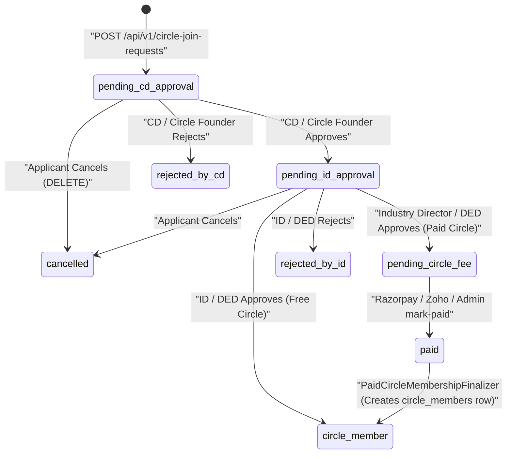
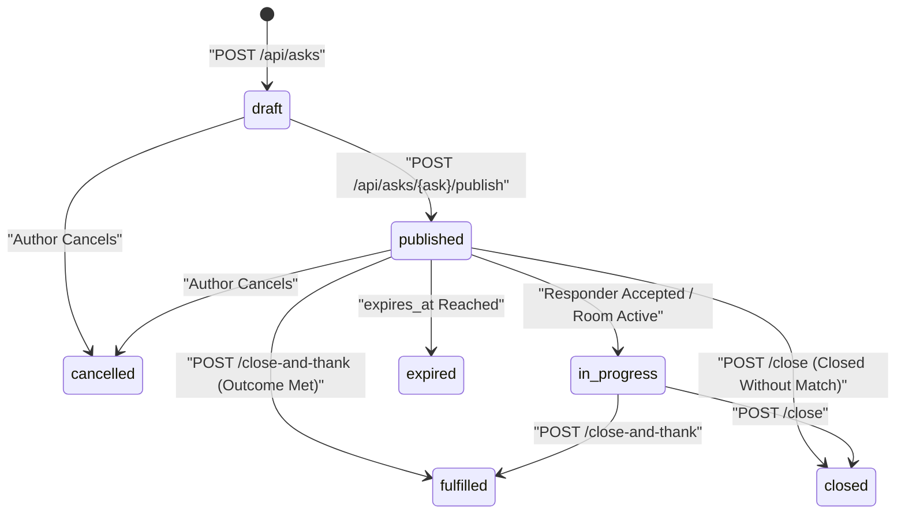
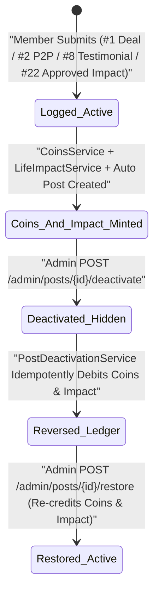

# 18 — Activity Lifecycle & Status State-Machine Reference

> **Document Scope:** Complete side-by-side comparison for all **35 Platform Activities** between **Workbook `Lifecycle States & Triggers` (Sheets 1 & 3)** and **Actual Backend PostgreSQL Status Columns / Enum Values** across all 9 lifecycle phases (`Initial`, `Submission`, `Verification`, `Approval`, `Rejection`, `Completion`, `Cancellation`, `Expiration`, `Reopening/Restoration`), highlighting every discrepancy and side effect.
>
> **Related Audit Documents:** [11-approval-and-delegation-authority.md](./11-approval-and-delegation-authority.md) · [12-master-35-activities-index.md](./12-master-35-activities-index.md) · [15-activity-database-and-metrics-mapping.md](./15-activity-database-and-metrics-mapping.md) · [25-activity-workflow-reference.md](./25-activity-workflow-reference.md) · [27-approval-and-escalation-flow.md](./27-approval-and-escalation-flow.md)

---

## 1. Key Production State Machines (Verified in Code)

### 1.1 Activity #20A — Circle Join Request 3-Stage State Machine (`CircleJoinRequestService`)

### 1.2 Activities #5, #6, #7 — Unified Ask Engine 7-State Machine (`AskService`)

### 1.3 Activities #1, #2, #8, #22, #24 & #25 — Immediate Log vs. Post Deactivation Reversal (`PostDeactivationService`)

---

## 2. Master 35-Activity Lifecycle & Status Comparison Matrix

| # | Activity | Workbook Lifecycle States & Triggers (Sheet 3 `Col 8`) | Actual Backend Status Column(s) & Exact Enum Values (`FACT`) | Phase Breakdown (Init -> Submit -> Verify/Approve/Reject -> Complete/Cancel/Expire/Restore) | Mismatch & Architectural Flag |
|---:|---|---|---|---|---|
| **1** | [Business Deals](./activities/01-business-deals.md) | `Deal Submitted -> Peer Verification -> Milestone Badge Triggered` | `business_deals`: **NO `status` column!** Only `is_deleted` (` false\|true`) + `deleted_at` (`SoftDeletes`). Linked `posts.moderation_status = 'approved'`. | **Submit/Complete:** Immediate on `POST` (mints coins + impact + public post). **Cancel/Reverse:** Soft-delete or Admin `PostDeactivationService` reverses coins/impact. | **MAJOR MISMATCH:** Workbook claims counterparty `Peer Verification` before badge/completion; DB has **zero peer-verification state** (`Requires Business Confirmation`). |
| **2** | [P2P Meetings](./activities/02-p2p-meetings.md) | `Meeting Completed -> Photo Uploaded -> Verified Peer Log` | 1. `p2p_meeting_requests.status`: `pending \| accepted \| rejected \| cancelled \| reschedule_requested` (+ `is_logged` bool). 2. `p2p_meeting_reschedule_requests.status`: `pending \| approved \| rejected`. 3. `p2p_meetings`: **NO `status` column** (`is_deleted` + `deleted_at`); auto-post has `moderation_status = 'pending'`. | **Init/Request:** `pending` -> peer `accepted`/`rejected`/`reschedule_requested` or requester `cancelled`. **Complete:** `POST /p2p-meetings` creates row + sets `request.is_logged = true`. **Reverse:** Soft-delete / Post Deactivation. | **MISMATCH:** Pre-meeting request/reschedule has full peer state machine, but completed `p2p_meetings` log has **no counterparty verification state** after upload. |
| **3** | [Normal Referrals](./activities/03-normal-referrals.md) | `Pending -> Contacted -> In Discussion -> Closed Won / Closed Lost` | 1. `referrals.status_id` -> dynamic `referral_status` table (`Not Contacted Yet`, `In Progress`, `Got Business`, `Lost/Closed`, etc.). 2. Open-category `peer_referrals.status`: `pending \| approved \| rejected`. | **Submit:** Initial `status_id` assigned. **Progression:** Receiver calls `PATCH /activities/referrals/{id}/status` across dynamic `referral_status` stages. **Cancel:** `is_deleted` / `deleted_at`. | **ALIGNED** (implemented via dynamic lookup table `referral_status` rather than hardcoded enum). |
| **4** | [I Can Help Profiles & Tags](./activities/04-i-can-help-profiles-and-tags.md) | `Profile Edit -> Tag Indexing -> Real-time Search Update` | `users.i_can_help_with` (stateless JSON overwrite); `user_tags.is_active` (`true\|false`); `tags.is_approved` (`true\|false`). | **Submit/Complete:** Immediate synchronous overwrite on `PUT /api/v1/profile`; immediately queryable in PostgreSQL. | **MINOR MISMATCH:** Synchronous DB update rather than async `ElasticSearchIndexer` pipeline. |
| **5** | [Collaboration Asks](./activities/05-collaboration-asks.md) | `Draft -> Published -> Peer Matched -> Room Created -> Closed` | `asks.status`: `draft \| published \| in_progress \| fulfilled \| closed \| cancelled \| expired`. `ask_matches.status`: `suggested \| viewed \| interested \| connected \| dismissed \| expired`. `ask_responses.status`: `pending \| accepted \| declined \| in_progress \| completed \| closed \| withdrawn`. *(Legacy `collaboration_posts.status`: `active \| expired \| deleted` — `collaborations:expire` cron at 00:10).* | **Init:** `draft` (`POST /api/asks`). **Submit:** `published` (`POST .../publish`). **Match/Progress:** `in_progress` when response accepted. **Complete:** `fulfilled` or `closed`. **Cancel/Expire:** `cancelled` or `expired` (`expires_at`). *(Note: no cron currently expires `asks` table — only legacy `collaboration_posts`!)* | **CRON GAP:** Daily `00:10` `collaborations:expire` cron updates legacy `collaboration_posts`, **not** unified `asks.status = 'expired'`! |
| **6** | [Get Help Asks](./activities/06-get-help-asks.md) | `Posted -> Advisor Replied -> Solution Accepted -> Outcome Rated` | Same `asks.status` (7 states) + `ask_responses.status` (7 states); legacy `requirements.status`: `open \| in_progress \| closed`. | `draft` -> `published` -> responder `pending` -> author `accepted` (`in_progress`) -> `fulfilled` / `closed` (`POST /close-and-thank`). | **ALIGNED** (audited in `ask_status_histories` & `ask_response_status_histories`). |
| **7** | [Referral Asks](./activities/07-referral-asks.md) | `Broadcasted -> Introducer Connected -> Intro Delivered -> Verified` | Same `asks.status` (7 states) + `ask_responses.status` (7 states) + `ask_response_contacts`. | `draft` -> `published` -> introducer submits `can_introduce_peer`/`know_someone` (`pending`) -> `accepted` -> `fulfilled` (`approx_deal_value` optional). | **ALIGNED** via Unified Ask Engine. |
| **8** | [Testimonials](./activities/08-testimonials.md) | `Written -> Published -> Moderation Check -> Profile Wall Pin` | `testimonials`: **NO `status` column!** (`is_deleted` + `deleted_at`). Linked `posts.moderation_status = 'pending'`. | **Submit:** Immediately visible on Peer Testimonials Wall; linked feed `Post` created with `moderation_status = 'pending'`. **Reject/Deactivate:** Admin `PostDeactivationService` reverses coins. | **MISMATCH:** `testimonials` row itself has no moderation or profile-pin column; only the mirrored feed `Post` has `moderation_status = 'pending'`. |
| **9** | [Entrepreneur Certification](./activities/09-entrepreneur-certification-form.md) | `Submitted -> Board Verification -> Approved -> PDF Generated` | `entrepreneur_certification_submissions.status` & `certification_submissions.status`: `new \| approved \| rejected`. | **Submit:** `new` (quiz auto-scored). **Approve:** `approved` -> `CertificateGeneratorService` renders PDF + sets `issued_at` + sends email. **Reject:** `rejected` (`admin_note`). | **ALIGNED** on lifecycle states (`new` = workbook `Pending`/`Submitted`); input is quiz rather than doc upload. |
| **10** | [Leadership Certification](./activities/10-leadership-certification-form.md) | `Role Verified -> Milestones Audited -> Seal Generated` | `leadership_certification_submissions.status` & `certification_submissions.status`: `new \| approved \| rejected`. | **Submit:** `new` (25-question leadership quiz scored). **Approve:** `approved` -> DomPDF certificate with seal. **Reject:** `rejected`. | **MISMATCH:** Driven by quiz submission + admin/leader approval (`new -> approved`), not automated RBAC role/milestone audit. |
| **11** | [Partner With Us](./activities/11-partner-with-us-form.md) | `Submitted -> Board Triage -> Due Diligence -> MOU Agreement` | `partner_with_us_submissions.status`: freeform `varchar` defaulting to `'new'` (admin sets `contacted`, `approved`, `rejected`, etc.). | **Submit:** `'new'`. **Triage:** Admin updates `status` & `notes` via `PATCH /api/v1/admin/leads/partner_with_us/{id}/status`. | Unconstrained string status rather than strict MOU enum. |
| **12** | [Brand Partner & Ads](./activities/12-brand-partner-form-and-ads.md) | `Campaign Created -> Budget Reserved -> Ad Live -> Metrics Tracked` | 1. `advertiser_applications.status`: `draft \| pending_email_verification \| submitted \| under_review \| changes_requested \| approved \| active \| rejected \| withdrawn`. 2. `advertiser_campaigns.status`: `draft \| pending_review \| changes_requested \| approved \| scheduled \| active \| paused \| rejected \| completed \| expired \| cancelled`. 3. `ad_bookings.status`: `pending \| approved \| rejected`. | **Init:** `draft` -> `pending_email_verification` -> `submitted` -> `under_review`. **Loop:** `changes_requested` -> resubmitted -> `approved` -> payment -> `active`. **Expire:** Daily `08:15` `PGU:advertiser-subscription-expiry-check` transitions to `expired`. **Cancel:** `withdrawn` / `paused` / `cancelled`. | **EXCEEDS WORKBOOK:** Production state machine is much richer (9 application states + 11 campaign states + history tables + expiry cron). |
| **13** | [Leadership Role Application](./activities/13-leadership-role-application-form.md) | `Submitted -> Nominated -> Election/Review -> Role Commissioned` | 1. In-app `leader_interest_submissions`: model references `pending \| approved \| rejected`, **but base DB table lacks `status` column!** 2. Web Portal `web_leadership_nominations.status`: `draft \| submitted \| under_review \| changes_requested \| approved \| shortlisted \| rejected \| proceeded_to_jury \| winner`. | **In-App:** `POST` inserts row; `PATCH .../approve` fails/drops `status` if column missing & does NOT commission role. **Web Portal:** `draft` -> `submitted` -> `under_review` -> `shortlisted` -> Public Voting -> `proceeded_to_jury` -> `FinalDecisionController` -> `winner`. | **CRITICAL BUG (In-App):** Missing `status` migration on `leader_interest_submissions` + broken `assignmentStore` enum crash! |
| **14** | [Become a Speaker](./activities/14-become-a-speaker-form.md) | `Profile Submitted -> Audition Review -> Accredited Speaker` | `become_speaker_submissions.status`: string defaulting to `'new'` (admin updatable via `LeadAdminApiController`). | **Submit:** `'new'` -> Admin updates `status` & `notes`. No accredited directory state. | Simple lead status string; no audition/accreditation pipeline. |
| **15** | [Become a Mentor](./activities/15-become-a-mentor-form.md) | `Application -> Screening -> Profile Published -> Sessions Bookable` | `become_mentor_submissions.status`: string defaulting to `'new'`. | **Submit:** `'new'` -> Admin updates `status` & `notes`. No bookable mentor state. | Simple lead status string; no directory/booking states. |
| **16** | [Recommend a Peer](./activities/16-recommend-a-peer-form.md) | `Endorsement Submitted -> Notification Sent -> Profile Badge Added` | `peer_recommendations.status`: `pending \| approved \| rejected \| contacted \| converted` (+ `coins_awarded` bool). | **Submit:** `pending` (coins/impact rewarded on submit per `PeerRecommendationService`). **Ops Follow-up:** Admin/Leader transitions to `approved`, `contacted`, `converted`, or `rejected`. | **MISMATCH:** CRM recruitment pipeline (`pending -> contacted -> converted`) instead of instant profile endorsement badge. |
| **17** | [Register a Visitor](./activities/17-register-a-visitor-form.md) | `Visitor Registered -> QR Pass Issued -> Checked In at Gate` | 1. Standalone `visitor_registrations.status`: `pending \| approved \| rejected` (`coins_awarded` bool). 2. Event visitor `event_registrations`: `status` (`registered\|pending\|cancelled\|rejected`) + `checkin_status` (`pending\|checked_in`). | **Standalone:** `pending` (impact credited immediately) -> Leader/DED/Admin `approved` (coins credited) or `rejected`. **Event Path:** `registered` -> QR issued -> `checked_in` at gate. | **SPLIT LIFECYCLE:** Gate check-in state exists only on `event_registrations`, not on `visitor_registrations`. |
| **18** | [Vyapaar Jagat Story](./activities/18-vyapaar-jagat-story-form.md) | `Draft -> Editorial Review -> Copy Edit -> Published Worldwide` | `sme_business_story_submissions.status`: `new \| pending \| approved \| rejected`. | **Submit:** `pending` (in-app) or `new` (public web) — **no `draft` state**. **Approve:** Admin provides `story_link` -> `approved` + syncs `users.story_link`. **Reject:** `rejected` (`rejected_reason`). | No member `draft` or `copy_edit` state in DB; starts at `pending`/`new`. |
| **19** | [Joined Circles & Memberships](./activities/19-joined-circles-and-memberships.md) | `Request Submitted -> Circle Director Approval -> Access Granted` | `circles.status`: `pending \| active \| archived`. `circle_members.status` (`circle_member_status_enum`): base `'pending' \| 'approved' \| 'rejected'` (+ optional manual DDL `'needs_attention' \| 'under_review'`; model also references `'active'\|'inactive'\|'left'` + `left_at` + `expires_at`). | **Active:** `status = 'approved'` (`left_at IS NULL`). **Flagging:** Leader Member 360° `PATCH flag-status` sets `needs_attention` / `under_review` / `approved`. **Leave/Expire:** `POST /circles/{id}/leave` sets `left_at`; daily `00:00` `memberships:expire` cron expires past-due memberships. | **ENUM HAZARD:** Writing `'inactive'` (`LeadershipController@assignmentDelete`) crashes PostgreSQL `circle_member_status_enum`! |
| **20** | [Circle Requests & Build Circle](./activities/20-circle-membership-requests-and-build-circle.md) | `Proposal Filed -> Regional Board Audit -> Charter Approved` | 1. Join (`circle_join_requests.status`): `pending_cd_approval \| pending_id_approval \| pending_circle_fee \| paid \| circle_member \| rejected_by_cd \| rejected_by_id \| cancelled` (+ `ded_approval_status`: `pending\|approved\|rejected`). 2. Build (`user_circle_requests.status`): `pending \| under_review \| approved \| rejected \| cancelled`. | **Join:** 3-stage gate (CD/CF -> ID/DED -> Fee -> `circle_member`). **Build:** `pending` -> `under_review` -> Admin `approved` (`BuildYourOwnCircleApprovalService` creates `Circle`) or `rejected` / member `cancelled`. | **EXCEEDS WORKBOOK:** Code implements both 8-state `CircleJoinRequest` and 5-state `UserCircleRequest`. |
| **21** | [Attended Events & Registrations](./activities/21-attended-events-and-registrations.md) | `Ticket Booked -> Payment Cleared -> QR Scanned at Venue` | 1. `events.status`: `scheduled \| completed \| cancelled \| approved \| rejected`. 2. `event_registrations.status`: `registered \| pending \| cancelled \| rejected`; `checkin_status`: `pending \| checked_in`; `payment_status`. 3. Cross-circle `event_registration_requests.status`: `pending \| approved \| rejected \| cancelled`. | **Cross-Circle Gate:** `pending` -> Leader/DED/Admin `approved`. **Booking:** `pending` (if paid) -> Razorpay verify -> `registered` (`qr_token` issued). **Check-In:** QR scan -> `checkin_status = 'checked_in'`. **Cancel:** `cancelled`. | **ALIGNED** + adds cross-circle `event_registration_requests` clearance gate. |
| **22** | [Impact Activity & Score](./activities/22-impact-activity-and-life-impact-score.md) | `Real-time Metric Aggregation -> Milestone Unlocked -> Honor Issued` | `impacts.status`: `pending \| approved \| rejected` (`requires_leadership_approval` bool from `config('impact.requires_leadership_approval', true)`). `life_impact_histories`: append-only ledger. | **Auto Path:** Immediate ledger insert on qualifying activities. **Manual Path:** `POST /impacts` -> `pending` -> Leader/DED/Admin `approved` (`ImpactService::approveImpact` credits `life_impact_histories`, `users.life_impacted_count`, coins, & timeline post) or `rejected`. | **ENHANCED IN CODE:** Manual impacts pass through explicit `pending -> approved\|rejected` leadership moderation! |
| **23** | [Coins, Wallet & Claims](./activities/23-coins-activity-wallet-and-history.md) | `Action Completed -> Proof Validated -> Coins Minted/Deducted` | 1. `coins_ledger`: immutable (`transaction_id`, +/- `amount`). 2. `coin_claim_requests.status`: `pending \| approved \| rejected`. 3. `wallet_transactions.status`: `pending \| success \| failed`. 4. Store Maker-Checker `wallet_adjustment_requests.status`: `PENDING \| APPROVED \| REJECTED`. | **Auto Credit/Debit:** Atomic SQL `coins_apply_transaction(...)`. **Manual Claim:** `pending` -> Admin/DED/Leader `approved` (mints coins) or `rejected`. **Store Redemption:** Cart -> OTP -> Order -> `coins_ledger` debit (refunds re-credit on return). | **ALIGNED** (fix `coin_claims` vs `coin_claim_requests` table name in `PendingRequestAdminController`). |
| **24** | [Timeline Posts Created](./activities/24-timeline-posts-created.md) | `Composed -> Media Processed -> Live on Feed -> Interaction Logged` | `posts.status`: `active \| inactive \| rejected \| hidden`; `posts.moderation_status`: `approved \| pending \| rejected`; `active` (`bool`), `is_deleted` (`bool`), `deleted_at`. | **User Post:** Published immediately (`active=true`, `moderation_status='approved'`). **Activity Auto-Post:** `business_deal` sets `approved`; `p2p_meeting` & `testimonial` set `moderation_status='pending'`. **Delete:** Author `DELETE /posts/{id}` soft-deletes. | Multiple overlapping status flags (`status`, `moderation_status`, `active`, `is_deleted`, `deleted_at`) require unified helper predicates. |
| **25** | [Deactivated / Hidden Posts](./activities/25-deactivated-hidden-posts.md) | `Hidden from Public -> In Soft-Delete Archive -> Restored or Purged` | `post_reports.status`: `pending \| reviewed \| resolved \| dismissed`. `posts`: `deactivated_at`, `deactivated_by`, `deactivation_remarks`, `status='inactive'\|'hidden'\|'rejected'`. | **Report:** Peer submits `post_reports` (`pending` -> `resolved`/`dismissed`). **Deactivate:** Admin calls `POST /admin/posts/{id}/deactivate` -> hides post & **reverses coins/impact**. **Restore:** Admin calls `POST .../restore` -> restores post & re-applies rewards. | **MISMATCH:** Restoration is **Admin-only**, not Member self-service; Leader `deletePost` soft-deletes without invoking `PostDeactivationService`. |
| **26** | [User Shorts / Videos](./activities/26-user-shorts-videos.md) | `Video Recorded -> Transcoded -> Short Streamable -> Views Counted` | Stateless FK `users.profile_video_id` (`NULL` vs `uuid` -> `files.id`). | **Upload:** `POST /files/upload` -> `POST /intro-videos` sets `profile_video_id` (first upload mints coins/impact). **Remove:** `DELETE /intro-videos` sets `profile_video_id = null` (rewards remain idempotent, not re-awarded on re-upload). | No transcoding queue or `processing`/`failed` video state. |
| **27** | [Invited Friends / Introduced Peers](./activities/27-invited-friends-introduced-peers.md) | `Invite Link Dispatched -> App Installed -> Referral Code Attributed` | 1. `contact_invitations`: `status` + `whatsapp_status`. 2. `referral_links.status`: `active \| revoked \| expired`. 3. `referraldata.reward_status`. 4. `introduction_requests.status`: `pending \| approved \| rejected`. | **Invite:** Contact synced -> WhatsApp invite sent. **Direct Attribution:** New user registers with `referral_code` -> sets `users.introduced_by`, increments `members_introduced_count`, mints coins. **Retroactive Claim:** `POST /introduction-requests` (`pending`) -> Admin/Leader `approved` or `rejected`. | **ENHANCED IN CODE:** Adds `introduction_requests` moderation workflow for retroactive introducer claims. |
| **28** | [Badges Earned](./activities/28-badges-earned.md) | `Milestone Reached -> Badge Unlocked -> Push Alert -> Displayed on Profile` | `user_milestone_badges.status`: `earned \| revoked` (`earned_at`, `revoked_at`). | **Unlock:** Threshold crossed -> `earned` + push alert. **Revocation:** Can transition to `revoked` if underlying count drops (e.g., post deactivation reversal) or admin revokes. | **ALIGNED** (includes `revoked` state for integrity). |
| **29** | [Blocked Users](./activities/29-blocked-users.md) | `User Blocked -> Visibility Revoked -> Chat Restricted -> Unblocked` | Presence/absence of row in `peer_blocks` & `speed_networking_blocked_peers` (no status column). | **Block:** `POST /peers/{user}/block` inserts row. **Unblock:** `DELETE /peers/{user}/block` deletes row, immediately restoring visibility. | **ALIGNED**. |
| **30** | [Submitted Feedback](./activities/30-submitted-feedback.md) | `Submitted -> Triage Categorized -> Routed to Product Backlog` | `feedback_forms.status`: string (default `'new'` / `'submitted'`); `event_feedbacks`: immutable post-submission row. | **Submit:** Row created + `FeedbackSubmittedMail` sent; Admin filters by `status` and `category_id`. | Read-only triage in Admin API; no multi-stage product backlog integration. |
| **31** | [Help & Support Tickets](./activities/31-help-and-support-tickets.md) | `Ticket Created -> Agent Assigned -> Discussion -> Resolved` | `support_tickets.status`: • Core API/Web: `open \| in_progress \| resolved \| closed` • Store API: `OPEN \| WAITING_FOR_ADMIN \| RESOLVED \| CLOSED` | **Submit:** `open` / `OPEN` (`sla_due_at = +24h` on Store). **Assign & Reply:** Admin assigns `assigned_to`, replies (`WAITING_FOR_ADMIN` / `in_progress`). **Complete:** `resolved` / `RESOLVED` -> `closed` / `CLOSED` (`resolved_at`). | **BUG:** Case-sensitivity split (`open` vs `OPEN`) in `support_tickets.status` between Core and Store controllers! |
| **32** | [Membership Plan & Subscriptions](./activities/32-membership-plan-and-subscriptions.md) | `Tier Selected -> Payment Gateway Verified -> Entitlements Activated` | 1. `payments.status`: `created \| pending \| success \| failed \| cancelled` (+ `'Paid'` in `LeaderFinanceService::recordOfflinePayment`!). 2. `user_memberships.status`: `active \| queued \| expired \| cancelled`. 3. `users.membership_status`: `visitor \| free_peer \| free_trial_peer \| Only Unity Peer \| global_peer \| circle_peer \| multi_circle_peer \| charter_peer \| suspended \| expired`. | **Checkout:** `payments.created` -> gateway/webhook verify -> `success` -> activates `user_memberships` (`active`, or `queued` for early renewal). **Expiration:** Hourly `memberships:expire-users`, `users:expire-trial`, and daily `00:00` `memberships:expire` transition past-due memberships to `expired`. **Reopen:** Renewal payment restores active tier. | **CASE BUG:** `LeaderFinanceService::recordOfflinePayment` writes `'Paid'` (capitalized) whereas standard Razorpay/Zoho flows write lowercase `'success'`! |
| **33** | [Who Viewed My Profile](./activities/33-who-viewed-my-profile.md) | `Profile Opened -> Background Event Logged -> Aggregated in Feed` | Stateless row in `profile_views` (`created_at`, `updated_at`). | **First View:** Inserts `(viewed_id, viewer_id)` + sends `profile_viewed` notification. **Repeat View:** `$existing->touch()` updates `updated_at` without duplicate notification spam. | **ALIGNED** (smart deduplication prevents notification spam). |
| **34** | [Profile Edit History & Last Updated](./activities/34-profile-edit-history-and-last-updated.md) | `Fields Modified -> Saved -> ElasticSearch Synced -> Audit Timestamp Set` | `users.updated_at`; `contact_change_otps` (`expires_at`, `consumed_at`); `custom_category_requests.status` (`pending \| approved \| rejected`). | **Standard Fields:** Immediate save + `users.updated_at` bump. **Email/Phone Change:** `request-otp` (`pending`) -> `verify-otp` (`consumed_at` set + `users.email`/`phone` updated). | **ALIGNED** (with OTP verification gate on email/phone changes). |
| **35** | [Last Month Activity Summary](./activities/35-last-month-activity-summary.md) | `Month Closes -> Aggregation Job -> Infographic Rendered -> Shareable` | Member summary: stateless on-demand query. Leader Circle Report (`leader_reports.status`): `'submitted'` / `'reviewed'`. | **Member:** Computed live on every `GET /api/v1/profile/last-month-activity` call. **Leader Report:** `POST /leader/reports` creates `leader_reports` (`submitted_at`), immediately downloadable as PDF. | Live query replaces monthly batch cron job (`MonthlyReportCronWorker` not needed). |
