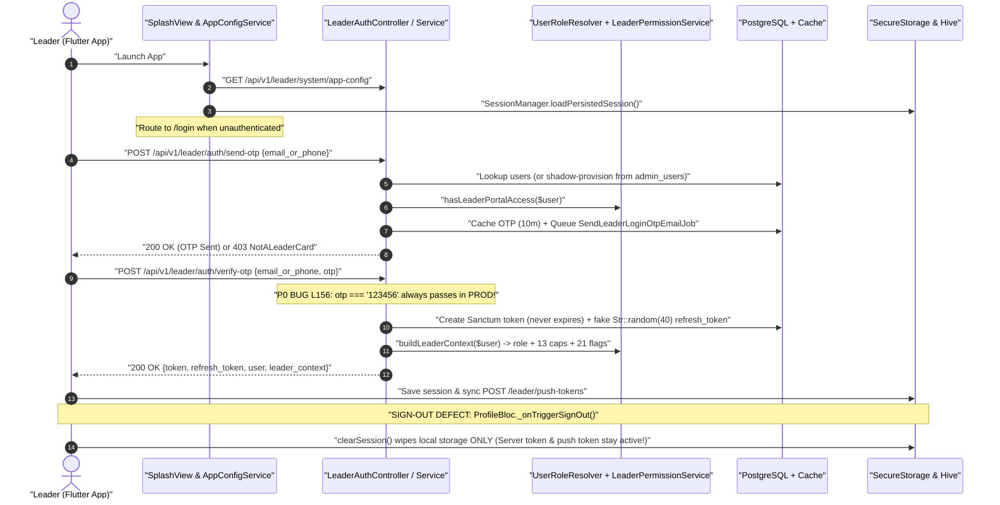
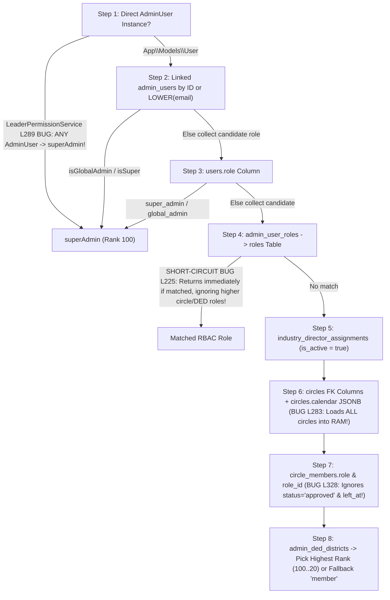

# 20 — Authentication, Session Lifecycle & Role Resolution Flow

> **Audit Scope:** End-to-end authentication, session persistence, dynamic RBAC resolution, capability mapping, navigation gating, and sign-out workflows across the **Flutter Leadership App** (`/api/v1/leader/auth/*`) and the **DED API Family** (`/api/v1/ded/auth/*`).
> **Related Deliverables:** [02-existing-leadership-app-audit.md](./02-existing-leadership-app-audit.md) · [03-existing-backend-api-inventory.md](./03-existing-backend-api-inventory.md) · [06-complete-role-hierarchy.md](./06-complete-role-hierarchy.md) · [08-master-role-permission-matrix.md](./08-master-role-permission-matrix.md) · [10-role-wise-screen-access.md](./10-role-wise-screen-access.md) · [42-rbac-security-audit.md](./42-rbac-security-audit.md)

---

## 1. Executive Summary & Subsystem Classification

| Sub-Workflow | Primary Surface & Endpoints | Classification | Verified Audit Verdict |
|---|---|---|---|
| **1. App Boot, Maintenance & Version Gate** | `SplashView` → `AppConfigService` (`GET /leader/system/app-config` / `GET /system/version`) → `MaintenanceView` | `Fully Implemented` | Enforces maintenance mode and force/optional app update before routing to `/home` or `/login`; swallows config network errors gracefully for offline boot. |
| **2. Leader OTP Request & Shadow Provisioning** | `LoginView` → `POST /api/v1/leader/auth/send-otp` ([LeaderAuthService.php](file:///c:/Users/malic/OneDrive/Documents/GitHub/unity-app-new/app/Leader/Services/LeaderAuthService.php#L345-L408)) | `Implemented but Incorrect` | Auto-provisions shadow `users` row from `admin_users`, **but** phone lookup uses suffix `LIKE "%{$short}"` across `phone` & `secondary_mobile`, and `AdminUser` email lookup checks `User::where('id', $admin->id)` without fallback to `LOWER(email)`. |
| **3. Leader OTP Verification & Token Minting** | `OtpView` → `POST /api/v1/leader/auth/verify-otp` ([LeaderAuthService.php:141-208](file:///c:/Users/malic/OneDrive/Documents/GitHub/unity-app-new/app/Leader/Services/LeaderAuthService.php#L141-L208)) | `Implemented but Incorrect` (`P0`) | **CRITICAL BACKDOOR**: Line 156 (`if ($otp === '123456') { $isValid = true; }`) is active in **production** without any environment check! Returns non-expiring Sanctum token (`expiration => null`) plus a fake unstored `refresh_token = Str::random(40)`. |
| **4. 8-Step Role & 13-Capability Resolution** | `UserRoleResolverService` + `LeaderPermissionService` → `SessionManager` | `Implemented but Incorrect` | Loads **all** `Circle` rows into memory on uncached calls (`L283`), treats `pending`/`left` `circle_members` as active leaders (`L328`), omits `committee_leader` & `global_founder`, grants `coin_payouts` to every seeded role via `DynamicRbacSeeder`, and leaves `CheckLeaderCapability` (`leader.can`) **100% unused** on routes! |
| **5. Leader Sign-Out & Token Revocation** | `ProfileView` → `ProfileSignOutBottomSheet` / `ProfileSignOutDialog` → `SessionManager.clearSession()` | `Implemented but Incorrect` | **Local-only wipe**: `routes/leader.php` defines **no `/leader/auth/logout` or `/refresh` route**; Sanctum tokens and `user_push_tokens` remain active forever on server. Calling `/api/v1/auth/logout` with an `AdminUser` token crashes with `TypeError` in `OnlineStatusService::markOffline(User $user)`. |
| **6. Separate DED `AdminUser` Auth Flow** | `POST /api/v1/ded/auth/request-otp` & `verify-otp` ([DedAuthController.php](file:///c:/Users/malic/OneDrive/Documents/GitHub/unity-app-new/app/Http/Controllers/Api/V1/Ded/DedAuthController.php#L27-L157)) | `Fully Implemented` (parallel guard) | Authenticates `AdminUser` (not `User`), verifies 4-digit hashed OTP in `admin_login_otps`, mints `ded-mobile-api` Sanctum token on `AdminUser`, and enforces `EnsureDedApiAccess`. |

---

## 2. Workflow A — App Startup, OTP Authentication & Session Persistence

### 2.1 Current Verified Flow (`**FACT:**`)

1. **Cold Boot & Config Gate (`main.dart` → `SplashView`)**:
   - [main.dart](file:///D:/office%20project/LeaderApp-Fornt-end-/lib/main.dart) initializes `Firebase.initializeApp()`, `HiveCacheService`, Lottie assets, `SessionManager.loadPersistedSession()` ([session_manager.dart:134-159](file:///D:/office%20project/LeaderApp-Fornt-end-/lib/core/helpers/session_manager.dart#L134-L159)), and `PushNotificationService.initialize()`.
   - [splash_view.dart](file:///D:/office%20project/LeaderApp-Fornt-end-/lib/features/splash/view/splash_view.dart) runs a ~2.7s minimum animation while [app_config_service.dart](file:///D:/office%20project/LeaderApp-Fornt-end-/lib/core/services/app_config_service.dart) fetches remote app config (`GET /api/v1/leader/system/app-config` / `GET /api/v1/system/version` in [LeaderSystemController.php](file:///c:/Users/malic/OneDrive/Documents/GitHub/unity-app-new/app/Leader/Controllers/LeaderSystemController.php#L1-L33)).
   - If maintenance mode is active, navigates to [maintenance_view.dart](file:///D:/office%20project/LeaderApp-Fornt-end-/lib/features/maintenance/view/maintenance_view.dart); if `min_supported_version` exceeds build, triggers force-update dialog; otherwise routes to `/home` if `SessionManager().isAuthenticated` else `/login`.
2. **Leader Identifier Lookup & OTP Dispatch (`POST /api/v1/leader/auth/send-otp`)**:
   - Leader opens [login_view.dart](file:///D:/office%20project/LeaderApp-Fornt-end-/lib/features/login/view/login_view.dart) and selects WhatsApp/Phone (`InternationalPhoneField`, currently capped at 10 national digits via `LengthLimitingTextInputFormatter(10)`) or Email (`LoginInputField`).
   - `LoginBloc` calls `POST /api/v1/leader/auth/send-otp` ([LeaderAuthController.php:23](file:///c:/Users/malic/OneDrive/Documents/GitHub/unity-app-new/app/Leader/Controllers/LeaderAuthController.php#L23) → [LeaderAuthService.php:345-408](file:///c:/Users/malic/OneDrive/Documents/GitHub/unity-app-new/app/Leader/Services/LeaderAuthService.php#L345-L408)).
   - `findUserByIdentifier()` searches `users` by `LOWER(email)` or last-10-digit suffix `LIKE "%{$short}"` on `phone` / `secondary_mobile`. If absent in `users` but present in `admin_users` with an eligible role (`super_admin`, `global_admin`, `country_director`, `ded`, `industry_director`, `circle_founder`, `circle_director`), `ensureLeaderUserFromAdminAccount()` auto-provisions a shadow `App\Models\User` record.
   - Calls `LeaderPermissionService::hasLeaderPortalAccess($user)`; if `false`, returns HTTP `403`, causing `LoginView` to render [not_a_leader_card.dart](file:///D:/office%20project/LeaderApp-Fornt-end-/lib/features/login/view/widgets/not_a_leader_card.dart).
   - Otherwise caches a 6-digit OTP under `leader_otp:{id}` (TTL 10 minutes) via `OtpService` and dispatches `SendLeaderLoginOtpEmailJob` (+ WhatsApp OTP where configured).
3. **OTP Verification & Session Hydration (`POST /api/v1/leader/auth/verify-otp`)**:
   - Leader enters 6 digits on [otp_view.dart](file:///D:/office%20project/LeaderApp-Fornt-end-/lib/features/otp/view/otp_view.dart). `OtpBloc` calls `POST /api/v1/leader/auth/verify-otp` ([LeaderAuthService.php:141-208](file:///c:/Users/malic/OneDrive/Documents/GitHub/unity-app-new/app/Leader/Services/LeaderAuthService.php#L141-L208)).
   - **FACT (`P0` Production Auth Bypass)**: At [LeaderAuthService.php:156-159](file:///c:/Users/malic/OneDrive/Documents/GitHub/unity-app-new/app/Leader/Services/LeaderAuthService.php#L156-L159), `if ($otp === '123456') { $isValid = true; }` executes unconditionally in **all environments**, allowing instant takeover of any Leader or `Super Admin` account without calling `send-otp`! *(Separate production zero-OTP `@gmail.com` backdoors also exist in `AuthController.php:1497` and `AdminAuthService.php:196-245`.)*
   - Mints Sanctum token `$user->createToken('leader-mobile-app')->plainTextToken` (`config/sanctum.php:53` sets `'expiration' => null`), generates a dummy `$refreshToken = Str::random(40)` ([L180-L181](file:///c:/Users/malic/OneDrive/Documents/GitHub/unity-app-new/app/Leader/Services/LeaderAuthService.php#L180-L181)) that is **never persisted in PostgreSQL or Redis**, registers any supplied FCM token, and returns `{ token, refresh_token, token_type: 'Bearer', user, leader_context }`.
   - `SessionManager.setAuthSession()` ([session_manager.dart:162-187](file:///D:/office%20project/LeaderApp-Fornt-end-/lib/core/helpers/session_manager.dart#L162-L187)) saves `token`, `refreshToken`, `UserSession`, and `LeaderPermissions` into `SecureStorageService`, triggers `PushNotificationService.instance.syncTokenWithBackend()` (`POST /api/v1/leader/push-tokens`), and navigates to `/home` ([dashboard_view.dart](file:///D:/office%20project/LeaderApp-Fornt-end-/lib/features/dashboard/view/dashboard_view.dart)).

### 2.2 Mandatory 11-Question Operational Walkthrough — Leader OTP Login & Sign-Out

| # | Workflow Question | Current Verified Answer (`**FACT:**`) | Status / Defect |
|---:|---|---|---|
| **1** | **Who initiates the operation?** | Any Peer or Admin holding a Circle, Industry, District, Country, or Global leadership assignment (`App\Models\User` or shadow-provisioned `AdminUser`). | `Fully Implemented` |
| **2** | **Which screen is opened?** | [splash_view.dart](file:///D:/office%20project/LeaderApp-Fornt-end-/lib/features/splash/view/splash_view.dart) → [login_view.dart](file:///D:/office%20project/LeaderApp-Fornt-end-/lib/features/login/view/login_view.dart) → [otp_view.dart](file:///D:/office%20project/LeaderApp-Fornt-end-/lib/features/otp/view/otp_view.dart) → [dashboard_view.dart](file:///D:/office%20project/LeaderApp-Fornt-end-/lib/features/dashboard/view/dashboard_view.dart). Sign-out via [profile_view.dart](file:///D:/office%20project/LeaderApp-Fornt-end-/lib/features/profile/view/profile_view.dart#L73-L110) → `ProfileSignOutBottomSheet` / [profile_sign_out_dialog.dart](file:///D:/office%20project/LeaderApp-Fornt-end-/lib/features/profile/view/widgets/profile_sign_out_dialog.dart). | `Fully Implemented` |
| **3** | **What information is entered?** | Step 1: Email or E.164 phone (`<dialCode><10 digits>`). Step 2: 6-digit OTP + device metadata (`device_name`, `fcm_token`, `platform`, `device_id`, `app_version`). | `Requires Enhancement` (10-digit phone cap blocks international lengths) |
| **4** | **Which API is called?** | `GET /api/v1/leader/system/app-config` → `POST /api/v1/leader/auth/send-otp` → `POST /api/v1/leader/auth/verify-otp` → `POST /api/v1/leader/push-tokens` → `GET /api/v1/leader/profile`. Sign-out calls **no API**! | `Implemented but Incorrect` (missing `/logout` & `/refresh`) |
| **5** | **Which backend controller & service processes it?** | [LeaderAuthController.php](file:///c:/Users/malic/OneDrive/Documents/GitHub/unity-app-new/app/Leader/Controllers/LeaderAuthController.php) → [LeaderAuthService.php](file:///c:/Users/malic/OneDrive/Documents/GitHub/unity-app-new/app/Leader/Services/LeaderAuthService.php) + [UserRoleResolverService.php](file:///c:/Users/malic/OneDrive/Documents/GitHub/unity-app-new/app/Shared/Services/UserRoleResolverService.php) + [LeaderPermissionService.php](file:///c:/Users/malic/OneDrive/Documents/GitHub/unity-app-new/app/Leader/Services/LeaderPermissionService.php). | `Implemented but Incorrect` |
| **6** | **Which authorization & scope check runs?** | Public OTP endpoints enforce `throttle:20,1` and `LeaderPermissionService::hasLeaderPortalAccess($user)` (`403` for regular `member`). Authenticated routes enforce `['auth:sanctum', 'leader.user']` ([EnsureLeaderUser.php](file:///c:/Users/malic/OneDrive/Documents/GitHub/unity-app-new/app/Leader/Middleware/EnsureLeaderUser.php)), **but `CheckLeaderCapability` (`leader.can`) is applied to 0 routes**! | `Implemented but Incorrect` (`P0` Backdoor + Unused `leader.can`) |
| **7** | **What database operation occurs?** | Optional shadow `INSERT INTO users` (from `admin_users`); cache write `leader_otp:{id}`; `INSERT INTO personal_access_tokens` (`leader-mobile-app`); `UPSERT INTO user_push_tokens` (`app = 'leader'`) + mirror to `users.leader_android_fcm_token` / `leader_ios_fcm_token`. | `Implemented but Incorrect` (`refresh_token` discarded) |
| **8** | **Which status changes?** | Client `SessionManager.isAuthenticated` transitions `false` → `true`; `user_push_tokens.is_active = true`. On sign-out, client clears `SecureStorageService` & `HiveCacheService` while DB token stays active! | `Implemented but Incorrect` |
| **9** | **Who receives the result?** | Leader's mobile device receives Bearer token, `user` profile, `leader_context` (`role`, `role_label`, `regional_scope`, `managed_circles`, `enabled_capabilities`, and 21 boolean `can_*` flags). | `Fully Implemented` |
| **10** | **Which notification is generated?** | Login OTP email (`SendLeaderLoginOtpEmailJob` → `email_logs`) and/or WhatsApp OTP message. | `Fully Implemented` |
| **11** | **What happens next?** | `DashboardBottomNavBar` renders visible tabs (`Dashboard`, `Peers`, `Teams`, `Finance`, `Reports`) per `LeaderPermissions`, marks `AppNotificationNavigator.instance.markReady()`, and loads Tab 0 KPIs. | `Fully Implemented` |

### 2.3 Leader App Login, Token & Sign-Out Sequence Diagram

---

## 3. Workflow B — 8-Step Role Precedence & 13-Capability Resolution

### 3.1 `UserRoleResolverService` 8-Step Precedence & Verified Bugs (`**FACT:**`)

When `EnsureLeaderUser`, `LeaderAuthService`, or `GET /api/v1/leader/profile` resolves a user's role, [UserRoleResolverService.php](file:///c:/Users/malic/OneDrive/Documents/GitHub/unity-app-new/app/Shared/Services/UserRoleResolverService.php#L122-L382) evaluates **8 sources in order**:

**Critical Role & Capability Resolution Defects (`Implemented but Incorrect`)**:
1. **Unverified Email Bridging (`HIGH-3`)**: Step 2 links `users` to `admin_users` by `LOWER(email)`, even though `AuthController::register()` leaves `email_verified_at = null`.
2. **Expired Roles Never Filtered**: Step 4 (`admin_user_roles.expires_at`) never checks `expires_at > now()`.
3. **Full-Table Memory Load**: Step 6 ([UserRoleResolverService.php:283](file:///c:/Users/malic/OneDrive/Documents/GitHub/unity-app-new/app/Shared/Services/UserRoleResolverService.php#L283)) executes `Circle::query()->whereNull('deleted_at')->get()` into PHP memory on every uncached call.
4. **Pending/Rejected Circle Members Treated as Leaders**: Step 7 ([L328-L350](file:///c:/Users/malic/OneDrive/Documents/GitHub/unity-app-new/app/Shared/Services/UserRoleResolverService.php#L328-L350)) omits `WHERE status = 'approved' AND left_at IS NULL`.
5. **Unreachable `circleChair` & Missing `committee_leader` / `global_founder`**: `normalizeRoleKey()` maps `chair`/`circle_chair` to `chairBusinessGrowth` (making `circleChair` unreachable) and fails to recognize `committee_leader` or `global_founder` (`is_leader = false`).
6. **`DynamicRbacSeeder` Grants `coin_payouts` to All Roles**: In [LeaderPermissionService.php:316-464](file:///c:/Users/malic/OneDrive/Documents/GitHub/unity-app-new/app/Leader/Services/LeaderPermissionService.php#L316-L464), step 1 reads `leader_role_capabilities`, step 2 maps `role_module_access` (where `coins` visibility grants `coin_payouts` down to `secretary` and `finance-analytics` visibility grants `manage_finance`, while dropping `track_milestones`!), and step 3 falls back to `getDefaultRoleCapabilities()`.
7. **Client Super-Admin Substring Matching (`R3`)**: [session_manager.dart:242-245](file:///D:/office%20project/LeaderApp-Fornt-end-/lib/core/helpers/session_manager.dart#L242-L245) sets `isSuperAdmin = true` whenever `role.label` or `customRoleLabel` contains `'admin'` (granting `LeaderPermissions.allGranted` in UI!).

---

## 4. Workflow C — Separate DED `AdminUser` Authentication Flow (`/api/v1/ded/auth/*`)

### 4.1 Mandatory 11-Question Operational Walkthrough — DED API Auth

| # | Workflow Question | Current Verified Answer (`**FACT:**`) | Status / Defect |
|---:|---|---|---|
| **1** | **Who initiates the operation?** | District Executive Director (`AdminUser` with `ded` role and assigned `admin_ded_districts` row). | `Fully Implemented` |
| **2** | **Which screen is opened?** | Web/DED Portal client consuming `/api/v1/ded/*` (note: Flutter Leadership App uses `/api/v1/leader/auth/*` instead, shadow-provisioning DEDs into `App\Models\User`). | `Fully Implemented` |
| **3** | **What information is entered?** | `email` → 4-digit numeric OTP. | `Fully Implemented` |
| **4** | **Which API is called?** | `POST /api/v1/ded/auth/request-otp` & `POST /api/v1/ded/auth/verify-otp` (`throttle:10,1` at [api.php:467-470](file:///c:/Users/malic/OneDrive/Documents/GitHub/unity-app-new/routes/api.php#L467-L470)), followed by `GET /api/v1/ded/me`. | `Fully Implemented` |
| **5** | **Which backend controller & service processes it?** | [DedAuthController.php](file:///c:/Users/malic/OneDrive/Documents/GitHub/unity-app-new/app/Http/Controllers/Api/V1/Ded/DedAuthController.php#L27-L157) & `DedContextController@me`. | `Fully Implemented` |
| **6** | **Which authorization & scope check runs?** | Verifies `AdminCircleScope::isDed($admin)` on login; protected `/api/v1/ded/*` routes run [EnsureDedApiAccess.php](file:///c:/Users/malic/OneDrive/Documents/GitHub/unity-app-new/app/Http/Middleware/EnsureDedApiAccess.php#L19-L55) (`$user instanceof AdminUser`, `is_active`, `isDed`, non-empty `resolveDedDistrict`). | `Fully Implemented` |
| **7** | **What database operation occurs?** | Stores hashed 4-digit OTP in `admin_login_otps`; mints `AdminUser` Sanctum token (`ded-mobile-api`) in `personal_access_tokens`. | `Implemented but Incorrect` (logout crash) |
| **8** | **Which status changes?** | `admin_login_otps` marked consumed; `AdminUser` token active. **BUG**: Calling `POST /api/v1/auth/logout` ([AuthController.php:1928](file:///c:/Users/malic/OneDrive/Documents/GitHub/unity-app-new/app/Http/Controllers/Api/AuthController.php#L1928)) with this `AdminUser` token throws `TypeError` in `OnlineStatusService::markOffline(User $user)` ([OnlineStatusService.php:39](file:///c:/Users/malic/OneDrive/Documents/GitHub/unity-app-new/app/Services/OnlineStatusService.php#L39))! | `Implemented but Incorrect` |
| **9** | **Who receives the result?** | DED client receives `{ token, admin, districts }` and can query `/api/v1/ded/leadership/*`, `/ded/dashboard`, `/ded/pending-requests/*`. | `Fully Implemented` |
| **10** | **Which notification is generated?** | 4-digit DED login OTP email. | `Fully Implemented` |
| **11** | **What happens next?** | DED operates district-scoped analytics and 5-category pending request approvals. | `Fully Implemented` |

---

## 5. Target Enhanced Authentication & Session Flow (`**RECOMMENDATION:**`)

1. **Eliminate Production Auth Backdoors Immediately (`P0`)**:
   - Delete `if ($otp === '123456')` from [LeaderAuthService.php:156-159](file:///c:/Users/malic/OneDrive/Documents/GitHub/unity-app-new/app/Leader/Services/LeaderAuthService.php#L156-L159) (and all other services), and remove hardcoded `@gmail.com` / `'Harsh@123'` bypasses in `AuthController` and `AdminAuthService`.
2. **Implement Real Token Rotation, Expiry & Server-Side Logout**:
   - Configure finite access token TTL (e.g. 24h) + hashed DB-backed refresh tokens (`POST /api/v1/leader/auth/refresh` with single-flight `QueuedInterceptor` in Flutter `ApiClient`), and wire `POST /api/v1/leader/auth/logout` in [routes/leader.php](file:///c:/Users/malic/OneDrive/Documents/GitHub/unity-app-new/routes/leader.php) + `ProfileBloc._onTriggerSignOut()` to revoke the current Sanctum token and deactivate the device's `user_push_tokens` row before `SessionManager().clearSession()`.
   - Guard `OnlineStatusService::markOffline()` with `if ($user instanceof User)` so `AdminUser` tokens can log out cleanly without `TypeError`.
3. **Fix `UserRoleResolverService` & Enforce `leader.can` Middleware**:
   - Query `circles` via indexed JSONB/column `WHERE` clauses instead of loading all circles into memory (`L283`); filter `circle_members` by `status = 'approved' AND left_at IS NULL`; filter `admin_user_roles` / `user_organizational_assignments` by active date windows; add `committeeLeader` and `global_founder`; fix `DynamicRbacSeeder` capability mapping (`coins` view != `coin_payouts`; `finance` view != `manage_finance`); and apply `leader.can:<capability>` across every route in `routes/leader.php`.
