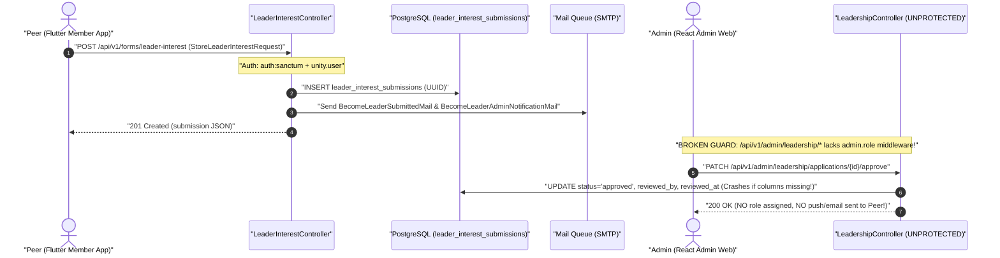
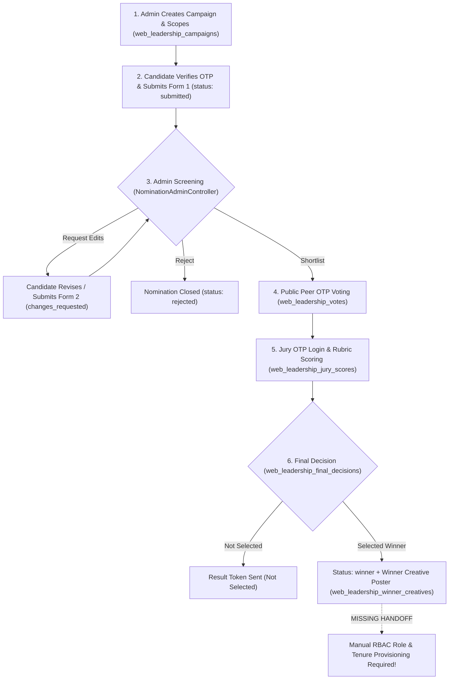
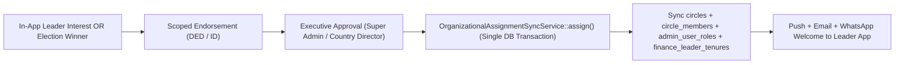

# 21 — Leadership Application & Approval Flow

> **Audit Scope:** End-to-end technical and operational workflow audit of both leadership intake pipelines in the Peers Global ecosystem: **(A) In-App Leader Interest Submission & Review** (`leader_interest_submissions`) and **(B) Website Leadership Election & Nomination Portal** (23 `web_leadership_*` tables).
> **Related Deliverables:** [06-complete-role-hierarchy.md](./06-complete-role-hierarchy.md) · [08-master-role-permission-matrix.md](./08-master-role-permission-matrix.md) · [11-approval-and-delegation-authority.md](./11-approval-and-delegation-authority.md) · [22-leadership-assignment-and-management-flow.md](./22-leadership-assignment-and-management-flow.md) · [activities/13-leadership-role-application-form.md](./activities/13-leadership-role-application-form.md)

---

## 1. Executive Summary & Subsystem Classification

**FACT:** Peers Global operates **two completely separate** leadership intake architectures with zero shared persistence or automated cross-handoff into live RBAC role assignments:

| Pipeline | Primary Storage | Surface & Audience | Implementation Classification | Core Architectural Status |
|---|---|---|---|---|
| **Flow A — In-App Leader Interest ("Become a Leader")** | `leader_interest_submissions` | Flutter Member App (`LeadershipRoleScreen`) → Admin API / Blade Web / Leader Activity Feed | `Implemented but Incorrect` | Member submission (`POST /api/v1/forms/leader-interest`) works and sends emails, **but** Admin `approve`/`reject` endpoints write columns (`status`, `admin_remarks`, `reviewed_by`, `reviewed_at`) missing from baseline schema & `$fillable`, lack admin guard middleware, and perform **zero RBAC role assignment** upon approval. |
| **Flow B — Website Leadership Election & Nomination Portal** | 23 `web_leadership_*` tables | Public SPA (`/leadership/*`) + React Admin Web (`src/features/webLeadership/*`) + Jury OTP Portal | `Partially Implemented` | Full multi-stage election engine (Campaigns → OTP Nomination Form 1 & Form 2 → Admin Shortlist → Peer OTP Voting → Jury OTP Scoring → Final Decision → Winner Creative), **but** admin endpoints lack role-level guards (`CRITICAL-5`), Jury/Result OTP checks accept hardcoded `'123456'` in production (`CRITICAL-3`), and winning `FinalDecision` does **not** auto-provision `user_organizational_assignments` or `circle_members`. |
| **Leader App Candidate Review Surface** | Read-only feed via `LeaderActivitiesService` | Flutter Leadership App (`LeaderActivitiesView` for `leadership-interests`) | `Requires Enhancement` | Leaders can view `leadership-interests` activity feed items, **but** cannot review, endorse, shortlist, or approve leadership applications inside the Flutter Leadership App, and `leader_interest_submissions` is excluded from the 10-category `/leader/pending-requests` queue. |

---

## 2. Flow A — In-App Leader Interest ("Become a Leader") Workflow

### 2.1 Current Verified Flow (`**FACT:**`)

**WORKBOOK REQUIREMENT:** Activity #13 (*Leadership Role Application Form*, Row 21 of `PEERS UNITY — MASTER ACTIVITY & ARCHITECTURE DIRECTORY.xlsx`) specifies that a Peer opens `LeadershipRoleScreen` / `CandidateApplicationSheet`, enters desired position, vision statement, and weekly hours, progresses through `Submitted -> Nominated -> Election/Review -> Role Commissioned`, and triggers conceptual `GovernanceElectionService` + `RBACPermissionUpdater`.

**FACT:** In the actual Laravel 12 codebase (`unity-app-new`), In-App Leader Interest is implemented as a standalone form submission stored in `leader_interest_submissions`:

1. **Submission (`POST /api/v1/forms/leader-interest`)**:
   - Routed at [api.php](file:///c:/Users/malic/OneDrive/Documents/GitHub/unity-app-new/routes/api.php#L1690) under `['auth:sanctum', 'unity.user']` to [LeaderInterestController.php](file:///c:/Users/malic/OneDrive/Documents/GitHub/unity-app-new/app/Http/Controllers/Api/V1/Forms/LeaderInterestController.php#L18-L62).
   - Validated by [StoreLeaderInterestRequest.php](file:///c:/Users/malic/OneDrive/Documents/GitHub/unity-app-new/app/Http/Requests/Forms/StoreLeaderInterestRequest.php#L16-L31):
     - `applying_for` (`required|in:self,other` — note model docblocks also reference `'myself'|'referring_friend'`).
     - `leadership_roles` (`nullable|array`, required `min:1` when `applying_for=self`; allowed values: `founder`, `director`, `industry_director`, `ded`, `chair`, `vice_chair`, `secretary`, `committee_leader`).
     - `contribute_domains` (`array`), `primary_domain` (`max:100`), `contribute_city`, `why_interested` (`max:500`), `excitement` (`max:500`), `ownership`, `time_commitment`, `has_led_before` (`bool`), `referred_name`, `referred_mobile`, `message`.
   - Inserts a new UUID row into `leader_interest_submissions` (`HTTP 201`) and dispatches `BecomeLeaderSubmittedMail` (to applicant) and `BecomeLeaderAdminNotificationMail` (to admin mailbox).
2. **Applicant Self-History (`GET /api/v1/forms/leader-interest/my`)**:
   - Routed at [api.php](file:///c:/Users/malic/OneDrive/Documents/GitHub/unity-app-new/routes/api.php#L1691) to [LeaderInterestController.php](file:///c:/Users/malic/OneDrive/Documents/GitHub/unity-app-new/app/Http/Controllers/Api/V1/Forms/LeaderInterestController.php#L64-L73), returning the authenticated Peer's submissions ordered by `created_at DESC`.
3. **Leader App & Web Visibility**:
   - **Flutter Leadership App**: Exposed read-only via `GET /api/v1/leader/activities?type=leader_interest` / `GET /api/v1/leader/activities/leadership-interests` in [LeaderActivitiesController.php](file:///c:/Users/malic/OneDrive/Documents/GitHub/unity-app-new/app/Leader/Controllers/LeaderActivitiesController.php) and [LeaderActivitiesService.php](file:///c:/Users/malic/OneDrive/Documents/GitHub/unity-app-new/app/Leader/Services/LeaderActivitiesService.php#L2380-L2420), rendered in [leader_activities_view.dart](file:///D:/office%20project/LeaderApp-Fornt-end-/lib/features/leader_activities/view/leader_activities_view.dart).
   - **React Admin Web & Blade Admin**: Rendered in [LeadershipPage.tsx](file:///D:/office%20project/unity-admin-web/src/features/leadership/LeadershipPage.tsx) / [FormsPage.tsx](file:///D:/office%20project/unity-admin-web/src/features/forms/FormsPage.tsx) and Blade `/admin/activities/become-a-leader` ([ActivitiesLeaderInterestController.php](file:///c:/Users/malic/OneDrive/Documents/GitHub/unity-app-new/app/Http/Controllers/Admin/ActivitiesLeaderInterestController.php)).
4. **Admin Review (`PATCH` Approve / Reject — Duplicated Across Two Controllers)**:
   - Duplicate Route Pair 1 ([api.php](file:///c:/Users/malic/OneDrive/Documents/GitHub/unity-app-new/routes/api.php#L1137-L1140)): `GET /api/v1/admin/leadership/applications`, `GET .../{id}`, `PATCH .../{id}/approve`, `PATCH .../{id}/reject` → [LeadershipController.php](file:///c:/Users/malic/OneDrive/Documents/GitHub/unity-app-new/app/Http/Controllers/Api/V1/Admin/LeadershipController.php#L25-L61).
   - Duplicate Route Pair 2 ([api.php](file:///c:/Users/malic/OneDrive/Documents/GitHub/unity-app-new/routes/api.php#L1276-L1279)): `GET /api/v1/admin/forms/leader-interest`, `GET .../{id}`, `PATCH .../{id}/approve`, `PATCH .../{id}/reject` → [AdminOpsController.php](file:///c:/Users/malic/OneDrive/Documents/GitHub/unity-app-new/app/Http/Controllers/Api/V1/Admin/AdminOpsController.php#L626-L653).

### 2.2 Mandatory 11-Question Operational Walkthrough — Flow A (In-App Leader Interest)

| # | Workflow Question | Current Verified Answer (`**FACT:**`) | Status / Defect |
|---:|---|---|---|
| **1** | **Who initiates the operation?** | Authenticated Peer (`App\Models\User`) applying for themselves (`applying_for = 'self'`) or nominating another Peer (`applying_for = 'other'`). Reviewer is an Admin user on React Admin Web. | `Fully Implemented` (intake) |
| **2** | **Which screen is opened?** | **Member App**: `LeadershipRoleScreen` (in `D:\office project\peers-unity\unity_app\lib\features\menu\...`). **Admin Web**: [LeadershipPage.tsx](file:///D:/office%20project/unity-admin-web/src/features/leadership/LeadershipPage.tsx) & [FormsPage.tsx](file:///D:/office%20project/unity-admin-web/src/features/forms/FormsPage.tsx). **Leader App (read-only)**: [leader_activities_view.dart](file:///D:/office%20project/LeaderApp-Fornt-end-/lib/features/leader_activities/view/leader_activities_view.dart). | `Partially Implemented` |
| **3** | **What information is entered?** | Applicant enters `applying_for`, `leadership_roles[]` (`founder`, `director`, `industry_director`, `ded`, `chair`, `vice_chair`, `secretary`, `committee_leader`), `contribute_domains[]`, `primary_domain`, `contribute_city`, `why_interested`, `excitement`, `time_commitment`, `has_led_before`, or `referred_name`/`referred_mobile`. Admin enters `admin_remarks` (approve) or `rejection_reason` (`max:500`, reject). | `Fully Implemented` |
| **4** | **Which API is called?** | Submit: `POST /api/v1/forms/leader-interest`. History: `GET /api/v1/forms/leader-interest/my`. Admin Review: `PATCH /api/v1/admin/leadership/applications/{id}/approve` or `/reject` (duplicated at `PATCH /api/v1/admin/forms/leader-interest/{id}/approve` or `/reject`). | `Implemented but Incorrect` (duplicated admin routes) |
| **5** | **Which backend controller & service processes it?** | Intake: [LeaderInterestController.php](file:///c:/Users/malic/OneDrive/Documents/GitHub/unity-app-new/app/Http/Controllers/Api/V1/Forms/LeaderInterestController.php#L18-L73) (controller-direct model insert + Mail dispatch). Review: [LeadershipController.php](file:///c:/Users/malic/OneDrive/Documents/GitHub/unity-app-new/app/Http/Controllers/Api/V1/Admin/LeadershipController.php#L35-L61) or [AdminOpsController.php](file:///c:/Users/malic/OneDrive/Documents/GitHub/unity-app-new/app/Http/Controllers/Api/V1/Admin/AdminOpsController.php#L636-L653) (no dedicated domain service). | `Requires Enhancement` |
| **6** | **Which authorization & scope check runs?** | Intake enforces `['auth:sanctum', 'unity.user']`. **CRITICAL DEFECT**: Both `/api/v1/admin/leadership/*` and `/api/v1/admin/forms/*` in [api.php](file:///c:/Users/malic/OneDrive/Documents/GitHub/unity-app-new/routes/api.php#L701-L1305) are mounted inside `['auth:sanctum', 'unity.user']` with **zero `admin.auth`, `admin.role`, or regional scope middleware** — any regular mobile Peer token can list, view, approve, or reject any leadership application! | `Implemented but Incorrect` (`P0` Auth Bypass) |
| **7** | **What database operation occurs?** | Intake: `INSERT INTO leader_interest_submissions`. Review: `UPDATE leader_interest_submissions SET status = 'approved'|'rejected', admin_remarks = ..., reviewed_by = ..., reviewed_at = NOW()`. **SCHEMA BUG**: `LeaderActivitiesService.php:2383` guards `Schema::hasColumn('leader_interest_submissions', 'status')` because baseline migration omitted `status`, `admin_remarks`, `reviewed_by`, `reviewed_at`, and they are missing from `LeaderInterestSubmission::$fillable` — causing `SQLSTATE[42703] Undefined column` on unpatched DBs! | `Implemented but Incorrect` (Schema Crash Risk) |
| **8** | **Which status changes?** | Intended transition: `pending` → `approved` or `rejected` on `leader_interest_submissions.status` (**INFERENCE:** works only if manual `ALTER TABLE` was applied in live PostgreSQL; otherwise crashes on `PATCH` and `LeadershipController::performance()` at L131). **Zero status or role change** occurs on `users`, `circle_members`, `circles`, or `user_organizational_assignments`. | `Implemented but Incorrect` |
| **9** | **Who receives the result?** | Applicant receives HTTP `201` JSON on submit; Admin receives HTTP `200` JSON on `PATCH` (or `500` with stack trace leak from [bootstrap/app.php](file:///c:/Users/malic/OneDrive/Documents/GitHub/unity-app-new/bootstrap/app.php#L125-L139) if columns are absent). | `Partially Implemented` |
| **10** | **Which notification is generated?** | On submit: `BecomeLeaderSubmittedMail` to applicant + `BecomeLeaderAdminNotificationMail` to admin (`email_logs`). **MISSING**: Zero FCM push or in-app notification (`app_notifications`/`notifications`) to regional DED/Industry Director on submit, and **zero email, push, or WhatsApp notification to the applicant on `approve` or `reject`!** | `Partially Implemented` |
| **11** | **What happens next?** | **Dead-end handoff (`Implemented but Not Integrated`)**: Approval ends at the form row. An admin must manually open Circle Editor or RBAC pages to assign the approved Peer's leadership role (see [22-leadership-assignment-and-management-flow.md](./22-leadership-assignment-and-management-flow.md)). | `Implemented but Not Integrated` |

### 2.3 Flow A — Verified Sequence & Broken Handoff Diagram

---

## 3. Flow B — Website Leadership Election & Nomination Portal (`web_leadership_*`)

### 3.1 Current Verified Flow (`**FACT:**`)

**FACT:** Mounted under `/api/v1/leadership` in [leadership.php](file:///c:/Users/malic/OneDrive/Documents/GitHub/unity-app-new/routes/leadership.php#L42-L303) with public SPA shell `/leadership/{any?}` ([web.php](file:///c:/Users/malic/OneDrive/Documents/GitHub/unity-app-new/routes/web.php#L1326-L1331)), Blade admin shells `/admin/leadership/*` ([LeadershipAdminWebController.php](file:///c:/Users/malic/OneDrive/Documents/GitHub/unity-app-new/app/Http/Controllers/Admin/Web/LeadershipAdminWebController.php)), and React Admin Web pages in `D:\office project\unity-admin-web\src\features\webLeadership\pages\*` ([Campaigns/index.tsx](file:///D:/office%20project/unity-admin-web/src/features/webLeadership/pages/Campaigns/index.tsx), [Nominations/index.tsx](file:///D:/office%20project/unity-admin-web/src/features/webLeadership/pages/Nominations/index.tsx), [Voting/index.tsx](file:///D:/office%20project/unity-admin-web/src/features/webLeadership/pages/Voting/index.tsx), [Jury/index.tsx](file:///D:/office%20project/unity-admin-web/src/features/webLeadership/pages/Jury/index.tsx), [FinalDecisions/index.tsx](file:///D:/office%20project/unity-admin-web/src/features/webLeadership/pages/FinalDecisions/index.tsx), [Creatives/index.tsx](file:///D:/office%20project/unity-admin-web/src/features/webLeadership/pages/Creatives/index.tsx)).

**INFERENCE:** All 23 `web_leadership_*` tables follow the `web_` table-prefix rule and are backed by Eloquent models in `app/Models/Leadership/` / `app/Modules/Leadership/Models/`, though no migration files exist in `database/migrations/` (tables pre-exist in PostgreSQL).

The end-to-end 6-stage election pipeline executes as follows:

1. **Stage 1 — Campaign & Form Configuration (`CampaignAdminController`, `FormBuilderAdminController`)**:
   - Admin creates a campaign in `web_leadership_campaigns` (`role_id`, `campaign_year`, `status`, `eligibility_rules`, `settings`), attaches territorial/sector scopes in `web_leadership_campaign_scopes` (`scope_type`, `country_id`, `city_id`, `district_id`, `industry_id`, `circle_id`), and builds Form 1 / Form 2 templates in `web_leadership_form_templates`, `web_leadership_form_sections`, `web_leadership_form_questions`, `web_leadership_form_options`.
2. **Stage 2 — Candidate Nomination, OTP Verification & Two-Part Form (`CampaignPublicController`, `NominationPublicController`)**:
   - Candidate browses `GET /api/v1/leadership/campaigns` and `GET /api/v1/leadership/campaigns/{campaignId}/form`.
   - Candidate verifies identity via OTP (`VerificationService`), saves drafts via `POST /api/v1/leadership/nominations/save-draft`, uploads supporting dossiers via `POST /api/v1/leadership/nominations/upload-document` (`web_leadership_nomination_documents`), and submits via `POST /api/v1/leadership/nominations/submit` (`throttle:10,1`).
   - Persists `web_leadership_nominations` (with `reference_code`, `original_profile`, `edited_profile`, `profile_changes` JSON diff, `status = 'submitted'`), `web_leadership_nomination_answers`, and `web_leadership_nomination_history`. Secondary questionnaire (`Form 2`) is completed via tokenized `/form-2/{token}` endpoints if shortlisted.
3. **Stage 3 — Admin Screening & Shortlisting (`NominationAdminController`)**:
   - Admin reviews nominations on `/admin/leadership/nominations` ([Nominations/index.tsx](file:///D:/office%20project/unity-admin-web/src/features/webLeadership/pages/Nominations/index.tsx)), transitioning `web_leadership_nominations.status` across `submitted` → `under_review` → `changes_requested` / `rejected` / `approved` / `shortlisted` → `proceeded_to_jury`, recording `web_leadership_nomination_history` and `web_leadership_audit_logs`.
4. **Stage 4 — Public / Peer OTP Voting (`CandidateDirectoryController`, `VotingPublicController`, `VotingAnalyticsAdminController`)**:
   - Shortlisted candidates appear on `GET /api/v1/leadership/candidates`.
   - Voters request OTP (`POST /api/v1/leadership/vote/request-otp`, `throttle:5,1`), verify OTP (`POST /api/v1/leadership/vote/verify-otp` → `web_leadership_voter_verifications`), and cast ballot (`POST /api/v1/leadership/vote/cast` → `web_leadership_votes`).
5. **Stage 5 — Jury Assignment & Rubric Scoring (`JuryManagementAdminController`, `JuryEvaluationController`)**:
   - Admin assigns jurors (`POST /api/v1/leadership/admin/jury/assign` → `web_leadership_jury_assignments` with passive `due_at` timestamp) and criteria (`web_leadership_jury_evaluation_criteria`).
   - Jurors authenticate via `/api/v1/leadership/jury/auth/request-otp` & `verify-otp`, inspect assigned candidates (`GET /jury/assigned-candidates`), submit criterion scores (`POST /jury/candidates/{nominationId}/score` → `web_leadership_jury_scores`), and file evaluation reports (`POST /jury/candidates/{nominationId}/submit-report` → `web_leadership_jury_reports`).
6. **Stage 6 — Final Decision & Winner Creative (`FinalDecisionController`, `CreativeGeneratorController`)**:
   - Admin records official outcome in `web_leadership_final_decisions`, updates `web_leadership_nominations.status = 'winner'`, generates tokenized candidate result links (`web_leadership_candidate_result_tokens` → `GET /api/v1/leadership/results/{token}`), and generates downloadable winner posters (`web_leadership_winner_creatives` → `GET /api/v1/leadership/creatives/{token}`).

### 3.2 Mandatory 11-Question Operational Walkthrough — Flow B (`web_leadership_*` Election Portal)

| # | Workflow Question | Current Verified Answer (`**FACT:**`) | Status / Defect |
|---:|---|---|---|
| **1** | **Who initiates the operation?** | **Admin** initiates campaign (`web_leadership_campaigns`); **Candidate Peer** initiates nomination; **Peers** cast votes; **Jurors** score candidates; **Super Admin / Election Admin** records Final Decision. | `Fully Implemented` |
| **2** | **Which screen is opened?** | **Public Web SPA**: `resources/views/leadership_public/spa.blade.php` (`/leadership/*`). **React Admin Web**: [Campaigns/index.tsx](file:///D:/office%20project/unity-admin-web/src/features/webLeadership/pages/Campaigns/index.tsx), [Nominations/index.tsx](file:///D:/office%20project/unity-admin-web/src/features/webLeadership/pages/Nominations/index.tsx), [Voting/index.tsx](file:///D:/office%20project/unity-admin-web/src/features/webLeadership/pages/Voting/index.tsx), [Jury/index.tsx](file:///D:/office%20project/unity-admin-web/src/features/webLeadership/pages/Jury/index.tsx), [FinalDecisions/index.tsx](file:///D:/office%20project/unity-admin-web/src/features/webLeadership/pages/FinalDecisions/index.tsx), [Creatives/index.tsx](file:///D:/office%20project/unity-admin-web/src/features/webLeadership/pages/Creatives/index.tsx). | `Fully Implemented` |
| **3** | **What information is entered?** | Campaign scope/dates; Candidate profile edits, dynamic Form 1 & Form 2 answers, PDF/image documents; Voter phone/email OTP + candidate choice; Jury weighted rubric scores & qualitative report; Final decision status & remarks. | `Fully Implemented` |
| **4** | **Which API is called?** | Public/Voter/Jury: `/api/v1/leadership/{campaigns,nominations/*,candidates,vote/*,jury/*,results/*,creatives/*}`. Admin: `/api/v1/leadership/admin/{campaigns,forms,nominations,voting,jury,decisions,creatives,notifications,audit-logs}`. **BUG**: `GET /api/v1/leadership/circles` on [leadership.php:111](file:///c:/Users/malic/OneDrive/Documents/GitHub/unity-app-new/routes/leadership.php#L111) is overwritten by `LeadershipCirclesController@index` on [leadership.php:312](file:///c:/Users/malic/OneDrive/Documents/GitHub/unity-app-new/routes/leadership.php#L312)! | `Implemented but Incorrect` (Route Collision) |
| **5** | **Which backend controller & service processes it?** | 14 controllers under `app/Modules/Leadership/Controllers/{Public,Admin}/` + `VerificationService`, `JuryWebController`, `FinalDecisionController`, `CreativeGeneratorController`. | `Fully Implemented` |
| **6** | **Which authorization & scope check runs?** | **THREE CRITICAL FLAWS**: (1) Admin routes ([leadership.php:155-303](file:///c:/Users/malic/OneDrive/Documents/GitHub/unity-app-new/routes/leadership.php#L155-L303)) use `['web', 'admin.auth']` (session/CSRF mismatch for stateless API clients) AND `EnsureAdminAuthenticated` ([EnsureAdminAuthenticated.php:39-47](file:///c:/Users/malic/OneDrive/Documents/GitHub/unity-app-new/app/Http/Middleware/EnsureAdminAuthenticated.php#L39-L47)) **auto-creates an `AdminUser` for any mobile `User` Bearer token**, with **zero role checks** — allowing any Peer to approve/reject/bulk-delete all nominations (`DELETE .../nominations/bulk` with `delete_all: true`)! (2) [JuryWebController.php:180](file:///c:/Users/malic/OneDrive/Documents/GitHub/unity-app-new/app/Http/Controllers/Admin/Web/JuryWebController.php#L180) and [VerificationService.php:380](file:///c:/Users/malic/OneDrive/Documents/GitHub/unity-app-new/app/Services/Leadership/VerificationService.php#L380) accept hardcoded OTP `'123456'` in production! | `Implemented but Incorrect` (`P0` Security Flaws) |
| **7** | **What database operation occurs?** | Writes across `web_leadership_campaigns`, `web_leadership_campaign_scopes`, `web_leadership_nominations`, `web_leadership_nomination_answers`, `web_leadership_nomination_documents`, `web_leadership_nomination_history`, `web_leadership_voter_verifications`, `web_leadership_votes`, `web_leadership_jury_assignments`, `web_leadership_jury_scores`, `web_leadership_jury_reports`, `web_leadership_final_decisions`, `web_leadership_winner_creatives`, `web_leadership_audit_logs`. | `Fully Implemented` |
| **8** | **Which status changes?** | `web_leadership_nominations.status`: `draft` → `submitted` → `under_review` → `changes_requested` \| `approved` \| `shortlisted` \| `rejected` → `proceeded_to_jury` → `winner`. | `Fully Implemented` |
| **9** | **Who receives the result?** | Candidate receives `reference_code` (`GET /nominations/status/{referenceCode}`) and tokenized result (`GET /results/{token}`); Public sees winners (`GET /results`) & creatives (`GET /creatives/{token}`); Admin sees analytics & audit logs. | `Fully Implemented` |
| **10** | **Which notification is generated?** | Campaign/stage/decision emails & WhatsApp templates logged to `web_leadership_notification_logs` (`NotificationAdminController`). Jury `due_at` has **no** automated reminder or escalation cron job. | `Partially Implemented` |
| **11** | **What happens next?** | **Missing Commission Handoff (`Implemented but Not Integrated`)**: Recording a `winner` in `web_leadership_final_decisions` generates a creative poster, **but does NOT invoke `OrganizationalAssignmentSyncService::assign()`** to grant the winner's actual Circle/District/Industry RBAC role in `user_organizational_assignments`, `circles`, `circle_members`, or `finance_leader_tenures`! | `Implemented but Not Integrated` |

### 3.3 Flow B — End-to-End Election & Evaluation State Flowchart

---

## 4. Broken Handoffs & Target Enhanced Architecture (`**RECOMMENDATION:**`)

### 4.1 Summary of Broken / Missing Handoffs

1. **Unprotected Admin Review & Election Endpoints (`Implemented but Incorrect` — `P0`)**:
   - `/api/v1/admin/leadership/*` and `/api/v1/admin/forms/leader-interest/*` allow any regular Peer token (`unity.user`) to approve/reject applications.
   - `/api/v1/leadership/admin/*` relies on `EnsureAdminAuthenticated`, which auto-provisions `AdminUser` records for mobile `User` tokens with zero `admin.role` enforcement.
2. **Master `'123456'` OTP Backdoors (`Implemented but Incorrect` — `P0`)**:
   - Active unconditionally in production inside [JuryWebController.php](file:///c:/Users/malic/OneDrive/Documents/GitHub/unity-app-new/app/Http/Controllers/Admin/Web/JuryWebController.php#L180) and [VerificationService.php](file:///c:/Users/malic/OneDrive/Documents/GitHub/unity-app-new/app/Services/Leadership/VerificationService.php#L380).
3. **Schema Drift on `leader_interest_submissions` (`Implemented but Incorrect`)**:
   - New additive migration required to guarantee `status` (`default 'pending'`), `target_circle_id`, `target_district_id`, `target_industry_id`, `admin_remarks`, `rejection_reason`, `reviewed_by`, `reviewed_at`, and `commissioned_assignment_id` exist and are listed in `LeaderInterestSubmission::$fillable`.
4. **Route Collision on `GET /api/v1/leadership/circles` (`Implemented but Incorrect`)**:
   - Public election route `FinalDecisionController@circles` ([leadership.php:111](file:///c:/Users/malic/OneDrive/Documents/GitHub/unity-app-new/routes/leadership.php#L111)) is shadowed by authenticated `LeadershipCirclesController@index` ([leadership.php:312](file:///c:/Users/malic/OneDrive/Documents/GitHub/unity-app-new/routes/leadership.php#L312)); public election UI already has `GET /api/v1/leadership/public/circles` on L110, so L111 should be retired after verifying SPA callers.
5. **No Post-Approval Role Commissioning Bridge (`Implemented but Not Integrated`)**:
   - Neither `LeadershipController@applicationApprove` nor `FinalDecisionController` commissions the approved leader into `OrganizationalAssignmentSyncService`.
6. **No Regional Leader Endorsement Step in Leadership App (`Requires Enhancement`)**:
   - **BUSINESS DECISION REQUIRED:** Confirm whether DEDs and Industry Directors should review/endorse in-app `leader_interest_submissions` within their territorial/industry scope before Super Admin / Country Director finalizes commissioning.

### 4.2 Target Enhanced Flow (`**RECOMMENDATION:**`)

**RECOMMENDATION:** Unify post-approval commissioning without duplicating intake tables:

1. **Harden Route Guards Immediately**:
   - Add `['auth:sanctum', 'admin.auth', 'admin.permission:leadership.manage']` (with `EnsureAdminAuthenticated` fixed to **never** auto-create `AdminUser` rows) on both `/api/v1/admin/leadership/*` and `/api/v1/leadership/admin/*`, and consolidate duplicate `AdminOpsController@leaderInterest*` routes into `LeadershipController`.
   - Remove `'123456'` bypasses from `JuryWebController` and `VerificationService`.
2. **Add Regional Scope Screening in Pending Requests**:
   - Surface `leader_interest_submissions` as category `leadership_applications` inside `PendingRequestAdminController` scoped to the target Circle's DED / Industry Director for preliminary endorsement (`pending` → `endorsed_by_regional_leader` → `approved`), while keeping final role commissioning restricted to `superAdmin` / `countryDirector` (or authorized DED per [11-approval-and-delegation-authority.md](./11-approval-and-delegation-authority.md)).
3. **Deterministic Commissioning Handoff to `OrganizationalAssignmentSyncService`**:
   - When an Admin approves a `LeaderInterestSubmission` (with explicit `{role_key, scope_type, circle_id|district_id|industry_id, starts_at, ends_at}`) **or** commits a `winner` in `FinalDecisionController` (`commission_immediately = true`), invoke `OrganizationalAssignmentSyncService::assign()` inside one `DB::transaction(...)` to atomically update `user_organizational_assignments`, `circles`, `circle_members`, `admin_user_roles`, and `finance_leader_tenures`, then dispatch multi-channel congratulations via `NotificationDispatchService` + `LeaderNotificationDispatcherService`.

