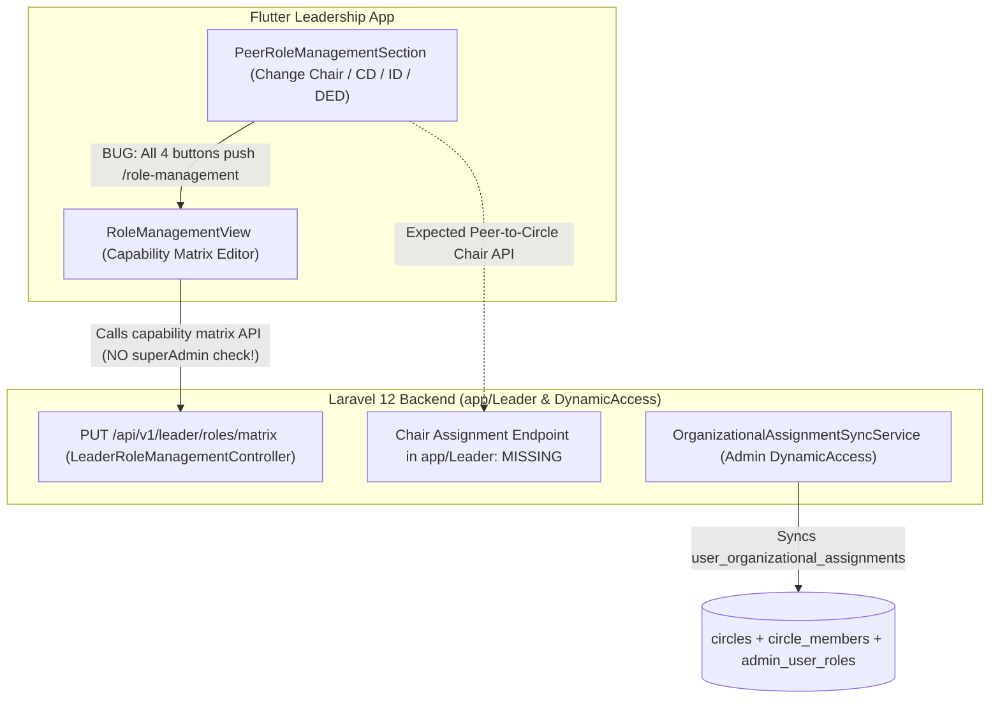

# 22 — Leadership Assignment, Tenure & Role Management Flow

> **Audit Scope:** Complete architectural trace of assigning, updating, syncing, auditing, and revoking leadership positions across Admin Circle APIs, `LeadershipController`, `OrganizationalAssignmentSyncService`, DED & Industry Director tables, the Flutter Leadership App (`PeerRoleManagementSection` & `RoleManagementView`), and Tenure/Lifespan tracking (`finance_leader_tenures`, `RoleLifespanController`).
> **Related Deliverables:** [06-complete-role-hierarchy.md](./06-complete-role-hierarchy.md) · [08-master-role-permission-matrix.md](./08-master-role-permission-matrix.md) · [09-organizational-data-scope-matrix.md](./09-organizational-data-scope-matrix.md) · [20-authentication-and-role-resolution-flow.md](./20-authentication-and-role-resolution-flow.md) · [21-leadership-application-and-approval-flow.md](./21-leadership-application-and-approval-flow.md) · [42-rbac-security-audit.md](./42-rbac-security-audit.md)

---

## 1. Executive Summary: Five Fragmented Assignment Mechanisms

**FACT:** Leadership assignments in `unity-app-new` are written across **five competing backend pathways** and **six overlapping PostgreSQL storage locations** (`circles` FK columns, `circles.calendar` JSONB, `circle_members.role`, `admin_user_roles`, `admin_ded_districts` / `industry_director_assignments`, and `user_organizational_assignments`):

| Pathway | Endpoint / Entry Point | Controller / Service | Classification | Critical Audit Verdict |
|---|---|---|---|---|
| **Pathway A — Admin Circle Leadership Endpoints** | `PATCH /api/v1/admin/circles/{id}/assign-founder\|assign-director\|assign-leadership-team` | [CircleManagementController.php](file:///c:/Users/malic/OneDrive/Documents/GitHub/unity-app-new/app/Http/Controllers/Api/V1/Admin/CircleManagementController.php#L632-L660) | `Implemented but Incorrect` | **Working DB sync** (`circles` FKs + `circle_members` + `Circle::syncLeadershipFromMembers`), **but** mounted under `['auth:sanctum', 'unity.user']` with **zero admin guard** (`P0` privilege escalation). |
| **Pathway B — Legacy Admin `LeadershipController`** | `POST/PUT/DELETE /api/v1/admin/leadership/assignments[/{id}]` | [LeadershipController.php](file:///c:/Users/malic/OneDrive/Documents/GitHub/unity-app-new/app/Http/Controllers/Api/V1/Admin/LeadershipController.php#L63-L120) | `Implemented but Incorrect` | **Crashes on PostgreSQL!** Writes `'circle_founder'`, `'circle_director'`, `'ded'`, `'id'` into `circle_members.role` (violating `circle_member_role_enum`) and writes `'inactive'` into `circle_members.status` on delete (violating `circle_member_status_enum`), plus lacks admin middleware. |
| **Pathway C — Enterprise `DynamicAccess` Assignment Sync** | `POST /api/v1/admin/access/organizational-assignments` (& duplicate at `L2319`/`L2388`) | [OrganizationalAssignmentSyncService.php](file:///c:/Users/malic/OneDrive/Documents/GitHub/unity-app-new/app/Modules/DynamicAccess/Services/OrganizationalAssignmentSyncService.php#L38-L353) | `Implemented but Incorrect` | Most complete multi-table synchronizer (`user_organizational_assignments` → `circles` + `circles.calendar` + `circle_members` + `admin_user_roles`), **but** route block at [api.php:2319-2450](file:///c:/Users/malic/OneDrive/Documents/GitHub/unity-app-new/routes/api.php#L2319-L2450) uses `auth:sanctum,admin` with `authorize(): true`, allowing **any mobile Peer to self-assign `global_admin`** (`CRITICAL-4`)! Also maps committee chairs to `'committee_leader'`, which `UserRoleResolverService` fails to recognize (`403` in Leader App). |
| **Pathway D — Regional DED & Industry Director Assignments** | Web `/admin/industry-directors*`, RBAC `/api/v1/rbac/roles/{id}/assign` | `IndustryDirectorManagementController`, `RoleHierarchyController` | `Implemented but Incorrect` | Populates `admin_ded_districts` and `industry_director_assignments`, **but** `/api/v1/rbac/*` ([api.php:312-380](file:///c:/Users/malic/OneDrive/Documents/GitHub/unity-app-new/routes/api.php#L312-L380)) is **completely unauthenticated** (`CRITICAL-1`)! |
| **Pathway E — Flutter Leadership App Role Controls** | `PeerRoleManagementSection` & `RoleManagementView` (`/roles/matrix`) | [LeaderRoleManagementController.php](file:///c:/Users/malic/OneDrive/Documents/GitHub/unity-app-new/app/Leader/Controllers/LeaderRoleManagementController.php#L19-L93) | `Implemented but Not Integrated` / `Implemented but Incorrect` | **UI Misdirection + Missing API**: `PeerRoleManagementSection` buttons ("Change Chair", "Change Circle Director", etc.) route to `RoleManagementView` (the **capability matrix toggle screen**, NOT a person-to-role assignment screen!). **Zero Chair/Leader assignment endpoint exists in `app/Leader/`**, while `/roles/matrix` mutations have **zero `superAdmin` check** (`HIGH-1`). |

---

## 2. Circle & Enterprise Leadership Assignment Workflows (Pathways A, B, C, D)

### 2.1 Current Verified Flow (`**FACT:**`)

1. **Pathway A — Admin Circle Assignment (`CircleManagementController`)**:
   - React Admin Web ([CircleEditorPage.tsx](file:///D:/office%20project/unity-admin-web/src/features/circles/CircleEditorPage.tsx) / [CircleDetailsPage.tsx](file:///D:/office%20project/unity-admin-web/src/features/circles/CircleDetailsPage.tsx) via [circleService.ts](file:///D:/office%20project/unity-admin-web/src/services/circleService.ts)) invokes:
     - `PATCH /api/v1/admin/circles/{id}/assign-founder` (`founder_user_id`)
     - `PATCH /api/v1/admin/circles/{id}/assign-director` (`director_user_id`)
     - `PATCH /api/v1/admin/circles/{id}/assign-leadership-team` (`chair_user_id`, `vice_chair_user_id`, `secretary_user_id`, `powerhouse_user_id` → mapped to `committee_leader`, plus committee chair keys in `circles.calendar`).
   - Updates `circles` columns, upserts `circle_members` with valid `circle_member_role_enum` values (`founder`, `director`, `chair`, `vice_chair`, `secretary`, `committee_leader`) and `status = 'approved'`, calls `Circle::syncLeadershipFromMembers($circle->id)` (syncing `finance_leader_tenures`), and logs to `admin_audit_logs` via `AdminAuditService`.
2. **Pathway B — Broken `LeadershipController` Assignments (`POST/PUT/DELETE /api/v1/admin/leadership/assignments`)**:
   - [LeadershipController.php](file:///c:/Users/malic/OneDrive/Documents/GitHub/unity-app-new/app/Http/Controllers/Api/V1/Admin/LeadershipController.php#L63-L120) validates `role` in `chair,vice_chair,secretary,circle_founder,circle_director,ded,id` and writes directly to `CircleMember`.
   - **FACT (Crash 1)**: PostgreSQL `circle_member_role_enum` only permits `('founder', 'director', 'chair', 'vice_chair', 'secretary', 'committee_leader', 'member')`. Passing `circle_founder`, `circle_director`, `ded`, or `id` throws an immediate PostgreSQL enum cast error (`22P02`).
   - **FACT (Crash 2)**: `assignmentDelete` (`DELETE /api/v1/admin/leadership/assignments/{id}`, L110–120) runs `$m->update(['role' => 'member', 'status' => 'inactive'])`. `'inactive'` is **not** in `circle_member_status_enum` (`pending`, `approved`, `rejected`), crashing every delete call AND demoting the Peer out of active circle membership even if it succeeded!
   - **FACT (Silent Drop)**: `title_override`, `term_starts_at`, and `term_ends_at` are validated in `assignmentStore` but do not exist on `circle_members` or `CircleMember::$fillable`.
3. **Pathway C — Enterprise `OrganizationalAssignmentSyncService`**:
   - Defined in [OrganizationalAssignmentSyncService.php](file:///c:/Users/malic/OneDrive/Documents/GitHub/unity-app-new/app/Modules/DynamicAccess/Services/OrganizationalAssignmentSyncService.php#L38-L353).
   - Writes canonical assignment rows to `user_organizational_assignments` (`user_id`, `admin_user_id`, `role_id`, `scope_type` ∈ `global|country|state|district|area|industry|circle|committee`, `country_id`, `state_name`, `district_id`, `city_id`, `industry_id`, `circle_id`, `committee_key`, `is_primary`, `status`, `starts_at`, `ends_at`).
   - Synchronizes downstream tables:
     - Ensures linked `AdminUser` + `admin_user_roles` entry.
     - Normalizes `circle_members.role` via `normalizeCircleMemberEnumRole()` ([L284-L300](file:///c:/Users/malic/OneDrive/Documents/GitHub/unity-app-new/app/Modules/DynamicAccess/Services/OrganizationalAssignmentSyncService.php#L284-L300)) so PostgreSQL `circle_member_role_enum` never crashes.
     - Updates `circles` leader FK columns and `circles.calendar.leadership_roles[]` JSON via `syncCircleJsonLeadership()` ([L302-L353](file:///c:/Users/malic/OneDrive/Documents/GitHub/unity-app-new/app/Modules/DynamicAccess/Services/OrganizationalAssignmentSyncService.php#L302-L353)) — supporting **configurable committees** without hardcoded seat counts.
4. **Pathway D — DED & Industry Director Scope Tables**:
   - **DED**: Stored in `admin_ded_districts` ([AdminDedDistrict.php](file:///c:/Users/malic/OneDrive/Documents/GitHub/unity-app-new/app/Models/AdminDedDistrict.php): `admin_user_id`, `user_id`, `district_id`, `assigned_by_admin_id`) plus `circles.ded_user_id`. Note: Executive Director scope (`area`, `district`, `state`, `country`) is strictly determined by actual assignment rows (`user_organizational_assignments`, `admin_ded_districts`, `admin_user_roles.scope_value`), though `AdminAccess::SUPER_ROLE_KEYS` currently erroneously grants `eed` (`countryDirector`) unrestricted global scope in Web Admin ([AdminAccess.php:20](file:///c:/Users/malic/OneDrive/Documents/GitHub/unity-app-new/app/Support/AdminAccess.php#L20)).
   - **Industry Director**: Stored in `industry_director_assignments` ([IndustryDirectorAssignment.php](file:///c:/Users/malic/OneDrive/Documents/GitHub/unity-app-new/app/Models/IndustryDirectorAssignment.php): `admin_user_id`, `industry_id` FK → L1 `circle_categories.id`, `is_active`) managed via [IndustryDirectorManagementController.php](file:///c:/Users/malic/OneDrive/Documents/GitHub/unity-app-new/app/Http/Controllers/Admin/IndustryDirectorManagementController.php) and React [IndustriesPage.tsx](file:///D:/office%20project/unity-admin-web/src/features/industries/IndustriesPage.tsx).
   - **Ambassador**: **FACT:** Per [ContributionMilestoneResolver.php](file:///c:/Users/malic/OneDrive/Documents/GitHub/unity-app-new/app/Services/Recognition/ContributionMilestoneResolver.php#L30) and [Track1GrowthHonoursSeeder.php](file:///c:/Users/malic/OneDrive/Documents/GitHub/unity-app-new/database/seeders/Track1GrowthHonoursSeeder.php#L39), `Ambassador` is an automatic 10-peer-introductions Growth Milestone Honour (with only a typo alias `'ambassador' => 'ambassader'` in [RolePermissionMatrixController.php:76](file:///c:/Users/malic/OneDrive/Documents/GitHub/unity-app-new/app/Http/Controllers/Admin/Rbac/RolePermissionMatrixController.php#L76)), **not** an assigned territorial/circle leadership role.

### 2.2 Mandatory 11-Question Operational Walkthrough — Leadership Assignment & Sync

| # | Workflow Question | Current Verified Answer (`**FACT:**`) | Status / Defect |
|---:|---|---|---|
| **1** | **Who initiates the operation?** | Intended: Super Admin / Country Director (for DED, ID, CF, CD) or Circle Founder / Circle Director / DED (for Circle Chairs, Vice Chair, Secretary, Committee Leaders). | `Implemented but Incorrect` (unprotected APIs) |
| **2** | **Which screen is opened?** | **React Admin Web**: [CircleEditorPage.tsx](file:///D:/office%20project/unity-admin-web/src/features/circles/CircleEditorPage.tsx), [LeadershipPage.tsx](file:///D:/office%20project/unity-admin-web/src/features/leadership/LeadershipPage.tsx), [RoleHierarchyPage.tsx](file:///D:/office%20project/unity-admin-web/src/features/rbac/RoleHierarchyPage.tsx), [IndustriesPage.tsx](file:///D:/office%20project/unity-admin-web/src/features/industries/IndustriesPage.tsx), [LeadershipTenuresTab.tsx](file:///D:/office%20project/unity-admin-web/src/features/finance/LeadershipTenuresTab.tsx). **Flutter Leadership App**: [peer_role_management_section.dart](file:///D:/office%20project/LeaderApp-Fornt-end-/lib/features/peers/view/widgets/peer_role_management_section.dart#L8-L90) → mistakenly opens [role_management_view.dart](file:///D:/office%20project/LeaderApp-Fornt-end-/lib/features/role_management/view/role_management_view.dart)! | `Implemented but Not Integrated` (Leader App) |
| **3** | **What information is entered?** | Target `user_id` (or `admin_user_id`), `role` / `role_id`, scope target (`circle_id`, `district_id`, `industry_id`, `country_id`, or `committee_key`), optional `starts_at` / `ends_at` (`expires_at`), `is_primary`, and `notes`. | `Partially Implemented` |
| **4** | **Which API is called?** | (a) `PATCH /api/v1/admin/circles/{id}/assign-founder\|assign-director\|assign-leadership-team`; (b) `POST/PUT/DELETE /api/v1/admin/leadership/assignments[/{id}]` (broken); (c) `POST /api/v1/admin/access/organizational-assignments`; (d) `POST /api/v1/rbac/roles/{id}/assign`. **Leader App Chair Assignment API**: **NOT IMPLEMENTED** anywhere in `routes/leader.php`! | `Missing` (Leader App Chair API) |
| **5** | **Which backend controller & service processes it?** | `CircleManagementController`, `LeadershipController`, `OrganizationalAssignmentController` → `OrganizationalAssignmentSyncService`, `RoleHierarchyController`, and `FinanceTenureController` (`finance_leader_tenures`). | `Partially Implemented` |
| **6** | **Which authorization & scope check runs?** | **CRITICAL SECURITY FAILURES**: (1) `/api/v1/rbac/*` has **zero authentication** (`CRITICAL-1`). (2) `/api/v1/admin/circles/{id}/assign-*` and `/api/v1/admin/leadership/assignments*` only check `unity.user` (`P0`). (3) Duplicate `/api/v1/admin/organizational-assignments` at `api.php:2319` & `2388` accepts any mobile `sanctum` token with `authorize(): true` (`CRITICAL-4`)! Only `/api/v1/admin/access/*` at `api.php:900-933` checks `admin.role:super_admin,global_admin`. | `Implemented but Incorrect` (`P0` Escalation) |
| **7** | **What database operation occurs?** | Upserts `user_organizational_assignments`, updates `circles` leader FK columns & `circles.calendar` JSONB, upserts `circle_members` (`role`, `role_id`, `status='approved'`), syncs `admin_users` + `admin_user_roles`, `admin_ded_districts`, `industry_director_assignments`, `finance_leader_tenures`, and writes `admin_audit_logs`. | `Partially Implemented` (depends on pathway used) |
| **8** | **Which status changes?** | `circle_members.role` changes from `'member'` to `'founder'\|'director'\|'chair'\|'vice_chair'\|'secretary'\|'committee_leader'`; `user_organizational_assignments.status = 'active'`; `finance_leader_tenures.is_active = true`. *(Bug: `LeadershipController@assignmentDelete` attempts `status = 'inactive'`, crashing Postgres!)* | `Implemented but Incorrect` |
| **9** | **Who receives the result?** | Calling Admin receives updated Circle/Assignment JSON. Affected Peer's next `GET /api/v1/leader/auth/me` resolves the new role via `UserRoleResolverService` (unless assigned `committee_leader` without `calendar` JSON, which `UserRoleResolverService` fails to recognize!). | `Implemented but Incorrect` |
| **10** | **Which notification is generated?** | **MISSING**: Assigning or revoking a leadership role via `CircleManagementController`, `OrganizationalAssignmentSyncService`, or `RoleHierarchyController` dispatches **zero push, email, or WhatsApp commissioning/revocation notification** to the appointed/demoted Peer! | `Missing` |
| **11** | **What happens next?** | Peer can sign in to the Flutter Leadership App (`EnsureLeaderUser` passes), view scoped circles/peers, and accrue commission/bonus eligibility under `finance_leader_tenures` (for `CF`, `CD`, `DED`, `ID`). | `Partially Implemented` |

---

## 3. Flutter Leadership App Role Management & Capability Matrix Bug (Pathway E)

### 3.1 Current Verified Flow (`**FACT:**`)

1. **UI Misdirection in `PeerRoleManagementSection`**:
   - In [peer_role_management_section.dart](file:///D:/office%20project/LeaderApp-Fornt-end-/lib/features/peers/view/widgets/peer_role_management_section.dart#L53-L86), the card displays *"Circle Founder role cannot be changed once assigned"* and renders up to four `"Manage"` rows:
     - `Change Chair (per circle)` (all roles viewing the widget)
     - `Change Circle Director` (all roles viewing the widget)
     - `Change Industry Director` (`if (isSuperAdmin)`)
     - `Change District Exec` (`if (isSuperAdmin)`)
   - **FACT:** Every single `"Manage"` button executes `Navigator.of(context).pushNamed(AppRoutes.roleManagement)` ([L65, L71, L78, L84](file:///D:/office%20project/LeaderApp-Fornt-end-/lib/features/peers/view/widgets/peer_role_management_section.dart#L65-L84)), which opens [role_management_view.dart](file:///D:/office%20project/LeaderApp-Fornt-end-/lib/features/role_management/view/role_management_view.dart) — the **global role capability matrix screen**, NOT a Peer-to-Circle assignment dialog!
   - Meanwhile, [LeaderPermissionService.php](file:///c:/Users/malic/OneDrive/Documents/GitHub/unity-app-new/app/Leader/Services/LeaderPermissionService.php#L490) computes `can_assign_circle_chair = true` for `superAdmin`, `countryDirector`, `districtExecDirector`, `circleFounder`, and `circleDirector` (when `access_teams` is enabled), **yet zero Chair-assignment endpoint exists anywhere in `routes/leader.php` or `app/Leader/`**.
2. **Unprotected Capability Matrix Mutations (`LeaderRoleManagementController`)**:
   - `RoleManagementView` calls `GET /api/v1/leader/roles/matrix`, `PUT /api/v1/leader/roles/matrix`, `POST /api/v1/leader/roles`, `PUT /api/v1/leader/roles/{id}`, and `DELETE /api/v1/leader/roles/{id}` ([LeaderRoleManagementController.php](file:///c:/Users/malic/OneDrive/Documents/GitHub/unity-app-new/app/Leader/Controllers/LeaderRoleManagementController.php#L19-L93) → [LeaderRoleMatrixService.php](file:///c:/Users/malic/OneDrive/Documents/GitHub/unity-app-new/app/Leader/Services/LeaderRoleMatrixService.php#L1-L236)).
   - **FACT (`HIGH-1` Vertical Privilege Escalation)**: `CheckLeaderCapability` (`leader.can:manage_roles`) is never applied to `routes/leader.php`, and `LeaderRoleManagementController` performs **zero `isSuperAdmin` check**. Any `secretary` or `viceChair` can call `PUT /api/v1/leader/roles/matrix` to grant their own role all 13 capabilities, or call `DELETE /api/v1/leader/roles/{id}` to delete system roles (`deleteRole()` at L174 lacks an `is_system_role` check!).

---

## 4. Role Tenure, Lifespan & Expiry Governance

### 4.1 Current Verified Flow (`**FACT:**`)

1. **Role Lifespan Configuration & History (`RoleLifespanController`)**:
   - The `roles` table ([Role.php](file:///c:/Users/malic/OneDrive/Documents/GitHub/unity-app-new/app/Models/Role.php)) defines `lifespan_months`, `term_duration_days`, `grace_period_days`, `auto_expire`, and `renewable`.
   - `admin_user_roles` stores `assigned_at` and `expires_at`; `user_organizational_assignments` stores `starts_at` and `ends_at`.
   - [RoleLifespanController.php](file:///c:/Users/malic/OneDrive/Documents/GitHub/unity-app-new/app/Http/Controllers/Admin/Rbac/RoleLifespanController.php#L17-L200) (and React [RoleHistoryPage.tsx](file:///D:/office%20project/unity-admin-web/src/features/rbac/RoleHistoryPage.tsx)) reconstructs active and historical role tenures from `admin_user_roles`, `admin_ded_districts`, `industry_director_assignments`, `circle_members`, and `admin_audit_logs` (`action = 'admin.rbac.role.assign'`).
   - **CRITICAL DEFECT (`Implemented but Incorrect`)**: Neither `UserRoleResolverService`, `AdminAccess`, nor `PermissionService` checks `admin_user_roles.expires_at > now()` or `user_organizational_assignments.ends_at > now()` during authentication or request authorization, and **zero scheduled Artisan commands** in `routes/console.php` auto-expire elapsed leadership roles! Expired roles remain active indefinitely until manually deleted.
2. **Financial Leadership Tenures & Milestone Bonuses (`finance_leader_tenures`)**:
   - Migration [2026_11_02_151500_create_finance_leader_bonus_tables.php](file:///c:/Users/malic/OneDrive/Documents/GitHub/unity-app-new/database/migrations/2026_11_02_151500_create_finance_leader_bonus_tables.php) defines `finance_leader_tenures` (`role_code` ∈ `CF`, `CD`, `DED`, `ID`; `scope_id`; `is_active`; start/end dates), `finance_leader_bonus_rules`, and `finance_leader_bonus_awards` (managed via React [LeadershipTenuresTab.tsx](file:///D:/office%20project/unity-admin-web/src/features/finance/LeadershipTenuresTab.tsx) and [AssignTenureModal.tsx](file:///D:/office%20project/unity-admin-web/src/features/finance/AssignTenureModal.tsx)).
   - **Flutter Defect**: `FinanceMetricsModel` in [finance_model.dart](file:///D:/office%20project/LeaderApp-Fornt-end-/lib/features/finance/model/finance_model.dart) fabricates `activeTenures ?? 42` if omitted, while [profile_assigned_circles_card.dart](file:///D:/office%20project/LeaderApp-Fornt-end-/lib/features/profile/view/widgets/profile_assigned_circles_card.dart#L115) renders the hardcoded string `'Active Leadership Assignment'` for every circle without displaying actual role title, committee, or tenure start/end dates.

---

## 5. Target Enhanced Assignment & Tenure Flow (`**RECOMMENDATION:**`)

1. **Single Canonical Assignment Engine (`OrganizationalAssignmentSyncService`)**:
   - Route **all** leadership mutations (Admin Circle Editor, `LeadershipController`, and a new scoped Leader App endpoint) through `OrganizationalAssignmentSyncService::assign()` and `revoke()`.
   - Fix `LeadershipController@assignmentStore/Update/Delete`: map role aliases via `normalizeCircleMemberEnumRole()`, and on leadership removal set `circle_members.role = 'member'` while preserving `circle_members.status = 'approved'` (demoting leadership without expelling the Peer from their paid Circle!).
2. **Lock Down All Assignment & RBAC Routes (`P0`)**:
   - Protect `/api/v1/rbac/*` and `/api/v1/admin/rbac/*` with `['auth:sanctum', 'admin.auth', 'admin.role:global_admin']`.
   - Remove duplicate unprotected `DynamicAccess` routes at [api.php:2319-2450](file:///c:/Users/malic/OneDrive/Documents/GitHub/unity-app-new/routes/api.php#L2319-L2450).
   - Add `leader.can:manage_roles` + explicit `isSuperAdmin($user)` check on `LeaderRoleManagementController` (`PUT /roles/matrix`, `POST /roles`, `PUT /roles/{id}`, `DELETE /roles/{id}`) and block deletion when `is_system_role = true`.
3. **Fix `committee_leader` & `global_founder` in `UserRoleResolverService`**:
   - Add `committeeLeader` (rank `25`, `is_leader = true`) and map `'global_founder'` → `'superAdmin'` in `UserRoleResolverService::normalizeRoleKey()` so committee leaders and Global Founders never hit `403` in the Leader App.
4. **Add Scoped Circle Chair / Committee Assignment Endpoint for Authorized Leaders**:
   - Expose `POST /api/v1/leader/teams/circles/{circleId}/leadership-assignments` guarded by `['auth:sanctum', 'leader.user', 'leader.can:access_teams']` + scope check (`can_assign_circle_chair`: `superAdmin`, `countryDirector`, scoped `districtExecDirector`, or that Circle's `circleFounder` / `circleDirector`), delegating to `OrganizationalAssignmentSyncService` for `chair_business_growth_committee`, `chair_membership_growth_committee`, `chair_events_impacts_committee`, `vice_chair`, `secretary`, and configurable `committee_leader` seats.
   - Replace `PeerRoleManagementSection`'s broken `/role-management` navigation with a dedicated Circle Committee Assignment bottom sheet for authorized roles, while enforcing *"Circle Founder role cannot be changed once assigned"* server-side for non-Super-Admins.
5. **Enforce Active Tenure Windows & Automated Expiry Job**:
   - Filter `admin_user_roles` (`WHERE expires_at IS NULL OR expires_at > NOW()`) and `user_organizational_assignments` (`WHERE status = 'active' AND (ends_at IS NULL OR ends_at > NOW())`) in `UserRoleResolverService` and `OrganizationalScopeService`, and schedule a daily `leadership:expire-tenures` Artisan command that sends 30/7/1-day renewal reminders and cleanly transitions expired terms.
