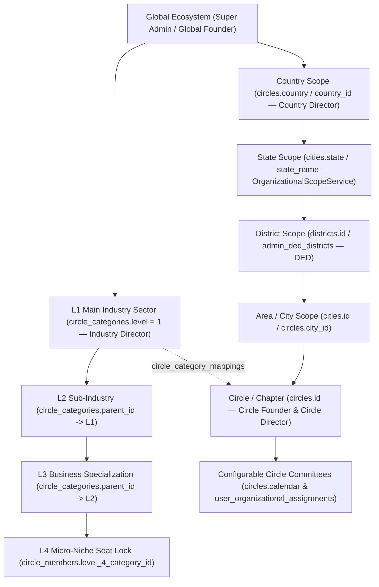
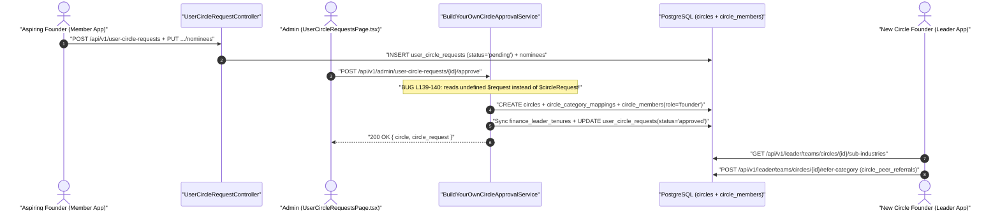

# 23 — Organizational Structure & Circle Lifecycle Flow

> **Audit Scope:** End-to-end architecture and operational workflows for the Peers Global organizational hierarchy: Territory (`Country` → `State` → `District` → `City`), 4-Level Industry & Business Category Taxonomy (`circle_categories`), Circle Chartering (Admin Creation vs Peer *"Build Your Own Circle"* `user_circle_requests` → `BuildYourOwnCircleApprovalService`), Circle Stages & Activation, Category Seat Exclusivity (`level_1..4`), and Configurable Committee Governance (`circles.calendar`).
> **Related Deliverables:** [06-complete-role-hierarchy.md](./06-complete-role-hierarchy.md) · [09-organizational-data-scope-matrix.md](./09-organizational-data-scope-matrix.md) · [22-leadership-assignment-and-management-flow.md](./22-leadership-assignment-and-management-flow.md) · [24-member-management-flow.md](./24-member-management-flow.md) · [activities/19-joined-circles-and-memberships.md](./activities/19-joined-circles-and-memberships.md) · [activities/20-circle-membership-requests-and-build-circle.md](./activities/20-circle-membership-requests-and-build-circle.md)

---

## 1. Organizational & Taxonomy Hierarchy (`**FACT:**`)

### 1.1 Territorial & Sectoral Hierarchy Model

**FACT:** Peers Global organizes chapters (`circles`) along two orthogonal axes — **Geographic Territory** and **4-Level Industry Taxonomy** — resolved across [OrganizationalScopeService.php](file:///c:/Users/malic/OneDrive/Documents/GitHub/unity-app-new/app/Shared/OrganizationalScope/OrganizationalScopeService.php#L1-L683), [DistrictScopeService.php](file:///c:/Users/malic/OneDrive/Documents/GitHub/unity-app-new/app/Services/Api/Ded/DistrictScopeService.php#L18-L57), and [IndustryDirectorScopeService.php](file:///c:/Users/malic/OneDrive/Documents/GitHub/unity-app-new/app/Services/Admin/IndustryDirectorScopeService.php):



| Hierarchy Layer | Backing PostgreSQL Tables & Columns | Controlling Scope Service | Implementation Status & Audit Notes |
|---|---|---|---|
| **Global** | Unrestricted (`null` filter) | `AdminAccess::isSuper()`, `OrganizationalScopeService` | `Fully Implemented` |
| **Country** | `countries`, `circles.country` (string, e.g. `'India'`), `admin_user_roles.scope_value` | `PermissionService::dataScope()`, `OrganizationalScopeService` | `Implemented but Incorrect` — `LeaderPermissionService::resolveManagedCircles()` ([L517](file:///c:/Users/malic/OneDrive/Documents/GitHub/unity-app-new/app/Leader/Services/LeaderPermissionService.php#L517)) and `AdminAccess::SUPER_ROLE_KEYS` ([L20](file:///c:/Users/malic/OneDrive/Documents/GitHub/unity-app-new/app/Support/AdminAccess.php#L20)) treat `countryDirector` (`eed`) as **unrestricted Global** instead of filtering by assigned country! |
| **State & Area** | `cities.state`, `users.state`, `user_organizational_assignments.{state_name, city_id}` | `OrganizationalScopeService` (`AccessConstants::SCOPE_HIERARCHY`) | `Partially Implemented` — Supported in `OrganizationalScopeService`, **not** in `UserRoleResolverService` or `RoleDataScope::SCOPE_TYPES`. Executive Director scope must follow actual assignment only. |
| **District** | `districts`, `cities.district_id`, `circles.district_id`, `admin_ded_districts` | `DistrictScopeService`, `AdminCircleScope::getDedCircleIds()` | `Implemented but Incorrect` — `LeaderTeamsService::resolveDedDistrictId()` ([L28-L31](file:///c:/Users/malic/OneDrive/Documents/GitHub/unity-app-new/app/Leader/Services/LeaderTeamsService.php#L28-L31)) accepts raw `?district_id=<uuid>` query parameter before checking `$user`, enabling cross-district IDOR! |
| **4-Level Industry & Category Tree** | `circle_categories` (`id`, `parent_id`, `level` 1..4, `name`, `is_active`), `circle_category_mappings`, `circles.industry_tags` (JSON), `industry_director_assignments` | `IndustryDirectorScopeService`, `CircleCategoryUsageController` | `Implemented but Incorrect` — `LeaderPermissionService` ([L558](file:///c:/Users/malic/OneDrive/Documents/GitHub/unity-app-new/app/Leader/Services/LeaderPermissionService.php#L558)) uses `LIKE "%{$indId}%"` on `industry_tags`, so `industry_id = 1` falsely matches `10`, `11`, `21`! |
| **Circle & Configurable Committees** | `circles` (`status` ∈ `pending\|active\|archived`, `circle_stage`, `meeting_mode`, `meeting_frequency`, `circle_price`, `zoho_plan_code`, `calendar` JSONB) | `AdminCircleScope`, `LeaderTeamsService` | `Requires Enhancement` — `circles.calendar` stores cadence (`settings`) and configurable committee leadership (`leadership`, `leadership_roles[]`), avoiding fixed seat counts; however `CircleCadenceModel` in Flutter guesses ~10 JSON paths and lacks IANA `timezone`. |

---

## 2. Workflow A — Admin Direct Circle Creation & Category Mapping

### 2.1 Mandatory 11-Question Operational Walkthrough — Admin Circle Creation

| # | Workflow Question | Current Verified Answer (`**FACT:**`) | Status / Defect |
|---:|---|---|---|
| **1** | **Who initiates the operation?** | Super Admin, Global Admin, or Country Director via React Admin Web or Blade Admin Panel. | `Fully Implemented` |
| **2** | **Which screen is opened?** | **React Admin Web**: [CirclesPage.tsx](file:///D:/office%20project/unity-admin-web/src/features/circles/CirclesPage.tsx) → [CircleEditorPage.tsx](file:///D:/office%20project/unity-admin-web/src/features/circles/CircleEditorPage.tsx). **Blade Admin**: `/admin/circles/create` (`App\Http\Controllers\Admin\Circles\CircleController`). | `Fully Implemented` |
| **3** | **What information is entered?** | Circle `name`, `description`, `type` (`public`\|`private`), `status` (`pending`\|`active`\|`archived`), `circle_stage` (e.g. `forming`, `launching`, `active`), `country`, `district_id`, `city_id`, L1 `category_ids[]` (`circle_category_mappings`), `meeting_mode` (`online`\|`offline`\|`hybrid`), `meeting_frequency`, `circle_price`, `zoho_plan_code`, `founder_user_id`, `director_user_id`, `ded_user_id`, `industry_director_user_id`, cover/logo media, and `calendar` cadence JSON. | `Fully Implemented` |
| **4** | **Which API is called?** | `POST /api/v1/admin/circles` (update: `PUT|PATCH /api/v1/admin/circles/{id}`; category mapping: `/api/v1/admin/circles/{id}/categories`). Member API also exposes `POST /api/v1/circles` (`CircleController@store`). | `Implemented but Incorrect` (auth guard) |
| **5** | **Which backend controller & service processes it?** | [CircleManagementController.php](file:///c:/Users/malic/OneDrive/Documents/GitHub/unity-app-new/app/Http/Controllers/Api/V1/Admin/CircleManagementController.php) + `Circle::syncLeadershipFromMembers()` + `AdminAuditService`. | `Fully Implemented` |
| **6** | **Which authorization & scope check runs?** | **CRITICAL DEFECT**: `/api/v1/admin/circles*` in [api.php](file:///c:/Users/malic/OneDrive/Documents/GitHub/unity-app-new/routes/api.php#L881) sits under `['auth:sanctum', 'unity.user']` without `admin.auth` or `admin.permission:circles.create`! (Blade `/admin/circles*` properly enforces `admin.auth` + `AdminCircleScope`.) | `Implemented but Incorrect` (`P0` Missing Guard) |
| **7** | **What database operation occurs?** | `INSERT INTO circles` (UUID PK, unique `slug`, `calendar` JSONB), `INSERT INTO circle_category_mappings`, `UPSERT INTO circle_members` (for assigned Founder/Director with `status = 'approved'`), `UPSERT INTO finance_leader_tenures`, `INSERT INTO admin_audit_logs`. | `Fully Implemented` |
| **8** | **Which status changes?** | New `circles` record enters `status = 'pending'` or `'active'` and `circle_stage = 'forming'` / `'active'`. | `Fully Implemented` |
| **9** | **Who receives the result?** | Admin receives `201 Created` Circle JSON; Circle immediately appears in Member App (`GET /api/v1/circles`) and Leader App (`GET /api/v1/leader/teams/circles` → [teams_view.dart](file:///D:/office%20project/LeaderApp-Fornt-end-/lib/features/teams/view/teams_view.dart)). | `Fully Implemented` |
| **10** | **Which notification is generated?** | **None** automatically dispatched to assigned Founder/Director/DED upon Admin Circle creation. | `Requires Enhancement` |
| **11** | **What happens next?** | Circle opens for Peer Join Requests (`circle_join_requests`), Category Seat Bookings (`level_1..4`), and recurring Circle Meetings (`circle_meetings` / `events`). | `Fully Implemented` |

---

## 3. Workflow B — Peer "Build Your Own Circle" Chartering Flow (`user_circle_requests`)

### 3.1 Current Verified Flow (`**FACT:**`)

**WORKBOOK REQUIREMENT:** Activity #20 (*Circle Membership Requests & Build Circle*, Row 28) specifies that a Peer opens `BuildCircleScreen`, proposes Circle Name, Category, Theme, Target City, and Founding Peers (`FoundingPeersPicker`), progressing `Proposal Filed -> Regional Board Audit -> Charter Approved` via `ChapterCharterService`.

**FACT:** In `unity-app-new`, this workflow is implemented end-to-end across `user_circle_requests`, `user_circle_request_nominees`, [UserCircleRequestController.php](file:///c:/Users/malic/OneDrive/Documents/GitHub/unity-app-new/app/Http/Controllers/Api/UserCircleRequestController.php), [UserCircleRequestAdminController.php](file:///c:/Users/malic/OneDrive/Documents/GitHub/unity-app-new/app/Http/Controllers/Api/V1/Admin/UserCircleRequestAdminController.php), and [BuildYourOwnCircleApprovalService.php](file:///c:/Users/malic/OneDrive/Documents/GitHub/unity-app-new/app/Services/Circles/BuildYourOwnCircleApprovalService.php#L20-L176):

1. **Proposal & Founding Nominees Submission (Member App)**:
   - Peer fetches `GET /api/v1/user-circle-requests/config` (reads `minimum_peers_required`) and `GET .../categories/{categoryId}/subcategories`.
   - Submits `POST /api/v1/user-circle-requests` (`circle_name`, `category_id`, `founder_category_id`, `founder_subcategory_id`, `description`, `city_id`, `city`, `state`, `country`, `meeting_mode`, `meeting_frequency`, `preferred_launch_timeline`, `reason_to_build`, `founder_note`) and attaches founding peer nominees via `PUT /api/v1/user-circle-requests/{id}/nominees` (`user_circle_request_nominees`).
2. **Admin Review & Automated Circle Provisioning (`BuildYourOwnCircleApprovalService::approve`)**:
   - Admin reviews proposal in React Admin Web ([UserCircleRequestsPage.tsx](file:///D:/office%20project/unity-admin-web/src/features/circles/UserCircleRequestsPage.tsx)) and invokes `POST /api/v1/admin/user-circle-requests/{id}/approve`.
   - Inside one `DB::transaction(...)` ([BuildYourOwnCircleApprovalService.php:48-175](file:///c:/Users/malic/OneDrive/Documents/GitHub/unity-app-new/app/Services/Circles/BuildYourOwnCircleApprovalService.php#L48-L175)):
     1. Generates unique `slug` and resolves `city_id` via `ILIKE` on `cities`.
     2. Creates the `Circle` (`status = 'active'`, `type = 'public'`, `founder_user_id = $circleRequest->user_id`, `circle_founder_user_id = $circleRequest->user_id`, plus `calendar.settings` and `calendar.leadership`).
     3. Syncs L1 `circle_categories` and populates `circles.industry_tags`.
     4. Adds the applicant to `circle_members` as `role = 'founder'` (`addFounderMember`), optionally adds `ded_user_id` and `industry_director_user_id` if provided in `$overrides`, calls `Circle::syncLeadershipFromMembers($circle->id)`, sets `user_circle_requests.status = 'approved'` + `created_circle_id = $circle->id`, and updates the Founder's `users.active_circle_id`.
   - **CRITICAL CODE BUG (`BuildYourOwnCircleApprovalService.php:139-140`)**:
     - Lines 139–140 read:
       ```php
       $founderCatId = $request->founder_category_id ?? ($request->metadata['founder_category_id'] ?? null);
       $founderSubId = $request->founder_subcategory_id ?? ($request->metadata['founder_subcategory_id'] ?? null);
       ```
     - The method parameter is named **`$circleRequest`**, NOT `$request`! Referencing undefined `$request` triggers an `ErrorException: Undefined variable $request` (under Laravel's error handler) or silently drops the Founder's L1/L2 category seat assignment (`null`, `null`) during charter approval!

### 3.2 Mandatory 11-Question Operational Walkthrough — Build Your Own Circle

| # | Workflow Question | Current Verified Answer (`**FACT:**`) | Status / Defect |
|---:|---|---|---|
| **1** | **Who initiates the operation?** | Authenticated Peer (`App\Models\User`) aspiring to become a **Circle Founder**; reviewed and chartered by Admin (`AdminUser`). | `Fully Implemented` |
| **2** | **Which screen is opened?** | **Member App**: `BuildCircleScreen` & `CircleRequestDetailScreen` (`D:\office project\peers-unity\unity_app\lib\features\circles\...`). **React Admin Web**: [UserCircleRequestsPage.tsx](file:///D:/office%20project/unity-admin-web/src/features/circles/UserCircleRequestsPage.tsx). **Leader App**: **Not exposed** in `/leader/pending-requests`! | `Partially Implemented` |
| **3** | **What information is entered?** | `circle_name`, L1 `category_id`, `founder_category_id`, `founder_subcategory_id`, `description`, `city`/`city_id`/`state`/`country`, `meeting_mode`, `meeting_frequency`, `preferred_launch_timeline`, `reason_to_build`, plus `nominees[]` (`name`, `phone`, `email`, `business_name`, `category_id`). Admin enters `admin_notes` and optional `overrides` (`ded_user_id`, `industry_director_user_id`, `status`). | `Fully Implemented` |
| **4** | **Which API is called?** | Submit: `POST /api/v1/user-circle-requests` + `PUT /api/v1/user-circle-requests/{id}/nominees`. Approve: `POST /api/v1/admin/user-circle-requests/{id}/approve` (status update/reject: `PATCH /api/v1/admin/user-circle-requests/{id}/status`). | `Fully Implemented` |
| **5** | **Which backend controller & service processes it?** | [UserCircleRequestController.php](file:///c:/Users/malic/OneDrive/Documents/GitHub/unity-app-new/app/Http/Controllers/Api/UserCircleRequestController.php) → [UserCircleRequestAdminController.php](file:///c:/Users/malic/OneDrive/Documents/GitHub/unity-app-new/app/Http/Controllers/Api/V1/Admin/UserCircleRequestAdminController.php) → [BuildYourOwnCircleApprovalService.php](file:///c:/Users/malic/OneDrive/Documents/GitHub/unity-app-new/app/Services/Circles/BuildYourOwnCircleApprovalService.php#L35-L176). | `Implemented but Incorrect` (undefined `$request` bug at L139–140) |
| **6** | **Which authorization & scope check runs?** | Member routes check `['auth:sanctum', 'unity.user']` and ownership (`user_id = auth()->id()`). Admin routes `/api/v1/admin/user-circle-requests` lack `admin.role` enforcement when mounted under the `unity.user` admin block. Regional DEDs/IDs have no preliminary review endpoint in `routes/leader.php` or `routes/api.php` (`/ded/*`). | `Implemented but Incorrect` |
| **7** | **What database operation occurs?** | Inserts `user_circle_requests` + `user_circle_request_nominees`; on approve, creates `circles`, `circle_category_mappings`, `circle_members` (`role = 'founder'`), updates `finance_leader_tenures`, `user_circle_requests.created_circle_id`, and `users.active_circle_id`. (Nominees remain in `user_circle_request_nominees` and are **not** auto-added as members.) | `Implemented but Incorrect` (L139 `$request` typo) |
| **8** | **Which status changes?** | `user_circle_requests.status`: `pending` → `under_review` → `approved` (or `rejected` / `cancelled`). Created `circles.status` = `'active'` (default). | `Fully Implemented` |
| **9** | **Who receives the result?** | Admin receives `{ circle, circle_request }`; Applicant immediately becomes `circleFounder` (rank 50 in `UserRoleResolverService`) and gains Flutter Leadership App access! | `Fully Implemented` |
| **10** | **Which notification is generated?** | Status notification to applicant; **however**, `BuildYourOwnCircleApprovalService::approve()` does **not** automatically invite the listed `user_circle_request_nominees` via WhatsApp/email or notify the city's DED (`resolveDedForLocation()` exists at L183 as a helper, but L73 leaves `$dedUserId = $overrides['ded_user_id'] ?? null` unless manually passed!). | `Requires Enhancement` |
| **11** | **What happens next?** | New Circle Founder signs into the Flutter Leadership App, views their newly chartered Circle under **Circles & Teams**, and recruits nominees into `circle_join_requests`. | `Fully Implemented` |

---

## 4. Category Seat Exclusivity & Leader App Circle Inspection Flow

### 4.1 Category Seat Locking (`level_1..4`) & Open-Category Referrals (`**FACT:**`)

1. **4-Level Seat Lock Mechanism**:
   - Each `circle_members` row holds `level_1_category_id`, `level_2_category_id`, `level_3_category_id`, and `level_4_category_id` (mirrored in `joined_circle_categories` and `circle_member_category_selections`).
   - [CircleCategoryUsageController.php](file:///c:/Users/malic/OneDrive/Documents/GitHub/unity-app-new/app/Http/Controllers/Api/V1/CircleCategoryUsageController.php) (`GET /api/v1/circles/{circle}/categories/*`) and [LeaderTeamsService.php](file:///c:/Users/malic/OneDrive/Documents/GitHub/unity-app-new/app/Leader/Services/LeaderTeamsService.php#L1322-L1565) (`GET /api/v1/leader/teams/circles/{id}/sub-industries`) compute occupied vs open seats per Circle so two competing Peers cannot occupy the same micro-category (`level_4_category_id`) inside one Circle.
2. **Leader App Open-Category Referral (`POST /api/v1/leader/teams/circles/{id}/refer-category`)**:
   - In Flutter Leadership App, a leader opens [circle_details_view.dart](file:///D:/office%20project/LeaderApp-Fornt-end-/lib/features/circle_details/view/circle_details_view.dart) → [circle_sub_industries_screen.dart](file:///D:/office%20project/LeaderApp-Fornt-end-/lib/features/circle_details/view/circle_sub_industries_screen.dart) → [refer_category_bottom_sheet.dart](file:///D:/office%20project/LeaderApp-Fornt-end-/lib/features/circle_details/view/widgets/refer_category_bottom_sheet.dart) and nominates a contact or Peer for an open category seat.
   - Handled by [LeaderTeamsController.php](file:///c:/Users/malic/OneDrive/Documents/GitHub/unity-app-new/app/Leader/Controllers/LeaderTeamsController.php#L135) → `LeaderTeamsService::referCategory()` ([L1806-L1927](file:///c:/Users/malic/OneDrive/Documents/GitHub/unity-app-new/app/Leader/Services/LeaderTeamsService.php#L1806-L1927)), inserting into `circle_peer_referrals` (`peer_recommendations` fallback), which feeds category #9 (`circle_peer_referrals`) of `PendingRequestAdminController`.
   - **THREE CRITICAL BUGS IN `LeaderTeamsService` (`Implemented but Incorrect`)**:
     1. **Missing Circle Scope Check (`IDOR`)**: `getCircleDetail`, `getCirclePeers`, `getSubIndustries`, `getCircleEvents`, and `referCategory` do **not** verify `$circleId` against `$this->resolveScopedCircleIds($user)`.
     2. **Random Circle Fallback**: In `getSubIndustries()` (`L1325-1327`), if `$circleId` is not found, it falls back to `Circle::query()->first()`!
     3. **Global Contact Leak (`P0` Data Leak)**: When `refer_category_contact_tab.dart` calls `GET /api/v1/leader/teams/contacts` (`LeaderTeamsService::getUserContacts()`, [L1942-L1947](file:///c:/Users/malic/OneDrive/Documents/GitHub/unity-app-new/app/Leader/Services/LeaderTeamsService.php#L1942-L1947)), if the leader has `0` rows in `contact_posts`, the `WHERE user_id = $user->id` filter is **omitted**, leaking up to 500 global contact submissions (`name`, `phone`, `email`)!
     4. **Synthetic Circle Revenue Estimate**: `LeaderTeamsService::calculateCircleRevenue()` ([L478-L500](file:///c:/Users/malic/OneDrive/Documents/GitHub/unity-app-new/app/Leader/Services/LeaderTeamsService.php#L478-L500)) estimates revenue as `(circle_price_amount ?? 120000) * approved_peers_count` instead of reading authoritative `payments` / `circle_subscriptions`!



---

## 5. Target Enhanced Flow (`**RECOMMENDATION:**`)

1. **Fix `BuildYourOwnCircleApprovalService.php:139-140` Immediately**:
   - Replace `$request->founder_category_id` / `$request->founder_subcategory_id` with `$circleRequest->founder_category_id` / `$circleRequest->founder_subcategory_id`, and invoke `$this->resolveDedForLocation($circleRequest->city, $cityId)` automatically when `$overrides['ded_user_id']` is omitted so new Circles are linked to their District Executive Director at birth.
2. **Enforce Country, District, Industry & Circle Scope Boundaries**:
   - Filter `countryDirector` (`eed`) by assigned country (`circles.country` / `country_id`) in `LeaderPermissionService::resolveManagedCircles()` and remove `'eed'` from `AdminAccess::SUPER_ROLE_KEYS`.
   - Validate `?district_id` against `admin_ded_districts` in `LeaderTeamsService::resolveDedDistrictId()`.
   - Replace `LIKE "%{$indId}%"` in `LeaderPermissionService.php:558` with `whereJsonContains` or `circle_category_mappings` join.
   - Enforce `canAccessCircle($user, $circleId)` on `showCircle`, `circlePeers`, `subIndustries`, `events`, and `referCategory`, remove the `Circle::query()->first()` fallback, and **never** drop `where('user_id', $user->id)` in `getUserContacts()`!
3. **Eliminate Estimated Circle Revenue & Standardize Timezones**:
   - Replace `(circle_price ?? 120000) * peers` in `LeaderTeamsService::calculateCircleRevenue()` with authoritative `circle_subscriptions` / `payments` (`WHERE circle_id = $circle->id`), returning `null` (`Unavailable`) when unrecorded.
   - Add an explicit IANA `timezone` column (e.g. `'Asia/Kolkata'`, `'America/New_York'`) on `circles` and standardize `circles.calendar` schema (`settings`, `leadership`, `leadership_roles[]`) so committees and global chapter meeting times remain 100% configurable and DST-accurate.
