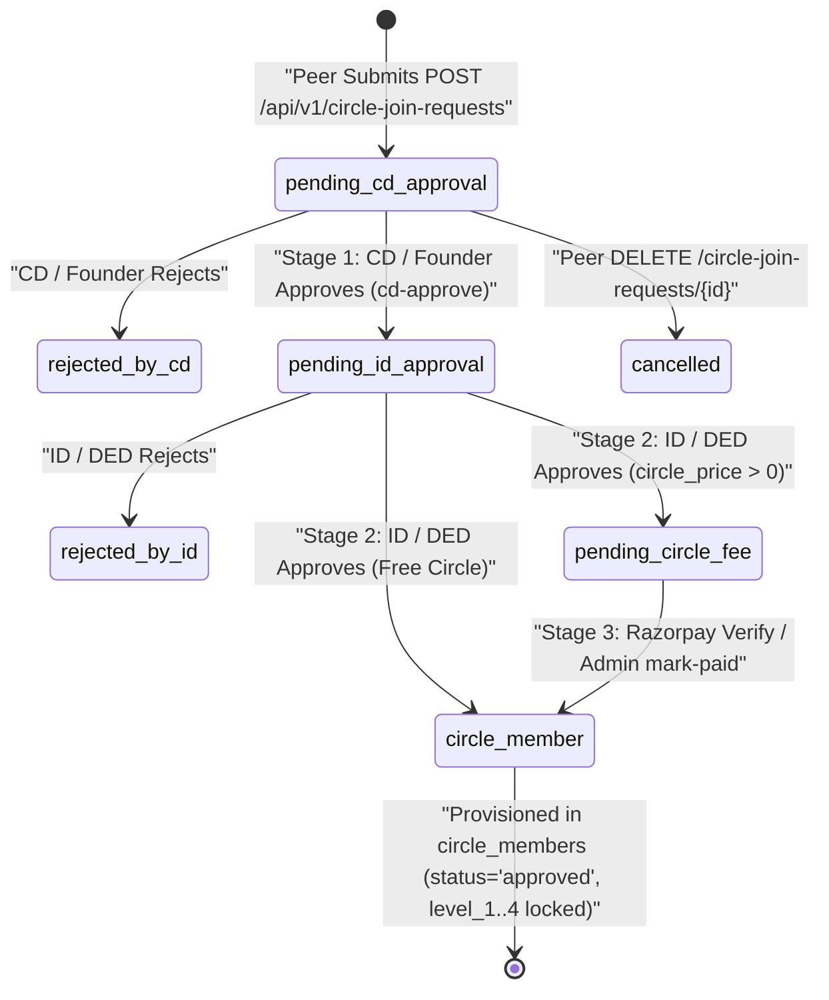
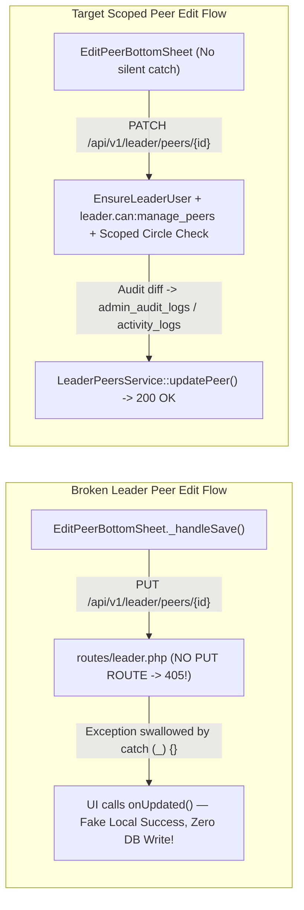

# 24 — Member Onboarding, Circle Admission & Peer 360° Management Flow

> **Audit Scope:** End-to-end Peer lifecycle workflows across Registration & Welcome Creatives, Paid/Trial Membership Activation (`MembershipUpgradeService`), Multi-Stage Circle Admission (`circle_join_requests`: `pending_cd_approval` → `pending_id_approval` → `pending_circle_fee` → `circle_member`), Peer Profile Editing (Member vs Admin vs broken Leader App `EditPeerBottomSheet`), Status Flagging (`flag-status`), Suspension/Account Deletion (`account_deletion_requests`), and Leader 360° Peer Monitoring (`LeaderMember360Service`).
> **Related Deliverables:** [09-organizational-data-scope-matrix.md](./09-organizational-data-scope-matrix.md) · [23-organizational-structure-and-circle-flow.md](./23-organizational-structure-and-circle-flow.md) · [27-approval-and-escalation-flow.md](./27-approval-and-escalation-flow.md) · [43-sensitive-data-and-finance-access.md](./43-sensitive-data-and-finance-access.md) · [activities/19-joined-circles-and-memberships.md](./activities/19-joined-circles-and-memberships.md) · [activities/20-circle-membership-requests-and-build-circle.md](./activities/20-circle-membership-requests-and-build-circle.md) · [activities/32-membership-plan-and-subscriptions.md](./activities/32-membership-plan-and-subscriptions.md) · [activities/34-profile-edit-history-and-last-updated.md](./activities/34-profile-edit-history-and-last-updated.md)

---

## 1. Executive Summary & Lifecycle Sub-Flows

| Lifecycle Stage | Primary Endpoints & Services | Classification | Key Audit Findings |
|---|---|---|---|
| **1. Peer Registration & Onboarding** | `POST /api/v1/auth/register` (+ Google / LinkedIn OAuth) → `WelcomeCreativeService` | `Implemented but Incorrect` | Creates `users`, attributes `introduced_by` / `referraldata`, triggers 30-day WhatsApp journey (`MemberJourney30DayService`), **but** leaves `email_verified_at = null` while `UserRoleResolverService` bridges `users.email` to `admin_users.email` (`HIGH-3`)! |
| **2. Platform Membership & Subscriptions** | `POST /api/v1/payments/create-order` & `verify` / Zoho Billing / `MembershipUpgradeService` | `Fully Implemented` | Supports Razorpay, Zoho Hosted Pages, Store Coin renewal (`routes/store.php`), and hourly/daily expiry crons (`memberships:expire-users`, `users:expire-trial`, `memberships:expire`). |
| **3. Multi-Stage Circle Join Request** | `POST /api/v1/circle-join-requests` → CD Approval → ID/DED Approval → `CircleJoinRequestPaymentController` | `Fully Implemented` | Stage-gated across `PendingRequestAdminController` (`pending_cd_approval` → `pending_id_approval` → `pending_circle_fee` → `circle_member`) with 4-level category seat locking (`level_1..4`), though `approve_peer_requests` capability is not checked for lower circle roles. |
| **4. Leader App Peer Profile Edit** | `EditPeerBottomSheet` ([edit_peer_bottom_sheet.dart:123-136](file:///D:/office%20project/LeaderApp-Fornt-end-/lib/features/peer_profile/view/widgets/edit_peer_bottom_sheet.dart#L123-L136)) → `PUT /api/v1/leader/peers/{id}` | `Implemented but Not Integrated` | **SILENT DATA-LOSS BUG**: `LeaderPeersController::update()` ([L183](file:///c:/Users/malic/OneDrive/Documents/GitHub/unity-app-new/app/Leader/Controllers/LeaderPeersController.php#L183)) is **100% unrouted**! `EditPeerBottomSheet` hits `405`/`404`, swallows the error in `catch (_) {}`, and updates local UI as if saved! |
| **5. Leader 360° Monitoring, Flagging & Content Deletion** | `/api/v1/leader/members/{member_id}/*` (`LeaderMemberController` → `LeaderMember360Service`) & `GET /api/v1/leader/peers` | `Implemented but Incorrect` | `LeaderMember360Service::resolveMember()` enforces circle scope, **but** `GET /leader/peers?scope=global` leaks **all platform users**, `formatPeerCard()` ignores `hide_phone`/`hide_email`, `DELETE posts/creatives` lacks `manage_peers` check, and `PATCH flag-status` relies on manual Postgres enum DDL. |
| **6. Suspension & Account Deletion** | `PATCH /api/v1/admin/peers/{id}/status` & `account_deletion_requests` | `Fully Implemented` | Moderated via Admin `UserManagementController` and category `account_deletion_requests` in `PendingRequestAdminController`. |

---

## 2. Workflow A — Registration, Verification & Membership Activation

### 2.1 Mandatory 11-Question Operational Walkthrough — Onboarding & Membership Upgrade

| # | Workflow Question | Current Verified Answer (`**FACT:**`) | Status / Defect |
|---:|---|---|---|
| **1** | **Who initiates the operation?** | New prospective Peer (self-registration via mobile/email, Google Sign-In, or LinkedIn OAuth, optionally using an introducer's `referral_code`); Admin may also add/import Peers (`AddPeerModal.tsx`, `ImportPeersModal.tsx`) or approve pending registrations. | `Fully Implemented` |
| **2** | **Which screen is opened?** | **Member App**: Auth & Onboarding screens + `MembershipPaywallScreen` / `InvoiceListScreen` (`D:\office project\peers-unity\unity_app\lib\features\{auth,membership}\...`). **React Admin Web**: [UsersPage.tsx](file:///D:/office%20project/unity-admin-web/src/features/users/UsersPage.tsx), [AddPeerModal.tsx](file:///D:/office%20project/unity-admin-web/src/features/users/AddPeerModal.tsx), [PlansPage.tsx](file:///D:/office%20project/unity-admin-web/src/features/plans/PlansPage.tsx). | `Fully Implemented` |
| **3** | **What information is entered?** | Name, phone, email, city, company, designation, business category (`main_business_category_id`), optional `referral_code`; on upgrade: `membership_plan_id`, coupon code, GST details, and Razorpay/Zoho payment confirmation. | `Fully Implemented` |
| **4** | **Which API is called?** | Registration: `POST /api/v1/auth/register` (or social login). Upgrade: `GET /api/v1/membership-plans` → `POST /api/v1/payments/create-order` → `POST /api/v1/payments/verify` (or `POST /api/v1/billing/checkout` + webhooks `/api/v1/webhooks/razorpay` & `/zoho-billing`; Admin manual upgrade: `POST|PATCH /api/v1/admin/peers/{id}/upgrade`). | `Fully Implemented` |
| **5** | **Which backend controller & service processes it?** | `AuthController` + `WelcomeCreativeService` + `MemberJourney30DayService`; Billing: `PaymentController`, `UserSubscriptionController`, `MembershipUpgradeService`, and `UserManagementController`. | `Implemented but Incorrect` (unverified email linking) |
| **6** | **Which authorization & scope check runs?** | Public registration throttled; payment verification bound to authenticated `unity.user` or HMAC-signed Razorpay/Zoho webhooks. **SECURITY FLAW**: `AuthController::register()` ([L991-L994](file:///c:/Users/malic/OneDrive/Documents/GitHub/unity-app-new/app/Http/Controllers/Api/AuthController.php#L991-L994)) sets `email_verified_at = null`, yet `EnsureAdminAuthenticated` and `UserRoleResolverService` match `LOWER(email)` against `admin_users` without checking `email_verified_at IS NOT NULL`! | `Implemented but Incorrect` (`HIGH-3`) |
| **7** | **What database operation occurs?** | `INSERT INTO users` (`membership_status = 'visitor'\|'free_peer'\|'free_trial_peer'`), `INSERT INTO referraldata` + increment introducer `members_introduced_count` (evaluating Track 1 Honours incl. 10-peer `Ambassador` milestone via `ContributionMilestoneResolver`), `INSERT INTO payments`, `INSERT INTO user_memberships`, `INSERT INTO zoho_invoice_documents`, `INSERT INTO coins_ledger`. | `Fully Implemented` |
| **8** | **Which status changes?** | `users.membership_status` transitions `visitor` / `free_trial_peer` → `Only Unity Peer` (`global_peer`) / `circle_peer` / `multi_circle_peer` / `charter_peer` (and later `expired` via hourly `memberships:expire-users` / `users:expire-trial` or `suspended` via Admin). `payments.status`: `created` → `success`. | `Fully Implemented` |
| **9** | **Who receives the result?** | Peer unlocks paid Unity entitlements & tax invoice PDF (`GET /api/v1/billing/invoices/{id}/pdf`); Introducer receives referral attribution & coins/milestone progress. | `Fully Implemented` |
| **10** | **Which notification is generated?** | Welcome email + one-time-ever WhatsApp `'welcome'` template + `WelcomeCreativeService` poster + 30-day onboarding drip (`whatsapp:journey:process` every 15 min) + payment invoice email + 30/7/1-day expiry reminders (`memberships:send-expiry-reminders`). | `Fully Implemented` |
| **11** | **What happens next?** | Peer completes their 8-section profile (`EditProfileOverviewScreen`) and applies to join an industry/city Circle (`POST /api/v1/circle-join-requests`). | `Fully Implemented` |

---

## 3. Workflow B — Multi-Stage Circle Join Request & Seat Locking (`circle_join_requests`)

### 3.1 Current Verified Flow (`**FACT:**`)

### 3.2 Mandatory 11-Question Operational Walkthrough — Circle Join Flow

| # | Workflow Question | Current Verified Answer (`**FACT:**`) | Status / Defect |
|---:|---|---|---|
| **1** | **Who initiates the operation?** | Authenticated Peer (`App\Models\User`) requesting admission to a Circle; Stage 1 reviewed by Circle Director / Circle Founder; Stage 2 reviewed by Industry Director / DED (or Admin); Stage 3 completed by Peer payment. | `Fully Implemented` |
| **2** | **Which screen is opened?** | **Member App**: `CirclesScreen` → Join Form → `JoinRequestStatusScreen`. **Leader App**: Dashboard *"Pending peers → Review"* ([dashboard_pending_peers_card.dart](file:///D:/office%20project/LeaderApp-Fornt-end-/lib/features/dashboard/view/widgets/dashboard_pending_peers_card.dart)) / Pending Approvals tile. **React Admin Web**: [CircleJoinRequestsPage.tsx](file:///D:/office%20project/unity-admin-web/src/features/circles/CircleJoinRequestsPage.tsx) & [PendingRequestsPage.tsx](file:///D:/office%20project/unity-admin-web/src/features/pendingRequests/PendingRequestsPage.tsx). | `Fully Implemented` |
| **3** | **What information is entered?** | `circle_id`, `reason_for_joining`, `level1_category_id`..`level4_category_id` (desired exclusive category seat). Reviewers enter approval notes or `cd_rejection_reason` / `id_rejection_reason`. | `Fully Implemented` |
| **4** | **Which API is called?** | Submit: `POST /api/v1/circle-join-requests`. Stage 1 & 2 Review: `POST /api/v1/leader/pending-requests/circle_joining_requests/{id}/approve\|reject` (or `/api/v1/ded/pending-requests/circle-joining-requests/{id}/approve\|ded-approve\|reject`, or `/api/v1/admin/circle-join-requests/{id}/cd-approve\|id-approve`). Stage 3 Fee: `POST /api/v1/circle-join-requests/{id}/payment/order` & `verify`. | `Fully Implemented` |
| **5** | **Which backend controller & service processes it?** | [CircleJoinRequestController.php](file:///c:/Users/malic/OneDrive/Documents/GitHub/unity-app-new/app/Http/Controllers/Api/CircleJoinRequestController.php), [PendingRequestAdminController.php](file:///c:/Users/malic/OneDrive/Documents/GitHub/unity-app-new/app/Http/Controllers/Api/Admin/PendingRequestAdminController.php#L808), `DedPendingRequestsController`, `CircleJoinRequestPaymentController` → `CircleJoinRequestService` & `CircleJoinPaymentService`. | `Fully Implemented` |
| **6** | **Which authorization & scope check runs?** | `PendingRequestAdminController` enforces stage-aware circle/industry scoping (`CD/Founder` sees `pending_cd_approval` for their circle; `ID/DED` sees `pending_id_approval`). **DEFECT**: Does **not** verify capability flag `can_review_pending_peers` — a Circle `secretary` or `viceChair` in that circle can call `POST .../approve` or `reject`! | `Implemented but Incorrect` (Missing role/capability gate inside circle) |
| **7** | **What database operation occurs?** | `INSERT INTO circle_join_requests`; Stage 1 sets `cd_approved_by`, `cd_approved_at`; Stage 2 sets `id_approved_by`, `id_approved_at` (or `ded_approved_by`); Final activation inserts/updates `circle_members` (`status = 'approved'`, `role = 'member'`, `level_1..4_category_id`, `paid_starts_at`, `paid_ends_at`), `joined_circle_categories`, `circle_subscriptions`, `payments`, and updates `users.membership_status` (`circle_peer` / `multi_circle_peer`). | `Fully Implemented` |
| **8** | **Which status changes?** | `circle_join_requests.status`: `pending_cd_approval` → `pending_id_approval` → `pending_circle_fee` → `circle_member` (`paid`), or `rejected_by_cd` / `rejected_by_id` / `cancelled`. | `Fully Implemented` |
| **9** | **Who receives the result?** | Applicant sees real-time stage progression on `JoinRequestStatusScreen` and gains access to Circle Group Chat & Circle Meetings upon `circle_member`. | `Fully Implemented` |
| **10** | **Which notification is generated?** | `LeaderNotificationDispatcherService` alerts CD/Founder on submission, alerts ID/DED upon Stage 1 approval, notifies Peer to pay fee upon Stage 2 approval, and broadcasts `PendingRequestChangedEvent`. | `Fully Implemented` |
| **11** | **What happens next?** | Peer appears in the Circle's roster (`circle_members`), locks their `level_4_category_id` seat, and is monitored via Leader 360° Peer Management. | `Fully Implemented` |

---

## 4. Workflow C — Peer Profile Edit, Status Flagging, Deletion & Leader 360° Management

### 4.1 Verified Profile Edit Divergence & Silent Data-Loss Bug (`**FACT:**`)

1. **Member Self-Edit (`Fully Implemented`)**:
   - Peer edits 8 modular sections on `EditProfileOverviewScreen` → `PUT|PATCH|POST /api/v1/profile` (`ProfileController@update`), updating `users` (`updated_at`), logging `Log::info('profile_update_saved', ...)`, creating `CustomCategoryRequest` if custom category is requested, and verifying email/phone changes via OTP (`ContactChangeController` → `contact_change_otps`).
2. **Admin Peer Edit (`Implemented but Incorrect` — Missing Admin Guard on V1 Route)**:
   - React Admin Web ([PeerEditorPage.tsx](file:///D:/office%20project/unity-admin-web/src/features/users/PeerEditorPage.tsx) / [PeerDetailDrawer.tsx](file:///D:/office%20project/unity-admin-web/src/components/PeerDetailDrawer/PeerDetailDrawer.tsx)) calls `PUT|PATCH /api/v1/admin/peers/{id}` (`UserManagementController@update`), writing `old_values` and `new_values` into `admin_audit_logs` (`action = 'admin.user.update'`).
3. **Leader App `EditPeerBottomSheet` (`Implemented but Not Integrated` — SILENT FAILURE)**:
   - On [peer_profile_view.dart](file:///D:/office%20project/LeaderApp-Fornt-end-/lib/features/peer_profile/view/peer_profile_view.dart), tapping Edit opens [edit_peer_bottom_sheet.dart](file:///D:/office%20project/LeaderApp-Fornt-end-/lib/features/peer_profile/view/widgets/edit_peer_bottom_sheet.dart#L77-L137).
   - `_handleSave()` sends `ApiClient().put(ApiEndpoints.peerDetails(widget.peer.id), body: updated.toJson())` (`PUT /api/v1/leader/peers/{id}`).
   - **FACT**: While [LeaderPeersController.php:183-261](file:///c:/Users/malic/OneDrive/Documents/GitHub/unity-app-new/app/Leader/Controllers/LeaderPeersController.php#L183-L261) and [LeaderUpdatePeerRequest.php](file:///c:/Users/malic/OneDrive/Documents/GitHub/unity-app-new/app/Leader/Requests/LeaderUpdatePeerRequest.php) exist in PHP, **no `PUT` or `PATCH` route for `/peers/{id}` or `/leader/peers/{id}` is registered in [routes/leader.php](file:///c:/Users/malic/OneDrive/Documents/GitHub/unity-app-new/routes/leader.php#L54-L68)**!
   - Worse, line 130 of `edit_peer_bottom_sheet.dart` wraps the `PUT` call in **`try { ... } catch (_) {}`**, silently swallowing the `405 Method Not Allowed` error, invoking `widget.onUpdated(updated)`, and closing the sheet — misleading the Leader into believing the Peer's profile was updated in PostgreSQL!

### 4.2 Mandatory 11-Question Operational Walkthrough — Leader 360° Actions, Flagging & Account Deletion

| # | Workflow Question | Current Verified Answer (`**FACT:**`) | Status / Defect |
|---:|---|---|---|
| **1** | **Who initiates the operation?** | Authorized Circle/Regional Leader inspecting or moderating a Peer in [peer_profile_view.dart](file:///D:/office%20project/LeaderApp-Fornt-end-/lib/features/peer_profile/view/peer_profile_view.dart); or a Peer requesting account deletion (`account_deletion_requests`). | `Partially Implemented` |
| **2** | **Which screen is opened?** | **Leader App**: [peers_view.dart](file:///D:/office%20project/LeaderApp-Fornt-end-/lib/features/peers/view/peers_view.dart) → [peer_profile_view.dart](file:///D:/office%20project/LeaderApp-Fornt-end-/lib/features/peer_profile/view/peer_profile_view.dart) (+ sub-screens for Deals, Referrals, Asks, Events, Coins, Testimonials, Posts & Creatives, [edit_peer_bottom_sheet.dart](file:///D:/office%20project/LeaderApp-Fornt-end-/lib/features/peer_profile/view/widgets/edit_peer_bottom_sheet.dart)). **Admin Web**: [PeerDetailDrawer.tsx](file:///D:/office%20project/unity-admin-web/src/components/PeerDetailDrawer/PeerDetailDrawer.tsx). | `Partially Implemented` |
| **3** | **What information is entered?** | Wish message (`birthday`\|`anniversary`); internal leader note (`add-note`); reminder message (`send-reminder`); health flag (`approved`\|`needs_attention`\|`under_review`\|`active`); post/creative delete action; or Peer profile edit fields (`name`, `company`, `designation`, `phone`, `email`, `intro_video_url`). | `Partially Implemented` |
| **4** | **Which API is called?** | Directory: `GET /api/v1/leader/peers`. 360°: `GET /api/v1/leader/members/{member_id}/{overview,profile,activities,circle-performance,unity-journey,posts,creatives,wallet}`, `DELETE .../posts/{post_id}`, `DELETE .../creatives/{creative_id}`, `POST .../send-reminder`, `POST .../add-note`, `PATCH .../flag-status`. Edit: `PUT /api/v1/leader/peers/{id}` (**405 UNROUTED!**). Account Deletion Review: `POST /api/v1/admin/pending-requests/account_deletion_requests/{id}/approve\|reject`. | `Implemented but Not Integrated` (`PUT /peers/{id}`) |
| **5** | **Which backend controller & service processes it?** | [LeaderPeersController.php](file:///c:/Users/malic/OneDrive/Documents/GitHub/unity-app-new/app/Leader/Controllers/LeaderPeersController.php) (`LeaderPeersService`), [LeaderMemberController.php](file:///c:/Users/malic/OneDrive/Documents/GitHub/unity-app-new/app/Leader/Controllers/LeaderMemberController.php) (`LeaderMember360Service`), `PendingRequestAdminController`. | `Implemented but Incorrect` |
| **6** | **Which authorization & scope check runs?** | `LeaderMember360Service::resolveMember()` (`L34-82`) properly checks `$scopedCircleIds`. **FOUR MAJOR BUGS**: (1) `GET /leader/peers?scope=global` or `?circle_id=all` bypasses scoping (`LeaderPeersService.php:288-330`) and dumps **every platform user**! (2) `GET /leader/peers/{id}`, `/meetings`, `/activities` have **zero scope checks** (`HIGH-2`). (3) `formatPeerCard()` (`L616-617`) exposes raw `phone`/`email` ignoring `hide_phone`/`hide_email`. (4) `DELETE .../posts/{post_id}` and `DELETE .../creatives/{creative_id}` omit `manage_peers` check! *(Note: Personal `peer_blocks` and `profile_views` are rightly excluded from Leader/Super Admin 360° endpoints per privacy boundary rules.)* | `Implemented but Incorrect` (`HIGH-1` / `HIGH-2` / `HIGH-4`) |
| **7** | **What database operation occurs?** | `sendWish`: `UPSERT leader_wishes`; `flagStatus`: `UPDATE circle_members SET status = ...`; `deletePost` / `deleteCreative`: soft-deletes `posts` / `member_creatives` / activity records; `account_deletion_requests` approval: anonymizes/soft-deletes `users` and revokes access. | `Implemented but Incorrect` (enum cast risk on `flagStatus`) |
| **8** | **Which status changes?** | `circle_members.status` transitions between `'approved'`, `'needs_attention'`, and `'under_review'` (requires PostgreSQL `circle_member_status_enum` DDL migration); `users.membership_status` → `'suspended'` on admin suspension; `account_deletion_requests.status` → `'approved'`. | `Requires Enhancement` |
| **9** | **Who receives the result?** | Leader sees updated 360° view; Peer receives reminder/wish or has flagged post removed from timeline. Multi-circle Peers currently show only `$u->circleMembers->first()?->circle` on Peer cards instead of all scoped memberships. | `Requires Enhancement` |
| **10** | **Which notification is generated?** | `sendWish` and `sendReminder` write `notifications` / `app_notifications` and dispatch FCM push via `LeaderNotificationDispatcherService`. | `Fully Implemented` |
| **11** | **What happens next?** | Flagged `needs_attention` / `At Risk` Peers surface under filtered Circle Peer lists (`CirclePeersScreen`) for retention follow-up by Circle Directors and Membership Growth Chairs. | `Partially Implemented` |

---

## 5. Target Enhanced Member Management Flow (`**RECOMMENDATION:**`)

1. **Wire & Harden `PATCH /api/v1/leader/peers/{id}` + Fix `EditPeerBottomSheet`**:
   - Register `Route::match(['put', 'patch'], '/leader/peers/{id}', [LeaderPeersController::class, 'update'])->whereUuid('id')->middleware('leader.can:manage_peers');` in [routes/leader.php](file:///c:/Users/malic/OneDrive/Documents/GitHub/unity-app-new/routes/leader.php).
   - Enforce `LeaderMember360Service::resolveMember($user, $id)` inside `LeaderPeersController::update`, log before/after field diffs to `activity_logs` via `ActivityLoggerService`, block direct overwriting of verified `email`/`phone` without OTP or Super Admin override, and remove `catch (_) {}` in [edit_peer_bottom_sheet.dart](file:///D:/office%20project/LeaderApp-Fornt-end-/lib/features/peer_profile/view/widgets/edit_peer_bottom_sheet.dart#L130) so API validation/403 errors display a real `SnackBar`.
2. **Close Peer Directory Scope Leaks & Respect Privacy Flags**:
   - Restrict `?scope=global` / `?circle_id=all` in `LeaderPeersService::listPeers()` to `superAdmin` (and country-filtered `countryDirector`), intersect `?circle_id` / `?district_id` with `$scopedCircleIds`, enforce scope checks on `GET /peers/{id}`, `/meetings`, and `/activities`, respect `users.hide_phone` / `hide_email` in `formatPeerCard()`, and return `circles: [{circle_id, circle_name, role, status}]` for multi-circle Peers.
3. **Gate Moderation Mutations & Formalize `circle_member_status_enum`**:
   - Require `can_review_pending_peers` (`circleFounder`, `circleDirector`, `industryDirector`, `districtExecDirector`, `countryDirector`, `superAdmin`) on `circle_joining_requests` approve/reject, require `leader.can:manage_peers` on `DELETE .../posts/{post_id}` and `creatives/{creative_id}`, and commit a formal Laravel migration adding `'needs_attention'` and `'under_review'` to `circle_member_status_enum`.
   - Require `email_verified_at IS NOT NULL` before linking `users.email` to `admin_users.email`.
