# 25 — Master 35-Activity End-to-End Workflow Reference

> **Audit Scope:** Canonical end-to-end workflow architecture for **all 35 Peers Global Unity Activities (`01` through `35`)**, including every sub-activity, verified Laravel 12 controller/service/table mapping, authorization/scope gap, notification side-effect, mandatory **11-Question Sequence Summary**, and an **individual Mermaid workflow diagram for every single activity (`01`–`35`)**.
> **Related Deliverables:** [12-master-35-activities-index.md](./12-master-35-activities-index.md) · [13-activity-input-forms-and-validation.md](./13-activity-input-forms-and-validation.md) · [14-activity-sub-activity-catalogue.md](./14-activity-sub-activity-catalogue.md) · [15-activity-database-and-metrics-mapping.md](./15-activity-database-and-metrics-mapping.md) · [16-activity-api-and-backend-mapping.md](./16-activity-api-and-backend-mapping.md) · [18-activity-lifecycle-and-status-reference.md](./18-activity-lifecycle-and-status-reference.md) · [19-activity-to-role-access-matrix.md](./19-activity-to-role-access-matrix.md) · [27-approval-and-escalation-flow.md](./27-approval-and-escalation-flow.md)

---

## 0. Master Index & Classification Summary (Activities `01`–`35`)

> **Workbook Reconciliation Note (`**WORKBOOK REQUIREMENT:**` vs `**FACT:**`)**: `PEERS UNITY — MASTER ACTIVITY & ARCHITECTURE DIRECTORY.xlsx` names conceptual cloud microservices (e.g., `PdfGeneratorLambda`, `ElasticSearchIndexer`, `CollabRoomSocketService`, `HlsVideoTranscoder`). In reality, `unity-app-new` runs a monolithic **Laravel 12 + PostgreSQL + Sanctum + DomPDF (`CertificateGeneratorService`) + Laravel Reverb + FCM HTTP v1** stack (**zero Firestore** across all 4 repositories). Every section below clearly distinguishes verified code (`**FACT:**`) from broken/missing handoffs and target recommendations (`**RECOMMENDATION:**`).

| # | Activity Name | Deep-Dive Deliverable | Leader App Surface | Classification |
|---:|---|---|---|---|
| **01** | Business Deals (Given & Received) | [01-business-deals.md](./activities/01-business-deals.md) | `BusinessDealsView` + Orphaned `CreateBusinessDealBottomSheet` + Peer 360° | `Partially Implemented` |
| **02** | P2P Meetings (1-on-1s & Scheduling) | [02-p2p-meetings.md](./activities/02-p2p-meetings.md) | `P2pMeetingsView` + `CreateP2pMeetingBottomSheet` + Peer 360° | `Implemented but Incorrect` |
| **03** | Normal Referrals & Circle Category Referrals | [03-normal-referrals.md](./activities/03-normal-referrals.md) | `ReferralsView` + `SendReferralBottomSheet` + `ReferCategoryBottomSheet` | `Implemented but Incorrect` |
| **04** | "I Can Help" Profiles & Tags | [04-i-can-help-profiles-and-tags.md](./activities/04-i-can-help-profiles-and-tags.md) | `PeerProfileOverviewSection` (Tags strip) | `Fully Implemented` |
| **05** | Collaboration Asks | [05-collaboration-asks.md](./activities/05-collaboration-asks.md) | `PeerCollaborationScreen` + `/ask-flows` (Unscoped leak!) | `Implemented but Incorrect` |
| **06** | Get Help Asks | [06-get-help-asks.md](./activities/06-get-help-asks.md) | `PeerHelpScreen` + `/ask-flows` (Unscoped leak!) | `Implemented but Incorrect` |
| **07** | Referral Asks ("Help Me Connect") | [07-referral-asks.md](./activities/07-referral-asks.md) | `PeerReferralScreen` + `/ask-flows` (Unscoped leak!) | `Implemented but Incorrect` |
| **08** | Testimonials (Given & Received) | [08-testimonials.md](./activities/08-testimonials.md) | `TestimonialsView` + `PeerTestimonialsScreen` | `Fully Implemented` |
| **09** | Entrepreneur Certification Form | [09-entrepreneur-certification-form.md](./activities/09-entrepreneur-certification-form.md) | `LeaderActivitiesView` + Pending Queue (`certifications`) | `Fully Implemented` |
| **10** | Leadership Certification Form | [10-leadership-certification-form.md](./activities/10-leadership-certification-form.md) | `LeaderActivitiesView` + Pending Queue (`certifications`) | `Fully Implemented` |
| **11** | Partner With Us Form | [11-partner-with-us-form.md](./activities/11-partner-with-us-form.md) | `/leader/leads/partner_with_us` (Read-only) | `Partially Implemented` |
| **12** | Brand Partner Form, Advertiser & Ads | [12-brand-partner-form-and-ads.md](./activities/12-brand-partner-form-and-ads.md) | Pending Queue (`ad_booking_requests`) | `Fully Implemented` |
| **13** | Leadership Role Application Form | [13-leadership-role-application-form.md](./activities/13-leadership-role-application-form.md) | `LeaderActivitiesView` (`leadership-interests`) | `Implemented but Incorrect` |
| **14** | Become a Speaker Form | [14-become-a-speaker-form.md](./activities/14-become-a-speaker-form.md) | `/leader/leads/become_speaker` (Read-only) | `Partially Implemented` |
| **15** | Become a Mentor Form | [15-become-a-mentor-form.md](./activities/15-become-a-mentor-form.md) | `/leader/leads/become_mentor` (Read-only) | `Partially Implemented` |
| **16** | Recommend a Peer Form | [16-recommend-a-peer-form.md](./activities/16-recommend-a-peer-form.md) | `LeaderActivitiesView` + Pending Queue (`circle_peer_referrals`) | `Fully Implemented` |
| **17** | Register a Visitor Form | [17-register-a-visitor-form.md](./activities/17-register-a-visitor-form.md) | `LeaderActivitiesView` + Pending Queue (`visitor_registrations`) | `Fully Implemented` |
| **18** | Vyapaar Jagat Story Form | [18-vyapaar-jagat-story-form.md](./activities/18-vyapaar-jagat-story-form.md) | `LeaderActivitiesView` (`vyapaar-jagat`) | `Fully Implemented` |
| **19** | Joined Circles & Memberships | [19-joined-circles-and-memberships.md](./activities/19-joined-circles-and-memberships.md) | `TeamsView` + `CircleDetailsView` + `PeerMembershipScreen` | `Implemented but Incorrect` |
| **20** | Circle Membership Requests & Build Circle | [20-circle-membership-requests-and-build-circle.md](./activities/20-circle-membership-requests-and-build-circle.md) | Pending Queue (`circle_joining_requests`) | `Implemented but Incorrect` |
| **21** | Attended Events & Registrations | [21-attended-events-and-registrations.md](./activities/21-attended-events-and-registrations.md) | `CircleEventsScreen` + `PeerEventsAttendanceScreen` + Pending Queue | `Partially Implemented` |
| **22** | Impact Activity & Life Impact Score | [22-impact-activity-and-life-impact-score.md](./activities/22-impact-activity-and-life-impact-score.md) | `ImpactsView` + `CreateImpactBottomSheet` + Pending Queue (`pending_impacts`) | `Fully Implemented` |
| **23** | Coins Activity, Wallet & Claims | [23-coins-activity-wallet-and-history.md](./activities/23-coins-activity-wallet-and-history.md) | `PeersByCoinsView` + `PeerCoinsScreen` + Pending Queue (`coin_claims` bug!) | `Implemented but Incorrect` |
| **24** | Timeline Posts Created | [24-timeline-posts-created.md](./activities/24-timeline-posts-created.md) | Peer 360° Posts & Creatives (`DELETE` lacks `manage_peers`!) | `Implemented but Incorrect` |
| **25** | Deactivated / Hidden Posts & Post Reports | [25-deactivated-hidden-posts.md](./activities/25-deactivated-hidden-posts.md) | Admin Moderation (`PostDeactivationService`) | `Fully Implemented` |
| **26** | User Shorts / Intro Videos | [26-user-shorts-videos.md](./activities/26-user-shorts-videos.md) | Peer Profile `intro_video_url` playback | `Fully Implemented` |
| **27** | Invited Friends / Introduced Peers | [27-invited-friends-introduced-peers.md](./activities/27-invited-friends-introduced-peers.md) | `LeaderActivitiesView` + `PeerIntroducedByScreen` + Pending Queue | `Fully Implemented` |
| **28** | Badges Earned | [28-badges-earned.md](./activities/28-badges-earned.md) | `PeerBadgeDetailScreen` (`GET /leader/members/{id}/badges`) | `Fully Implemented` |
| **29** | Blocked Users | [29-blocked-users.md](./activities/29-blocked-users.md) | Consumer-Only Privacy Boundary (`Not Required` in Leader App) | `Not Required` (in Leader App) |
| **30** | Submitted Feedback (App & Event) | [30-submitted-feedback.md](./activities/30-submitted-feedback.md) | Consumer -> Admin (`FeedbackController`, `EventFeedbackController`) | `Fully Implemented` |
| **31** | Help & Support Tickets | [31-help-and-support-tickets.md](./activities/31-help-and-support-tickets.md) | `/leader/support/*` (`SupportController`) + Admin Support | `Partially Implemented` |
| **32** | Membership Plan & Subscriptions | [32-membership-plan-and-subscriptions.md](./activities/32-membership-plan-and-subscriptions.md) | `FinanceView` + `RecordPaymentBottomSheet` + `PeerMembershipScreen` | `Implemented but Incorrect` |
| **33** | Who Viewed My Profile | [33-who-viewed-my-profile.md](./activities/33-who-viewed-my-profile.md) | Consumer-Only Privacy Boundary (`Not Required` in Leader App) | `Not Required` (in Leader App) |
| **34** | Profile Edit History & Last Updated | [34-profile-edit-history-and-last-updated.md](./activities/34-profile-edit-history-and-last-updated.md) | `EditProfileBottomSheet` + Broken `EditPeerBottomSheet` | `Implemented but Not Integrated` |
| **35** | Last Month Activity Summary | [35-last-month-activity-summary.md](./activities/35-last-month-activity-summary.md) | Peer 360° Overview & `LastMonthActivityService` | `Fully Implemented` |

---

## Activity 01 — Business Deals (Given & Received)
**Deep-Dive Spec:** [01-business-deals.md](./activities/01-business-deals.md) · **Classification:** `Partially Implemented`

- **1. Initiator:** Peer (`from_user_id` giver logging commercial deal closed with `to_user_id` receiver) or Leader.
- **2. Screen:** Member App `BusinessDealsScreen`; Leader App [business_deals_view.dart](file:///D:/office%20project/LeaderApp-Fornt-end-/lib/features/business_deals/view/business_deals_view.dart), [peer_business_deals_screen.dart](file:///D:/office%20project/LeaderApp-Fornt-end-/lib/features/peer_profile/view/peer_business_deals_screen.dart), and orphaned [create_business_deal_bottom_sheet.dart](file:///D:/office%20project/LeaderApp-Fornt-end-/lib/features/business_deals/view/widgets/create_business_deal_bottom_sheet.dart); Admin Web [ActivitiesPage.tsx](file:///D:/office%20project/unity-admin-web/src/features/activities/ActivitiesPage.tsx).
- **3. Inputs:** `to_user_id`, `deal_amount` (INR decimal), `business_type` (`new` \| `repeat`), `deal_date`, `comment`, optional `referral_id`.
- **4. API:** Member `POST /api/v1/activities/business-deals` (`GET ?type=given|received|all`); Leader `GET|POST /api/v1/leader/business-deals`, `GET /api/v1/leader/members/{id}/business-deals`; DED `GET /api/v1/ded/activities/business-deals[/{id}]`.
- **5. Controller & Service:** `Api\BusinessDealController@store`, `LeaderActivitiesController` (`LeaderActivitiesService`), `CoinsService`, `LifeImpactService`.
- **6. Auth & Scope:** `auth:sanctum` + `unity.user` / `leader.user`. **Gap:** `GET /activities/deals/{id}` in `LeaderActivitiesService::showDetail()` lacks `$scopedPeerIds` verification (`IDOR`).
- **7. DB Operation:** `INSERT INTO business_deals` (`SoftDeletes`) + `INSERT INTO coins_ledger` + `INSERT INTO life_impact_histories` + auto-post to `posts` (`source_type = 'business_deal'`).
- **8. Status Change:** Immediate active log (`is_deleted = false`); **Gap vs Workbook:** Workbook specifies receiver *"Peer Verification"* before counting, whereas backend currently logs and awards coins immediately without receiver confirmation!
- **9. Recipient:** Receiver Peer (`to_user_id`), Circle leaderboard (`GET /api/v1/leaderboards/business-deals`), and scoped Leaders.
- **10. Notification:** FCM push + `app_notifications` / `notifications` to `to_user_id` (`ActivityNotification`).
- **11. Next Step:** Generates shareable Deal Creative Card; reversible if Admin deactivates linked post (`PostDeactivationService`). **Recommendation:** Add receiver confirmation status (`pending_confirmation` → `confirmed` \| `disputed`) if bilateral confirmation is required by product, and enforce `$scopedPeerIds` on detail reads.

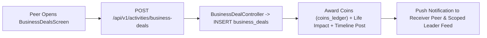

---

## Activity 02 — P2P Meetings (1-on-1s, Scheduling, Rescheduling & Speed Networking)
**Deep-Dive Spec:** [02-p2p-meetings.md](./activities/02-p2p-meetings.md) · **Classification:** `Implemented but Incorrect`

- **1. Initiator:** Peer or Leader scheduling (`P2PMeetingRequest`), rescheduling (`P2PMeetingRescheduleRequest`), completing Speed Networking (`complete-p2p`), or directly logging a completed 1-on-1 (`P2pMeeting`).
- **2. Screen:** Member App `P2pMeetingsScreen`; Leader App [p2p_meetings_view.dart](file:///D:/office%20project/LeaderApp-Fornt-end-/lib/features/p2p_meetings/view/p2p_meetings_view.dart) & [create_p2p_meeting_bottom_sheet.dart](file:///D:/office%20project/LeaderApp-Fornt-end-/lib/features/p2p_meetings/view/widgets/create_p2p_meeting_bottom_sheet.dart) / [log_p2p_bottom_sheet.dart](file:///D:/office%20project/LeaderApp-Fornt-end-/lib/features/peer_profile/view/widgets/log_p2p_bottom_sheet.dart).
- **3. Inputs:** `peer_id` / `invitee_id`, `meeting_date` / `scheduled_at`, `meeting_place`, `remarks` / `message`, `media` (selfie JSON), or reschedule `new_scheduled_at` + `reason`.
- **4. API:** Schedule `POST /api/v1/p2p-meeting-requests` (`/{id}/accept|reschedule|reject|cancel`); Reschedule `POST /api/v1/p2p-meeting-reschedule-requests/{id}/approve|reject`; Log `POST /api/v1/activities/p2p-meetings` & Leader `POST /api/v1/leader/p2p-meetings`.
- **5. Controller & Service:** `P2PMeetingRequestController` (`P2PMeetingRequestService`), `P2PMeetingRescheduleController`, `P2pMeetingController`, `SpeedNetworkingP2pService`, `LeaderActivitiesController`.
- **6. Auth & Scope:** Invitee-only guard on accept/reject; **Bug:** Leader `POST /activities/p2p-meetings` and `GET /peers/{id}/meetings` perform **zero circle scope check**.
- **7. DB Operation:** Writes `p2p_meeting_requests` → `p2p_meeting_reschedule_requests` → `p2p_meetings` (`p2p_meeting_request_id` linked) + `coins_ledger` + `life_impact_histories` + `posts`.
- **8. Status Change:** Request: `pending` → `accepted` \| `reschedule_requested` \| `rejected` \| `cancelled` → `is_logged = true`.
- **9. Recipient:** Counterparty Peer + Circle P2P Leaderboard (`GET /api/v1/leaderboards/p2p-meetings`).
- **10. Notification:** Request/Accept/Reschedule/Logged push & in-app alerts (`LeaderNotificationDispatcherService` when logged by Leader).
- **11. Next Step:** Dual-avatar P2P Creative posted to feed; counts toward Last 30 Days P2P KPI. **Recommendation:** Enforce circle scope on Leader P2P endpoints and strip `[sn_match:<uuid>]` from Speed Networking P2P remarks.

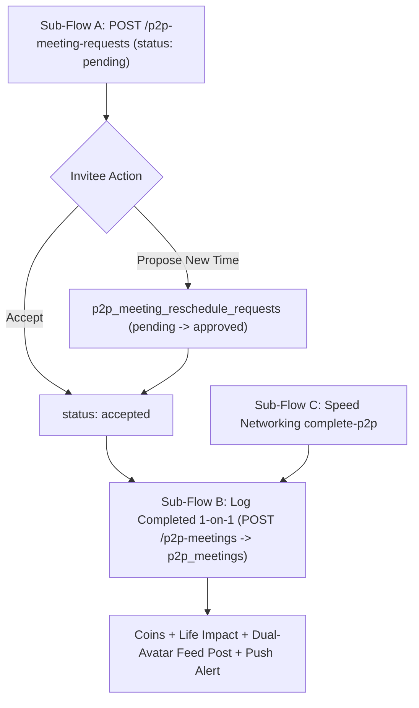

---

## Activity 03 — Normal Referrals (Given/Received Leads) & Circle Category Referrals
**Deep-Dive Spec:** [03-normal-referrals.md](./activities/03-normal-referrals.md) · **Classification:** `Implemented but Incorrect`

- **1. Initiator:** Peer or Leader passing a client lead (`Referral`) or nominating a candidate for an open Circle category (`PeerReferral` / `circle_peer_referrals`).
- **2. Screen:** Member App `ReferralsScreen`; Leader App [referrals_view.dart](file:///D:/office%20project/LeaderApp-Fornt-end-/lib/features/referrals/view/referrals_view.dart), [send_referral_bottom_sheet.dart](file:///D:/office%20project/LeaderApp-Fornt-end-/lib/features/peer_profile/view/widgets/send_referral_bottom_sheet.dart), and [refer_category_bottom_sheet.dart](file:///D:/office%20project/LeaderApp-Fornt-end-/lib/features/circle_details/view/widgets/refer_category_bottom_sheet.dart).
- **3. Inputs:** Business Lead: `to_user_id`, `referral_of` (prospect name), `phone`, `email`, `address`, `referral_type` (`inside`\|`outside`), `hot_value` (`1..5`), `remarks`. Category Referral: `referred_name`, `referred_phone`, `open_category_id`.
- **4. API:** Lead: `POST /api/v1/activities/referrals`, `PATCH /api/v1/activities/referrals/{id}/status`, Leader `POST /api/v1/leader/referrals`. Category: `POST /api/v1/peer-referrals` & `POST /api/v1/leader/teams/circles/{id}/refer-category`.
- **5. Controller & Service:** `Api\ReferralController` (`ReferralService`), `PeerReferralsApiController`, `LeaderActivitiesService`, `LeaderTeamsService::referCategory()`, `DedReportController`.
- **6. Auth & Scope:** Receiver updates lead `status_id`; **Bugs:** `referCategory` lacks circle scope check, and `GET /teams/contacts` leaks global `contact_posts` when user has `0` contacts (`P0` leak!).
- **7. DB Operation:** `INSERT INTO referrals` (`status_id` FK → `referral_status`) + `coins_ledger` + `life_impact_histories`; or `INSERT INTO circle_peer_referrals` / `peer_referrals`.
- **8. Status Change:** `referrals.status_id`: `Not Contacted Yet` → `In Progress` → `Got Business` \| `Lost/Closed`. `peer_referrals.status`: `pending` → `approved` \| `rejected`.
- **9. Recipient:** Recipient Peer (`to_user_id`) or Circle Director/Admin reviewing `circle_peer_referrals` in Pending Requests.
- **10. Notification:** Lead push & in-app card to `to_user_id` (`LeaderNotificationDispatcherService::notifyReferralCreated`).
- **11. Next Step:** When `Got Business` is reached, Peer converts the lead into **Activity 01 (`business_deals.referral_id`)**. **Recommendation:** Fix `getUserContacts()` leak and scope `referCategory`.

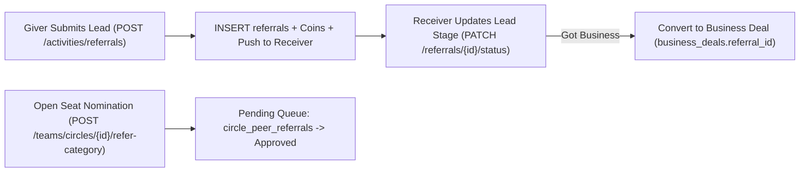

---

## Activity 04 — "I Can Help" Profiles & Admin User Tags
**Deep-Dive Spec:** [04-i-can-help-profiles-and-tags.md](./activities/04-i-can-help-profiles-and-tags.md) · **Classification:** `Fully Implemented`

- **1. Initiator:** Peer declaring expertise/needs (`i_can_help_with`, `i_am_looking_for`, `superpower`), or Admin assigning structured `UserTag` badges (`team_member`, etc.).
- **2. Screen:** Member App `EditProfileOverviewScreen`; Leader App [peer_profile_overview_section.dart](file:///D:/office%20project/LeaderApp-Fornt-end-/lib/features/peer_profile/view/widgets/peer_profile_overview_section.dart); React Admin Web [UserTagsPage.tsx](file:///D:/office%20project/unity-admin-web/src/features/userTags/UserTagsPage.tsx).
- **3. Inputs:** JSON arrays `i_can_help_with[]`, `i_am_looking_for[]`, `skills[]`, `business_keywords[]`, `superpower`; Admin `tag_id` + `user_id`.
- **4. API:** `PUT|PATCH /api/v1/profile`, `GET /api/v1/members/{id}`; Admin `/api/v1/admin/user-tags[/{id}/users]`.
- **5. Controller & Service:** `ProfileController@update`, `MemberController@show` (`ProfileMatchService`), `AskMatchingService`, `UserTagAdminController`.
- **6. Auth & Scope:** Self-only on `/api/v1/profile`; Admin guard required on `/api/v1/admin/user-tags*` (currently under `unity.user` block — needs `admin.permission`).
- **7. DB Operation:** `UPDATE users SET i_can_help_with = ..., i_am_looking_for = ..., updated_at = NOW()`; `INSERT/DELETE user_tag_assignments`.
- **8. Status Change:** Immediate profile update (no moderation gate; custom tags stored in `tags`).
- **9. Recipient:** Peer Discovery search (`PostgreSQL ILIKE`), `ProfileMatchService` (15-weight compatibility score), and `AskMatchingService`.
- **10. Notification:** None on tag edit.
- **11. Next Step:** Automatically powers AI/keyword candidate matching whenever other Peers publish **Activities 05, 06, or 07 (Asks)**.

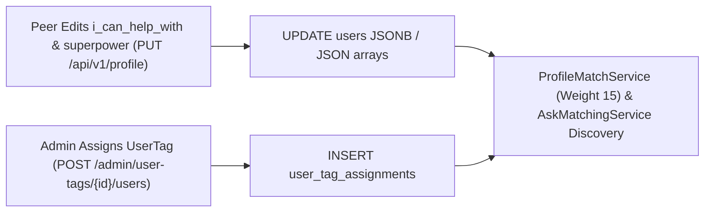

---

## Activity 05 — Collaboration Asks (`flow.code = 'collaboration'`)
**Deep-Dive Spec:** [05-collaboration-asks.md](./activities/05-collaboration-asks.md) · **Classification:** `Implemented but Incorrect`

- **1. Initiator:** Peer seeking a JV, co-founder, manufacturing, technology, channel, or cross-border partner (13 `ask_types` under `collaboration`, plus legacy `collaboration_posts`).
- **2. Screen:** Member App 3-Step Wizard (`AskStep1BriefScreen` → `AskStep2FiltersScreen` → `AskStep3PreviewScreen`, `PeersAsksHubScreen`); Leader App [peer_collaboration_screen.dart](file:///D:/office%20project/LeaderApp-Fornt-end-/lib/features/peer_profile/view/peer_collaboration_screen.dart); Admin Web [AsksPage.tsx](file:///D:/office%20project/unity-admin-web/src/features/asks/AsksPage.tsx).
- **3. Inputs:** `flow = 'collaboration'`, `type_id`, `title`, dynamic `ask_answers[]`, target cities/industries (`filters`), `visibility_type` (`all_peers` \| `district` \| `circle`), `publish_to_timeline`.
- **4. API:** `POST /api/v1/asks` → `PUT .../{ask}/filters|visibility` → `POST .../{ask}/publish` → `POST /api/asks/{ask}/matches` → `POST /api/asks/{ask}/responses` → `POST .../{id}/close-and-thank`; Leader `GET /api/v1/ask-flows*` & `/leader/asks/collaboration/*`.
- **5. Controller & Service:** `AskController` (`AskService`), `AskMatchController` (`AskMatchingService`), `AskResponseController` (`AskResponseService`), `AskFlowHubController`, `LeaderAskFlowController` (`LeaderAskFlowService`).
- **6. Auth & Scope:** Visibility scoped on Member feed (`AskFeedService`); **CRITICAL BUG:** `LeaderAskFlowService` (`GET /ask-flows*`) never accepts `$user` and leaks **all platform asks** across every circle! Also `GET /leader/asks/form-config` omits `option_id` UUIDs needed by `POST /api/v1/asks`.
- **7. DB Operation:** Writes `asks`, `ask_answers`, `ask_matches`, `ask_responses`, `ask_status_histories`, optional `posts` (`ask_timeline_links`); daily `00:10` cron `collaborations:expire` expires past-due legacy posts.
- **8. Status Change:** `asks.status`: `draft` → `published` → `in_progress` → `fulfilled` \| `closed` \| `cancelled` \| `expired`.
- **9. Recipient:** Matched Peers (`ask_matches`), Circle/District feed viewers, and Responding Peers (`ask_responses`).
- **10. Notification:** Match alert & response notifications via `PushNotificationService` / `NotificationDispatchService`.
- **11. Next Step:** Responder and Ask owner connect via P2P (`createP2pFromAsk`) or convert outcome into a Business Deal (`convertAskToDeal`, recording `approx_deal_value`).

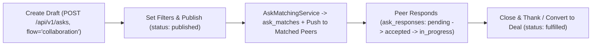

---

## Activity 06 — Get Help Asks (`flow.code = 'help'`)
**Deep-Dive Spec:** [06-get-help-asks.md](./activities/06-get-help-asks.md) · **Classification:** `Implemented but Incorrect`

- **1. Initiator:** Peer requesting mentorship, operational advice, expert guidance, capital advice, or feedback (12 `ask_types` under `help`, plus legacy `requirements`).
- **2. Screen:** Member App `MyAsksScreen`, `AskResponsesListScreen`, `HelpOutcomeFormDialog`; Leader App [peer_help_screen.dart](file:///D:/office%20project/LeaderApp-Fornt-end-/lib/features/peer_profile/view/peer_help_screen.dart) & [requirements_view.dart](file:///D:/office%20project/LeaderApp-Fornt-end-/lib/features/requirements/view/requirements_view.dart); Admin Web [AsksPage.tsx](file:///D:/office%20project/unity-admin-web/src/features/asks/AsksPage.tsx).
- **3. Inputs:** `flow = 'help'`, `type_id` (e.g. `founder_mentorship`, `advice`, `expert_guidance`), `title`, problem `ask_answers[]`, consultation mode, `visibility_type`.
- **4. API:** `/api/v1/asks` lifecycle + `GET /api/v1/asks/help/global|my|leaderboard` + legacy `/api/v1/activities/requirements`; Leader `GET /api/v1/leader/activities/help-asks` & `/leader/requirements`.
- **5. Controller & Service:** `AskController` (`AskService`), `AskMatchingService` (matches `users.i_can_help_with` & `willing_to_mentor`), `AskResponseService`, `LeaderAskFlowService`.
- **6. Auth & Scope:** Same unscoped global leak in `LeaderAskFlowService` (`GET /ask-flows*`) and fake `60/25/15%` Ask status split in `LeaderDashboardService.php:784-786`.
- **7. DB Operation:** Inserts `asks` (`flow_id` = `help`), `ask_answers`, `ask_matches`, `ask_responses`, `ask_status_histories`.
- **8. Status Change:** `asks.status`: `draft` → `published` → `in_progress` → `fulfilled` \| `closed`. `ask_responses.status`: `pending` → `accepted` → `completed`.
- **9. Recipient:** Matched Advisors/Mentors (`can_help_directly` / `can_introduce_peer`) and Ask author.
- **10. Notification:** Advisor match push + response thread notifications + gratitude notification on `close-and-thank`.
- **11. Next Step:** Solution accepted, outcome notes saved (`outcome_status`, `outcome_notes`), and helper credited on Help Ask Leaderboard.

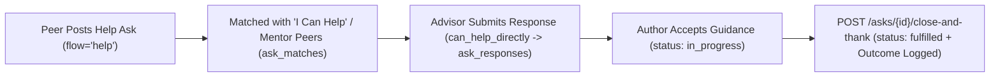

---

## Activity 07 — Referral Asks — "Help Me Connect" (`flow.code = 'referral'`)
**Deep-Dive Spec:** [07-referral-asks.md](./activities/07-referral-asks.md) · **Classification:** `Implemented but Incorrect`

- **1. Initiator:** Peer requesting a warm introduction to a specific target customer, enterprise decision-maker, distributor, investor, or media contact (12 `ask_types` under `referral`).
- **2. Screen:** Member App `MyAsksScreen`, `AskMatchesScreen`, `IntroPassSheet`; Leader App [peer_referral_screen.dart](file:///D:/office%20project/LeaderApp-Fornt-end-/lib/features/peer_profile/view/peer_referral_screen.dart); Admin Web [AsksPage.tsx](file:///D:/office%20project/unity-admin-web/src/features/asks/AsksPage.tsx).
- **3. Inputs:** `flow = 'referral'`, `type_id` (`customer`, `client`, `distributor`, `investor`, etc.), target company/role in `ask_answers[]`; Responder submits `introduced_peer_id` or `ask_response_contacts` (`PATCH /api/asks/{ask}/responses/{response}/contact`).
- **4. API:** `POST /api/v1/asks` → `POST /api/v1/asks/{ask}/publish` → `POST /api/asks/{ask}/responses` → `POST /api/v1/asks/{ask}/referral-link`; Feed `GET /api/v1/asks/referral/global` (merges `asks` + `referrals`).
- **5. Controller & Service:** `AskController`, `AskFlowHubService`, `AskResponseController` (`AskResponseService`), `LeaderAskFlowService`.
- **6. Auth & Scope:** Same unscoped `LeaderAskFlowService` leak in Leader App; contact details in `ask_response_contacts` restricted to Ask owner & responder.
- **7. DB Operation:** Writes `asks`, `ask_answers`, `ask_matches`, `ask_responses`, `ask_response_contacts`, and links converted leads via `POST /asks/{ask}/referral-link`.
- **8. Status Change:** `draft` → `published` → `in_progress` (introducer connected) → `fulfilled` (intro delivered & verified) \| `closed`.
- **9. Recipient:** Ask creator receives warm contact details; Introducer earns Referral Ask leaderboard credit.
- **10. Notification:** Warm-intro offer push to Ask creator + acceptance push to Introducer.
- **11. Next Step:** Warm introduction converts into a tracked **Normal Referral (#03)** and/or **Business Deal (#01)**.

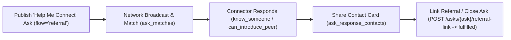

---

## Activity 08 — Testimonials (Given & Received)
**Deep-Dive Spec:** [08-testimonials.md](./activities/08-testimonials.md) · **Classification:** `Fully Implemented`

- **1. Initiator:** Peer or Leader writing a public commendation and 1–5 star rating for a fellow Peer (`to_user_id`).
- **2. Screen:** Member App `TestimonialsScreen` / `AddTestimonialSheet`; Leader App [testimonials_view.dart](file:///D:/office%20project/LeaderApp-Fornt-end-/lib/features/testimonials/view/testimonials_view.dart) & [peer_testimonials_screen.dart](file:///D:/office%20project/LeaderApp-Fornt-end-/lib/features/peer_profile/view/peer_testimonials_screen.dart).
- **3. Inputs:** `to_user_id`, `rating` (`1..5`), `content` (text), optional `media` JSON & `referral_id`.
- **4. API:** Member `POST /api/v1/testimonials` & `GET|POST /api/v1/activities/testimonials`; Leader `GET|POST /api/v1/leader/testimonials`, `GET /api/v1/leader/members/{id}/testimonials`; DED `GET /api/v1/ded/activities/testimonials[/{id}]`.
- **5. Controller & Service:** `Api\V1\TestimonialController`, `Api\TestimonialController`, `LeaderActivitiesController` (`LeaderActivitiesService`), `CoinsService`, `LifeImpactService`.
- **6. Auth & Scope:** Authenticated Peer/Leader (`from_user_id !== to_user_id`); Leader list scoped via `resolveActivityScope()` (detail `showDetail` needs scope guard).
- **7. DB Operation:** `INSERT INTO testimonials` (`SoftDeletes`) + `coins_ledger` + `life_impact_histories` + auto-generated timeline `posts` (`source_type = 'testimonial'`).
- **8. Status Change:** Immediate publication (`is_deleted = false`); subject to post-hoc moderation via `PostDeactivationService`.
- **9. Recipient:** Receiver Peer's Profile Testimonials Wall (`GET /api/v1/users/{user}/testimonials`) & Top Testimonials Leaderboard.
- **10. Notification:** Push + in-app notification to `to_user_id`.
- **11. Next Step:** Boosts Peer credibility and counts in `LastMonthActivityService` (#35).

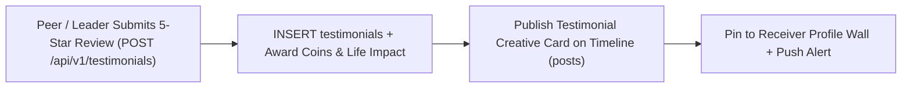

---

## Activity 09 — Entrepreneur Certification Form
**Deep-Dive Spec:** [09-entrepreneur-certification-form.md](./activities/09-entrepreneur-certification-form.md) · **Classification:** `Fully Implemented`

- **1. Initiator:** Peer (or public entrepreneur) completing the 25-question Entrepreneur Accreditation Assessment; reviewed by Admin or scoped Leader.
- **2. Screen:** Member App `EntrepreneurCertificationScreen`; Leader App Pending Approvals (`certifications`) & `LeaderActivitiesView`; React Admin Web [CertificationSubmissionsView.tsx](file:///D:/office%20project/unity-admin-web/src/features/certifications/CertificationSubmissionsView.tsx) & [PendingRequestsPage.tsx](file:///D:/office%20project/unity-admin-web/src/features/pendingRequests/PendingRequestsPage.tsx).
- **3. Inputs:** `full_name`, `business_name`, `email`, `contact_no`, and 25 scored quiz answers (`GET /api/v1/entrepreneur-certification/questions`).
- **4. API:** Submit `POST /api/v1/entrepreneur-certification`; History `GET /api/v1/my-certifications`; Review `POST /api/v1/admin/certifications/{id}/approve|reject` or `POST /api/v1/leader/pending-requests/certifications/{id}/approve|reject`; Download `GET /api/v1/admin/certifications/{id}/download`.
- **5. Controller & Service:** `WebsiteFormsController@submitEntrepreneurCertification` (`CertificationQuestionsService`), `CertificationSubmissionController`, `PendingRequestAdminController` → `CertificateGeneratorService` (DomPDF).
- **6. Auth & Scope:** Public/Member submission; Leader queue scoped to applicant's Circle/Category (**Fix needed:** add `admin.role` on `/api/v1/admin/certifications*` and `can_review_pending_peers` on `/leader/pending-requests`).
- **7. DB Operation:** Dual-writes same UUID inside one transaction into `entrepreneur_certification_submissions` AND `certification_submissions` (`certification_type = 'entrepreneur'`, `total_score`, `percentage`, `certification_level`). Approval generates PDF (`certificate_file_path`, `certificate_number`).
- **8. Status Change:** `new` → `approved` (PDF issued) \| `rejected`.
- **9. Recipient:** Applicant receives downloadable PDF certificate (`certificate_download_url`) on `Profile Certifications`.
- **10. Notification:** Submission receipt email + Approval email with PDF certificate + push notification.
- **11. Next Step:** Accredited Entrepreneur badge/certificate displayed on Peer profile.

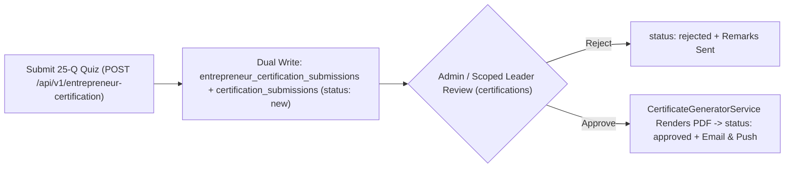

---

## Activity 10 — Leadership Certification Form
**Deep-Dive Spec:** [10-leadership-certification-form.md](./activities/10-leadership-certification-form.md) · **Classification:** `Fully Implemented`

- **1. Initiator:** Peer or Chapter Leader completing the 25-question Leadership Stewardship Assessment; reviewed by Admin or scoped Senior Leader.
- **2. Screen:** Member App `LeadershipCertificationScreen`; Leader App Pending Approvals (`certifications`) & `LeaderActivitiesView`; React Admin Web [CertificationSubmissionsView.tsx](file:///D:/office%20project/unity-admin-web/src/features/certifications/CertificationSubmissionsView.tsx).
- **3. Inputs:** `full_name`, `business_name`, `email`, `contact_no`, and 25 leadership quiz responses (`GET /api/v1/leadership-certification/questions`).
- **4. API:** Submit `POST /api/v1/leadership-certification`; History `GET /api/v1/leadership-certification/my`; Review `POST /api/v1/admin/certifications/{id}/approve|reject` or `/api/v1/leader/pending-requests/certifications/{id}/approve|reject`.
- **5. Controller & Service:** `WebsiteFormsController@submitLeadershipCertification`, `CertificationSubmissionController`, `PendingRequestAdminController` → `CertificateGeneratorService`.
- **6. Auth & Scope:** Same auth/scope posture as Activity #09 (`LeaderDashboardService.php:789-790` currently fakes a `70% / 30%` split between Entrepreneur and Leadership certifications instead of `GROUP BY certification_type`!).
- **7. DB Operation:** Atomic dual-write into `leadership_certification_submissions` + `certification_submissions` (`certification_type = 'leadership'`); DomPDF writes signed certificate PDF on approval.
- **8. Status Change:** `new` → `approved` \| `rejected`.
- **9. Recipient:** Certified Peer/Leader (`GET /api/v1/my-certifications`).
- **10. Notification:** Approval email with Leadership Certificate PDF + push/in-app alert.
- **11. Next Step:** Supports candidacy in Leadership Applications ([21-leadership-application-and-approval-flow.md](./21-leadership-application-and-approval-flow.md)).

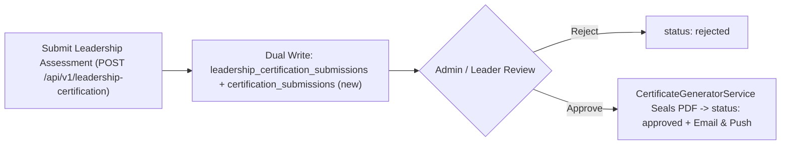

---

## Activity 11 — Partner With Us Form
**Deep-Dive Spec:** [11-partner-with-us-form.md](./activities/11-partner-with-us-form.md) · **Classification:** `Partially Implemented`

- **1. Initiator:** Corporate entity, sponsor, or Peer pitching an institutional alliance.
- **2. Screen:** Member App `PartnerWithUsScreen` / Public Website form; React Admin Web [LeadsPage.tsx](file:///D:/office%20project/unity-admin-web/src/features/leads/LeadsPage.tsx) & Blade `/admin/pending-requests/leads/partner-with-us`.
- **3. Inputs:** `first_name`, `last_name`, `mobile_number`, `email_id`, `city`, `brand_or_company_name`, `website_or_social_media_link`, `industry`, `about_your_business`, `partnership_goal`, `why_partner_with_peers_global`.
- **4. API:** Submit `POST /api/v1/partner-with-us`; Admin `GET|PATCH|PUT|DELETE /api/v1/admin/leads/partner_with_us[/{id}|/{id}/status]`; Leader read-only `GET /api/v1/leader/leads/partner_with_us`.
- **5. Controller & Service:** `WebsiteFormsController@submitPartnerWithUs`, `LeadAdminApiController`, `Admin\LeadSubmissionsController`.
- **6. Auth & Scope:** Public submission; Admin Lead API needs `admin.role` guard; Leader read route needs territorial filter.
- **7. DB Operation:** `INSERT INTO partner_with_us_submissions` (separate from public partner showcase `web_partnerships`).
- **8. Status Change:** `new` → `contacted` → `approved` \| `rejected` (free-form string updated via `PATCH .../status`).
- **9. Recipient:** Global Partnerships / Executive Board team on `LeadsPage.tsx`.
- **10. Notification:** Admin lead notification email + submitter confirmation email (`email_logs`).
- **11. Next Step:** Offline due diligence & MOU; if onboarded as public ecosystem partner, Admin publishes logo in `web_partnerships` ([WebAdminPage](file:///D:/office%20project/unity-admin-web/src/features/webAdmin/WebDashboardPage.tsx)).

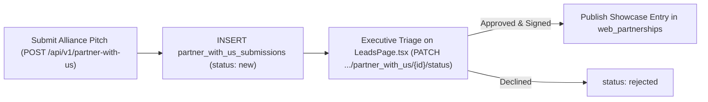

---

## Activity 12 — Brand Partner Form, Advertiser Onboarding & Timeline Ads
**Deep-Dive Spec:** [12-brand-partner-form-and-ads.md](./activities/12-brand-partner-form-and-ads.md) · **Classification:** `Fully Implemented`

- **1. Initiator:** Peer or Brand submitting **(A)** Advertiser Application & Campaign (`AdvertiserApplication`, `AdvertiserCampaign`), **(B)** Peer Ad Booking (`AdBooking`), or **(C)** Brand Partner Directory Offer (`BrandPartner`).
- **2. Screen:** Member App `AdvertiserDashboardScreen`, `BrandPartnerApplicationsListScreen`, `CampaignBuilderScreen`; Leader App Pending Queue (`ad_booking_requests`); React Admin Web [AdvertiserPage.tsx](file:///D:/office%20project/unity-admin-web/src/features/advertiser/AdvertiserPage.tsx), [AdsPage.tsx](file:///D:/office%20project/unity-admin-web/src/features/ads/AdsPage.tsx), [BrandPartnersPage.tsx](file:///D:/office%20project/unity-admin-web/src/features/partners/BrandPartnersPage.tsx).
- **3. Inputs:** `package_id`, `brand_name`, `company_name`, `email`, `phone`, `city`, `category_id`, creative assets, Razorpay payment, target placement/dates.
- **4. API:** Advertiser `/api/v1/advertiser/{packages,applications,campaigns,payments/*}` & `/api/v1/admin/advertiser/*`; Ad Bookings `POST /api/v1/ad-bookings` & Pending Queue `ad_booking_requests`; Brand Partners `/api/v1/brand-partners/*` (`view`, `click`, `callback-request`).
- **5. Controller & Service:** `AdvertiserPublicApiController`, `AdvertiserMemberApiController`, `AdvertiserAdminApiController`, `AdBookingController` (`AdBookingService`), `BrandPartnerApiController` (`BrandPartnerService`).
- **6. Auth & Scope:** Email OTP verification on Advertiser onboarding; Admin/Leader review on `ad_booking_requests` (harden `/api/v1/admin/advertiser/*` with `admin.permission`).
- **7. DB Operation:** Writes `advertiser_applications`, `advertiser_subscriptions`, `advertiser_payments`, `advertiser_campaigns`, `ad_bookings` → live `ads` (`ad_views`, `ad_clicks`) & `brand_partners` (`brand_partner_inquiries`).
- **8. Status Change:** Advertiser: `draft` → `pending_email_verification` → `submitted` → `under_review` → `changes_requested` \| `approved` → `active` \| `expired` (daily `08:15` cron `PGU:advertiser-subscription-expiry-check`). `ad_bookings`: `pending` → `approved` \| `rejected`.
- **9. Recipient:** Member timeline/feed viewers see sponsored `ads`; Advertiser tracks impressions, clicks, and inquiries; weekly `Mon 09:00` `PGU:brand-partner-weekly-report` emails analytics.
- **10. Notification:** Status emails/pushes on review, corrections, publish, and expiry (`08:00` `PGU:brand-partner-expiry-alerts`).
- **11. Next Step:** Active ads serve in Member feed (`GET /api/v1/ads/timeline`) until `ends_at`.

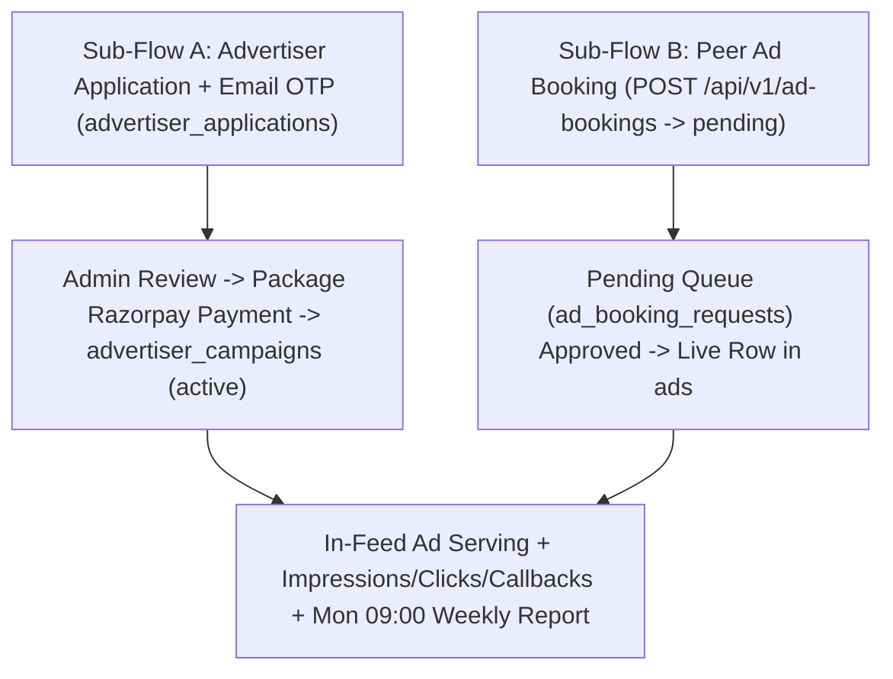

---

## Activity 13 — Leadership Role Application Form (In-App & Election Portal)
**Deep-Dive Spec:** [13-leadership-role-application-form.md](./activities/13-leadership-role-application-form.md) · **Full Flow Doc:** [21-leadership-application-and-approval-flow.md](./21-leadership-application-and-approval-flow.md) · **Classification:** `Implemented but Incorrect`

- **1. Initiator:** Peer applying for Circle/Regional leadership via **(A)** In-App `"Become a Leader"` form or **(B)** Website Election Portal (`/leadership/*`).
- **2. Screen:** Member App `LeadershipRoleScreen`; Public SPA `spa.blade.php`; Leader App `LeaderActivitiesView` (`leadership-interests`); React Admin Web [LeadershipPage.tsx](file:///D:/office%20project/unity-admin-web/src/features/leadership/LeadershipPage.tsx) & [Nominations/index.tsx](file:///D:/office%20project/unity-admin-web/src/features/webLeadership/pages/Nominations/index.tsx).
- **3. Inputs:** Flow A: `applying_for`, `leadership_roles[]`, `contribute_domains[]`, `why_interested`, `time_commitment`. Flow B: OTP + dynamic Form 1/Form 2 answers + documents + peer votes + jury rubric scores.
- **4. API:** Flow A: `POST /api/v1/forms/leader-interest` → `PATCH /api/v1/admin/leadership/applications/{id}/approve|reject`. Flow B: `/api/v1/leadership/{campaigns,nominations/*,vote/*,jury/*,admin/*}`.
- **5. Controller & Service:** `LeaderInterestController`, `LeadershipController`, and 14 controllers in `app/Modules/Leadership/Controllers/`.
- **6. Auth & Scope:** **CRITICAL BUGS:** `/api/v1/admin/leadership/*` lacks admin role middleware (`P0`); `/api/v1/leadership/admin/*` auto-creates `AdminUser` (`CRITICAL-5`); Jury/Result OTP accepts `'123456'` in prod (`CRITICAL-3`).
- **7. DB Operation:** Flow A writes `leader_interest_submissions` (**missing `status` column migration bug!**); Flow B writes 23 `web_leadership_*` tables.
- **8. Status Change:** Flow A: `pending` → `approved` \| `rejected`. Flow B: `draft` → `submitted` → `shortlisted` → `proceeded_to_jury` → `winner`.
- **9. Recipient:** Applicant & Election Board.
- **10. Notification:** Submission emails (`BecomeLeaderSubmittedMail`) & campaign logs (`web_leadership_notification_logs`); **missing** approval push/email in Flow A.
- **11. Next Step:** **Broken Handoff:** Neither Flow A nor Flow B auto-commissions the approved winner via `OrganizationalAssignmentSyncService::assign()`!

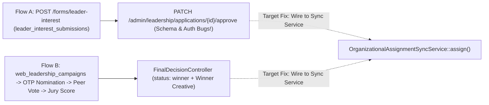

---

## Activity 14 — Become a Speaker Form
**Deep-Dive Spec:** [14-become-a-speaker-form.md](./activities/14-become-a-speaker-form.md) · **Classification:** `Partially Implemented`

- **1. Initiator:** Peer or domain expert applying to speak at Peers Global summits, masterclasses, and chapter conclaves.
- **2. Screen:** Member App `BecomeSpeakerScreen` / Website form; React Admin Web [LeadsPage.tsx](file:///D:/office%20project/unity-admin-web/src/features/leads/LeadsPage.tsx) & Blade `/admin/pending-requests/leads/become-speaker`.
- **3. Inputs:** `first_name`, `last_name`, `email`, `phone`, `city`, `linkedin_profile_url`, `company_name`, `brief_bio`, `topics_to_speak_on`, `image_file_id` (FK → `files.id`).
- **4. API:** Submit `POST /api/v1/become-a-speaker`; History `GET /api/v1/become-a-speaker`; Admin `GET|PATCH /api/v1/admin/leads/become_speaker[/{id}/status]`; Leader read `GET /api/v1/leader/leads/become_speaker`.
- **5. Controller & Service:** `WebsiteFormsController@submitBecomeSpeaker`, `LeadAdminApiController`, `Admin\LeadSubmissionsController`.
- **6. Auth & Scope:** Public/Member intake; Admin Lead API requires `admin.permission` hardening; Leader read endpoint currently unscoped.
- **7. DB Operation:** `INSERT INTO become_speaker_submissions` (`status = 'new'`). *(Note vs Workbook: `SpeakerBureauDirectoryScreen` / `SpeakerBureauCatalogService` directory table is not yet a separate published catalog — `users.open_to_speaking_at_events` boolean serves discovery).*
- **8. Status Change:** `new` → `reviewed` / `approved` / `rejected`.
- **9. Recipient:** Events & Programs Committee / Global Events Admin team.
- **10. Notification:** Submission acknowledgement & admin alert email (`email_logs`).
- **11. Next Step:** Approved speakers are invited to headline regional/national Events (#21) and optionally flip `users.open_to_speaking_at_events = true`.

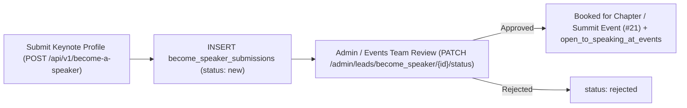

---

## Activity 15 — Become a Mentor Form
**Deep-Dive Spec:** [15-become-a-mentor-form.md](./activities/15-become-a-mentor-form.md) · **Classification:** `Partially Implemented`

- **1. Initiator:** Seasoned Peer applying to offer structured mentorship across business domains.
- **2. Screen:** Member App `BecomeMentorScreen` / Website form; React Admin Web [LeadsPage.tsx](file:///D:/office%20project/unity-admin-web/src/features/leads/LeadsPage.tsx) & Blade `/admin/pending-requests/leads/become-mentor`.
- **3. Inputs:** `first_name`, `last_name`, `email`, `phone`, `city`, `linkedin_profile` (note: backend schema is leaner than Workbook's conceptual `SlotConfigSheet`).
- **4. API:** Submit `POST /api/v1/become-a-mentor`; Read `GET /api/v1/become-a-mentor[/{id}]`; Admin `GET|PATCH /api/v1/admin/leads/become_mentor[/{id}/status]`; Leader `GET /api/v1/leader/leads/become_mentor`.
- **5. Controller & Service:** `App\Http\Controllers\Api\V1\Forms\BecomeMentorController`, `LeadAdminApiController`, `Admin\LeadSubmissionsController`.
- **6. Auth & Scope:** Public/Member intake; Admin Lead API requires `admin.permission` guard.
- **7. DB Operation:** `INSERT INTO become_mentor_submissions` (`status = 'new'`). *(Note vs Workbook: `CalendarSlotManager` / `MentorshipBookingService` is not implemented; mentorship matching routes through `users.willing_to_mentor` + **Activity 06 Get Help Asks** `founder_mentorship` / `industry_mentorship`!)*
- **8. Status Change:** `new` → `approved` \| `rejected`.
- **9. Recipient:** Community Operations / Mentorship Review team.
- **10. Notification:** Submission & admin notification email (`email_logs`).
- **11. Next Step:** Upon approval, set `users.willing_to_mentor = true` so `AskMatchingService` routes Mentorship Help Asks (#06) to the mentor.

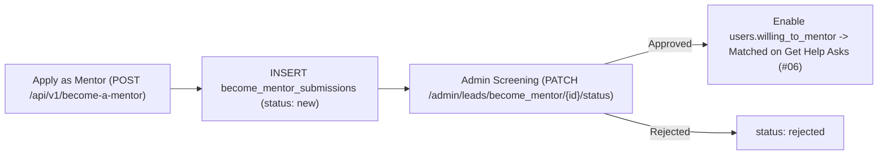

---

## Activity 16 — Recommend a Peer Form
**Deep-Dive Spec:** [16-recommend-a-peer-form.md](./activities/16-recommend-a-peer-form.md) · **Classification:** `Fully Implemented`

- **1. Initiator:** Authenticated Peer (`user_id`) nominating an external entrepreneur to join Peers Global / a specific Circle. *(Note vs Workbook: Workbook describes internal character endorsement, whereas actual code & form fields implement prospective Peer membership recommendation!)*
- **2. Screen:** Member App `RecommendPeerScreen` & `RecommendPeerHistoryScreen`; Leader App `LeaderActivitiesView` (`peer-recommendations`) & Pending Approvals (`circle_peer_referrals`); Admin Web [PendingRequestsPage.tsx](file:///D:/office%20project/unity-admin-web/src/features/pendingRequests/PendingRequestsPage.tsx).
- **3. Inputs:** `peer_name`, `peer_mobile`, `peer_email`, `peer_city`, `peer_business`, `main_business_category_id`, `business_subcategory_id`, `circle_id`, `why_valuable`, `how_well_known`, `is_aware`, `note`.
- **4. API:** Submit `POST /api/v1/forms/recommend-peer`; My list `GET /api/v1/forms/recommend-peer/my`; Review `POST /api/v1/leader/pending-requests/circle_peer_referrals/{id}/approve|reject` or `PATCH /api/v1/admin/forms/recommend-peer/{id}/status`; DED `GET /api/v1/ded/activities/recommend-a-peer`.
- **5. Controller & Service:** `PeerRecommendationController` (`PeerRecommendationService`), `PendingRequestAdminController`, `AdminOpsController`, `DedActivitiesController`.
- **6. Auth & Scope:** `auth:sanctum` + `unity.user` on submit; scoped to target Circle / recommender's Circle in `PendingRequestAdminController` (needs `can_review_pending_peers` role check).
- **7. DB Operation:** `INSERT INTO peer_recommendations` (`status = 'pending'`); approval sets `status = 'approved'`, awards Coins (`coins_awarded = true`, `coins_ledger`).
- **8. Status Change:** `pending` → `approved` \| `contacted` \| `converted` \| `rejected`.
- **9. Recipient:** Target Circle Director, Membership Growth Chair, DED, and Recommender Peer.
- **10. Notification:** Leader alert via `LeaderNotificationDispatcherService` + approval/coin push to recommender.
- **11. Next Step:** Membership Growth Chair / CD invites the recommended entrepreneur to attend as a Visitor (#17) or register (#24).

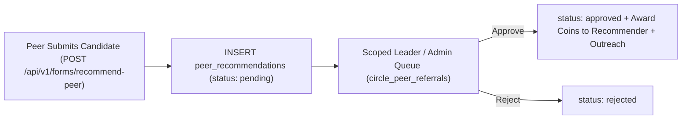

---

## Activity 17 — Register a Visitor Form
**Deep-Dive Spec:** [17-register-a-visitor-form.md](./activities/17-register-a-visitor-form.md) · **Full Event Flow:** [26-events-and-attendance-flow.md](./26-events-and-attendance-flow.md) · **Classification:** `Fully Implemented`

- **1. Initiator:** Host Peer (`user_id`) inviting a prospective entrepreneur guest to a chapter meeting or event (or public guest via referral link `visitor_leads` / occurrence visitor form).
- **2. Screen:** Member App `RegisterVisitorScreen`; Leader App `LeaderActivitiesView` (`visitor-registrations`) & Pending Approvals (`visitor_registrations`); Admin Web [PendingRequestsPage.tsx](file:///D:/office%20project/unity-admin-web/src/features/pendingRequests/PendingRequestsPage.tsx).
- **3. Inputs:** `event_type`, `event_name`, `event_date`, `visitor_full_name`, `visitor_mobile`, `visitor_email`, `visitor_city`, `visitor_business`, `visitor_business_category_id`, `how_known`, `note`.
- **4. API:** Submit `POST /api/v1/forms/register-visitor` (or event-bound `POST /api/v1/events/{event_id}/occurrences/{occurrence_id}/visitor-register[-as-user]`); Review `POST /api/v1/leader/pending-requests/visitor_registrations/{id}/approve|reject` or `POST /api/v1/ded/pending-requests/visitor-registrations/{id}/approve|reject`.
- **5. Controller & Service:** `VisitorRegistrationController`, `EventController`, `PendingRequestAdminController`, `DedPendingRequestsController`.
- **6. Auth & Scope:** Host Peer authenticated; Leader/DED queue scoped to host Peer's Circle/District.
- **7. DB Operation:** `INSERT INTO visitor_registrations` (`status = 'pending'`) and/or `event_registrations` (`registration_type = 'visitor'`); approval sets `status = 'approved'` and credits Coins (`coins_awarded = true`, `coins_ledger`) + Life Impact to host Peer.
- **8. Status Change:** `pending` → `approved` \| `rejected`; event pass `checkin_status`: `pending` → `checked_in`.
- **9. Recipient:** Visitor receives event QR pass (`WhatsApp` / email); Host Peer receives Coins & visitor credit.
- **10. Notification:** Leader/DED pending alert + Host Peer approval push + Visitor WhatsApp QR pass.
- **11. Next Step:** Visitor checks in at venue gate (#21) and enters Circle conversion pipeline (#20).

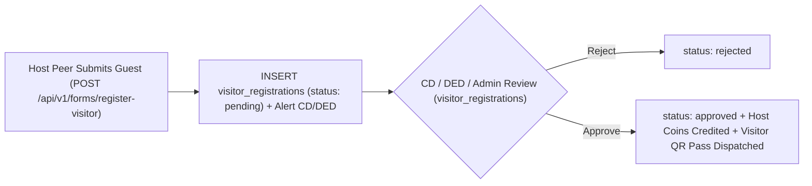

---

## Activity 18 — Vyapaar Jagat Story Form
**Deep-Dive Spec:** [18-vyapaar-jagat-story-form.md](./activities/18-vyapaar-jagat-story-form.md) · **Classification:** `Fully Implemented`

- **1. Initiator:** Peer (`user_id`) submitting their founder journey and SME milestones for editorial publication on Vyapaar Jagat.
- **2. Screen:** Member App `VyapaarJagatStoryScreen`; Leader App `LeaderActivitiesView` (`vyapaar-jagat`); Blade Admin `/admin/stories` & React Admin Web [StorySubmissionsEditTab.tsx](file:///D:/office%20project/unity-admin-web/src/components/PeerDetailDrawer/editTabs/StorySubmissionsEditTab.tsx) / [LeadsPage.tsx](file:///D:/office%20project/unity-admin-web/src/features/leads/LeadsPage.tsx).
- **3. Inputs:** `title`, `company_introduction`, `entrepreneurial_journey`, `biggest_challenge`, `biggest_achievement`, `business_impact`, `future_goals`, `advice_for_entrepreneurs`, `profile_photo`, `company_logo`, `cover_image`, social links, `consent` (`bool`).
- **4. API:** Member `GET /api/v1/story/status`, `POST /api/v1/story/submit` (`/story-submission`), `GET /api/v1/story/my-submissions`; Public `POST /api/v1/share-sme-business-story`; Admin `POST /admin/stories/{id}/approve|reject` & `/api/v1/admin/leads/story_submissions`; Leader `GET /api/v1/leader/activities/vyapaar-jagat`.
- **5. Controller & Service:** `StorySubmissionApiController`, `WebsiteFormsController`, `Admin\StorySubmissionsController`, `LeadAdminApiController`.
- **6. Auth & Scope:** Member auth on `/story/*`; Admin auth on `/admin/stories/*`; scoped Leader read feed in `LeaderActivitiesService`.
- **7. DB Operation:** `INSERT INTO sme_business_story_submissions` (`status = 'pending'`); on approval, validates published `story_link`, updates `sme_business_story_submissions.story_link` AND syncs `users.story_link`!
- **8. Status Change:** `new` / `pending` → `approved` (with live `story_link`) \| `rejected` (`rejected_reason`).
- **9. Recipient:** Author Peer (`users.story_link` badge/link on profile) & community readers.
- **10. Notification:** Approval email + push notification containing the live Vyapaar Jagat article URL.
- **11. Next Step:** Approved story surfaces in `LastMonthActivityService` (#35 `success_story` stream) and Peer 360° profile.

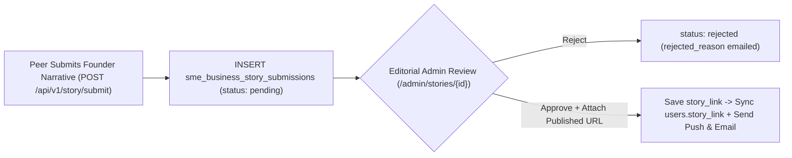

---

## Activity 19 — Joined Circles & Active Circle Memberships
**Deep-Dive Spec:** [19-joined-circles-and-memberships.md](./activities/19-joined-circles-and-memberships.md) · **Full Circle Flow:** [23-organizational-structure-and-circle-flow.md](./23-organizational-structure-and-circle-flow.md) · **Classification:** `Implemented but Incorrect`

- **1. Initiator:** Peer managing active Circle memberships, package subscriptions (`CircleSubscriptionController`), or leaving a Circle; Leaders inspecting Circle directory & category seats.
- **2. Screen:** Member App `CirclesScreen`, `CircleMembersScreen`; Leader App [teams_view.dart](file:///D:/office%20project/LeaderApp-Fornt-end-/lib/features/teams/view/teams_view.dart), [circle_details_view.dart](file:///D:/office%20project/LeaderApp-Fornt-end-/lib/features/circle_details/view/circle_details_view.dart), [peer_membership_screen.dart](file:///D:/office%20project/LeaderApp-Fornt-end-/lib/features/peer_profile/view/peer_membership_screen.dart); Admin Web [CirclesPage.tsx](file:///D:/office%20project/unity-admin-web/src/features/circles/CirclesPage.tsx).
- **3. Inputs:** Circle package checkout (`circle_id`, Razorpay verification), `POST /circles/{id}/leave`, or Leader search/industry/status filters.
- **4. API:** Member `GET /api/v1/my-circles`, `GET /api/v1/circles/{circle}/members|leaders|categories/*`, `POST /api/v1/circles/{circle}/checkout|verify|leave`; Leader `GET /api/v1/leader/teams/{summary,industries,circles,circles/{id},circles/{id}/peers}`; DED `GET /api/v1/ded/circles`.
- **5. Controller & Service:** `CircleController`, `MyCircleController`, `CircleSubscriptionController`, `LeaderTeamsController` (`LeaderTeamsService`), `LeadershipCirclesController`.
- **6. Auth & Scope:** **CRITICAL BUGS:** `LeaderTeamsService` (`showCircle`, `circlePeers`, `subIndustries`, `events`) omits `$scopedCircleIds` validation (`IDOR`), `resolveDedDistrictId()` trusts raw `?district_id=<uuid>`, and `calculateCircleRevenue()` fabricates `(circle_price ?? 120000) * peers`!
- **7. DB Operation:** Reads/updates `circles`, `circle_members` (`level_1..4_category_id`, `paid_starts_at`, `paid_ends_at`, `expires_at`), `circle_subscriptions`, `joined_circle_categories`; daily `00:00` cron `memberships:expire` expires elapsed rows.
- **8. Status Change:** `circle_members.status`: `approved` → `left` / expired (`left_at` populated).
- **9. Recipient:** Circle Peers (Circle Group Chat & directory access) and scoped Leaders.
- **10. Notification:** `11:25` daily `memberships:send-circle-expiry-reminders` alerts expiring Circle Peers.
- **11. Next Step:** Active Circle membership unlocks Circle Group Chat (`/circles/{circle}/leadership-group-chat/messages`), category seat exclusivity, and chapter report eligibility (#29).

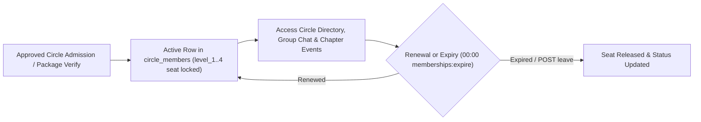

---

## Activity 20 — Circle Membership Requests & Build Your Own Circle
**Deep-Dive Spec:** [20-circle-membership-requests-and-build-circle.md](./activities/20-circle-membership-requests-and-build-circle.md) · **Full Flows:** [23-organizational-structure-and-circle-flow.md](./23-organizational-structure-and-circle-flow.md) & [24-member-management-flow.md](./24-member-management-flow.md) · **Classification:** `Implemented but Incorrect`

- **1. Initiator:** Peer submitting **(A)** a Circle Join Request (`CircleJoinRequest`) or **(B)** a *"Build Your Own Circle"* charter proposal (`UserCircleRequest`).
- **2. Screen:** Member App `JoinRequestStatusScreen`, `BuildCircleScreen`, `CircleRequestDetailScreen`; Leader App Pending Approvals (`circle_joining_requests`); Admin Web [CircleJoinRequestsPage.tsx](file:///D:/office%20project/unity-admin-web/src/features/circles/CircleJoinRequestsPage.tsx) & [UserCircleRequestsPage.tsx](file:///D:/office%20project/unity-admin-web/src/features/circles/UserCircleRequestsPage.tsx).
- **3. Inputs:** **(A)** `circle_id`, `reason_for_joining`, `level1..4_category_id`. **(B)** `circle_name`, `category_id`, `founder_category_id`, `city`, `meeting_mode`, `meeting_frequency`, `nominees[]`.
- **4. API:** **(A)** `POST /api/v1/circle-join-requests` → Stage 1/2 `/leader/pending-requests/circle_joining_requests/{id}/approve|reject` → Stage 3 `/circle-join-requests/{id}/payment/order|verify`. **(B)** `POST /api/v1/user-circle-requests` → `POST /api/v1/admin/user-circle-requests/{id}/approve`.
- **5. Controller & Service:** `CircleJoinRequestController` (`CircleJoinRequestService`, `CircleJoinPaymentService`), `PendingRequestAdminController`, `UserCircleRequestAdminController` (`BuildYourOwnCircleApprovalService`).
- **6. Auth & Scope:** Stage-aware routing on **(A)** (missing `can_review_pending_peers` check inside circle); **Code Bug on (B):** [BuildYourOwnCircleApprovalService.php:139-140](file:///c:/Users/malic/OneDrive/Documents/GitHub/unity-app-new/app/Services/Circles/BuildYourOwnCircleApprovalService.php#L139-L140) references undefined `$request` instead of `$circleRequest`!
- **7. DB Operation:** **(A)** `circle_join_requests` → `payments` → `circle_members`. **(B)** `user_circle_requests` + `user_circle_request_nominees` → auto-creates `circles` + `circle_members(role='founder')` + `finance_leader_tenures`.
- **8. Status Change:** **(A)** `pending_cd_approval` → `pending_id_approval` → `pending_circle_fee` → `circle_member`. **(B)** `pending` → `under_review` → `approved` \| `rejected`.
- **9. Recipient:** Applicant becomes `circle_member` (Flow A) or `circleFounder` (Flow B).
- **10. Notification:** Stage transition pushes to CD, ID/DED, and Applicant (`LeaderNotificationDispatcherService`).
- **11. Next Step:** Provisioned into **Activity 19 (`circle_members`)** or commissioned into the Flutter Leadership App as `circleFounder`.

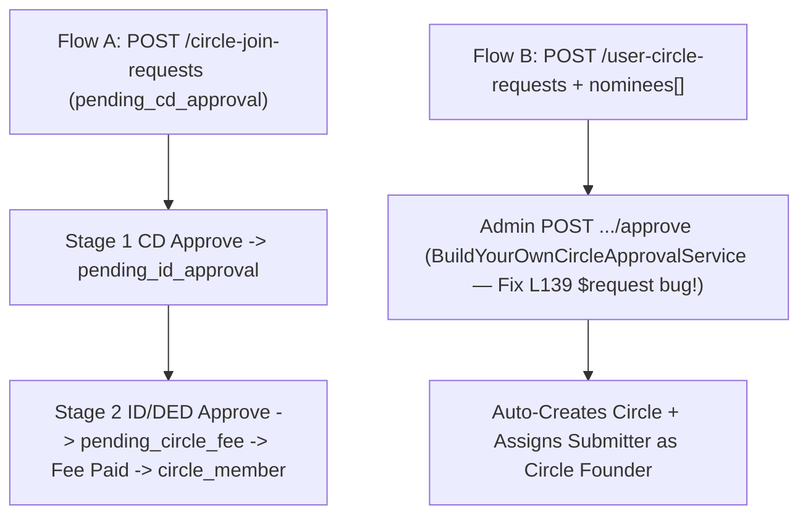

---

## Activity 21 — Attended Events, QR Tickets & Meeting Attendance
**Deep-Dive Spec:** [21-attended-events-and-registrations.md](./activities/21-attended-events-and-registrations.md) · **Full Event Flow:** [26-events-and-attendance-flow.md](./26-events-and-attendance-flow.md) · **Classification:** `Partially Implemented`

- **1. Initiator:** Peer booking an Event/Occurrence ticket (in-circle or cross-circle `event_registration_requests`), Gate Scanner scanning QR pass, or Admin/Leader recording Circle meeting attendance.
- **2. Screen:** Member App `MyEventsScreen`, `EventQrTicketScreen`; Scan App; Leader App [circle_events_screen.dart](file:///D:/office%20project/LeaderApp-Fornt-end-/lib/features/circle_details/view/circle_events_screen.dart), [circle_event_detail_screen.dart](file:///D:/office%20project/LeaderApp-Fornt-end-/lib/features/circle_details/view/circle_event_detail_screen.dart), [peer_events_attendance_screen.dart](file:///D:/office%20project/LeaderApp-Fornt-end-/lib/features/peer_profile/view/peer_events_attendance_screen.dart); Admin Web [EventsPage.tsx](file:///D:/office%20project/unity-admin-web/src/features/events/EventsPage.tsx).
- **3. Inputs:** `occurrence_id`, `coupon_code`, Razorpay payment; at venue: `qr_token` scan; Circle meeting: `present` / `absent` / `substitute`.
- **4. API:** Register `POST /api/v1/events/{event_id}/occurrences/{occurrence_id}/register` (`registration-request` for cross-circle); Scan `POST /api/v1/events/checkin/scan` & `/api/v1/scan-app/*`; Leader `GET /api/v1/leader/members/{id}/events|event-registrations|attendance`.
- **5. Controller & Service:** `EventController` (`EventRegistrationService`, `EventCheckinService`), `ScanAppEventController`, `PendingRequestAdminController` (`event_joining_requests`), `LeaderMemberController`.
- **6. Auth & Scope:** Cross-circle clearance gated by CD/DED; **Bugs:** `scan_app_users` has `plain_password` column (`HIGH-4`); `CircleEventDetailScreen` receives `attendees_count` > 0 with empty `attendees: []`; no UTC/IANA timezone on events.
- **7. DB Operation:** Writes `event_registrations` (`qr_token`, Razorpay + Zoho invoice), `event_qr_scan_logs`, `circle_meetings`, `attendance_records`, `substitute_logs`, `absence_warnings`.
- **8. Status Change:** `event_registrations`: `status = 'registered'`, `checkin_status`: `pending` → `checked_in`.
- **9. Recipient:** Attendee (QR ticket + tax invoice) & Circle attendance ledger.
- **10. Notification:** WhatsApp QR ticket pass + invoice email + `absence_warnings` + post-event feedback prompt (#30).
- **11. Next Step:** Checked-in Peers join Speed Networking (#02) and submit Event Feedback (#30); Leaders need mobile roll-call UI in Phase 2.

```mermaid
flowchart LR
    A["Book Event Occurrence (Free / Razorpay + Zoho Invoice)"] --> B["Mint QR Pass (event_registrations.qr_token) + WhatsApp Pass"]
    C["Cross-Circle Request (event_joining_requests)"] -->|"CD / DED Approves"| B
    B --> D["Venue Scanner POST /events/checkin/scan -> checkin_status: checked_in"]
    D --> E["Sync Attendance Ledger & Prompt Event Feedback (#30)"]
```

---

## Activity 22 — Impact Activity & Life Impact Score
**Deep-Dive Spec:** [22-impact-activity-and-life-impact-score.md](./activities/22-impact-activity-and-life-impact-score.md) · **Classification:** `Fully Implemented`

- **1. Initiator:** Peer or Leader logging a community/economic impact story (`POST /api/v1/impacts` or `/leader/impacts`), plus automatic Life Impact points accrued from Deals (#01), P2Ps (#02), Referrals (#03), Testimonials (#08), Visitors (#17), and Intro Videos (#26).
- **2. Screen:** Member App `LifeImpactScreen`, `ImpactLeaderboardScreen`; Leader App [impacts_view.dart](file:///D:/office%20project/LeaderApp-Fornt-end-/lib/features/impacts/view/impacts_view.dart), [create_impact_bottom_sheet.dart](file:///D:/office%20project/LeaderApp-Fornt-end-/lib/features/impacts/view/widgets/create_impact_bottom_sheet.dart), & Pending Approvals (`pending_impacts`); Admin Web [ImpactsPage.tsx](file:///D:/office%20project/unity-admin-web/src/features/impacts/ImpactsPage.tsx) & [RecognitionPage.tsx](file:///D:/office%20project/unity-admin-web/src/features/recognition/RecognitionPage.tsx).
- **3. Inputs:** `action` (from `GET /api/v1/impacts/actions` → `impact_actions`), `impacted_peer_id`, `impact_date`, `life_impacted` (`int`), `story_to_share`, `additional_remarks`.
- **4. API:** Member `POST /api/v1/impacts`, `GET /api/v1/life-impact/history`; Review `POST /api/v1/leader/pending-requests/pending_impacts/{id}/approve|reject`, `/api/v1/ded/pending-requests/pending-impacts/{id}/approve|reject`, `/api/v1/admin/impacts/{impact}/approve|reject`.
- **5. Controller & Service:** `ImpactController` (`ImpactService`, `LifeImpactService`), `PendingRequestAdminController`, `DedPendingRequestsController`, `MilestoneBadgeService`.
- **6. Auth & Scope:** Scoped to Peer's Circle/District in Leader & DED Pending Queues. *(Bug in `LeaderDashboardService.php:374,924`: queries non-existent `peer_user_id` instead of `impacted_peer_id` and fabricates `top_impacters` scores/names when 0!)*
- **7. DB Operation:** `INSERT INTO impacts` (`status = 'pending'` when `requires_leadership_approval = true`); approval increments `users.life_impacted_count`, inserts `life_impact_histories`, credits `coins_ledger`, and publishes timeline `posts` (`timeline_posted_at`).
- **8. Status Change:** `impacts.status`: `pending` → `approved` \| `rejected`.
- **9. Recipient:** Submitting Peer (`users.life_impacted_count`), Impact Leaderboard, and Circle Timeline.
- **10. Notification:** Leader pending alert on submission + Peer approval push & timeline card on `approveImpact()`.
- **11. Next Step:** Evaluates Life Impact `milestone_badges` (#28) and recognition posters (`life_impact_recognition_creatives`).

```mermaid
flowchart LR
    A["Submit Impact Story (POST /api/v1/impacts)"] --> B{"requires_leadership_approval?"}
    B -->|"Yes (status: pending)"| C["CD / DED / Admin Approves (pending_impacts)"]
    B -->|"Auto Action"| D["ImpactService / LifeImpactService"]
    C --> D
    D --> E["Increment users.life_impacted_count + life_impact_histories + Coins + Timeline Post + Badge Check (#28)"]
```

---

## Activity 23 — Coins Activity, Wallet, Claims & Maker-Checker Adjustments
**Deep-Dive Spec:** [23-coins-activity-wallet-and-history.md](./activities/23-coins-activity-wallet-and-history.md) · **Classification:** `Implemented but Incorrect`

- **1. Initiator:** Automatic activity reward hooks (`CoinsService`), Peer submitting a manual Coin Claim (`CoinClaimRequest`), or Store Admin initiating a Maker-Checker wallet adjustment (`WalletAdjustmentRequest`).
- **2. Screen:** Member App `CoinsScreen`, `CoinMilestonesScreen`, `ClaimYourCoinScreen`; Leader App [peers_by_coins_view.dart](file:///D:/office%20project/LeaderApp-Fornt-end-/lib/features/peers_by_coins/view/peers_by_coins_view.dart) & [peer_coins_screen.dart](file:///D:/office%20project/LeaderApp-Fornt-end-/lib/features/peer_profile/view/peer_coins_screen.dart); Admin Web [CoinsPage.tsx](file:///D:/office%20project/unity-admin-web/src/features/coins/CoinsPage.tsx), [CoinClaimsPage.tsx](file:///D:/office%20project/unity-admin-web/src/features/coins/CoinClaimsPage.tsx), [StoreCoinAdjustmentsPage.tsx](file:///D:/office%20project/unity-admin-web/src/features/store/StoreCoinAdjustmentsPage.tsx).
- **3. Inputs:** Manual Claim: `activity_code` (from `config/coin_claims.php`) + proof `payload` JSON. Store Adjustment: `user_id`, `type` (`CREDIT`\|`DEBIT`), `amount`, `reason`.
- **4. API:** Ledger `GET /api/v1/me/coins[/ledger]`; Claim `POST /api/v1/coin-claims`; Review `PATCH /api/v1/admin/coin-claims/{id}/approve|reject`, `/api/v1/ded/pending-requests/coin-claims/{id}/approve|reject`, & `/leader/pending-requests/coin_claims/{id}/approve|reject`; Store Maker-Checker `/api/admin/v1/wallet-adjustments*`.
- **5. Controller & Service:** `CoinsController` (`CoinsService`), `CoinClaimController`, `PendingRequestAdminController`, `DedPendingRequestsController`, `AdminStoreWalletAdjustmentController`.
- **6. Auth & Scope:** **TWO CRITICAL BUGS:** (1) `PendingRequestAdminController::fetchCoinClaims()` checks `Schema::hasTable('coin_claims')` while the real table is `coin_claim_requests`, hiding pending coin claims from Unified Pending Queue! (2) `DynamicRbacSeeder` marks `coins` visible for all roles, causing `LeaderPermissionService` to grant `coin_payouts` (`can_issue_coins = true`) to every role down to `secretary`!
- **7. DB Operation:** `INSERT INTO coin_claim_requests`; on approval calls SQL `coins_apply_transaction(...)` / inserts immutable `coins_ledger` (`transaction_id`, `amount`, `balance_after`) + updates `users.coins_balance`, `coin_medal_rank`, `coin_milestone_title`.
- **8. Status Change:** `coin_claim_requests.status`: `pending` → `approved` \| `rejected`; `wallet_adjustment_requests.status`: `PENDING` → `APPROVED` \| `REJECTED`.
- **9. Recipient:** Peer (`users.coins_balance`) & Coins Leaderboard (`GET /api/v1/leaderboards/coins`).
- **10. Notification:** Coin credit push & in-app alert + milestone unlock push (#28).
- **11. Next Step:** Coins redeem in Unity Store (`routes/store.php`) or Coin-based Membership Renewal (`/api/v1/membership/renew`).

```mermaid
flowchart TD
    A["Auto Activity Trigger OR Manual Claim (POST /api/v1/coin-claims)"] --> B["coin_claim_requests (Fix fetchCoinClaims table typo!)"]
    B -->|"DED / Admin / Scoped Leader Approves"| C["Immutable Ledger Write (coins_ledger + users.coins_balance)"]
    D["Store Admin Maker (POST /wallet-adjustments)"] -->|"Second Admin Checker Approves"| C
    C --> E["Update Coin Medal Rank + Unlock Badges (#28) + Redeem in Store/Membership"]
```

---

## Activity 24 — Timeline Posts Created & Activity Creatives
**Deep-Dive Spec:** [24-timeline-posts-created.md](./activities/24-timeline-posts-created.md) · **Classification:** `Implemented but Incorrect`

- **1. Initiator:** Peer authoring a text/photo/video timeline post (`POST /api/v1/posts`), automated system hooks (`source_type` ∈ `business_deal`, `p2p_meeting`, `testimonial`, `impact`, `ask`, `celebration`), or `07:00 IST` cron `celebrations:publish-due`.
- **2. Screen:** Member App `CreatePostScreen`, `TimelineFeedView`; Leader App Peer 360° Posts & Creatives ([peer_post_card.dart](file:///D:/office%20project/LeaderApp-Fornt-end-/lib/features/peer_profile/view/widgets/peer_post_card.dart)); Admin Web [PostsPage.tsx](file:///D:/office%20project/unity-admin-web/src/features/posts/PostsPage.tsx) & [TimeAnalyticsPage.tsx](file:///D:/office%20project/unity-admin-web/src/features/time/TimeAnalyticsPage.tsx).
- **3. Inputs:** `content_text`, `media[]` JSON, `tags[]`, `visibility` (`public` \| `circle` \| `connections`), `circle_id`; interactions: `like`, `comments`, `save`.
- **4. API:** Member `GET /api/v1/posts/feed`, `POST /api/v1/posts`, `POST|DELETE /api/v1/posts/{id}/like|comments|save`; Leader `GET|DELETE /api/v1/leader/members/{member_id}/posts[/{post_id}]` & `.../creatives[/{creative_id}]`; Admin `/api/v1/admin/posts*`.
- **5. Controller & Service:** `Api\PostController`, `PostSaveController`, `ActivityCreativeController`, `LeaderMemberController` (`LeaderMember360Service`), `Api\Admin\PostController`.
- **6. Auth & Scope:** Visibility & `PeerBlock` respected on Member feed; **CRITICAL BUG (`HIGH-1`):** `LeaderMemberController@deletePost` and `@deleteCreative` check circle membership via `resolveMember()` **but omit `manage_peers` check**, allowing any Circle Chair, Vice Chair, or Secretary to delete a Peer's posts/creatives (and UI trash icon renders without confirmation check)!
- **7. DB Operation:** Writes `posts`, `post_likes`, `post_comments`, `post_saves`, `post_mentions`, `activity_creatives`.
- **8. Status Change:** `posts.status = 'active'`, `moderation_status = 'approved'`; transitions to `'inactive'`/`'hidden'`/`SoftDeleted` if moderated (#25).
- **9. Recipient:** Public/Circle Peers on Home Timeline & Author's Profile Posts tab.
- **10. Notification:** `PostInteractionNotification` on likes, comments, and `@mentions` (excluded from Leader App inbox via `CONSUMER_EXCLUDED_TYPES`).
- **11. Next Step:** Flagged or policy-violating posts enter **Activity 25 (Deactivated / Hidden Posts)**.

```mermaid
flowchart LR
    A["Peer Creates Post OR Activity Auto-Creative"] --> B["INSERT posts (status: active, visibility: public|circle|connections)"]
    B --> C["Home Timeline Feed + Likes, Comments, Saves & Mentions"]
    C --> D{"Moderation / Report?"}
    D -->|"Compliant"| E["Remains Live on Profile & Feed"]
    D -->|"Reported / Admin Deactivates"| F["Activity 25: PostDeactivationService"]
```

---

## Activity 25 — Deactivated / Hidden Posts & Post Reports
**Deep-Dive Spec:** [25-deactivated-hidden-posts.md](./activities/25-deactivated-hidden-posts.md) · **Classification:** `Fully Implemented`

- **1. Initiator:** Peer reporting an inappropriate post (`POST /api/v1/posts/{post}/report`) or hiding their own post, or Admin deactivating/restoring a post (`PostDeactivationService`).
- **2. Screen:** Member App `DeactivatedPostsScreen`; React Admin Web [PostsPage.tsx](file:///D:/office%20project/unity-admin-web/src/features/posts/PostsPage.tsx), [DeactivatePostModal.tsx](file:///D:/office%20project/unity-admin-web/src/features/posts/components/DeactivatePostModal.tsx), [RestorePostModal.tsx](file:///D:/office%20project/unity-admin-web/src/features/posts/components/RestorePostModal.tsx), [PostReportsTab.tsx](file:///D:/office%20project/unity-admin-web/src/features/time/PostReportsTab.tsx).
- **3. Inputs:** Report: `reason_id` (`post_report_reasons`), `note`. Admin Deactivation: `deactivation_remarks`.
- **4. API:** Member `POST /api/v1/posts/{post}/report`, `GET /api/v1/posts/deactivated[-notice|/{id}]`; Admin `GET /api/v1/admin/posts/{id}/preview-deactivation|preview-restore`, `POST .../deactivate|restore`, `GET|POST /api/v1/admin/post-reports[/{id}/resolve|dismiss]`.
- **5. Controller & Service:** `PostReportController`, `DeactivatedPostController` (`DeactivatedPostService`), `Api\Admin\PostController` (`PostDeactivationService`), `Api\Admin\PostReportController`.
- **6. Auth & Scope:** Author-only read on `/posts/deactivated`; Admin moderation requires `admin.permission` hardening on `/api/v1/admin/posts*`.
- **7. DB Operation:** `INSERT INTO post_reports`; `PostDeactivationService` updates `posts` (`status = 'inactive'`, `active = false`, `deactivated_by`, `deactivated_at`, `deactivation_remarks`) AND **idempotently reverses awarded Coins (`coins_ledger`) and Life Impact points (`life_impact_histories` + `users.life_impacted_count`)** tied to `source_type`/`source_id`!
- **8. Status Change:** `post_reports.status`: `pending` → `resolved` \| `dismissed`. `posts.status`: `active` ↔ `inactive` / `hidden` / `rejected`.
- **9. Recipient:** Post author views reason & impact/coin reversal summary on `DeactivatedPostsScreen`.
- **10. Notification:** `post_deactivated` push + in-app notification to post author.
- **11. Next Step:** If Admin executes `restore`, `PostDeactivationService` restores feed visibility and re-applies reversed rewards.

```mermaid
flowchart LR
    A["Peer Reports Post (POST /posts/{post}/report -> post_reports)"] --> B["Admin Previews Impact/Coin Reversal (preview-deactivation)"]
    B --> C["POST /admin/posts/{id}/deactivate (PostDeactivationService)"]
    C --> D["Hide Post + Reverse Linked Coins & Life Impact + Notify Author"]
    D -->|"Appeal Accepted (POST .../restore)"| E["Restore Post & Re-Credit Rewards"]
```

---

## Activity 26 — User Shorts / Intro Videos & Explainer Videos
**Deep-Dive Spec:** [26-user-shorts-videos.md](./activities/26-user-shorts-videos.md) · **Classification:** `Fully Implemented`

- **1. Initiator:** Peer recording/uploading a vertical elevator-pitch Intro Short (`POST /api/v1/intro-videos`), Peers liking shorts (`toggle-like`), or Admin publishing platform explainer videos (`activity_videos`, `tutorials`).
- **2. Screen:** Member App `ShortsScreen`, `UserProfileMediaTab`; Leader App [app_video_player.dart](file:///D:/office%20project/LeaderApp-Fornt-end-/lib/core/widgets/app_video_player.dart) on `PeerProfileView`; Admin Web [TutorialsPage.tsx](file:///D:/office%20project/unity-admin-web/src/features/tutorials/TutorialsPage.tsx).
- **3. Inputs:** Video file upload (`files` table) attached to `users.profile_video_id`. *(Note vs Workbook: Backend stores direct MP4/media files via `File` model rather than AWS `HlsVideoTranscoder`.)*
- **4. API:** `GET /api/v1/intro-videos`, `POST /api/v1/intro-videos`, `GET /api/v1/intro-videos/me`, `DELETE /api/v1/intro-videos`, `POST /api/v1/intro-videos/{id}/toggle-like`; Explainers `GET /api/v1/activities/videos` & `/tutorials`.
- **5. Controller & Service:** `IntroVideoController`, `CoinsService::rewardForIntroVideo`, `LifeImpactService` (`action_key = 'introduction_video'`), `ActivityVideoController`, `TutorialController`.
- **6. Auth & Scope:** Authenticated Peer on `/intro-videos*`. **CRITICAL BUG (`CRITICAL-1`):** `POST /api/v1/tutorials` and `DELETE /api/v1/tutorials/{id}` at [api.php:389-390](file:///c:/Users/malic/OneDrive/Documents/GitHub/unity-app-new/routes/api.php#L389-L390) are **unauthenticated**!
- **7. DB Operation:** Uploads file to `files`, sets `users.profile_video_id`, writes `intro_video_likes`, and on first-ever upload credits `coins_ledger` + `life_impact_histories`.
- **8. Status Change:** `users.profile_video_id`: `null` ↔ `<file_uuid>` (`hasUploadedShortsFlag = true`).
- **9. Recipient:** All Peers browsing the vertical Shorts reel (`GET /api/v1/intro-videos`) and Leaders viewing Peer 360°.
- **10. Notification:** Like notification to video owner + first-upload coin/impact credit alert.
- **11. Next Step:** Increases profile completion % (#34) and Peer discoverability. **Recommendation:** Guard `POST|DELETE /api/v1/tutorials` behind `admin.auth`.

```mermaid
flowchart LR
    A["Peer Uploads Pitch Video (POST /api/v1/intro-videos)"] --> B["Save to files + Set users.profile_video_id"]
    B --> C["First-Time Upload Hook -> CoinsService + LifeImpactService"]
    C --> D["Streamed in Shorts Feed (GET /intro-videos) + Likes (intro_video_likes)"]
```

---

## Activity 27 — Invited Friends & Introduced Peers
**Deep-Dive Spec:** [27-invited-friends-introduced-peers.md](./activities/27-invited-friends-introduced-peers.md) · **Classification:** `Fully Implemented`

- **1. Initiator:** Peer syncing phonebook contacts & sending WhatsApp invites (`ContactInvitation`), sharing `referral_code` / `referral_links`, or submitting a retroactive `IntroductionRequest`.
- **2. Screen:** Member App `InviteContactsScreen`, `PeerIntroducedPeersScreen`, `ContactInvitationsHistoryScreen`; Leader App `LeaderActivitiesView` (`introduced-peers`), [peer_introduced_by_screen.dart](file:///D:/office%20project/LeaderApp-Fornt-end-/lib/features/peer_profile/view/peer_introduced_by_screen.dart), & Pending Queue (`introduction_requests`); Admin Web [MemberIntroducersTab.tsx](file:///D:/office%20project/unity-admin-web/src/features/recognition/MemberIntroducersTab.tsx) & [WhatsAppContactInvitationsPage.tsx](file:///D:/office%20project/unity-admin-web/src/features/whatsapp/WhatsAppContactInvitationsPage.tsx).
- **3. Inputs:** Phonebook batch (`POST /api/v1/contacts/sync`), selected contacts (`POST /api/v1/contact-invitations/send`), referral link generation (`POST /api/v1/referrals/links`), or retroactive `introducer_id` (`POST /api/v1/introduction-requests`).
- **4. API:** Member `/api/v1/introduced-peers`, `/referrals/{me,members,stats,links}`, `/contact-invitations/{send,history}`, `/introduction-requests`; Review `POST /api/v1/leader/pending-requests/introduction_requests/{id}/approve|reject`; Leader `GET /api/v1/leader/members/{id}/introduced-peers`.
- **5. Controller & Service:** `UserContactController`, `ContactInvitationApiController`, `IntroducedPeerController` (`IntroducedPeerService`), `IntroductionRequestsApiController`, `PendingRequestAdminController`, `ContributionMilestoneResolver`.
- **6. Auth & Scope:** Contact sync isolated per `user_id`; `introduction_requests` moderated via scoped Pending Queue.
- **7. DB Operation:** Writes `user_contacts`, `contact_invitations` (WhatsApp dispatch status), `referral_links`, `referraldata`, `introduction_requests`; updates `users.introduced_by` & increments `users.members_introduced_count` + credits `coins_ledger`.
- **8. Status Change:** `contact_invitations.whatsapp_status`: `queued` → `sent` → `delivered`; `introduction_requests.status`: `pending` → `approved` \| `rejected`.
- **9. Recipient:** Invited friend (WhatsApp invite link) & Introducer Peer (`members_introduced_count` + Top Introducers leaderboard).
- **10. Notification:** WhatsApp invitation to contact + push/coin alert to Introducer when friend registers or `introduction_request` is approved.
- **11. Next Step:** Reaching **10 introduced Peers** automatically unlocks the **Ambassador** Growth Milestone Honour (#28, `ContributionMilestoneResolver.php:30`).

```mermaid
flowchart TD
    A["Sub-Flow A: Sync Contacts & Send WhatsApp Invite (contact_invitations)"] --> B["Friend Registers with referral_code -> referraldata"]
    C["Sub-Flow B: Retroactive Claim (POST /introduction-requests -> pending)"] -->|"Leader / Admin Approves"| D["Link users.introduced_by"]
    B --> D
    D --> E["Increment members_introduced_count + Award Coins + Check 10-Peer Ambassador Honour (#28)"]
```

---

## Activity 28 — Badges Earned & Milestone Honours
**Deep-Dive Spec:** [28-badges-earned.md](./activities/28-badges-earned.md) · **Classification:** `Fully Implemented`

- **1. Initiator:** Automated backend milestone evaluation (`MilestoneBadgeService`, `ContributionMilestoneResolver`) triggered whenever a Peer's `life_impacted_count` (#22), `coins_balance` (#23), or `members_introduced_count` (#27) crosses a `milestone_badges.required_count` threshold; or Admin configuring badges / dispatching WhatsApp awards.
- **2. Screen:** Member App `ProfileBadgesTab`, `LeaderboardScreen`; Leader App [peer_badge_detail_screen.dart](file:///D:/office%20project/LeaderApp-Fornt-end-/lib/features/peer_profile/view/peer_badge_detail_screen.dart); React Admin Web [MilestoneBadgesTab.tsx](file:///D:/office%20project/unity-admin-web/src/features/recognition/MilestoneBadgesTab.tsx) & [WhatsAppAwardsPage.tsx](file:///D:/office%20project/unity-admin-web/src/features/whatsapp/WhatsAppAwardsPage.tsx).
- **3. Inputs:** Automatic threshold check (`type` ∈ `life_impact` \| `coins` \| `member_introduction`); Admin CRUD (`title`, `required_count`, `badge_image_url`, `is_active`).
- **4. API:** Member `GET /api/v1/peers/{peerId}/badges` (`?status=earned|locked|all`), `GET /api/v1/milestones[/latest|/history]`; Leader `GET /api/v1/leader/members/{member_id}/badges`; Admin `/admin/milestone-badges/*` & `/api/v1/admin/whatsapp/awards/*`.
- **5. Controller & Service:** `PeerBadgeController` (`PeerBadgeService`, `MilestoneBadgeService`), `CoinMilestoneController`, `LeaderMemberController@badges`, `AwardRecognitionAdminController` (`AwardRecognitionWhatsappService`).
- **6. Auth & Scope:** Public-to-peers profile badge display; Leader 360° badge read scoped by `LeaderMember360Service::resolveMember()`.
- **7. DB Operation:** `UPSERT INTO user_milestone_badges` (`status = 'earned'`, `achieved_count`, `earned_at`), updates cached medal fields on `users` (`coin_medal_rank`, `coin_milestone_title`, `contribution_award_name`), and logs WhatsApp award sends in `member_award_sends`.
- **8. Status Change:** Badge state per Peer: `locked` → `earned` (or `revoked` if underlying activity is deactivated and balance drops below threshold).
- **9. Recipient:** Earning Peer (3D badge showcase on profile) & Circle Leaders celebrating Peer milestones.
- **10. Notification:** Milestone unlocked FCM push + in-app alert + optional personalized WhatsApp Award Poster (`AwardRecognitionWhatsappService`).
- **11. Next Step:** Displayed permanently on Peer Profile and Recognition Leaderboards.

```mermaid
flowchart LR
    A["Coins (#23), Life Impact (#22), or Introductions (#27) Incremented"] --> B["MilestoneBadgeService Evaluates milestone_badges.required_count"]
    B -->|"Threshold Crossed"| C["INSERT user_milestone_badges (status: earned) + Update users Medal Columns"]
    C --> D["Push Alert + Profile Badge Unlocked + Optional WhatsApp Recognition Poster"]
```

---

## Activity 29 — Blocked Users (Personal Privacy Boundary)
**Deep-Dive Spec:** [29-blocked-users.md](./activities/29-blocked-users.md) · **Classification:** `Not Required` *(in Leadership App — `Fully Implemented` in Member App)*

- **1. Initiator:** Individual Peer (`blocker_user_id`) blocking or unblocking another Peer (`blocked_user_id`) globally (`PeerBlock`) or for Speed Networking (`SpeedNetworkingBlockedPeer`).
- **2. Screen:** Member App `BlockedUsersScreen` & `BlockConfirmationDialog` (**intentionally absent** from Flutter Leadership App and Admin moderation queues per **Super Admin Privacy Boundary** rule).
- **3. Inputs:** Target `{user}` UUID + optional `reason`.
- **4. API:** `GET /api/v1/blocked-peers`, `POST /api/v1/peers/{user}/block`, `DELETE /api/v1/peers/{user}/block`, `GET /api/v1/peers/{user}/block-status`; Speed Networking `/api/v1/speed-networking/blocked-peers[/{peerId}]`.
- **5. Controller & Service:** `PeerBlockController` (`PeerBlockService`), `SpeedNetworkingBlockController`.
- **6. Auth & Scope:** Strictly self-scoped (`blocker_user_id = auth()->id()`); **Super Admin Privacy Boundary:** Personal peer blocks MUST remain private to the Peer and are NOT exposed in `LeaderMember360Service` or Super Admin dashboards (platform-wide safety enforcement uses `PostReport` #25 or Admin account suspension #24).
- **7. DB Operation:** `INSERT` or `DELETE` on `peer_blocks` (unique `blocker_user_id, blocked_user_id`) / `speed_networking_blocked_peers`.
- **8. Status Change:** Mutual visibility, 1-on-1 chat, `profile_views` (#33), and Speed Networking pairing suppressed while row exists; restored upon `DELETE`.
- **9. Recipient:** Blocking Peer only (silent — blocked user receives zero notification).
- **10. Notification:** **None** (strictly silent to prevent retaliation).
- **11. Next Step:** Feed, directory, chat, profile-views, and Speed Networking queries automatically exclude blocked pairs.

```mermaid
flowchart LR
    A["Peer Taps Block User (POST /api/v1/peers/{user}/block)"] --> B["INSERT peer_blocks (Private to Blocker — Zero Alert to Blocked Peer)"]
    B --> C["Suppress Mutual Feed, Chat, Profile Views & Speed Networking Pairing"]
    C -->|"DELETE /api/v1/peers/{user}/block"| D["Row Deleted -> Visibility Restored"]
```

---

## Activity 30 — Submitted Feedback (General App & Post-Event Ratings)
**Deep-Dive Spec:** [30-submitted-feedback.md](./activities/30-submitted-feedback.md) · **Classification:** `Fully Implemented`

- **1. Initiator:** Authenticated Peer submitting **(A)** General Product Feedback (`Feedback`) or **(B)** Post-Event Rating & Review (`EventFeedback`).
- **2. Screen:** Member App `FeedbackScreen` & Post-Event Feedback modal; React Admin Web (Admin feedback & event analytics tabs).
- **3. Inputs:** **(A)** `type` (`GET /api/v1/feedback/categories`), `message`, `metadata` JSON (rating/device info), optional `feedback_media`. **(B)** `event_id`, `occurrence_id`, `rating` (`1..5`), `feedback`, `tags[]`, `would_recommend` (`bool`).
- **4. API:** **(A)** `GET /api/v1/feedback/categories`, `POST /api/v1/feedback`, Admin `GET /api/v1/admin/feedback`. **(B)** `GET /api/v1/event-feedbacks/check-pending`, `POST /api/v1/events/{eventId}/feedback`, `GET /api/v1/events/{eventId}/feedback-summary`.
- **5. Controller & Service:** `Api\FeedbackController`, `EventFeedbackController` (`EventFeedbackService`).
- **6. Auth & Scope:** `auth:sanctum` + `unity.user` on submit; Admin read on `/api/v1/admin/feedback` requires `admin.permission` guard.
- **7. DB Operation:** `INSERT INTO feedback` (+ `feedback_media`) or `INSERT INTO event_feedbacks`.
- **8. Status Change:** Logged immediately (`check-pending` clears once `event_feedbacks` row exists for `(event_id, user_id)`).
- **9. Recipient:** Product Operations (`feedback`) & Event Organizers / Circle Events & Impacts Chairs (`feedback-summary`).
- **10. Notification:** Post-event feedback prompt linked via `event_feedbacks.notification_id`.
- **11. Next Step:** Aggregated `feedback-summary` informs chapter event quality governance; **Recommendation:** Expose read-only `feedback-summary` on `CircleEventDetailScreen` in the Leadership App.

```mermaid
flowchart TD
    A["Sub-Flow A: General App Feedback (POST /api/v1/feedback)"] --> B["INSERT feedback + feedback_media -> Admin Review (GET /admin/feedback)"]
    C["Sub-Flow B: Checked-In Event Ends -> GET /event-feedbacks/check-pending"] --> D["POST /api/v1/events/{eventId}/feedback (1-5 Stars + Tags)"]
    D --> E["INSERT event_feedbacks -> Aggregated in /events/{eventId}/feedback-summary"]
```

---

## Activity 31 — Help & Support Tickets (Core, Leader, Store & Public Helpdesk)
**Deep-Dive Spec:** [31-help-and-support-tickets.md](./activities/31-help-and-support-tickets.md) · **Classification:** `Partially Implemented`

- **1. Initiator:** Peer, Leader (`/leader/support/*`), Store Buyer (`/store/support/tickets`), or Public visitor (`/support`) raising a technical, billing, or governance issue.
- **2. Screen:** Member App `SubmitTicketScreen`, `TicketHistoryScreen`, `SupportTicketDetails`; Public Web `/support`; React Admin Web [SupportPage.tsx](file:///D:/office%20project/unity-admin-web/src/features/support/SupportPage.tsx) (note: Flutter Leadership App has backend routes `/leader/support/*` in `routes/leader.php:239-265`, **but no dedicated Support Ticket screen in `lib/features/`**!).
- **3. Inputs:** `category`, `subject`, `description`, `priority` (`low` \| `medium` \| `high` \| `urgent`), optional screenshot (`media_file_id`) or `order_id`; thread replies (`support_ticket_messages`).
- **4. API:** Core `POST /api/v1/support/tickets`, `GET /api/v1/support/my-tickets`, `GET .../{id}`; Leader `/api/v1/leader/support/*`; Store `GET|POST /api/v1/store/support/tickets[/{id}/messages|close]`; Admin `GET|PATCH /api/v1/admin/support-tickets[/{id}]` & `/api/admin/v1/support/tickets/{id}/{assign,messages,resolve}`.
- **5. Controller & Service:** `SupportTicketController`, `SupportController`, `SupportQueryController`, `StoreSupportController` (`StoreSupportService`), `AdminStoreSupportController`, `PublicSupportController`.
- **6. Auth & Scope:** Submitter sees own tickets; Admin assigns `support_tickets.assigned_to` (harden `/api/v1/admin/support-tickets` with `admin.permission:support.manage`).
- **7. DB Operation:** `INSERT INTO support_tickets` (`ticket_number`, `sla_due_at = now()->addHours(24)` on Store tickets) + `INSERT INTO support_ticket_messages`.
- **8. Status Change:** Core: `open` → `in_progress` → `resolved` → `closed` (Store uses uppercase `OPEN` \| `WAITING_FOR_ADMIN` \| `RESOLVED` \| `CLOSED` — **schema case divergence!**).
- **9. Recipient:** Support Helpdesk Agent (`assigned_to`) & Ticket Submitter.
- **10. Notification:** Admin reply email (`POST /admin/support-tickets/{id}/send-email`) + push notification to Peer.
- **11. Next Step:** **Gap:** `sla_due_at` has **no** breach-alert cron job; normalize lowercase status values and add a lightweight Support/Help entry in Leader App Profile.

```mermaid
flowchart LR
    A["Peer / Leader / Buyer Submits Ticket (POST /support/tickets)"] --> B["INSERT support_tickets (status: open, sla_due_at: +24h)"]
    B --> C["Admin Assigns Agent (assigned_to) & Replies (support_ticket_messages)"]
    C --> D["Push & Email Reply Sent -> status: resolved -> closed"]
```

---

## Activity 32 — Membership Plan, Subscriptions, Invoices & Leader Finance
**Deep-Dive Spec:** [32-membership-plan-and-subscriptions.md](./activities/32-membership-plan-and-subscriptions.md) · **Full Flows:** [24-member-management-flow.md](./24-member-management-flow.md) & [43-sensitive-data-and-finance-access.md](./43-sensitive-data-and-finance-access.md) · **Classification:** `Implemented but Incorrect`

- **1. Initiator:** Peer subscribing/renewing via Razorpay, Zoho Hosted Pages, or Store Coins (`/api/v1/membership/renew`); Admin upgrading a Peer (`MembershipUpgradeService`); or Leader recording an offline payment (`POST /finance/transactions/record-offline`).
- **2. Screen:** Member App `MembershipPaywallScreen`, `InvoiceListScreen`; Leader App [finance_view.dart](file:///D:/office%20project/LeaderApp-Fornt-end-/lib/features/finance/view/finance_view.dart), [record_payment_bottom_sheet.dart](file:///D:/office%20project/LeaderApp-Fornt-end-/lib/features/finance/view/widgets/record_payment_bottom_sheet.dart), [commission_settings_bottom_sheet.dart](file:///D:/office%20project/LeaderApp-Fornt-end-/lib/features/finance/view/widgets/commission_settings_bottom_sheet.dart), [peer_membership_screen.dart](file:///D:/office%20project/LeaderApp-Fornt-end-/lib/features/peer_profile/view/peer_membership_screen.dart); Admin Web [BillingPage.tsx](file:///D:/office%20project/unity-admin-web/src/features/billing/BillingPage.tsx), [FinanceContainerPage.tsx](file:///D:/office%20project/unity-admin-web/src/features/finance/FinanceContainerPage.tsx), [PlansPage.tsx](file:///D:/office%20project/unity-admin-web/src/features/plans/PlansPage.tsx).
- **3. Inputs:** `membership_plan_id`, coupon, GSTIN, Razorpay/Zoho signature; Offline Payment: `peer_id`, `circle_id`, `amount`, `payment_mode`, `reference_number`.
- **4. API:** Member `/api/v1/membership-plans`, `/payments/{create-order,verify}`, `/billing/{checkout,invoices}`, `/webhooks/{razorpay,zoho-billing}`; Leader `GET /api/v1/leader/finance/{summary,transactions,commission-rates}`, `PUT .../commission-rates`, `POST .../transactions/record-offline`.
- **5. Controller & Service:** `PaymentController`, `UserSubscriptionController`, `InvoiceController`, `MembershipUpgradeService`, `LeaderFinanceController` (`LeaderFinanceService`).
- **6. Auth & Scope:** `PUT /commission-rates` properly checks `isSuperAdmin($user)`, **BUT `POST /finance/transactions/record-offline` has ZERO `manage_finance` or circle-scope check** (`HIGH-1` — any leader can insert `'Paid'` rows into `payments` AND `LeaderFinanceService::recordOfflinePayment()` drops `circle_id`!). Also `LeaderFinanceService` over-attributes multi-circle user payments via `orWhereHas('user.circleMembers')` and leaks global `circle_budget`!
- **7. DB Operation:** Writes `payments`, `user_memberships`, `zoho_invoice_documents`, `finance_ledger_transactions`, `finance_wallets`, `membership_ledgers`; hourly/daily crons expire lapsed memberships (`memberships:expire-users`, `memberships:expire`).
- **8. Status Change:** `payments.status`: `created` → `success` \| `failed`; `user_memberships.status`: `active` → `expired` \| `cancelled`.
- **9. Recipient:** Peer (tier badge + GST invoice PDF) & Finance/Commission ledgers (`CF`, `CD`, `DED`, `ID`).
- **10. Notification:** Tax invoice email + `11:25` daily expiry reminders (`memberships:send-expiry-reminders`, `send-upcoming-expiry-reminders`).
- **11. Next Step:** Enforce `leader.can:manage_finance` + Maker-Checker verification on offline payments, persist `circle_id` on `payments`, and remove cross-circle `orWhereHas` over-attribution.

```mermaid
flowchart TD
    A["Peer Checkout (Razorpay / Zoho / Coin Renew)"] --> B["Verify Webhook/Signature -> payments(success) + user_memberships(active)"]
    C["Leader Offline Entry (POST /finance/transactions/record-offline)"] -.->|"FIX: Add manage_finance + Scope + Persist circle_id!"| B
    B --> D["Generate Zoho GST Invoice PDF + Post finance_ledger_transactions"]
    D --> E["Hourly/Daily Crons Monitor Expiry & Send 11:25 Renewal Reminders"]
```

---

## Activity 33 — Who Viewed My Profile (Personal Telemetry Boundary)
**Deep-Dive Spec:** [33-who-viewed-my-profile.md](./activities/33-who-viewed-my-profile.md) · **Classification:** `Not Required` *(in Leadership App — `Fully Implemented` in Member App)*

- **1. Initiator:** Background telemetry call fired when Peer A (`viewer_id`) opens Peer B's (`viewed_id`) profile in the Member App.
- **2. Screen:** Member App `WhoViewedMyProfileScreen` (**intentionally excluded** from Leadership App & Super Admin dashboards per **Super Admin Privacy Boundary** rule).
- **3. Inputs:** `{ viewed_id }` (`viewer_id` resolved from `auth()->id()`; self-views `viewer_id === viewed_id` ignored).
- **4. API:** `POST /api/v1/profile/view`, `GET /api/v1/profile/views`.
- **5. Controller & Service:** `App\Http\Controllers\Api\ProfileController@recordView`, `@getViews`.
- **6. Auth & Scope:** Strictly private to `viewed_id = auth()->id()`, excluding pairs in `peer_blocks` (#29). Must **never** be exposed to Circle/Regional Leaders or Super Admin without explicit privacy justification.
- **7. DB Operation:** Deduplicated per `(viewed_id, viewer_id)` in `profile_views`: first visit runs `INSERT`, repeat visits call `$existing->touch()` (`updated_at = NOW()`).
- **8. Status Change:** `profile_views.updated_at` bumped to top of chronological viewer feed.
- **9. Recipient:** Viewed Peer (`viewed_id`) only.
- **10. Notification:** First-time view dispatches `ProfileViewedNotification` + `PushNotificationService::storeAndSend` (`type = 'profile_viewed'`, excluded from Leader App inbox via `CONSUMER_EXCLUDED_TYPES`).
- **11. Next Step:** Viewed Peer can tap 1-click Connect / P2P Request (#02) from `WhoViewedMyProfileScreen`.

```mermaid
flowchart LR
    A["Peer Opens Another Peer's Profile (POST /api/v1/profile/view)"] --> B{"Self-View or Existing Pair?"}
    B -->|"First Visit"| C["INSERT profile_views + Send profile_viewed Push"]
    B -->|"Repeat Visit"| D["touch() profile_views.updated_at (No Duplicate Spam)"]
    C --> E["Private Feed on GET /api/v1/profile/views (Filtered by peer_blocks)"]
    D --> E
```

---

## Activity 34 — Profile Edit History & Last Updated
**Deep-Dive Spec:** [34-profile-edit-history-and-last-updated.md](./activities/34-profile-edit-history-and-last-updated.md) · **Full Member Flow:** [24-member-management-flow.md](./24-member-management-flow.md) · **Classification:** `Implemented but Not Integrated`

- **1. Initiator:** Peer updating their 8 modular profile sections, Leader editing own profile (`PUT /leader/profile`) or attempting to edit a Peer (`EditPeerBottomSheet`), or Admin editing a Peer (`PUT /api/v1/admin/peers/{id}`).
- **2. Screen:** Member App `EditProfileOverviewScreen` (8 sub-screens); Leader App [edit_profile_bottom_sheet.dart](file:///D:/office%20project/LeaderApp-Fornt-end-/lib/features/profile/view/widgets/edit_profile_bottom_sheet.dart) (currently commented out in `profile_view.dart`) & broken [edit_peer_bottom_sheet.dart](file:///D:/office%20project/LeaderApp-Fornt-end-/lib/features/peer_profile/view/widgets/edit_peer_bottom_sheet.dart); Admin Web [PeerEditorPage.tsx](file:///D:/office%20project/unity-admin-web/src/features/users/PeerEditorPage.tsx) & [AuditLogsPage.tsx](file:///D:/office%20project/unity-admin-web/src/features/audit/AuditLogsPage.tsx).
- **3. Inputs:** Personal, Business, Goals, Social, Portfolio, Journey, Circle, Additional fields; OTP for email/phone change (`ContactChangeController`); avatar upload.
- **4. API:** Member `PUT|PATCH|POST /api/v1/profile` + `/profile/change-{email,phone}/{request-otp,verify-otp}`; Leader self `PUT /api/v1/leader/profile`; Leader Peer edit `PUT /api/v1/leader/peers/{id}` (**100% UNROUTED -> 405!**); Admin `PUT|PATCH /api/v1/admin/peers/{id}`.
- **5. Controller & Service:** `ProfileController`, `ContactChangeController`, `LeaderAuthController@updateProfile`, unrouted `LeaderPeersController@update`, `UserManagementController@update` (`AdminAuditService`).
- **6. Auth & Scope:** **CRITICAL DEFECT:** `LeaderPeersController::update()` has **0 routes** in `routes/leader.php`, while `EditPeerBottomSheet` (`edit_peer_bottom_sheet.dart:130`) catches and hides the error! Also `/api/v1/admin/peers/{id}` needs `admin.permission` middleware.
- **7. DB Operation:** Updates `users` (`updated_at`), `contact_change_otps`, `custom_category_requests`; Admin edits write `old_values`/`new_values` to `admin_audit_logs` (note: Member self-edits log to `Log::info('profile_update_saved')` and `user_activity_logs`, with no dedicated `profile_edit_histories` SQL table); hourly `profile-completion:send-reminders` nudges incomplete profiles.
- **8. Status Change:** `users.updated_at` refreshed; profile completion % recomputed.
- **9. Recipient:** Updated profile reflected across Member/Leader directories; Audit diffs visible on `AuditLogsPage.tsx`.
- **10. Notification:** OTP email/SMS on contact change + hourly `profile-completion:send-reminders` nudges.
- **11. Next Step:** Route `PATCH /api/v1/leader/peers/{id}` with `leader.can:manage_peers` + `ActivityLoggerService` diff logging, and remove `catch (_) {}` in `EditPeerBottomSheet`.

```mermaid
flowchart TD
    A["Member Self-Edit (PUT /api/v1/profile + ContactChangeOtp)"] --> B["UPDATE users.updated_at + Log::info + user_activity_logs"]
    C["Admin Edit (PUT /api/v1/admin/peers/{id})"] --> D["UPDATE users + Diff Logged in admin_audit_logs"]
    E["Leader EditPeerBottomSheet (PUT /leader/peers/{id})"] -->|"BROKEN: Unrouted 405 + Silent catch (_) {}"| F["Fix: Route LeaderPeersController@update + leader.can:manage_peers + activity_logs"]
```

---

## Activity 35 — Last Month Activity Summary & Gratitude Script
**Deep-Dive Spec:** [35-last-month-activity-summary.md](./activities/35-last-month-activity-summary.md) · **Full Reporting Flow:** [29-reporting-and-analytics-flow.md](./29-reporting-and-analytics-flow.md) · **Classification:** `Fully Implemented`

- **1. Initiator:** Peer reviewing their 30-day / monthly networking ROI and shareable pitch script, or Leader/Admin inspecting a Peer's monthly summary.
- **2. Screen:** Member App `LastMonthActivityScreen`, `ActivitySummaryScreen`, `GratitudeScriptSheet`; Leader App [peer_profile_view.dart](file:///D:/office%20project/LeaderApp-Fornt-end-/lib/features/peer_profile/view/peer_profile_view.dart) (`LeaderMember360Service`); Admin Web [PeerDetailDrawer.tsx](file:///D:/office%20project/unity-admin-web/src/components/PeerDetailDrawer/PeerDetailDrawer.tsx).
- **3. Inputs:** Optional query window `?month=MM&year=YYYY` (defaults to rolling last 30 days).
- **4. API:** Member `GET /api/v1/profile/last-month-activity`, `GET /api/v1/peer-monthly-impact-script`, `GET /api/v1/users/{user_id}/activity-summary`; Leader `GET /api/v1/leader/members/{member_id}[/activities]`; Admin `GET /api/v1/admin/users/{id}/activity-summary`.
- **5. Controller & Service:** `LastMonthActivityController` (`LastMonthActivityService`), `PeerMonthlyImpactScriptController` (`PeerMonthlyImpactScriptService`), `UserActivitySummaryController`, `LeaderMemberController` (`LeaderMember360Service`).
- **6. Auth & Scope:** Self-scoped on `/profile/last-month-activity`; circle-scoped on `/leader/members/{member_id}` via `LeaderMember360Service::resolveMember()`.
- **7. DB Operation:** Live read-only aggregation across **9 verified PostgreSQL streams** (no materialized table needed): `p2p_meetings`, `business_deals` (received), `business_deals` (given), `referrals` (given), `testimonials` (given), `visitor_registrations` + visitor `event_registrations`, `peer_recommendations` + `referraldata`, `requirements` + `asks`, and approved `sme_business_story_submissions`.
- **8. Status Change:** None (on-the-fly computation).
- **9. Recipient:** Peer (shareable monthly infographic + personalized chapter pitch script) and coaching Circle Leaders.
- **10. Notification:** None currently automated at month-end (**Recommendation:** schedule a 1st-of-month `09:00` summary push deep-linking to `LastMonthActivityScreen`).
- **11. Next Step:** Peer shares their monthly gratitude card at their next Circle Meeting (#21) or on the Timeline (#24).

```mermaid
flowchart LR
    A["Request Summary (GET /api/v1/profile/last-month-activity?month=&year=)"] --> B["LastMonthActivityService Queries 9 Live PostgreSQL Streams"]
    B --> C["Compile Deals, P2Ps, Referrals, Testimonials, Visitors, Peer Recs, Asks & Stories"]
    C --> D["PeerMonthlyImpactScriptService Generates Gratitude Script + Shareable Infographic"]
```

---

## 36. Cross-Activity Architectural Priorities (`**RECOMMENDATION:**`)

1. **Close Scope & Capability Gaps Across Activity Endpoints (`P0` / `P1`)**:
   - Pass `$user` and enforce `resolveActivityScope()` / `OrganizationalScopeService` inside `LeaderAskFlowService` (#05–#07), `LeaderActivitiesService::showDetail()` (#01–#08), `LeaderActivitiesService::storeP2pMeeting()` & `storeReferral()` (#02–#03), and `LeaderTeamsService::referCategory()` & `getUserContacts()` (#03, #19).
   - Apply `leader.can:manage_peers` on `DELETE /leader/members/{id}/posts/{post_id}` & `creatives/{creative_id}` (#24) and `PATCH /leader/peers/{id}` (#34), and protect `POST|DELETE /api/v1/tutorials` (#26) and `/api/v1/admin/*` routes with `admin.auth` + `admin.permission`.
2. **Fix Broken Queue & Commissioning Bridges (`P1`)**:
   - Fix `PendingRequestAdminController::fetchCoinClaims()` (`coin_claims` → `coin_claim_requests`, #23), `BuildYourOwnCircleApprovalService.php:139-140` (`$request` → `$circleRequest`, #20), `EditPeerBottomSheet` unrouted `PUT` + silent catch (#34), and wire Activity #13 approvals/election winners to `OrganizationalAssignmentSyncService::assign()`.
3. **Preserve Strict Privacy Boundaries**:
   - Keep **Activity 29 (`peer_blocks`)** and **Activity 33 (`profile_views`)** strictly consumer-private (`Not Required` in the Leadership App or Super Admin consoles).
