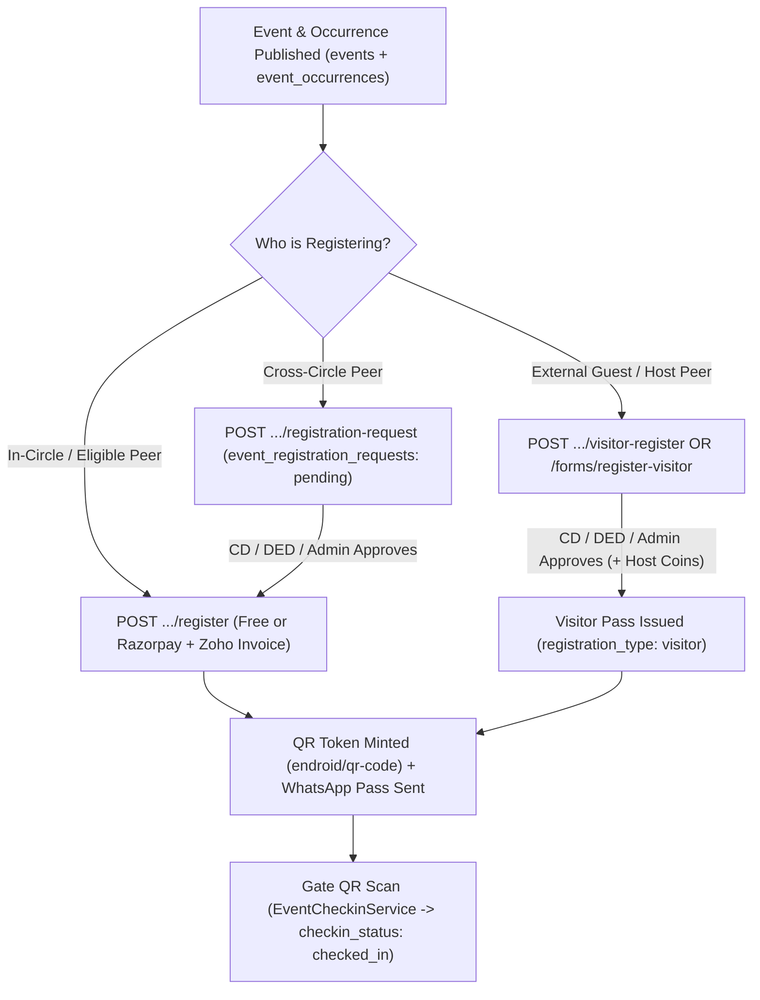
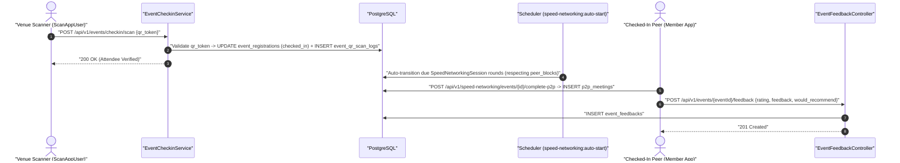

# 26 — Events, QR Check-In, Circle Meetings & Speed Networking Flow

> **Audit Scope:** End-to-end operational workflows for Event & Occurrence Creation (`EventAdminController`), Paid/Free Member Registration (`EventRegistrationService` + Razorpay + Zoho Invoice + QR Pass + WhatsApp Delivery), Cross-Circle Event Clearance (`event_registration_requests`), Visitor Registration (`visitor_registrations` & occurrence visitor passes), Venue QR Check-In (`EventCheckinService` + `ScanAppEventController`), Circle Meeting Attendance & Substitutes (`circle_meetings`, `attendance_records`, `substitute_logs`, `absence_warnings`), Speed Networking Live Rounds (`SpeedNetworkingApiController`), and Post-Event Feedback (`EventFeedbackController`).
> **Related Deliverables:** [23-organizational-structure-and-circle-flow.md](./23-organizational-structure-and-circle-flow.md) · [27-approval-and-escalation-flow.md](./27-approval-and-escalation-flow.md) · [29-reporting-and-analytics-flow.md](./29-reporting-and-analytics-flow.md) · [activities/17-register-a-visitor-form.md](./activities/17-register-a-visitor-form.md) · [activities/21-attended-events-and-registrations.md](./activities/21-attended-events-and-registrations.md) · [activities/30-submitted-feedback.md](./activities/30-submitted-feedback.md)

---

## 1. Executive Summary & Subsystem Matrix

| Sub-Workflow | Primary Tables & Services | Classification | Key Audit Findings |
|---|---|---|---|
| **1. Event & Recurrence Publishing** | `events`, `event_occurrences`, `event_coupons` (`EventAdminController`) | `Requires Enhancement` | Full Admin CRUD + recurrences ([CreateEventPage.tsx](file:///D:/office%20project/unity-admin-web/src/features/events/CreateEventPage.tsx), [EventRecurrencesPage.tsx](file:///D:/office%20project/unity-admin-web/src/features/events/EventRecurrencesPage.tsx)), **but** events lack explicit IANA `timezone` + ISO-8601 UTC contract in Leader APIs, and Leaders cannot create Circle events directly from the Flutter Leadership App. |
| **2. Paid / Free Registration, QR Pass & Cross-Circle Approval** | `event_registrations`, `event_registration_requests` (`EventRegistrationService`) | `Fully Implemented` | Supports coupons, GST calculation, Razorpay order/verify, Zoho invoice generation, `endroid/qr-code` `qr_token` generation, WhatsApp QR ticket delivery, and cross-circle clearance (`event_joining_requests` in `PendingRequestAdminController` & `DedPendingRequestsController`). |
| **3. Visitor Event Registration** | `visitor_registrations`, `visitor_leads`, `event_registrations` (`registration_type='visitor'`) | `Fully Implemented` | Supports Peer-hosted visitor form (`POST /api/v1/forms/register-visitor`), occurrence visitor pass (`POST .../visitor-register`), DED/Leader/Admin approval (with Coin reward), and QR gate check-in. |
| **4. QR Scanner Gate Check-In** | `event_qr_scan_logs`, `scan_app_users` (`EventCheckinService`, `ScanAppEventController`) | `Implemented but Incorrect` | Real-time QR check-in works across `/api/v1/events/checkin/scan` and `/api/v1/scan-app/*`, **but** migration `2026_08_22_180000` added a nullable **`plain_password` column** on `scan_app_users` (`HIGH-4` security flaw)! |
| **5. Circle Meetings, Attendance, Substitutes & Warnings** | `circle_meetings`, `attendance_records`, `substitute_logs`, `absence_warnings` | `Partially Implemented` | Admin APIs (`/api/v1/admin/circles/{circleId}/meetings`, `/meetings/{id}/attendance`, `/warnings`) and Leader read views exist, **but** Leaders have **no mobile attendance-marking UI** in the Flutter Leadership App, `LeaderReportsService::getAttendanceTrend()` returns `[]`, and `CircleEventDetailScreen` shows `attendees_count: 15` with `attendees: []`! |
| **6. Speed Networking & Post-Event Feedback** | `speed_networking_*`, `event_feedbacks` (`SpeedNetworkingP2pService`, `EventFeedbackService`) | `Partially Implemented` | Live round auto-start cron (`speed-networking:auto-start` every minute), P2P auto-logging (`complete-p2p`), and 1–5 star `event_feedbacks` work in Member/Admin apps; raw `[sn_match:<uuid>]` tags leak into Leader App Peer activity descriptions. |

---

## 2. Workflow A — Event Creation, Registration (Member / Cross-Circle / Visitor) & QR Pass Issuance

### 2.1 Mandatory 11-Question Operational Walkthrough — Event Creation to QR Ticket

| # | Workflow Question | Current Verified Answer (`**FACT:**`) | Status / Defect |
|---:|---|---|---|
| **1** | **Who initiates the operation?** | **Admin** creates/publishes Event & Occurrences; **Circle Peer**, **Cross-Circle Peer**, or **Invited Visitor** initiates registration; **CD / DED / Admin** approves cross-circle or visitor requests. | `Fully Implemented` |
| **2** | **Which screen is opened?** | **React Admin Web**: [EventsPage.tsx](file:///D:/office%20project/unity-admin-web/src/features/events/EventsPage.tsx), [CreateEventPage.tsx](file:///D:/office%20project/unity-admin-web/src/features/events/CreateEventPage.tsx), [EventRecurrencesPage.tsx](file:///D:/office%20project/unity-admin-web/src/features/events/EventRecurrencesPage.tsx), [EventJoiningRequestsTab.tsx](file:///D:/office%20project/unity-admin-web/src/features/events/tabs/EventJoiningRequestsTab.tsx), [WhatsAppEventPassesPage.tsx](file:///D:/office%20project/unity-admin-web/src/features/whatsapp/WhatsAppEventPassesPage.tsx). **Member App**: `MyEventsScreen`, `EventQrTicketScreen`, `PaymentGatewaySheet`, `RegisterVisitorScreen`. **Leader App**: [circle_events_screen.dart](file:///D:/office%20project/LeaderApp-Fornt-end-/lib/features/circle_details/view/circle_events_screen.dart) & Pending Approvals. | `Partially Implemented` (no Leader App create-event screen) |
| **3** | **What information is entered?** | Admin enters `circle_id` (or global), `title`, `description`, `start_at`, `end_at`, `is_virtual`, `location_text`, `visibility`, `is_paid`, `base_amount`, `gst_percent`, `qr_checkin_enabled`, `event_type`, coupons. Registrant enters `occurrence_id`, `coupon_code`, Razorpay payment (or cross-circle `notes`, or visitor `visitor_full_name`, `visitor_mobile`, `visitor_email`, `visitor_business_category`). | `Fully Implemented` |
| **4** | **Which API is called?** | Create: `/api/v1/admin/events/*`. Member Register: `POST /api/v1/events/{event_id}/occurrences/{occurrence_id}/register` (+ `POST .../razorpay/verify`, `GET .../registrations/{id}/qr\|invoice`). Cross-Circle Request: `POST .../registration-request` → reviewed via `POST /api/v1/leader/pending-requests/event_joining_requests/{id}/approve\|reject` (or `/ded/pending-requests/event-joining-requests/...`). Visitor: `POST /api/v1/forms/register-visitor` or `POST .../visitor-register[-as-user]`. | `Fully Implemented` |
| **5** | **Which backend controller & service processes it?** | `EventAdminController`, `EventController`, `MyEventQrController`, `PublicEventRegistrationFormController` → `EventRegistrationService`, `PendingRequestAdminController`, `DedPendingRequestsController`. | `Fully Implemented` |
| **6** | **Which authorization & scope check runs?** | Member registration checks circle visibility (routing out-of-circle Peers to `event_registration_requests`). Leader/DED approval checks circle/district scope via `PendingRequestAdminController` / `EnsureDedApiAccess`. **DEFECT**: `GET /api/v1/leader/teams/circles/{id}/events` (`LeaderTeamsService.php:1571`) lacks circle scope verification (`IDOR`), and `/api/v1/admin/events/*` sits in the unprotected `unity.user` admin block. | `Implemented but Incorrect` |
| **7** | **What database operation occurs?** | Inserts `events` + `event_occurrences`; on registration inserts `event_registrations` (`qr_token`, `status='registered'`, `checkin_status='pending'`, `registration_type='member'\|'visitor'`, Razorpay & Zoho invoice IDs) or `event_registration_requests` (`status='pending'`) / `visitor_registrations`. Approving a visitor awards coins (`coins_ledger`) to the host Peer. | `Fully Implemented` |
| **8** | **Which status changes?** | `events.status`: `scheduled` → `completed` \| `cancelled`. `event_registration_requests.status`: `pending` → `approved` (provisioning `event_registrations`) \| `rejected`. `event_registrations.status`: `pending` → `registered` (`payment_status = 'paid'`). | `Fully Implemented` |
| **9** | **Who receives the result?** | Registrant receives dynamic QR Pass (`EventQrTicketScreen`) + GST Tax Invoice PDF; Host Peer receives visitor approval status & Coins. | `Fully Implemented` |
| **10** | **Which notification is generated?** | Registration confirmation email + GST invoice attachment + WhatsApp QR Ticket Pass (`whatsapp_messages` / `WhatsAppEventPassesPage.tsx`) + FCM push to Circle Director / DED on cross-circle or visitor request. | `Fully Implemented` |
| **11** | **What happens next?** | Attendee presents QR pass at the venue gate for scanner check-in (`EventCheckinService`), participates in Circle Meeting / Speed Networking, and receives post-event feedback prompt. | `Fully Implemented` |

---

## 3. Workflow B — Venue QR Check-In, Circle Attendance, Speed Networking & Feedback

### 3.1 Mandatory 11-Question Operational Walkthrough — Check-In, Attendance & Post-Event Loop

| # | Workflow Question | Current Verified Answer (`**FACT:**`) | Status / Defect |
|---:|---|---|---|
| **1** | **Who initiates the operation?** | **Gate Scanner Operator** (`ScanAppUser`) or Event Host scans QR ticket; **Circle Secretary / Director / Admin** logs meeting attendance & substitutes; **Event Moderator / Cron** runs Speed Networking rounds; **Checked-in Peer** submits post-event feedback. | `Partially Implemented` |
| **2** | **Which screen is opened?** | **Scanner App**: Dedicated Scan App (`/api/v1/scan-app/*`) + Admin [EventScanCredentialsTab.tsx](file:///D:/office%20project/unity-admin-web/src/features/events/tabs/EventScanCredentialsTab.tsx) & [TotalAttendanceTab.tsx](file:///D:/office%20project/unity-admin-web/src/features/events/tabs/TotalAttendanceTab.tsx). **Admin Web Speed Networking**: [SpeedNetworkingLivePage.tsx](file:///D:/office%20project/unity-admin-web/src/features/speedNetworking/SpeedNetworkingLivePage.tsx). **Leader App (Read-Only)**: [circle_event_detail_screen.dart](file:///D:/office%20project/LeaderApp-Fornt-end-/lib/features/circle_details/view/circle_event_detail_screen.dart) & [peer_events_attendance_screen.dart](file:///D:/office%20project/LeaderApp-Fornt-end-/lib/features/peer_profile/view/peer_events_attendance_screen.dart). | `Partially Implemented` (no Leader App attendance roll-call UI) |
| **3** | **What information is entered?** | Scanner submits `qr_token`; Attendance roll-call records `present` / `absent` / `substitute` (`substitute_logs`) and issues `absence_warnings`; Speed Networking pairs non-blocked participants into timed rounds; Feedback submits `rating` (`1..5`), `feedback`, `tags[]`, `would_recommend`. | `Partially Implemented` |
| **4** | **Which API is called?** | Check-in: `POST /api/v1/events/checkin/scan`, `GET /api/v1/events/checkin/qr/{qr_token}`, `/api/v1/scan-app/*`. Circle Attendance: `/api/v1/admin/circles/{circleId}/meetings`, `/api/v1/admin/meetings/{id}/attendance`, `/api/v1/admin/warnings`. Speed Networking: `POST /api/v1/speed-networking/events/{eventId}/complete-p2p`. Feedback: `GET /api/v1/event-feedbacks/check-pending` → `POST /api/v1/events/{eventId}/feedback`. | `Partially Implemented` |
| **5** | **Which backend controller & service processes it?** | `EventCheckinService`, `ScanAppEventController`, `AdminOpsController`, `SpeedNetworkingApiController` (`SpeedNetworkingP2pService`), `EventFeedbackController` (`EventFeedbackService`). | `Fully Implemented` |
| **6** | **Which authorization & scope check runs?** | Scanner endpoints authenticate `scan_app_users` (**SECURITY BUG**: `scan_app_users` stores `plain_password` alongside `password_hash` per migration `2026_08_22_180000`!). Speed Networking excludes pairs in `peer_blocks` and `speed_networking_blocked_peers`. | `Implemented but Incorrect` (`plain_password` column) |
| **7** | **What database operation occurs?** | `UPDATE event_registrations SET checkin_status = 'checked_in', checked_in_at = NOW(), checked_in_by_user_id = ...` + `INSERT INTO event_qr_scan_logs`; Circle meetings write `circle_meetings`, `attendance_records`, `substitute_logs`, `absence_warnings`; Speed Networking writes `speed_networking_sessions`, `speed_networking_matches`, and auto-creates `p2p_meetings`; Feedback writes `event_feedbacks`. | `Fully Implemented` |
| **8** | **Which status changes?** | `event_registrations.checkin_status`: `pending` → `checked_in`. `speed_networking_sessions`: auto-started every minute by `speed-networking:auto-start`. | `Fully Implemented` |
| **9** | **Who receives the result?** | Scanner receives instant green/duplicate-scan verification; Checked-in Peer receives attendance credit, coins/streaks, Speed Networking match cards, and feedback prompt; Leaders view attendance in `GET /leader/members/{id}/attendance`. **BUG**: `CircleEventDetailScreen` receives `attendees_count: 15` alongside an empty `attendees: []` array! | `Implemented but Incorrect` (empty `attendees` list in Leader API) |
| **10** | **Which notification is generated?** | Event reminders, live Speed Networking round transitions, `absence_warnings` notices, and pending post-event feedback notification (`event_feedbacks.notification_id`). | `Fully Implemented` |
| **11** | **What happens next?** | Attendance percentages feed Circle health metrics and monthly/weekly Leadership Reports ([29-reporting-and-analytics-flow.md](./29-reporting-and-analytics-flow.md)) — though `LeaderReportsService::getAttendanceTrend()` is currently a stub returning `[]`! | `Requires Enhancement` |

---

## 4. Target Enhanced Events & Attendance Flow (`**RECOMMENDATION:**`)

1. **Drop `scan_app_users.plain_password` & Enforce Circle Scope on Leader Event APIs**:
   - Create a new migration dropping `plain_password` from `scan_app_users` (relying strictly on bcrypt/Argon2 `password_hash`), and enforce `canAccessCircle($user, $circleId)` on `GET /api/v1/leader/teams/circles/{id}/events`.
2. **Add Mobile Roll-Call & QR Check-In Mode for Circle Secretaries / Directors / Events Chairs**:
   - Expose scoped endpoints `POST /api/v1/leader/teams/circles/{circleId}/meetings/{meetingId}/attendance` (recording `present`, `absent`, `substitute` into `attendance_records` + `substitute_logs`) and `POST /api/v1/leader/events/checkin/scan` inside the Flutter Leadership App for `circleDirector`, `circleFounder`, `chairEventsPrograms`, and `secretary` so chapter officers can take live roll-call without needing Web Admin or a separate Scanner APK.
3. **Populate `attendees[]`, Real Attendance Trends & UTC/IANA Timezones**:
   - Return hydrated `attendees[]` in `LeaderTeamsService::getCircleEvents()` (fixing the `15 Total Registered Attendees` vs empty list bug on `CircleEventDetailScreen`), wire `LeaderReportsService::getAttendanceTrend()` to real `attendance_records` / `event_registrations` grouped by `YYYY-MM`, strip `[sn_match:<uuid>]` internal tags from activity display strings, and include `starts_at_utc`, `ends_at_utc`, and Circle IANA `timezone` on all event payloads.
