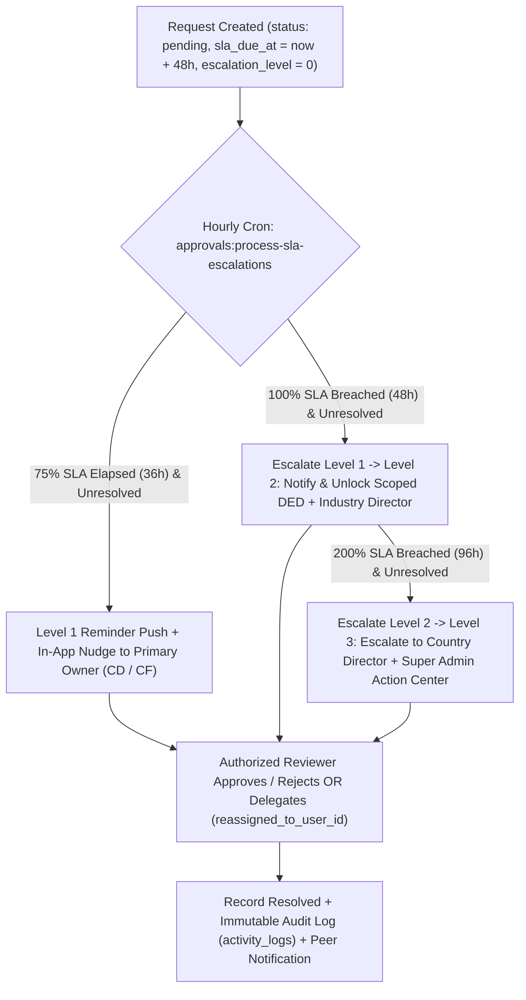

# 27 — Unified Approval Queues, Maker-Checker & Escalation Flow

> **Audit Scope:** Complete architectural audit of the Unified Pending Requests Queues (`/api/v1/leader/pending-requests`, `/api/v1/admin/pending-requests`, `/api/v1/ded/pending-requests`) across all 10 moderation categories, stage-aware Circle Join gating, Store Wallet Maker-Checker (`wallet_adjustment_requests`), the `WorkflowApprovalRule` configuration-vs-runtime gap, the complete absence of Tasks / SLAs / Reassignments / Escalation cron jobs, and the target deterministic escalation architecture.
> **Related Deliverables:** [11-approval-and-delegation-authority.md](./11-approval-and-delegation-authority.md) · [24-member-management-flow.md](./24-member-management-flow.md) · [28-notification-generation-and-delivery-flow.md](./28-notification-generation-and-delivery-flow.md) · [33-action-center-and-task-management.md](./33-action-center-and-task-management.md) · [34-escalation-rules-and-ownership.md](./34-escalation-rules-and-ownership.md)

---

## 1. Executive Summary & Approval Subsystem Matrix

| Approval Engine | Endpoints & Controller | Categories Covered | Classification | Critical Audit Verdict |
|---|---|---|---|---|
| **1. Unified Admin & Leader Pending Queue** | `/api/v1/admin/pending-requests*` & `/api/v1/leader/pending-requests*` ([PendingRequestAdminController.php](file:///c:/Users/malic/OneDrive/Documents/GitHub/unity-app-new/app/Http/Controllers/Api/Admin/PendingRequestAdminController.php#L75-L820)) | **10 Categories** (Circle Joins, Visitors, Coin Claims, Certifications, Impacts, Ad Bookings, Account Deletions, Event Joins, Circle Peer Referrals, Introduction Requests) | `Implemented but Incorrect` | Enforces circle/category scope on `/leader/pending-requests*`, **but**: (a) `/admin/pending-requests*` lacks `admin.role` middleware (`P0`!), (b) `fetchCoinClaims()` checks table `'coin_claims'` while `processApproval()` updates `'coin_claim_requests'` (broken read/write mismatch!), and (c) `/leader/pending-requests` omits `can_review_pending_peers` check, letting `viceChair` / `secretary` approve/reject! |
| **2. DED Scoped Pending Queue** | `/api/v1/ded/pending-requests/*` (`DedPendingRequestsController` → `DedApiService`) | **5 Categories** (`visitor-registrations`, `event-joining-requests`, `coin-claims`, `circle-joining-requests`, `pending-impacts`) | `Fully Implemented` | Properly guarded by `['auth:sanctum', 'ensure.ded.api']`, district-scoped via `DistrictScopeService`, and uses `coin_claim_requests` consistently. |
| **3. Store Coin Wallet Maker-Checker** | `/api/admin/v1/wallet-adjustments[/{id}/approve\|reject]` (`AdminStoreWalletAdjustmentController`) | `wallet_adjustment_requests` (`CREDIT` / `DEBIT`) | `Fully Implemented` | Two-person Maker-Checker (`requested_by` != `reviewed_by`) writing immutable ledger entries upon `APPROVED`. |
| **4. Dynamic `WorkflowApprovalRule` Engine** | `/api/v1/admin/rbac/workflow-rules` ([WorkflowApprovalRule.php](file:///c:/Users/malic/OneDrive/Documents/GitHub/unity-app-new/app/Modules/DynamicAccess/Models/WorkflowApprovalRule.php)) | `workflow_approval_rules` (`step_order`, `is_parallel`, `auto_approve_after_hours`) | `Implemented but Not Integrated` | **100% Dead Configuration CRUD!** Zero runtime controllers, services, or cron jobs read `workflow_approval_rules` (plus `/api/v1/admin/rbac/*` is unauthenticated per `CRITICAL-1`). |
| **5. Tasks, SLAs, Reassignment & Auto-Escalation** | Checked across all 62 Artisan commands & 23 Queue Jobs | Platform-wide | `Missing` | **NOT IMPLEMENTED**: Zero `tasks` table, zero SLA breach detector (`support_tickets.sla_due_at` & `web_leadership_jury_assignments.due_at` are passive timestamps), zero queue `assigned_to` reassignment, and zero hierarchical escalation (`CD -> DED -> Country Director -> Super Admin`)! |

---

## 2. Workflow A — Unified 10-Category Pending Requests Moderation

### 2.1 Complete Mapping of the 10 Aggregated Queue Categories (`**FACT:**`)

Source: [PendingRequestAdminController.php](file:///c:/Users/malic/OneDrive/Documents/GitHub/unity-app-new/app/Http/Controllers/Api/Admin/PendingRequestAdminController.php#L807-L818) & `PendingRequestModerationService`:

| # | Category Key (`{category}`) | Underlying PostgreSQL Table(s) | Domain Service / Side Effects on Approval | Leader / DED Visibility & Stage Rule |
|---:|---|---|---|---|
| **1** | `circle_joining_requests` | `circle_join_requests` | `CircleJoinRequestService` — Stage 1 (`pending_cd_approval` → `pending_id_approval`); Stage 2 (`pending_id_approval` → `pending_circle_fee` or `circle_member`) | **Stage-aware**: CD/Founder sees Stage 1; ID/DED sees Stage 2; Admin sees all. Also in `/ded/pending-requests/circle-joining-requests`. |
| **2** | `visitor_registrations` | `visitor_registrations` | Marks `approved`, sets `reviewed_by_admin_user_id`, awards Coins (`coins_ledger`) to host Peer | Scoped to host Peer's Circle / District (`DED` queue #1). |
| **3** | `coin_claims` | **BUG**: `fetchCoinClaims()` checks `Schema::hasTable('coin_claims')`; `processApproval()` updates `coin_claim_requests`! | Credits `coins_awarded` via `CoinsService` (`coins_ledger` + `users.coins_balance`) | **Broken list fetch** in `PendingRequestAdminController` when table is `coin_claim_requests`! Works in `/ded/pending-requests/coin-claims` & `/admin/coin-claims`. |
| **4** | `certifications` | `certification_submissions` (`entrepreneur` & `leadership`) | `CertificateGeneratorService` generates PDF certificate, sets `certificate_number` & `certificate_download_url`, emails Peer | Scoped to applicant Peer's Circle/Category (Admin & Leader queues). |
| **5** | `pending_impacts` | `impacts` (`requires_leadership_approval = true`) | `ImpactService::approveImpact()` — increments `users.life_impacted_count`, writes `life_impact_histories`, awards Coins, creates timeline `posts` row, sends push | Scoped to Peer's Circle / District (`DED` queue #5). |
| **6** | `ad_booking_requests` | `ad_bookings` | Creates/links live `ads` banner row (`ad_id`), sets `reviewed_by`, `reviewed_at` | Admin & scoped Leader queue. |
| **7** | `account_deletion_requests` | `account_deletion_requests` (+ `account_deletion_emails` in summary) | Approves account removal / anonymization workflow | Admin-level governance (exposed if Peer is in scope). |
| **8** | `event_joining_requests` | `event_registration_requests` | Approves cross-circle event attendance and provisions `event_registrations` | Scoped to target Event's Circle / District (`DED` queue #2). |
| **9** | `circle_peer_referrals` | `circle_peer_referrals` + `peer_referrals` + `peer_recommendations` | Marks open-category nomination / peer recommendation `approved` and awards referrer Coins if applicable | Scoped to target Circle / Recommender's Circle. |
| **10** | `introduction_requests` | `introduction_requests` | Links `users.introduced_by` (`requester_id` → `introducer_id`), increments `members_introduced_count`, evaluates Milestone Badges | Scoped to Peer's Circle. |

### 2.2 Mandatory 11-Question Operational Walkthrough — Unified Pending Requests Queue

| # | Workflow Question | Current Verified Answer (`**FACT:**`) | Status / Defect |
|---:|---|---|---|
| **1** | **Who initiates the operation?** | **Peer** submits an underlying request (Categories 1–10); **Circle Director, Circle Founder, Industry Director, DED, Country Director, or Super Admin** initiates `approve` or `reject`. | `Fully Implemented` |
| **2** | **Which screen is opened?** | **Flutter Leadership App**: Dashboard *"Pending Approvals"* tile / *"Pending peers → Review"* card ([dashboard_pending_peers_card.dart](file:///D:/office%20project/LeaderApp-Fornt-end-/lib/features/dashboard/view/widgets/dashboard_pending_peers_card.dart)). **React Admin Web**: [PendingRequestsPage.tsx](file:///D:/office%20project/unity-admin-web/src/features/pendingRequests/PendingRequestsPage.tsx) → [PendingRequestDrawer.tsx](file:///D:/office%20project/unity-admin-web/src/features/pendingRequests/components/PendingRequestDrawer.tsx), [ApproveConfirmModal.tsx](file:///D:/office%20project/unity-admin-web/src/features/pendingRequests/components/ApproveConfirmModal.tsx), [RejectReasonModal.tsx](file:///D:/office%20project/unity-admin-web/src/features/pendingRequests/components/RejectReasonModal.tsx). | `Requires Enhancement` (Leader App places Pending card at very bottom of Dashboard scroll & lacks confirm dialog on inline buttons) |
| **3** | **What information is entered?** | Filter `category`, `status` (`pending\|approved\|rejected\|all`), `search`; on decision: optional approval `notes` or `rejection_reason` / `remarks`. | `Fully Implemented` |
| **4** | **Which API is called?** | Leader: `GET /api/v1/leader/pending-requests[/summary]`, `POST /api/v1/leader/pending-requests/{category}/{id}/approve\|reject`. DED: `/api/v1/ded/pending-requests/{type}[/{id}/approve\|reject]`. Admin: `/api/v1/admin/pending-requests*`. **CRITICAL CLIENT BUG**: [api_endpoints.dart:60-70](file:///D:/office%20project/LeaderApp-Fornt-end-/lib/core/constants/api_endpoints.dart#L60-L70) also defines `adminPendingRequests` (`/api/v1/admin/pending-requests`) used by `DashboardView`! | `Implemented but Incorrect` |
| **5** | **Which backend controller & service processes it?** | [PendingRequestAdminController.php](file:///c:/Users/malic/OneDrive/Documents/GitHub/unity-app-new/app/Http/Controllers/Api/Admin/PendingRequestAdminController.php), `PendingRequestModerationService`, `DedPendingRequestsController` (`DedApiService`), delegating to `CircleJoinRequestService`, `ImpactService`, `CoinsService`, `CertificateGeneratorService`. | `Implemented but Incorrect` (`coin_claims` table typo) |
| **6** | **Which authorization & scope check runs?** | `/leader/pending-requests*` calls `resolveLeaderScope()`, `filterResultsByLeaderScope()`, and `denyIfOutsideLeaderScope()`. **TWO CRITICAL FLAWS**: (1) `/api/v1/admin/pending-requests*` sits under `['auth:sanctum', 'unity.user']` without admin role check — so when Leader App (or any Peer) calls `/admin/pending-requests`, **scoping is bypassed completely**! (2) `/leader/pending-requests` does **not** enforce `can_review_pending_peers`, letting `secretary` / `viceChair` approve or reject! | `Implemented but Incorrect` (`P0` Scope/Role Bypass) |
| **7** | **What database operation occurs?** | Updates target category table (`status = 'approved'\|'rejected'`, reviewer FK, `reviewed_at`), triggers domain ledger writes (`coins_ledger`, `life_impact_histories`, `posts`, `certification_submissions` PDF, `event_registrations`), and logs moderation audit trail. | `Implemented but Incorrect` (`fetchCoinClaims` reads non-existent `coin_claims`) |
| **8** | **Which status changes?** | Record transitions `pending` / `new` → `approved` or `rejected` (or next multi-step stage on `circle_join_requests`). | `Fully Implemented` |
| **9** | **Who receives the result?** | Reviewer receives updated JSON; real-time `PendingRequestChangedEvent` broadcasts over Laravel Reverb; Applicant Peer sees approved badge/coins/pass/membership. | `Fully Implemented` |
| **10** | **Which notification is generated?** | Domain-specific push/in-app/email notification (`app_notifications`, `notifications`, FCM push, certificate/status email) to the requesting Peer (plus next-stage leader on Stage 1 `circle_join_requests`). | `Fully Implemented` |
| **11** | **What happens next?** | Item leaves the `pending` queue. **HOWEVER, if no leader acts**, the item sits in `pending` **forever** — zero reminders, reassignments, or escalations ever fire! | `Missing` (Zero SLA / Escalation) |

---

## 3. Workflow B — Store Wallet Maker-Checker (`wallet_adjustment_requests`)

### 3.1 Mandatory 11-Question Summary — Two-Admin Maker-Checker

1. **Initiator (Maker)**: Store/Finance Admin (`AdminUser` A) requesting manual Coin wallet `CREDIT` or `DEBIT`.
2. **Screen**: React Admin Web [StoreCoinAdjustmentsPage.tsx](file:///D:/office%20project/unity-admin-web/src/features/store/StoreCoinAdjustmentsPage.tsx) & [StoreWalletsPage.tsx](file:///D:/office%20project/unity-admin-web/src/features/store/StoreWalletsPage.tsx).
3. **Input**: Target `user_id`, `type` (`CREDIT` \| `DEBIT`), `amount`, `reason`.
4. **API**: Maker calls `POST /api/admin/v1/wallet-adjustments`; Checker (`AdminUser` B) calls `POST /api/admin/v1/wallet-adjustments/{id}/approve` or `/reject` (`routes/admin_store.php`).
5. **Controller / Service**: `AdminStoreWalletAdjustmentController` → Store Wallet Service.
6. **Auth & Scope Check**: Enforces Store Admin auth and **Maker != Checker** separation of duties (`requested_by !== reviewed_by`).
7. **DB Operation**: Maker inserts `wallet_adjustment_requests` (`status = 'PENDING'`); Checker updates `status = 'APPROVED'`, `reviewed_by`, `reviewed_at` and atomically writes `coins_ledger` + updates `users.coins_balance` + `activity_logs`.
8. **Status Change**: `PENDING` → `APPROVED` or `REJECTED`.
9. **Recipient**: Target Peer's Coin wallet balance updates immediately; Audit log records both Maker and Checker IDs.
10. **Notification**: Wallet credit/debit push & in-app notification to Peer.
11. **Next Step**: Coins become spendable in Store / Membership Coin Renewal (`/api/v1/membership/renew`).

---

## 4. Broken / Missing Escalation Infrastructure & Target Architecture (`**RECOMMENDATION:**`)

### 4.1 Verified Gaps (`**NOT IMPLEMENTED:**`)

**FACT:** Static inspection of all 62 commands in `app/Console/Commands/`, 25 active schedules in `routes/console.php`, and `app/Modules/DynamicAccess/` confirms:
- `WorkflowApprovalRule` (`workflow_approval_rules`: `step_order`, `is_parallel`, `auto_approve_after_hours`) is **never queried** by any approval controller or service (`Implemented but Not Integrated`).
- `support_tickets.sla_due_at` (`+24h` on Store tickets) and `web_leadership_jury_assignments.due_at` are **passive display columns** with zero breach-detection cron jobs.
- Pending request tables (`circle_join_requests`, `impacts`, `visitor_registrations`, `coin_claim_requests`, `certification_submissions`, `event_registration_requests`) lack `sla_due_at`, `escalation_level`, and `escalated_to_role_key` columns (`Missing`).

### 4.2 Target Deterministic SLA, Reassignment & Hierarchical Escalation Flow (`**RECOMMENDATION:**`)

**BUSINESS DECISION REQUIRED:** Confirm exact SLA thresholds per category (recommended defaults below: **48h** Circle/Visitor/Event requests, **72h** Impacts/Coin Claims/Certifications, **24h** Support Tickets).

**Recommended Minimum-Change Implementation**:
1. **Fix Immediate Bugs**:
   - Lock `/api/v1/admin/pending-requests*` behind `['auth:sanctum', 'admin.auth', 'admin.permission:pending_requests.view']`, switch Flutter `DashboardView` strictly to `/api/v1/leader/pending-requests*`, enforce `can_review_pending_peers` on `/leader/pending-requests` approve/reject, and fix `PendingRequestAdminController::fetchCoinClaims()` to query `coin_claim_requests`!
   - Restrict `account_deletion_requests` strictly to Global/Super Admin (removing personal account deletion moderation from circle-level leader queues).
2. **Add Lightweight Escalation Tracking (`approval_escalations` table or additive columns)**:
   - Store `(request_category, request_id, current_owner_role, reassigned_to_user_id, sla_due_at, escalation_level, last_notified_at)` and wire `WorkflowApprovalRule` + a scheduled hourly command `approvals:process-sla-escalations` in `routes/console.php` that walks the verified territorial/sector chain (`CD/CF` → `DED / Industry Director` → `Country Director` → `Super Admin`) using `LeaderNotificationDispatcherService`.
