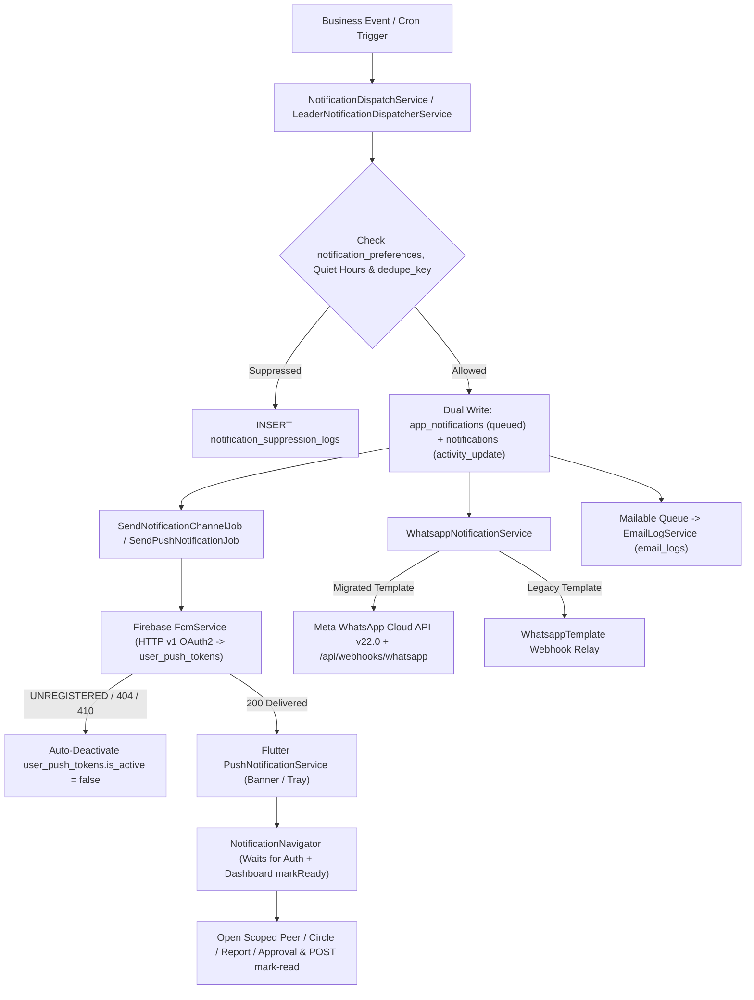

# 28 — Notification Generation, Multi-Channel Dispatch & Deep-Link Flow

> **Audit Scope:** End-to-end technical workflow from business event trigger through `LeaderNotificationDispatcherService` / `NotificationDispatchService` / `PushNotificationService`, preference & quiet-hours suppression, dual-table persistence (`app_notifications` + `notifications`), queue dispatch (`SendNotificationChannelJob`, `SendPushNotificationJob`), FCM HTTP v1 (`user_push_tokens` + stale token cleanup), Meta WhatsApp Cloud API v22.0 / Webhook relay, 42 Mailables (`email_logs`), Flutter foreground banner & cold-start `NotificationNavigator` deep-linking, unread-badge synchronization, and the unprotected Super Admin Broadcast console vulnerability.
> **Related Deliverables:** [05-existing-infrastructure-and-integration.md](./05-existing-infrastructure-and-integration.md) · [27-approval-and-escalation-flow.md](./27-approval-and-escalation-flow.md) · [30-existing-notification-system-audit.md](./30-existing-notification-system-audit.md) · [31-master-actionable-notification-catalogue.md](./31-master-actionable-notification-catalogue.md) · [32-role-wise-notification-matrix.md](./32-role-wise-notification-matrix.md) · [49-notification-enhancement-recommendations.md](./49-notification-enhancement-recommendations.md)

---

## 1. Executive Summary & Notification Architecture Matrix

| Pipeline Stage | Primary Classes & Tables | Classification | Verified Audit Verdict |
|---|---|---|---|
| **1. Event Trigger & Orchestration** | `NotificationDispatchService`, `LeaderNotificationDispatcherService`, `PushNotificationService`, `NotifyUserService` | `Partially Implemented` | Rich multi-channel orchestration with `notification_preferences`, quiet hours, and `dedupe_key` (`notification_suppression_logs`), **but** fragmented across 4 parallel dispatcher services with inconsistent payload schemas. |
| **2. Dual-Table In-App Persistence** | `app_notifications` (`AppNotification`) + `notifications` (`Notification`) | `Implemented but Incorrect` | Writing to two tables causes **3-way unread count drift** in the Flutter Leadership App (`NotificationCountService` vs `NotificationsState` vs `LeaderNotificationModel.isLeaderNotification`), plus `LeaderNotificationsController@index` injects fake `ldr-welcome-1` items when empty! |
| **3. FCM HTTP v1 Push Delivery** | `App\Services\Firebase\FcmService`, `user_push_tokens`, `SendNotificationChannelJob` | `Fully Implemented` | Mints Google OAuth2 bearer tokens, calls FCM v1 REST API with custom `peers_woodblock` sound, mirrors tokens onto `users.leader_*_fcm_token` (`app = 'leader'`), logs `notification_delivery_logs`, and **auto-deactivates stale tokens** (`UNREGISTERED`, `404`/`410`). |
| **4. WhatsApp & Email Transports** | `WhatsappNotificationService` (Meta Cloud API v22.0 + Webhook relay) & 42 Mailables (`email_logs`) | `Fully Implemented` | Dual-transport WhatsApp routing (`whatsapp_messages` + `/api/webhooks/whatsapp` delivery receipts, strict one-time `'welcome'` guard) and audited SMTP delivery (`email_logs`). |
| **5. Flutter Reception & Cold-Start Deep Links** | `PushNotificationService` ([push_notification_service.dart](file:///D:/office%20project/LeaderApp-Fornt-end-/lib/core/services/push_notification_service.dart)) + `NotificationNavigator` ([notification_navigator.dart](file:///D:/office%20project/LeaderApp-Fornt-end-/lib/core/notifications/notification_navigator.dart)) | `Requires Enhancement` | Cold-start/background readiness queue (`markReady()`, 15-min TTL, 2s dedupe, permission check) works cleanly on client, **but** backend does not yet guarantee structured `entity_type` + `entity_id` keys on every push payload, and foreground push locally increments badge by `+1` even for hidden consumer types! |
| **6. Leader Admin Broadcast Console** | `/api/v1/leader/admin/notifications/{config,leaders,send,logs}` ([LeaderNotificationsController.php:368-1505](file:///c:/Users/malic/OneDrive/Documents/GitHub/unity-app-new/app/Leader/Controllers/LeaderNotificationsController.php#L368-L1505)) | `Implemented but Incorrect` (`P0`) | **CRITICAL PRIVILEGE ESCALATION**: Zero `isSuperAdmin($user)` check — any Circle `secretary` or `viceChair` can toggle global notification triggers, harvest all leaders' emails/phones, read global logs, and blast `"Super Admin Broadcast"` push alerts to 500 leaders! |

---

## 2. Workflow A — Event Trigger to Multi-Channel Delivery & Mobile Deep-Link

### 2.1 Current Verified Flow (`**FACT:**`)

1. **Trigger & Recipient Resolution**:
   - Domain services (e.g. `CircleJoinRequestService`, `ImpactService`, `LeaderPeersService::sendWish`, `LeaderActivitiesService::storeP2pMeeting`, `PostDeactivationService`, or scheduled commands in `routes/console.php` such as `habit-loop:send-daily`, `whatsapp:journey:process`, `memberships:send-expiry-reminders`) invoke `NotificationDispatchService` (member/multi-channel), `PushNotificationService::storeAndSend()`, or `LeaderNotificationDispatcherService` (fans out governance events to scoped Circle Directors, Founders, Industry Directors, and DEDs).
2. **Preference, Quiet-Hours & Deduplication Gate**:
   - `NotificationDispatchService` evaluates `notification_preferences` (`push_enabled`, `email_enabled`, `whatsapp_enabled`, `in_app_enabled`, `quiet_hours_start`, `quiet_hours_end`) and `dedupe_key`. Suppressed dispatches are recorded in `notification_suppression_logs`.
3. **Dual-Table Persistence (`app_notifications` + `notifications`)**:
   - Writes a primary row to **`app_notifications`** (`id`, `user_id`, `type`, `category`, `title`, `body`, `channel`, `screen`, `reference_type`, `reference_id`, `data` JSON, `status = 'queued'`).
   - Simultaneously writes a compatibility row to **`notifications`** (`type = 'activity_update'` to satisfy PostgreSQL `notification_type_enum`, storing the real subtype inside `payload`/`data`, `is_read = false`).
4. **Asynchronous Channel Dispatch (Queue Workers)**:
   - **FCM Push (`SendNotificationChannelJob` / `SendPushNotificationJob`)**:
     - `App\Services\Notifications\FcmService` gathers active tokens from `user_push_tokens` (`app = 'leader'` for Leader App vs `null`/`'member'` for Member App) plus `users.*_fcm_token` fallbacks.
     - `App\Services\Firebase\FcmService` authenticates via service-account OAuth2 against `https://fcm.googleapis.com/v1/projects/{projectId}/messages:send` (`high_importance_channel`, `peers_woodblock` sound).
     - Updates `app_notifications.status = 'sent'`, writes `notification_delivery_logs`, and **auto-deactivates stale tokens** (`is_active = false`, `failed_at`, `failure_reason`) when FCM returns `UNREGISTERED`, `INVALID_ARGUMENT`, HTTP `404`, or `410`.
   - **WhatsApp (`WhatsappNotificationService`)**:
     - Routes migrated templates through `WhatsAppMessageService` → `WhatsAppCloudApiService` (`POST https://graph.facebook.com/v22.0/{phoneNumberId}/messages` → `whatsapp_messages` + webhook status updates on `POST /api/webhooks/whatsapp`), and legacy templates through `WhatsappTemplate` webhook URLs (`whatsapp_message_delivery_logs`).
   - **Email (`app/Mail/*` — 42 Mailables)**:
     - Renders Mailable or DB `EmailTemplate` and records delivery status in `email_logs` via `EmailLogService`.
5. **Flutter Leadership App Reception, Deep-Link & Mark-Read**:
   - **Foreground**: [push_notification_service.dart](file:///D:/office%20project/LeaderApp-Fornt-end-/lib/core/services/push_notification_service.dart#L307) shows top banner / local notification and increments `NotificationCountService.unreadCount` by `+1`.
   - **Tap / Cold-Start**: [notification_navigator.dart](file:///D:/office%20project/LeaderApp-Fornt-end-/lib/core/notifications/notification_navigator.dart) parses `NotificationPayload` into a typed `NotificationDestination` (Home tab, Notifications feed, Profile, Role Management, `PeerProfileView(id)`, `CircleDetailsView(id)`, `ReportDetailsView(id)`). If tapped on cold start, waits until `Navigator` exists, `SessionManager().isAuthenticated`, and `DashboardView` calls `markReady()` (15-min expiry, 2s duplicate guard, `LeaderPermissions` check, graceful 404 fallback).
   - **Inbox & Mark-Read**: [notifications_view.dart](file:///D:/office%20project/LeaderApp-Fornt-end-/lib/features/notifications/view/notifications_view.dart) calls `GET /api/v1/leader/notifications` and marks items read via `POST /api/v1/leader/notifications/mark-read` (`POST /leader/notifications/{id}/read` / `read-all`).

### 2.2 Mandatory 11-Question Operational Walkthrough — Notification Lifecycle

| # | Workflow Question | Current Verified Answer (`**FACT:**`) | Status / Defect |
|---:|---|---|---|
| **1** | **Who initiates the operation?** | Automated backend domain event (Peer activity, Circle join request, approval/rejection), scheduled cron (`routes/console.php`), or Admin broadcast ([AppNotificationsPage.tsx](file:///D:/office%20project/unity-admin-web/src/features/appNotifications/AppNotificationsPage.tsx) / `/leader/admin/notifications/send`). | `Implemented but Incorrect` (unprotected Leader Admin broadcast) |
| **2** | **Which screen is opened?** | **Recipient (Leader App)**: Foreground banner / OS tray → [notification_navigator.dart](file:///D:/office%20project/LeaderApp-Fornt-end-/lib/core/notifications/notification_navigator.dart) → target screen or [notifications_view.dart](file:///D:/office%20project/LeaderApp-Fornt-end-/lib/features/notifications/view/notifications_view.dart). **Admin Web**: [NotificationsPage.tsx](file:///D:/office%20project/unity-admin-web/src/features/notifications/NotificationsPage.tsx), [NotificationMonitoringPage.tsx](file:///D:/office%20project/unity-admin-web/src/features/notifications/NotificationMonitoringPage.tsx), [WhatsAppHubPage.tsx](file:///D:/office%20project/unity-admin-web/src/features/whatsapp/WhatsAppHubPage.tsx), [EmailLogsPage.tsx](file:///D:/office%20project/unity-admin-web/src/features/emailLogs/EmailLogsPage.tsx). | `Requires Enhancement` |
| **3** | **What information is entered?** | Automated payload (`type`, `category`, `title`, `body`, `screen`, `reference_type`, `reference_id`, `dedupe_key`); on mark-read: `notification_ids` / `id` / `mark_all`. | `Requires Enhancement` (schema drift across endpoints) |
| **4** | **Which API is called?** | Token sync: `POST /api/v1/leader/push-tokens` (`/leader/fcm-token`). Inbox: `GET /api/v1/leader/notifications`, `GET /api/v1/leader/notifications/unread-count`, `POST /api/v1/leader/notifications/mark-read` (`/{id}/read`, `/read-all`). Member App: `/api/v1/notifications*` (`NotificationEngineController`). | `Implemented but Incorrect` |
| **5** | **Which backend controller & service processes it?** | [LeaderNotificationsController.php](file:///c:/Users/malic/OneDrive/Documents/GitHub/unity-app-new/app/Leader/Controllers/LeaderNotificationsController.php), `NotificationEngineController`, `LeaderNotificationDispatcherService`, `NotificationDispatchService`, `App\Services\Firebase\FcmService`, `WhatsappNotificationService`, `EmailLogService`. | `Implemented but Incorrect` |
| **6** | **Which authorization & scope check runs?** | Inbox queries filter `WHERE user_id = auth()->id()`. **CRITICAL DEFECT (`HIGH-1` / `P0`)**: All 5 endpoints under `/api/v1/leader/admin/notifications/{config,leaders,send,logs}` check ONLY `leader.user` and **never check `isSuperAdmin($user)`**! | `Implemented but Incorrect` (`P0` Broadcast & PII Leak) |
| **7** | **What database operation occurs?** | Inserts `app_notifications` + `notifications`; writes `notification_delivery_logs` / `notification_suppression_logs` / `whatsapp_messages` / `email_logs`; auto-updates stale `user_push_tokens.is_active = false`; mark-read sets `read_at = NOW()` and `is_read = true`. | `Fully Implemented` |
| **8** | **Which status changes?** | `app_notifications.status`: `queued` → `sent` → `delivered` → `read` (or `failed`); `notifications.is_read`: `false` → `true`; `whatsapp_messages` updated via Meta webhook (`sent` → `delivered` → `read`). | `Fully Implemented` |
| **9** | **Who receives the result?** | Scoped Leader(s) on `app = 'leader'` devices and/or Peer(s) on `app = 'member'` devices. **BUG**: When a leader has `0` rows, `LeaderNotificationsController@index` fabricates sample items (`ldr-welcome-1`) while `unread-count` vs client filter (`isLeaderNotification`) shows `2` on bell, `"1 new"` in header, and `"All Caught Up"` in list! | `Implemented but Incorrect` (3-way badge mismatch) |
| **10** | **Which notification is generated?** | Push (FCM HTTP v1), In-App inbox row, Email (`email_logs`), and/or WhatsApp Cloud API / Webhook message. | `Fully Implemented` |
| **11** | **What happens next?** | Tapping the notification routes via `NotificationNavigator` to the actionable entity (Circle, Peer, Report, Pending Approval) and marks the notification read. | `Requires Enhancement` (standardize `entity_type` + `entity_id`) |

### 2.3 End-to-End Multi-Channel Dispatch & Deep-Link Diagram

---

## 3. Target Enhanced Notification Flow (`**RECOMMENDATION:**`)

1. **Lock Down `/api/v1/leader/admin/notifications/*` Immediately (`P0`)**:
   - Enforce `leader.can:system_configs` + explicit `$this->permissions->isSuperAdmin($request->user())` (`403` otherwise) on `adminGetConfig`, `adminSaveConfig`, `adminSearchLeaders`, `adminSendNotification`, and `adminGetLogs` in [LeaderNotificationsController.php](file:///c:/Users/malic/OneDrive/Documents/GitHub/unity-app-new/app/Leader/Controllers/LeaderNotificationsController.php#L368-L1505).
2. **Eliminate 3-Way Unread Count Drift & Fake Sample Rows**:
   - Remove synthetic `ldr-welcome-1` sample items from `LeaderNotificationsController@index`.
   - Use a single server-side query helper `LeaderNotificationQuery::scopedForLeader($user)` shared by **both** `GET /leader/notifications` and `GET /leader/notifications/unread-count` (reading `app_notifications` with `target_app IN ('leader', 'both')` or unified predicate), and in Flutter re-sync `NotificationCountService.fetchUnreadCount()` instead of blindly adding `+1` on foreground consumer pushes.
3. **Standardize Actionable Push Payload Contract**:
   - Guarantee `{ notification_id, type, category, route, entity_type, entity_id }` in all `LeaderNotificationDispatcherService` FCM `data` maps so `NotificationNavigator` always deep-links directly to the exact Peer, Circle, Report, or Pending Request ID, and unregister the device's `user_push_tokens` row on sign-out (`DELETE /api/v1/leader/push-tokens`).
