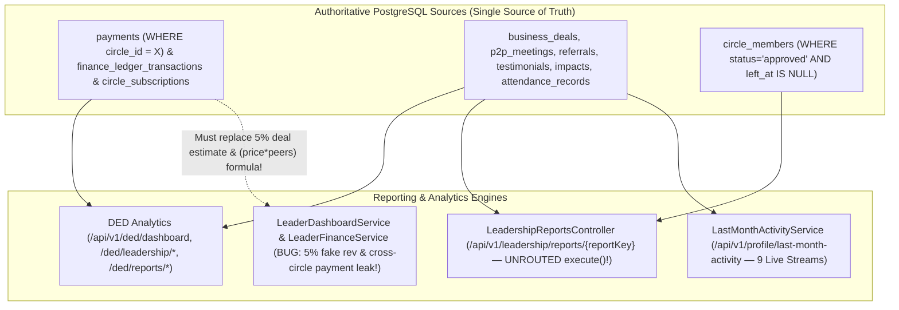

# 29 — Multi-Tier Reporting, Roster Deduplication & Analytics Flow

> **Audit Scope:** End-to-end reporting and analytics workflows across Global, Country, District (`DED`), Industry, Circle, Committee, and Peer Monthly Summary (`LastMonthActivityService`) levels: Flutter `ReportsView` → `GET /reports/roster` → All-Circles incomplete-roster guard (`ReportsBloc`) → `POST /reports/submit` (`leader_reports` + fake-default bug) → DomPDF generation (`LeaderReportPdfGenerator`) & unauthenticated `/files/{id}/download` leak → CSV Activity Exports (`GET /activities/export`) → Dynamic `LeadershipReportsController` (`/api/v1/leadership/reports/{reportKey}`), plus Dashboard/Finance revenue reconciliation.
> **Related Deliverables:** [09-organizational-data-scope-matrix.md](./09-organizational-data-scope-matrix.md) · [23-organizational-structure-and-circle-flow.md](./23-organizational-structure-and-circle-flow.md) · [35-global-admin-dashboard.md](./35-global-admin-dashboard.md) · [36-district-executive-dashboard.md](./36-district-executive-dashboard.md) · [41-master-reporting-and-metrics-reference.md](./41-master-reporting-and-metrics-reference.md) · [43-sensitive-data-and-finance-access.md](./43-sensitive-data-and-finance-access.md) · [activities/35-last-month-activity-summary.md](./activities/35-last-month-activity-summary.md)

---

## 1. Executive Summary & Reporting Architecture Matrix

| Reporting Surface | Endpoints & Services | Classification | Critical Audit Verdict |
|---|---|---|---|
| **1. Leader Periodic Report Submission & Roster** | `GET /api/v1/reports/roster`, `POST /api/v1/reports/submit`, `GET /api/v1/reports` ([LeaderReportsService.php](file:///c:/Users/malic/OneDrive/Documents/GitHub/unity-app-new/app/Leader/Services/LeaderReportsService.php#L28-L356)) | `Implemented but Incorrect` | **Multiple Critical Defects**: (a) `listReports` allows `?circle_id=<any_uuid>` IDOR; (b) `submitReport` lacks scope check, falls back to **first random circle in DB** if `circle_id` omitted (`L118`), and injects **hardcoded fake metrics** (`94.5%`, `'₹18.5L'`, `'₹24.0L'`) when omitted (`L157-179`); (c) `getPeersRoster` caps at `->take(20)` (`L285`), ignores `status='approved'`, and reads non-existent `User` properties (`'0%'`, `'₹0'`); (d) `getAttendanceTrend` returns hardcoded `[]`. |
| **2. Report PDF Generation & Download** | `GET /api/v1/reports/{id}/download` & `/file` ([LeaderReportPdfGenerator.php](file:///c:/Users/malic/OneDrive/Documents/GitHub/unity-app-new/app/Leader/Services/LeaderReportPdfGenerator.php)) + `GET /api/v1/files/{id}/download` | `Implemented but Incorrect` (`P0`) | **CONFIDENTIAL DATA LEAK**: `renderReportPdf()` (`L393`) and `downloadReportPdf()` (`L431`) call `getReportDetails($reportId)` **omitting `$user`** (skipping `403` scope check!), and [FileController.php:685-702](file:///c:/Users/malic/OneDrive/Documents/GitHub/unity-app-new/app/Http/Controllers/Api/FileController.php#L685-L702) streams any report PDF **with zero authentication**! |
| **3. Dynamic Access Scoped Reports (API 50)** | `GET /api/v1/leadership/reports` & `GET /api/v1/leadership/reports/{reportKey}` ([LeadershipReportsController.php](file:///c:/Users/malic/OneDrive/Documents/GitHub/unity-app-new/app/Modules/Leadership/Controllers/LeadershipReportsController.php#L18-L159)) | `Implemented but Not Integrated` | Enforces `EffectiveAccessResolverService` + `OrganizationalScopeService`, **but** [routes/leadership.php:331-332](file:///c:/Users/malic/OneDrive/Documents/GitHub/unity-app-new/routes/leadership.php#L331-L332) registers `GET /reports` (`@index`) and `POST /reports` (`@store` — method **does not exist** on controller!), leaving `execute($request, $reportKey)` **unrouted**! Also caps peers at `limit(50)` (`L122`) and runs N+1 queries (`L140-157`). |
| **4. DED District Analytics & Reports** | `/api/v1/ded/dashboard`, `/ded/leadership/*` (7 roles), `/ded/reports/{referrals,activities,coins,pending-requests}`, `/ded/life-impact` | `Fully Implemented` | Properly guarded (`ensure.ded.api`), district-scoped (`DedScopeService`), and uses authoritative `circle_subscriptions.amount` for revenue contribution (`DistrictAnalyticsService`). |
| **5. Activity CSV Export & Peer Monthly Summary** | `GET /api/v1/leader/activities/export` (`LeaderActivitiesController@export`) & `GET /api/v1/profile/last-month-activity` (`LastMonthActivityService`) | `Requires Enhancement` | Activity CSV export works (capped at `500` rows, missing `can_export_peer_data` capability check); `LastMonthActivityService` dynamically aggregates 9 real activity streams over 30 days / `?month=&year=`. |
| **6. Dashboard & Finance KPI Analytics** | `GET /leader/dashboard/metrics` (`LeaderDashboardService`) & `GET /leader/finance/metrics` (`LeaderFinanceService`) | `Implemented but Incorrect` | **Synthetic / Over-Attributed Revenue**: Dashboard hardcodes `overall_revenue = 5%` of `business_deals` (`L733`) + `60/25/15%` fake Ask splits + literal `5` circulars + fake fallback names; Finance uses `orWhereHas('user.circleMembers')` (`L77`), attributing a multi-circle Peer's entire payment history to every circle they belong to! |

---

## 2. Workflow A — Leader Periodic Report Roster, Guard, Submission & PDF Export

### 2.1 Current Verified Flow (`**FACT:**`)

1. **Opening Reports & Selecting Scope (`ReportsView` → `ReportsBloc`)**:
   - Leader opens Tab 4 ([reports_view.dart](file:///D:/office%20project/LeaderApp-Fornt-end-/lib/features/reports/view/reports_view.dart), gated in UI by `can_access_reports_tab`).
   - `ReportsBloc` loads report history (`GET /api/v1/leader/reports`) and calls `GET /api/v1/leader/reports/attendance-trend` (wasted request: backend returns `[]` and `ReportsTrendCard` is unmounted!).
   - When a specific Circle is selected, `LoadCirclePeersForReport` calls `GET /api/v1/leader/teams/circles/{id}/peers` (or `GET /api/v1/reports/roster`) and filters hardcoded test names/UUIDs via `ReportModel.isDummyPeer` ([report_model.dart:245-260](file:///D:/office%20project/LeaderApp-Fornt-end-/lib/features/reports/model/report_model.dart#L245-L260)).
   - **All-Circles Incomplete-Roster Guard (`FACT`)**: When Circle filter is `"All Circles"` (`circleId.isEmpty`), `ReportsBloc._onLoadCirclePeersForReport` ([reports_bloc.dart:400](file:///D:/office%20project/LeaderApp-Fornt-end-/lib/features/reports/bloc/reports_bloc.dart#L400)) returns early (`"All 0 peers"`), and the Round-4 client guard blocks submitting an All-Circles report with an incomplete/empty roster because the backend currently provides no deduplicated multi-circle roster snapshot.
2. **Submitting a Report (`POST /api/v1/reports/submit`)**:
   - Leader selects `report_type` (`Weekly`, `Monthly`, `Quarterly`), `period`, `included_sections[]`, summary fields (`highlights`, `challenges_faced`, `action_items`), and submits `LeaderSubmitReportRequest`.
   - **CRITICAL BACKEND DEFECTS in [LeaderReportsService.php:109-189](file:///c:/Users/malic/OneDrive/Documents/GitHub/unity-app-new/app/Leader/Services/LeaderReportsService.php#L109-L189)**:
     - **No Scope Check & Random Circle Assignment (`L118-121`)**: Does not verify `$circleId` belongs to `$user`'s managed circles; if `circle_id` is null/empty (e.g., `"All Circles"`), assigns `Circle::query()->whereNull('deleted_at')->value('id')` (a random circle!).
     - **Fabricated Metrics Injection (`L157-179`)**: Any omitted metric/text defaults to hardcoded fiction: `attendance_percentage ?? 94.5`, `deals_closed_value ?? '₹18.5L'`, `total_revenue ?? '₹24.0L'`, plus canned strings (`"Strong peer engagement and steady referral flow across the circle."`)!
3. **PDF Generation & Download (`LeaderReportPdfGenerator`)**:
   - Leader opens [report_details_view.dart](file:///D:/office%20project/LeaderApp-Fornt-end-/lib/features/reports/view/report_details_view.dart) and taps Export PDF/Share (`GET /api/v1/leader/reports/{id}/download` or `/file`, plus client `ReportExportService` via `share_plus`).
   - `LeaderReportPdfGenerator` renders HTML via DomPDF, saves to `files`, and returns `/api/v1/files/{id}/download` — which is **publicly downloadable without any Bearer token** ([FileController.php:685-702](file:///c:/Users/malic/OneDrive/Documents/GitHub/unity-app-new/app/Http/Controllers/Api/FileController.php#L685-L702))!

### 2.2 Mandatory 11-Question Operational Walkthrough — Leader Report Lifecycle

| # | Workflow Question | Current Verified Answer (`**FACT:**`) | Status / Defect |
|---:|---|---|---|
| **1** | **Who initiates the operation?** | Circle Chair, Circle Director, Circle Founder, Industry Director, DED, Country Director, or Super Admin (`can_submit_reports` / `can_access_reports_tab`). | `Implemented but Incorrect` (unlinked `leader.can:view_reports`) |
| **2** | **Which screen is opened?** | **Leader App**: [reports_view.dart](file:///D:/office%20project/LeaderApp-Fornt-end-/lib/features/reports/view/reports_view.dart) ([report_submit_section.dart](file:///D:/office%20project/LeaderApp-Fornt-end-/lib/features/reports/view/widgets/report_submit_section.dart), [report_history_section.dart](file:///D:/office%20project/LeaderApp-Fornt-end-/lib/features/reports/view/widgets/report_history_section.dart)) → [report_details_view.dart](file:///D:/office%20project/LeaderApp-Fornt-end-/lib/features/reports/view/report_details_view.dart). **React Admin Web**: [ReportsPage.tsx](file:///D:/office%20project/unity-admin-web/src/features/reports/ReportsPage.tsx). | `Implemented but Incorrect` (15px RenderFlex overflow in header) |
| **3** | **What information is entered?** | `circle_id`, `report_type`, `period`, `attendance_percentage`, `deals_closed_value`, `total_revenue`, `highlights`, `challenges_faced`, `action_items`, `included_sections[]`, `peers_roster[]`. | `Implemented but Incorrect` (omitted fields trigger fake backend defaults) |
| **4** | **Which API is called?** | Roster: `GET /api/v1/leader/teams/circles/{id}/peers` & `GET /api/v1/reports/roster`. Submit: `POST /api/v1/reports/submit`. History: `GET /api/v1/reports` & `GET /api/v1/reports/{id}`. Export: `GET /api/v1/reports/{id}/download`, `GET /api/v1/reports/{id}/file`, `GET /api/v1/activities/export`. | `Implemented but Incorrect` |
| **5** | **Which backend controller & service processes it?** | [LeaderReportsController.php](file:///c:/Users/malic/OneDrive/Documents/GitHub/unity-app-new/app/Leader/Controllers/LeaderReportsController.php) → [LeaderReportsService.php](file:///c:/Users/malic/OneDrive/Documents/GitHub/unity-app-new/app/Leader/Services/LeaderReportsService.php) & [LeaderReportPdfGenerator.php](file:///c:/Users/malic/OneDrive/Documents/GitHub/unity-app-new/app/Leader/Services/LeaderReportPdfGenerator.php); CSV via `LeaderActivitiesController@export`. | `Implemented but Incorrect` |
| **6** | **Which authorization & scope check runs?** | **CRITICAL FAILURES (`P0` / `HIGH-2`)**: (1) `listReports` skips `$scopedCircleIds` whenever `?circle_id=<uuid>` is passed (`L48`). (2) `submitReport` has **zero circle scope check** and **zero `can_submit_reports` check** (allowing `viceChair`/`secretary` to submit to any circle). (3) `renderReportPdf` / `downloadReportPdf` omit `$user` (`L393, L431`), and `GET /api/v1/files/{id}/download` has **zero auth**! | `Implemented but Incorrect` (`P0` IDOR & Public File Leak) |
| **7** | **What database operation occurs?** | `INSERT INTO leader_reports` (UUID PK, `included_sections` & `peers_roster` JSON, `submitted_by_user_id`, `submitted_at`); DomPDF writes PDF to disk + `INSERT INTO files`. | `Implemented but Incorrect` |
| **8** | **Which status changes?** | `leader_reports` row created (`submitted_at = NOW()`, `reviewed_at = null` — note: **no report review/approve endpoint exists yet**!). | `Partially Implemented` |
| **9** | **Who receives the result?** | Submitting Leader & upper-hierarchy Leaders viewing `GET /reports` (currently anyone with the UUID due to IDOR). | `Implemented but Incorrect` |
| **10** | **Which notification is generated?** | **None** — submitting a Circle report does **not** notify the Circle's DED, Industry Director, or Country Director! | `Missing` |
| **11** | **What happens next?** | Report appears in History & Analytics and can be exported as PDF, **but** no upstream review/acknowledgement workflow (`reviewed_by`, `reviewed_at`) is wired. | `Requires Enhancement` |

---

## 3. Workflow B — Multi-Tier Scoped Analytics (DED, Dynamic Leadership & Peer Summary)

### 3.1 Cross-Tier Reporting & Revenue Integrity Flow

### 3.2 Mandatory 11-Question Operational Walkthrough — Scoped Analytics & Exports

| # | Workflow Question | Current Verified Answer (`**FACT:**`) | Status / Defect |
|---:|---|---|---|
| **1** | **Who initiates the operation?** | **Global / Country / DED / Industry / Circle Leaders** viewing scoped analytics or exporting CSVs; **Individual Peer** (or Leader via 360°) viewing 30-day Activity Summary. | `Partially Implemented` |
| **2** | **Which screen is opened?** | **Leader App**: [dashboard_view.dart](file:///D:/office%20project/LeaderApp-Fornt-end-/lib/features/dashboard/view/dashboard_view.dart), [finance_view.dart](file:///D:/office%20project/LeaderApp-Fornt-end-/lib/features/finance/view/finance_view.dart), [reports_view.dart](file:///D:/office%20project/LeaderApp-Fornt-end-/lib/features/reports/view/reports_view.dart). **Member App**: `LastMonthActivityScreen` / `ActivitySummaryScreen`. **React Admin Web**: [DashboardPage.tsx](file:///D:/office%20project/unity-admin-web/src/features/dashboard/DashboardPage.tsx), [FinanceContainerPage.tsx](file:///D:/office%20project/unity-admin-web/src/features/finance/FinanceContainerPage.tsx), [ReportsPage.tsx](file:///D:/office%20project/unity-admin-web/src/features/reports/ReportsPage.tsx). | `Partially Implemented` |
| **3** | **What information is entered?** | Scope selector (`circle_id`, `district_id`, `industry_id`), date window (`date_from`, `date_to`, `month`, `year`), activity `type`, or `reportKey` (`circle_summary_report`, `leadership_coverage_report`, `peer_growth_report`, `coin_distribution_report`, `activity_performance_report`). | `Partially Implemented` |
| **4** | **Which API is called?** | Leader: `GET /leader/dashboard/metrics`, `GET /leader/finance/metrics`, `GET /leader/activities/export`. DED: `GET /api/v1/ded/leadership/{industry-directors,founders,directors,chairs,vice-chairs,secretaries,members}` & `GET /api/v1/ded/reports/{type}`. Dynamic: `GET /api/v1/leadership/reports` (**`GET .../{reportKey}` missing from `routes/leadership.php`!**). Peer: `GET /api/v1/profile/last-month-activity`. | `Implemented but Not Integrated` (`execute` route missing) |
| **5** | **Which backend controller & service processes it?** | `LeaderDashboardService`, `LeaderFinanceService`, `LeaderActivitiesService`, `DistrictAnalyticsService` (`DedDashboardController`, `DedReportsController`), [LeadershipReportsController.php](file:///c:/Users/malic/OneDrive/Documents/GitHub/unity-app-new/app/Modules/Leadership/Controllers/LeadershipReportsController.php), `LastMonthActivityService`. | `Implemented but Incorrect` |
| **6** | **Which authorization & scope check runs?** | `DedDashboardController` & `LeadershipReportsController` properly enforce `DedScopeService` / `OrganizationalScopeService`. **BUGS**: `LeaderFinanceService` leaks global `circle_budget` when `circle_id` is omitted (`L339`) and accepts unverified `?circle_id`; `LeaderActivitiesController@export` omits `can_export_peer_data` check; `countryDirector` is not country-filtered in `LeaderPermissionService`. | `Implemented but Incorrect` |
| **7** | **What database operation occurs?** | Read-only SQL aggregations across `payments`, `finance_ledger_transactions`, `circle_subscriptions`, `business_deals`, `p2p_meetings`, `referrals`, `testimonials`, `impacts`, `asks`, `visitor_registrations`, `circle_members`. | `Implemented but Incorrect` (synthetic formulas in `LeaderDashboardService` & `LeaderFinanceService`) |
| **8** | **Which status changes?** | None (read-only analytics and streaming CSV response). | `Fully Implemented` |
| **9** | **Who receives the result?** | Requesting Leader/Admin receives JSON KPIs or `text/csv` stream; Peer receives monthly infographic data + `PeerMonthlyImpactScriptController` script. | `Partially Implemented` |
| **10** | **Which notification is generated?** | Weekly `PGU:brand-partner-weekly-report` (`Mon 09:00`); **no** automated weekly/monthly Leadership Digest is currently scheduled for Circle/Regional Leaders. | `Requires Enhancement` |
| **11** | **What happens next?** | Leaders drill down from KPI tiles into specific Circle, Peer 360°, or Activity views to coach underperforming chapters or recognize top impacters. | `Fully Implemented` |

---

## 4. Target Enhanced Reporting & Analytics Architecture (`**RECOMMENDATION:**`)

1. **Enforce All-Circles Deduplication & Snapshot Contract (`GET /api/v1/leader/reports/roster`)**:
   - Upgrade `LeaderReportsService::getPeersRoster()` to enforce caller scope, filter `circle_members.status = 'approved' AND left_at IS NULL` (excluding `visitor` registrations), remove the `->take(20)` cap and `ReportModel.isDummyPeer` client hack, compute real per-peer attendance/deals/P2P/referrals via grouped SQL subqueries, and for `"All Circles"` return **one row per unique Peer** with `memberships: [{circle_id, circle_name, status}]` plus `meta: { unique_peers, qualifying_memberships, complete: true, snapshot_id }` — blocking report submission whenever `complete == false`.
2. **Purge Every Fabricated Metric & Enforce Authoritative Finance**:
   - Delete `94.5%` / `'₹18.5L'` / `'₹24.0L'` defaults in `LeaderReportsService::submitReport()`, `5%` deal-as-revenue (`$dealsSum * 0.05`), `60/25/15%` Ask splits, literal `5` circulars, and fictional impacter names in `LeaderDashboardService`, `(circle_price ?? 120000) * peers` in `LeaderTeamsService`, and `orWhereHas('user.circleMembers')` cross-circle payment over-attribution in `LeaderFinanceService::getSummary()`. Return numeric `{ amount, currency }` from authoritative `payments` (`WHERE circle_id IN (...)`) / `finance_ledger_transactions`, and render `—` (`Unavailable`) when absent.
3. **Close Report PDF Leaks & Wire `LeadershipReportsController::execute()`**:
   - Pass `$request->user()` into `renderReportPdf()` / `downloadReportPdf()`, protect report files behind `auth:sanctum` + scope check (never public `/api/v1/files/{id}/download`), fix [routes/leadership.php:332](file:///c:/Users/malic/OneDrive/Documents/GitHub/unity-app-new/routes/leadership.php#L332) to `Route::get('/reports/{reportKey}', [LeadershipReportsController::class, 'execute'])` (replacing N+1 queries at `L140-157` with grouped `COUNT` joins), and add `POST /api/v1/leader/reports/{id}/review` so DEDs / Industry Directors receive a notification and mark submitted Circle reports `reviewed`.
