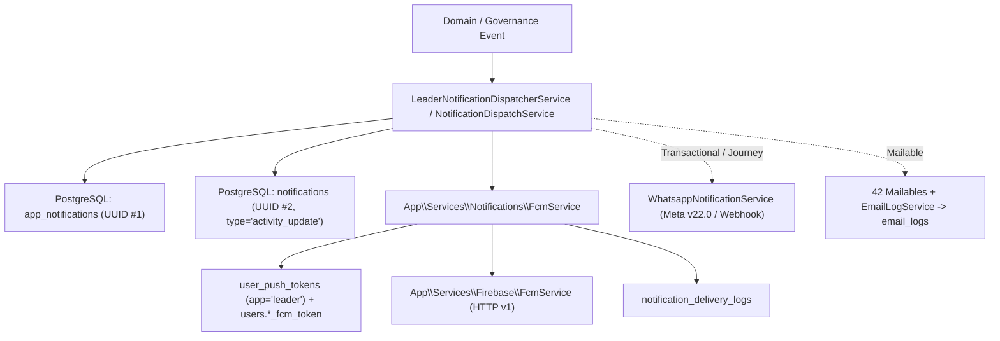

# 30 — Existing Notification System Audit

**Document Group:** 05 — Notifications and Operations  
**Audit Scope:** Laravel 12 Backend (`unity-app-new`) + Flutter Leadership App (`LeaderApp-Fornt-end-`)  
**Related Documents:** [28-notification-generation-and-delivery-flow.md](./28-notification-generation-and-delivery-flow.md) · [31-master-actionable-notification-catalogue.md](./31-master-actionable-notification-catalogue.md) · [32-role-wise-notification-matrix.md](./32-role-wise-notification-matrix.md) · [42-rbac-security-audit.md](./42-rbac-security-audit.md) · [49-notification-enhancement-recommendations.md](./49-notification-enhancement-recommendations.md)

---

## 1. Executive Summary & Architectural Verdict

**FACT:** The Peers Global Unity platform already operates a production multi-channel notification infrastructure across In-App Inbox (`app_notifications` + `notifications`), Firebase Cloud Messaging HTTP v1 (`App\Services\Firebase\FcmService`), Meta WhatsApp Cloud API v22.0 + webhook relay (`WhatsappNotificationService`), 42 Laravel Mailable classes logged via `EmailLogService`, and 25 active scheduled Artisan commands in `[console.php](file:///c:/Users/malic/OneDrive/Documents/GitHub/unity-app-new/routes/console.php)`.

**RECOMMENDATION:** **Enhance, Never Duplicate.** Do **NOT** introduce a parallel notification microservice, Firestore realtime listener, or separate `leader_notifications` table. All Leadership App notifications must continue using the existing `app_notifications` + `user_push_tokens` (`app = 'leader'`) pipeline and `[LeaderNotificationDispatcherService.php](file:///c:/Users/malic/OneDrive/Documents/GitHub/unity-app-new/app/Leader/Services/LeaderNotificationDispatcherService.php)`, while fixing the verified security, deduplication, unread-count, and fake-fallback defects documented below.

| Subsystem | Classification | Primary Evidence |
|---|---|---|
| Dual-table In-App Storage (`app_notifications` + `notifications`) | `Implemented but Incorrect` | Dual writes with distinct UUIDs cause duplicate rows & `2x` unread counts in `[LeaderNotificationsController.php](file:///c:/Users/malic/OneDrive/Documents/GitHub/unity-app-new/app/Leader/Controllers/LeaderNotificationsController.php#L134-L253)` |
| Push Token Isolation (`user_push_tokens` `app = 'leader'`) | `Implemented but Incorrect` | `[LeaderNotificationsController.php](file:///c:/Users/malic/OneDrive/Documents/GitHub/unity-app-new/app/Leader/Controllers/LeaderNotificationsController.php#L1582-L1598)` isolates `leader_*_fcm_token` on L1583–1589, then overwrites member `android_fcm_token` / `ios_fcm_token` on L1591–1598 |
| FCM HTTP v1 Transport & Stale Token Cleanup | `Fully Implemented` | `[FcmService.php](file:///c:/Users/malic/OneDrive/Documents/GitHub/unity-app-new/app/Services/Firebase/FcmService.php)` mints OAuth2 tokens, plays `peers_woodblock`, and deactivates `UNREGISTERED` / HTTP 404/410 tokens |
| Leader Event Fan-Out (`LeaderNotificationDispatcherService`) | `Partially Implemented` | Supports user, CD/CF, DED, ID, SuperAdmin, and `bubbleUpCircleEvent` fan-out, but misses Dynamic RBAC / `admin_ded_districts` / `industry_director_assignments` lookups |
| Empty-Inbox Hardcoded Sample Fallback (`sa_notif_001_*`, `cd_notif_001_*`) | `Implemented but Incorrect` | `[LeaderNotificationsController.php](file:///c:/Users/malic/OneDrive/Documents/GitHub/unity-app-new/app/Leader/Controllers/LeaderNotificationsController.php#L256-L593)` fabricates unread notifications with non-UUID IDs that can never be marked read |
| Leader Admin Broadcast & Config Console (`/leader/admin/notifications/*`) | `Implemented but Incorrect` | **CRITICAL (`P0`)**: `[routes/leader.php](file:///c:/Users/malic/OneDrive/Documents/GitHub/unity-app-new/routes/leader.php#L155-L159)` has zero `superAdmin` / capability guard — any Secretary or Vice Chair can broadcast pushes to 500 leaders |
| WhatsApp Dual-Transport & Email Logging | `Fully Implemented` | Cloud API v22.0 + Webhook relay + 42 Mailables audited to `email_logs` |
| Scheduled Notification Crons (25 active commands) | `Partially Implemented` | Strong member lifecycle crons; **zero** leadership SLA, pending-approval reminder, or overdue-report crons |
| Flutter Push, Local Banner & Typed Cold-Start Routing | `Requires Enhancement` | `[NotificationNavigator](file:///D:/office%20project/LeaderApp-Fornt-end-/lib/core/notifications/notification_navigator.dart#L32-L202)` safely handles auth/readiness/permissions, but `[PushNotificationService](file:///D:/office%20project/LeaderApp-Fornt-end-/lib/core/services/push_notification_service.dart#L307-L308)` causes `+1` badge drift and backend omits `entity_type`/`entity_id` |

---

## 2. Backend Notification Architecture (`unity-app-new`)

### 2.1 Dual-Table In-App Notification Storage (`app_notifications` vs `notifications`)

**FACT:** The Laravel backend maintains two PostgreSQL in-app notification tables written in tandem by `PushNotificationService`, `NotifyUserService`, and `[LeaderNotificationDispatcherService.php](file:///c:/Users/malic/OneDrive/Documents/GitHub/unity-app-new/app/Leader/Services/LeaderNotificationDispatcherService.php#L42-L110)`:

1. **`app_notifications` (`App\Models\Notifications\AppNotification`, aliased by `App\Models\AppNotification`)**
   - **Role:** Primary modern notification ledger with delivery state, deep-link routing, and deduplication.
   - **Columns:** `id` (uuid), `user_id`, `campaign_id` (nullable), `type` (varchar), `category` (varchar), `title`, `body`, `channel` (`in_app` | `app` | `push` | `email` | `whatsapp`), `priority` (`low` | `medium` | `high` | `urgent`), `reference_type`, `reference_id`, `screen` (deep-link path), `data` (jsonb), `dedupe_key`, `status` (`queued` | `sent` | `delivered` | `read` | `failed`), `sent_at`, `read_at`, `clicked_at`, `failed_at`, `failure_reason`, `created_at`, `updated_at`, `deleted_at` (`SoftDeletes`).
2. **`notifications` (`App\Models\Notification`)**
   - **Role:** Legacy / universal activity inbox retained for backward compatibility.
   - **Columns:** `id` (uuid), `user_id`, `type` (PostgreSQL enum `notification_type_enum`), `payload` (jsonb), `data` (jsonb), `title`, `message`, `source_type`, `source_id`, `source_event`, `is_read` (bool), `read_at` (timestamp), `created_at`.
   - **Enum Constraint Workaround:** Because `notifications.type` is bound to PostgreSQL `notification_type_enum`, `[LeaderNotificationDispatcherService.php](file:///c:/Users/malic/OneDrive/Documents/GitHub/unity-app-new/app/Leader/Services/LeaderNotificationDispatcherService.php#L89-L99)` hardcodes `'type' => 'activity_update'` and embeds the real leadership subtype inside `payload.notification_type` and `payload.type`. Similarly, `[LeaderNotificationsController.php](file:///c:/Users/malic/OneDrive/Documents/GitHub/unity-app-new/app/Leader/Controllers/LeaderNotificationsController.php#L195-L213)` avoids SQL `WHERE type NOT IN (...)` on `notifications` to prevent PostgreSQL `22P02 invalid input value for enum` crashes, fetching up to 500 rows (`take(500)` in `index()`, `take(100)` in `unreadCount()`) and filtering in PHP.
3. **Supporting Governance & Telemetry Tables:**
   - `notification_preferences` (`NotificationPreference`): per-user toggles (`push_enabled`, `email_enabled`, `whatsapp_enabled`, `in_app_enabled`, `quiet_hours_start`, `quiet_hours_end`).
   - `notification_delivery_logs` (`NotificationDeliveryLog`): per-channel provider response and failure trace.
   - `notification_suppression_logs` (`NotificationSuppressionLog`): records quiet-hour, rate-limit, preference, and dedupe suppressions.
   - `notification_campaigns`, `notification_campaign_runs`, `notification_templates`, `daily_notification_reminders`, `activity_reminder_settings`, and `app_configs` (`key = 'leader_notification_flow_config'`).

#### Verified Defects in Dual-Table Read & Unread Logic
- **Defect 1 — Dual-Write Duplicate UUIDs (`2x` Feed Rows & `2x` Unread Count):** **FACT:** `[LeaderNotificationDispatcherService::dispatchToUser()](file:///c:/Users/malic/OneDrive/Documents/GitHub/unity-app-new/app/Leader/Services/LeaderNotificationDispatcherService.php#L56-L106)` generates one `Str::uuid()` for `app_notifications` (L57) and a **second, different** `Str::uuid()` for `notifications` (L87). Furthermore, because `notifications.type` is `'activity_update'` — which is in `CONSUMER_EXCLUDED_TYPES` (L37)! — `notifications` rows written by `LeaderNotificationDispatcherService` are accidentally excluded by L209 (`in_array(strtolower($type), $excludedTypes, true)` checks `$n->type` = `'activity_update'` first!), whereas `notifications` rows with non-excluded enum values appear alongside `app_notifications` because L253 only deduplicates by `->unique('id')`.
- **Defect 2 — Hardcoded Fictional Fallback Feed When Inbox Is Empty:** **FACT:** In `[LeaderNotificationsController::index()](file:///c:/Users/malic/OneDrive/Documents/GitHub/unity-app-new/app/Leader/Controllers/LeaderNotificationsController.php#L256-L593)` (and earlier builds returning `ldr-welcome-1`), whenever `$collection->isEmpty()` is true, the controller fabricates 3 to 7 role-specific sample notifications containing fictional names and amounts (`sa_notif_001_<hash>` "Vikram Mehta requested ₹25,000", `sa_notif_002_<hash>` "Ananya Roy ₹25,000", `sa_notif_003_<hash>` "Rajesh Patel ₹45,000", `ded_notif_001_<hash>` "Surat Diamond Pioneers", `cf_notif_003_<hash>` "Pooja Shah", `cd_notif_001_<hash>` "Rahul Sharma") with `is_unread => true`!
  - Because these synthetic IDs (`sa_notif_001_...`, `cd_notif_001_...`, `ldr-welcome-1`) do not exist in `app_notifications` or `notifications`, calling `POST /api/v1/leader/notifications/mark-read` (`L688-706`) or `POST /api/v1/leader/notifications/{id}/read` (`L739` — which also rejects non-UUIDs via `->whereUuid('id')` at `[routes/leader.php](file:///c:/Users/malic/OneDrive/Documents/GitHub/unity-app-new/routes/leader.php#L165)` with `404`!) leaves them **permanently unread**.
  - Meanwhile, `[LeaderNotificationsController::unreadCount()](file:///c:/Users/malic/OneDrive/Documents/GitHub/unity-app-new/app/Leader/Controllers/LeaderNotificationsController.php#L778-L861)` has no synthetic fallback and returns `unread_count: 0`, causing the bell badge (`0`) and inbox header (`2` or `3` unread) to contradict each other.
  - Also note L93–95 hardcodes default strings `'Ahmedabad Tech Pioneers'`, `'Gujarat Central'`, and `'Technology & Software'` whenever `$user->activeCircle` is null!

### 2.2 Push Token Registry (`user_push_tokens`) & Member/Leader Token Collision Bug

**FACT:** Device push tokens are stored in `user_push_tokens` (`[UserPushToken.php](file:///c:/Users/malic/OneDrive/Documents/GitHub/unity-app-new/app/Models/UserPushToken.php)`):
- **Columns:** `id`, `user_id` (dynamically falls back to `usr_id` via `getUserIdColumn()`), `token`, `platform` (`android` | `ios` | `web`), `device_id`, `device_name`, `app_version`, `app` (`'leader'` vs `null`/`'member'`), `is_active`, `status`, `last_seen_at`, `last_used_at`, `failed_at`, `failure_reason`.
- **Model Hooks:** `saved` and `deleted` hooks mirror active tokens onto `users.leader_android_fcm_token` / `users.leader_ios_fcm_token` when `app === 'leader'` or `device_id` starts with `'leader_'`, and onto `users.android_fcm_token` / `users.ios_fcm_token` for the Member App.
- **Endpoints:**
  - Leader App: `POST /api/v1/leader/push-token`, `DELETE /api/v1/leader/push-token` (`[routes/leader.php](file:///c:/Users/malic/OneDrive/Documents/GitHub/unity-app-new/routes/leader.php#L167-L168)`), and `POST /api/v1/leader/fcm-token` (`L60`).
  - Member App: `POST /api/v1/push-tokens`, `DELETE /api/v1/push-tokens` (`NotificationEngineController` / `PushTokenController`).
- **Token Mirroring Bug (`Implemented but Incorrect`):** **FACT:** In `[LeaderNotificationsController::storePushToken()](file:///c:/Users/malic/OneDrive/Documents/GitHub/unity-app-new/app/Leader/Controllers/LeaderNotificationsController.php#L1582-L1598)`, after correctly writing `users.leader_android_fcm_token` / `leader_ios_fcm_token` (L1583–1589), lines **1591–1598** also overwrite `users.android_fcm_token` / `users.ios_fcm_token` with the Leader App's FCM registration token! Because each Firebase project/app ID (`com.unity.leadersapp` vs Member App) generates an app-scoped FCM token, overwriting `users.android_fcm_token` causes consumer Member App fallback pushes to target the Leader App token (or fail with `SENDER_ID_MISMATCH` if separate Firebase apps are used).

### 2.3 FCM HTTP v1 Service & Orchestrators

**FACT:** Push transport is layered cleanly across four backend services:
1. **`[App\Services\Firebase\FcmService](file:///c:/Users/malic/OneDrive/Documents/GitHub/unity-app-new/app/Services/Firebase/FcmService.php)`**:
   - Uses **Firebase Cloud Messaging HTTP v1 API** (`https://fcm.googleapis.com/v1/projects/{projectId}/messages:send`) with OAuth2 service-account bearer tokens (`config('services.fcm')` / `config('firebase')`).
   - Configures Android channel `high_importance_channel` (and `peers_unity_notifications_woodblock`) + custom sound `peers_woodblock` (APNs `peers_woodblock.caf`).
   - **Automatic Stale Token Hygiene:** Inspects FCM HTTP v1 error responses (`UNREGISTERED`, `INVALID_ARGUMENT`, HTTP `404` / `410`) and automatically marks stale `user_push_tokens` rows `is_active = false`, `status = 'inactive'`, recording `failed_at` and `failure_reason`.
2. **`[App\Services\Notifications\FcmService](file:///c:/Users/malic/OneDrive/Documents/GitHub/unity-app-new/app/Services/Notifications/FcmService.php)`**:
   - Aggregates active `UserPushToken` rows + `users.*_fcm_token` fallback columns, deduplicates tokens, invokes Firebase `FcmService`, and writes `NotificationDeliveryLog`.
   - **Enhancement Needed:** When dispatching a Leader-only governance alert (`$fcmData['app'] === 'leader'`), `FcmService` should filter `user_push_tokens` to `app = 'leader'` (falling back to `leader_*_fcm_token`) rather than blasting the same governance payload to the user's consumer Member App device tokens.
3. **`[App\Services\Notifications\NotificationDispatchService](file:///c:/Users/malic/OneDrive/Documents/GitHub/unity-app-new/app/Services/Notifications/NotificationDispatchService.php)`**:
   - Evaluates `NotificationPreference`, quiet hours (`quiet_hours_start`–`quiet_hours_end`), and `dedupe_key` (logging suppressions to `notification_suppression_logs`), writes `app_notifications`, and dispatches asynchronous `App\Jobs\SendNotificationChannelJob`.
4. **`[App\Leader\Services\LeaderNotificationDispatcherService](file:///c:/Users/malic/OneDrive/Documents/GitHub/unity-app-new/app/Leader/Services/LeaderNotificationDispatcherService.php)`**:
   - Provides leadership-specific fan-out methods: `dispatchToUser()` (L22), `notifySuperAdmins()` (L150), `notifyCircleLeaders()` (L204), `notifyDistrictDirector()` (L265), `notifyIndustryDirector()` (L310), and `bubbleUpCircleEvent()` (L354).
   - **Verified Scope Bugs in `LeaderNotificationDispatcherService`:**
     1. **Synchronous HTTP Blocking (`L128, 130`):** Calls `$fcmService->sendToUser(...)` inline on the HTTP request thread (or `SendFcmNotificationJob::dispatchSync`) instead of queueing!
     2. **`notifySuperAdmins()` Over-Broad Target (`L178-183`):** Runs `AdminUser::query()->pluck('id')->all()` **without filtering role**, sending high-priority Super Admin alerts (and matching UUIDs) to every `read_only`, `content_team`, or circle-scoped `AdminUser`, AND fails when `admin_users.id !== users.id` because `dispatchToUser` looks up `User::find($adminId)` (L114).
     3. **`notifyDistrictDirector()` Misses `admin_ded_districts` (`L283-290`):** Checks `districts.ded_user_id` (which does not exist on standard `districts`; DED assignments live in `admin_ded_districts` and `circles.ded_user_id`!).
     4. **`notifyIndustryDirector()` Misses `industry_director_assignments` (`L322-333`):** Queries `users.role = 'industry_director'` and `users.industry_id` instead of `industry_director_assignments` + `circles.industry_director_user_id`!
     5. **`notifyCircleLeaders()` Tenure Column Mismatch (`L233-236`):** Queries `finance_leader_tenures` where `circle_id = $circleId` and `status = 'active'`, whereas `LeaderFinanceService.php:321` queries `FinanceLeaderTenure` by `scope_id` and `is_active = true`.

### 2.4 WhatsApp Dual-Transport & Email Infrastructure

- **WhatsApp (`Fully Implemented`):** **FACT:** `App\Services\Notifications\WhatsappNotificationService` and `App\Services\WhatsApp\*` implement dual-transport routing:
  1. **Direct Meta WhatsApp Cloud API (v22.0):** When `WhatsAppTemplatePayloadBuilder::isMigrated($templateKey)` is `true`, messages route via `WhatsAppMessageService` → `WhatsAppCloudApiService` (`POST https://graph.facebook.com/v22.0/{phoneNumberId}/messages`), persisted in `whatsapp_messages` and `whatsapp_message_logs`, with webhook status reconciliation at `POST /api/webhooks/whatsapp` (`WhatsappWebhookEvent`).
  2. **Webhook Automation Relay:** Non-migrated keys query `whatsapp_templates` (`template_key`, `webhook_url`, `webhook_secret`, `is_active`) and POST signed JSON to external relays (WATI / AiSensy / n8n), logged in `whatsapp_message_delivery_logs` and `notification_delivery_logs`, with a strict one-time-ever guard on `'welcome'`.
  3. **Specialized Engines:** 2-way Admin Chat (`WhatsAppChatService` → `whatsapp_conversations`), Bulk Campaigns (`WhatsAppBulkCampaignService` → `whatsapp_bulk_campaigns`), 30-Day Onboarding (`MemberJourney30DayService` → `member_journey_sends`), and Milestone Recognition (`AwardRecognitionWhatsappService` → `member_award_sends`).
- **Email (`Fully Implemented`):** **FACT:** 42 Mailable classes in `app/Mail/` (including `SendLeaderLoginOtpEmailJob`, `BecomeLeaderSubmittedMail`, `BecomeLeaderAdminNotificationMail`, certification PDFs, membership invoices, event tickets, and story approvals) plus DB-driven `EmailTemplate` (`email_templates`) and `CampaignEmailTemplate` (`campaign_email_templates`), all audited to `email_logs` via `App\Services\EmailLogs\EmailLogService`.

### 2.5 Audit of All 25 Active Scheduled Commands (`routes/console.php`)

**FACT:** Out of 62 Artisan commands in `app/Console/Commands/`, **25 active schedules** run in `[routes/console.php](file:///c:/Users/malic/OneDrive/Documents/GitHub/unity-app-new/routes/console.php)` (2 consumer engagement commands `app:send-daily-engagement-reminders` and `app:send-inactivity-activity-reminders` are commented out):

| Cadence | Command Signature | Purpose | Leadership Relevance |
|---|---|---|---|
| Every 1 min | `members:mark-offline-stale` | Marks stale online presence offline | None (Consumer presence) |
| Every 1 min | `app:check-maintenance-transitions` | Toggles scheduled maintenance windows | Gates Leader App startup (`/system/version` / config) |
| Every 1 min | `campaigns:run` | Executes due admin email/notification campaigns | Admin broadcasts |
| Every 1 min | `celebrations:publish-due` | Publishes DOB/anniversary timeline posts (`>= 07:00 IST`) | Feeds `GET /leader/peers/celebrations` |
| Every 1 min | `whatsapp:dispatch-scheduled-campaigns` | Sends scheduled WhatsApp bulk campaigns | Marketing / Ops |
| Every 1 min | `speed-networking:auto-start` | Advances speed networking rounds | Event ops |
| Every 5 min | `notifications:campaigns every-five-minutes` | Processes 5-minute notification campaign bucket | Campaign engine |
| Every 15 min | `habit-loop:send-daily` | Dispatches timezone-aware daily habit-loop pushes | Excluded from Leader App via `CONSUMER_EXCLUDED_TYPES` |
| Every 15 min | `whatsapp:journey:process` | Sends 30-day Peer onboarding WhatsApp sequence | Peer onboarding |
| Hourly | `memberships:expire-users` | Transitions expired paid Peers | Peer health / renewal tracking |
| Hourly | `users:expire-trial` | Transitions expired trial Peers | Peer conversion |
| Hourly | `app:update-reminder-notifications` | Refreshes in-app reminder state | Consumer reminders |
| Hourly | `notifications:campaigns hourly` | Processes hourly campaign bucket | Campaign engine |
| Hourly | `profile-completion:send-reminders` | Prompts incomplete Peer profiles | Peer onboarding |
| Daily `00:00` | `memberships:expire` | Expires `user_memberships` & `circle_members` rows | Impacts active Circle Peer counts |
| Daily `00:10` | `collaborations:expire` | Marks past-due `collaboration_posts` `expired` | Collaboration Ask hygiene |
| Daily `00:15` & `06:55` | `celebrations:sync-schedules` | Syncs Peer DOB/anniversary schedules | Leader Wishes feed |
| Daily `08:00` | `PGU:brand-partner-expiry-alerts` | Alerts expiring Brand Partner offers | Brand Partner ops |
| Daily `08:15` | `PGU:advertiser-subscription-expiry-check` | Expires/alerts advertiser subscriptions & campaigns | Ad ops |
| Daily `09:00` | `connections:send-pending-reminders` | Nudges unaccepted Peer connections | Excluded from Leader App |
| Daily `09:15` | `notifications:campaigns daily` | Processes daily campaign bucket | Campaign engine |
| Daily `10:00` | `circle-recommendation:send-reminders` | Prompts Circle recommendations | Circle growth |
| Daily `11:25` | `memberships:send-expiry-reminders` (+ `upcoming-expiry`, `circle-expiry`) | 3 commands sending renewal reminders | Should also notify CD / Membership Chair for 7-day Circle renewals |
| Weekly Mon `09:00` | `PGU:brand-partner-weekly-report` | Sends weekly Brand Partner performance report | Brand Partner analytics |
| Weekly Sun `18:00` | `notifications:campaigns weekly` | Processes weekly campaign bucket | Campaign engine |

**NOT IMPLEMENTED:** Zero scheduled commands exist for (a) weekly/monthly Circle Leadership Report due reminders, (b) overdue `pending_cd_approval` / `pending_id_approval` / `pending_impacts` approval SLA reminders, (c) `support_tickets.sla_due_at` breach alerts, or (d) `web_leadership_jury_assignments.due_at` reminders (see [34-escalation-rules-and-ownership.md](./34-escalation-rules-and-ownership.md)).

---

## 3. Critical Security Vulnerability: Unguarded `/api/v1/leader/admin/notifications/*` (`P0`)

**FACT:** In `[routes/leader.php](file:///c:/Users/malic/OneDrive/Documents/GitHub/unity-app-new/routes/leader.php#L155-L159)`, five administrative notification endpoints are mounted inside `middleware(['auth:sanctum', 'leader.user'])` with **zero `superAdmin` or `leader.can:system_configs` middleware**, and none of the five methods in `[LeaderNotificationsController.php](file:///c:/Users/malic/OneDrive/Documents/GitHub/unity-app-new/app/Leader/Controllers/LeaderNotificationsController.php#L892-L1505)` perform any authorization check:

| Endpoint | Controller Method | Unprotected Capability Exposed to ANY Leader (incl. Secretary / Pending `circle_members` Leader) |
|---|---|---|
| `GET /api/v1/leader/admin/notifications/config` | `getRoleConfig` (`L892`) | Reads global role notification rules from `app_configs` |
| `POST /api/v1/leader/admin/notifications/config` | `updateRoleConfig` (`L985`) | Overwrites `app_configs.leader_notification_flow_config` for all roles |
| `GET /api/v1/leader/admin/notifications/leaders` | `listEligibleLeaders` (`L1023`) | Harvests full name, `email`, `phone`, role, and Circle of up to 100 leaders (`L1063-1072`) |
| `POST /api/v1/leader/admin/notifications/send` | `sendImmediateNotification` (`L1087`) | Dispatches arbitrary `"Super Admin Broadcast"` FCM push + in-app notifications (`sent_by_admin: true`) to up to **500 leaders globally**, by role, or by email/ID |
| `GET /api/v1/leader/admin/notifications/logs` | `getSecurityLogs` (`L1183`) | Reads up to 200 global `app_notifications` / `notifications` rows across all leaders (including withdrawal amounts and private alerts) |

**RECOMMENDATION:** Immediately wrap `/leader/admin/notifications/*` in `['leader.can:system_configs']` AND enforce `$permissionService->isSuperAdmin($request->user())` (`403`) inside each method, while logging all `updateRoleConfig` and `sendImmediateNotification` calls to `activity_logs` via `ActivityLoggerService`.

---

## 4. Flutter Leadership App Notification Audit (`LeaderApp-Fornt-end-`)

### 4.1 Push, Local Banner & Top-Banner Services

1. **`[PushNotificationService](file:///D:/office%20project/LeaderApp-Fornt-end-/lib/core/services/push_notification_service.dart#L54-L334)` (`Fully Implemented` with 2 minor defects):**
   - **FACT:** Initializes Firebase Messaging (`com.unity.leadersapp`), registers `firebaseMessagingBackgroundHandler` (`L27-50` — renders local heads-up notification for data-only FCM messages), requests Android 13+ `POST_NOTIFICATIONS` and iOS permissions (`L150-181`), and syncs tokens in background (`L203-270`) tagged with `'app': 'leader'` and `'device_id': 'leader_<id>'`.
   - **Defect A — Triple Endpoint Sequential Fallback (`L235-266`):** Calls `/leader/push-token`; if successful returns, otherwise falls back to `/user/push-token` AND `/push-tokens`. Additionally, `_getOrCreateDeviceId()` (`L325-333`) hashes the current `authToken` (`device_${savedId.hashCode.abs()}`), meaning every re-login generates a **new `device_id`** instead of reusing a persistent installation UUID in secure storage!
   - **Defect B — Unverified Local `+1` Badge Drift (`L307-308`):** On every foreground FCM message, `_onForegroundMessage` unconditionally increments `NotificationCountService.instance.unreadCount.value + 1` without checking `LeaderNotificationModel.isLeaderNotification` or re-syncing from `GET /leader/notifications/unread-count`. If the backend sends a consumer push to the shared user token, the Leader App bell increments even though the feed hides the item!
2. **`[LocalNotificationService](file:///D:/office%20project/LeaderApp-Fornt-end-/lib/core/services/local_notification_service.dart#L19-L186)` (`Fully Implemented`):**
   - **FACT:** Pre-registers all three Android notification channels (`leader_high_importance_channel`, `peers_unity_notifications_woodblock`, `high_importance_channel`) at `Importance.max` so OS heads-up banners never drop regardless of which `channel_id` the backend sets.
   - **Minor Gap (`L13-16`):** `notificationTapBackgroundHandler` logs the payload in a background isolate without persisting or forwarding it, though Android/iOS foreground/background taps invoke `_onNotificationTapped` (`L169-185`) on the main isolate.
3. **`[TopBannerNotificationService](file:///D:/office%20project/LeaderApp-Fornt-end-/lib/core/services/top_banner_notification_service.dart#L10-L267)` (`Implemented but Not Integrated`):**
   - **FACT:** Complete custom slide-down dark gradient `OverlayEntry` banner widget, deliberately commented out in `push_notification_service.dart:23, 298-304` in favor of native OS heads-up notifications via `LocalNotificationService`. **Classification:** `Not Required` (keep disabled so foreground pushes do not double-render both an OS banner and an in-app overlay).

### 4.2 Client vs Backend Consumer Filtering Alignment

**FACT:** Both backend (`[LeaderNotificationsController::CONSUMER_EXCLUDED_TYPES](file:///c:/Users/malic/OneDrive/Documents/GitHub/unity-app-new/app/Leader/Controllers/LeaderNotificationsController.php#L23-L78)`) and Flutter (`[LeaderNotificationModel.isLeaderNotification](file:///D:/office%20project/LeaderApp-Fornt-end-/lib/features/notifications/model/leader_notification_model.dart#L90-L187)`) maintain parallel 38-item exclusion lists (`new_post`, `post_like`, `event`, `chat_message`, `profile_viewed`, `connection_request`, `daily_reminder`, `streak`, etc.) and 9 excluded screens (`event_detail`, `live_meeting`, `post_detail`, `/feed`, `chat_conversation`, `connections`, `member_feed`).
- **Divergence (`Implemented but Incorrect`):**
  1. Flutter's `isLeaderNotification` (`L148-170`) rescues items containing `leaderKeywords` (`requirement`, `lead`, `referral`, `deal`, `ask`, `circle`, `leader`, `report`, `finance`, `payment`, `commission`, `payout`, `approval`, `pending`, `role`, `circular`, `milestone`) **even if** `screen` is `/post-detail`, whereas `LeaderNotificationsController::unreadCount()` (`L825-844`) excludes any row whose `screen` is in `CONSUMER_EXCLUDED_SCREENS` unconditionally.
  2. Conversely, `LeaderNotificationsController::unreadCount()` (`L786-795`) does **not** exclude `commission_credited`, `commission_payout`, `joining_cut_credited`, or `ledger_entry` for non-SuperAdmins, whereas `LeaderNotificationsController::index()` (`L121-127`) excludes them — causing `unread-count` to exceed visible items in `index()`!

### 4.3 Typed Cold-Start & Permission-Checked Deep-Link Routing (`NotificationNavigator`)

**FACT:** Implemented in Round 5 (`[notification_destination.dart](file:///D:/office%20project/LeaderApp-Fornt-end-/lib/core/notifications/notification_destination.dart#L5-L208)` + `[notification_navigator.dart](file:///D:/office%20project/LeaderApp-Fornt-end-/lib/core/notifications/notification_navigator.dart#L32-L209)`), verified by 25 unit/cold-start tests:
- Single funnel (`AppNotificationNavigator.instance.handle(data)`) for cold-start `getInitialMessage()`, background `onMessageOpenedApp`, foreground `LocalNotificationService` taps, and inbox feed taps.
- Holds pending taps until `target.isAvailable && isAuthenticated() && _ready` (`markReady()` fired by `DashboardView`), enforces a 15-minute staleness TTL (`pendingTtl`), clears pending state on sign-out (`reset()`), and deduplicates double-taps within a 2-second window.
- Checks `isDestinationAllowed(destination, permissions())` (`notification_destination.dart:186-208`) before navigating; unauthorized targets show `"You do not have access to that screen."` and fall back to `/notifications`.
- Resolves `PeerProfileDestination(peerId)`, `CircleDetailsDestination(circleId)`, and `ReportDetailsDestination(reportId)` when `entity_type` + `entity_id` are present, gracefully handling deleted entities (`404` → `"That Circle/report is no longer available."`).
- **Remaining Gap (`Requires Enhancement`):**
  1. Backend `LeaderNotificationDispatcherService` currently populates `reference_type` / `reference_id` (or ad-hoc `circle_name` / `peer_name`), **not** canonical `entity_type` + `entity_id`!
  2. `NotificationEntityType` currently supports `{peer, circle, report}`; it needs `{approval, ask, circular}` destinations so tapping a Pending Approval notification opens the exact Pending Approvals queue (`/leader-activities` with `pending-requests` or Action Center) rather than falling back to a generic tab.
