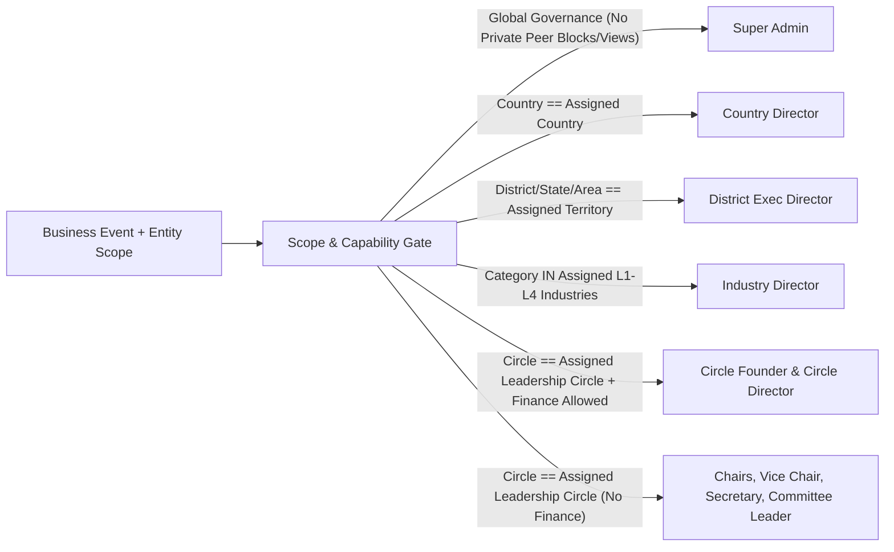

# 32 — Role-Wise Notification Matrix & Zero-Leakage Eligibility Rules

**Document Group:** 05 — Notifications and Operations  
**Audit Scope:** Role-by-Role Notification Eligibility, Scope Isolation & Privacy Boundaries  
**Related Documents:** [06-complete-role-hierarchy.md](./06-complete-role-hierarchy.md) · [08-master-role-permission-matrix.md](./08-master-role-permission-matrix.md) · [09-organizational-data-scope-matrix.md](./09-organizational-data-scope-matrix.md) · [30-existing-notification-system-audit.md](./30-existing-notification-system-audit.md) · [31-master-actionable-notification-catalogue.md](./31-master-actionable-notification-catalogue.md)

---

## 1. Hard Scope & Zero-Data-Leakage Rules (Mandatory)

**FACT (Updated):** `[LeaderNotificationPolicyService](file:///c:/Users/malic/OneDrive/Documents/GitHub/unity-app-new/app/Leader/Services/LeaderNotificationPolicyService.php)`, `[LeaderNotificationDispatcherService](file:///c:/Users/malic/OneDrive/Documents/GitHub/unity-app-new/app/Leader/Services/LeaderNotificationDispatcherService.php)`, and `[LeaderNotificationsController](file:///c:/Users/malic/OneDrive/Documents/GitHub/unity-app-new/app/Leader/Controllers/LeaderNotificationsController.php)` now enforce explicit `audience = 'leadership'` classification, separate `superAdmin` / `globalFounder` / `countryDirector` resolution, `industry_director_assignments` lookup, `access_finance` confidentiality filtering, `sha256` idempotency, quiet hours, and all 14 canonical roles in `leader_notification_flow_config`.

**RECOMMENDATION:** Enforce these **5 Non-Negotiable Notification Scope Invariants** before any row is written to `app_notifications` or pushed via FCM:

1. **Scope Containment Invariant:** A notification referencing an entity (`peer`, `circle`, `report`, `approval`, `payment`, `ask`) MUST verify that the recipient holds an **active, non-expired** role assignment (`starts_at <= now() <= ends_at` / `expires_at IS NULL OR expires_at > now()`) whose resolved scope covers that entity:
   - `superAdmin` (`global_admin` / `global_founder`): Global platform governance, **subject to Rule 5 Privacy Boundary**.
   - `countryDirector` (`eed`): Strictly circles, districts, and peers within assigned `country` (`admin_user_roles.scope_value` / `user_organizational_assignments.country_id`) — **NEVER unrestricted global** when another country's record triggers an event!
   - `districtExecDirector` (`ded`): Strictly circles and peers within assigned Area / District / State (`admin_ded_districts`, `circles.ded_user_id`, `user_organizational_assignments`) — **never infer global or country scope from title**.
   - `industryDirector` (`industry_director`): Strictly circles and peers mapped to assigned L1–L4 `circle_categories` (`industry_director_assignments`, `circles.industry_director_user_id`).
   - Circle-level roles (`circleFounder`, `circleDirector`, `circleChair`, `chairBusinessGrowth`, `chairMembership`, `chairEventsPrograms`, `viceChair`, `secretary`, `committee_leader`): Strictly `circle_id IN $leaderApprovedLeadershipCircleIds` (excluding circles where the user is only a regular `member` or `pending`!).
2. **Financial Confidentiality Invariant:** Financial notifications (`L-06`, `L-07`, `M-04`, commission/payout/revenue alerts) MUST NEVER be sent to `circleChair`, `chairBusinessGrowth`, `chairMembership`, `chairEventsPrograms`, `viceChair`, `secretary`, or `committee_leader` (`access_finance = false`). Even for `circleFounder`, `circleDirector`, `industryDirector`, and `districtExecDirector`, personal bonus/wallet alerts (`L-06`) go **only** to the earning `leader_user_id` + approving `countryDirector`/`superAdmin`, never to peer Circle leaders.
3. **Multi-Role Union Without Escalation:** If a user is `circleDirector` of Circle A and a regular `member` of Circle B, they receive Circle Director notifications **only for Circle A** and **zero** leadership notifications for Circle B.
4. **Ambassador Exclusion Note:** Per backend evidence (`ContributionMilestoneResolver.php:30`, `RolePermissionMatrixController.php:76`), `Ambassador` is a 10-peer-introductions Growth Honour (not a scoped `UserRoleResolverService` leadership role) and receives consumer badge recognition in the Member App, not Leadership App governance queues.
5. **Super Admin Privacy Boundary:** Even `superAdmin` MUST NOT receive notifications for personal `peer_blocks` (`#29`), private `"Who Viewed My Profile"` (`profile_views`, `#33`), private unsubmitted Ask/Nomination drafts (`status = 'draft'`), or raw OTP/credential events.

---

## 2. Master Role × Notification Eligibility Matrix

Legend:
- **A (`Action Owner`)**: Primary responsible actor — receives High/Medium push + Action Center item.
- **B (`Backup / Co-Approver`)**: Authorized co-approver or escalation recipient within scope.
- **I (`Informational`)**: Scoped awareness alert (no mutation required).
- **`—` (`Excluded`)**: Must **NOT** receive this notification (out of scope or unauthorized capability).

| ID | Notification Event | Super Admin | Country Director | DED | Industry Director | Circle Founder | Circle Director | Business Growth Chair | Membership Chair | Events & Impacts Chair | Vice Chair | Secretary | Committee Leader |
|---|---|:---:|:---:|:---:|:---:|:---:|:---:|:---:|:---:|:---:|:---:|:---:|:---:|
| **L-01** | Leader Interest Submitted | B | **A** *(Country)* | I *(District)* | `—` | `—` | `—` | `—` | `—` | `—` | `—` | `—` | `—` |
| **L-02** | Website Nomination Submitted/Shortlisted | **A** | B *(Country)* | `—` | `—` | `—` | `—` | `—` | `—` | `—` | `—` | `—` | `—` |
| **L-03** | Jury Evaluation Assigned / Due | I | `—` | *(If Juror)* | *(If Juror)* | *(If Juror)* | *(If Juror)* | `—` | `—` | `—` | `—` | `—` | `—` |
| **L-04** | Leadership Tenure Appointed | I | I *(Country)* | I *(District)* | I *(Industry)* | I *(Circle)* | I *(Circle)* | *(Self only)* | *(Self only)* | *(Self only)* | *(Self only)* | *(Self only)* | *(Self only)* |
| **L-05** | Leadership Tenure Expiring (30d/7d) | B | **A** *(Country)* | **A** *(District)* | *(Self)* | *(Self)* | *(Self / Circle)* | *(Self)* | *(Self)* | *(Self)* | *(Self)* | *(Self)* | *(Self)* |
| **L-06** | Bonus Milestone Unlocked | I | I *(Country)* | *(Self only)* | *(Self only)* | *(Self only)* | *(Self only)* | `—` | `—` | `—` | `—` | `—` | `—` |
| **L-07** | Leader Bonus Payout Approval Req | **A** | B *(Country)* | `—` | `—` | `—` | `—` | `—` | `—` | `—` | `—` | `—` | `—` |
| **L-08** | Role Capability Matrix Modified | **A** | `—` | `—` | `—` | `—` | `—` | `—` | `—` | `—` | `—` | `—` | `—` |
| **L-09** | Official Leadership Circular Published | I | *(If targeted)* | *(If targeted)* | *(If targeted)* | *(If targeted)* | *(If targeted)* | *(If targeted)* | *(If targeted)* | *(If targeted)* | *(If targeted)* | *(If targeted)* | *(If targeted)* |
| **M-01** | Circle Join Req — Stage 1 (CD) | `—` *(Escal. only)* | `—` *(Escal. only)* | I *(District)* | `—` | B *(Circle)* | **A** *(Circle)* | `—` | I *(Circle)* | `—` | `—` | `—` | `—` |
| **M-02** | Circle Join Req — Stage 2 (ID/DED) | `—` *(Escal. only)* | B *(Escal.)* | **B** *(District)* | **A** *(Industry)* | I *(Circle)* | I *(Circle)* | `—` | `—` | `—` | `—` | `—` | `—` |
| **M-03** | New Peer Chartered / Fee Paid | `—` | I *(Country)* | I *(District)* | I *(Industry)* | I *(Circle)* | **A** *(Circle)* | I *(Circle)* | **A** *(Circle)* | I *(Circle)* | I *(Circle)* | I *(Circle)* | I *(Committee)* |
| **M-04** | Offline Payment Verification Req | **A** | **A** *(Country)* | B *(District)* | `—` | `—` | `—` | `—` | `—` | `—` | `—` | `—` | `—` |
| **M-05** | Peer Circle Renewal Due (30d/7d) | `—` | `—` | I *(7d only)* | `—` | B *(Circle)* | **A** *(Circle)* | `—` | **A** *(Circle)* | `—` | I *(Circle)* | `—` | `—` |
| **M-06** | Peer Membership Expired | `—` | `—` | I *(District)* | `—` | I *(Circle)* | **A** *(Circle)* | `—` | I *(Circle)* | `—` | `—` | `—` | `—` |
| **M-07** | Peer Health Flagged (`needs_attention`) | `—` | `—` | I *(if `under_review`)* | `—` | B *(Circle)* | **A** *(Circle)* | `—` | **A** *(Circle)* | `—` | I *(Circle)* | `—` | `—` |
| **M-08** | Peer Birthday / Anniversary Today | `—` | `—` | `—` | `—` | I *(Circle)* | I *(Circle)* | I *(Circle)* | I *(Circle)* | I *(Circle)* | I *(Circle)* | I *(Circle)* | I *(Circle)* |
| **M-09** | Introduction Claim Req Pending | B | **A** *(Country)* | `—` | `—` | `—` | B *(Circle)* | `—` | `—` | `—` | `—` | `—` | `—` |
| **M-10** | Account Deletion Request | **A** | `—` | `—` | `—` | `—` | `—` | `—` | `—` | `—` | `—` | `—` | `—` |
| **C-01** | Build Your Own Circle Proposal | B | **A** *(Country)* | **A** *(District)* | `—` | `—` | `—` | `—` | `—` | `—` | `—` | `—` | `—` |
| **C-02** | New Circle Chartered / Launched | I | I *(Country)* | I *(District)* | I *(Industry)* | **A** *(Circle)* | **A** *(Circle)* | `—` | `—` | `—` | `—` | `—` | `—` |
| **C-03** | Open Category Peer Nomination | `—` | `—` | `—` | I *(Industry)* | B *(Circle)* | **A** *(Circle)* | `—` | **A** *(Circle)* | `—` | `—` | `—` | `—` |
| **C-04** | Weekly / Monthly Report Due | `—` | `—` | `—` | `—` | B *(Circle)* | **A** *(Circle)* | I *(Circle)* | I *(Circle)* | I *(Circle)* | B *(Circle)* | **A** *(Circle)* | `—` |
| **C-05** | Circle Leadership Report Submitted | `—` | I *(Country)* | **A** *(District)* | I *(Industry)* | I *(Circle)* | I *(Circle)* | `—` | `—` | `—` | `—` | `—` | `—` |
| **C-06** | Circle Attendance Dip (`< 75%`) | `—` | `—` | I *(`< 70%` x2)* | `—` | B *(Circle)* | **A** *(Circle)* | `—` | I *(Circle)* | **A** *(Circle)* | B *(Circle)* | I *(Circle)* | `—` |
| **C-07** | Overdue Report Compliance (2+ wks) | B *(L2 Escal.)* | B *(L2 Country)* | **A** *(L1 District)* | `—` | **A** *(Circle)* | **A** *(Circle)* | `—` | `—` | `—` | `—` | B *(Circle)* | `—` |
| **D-01** | Regional Approval SLA Escalation | B *(L2)* | B *(L2 Country)* | **A** *(L1 District)* | **A** *(L1 Industry)* | `—` | `—` | `—` | `—` | `—` | `—` | `—` | `—` |
| **D-02** | Vacant Circle Leadership Seat | `—` | I *(Country)* | **A** *(District)* | `—` | B *(Circle)* | B *(Circle)* | `—` | `—` | `—` | `—` | `—` | `—` |
| **D-03** | Territory Scale Milestone | I | I *(Country)* | I *(District)* | `—` | `—` | `—` | `—` | `—` | `—` | `—` | `—` | `—` |
| **I-01** | Industry Category Conflict / Stage-2 | `—` | `—` | B *(District)* | **A** *(Industry)* | `—` | I *(Circle)* | `—` | `—` | `—` | `—` | `—` | `—` |
| **I-02** | High-Value Cross-Circle Industry Deal | `—` | `—` | `—` | I *(Industry)* | `—` | I *(Circle)* | I *(Circle)* | `—` | `—` | `—` | `—` | `—` |
| **I-03** | Unmatched Open Ask (`> 72h`) | `—` | `—` | `—` | **A** *(Industry)* | `—` | I *(Circle)* | **A** *(Circle)* | `—` | `—` | `—` | `—` | *(If BG Comm.)* |
| **A-01** | Visitor Registration Pending | `—` *(Escal.)* | `—` | B *(District)* | `—` | B *(Circle)* | **A** *(Circle)* | `—` | `—` | **A** *(Circle)* | I *(Circle)* | I *(Circle)* | `—` |
| **A-02** | Cross-Circle Event Join Req Pending | `—` *(Escal.)* | `—` | B *(District)* | `—` | B *(Circle)* | **A** *(Circle)* | `—` | `—` | **A** *(Circle)* | `—` | `—` | `—` |
| **A-03** | Life Impact Verification Pending | `—` *(Escal.)* | `—` | B *(District)* | `—` | B *(Circle)* | **A** *(Circle)* | `—` | `—` | I *(Circle)* | `—` | `—` | `—` |
| **A-04** | Coin Claim Verification Pending | B | **A** *(Country)* | **A** *(District)* | `—` | `—` | B *(Circle)* | `—` | `—` | `—` | `—` | `—` | `—` |
| **A-05** | Certification Submission Pending | B | **A** *(Country)* | `—` | `—` | `—` | I *(If Circle Peer)* | `—` | `—` | `—` | `—` | `—` | `—` |
| **A-06** | Ad Booking / Partner / Speaker / Story | **A** | **A** *(Country)* | `—` | `—` | `—` | `—` | `—` | `—` | `—` | `—` | `—` | `—` |
| **A-07** | Post Reported in Circle | **A** | B *(Country)* | `—` | `—` | `—` | B *(If Circle Post)* | `—` | `—` | `—` | `—` | `—` | `—` |
| **A-08** | Direct P2P / Referral / Wish to Leader | *(Self)* | *(Self)* | *(Self)* | *(Self)* | *(Self)* | *(Self)* | *(Self)* | *(Self)* | *(Self)* | *(Self)* | *(Self)* | *(Self)* |
| **A-09** | Support Ticket Assigned / SLA Breach | **A** *(Breach)* | *(If Assigned)* | `—` | `—` | `—` | `—` | `—` | `—` | `—` | `—` | `—` | `—` |

---

## 3. Role-by-Role Notification Profiles & Scope Filters

### 3.1 Super Admin (`superAdmin` / `global_admin` / `global_founder`)
- **Authorized Scope:** Global platform governance (`is_global = true`), **excluding** private peer blocks, profile views, and unsubmitted drafts.
- **Primary Action Triggers:** Leader bonus payout approvals (`L-07`), offline payment verifications (`M-04`), RBAC matrix mutations (`L-08`), GDPR/DPDP account deletion requests (`M-10`), ad bookings & national partnership leads (`A-06`), post reports (`A-07`), L2 SLA escalations (`C-07`, `D-01`, `A-09`).
- **Noise Suppression Rule:** Do **NOT** send routine per-circle Stage-1 join requests (`M-01`), routine visitor registrations (`A-01`), or Circle birthday alerts (`M-08`) to `superAdmin` unless escalated past L2 (`> 96h`) — otherwise a platform with 100+ Circles floods the Super Admin inbox.

### 3.2 Country Director (`countryDirector` / `eed`)
- **Authorized Scope:** **Country Scope ONLY** (`circles.country = $assignedCountry` / `user_organizational_assignments.country_id`).
- **Code Fix Required (`Implemented but Incorrect`):** `[LeaderNotificationsController.php](file:///c:/Users/malic/OneDrive/Documents/GitHub/unity-app-new/app/Leader/Controllers/LeaderNotificationsController.php#L102)` and `[LeaderNotificationDispatcherService.php](file:///c:/Users/malic/OneDrive/Documents/GitHub/unity-app-new/app/Leader/Services/LeaderNotificationDispatcherService.php#L166)` currently lump `country_director` with `super_admin` without filtering by country! Country Directors must only receive `L-01`, `L-05`, `M-04`, `C-01`, `C-07`, `D-01`, `A-04`, `A-05`, `A-06` where the originating user/circle belongs to their assigned country, and **never** `L-08` (Role Matrix) or `M-10` (Account Deletion).

### 3.3 District Executive Director (`districtExecDirector` / `ded`)
- **Authorized Scope:** Assigned Area / District / State (`admin_ded_districts` + `circles.ded_user_id` + `user_organizational_assignments`).
- **Primary Action Triggers:** Stage-2 Circle Join clearance (`M-02`), Build-a-Circle proposals in district (`C-01`), submitted Circle weekly reports (`C-05`), L1 overdue approval/report escalations (`D-01`, `C-07`), vacant Circle leadership seats (`D-02`), and DED-queue pending items (`visitor_registrations`, `event_joining_requests`, `coin_claims`, `pending_impacts`).

### 3.4 Industry Director (`industryDirector` / `industry_director`)
- **Authorized Scope:** Assigned L1–L4 `circle_categories` (`industry_director_assignments` + `circles.industry_director_user_id`).
- **Primary Action Triggers:** Stage-2 Circle Join category clearance (`M-02` / `I-01`), cross-circle industry deals (`I-02`), unmatched sector Collaboration/Referral Asks older than 72h (`I-03`), and personal industry milestones (`L-06`).
- **Strict Exclusion:** Must **not** receive visitor registrations, attendance alerts, or peer health flags for Peers outside their assigned industry categories, even inside Circles where one Peer belongs to their industry.

### 3.5 Circle Founder (`circleFounder` / `circle_founder`)
- **Authorized Scope:** Own founded Circle(s) (`circles.founder_user_id` / `circle_founder_user_id` / `circle_members.role = 'founder'` with `status = 'approved'`).
- **Primary Action Triggers:** Founder speed/scale/quality bonus milestones (`L-06`), Circle launch/charter milestones (`C-02`), backup co-approver on Circle Join Stage-1 (`M-01`), open category referrals (`C-03`), overdue Circle report compliance (`C-07`), and Circle renewal retention (`M-05`).

### 3.6 Circle Director (`circleDirector` / `circle_director`)
- **Authorized Scope:** Own directed Circle(s) (`circles.director_user_id` / `circle_director_user_id` / `circle_members.role = 'director'` with `status = 'approved'`).
- **Primary Action Triggers:** Operational owner of Stage-1 Circle Join approvals (`M-01`), Visitor Registrations (`A-01`), Cross-Circle Event Join Requests (`A-02`), Life Impact verifications (`A-03`), Weekly Report submission (`C-04`), Attendance dips (`C-06`), Peer renewals & `needs_attention` flags (`M-05`, `M-06`, `M-07`), and CD speed/quality milestones (`L-06`).

### 3.7 Circle Chair & 3 Committee Chairs (`circleChair`, `chairBusinessGrowth`, `chairMembership`, `chairEventsPrograms`)
- **Authorized Scope:** Own Circle (`status = 'approved'`), **Zero Finance/Commission/Revenue Notifications**.
  - **Chair — Business Growth (`chairBusinessGrowth`) & General `circleChair`:** Unmatched Collaboration/Referral Asks (`I-03`), high-value Circle deals/referrals (`I-02`), Circle celebrations (`M-08`), report window (`C-04`).
  - **Chair — Membership Growth (`chairMembership`):** Open category Peer nominations (`C-03`), Stage-1 join awareness (`M-01`), new Peer onboarding (`M-03`), 30d/7d renewals (`M-05`), `needs_attention` Peer retention (`M-07`).
  - **Chair — Events & Impacts (`chairEventsPrograms`):** Visitor registrations (`A-01`), cross-circle event join requests (`A-02`), Life Impact verifications (`A-03`), attendance dip alerts (`C-06`).
- **Code Note (`Implemented but Incorrect`):** Fix `PendingRequestAdminController` capability check so Chairs only approve items if `can_review_pending_peers` is explicitly enabled for their role, otherwise receive `I` (Informational / Recommend) deep links without mutating `approve`/`reject`.

### 3.8 Vice Chair (`viceChair`) & Secretary (`secretary`)
- **Authorized Scope:** Own Circle (`status = 'approved'`), **Zero Finance & Zero Approval Mutation Notifications** by default (`access_teams = false`, `access_finance = false`, `manage_peers = false`).
- **Vice Chair:** Receives deputy operational alerts — attendance dips (`C-06`), report window (`C-04`), Peer renewals/health awareness (`M-05`, `M-07`), new Peer welcome (`M-03`), celebrations (`M-08`).
- **Secretary:** Primary co-owner of **Weekly / Monthly Circle Report Due (`C-04`)** & overdue compliance (`C-07`), plus meeting attendance/visitor roster awareness (`A-01` informational, `C-06`), new Peer welcome (`M-03`), celebrations (`M-08`).

### 3.9 Committee Leader (`committee_leader`)
- **Authorized Scope:** Own Circle & assigned `committee_key` (`user_organizational_assignments.committee_key`), **Zero Finance**.
- **Prerequisite Fix (`Implemented but Incorrect`):** Must first be added to `[UserRoleResolverService.php](file:///c:/Users/malic/OneDrive/Documents/GitHub/unity-app-new/app/Shared/Services/UserRoleResolverService.php#L34-L55)` so `EnsureLeaderUser` does not reject `committee_leader` with `403 NOT_A_LEADER`!
- **Eligible Notifications:** Own assignment/tenure alerts (`L-04`, `L-05`), targeted circulars (`L-09`), Circle Peer welcome & celebrations (`M-03`, `M-08`), direct P2P/Referral/Wish (`A-08`), and committee-matched Ask outreach (`I-03` when assigned to Business Growth committee).
