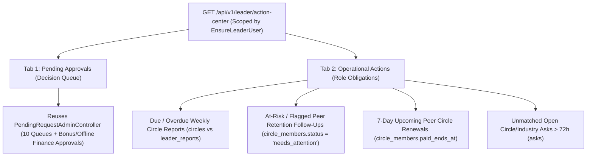

# 33 — Action Center & Role-Aware Task Management Architecture

**Document Group:** 05 — Notifications and Operations  
**Audit Scope:** Existing Pending Approvals Queue, Task Gap Analysis & Non-Duplicative Action Center Design  
**Related Documents:** [11-approval-and-delegation-authority.md](./11-approval-and-delegation-authority.md) · [27-approval-and-escalation-flow.md](./27-approval-and-escalation-flow.md) · [30-existing-notification-system-audit.md](./30-existing-notification-system-audit.md) · [31-master-actionable-notification-catalogue.md](./31-master-actionable-notification-catalogue.md) · [34-escalation-rules-and-ownership.md](./34-escalation-rules-and-ownership.md)

---

## 1. Conceptual Separation: Notification vs Task vs Approval

A recurring architectural flaw in operational apps is conflating inbox notifications with stateful work queues. Per Prompt §14, the Peers Global Leadership App must maintain a strict separation across three distinct primitives:

| Primitive | Purpose | State Owner | Completion Semantics | Current Ecosystem Status |
|---|---|---|---|---|
| **1. Notification** | **Informs** a specific user that an event occurred or attention is needed | Per-recipient row in `app_notifications` | Marked `read` when viewed (`read_at`); reading a notification **never** approves or completes the underlying business record | `Partially Implemented` (`app_notifications` + FCM HTTP v1) |
| **2. Approval** | **Requests an authorized governance decision** (`Approve` / `Reject` / `Request Changes`) on a Peer-submitted or system-generated entity | Shared domain record (`circle_join_requests`, `impacts`, `visitor_registrations`, `certification_submissions`, etc.) | Completed **atomically for all co-approvers** the moment one authorized leader transitions `status` (e.g., `pending_cd_approval -> pending_id_approval`) | `Partially Implemented` (`PendingRequestAdminController` 10 queues + `DedPendingRequestsController` 5 queues + `LeaderActivitiesView` inline cards) |
| **3. Task** | **Assigns bounded operational work** with a single responsible owner, due date, and completion condition (e.g., *"Submit Weekly Circle Report"*, *"Conduct Retention Call with At-Risk Peer"*) | Operational obligation derived from schedule/health state (or lightweight assignment) | Completed when the required artifact/action is recorded (e.g., `leader_reports` row submitted for period, or `add-note` / P2P logged) | `Missing` (`**NOT IMPLEMENTED:**` — zero `Task` model or `tasks` table exists) |

---

## 2. Audit of Existing Approval & Assignment Capabilities

### 2.1 Unified Leader & Admin Pending Approvals (`PendingRequestAdminController`)
**FACT:** `[PendingRequestAdminController.php](file:///c:/Users/malic/OneDrive/Documents/GitHub/unity-app-new/app/Http/Controllers/Api/Admin/PendingRequestAdminController.php#L75-L205)` is already mounted for the Leadership App under `['auth:sanctum', 'leader.user']` at `[routes/leader.php](file:///c:/Users/malic/OneDrive/Documents/GitHub/unity-app-new/routes/leader.php#L225-L232)`:
- `GET /api/v1/leader/pending-requests` (`?category=...&status=pending|approved|rejected|all&search=...`)
- `GET /api/v1/leader/pending-requests/summary`
- `POST /api/v1/leader/pending-requests/{category}/{id}/approve` (& `POST .../{id}/approve`)
- `POST /api/v1/leader/pending-requests/{category}/{id}/reject` (& `POST .../{id}/reject`)

It aggregates **10 categories**, applies `resolveLeaderScope($request)` / `denyIfOutsideLeaderScope()`, delegates core domain mutations to `[PendingRequestModerationService.php](file:///c:/Users/malic/OneDrive/Documents/GitHub/unity-app-new/app/Services/Admin/PendingRequestModerationService.php)`, `CircleJoinRequestService`, `ImpactService`, and `CertificateGeneratorService`, and broadcasts real-time `App\Events\PendingRequestChangedEvent`:

| # | Queue Key | Backing Table(s) | Stage / Domain Handler | Verified Bugs / Gaps |
|---:|---|---|---|---|
| 1 | `circle_joining_requests` | `circle_join_requests` | `CircleJoinRequestService`: CD/CF sees `pending_cd_approval` → `pending_id_approval`; ID/DED sees `pending_id_approval` → `pending_circle_fee` / `circle_member` | Works stage-aware; lacks `can_review_pending_peers` role guard on `approve()`/`reject()` |
| 2 | `visitor_registrations` | `visitor_registrations` | Approves/rejects visitor pass + awards host coins | Works |
| 3 | `coin_claims` | `coin_claims` vs `coin_claim_requests` | Credits `coins_ledger` on approval | **Table Name Bug (`Implemented but Incorrect`)**: `fetchCoinClaims()` checks `Schema::hasTable('coin_claims')`, whereas `processApproval()` and `CoinClaimRequest` model use `coin_claim_requests`! |
| 4 | `certifications` | `certification_submissions` | Generates PDF certificate via `CertificateGeneratorService` + emails Peer | Should restrict non-Circle public quiz submissions to Country Director / Super Admin |
| 5 | `pending_impacts` | `impacts` | `ImpactService::approveImpact` / `rejectImpact` (credits Life Impact + Coins + Timeline post) | Works |
| 6 | `ad_booking_requests` | `ad_bookings` | Approves/rejects Peer timeline ad booking | Global commercial queue — should be hidden from Circle-only roles |
| 7 | `account_deletion_requests` | `account_deletion_requests` | Processes account deletion request | **Privacy/Security Gap**: Must be restricted strictly to `superAdmin` |
| 8 | `event_joining_requests` | `event_registration_requests` | Cross-circle event attendance clearance | Works |
| 9 | `circle_peer_referrals` | `circle_peer_referrals` + `peer_referrals` + `peer_recommendations` | Open-category prospect referrals | Status vocabulary (`pending` / `approved` / `contacted` / `converted`) needs consistent transitions |
| 10 | `introduction_requests` | `introduction_requests` | Peer introducer attribution claims | Works |

### 2.2 DED Pending Requests Queue (`DedPendingRequestsController`)
**FACT:** Mounted under `/api/v1/ded/pending-requests/*` (`auth:sanctum` + `ensure.ded.api`, requiring an `AdminUser` token; `[routes/api.php](file:///c:/Users/malic/OneDrive/Documents/GitHub/unity-app-new/routes/api.php#L525-L545)`), covering **5 categories** (`visitor-registrations`, `event-joining-requests`, `coin-claims`, `circle-joining-requests` including `/ded-approve`, and `pending-impacts`). Because the Flutter Leadership App authenticates as `App\Models\User` (`leader.user`), DEDs in the Leadership App already consume `/api/v1/leader/pending-requests` rather than `/api/v1/ded/*`.

### 2.3 `WorkflowApprovalRule` & Existing Assignment Columns
- **`WorkflowApprovalRule` (`Implemented but Not Integrated`):** **FACT:** `workflow_approval_rules` (`WorkflowApprovalRuleController`) is pure configuration CRUD; **zero** runtime services (`PendingRequestAdminController`, `CircleJoinRequestService`, `ImpactService`, `DedApiService`) query `workflow_approval_rules`.
- **Existing Point-Assignment Columns (`Partially Implemented`):**
  1. `support_tickets.assigned_to` (`POST /api/admin/v1/support/tickets/{id}/assign`) and `support_requests.routed_to_user_id`.
  2. `web_leadership_jury_assignments` (`POST /api/v1/leadership/admin/jury/assign` with `juror_user_id` and `due_at`).
  3. `asks` owner assignment (`POST /api/v1/leader/ask-flows/{id}/assign-owner` in `AskFlowHubController`).
- **Flutter UI Today (`[leader_activities_view.dart](file:///D:/office%20project/LeaderApp-Fornt-end-/lib/features/leader_activities/view/leader_activities_view.dart#L20-L250)` & `[leader_activity_item_card.dart](file:///D:/office%20project/LeaderApp-Fornt-end-/lib/features/leader_activities/view/widgets/leader_activity_item_card.dart#L371-L457)`):**
  - **FACT:** Dashboard shows a `"Pending Peers · Review"` banner (`DashboardMetricsModel.pendingRequestsCount`), opening `LeaderActivitiesView(activityType: 'pending-requests')`, where `LeaderActivityItemCard` renders inline `Reject` and `Accept` buttons when `item.isActionablePending` is true!
  - **UI Gaps:** (a) No confirmation dialog or rejection-reason input before firing `Reject` (whereas backend `CircleJoinRequest` / `LeadershipController` expect or store `rejection_reason`); (b) `Accept`/`Reject` buttons should be hidden when `!SessionManager().permissions.canReviewPendingPeers`; (c) non-approval operational obligations (overdue Weekly Report, `needs_attention` Peer follow-ups, expiring renewals, offline payment verifications) are scattered across 4 tabs instead of unified in one Action Center view.

---

## 3. Minimal, Non-Duplicative Role-Aware Action Center Design

**RECOMMENDATION:** **Do NOT build a generic Jira-style project management / freeform task-creation engine.** Instead, upgrade the existing `Pending Approvals` screen in the Flutter Leadership App into a unified, two-tab **Role-Aware Action Center** backed by one lightweight composite read endpoint `GET /api/v1/leader/action-center` (which internally composes `PendingRequestAdminController` + derived operational obligations from existing tables):

### 3.1 Guardrails Against Duplication
1. **Zero Duplicate Approval Endpoints:** Approving or rejecting an item in Tab 1 calls the **exact existing** `POST /api/v1/leader/pending-requests/{category}/{id}/approve` and `/reject` endpoints (with `leader.can` capability checks enforced and a mandatory `rejection_reason` modal on Reject).
2. **Derived Tasks First (No Orphan Task Sync Bugs):** Operational Actions in Tab 2 (`Weekly Report Due`, `Peer Renewal in 7 Days`, `Flagged Peer Follow-Up`, `Unmatched Ask > 72h`) are **computed directly from authoritative domain state** (`leader_reports`, `circle_members`, `asks`). The moment a Circle Director submits the weekly report via `POST /api/v1/reports/submit`, the `"Weekly Report Due"` item disappears automatically without needing dual-state synchronization!
3. **Optional Manual Follow-Up Notes Already Exist:** When a CD/Membership Chair completes a retention call with a `needs_attention` Peer, calling existing `POST /api/v1/leader/members/{member_id}/add-note` or `PATCH .../flag-status` (`approved`) satisfies the completion condition natively.

---

## 4. Complete 8-Attribute Specification for Every Action Center Item

Per Prompt §14, every approval and operational action in the Leadership App Action Center is specified below across all **8 mandatory governance attributes**:

| Action ID & Title | 1. Responsible Person | 2. Assigned Role | 3. Organizational Scope | 4. Due Date (Proposed SLA*) | 5. Available Transitions | 6. Required Permission | 7. Completion Condition | 8. Escalation Path |
|---|---|---|---|---|---|---|---|---|
| **AC-01: Circle Join Request — Stage 1** | Circle's active `circle_director_user_id` (co-owned by `circle_founder_user_id`) | `circleDirector` (Primary), `circleFounder` (Backup) | Target `circle_id` (`Own Circle`) | `created_at + 48h` | `pending_cd_approval` → `pending_id_approval` (`Approve`) \| `rejected_by_cd` (`Reject` + reason) | `can_review_pending_peers` (`access_teams`) | `circle_join_requests.status != 'pending_cd_approval'` | `48h` reminder to CD/CF → `72h` escalate to `districtExecDirector` → `120h` `countryDirector` |
| **AC-02: Circle Join Request — Stage 2** | Assigned `industry_director_user_id` & `ded_user_id` | `industryDirector` (Primary), `districtExecDirector` (Co-Approver) | Applicant Industry (`L1–L4`) & Circle `district_id` | `cd_approved_at + 48h` | `pending_id_approval` → `pending_circle_fee` / `circle_member` (`Approve`) \| `rejected_by_id` (`Reject` + reason) | `can_review_pending_peers` | `circle_join_requests.status != 'pending_id_approval'` | `48h` reminder to ID/DED → `96h` escalate to `countryDirector` → `144h` `superAdmin` |
| **AC-03: Visitor Registration Approval** | Host Peer's Circle `circle_director_user_id` / Events Chair | `circleDirector`, `chairEventsPrograms`, `circleFounder` | Host Peer's `circle_id` | `min(created_at + 24h, event_date - 4h)` | `pending` → `approved` \| `rejected` | `can_review_pending_peers` | `visitor_registrations.status IN ('approved','rejected')` | `24h` (or `T-6h` before event) escalate to `districtExecDirector` |
| **AC-04: Cross-Circle Event Join Request** | Host Event Circle's `circle_director_user_id` | `circleDirector`, `chairEventsPrograms`, `circleFounder` | `events.circle_id` | `min(created_at + 24h, start_at - 4h)` | `pending` → `approved` \| `rejected` | `can_review_pending_peers` | `event_registration_requests.status IN ('approved','rejected')` | `24h` (or `T-6h` before `events.start_at`) escalate to `districtExecDirector` |
| **AC-05: Life Impact Verification** | Submitter's Circle `circle_director_user_id` | `circleDirector`, `circleFounder` (Backup: `districtExecDirector`) | Submitter's `circle_id` | `created_at + 72h` | `pending` → `approved` (credits score & coins) \| `rejected` (with `review_remarks`) | `can_review_pending_peers` | `impacts.status IN ('approved','rejected')` | `72h` reminder to CD/CF → `120h` escalate to `districtExecDirector` |
| **AC-06: Open Category Peer Nomination** | Target Circle `circle_director_user_id` & Membership Chair | `circleDirector`, `chairMembership`, `circleFounder` | Target `circle_id` | `created_at + 72h` | `pending` → `contacted` → `approved` / `converted` \| `rejected` | `can_review_pending_peers` | `status IN ('approved','converted','rejected')` | `72h` reminder to CD/Membership Chair → `7d` escalate to `circleFounder` & `districtExecDirector` |
| **AC-07: Coin Claim Verification** | Country / District / Circle reviewer per policy | `countryDirector`, `districtExecDirector`, `superAdmin` | Country / District / Circle | `created_at + 72h` | `pending` → `approved` (writes `coins_ledger`) \| `rejected` | `can_issue_coins` (`coin_payouts`) | `coin_claim_requests.status IN ('approved','rejected')` | `72h` reminder → `120h` escalate to `countryDirector` / `superAdmin` |
| **AC-08: Certification Quiz Approval** | Assigned Country Director / Super Admin | `countryDirector`, `superAdmin` | Applicant Country / Global | `created_at + 72h` | `new` → `approved` (generates PDF certificate) \| `rejected` | `can_review_pending_peers` + Country/Global scope | `certification_submissions.status IN ('approved','rejected')` | `72h` reminder to `countryDirector` → `120h` `superAdmin` |
| **AC-09: Build Your Own Circle Proposal** | Governing DED & Country Director | `districtExecDirector`, `countryDirector`, `superAdmin` | Proposed `city_id` / `district` / `country` | `created_at + 5d` | `pending` → `under_review` → `approved` (provisions `Circle`) \| `rejected` | `can_manage_circles` + `regional_data` | `user_circle_requests.status IN ('approved','rejected')` | `5d` reminder to DED → `7d` escalate to `countryDirector` → `10d` `superAdmin` |
| **AC-10: Leader Interest Application** | Governing Country Director | `countryDirector`, `superAdmin` | Applicant `contribute_city` / Country | `created_at + 5d` | `pending` → `approved` \| `rejected` | `manage_peers` + `regional_data` | `leader_interest_submissions.status IN ('approved','rejected')` | `5d` reminder to `countryDirector` → `10d` `superAdmin` |
| **AC-11: Offline Payment & Bonus Payout Verification** | Finance Governance Approver | `countryDirector`, `superAdmin` | Country / Global | `created_at + 48h` | `pending_approval` → `credited` / `verified` \| `rejected` | `can_modify_finance_settings` (`manage_finance`) | Ledger entry posted or award `status IN ('credited','rejected')` | `48h` reminder → `72h` urgent alert to `superAdmin` |
| **AC-12: Account Deletion Request** | Platform Data Protection Owner | `superAdmin` ONLY | Global | `created_at + 72h` (Statutory SLA) | `pending` → `approved` \| `rejected` | `superAdmin` (`system_configs`) | `account_deletion_requests.status IN ('approved','rejected')` | `48h` Urgent `superAdmin` alert |
| **AC-13: Weekly / Monthly Circle Report *(Operational Task)*** | Circle's `circle_director_user_id` or `secretary_user_id` | `circleDirector` (Owner), `secretary` (Co-Owner), `circleFounder` (Backup) | Target `circle_id` | `48h` after Circle meeting (or Sunday `23:59` Circle tz) | `due` → `submitted` (`POST /api/v1/reports/submit`) | `can_submit_reports` (`view_reports`) | `leader_reports` row exists for `(circle_id, period)` | `48h` overdue reminder to CD/Sec/CF → `2 consecutive missed periods` escalate to `districtExecDirector` → `3 missed` `countryDirector` |
| **AC-14: Flagged / At-Risk Peer Retention Check-In *(Operational Task)*** | Circle's `circle_director_user_id` & Membership Chair | `circleDirector`, `chairMembership`, `circleFounder` | Target `circle_id` | `flagged_at + 7d` | `needs_attention` → Log Note (`POST /members/{id}/add-note`) / Log P2P / Restore `approved` (`PATCH /flag-status`) | `can_view_peer_profile` (`manage_peers` to clear flag) | Leader note or P2P logged after `flagged_at`, OR `circle_members.status = 'approved'` | `7d` unactioned → notify `circleFounder` → `14d` notify `districtExecDirector` |
| **AC-15: 7-Day Expiring Peer Renewal Outreach *(Operational Task)*** | Circle's `circle_director_user_id` & Membership Chair | `circleDirector`, `chairMembership` | Target `circle_id` | `paid_ends_at` (`T-0`) | `expiring_soon` → Send Reminder (`POST /members/{id}/send-reminder`) / Renewed | `can_view_peer_profile` | `paid_ends_at` extended OR reminder/note logged within 7d window | On expiry (`M-06`), notify `circleDirector`, `circleFounder`, and `districtExecDirector` |
| **AC-16: Unmatched Open Ask Broker Action *(Operational Task)*** | Circle Business Growth Chair & Industry Director | `chairBusinessGrowth`, `industryDirector` | Ask `visibility_circle_id` / Ask Industry | `published_at + 5d` (surfaces at `+72h`) | `unmatched` → Recommend Peer / Create P2P (`POST /ask-flows/{id}/create-p2p`) / Assign Owner | `request_actions` | `ask_responses` count `>= 1` OR `asks.status IN ('in_progress','fulfilled','closed')` | `7d` with `0` responses → highlight in Circle Director weekly review |

> **BUSINESS DECISION REQUIRED:** All SLA hour/day windows (`48h`, `72h`, `5d`, `7d`) in Column 4 and Column 8 are practical operational defaults proposed for Product Owner sign-off and are formalized as configurable settings in [34-escalation-rules-and-ownership.md](./34-escalation-rules-and-ownership.md).
