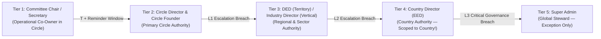

# 34 — SLA Windows, Escalation Rules & Governance Ownership Chains

**Document Group:** 05 — Notifications and Operations  
**Audit Scope:** Current SLA/Escalation Verification, Hierarchical Ownership Chains, Idempotent Cron Design & Immutable Audit Logging  
**Related Documents:** [11-approval-and-delegation-authority.md](./11-approval-and-delegation-authority.md) · [27-approval-and-escalation-flow.md](./27-approval-and-escalation-flow.md) · [30-existing-notification-system-audit.md](./30-existing-notification-system-audit.md) · [33-action-center-and-task-management.md](./33-action-center-and-task-management.md) · [51-open-business-decisions.md](./51-open-business-decisions.md)

---

## 1. Current Codebase Verification (`**NOT IMPLEMENTED:**`)

**FACT:** A full repository-wide inspection of all 62 Artisan commands (`app/Console/Commands/`), 25 scheduled jobs (`[routes/console.php](file:///c:/Users/malic/OneDrive/Documents/GitHub/unity-app-new/routes/console.php)`), 23 Queue Jobs (`app/Jobs/`), `app/Leader/`, and `database/migrations/` confirms that **automated SLA monitoring, approval reminders, and hierarchical escalations are `Missing` (`**NOT IMPLEMENTED:**`) today**:

| Capability | Current Codebase State | Verified Evidence |
|---|---|---|
| **Approval Queue SLAs & Escalation Crons** | `Missing` (`**NOT IMPLEMENTED:**`) | Zero Artisan commands inspect overdue `circle_join_requests`, `visitor_registrations`, `impacts`, `coin_claim_requests`, `certification_submissions`, `user_circle_requests`, or `leader_interest_submissions`. |
| **Report Compliance Escalation Cron** | `Missing` (`**NOT IMPLEMENTED:**`) | `[LeaderNotificationsController.php](file:///c:/Users/malic/OneDrive/Documents/GitHub/unity-app-new/app/Leader/Controllers/LeaderNotificationsController.php#L329-L340)` mocks `sa_notif_006_*` (*"0 weekly reports submitted for 2 consecutive weeks"*), but no command checks `leader_reports`. |
| **`WorkflowApprovalRule.auto_approve_after_hours`** | `Implemented but Not Integrated` | Column `auto_approve_after_hours` exists on `[workflow_approval_rules](file:///c:/Users/malic/OneDrive/Documents/GitHub/unity-app-new/database/migrations/2026_08_05_000008_create_workflow_approval_rules_table.php)`, but zero runtime services or crons query it. |
| **`support_tickets.sla_due_at`** | `Partially Implemented` *(Passive Display Only)* | `StoreSupportService` writes `sla_due_at = now()->addHours(24)` on Store ticket creation, but **zero** scheduled commands check `sla_due_at < now()` or alert admins on breach. |
| **`web_leadership_jury_assignments.due_at`** | `Partially Implemented` *(Passive Display Only)* | `LeadershipJuryAssignment` exposes `due_at` (`deadline`), with **zero** reminder or escalation automation. |
| **Queue Item Reassignment (`assigned_to`)** | `Partially Implemented` *(Support & Jury Only)* | Pending approval tables (`circle_join_requests`, `impacts`, `visitor_registrations`, etc.) have **no `assigned_to` column**; visibility derives dynamically from Circle/District/Industry leadership FKs. Only `support_tickets.assigned_to` and `web_leadership_jury_assignments.juror_user_id` support point assignment. |
| **Bottom-Up Notification Helper** | `Partially Implemented` | `[LeaderNotificationDispatcherService::bubbleUpCircleEvent()](file:///c:/Users/malic/OneDrive/Documents/GitHub/unity-app-new/app/Leader/Services/LeaderNotificationDispatcherService.php#L354-L395)` implements immediate fan-out (`CD/CF -> DED -> SuperAdmin`), not time-delayed SLA escalation, and skips `countryDirector` and `industryDirector`. |

---

## 2. Canonical Hierarchical Ownership & Escalation Chain

**RECOMMENDATION:** Rather than adding fragile `assigned_to` columns to 10 domain tables, preserve **scope-derived co-ownership** (where any authorized holder at the active tier or an escalated parent tier can resolve the item via `POST /api/v1/leader/pending-requests/{category}/{id}/approve|reject`), governed by the 5-tier organizational hierarchy:

### 2.1 Vacant-Seat Auto-Skip Rule (Zero Dead-End Escalation)
**RECOMMENDATION:** Many Circles in formation or transition may temporarily lack an active `Circle Director`, `Industry Director`, or `DED` (`DistrictAnalyticsService::getHealthScores` explicitly tracks `leadership_filled_pct`). When resolving recipients at any tier:
1. Query active, non-expired role holders (`starts_at <= now() <= ends_at` / `expires_at IS NULL OR expires_at > now()`).
2. **If Tier `N` has `0` active holders for that scope, immediately promote initial ownership to Tier `N + 1` at `T = 0`** instead of waiting 48 hours for an empty seat to time out!
   - *Example:* If Circle X has no `Circle Director` and no `Circle Founder`, a Stage-1 `circle_join_requests` item immediately notifies the governing `DED` at `T = 0` with reason `"escalated_vacant_circle_leadership"`.

### 2.2 Co-Ownership & Atomic Resolution Rule
- Escalating an item from `Circle Director` (`Tier 2`) to `DED` (`Tier 3`) **expands** action visibility to `Tier 3` without revoking `Tier 2`'s ability to complete it.
- The first authorized leader (`CD`, `CF`, or escalated `DED`) who approves or rejects the item transitions the underlying DB record (`status != 'pending*'`), which **atomically clears the item from all Action Centers** and suppresses any further escalation stages.

---

## 3. Proposed SLA & Escalation Matrix Across All Operational Flows

> **BUSINESS DECISION REQUIRED:** Every numeric SLA threshold (`T_remind`, `T_L1`, `T_L2`, `T_L3`) and auto-expiry policy below MUST be confirmed by Peers Global Founders / Operations Leadership before enabling cron enforcement. Store approved values in `app_configs` (`key = 'leader_sla_escalation_config'`) so thresholds remain admin-tunable without code deploys.

| Workflow / Queue | Primary Tier (T = 0) | Reminder (`T_remind`) | L1 Escalation (`T_L1`) | L2 Escalation (`T_L2`) | L3 Escalation (`T_L3`) | Auto-Approve Allowed? |
|---|---|---|---|---|---|---|
| **1. Circle Join — Stage 1 (`pending_cd_approval`)** | Circle Director + Circle Founder | `+24h` → CD & CF | `+48h` → Governing DED | `+96h` → Country Director *(Country)* | `+144h` → Super Admin | **NEVER** (Category seat & trust check mandatory) |
| **2. Circle Join — Stage 2 (`pending_id_approval`)** | Industry Director + DED | `+24h` → ID & DED | `+48h` → Country Director *(Country)* | `+96h` → Super Admin | — | **NEVER** (Category exclusivity check mandatory) |
| **3. Visitor Registration (`visitor_registrations`)** | CD + Events Chair + CF | `min(+12h, event - 12h)` → CD & Events Chair | `min(+24h, event - 4h)` → Governing DED | `event_date` passed unactioned → Mark `expired` | — | **BUSINESS DECISION REQUIRED** (Never auto-approve without host check) |
| **4. Cross-Circle Event Join (`event_registration_requests`)** | Host Circle CD + Events Chair | `min(+12h, start_at - 12h)` → Host CD | `min(+24h, start_at - 4h)` → Host DED | `start_at` passed → Mark `expired` | — | **NEVER** |
| **5. Life Impact Verification (`impacts`)** | Submitter Circle CD + CF | `+48h` → CD & CF | `+96h` → Governing DED | `+168h (7d)` → Country Director | — | **NEVER** (Brand rule: unconfirmed impact counts for zero) |
| **6. Open Category Peer Referral (`circle_peer_referrals`)** | Circle CD + Membership Chair | `+48h` → CD & Membership Chair | `+120h (5d)` → Circle Founder + DED | `+10d` → Country Director | — | **NEVER** |
| **7. Coin Claim Verification (`coin_claim_requests`)** | Country Director / DED | `+48h` → DED / Country Director | `+96h` → Country Director | `+168h (7d)` → Super Admin | — | **NEVER** (Financial/coin ledger impact) |
| **8. Quiz Certifications (`certification_submissions`)** | Country Director | `+48h` → Country Director | `+96h` → Super Admin | — | — | **BUSINESS DECISION REQUIRED** (Auto-issue if score `>= pass_mark`?) |
| **9. Build Your Own Circle (`user_circle_requests`)** | DED + Country Director | `+72h (3d)` → DED | `+120h (5d)` → Country Director | `+240h (10d)` → Super Admin | — | **NEVER** (Provisions live Circle) |
| **10. Leader Interest Form (`leader_interest_submissions`)** | Country Director | `+72h (3d)` → Country Director | `+168h (7d)` → Super Admin | — | — | **NEVER** |
| **11. Offline Payment / Bonus Payout (`payments` / `finance_leader_bonus_awards`)** | Country Director + Super Admin | `+24h` → Country Director | `+48h` → Super Admin (`Urgent`) | — | — | **NEVER** (Direct financial ledger mutation) |
| **12. Weekly / Monthly Circle Report (`leader_reports`)** | Circle Director + Secretary | `Due - 12h` & `Due + 24h` → CD, Sec, CF | `1 Missed Period (+48h)` → DED | `2 Consecutive Missed Periods` → Country Director | `3 Consecutive Missed` → Super Admin | N/A (Requires report submission) |
| **13. Flagged Peer Follow-Up (`needs_attention`)** | CD + Membership Chair | `+5d` without note/P2P → CD & Membership Chair | `+10d` → Circle Founder | `+14d` → Governing DED | — | N/A |
| **14. Support Ticket SLA (`support_tickets.sla_due_at`)** | `assigned_to` Support Admin | `sla_due_at - 4h` (`+20h`) → `assigned_to` | `sla_due_at` breached (`+24h`) → Support Lead & Country Director | `sla_due_at + 24h` (`+48h`) → Super Admin | — | N/A |
| **15. Jury Evaluation (`web_leadership_jury_assignments.due_at`)** | `juror_user_id` | `due_at - 24h` → Juror | `due_at` breached → Campaign Admin & Super Admin (for reassignment) | — | — | **NEVER** |
| **16. Account Deletion (`account_deletion_requests`)** | Super Admin ONLY | `+24h` → Super Admin | `+48h` → Super Admin (`Urgent`) | — | — | **NEVER** |

---

## 4. Non-Duplicative Technical Implementation Plan (`routes/console.php`)

**RECOMMENDATION:** Implement escalation with **two lightweight scheduled Artisan commands** registered in `[routes/console.php](file:///c:/Users/malic/OneDrive/Documents/GitHub/unity-app-new/routes/console.php)`, reusing `[LeaderNotificationDispatcherService](file:///c:/Users/malic/OneDrive/Documents/GitHub/unity-app-new/app/Leader/Services/LeaderNotificationDispatcherService.php)` and `app_notifications.dedupe_key` (zero new notification tables required!):

1. **`leader:process-sla-escalations` (`Schedule::command(...)->everyFifteenMinutes()->withoutOverlapping()`):**
   - Scans pending rows across `circle_join_requests`, `visitor_registrations`, `event_registration_requests`, `impacts`, `coin_claim_requests`, `certification_submissions`, `user_circle_requests`, `leader_interest_submissions`, `finance_leader_bonus_awards`, `support_tickets`, `web_leadership_jury_assignments`, and `account_deletion_requests`.
   - Computes elapsed age (`now()->diffInHours($record->created_at)` or stage timestamp `cd_approved_at`) against `leader_sla_escalation_config`.
   - **Strict Idempotency via Deterministic `dedupe_key`:**
     - Reminder key: `sla_remind:{category}:{record_id}:{recipient_id}`
     - L1 key: `sla_l1:{category}:{record_id}:{recipient_id}`
     - L2 key: `sla_l2:{category}:{record_id}:{recipient_id}`
     - L3 key: `sla_l3:{category}:{record_id}:{recipient_id}`
     - Note: Unlike the current `LeaderNotificationDispatcherService.php:39` which appends `date('Y-m-d')` (causing daily repeat spam!), stage-based SLA `dedupe_key` values MUST omit the date so **each escalation tier fires at most once per record per recipient**!
   - Respects user quiet hours (`notification_preferences.quiet_hours_start`..`quiet_hours_end`) for `Medium` reminders while delivering `Urgent` statutory/event-imminent escalations immediately.

2. **`leader:check-report-and-tenure-compliance` (`Schedule::command(...)->dailyAt('09:00')->withoutOverlapping()`):**
   - Evaluates active Circles (`circles.status = 'active'`) without a `leader_reports` entry for the completed weekly/monthly window (`C-04` due reminder, `C-07` consecutive-miss escalation).
   - Evaluates `admin_user_roles.expires_at` and `user_organizational_assignments.ends_at` at `T-30d`, `T-7d`, and `T-0` (`L-05`), automatically revoking expired leadership assignments at `T-0` + `grace_period_days` (`roles.grace_period_days`).

---

## 5. Mandatory Immutable Audit Trail (`activity_logs`)

**FACT:** `[App\Models\ActivityLog](file:///c:/Users/malic/OneDrive/Documents/GitHub/unity-app-new/app/Models/ActivityLog.php)` (`activity_logs`) already enforces immutability (`updating` and `deleting` throw `BadMethodCallException`) via `App\Services\ActivityLoggerService`.

**RECOMMENDATION:** Every SLA escalation event, vacant-seat auto-skip, reassignment, and escalated override approval/rejection MUST write an immutable `activity_logs` entry:
- `actor_type`: `'system_cron'` (for automated escalation) or `'leader_user'` (when an escalated DED/CD/SA approves on behalf of a lower tier).
- `module`: `'leader_action_center'`
- `action`: `'sla_escalated_l1'` | `'sla_escalated_l2'` | `'vacant_seat_promoted'` | `'escalated_approval_completed'`
- `entity_type` & `entity_id`: Target domain model and UUID.
- `metadata` JSON: `{ "from_tier": "circleDirector", "to_tier": "districtExecDirector", "elapsed_hours": 48.3, "circle_id": "...", "country": "...", "notified_user_ids": ["..."] }`.
