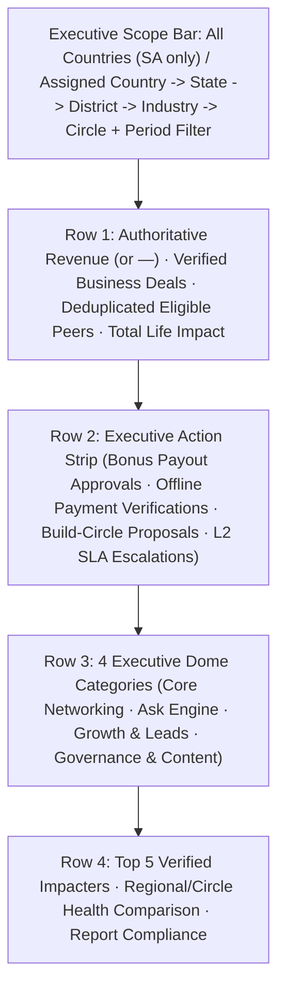

# 35 — Global Admin & Country Director Executive Dashboard

**Document Group:** 06 — Analytics and Role-Wise Dashboards  
**Target Roles:** `Super Admin` (`superAdmin` / `global_admin` / `global_founder`) & `Country Director` (`countryDirector` / `eed`)  
**Related Documents:** [08-master-role-permission-matrix.md](./08-master-role-permission-matrix.md) · [09-organizational-data-scope-matrix.md](./09-organizational-data-scope-matrix.md) · [29-reporting-and-analytics-flow.md](./29-reporting-and-analytics-flow.md) · [41-master-reporting-and-metrics-reference.md](./41-master-reporting-and-metrics-reference.md) · [43-sensitive-data-and-finance-access.md](./43-sensitive-data-and-finance-access.md)

---

## 1. Role Authority, Scope Separation & Privacy Boundaries

**FACT:** Today, both `[LeaderPermissionService::resolveManagedCircles()](file:///c:/Users/malic/OneDrive/Documents/GitHub/unity-app-new/app/Leader/Services/LeaderPermissionService.php#L517)` and `[LeaderDashboardService::resolveLeaderScope()](file:///c:/Users/malic/OneDrive/Documents/GitHub/unity-app-new/app/Leader/Services/LeaderDashboardService.php#L64-L66)` treat `countryDirector` (`eed`) **identically** to `superAdmin` (`is_global_scope = true`), returning global platform data across all countries (`Implemented but Incorrect`). Only Web Admin's `[PermissionService::dataScope()](file:///c:/Users/malic/OneDrive/Documents/GitHub/unity-app-new/app/Services/Admin/PermissionService.php#L704-L725)` attempts to filter `circles.country = $country`.

### 1.1 Mandatory Scope Divergence: Super Admin vs Country Director
| Dimension | Super Admin (`superAdmin` / `global_admin`) | Country Director (`countryDirector` / `eed`) |
|---|---|---|
| **Default Geographic Scope** | **Global Platform** (All Countries, States, Districts, Industries, Circles) | **Assigned Country ONLY** (`user_organizational_assignments.country_id` / `admin_user_roles.scope_value` → `circles.country` & `users.country`) |
| **Scope Filter Drilldowns** | Country → State → District → Industry → Circle | State → District → Industry → Circle *(locked to assigned Country; cross-country `circle_id` / `district_id` must return `403`)* |
| **Capabilities (`LeaderPermissionService`)** | 12 capabilities (includes `manage_roles`, `system_configs`, `manage_finance`, `coin_payouts`) | 10 capabilities (`access_dashboard`, `access_teams`, `access_finance`, `regional_data`, `view_peers`, `manage_peers`, `request_actions`, `view_reports`, `manage_finance`, `coin_payouts` — **no** `manage_roles` or `system_configs`) |
| **Privacy Boundary (Hard Rule)** | **Excluded** from personal `peer_blocks` (`#29`), private `"Who Viewed My Profile"` (`profile_views`, `#33`), unsubmitted `draft` Asks/Nominations, and raw OTPs/credentials | Same privacy exclusions + strictly zero access to other countries' Peers, Circles, Reports, or Finance |

---

## 2. Critical Backend & Client Defects Affecting Executive Dashboards

1. **Synthetic `overall_revenue` (`Implemented but Incorrect` — `P0` Data Integrity):**
   - **FACT:** `[LeaderDashboardService.php](file:///c:/Users/malic/OneDrive/Documents/GitHub/unity-app-new/app/Leader/Services/LeaderDashboardService.php#L733)` computes `overall_revenue` as `$revSum = $dealsSum * 0.05;` (5% of Peer-to-Peer `business_deals.deal_amount`)! Peer business deals do **not** generate 5% platform fee revenue.
   - **Authoritative Rule:** Replace with verified net collections from `payments` / `finance_ledger_transactions` (`circle_subscriptions` + `user_memberships`), or return `null` so the Flutter UI displays **`—` (`Unavailable`)** (never `5%` of deals and never falling back to `deals`).
2. **Fabricated Ask, Certification, Circular & Top-Impacter Figures (`Implemented but Incorrect`):**
   - **FACT:** `[LeaderDashboardService.php](file:///c:/Users/malic/OneDrive/Documents/GitHub/unity-app-new/app/Leader/Services/LeaderDashboardService.php#L784-L970)` fabricates `open_asks = round($allAsksCount * 0.6)`, `in_progress_asks = 0.25`, `fulfilled_asks = 0.15` (L784–786); splits certifications `70% / 30%` (L789–790); hardcodes `circulars = 5` (L798); and in `getTopImpacters` fabricates `max(50 - ($rank * 8), 5)` impact scores (L924), fake coin counts (L925), and 5 fictional names ("Siddharth Verma", "Ananya Roy", etc., L945–970) when empty!
3. **Client-Side 7-Endpoint Fan-Out Workaround (`Requires Enhancement`):**
   - **FACT:** In `[dashboard_remote_datasource.dart](file:///D:/office%20project/LeaderApp-Fornt-end-/lib/data/datasources/remote/dashboard_remote_datasource.dart#L75-L205)`, whenever `role == UserRole.superAdmin || role == UserRole.countryDirector`, `getMetrics()` fires **1 + 7 = 8 HTTP requests** on every dashboard load (`/leader/dashboard/metrics` + `/leader/asks/summary`, `/admin/leads/counts`, `/admin/pending-requests/summary`, `/admin/posts?per_page=50`, `/peers?per_page=500`, `/circulars`, `/admin/pending-requests?per_page=100`) and overwrites fields with `max(base, enriched)`.
   - **Two Bugs in This Fan-Out:** (a) For a `countryDirector`, `/leader/asks/summary`, `/admin/leads/counts`, and `/admin/pending-requests/summary` are **unscoped global endpoints**, leaking global counts onto a Country Director's dashboard! (b) Summing `life_impacted_count` over only the first `per_page=500` Peers (`L154-165, 362-385`) truncates impact totals once a country/platform exceeds 500 Peers.
4. **Finance Over-Attribution & Formula Bugs (`Implemented but Incorrect`):**
   - **FACT:** `[LeaderFinanceService.php](file:///c:/Users/malic/OneDrive/Documents/GitHub/unity-app-new/app/Leader/Services/LeaderFinanceService.php#L77-L340)` uses `orWhereHas('user.circleMembers')` (double-counting multi-circle users' payments when filtering by Circle/Country), computes `projected_annual_revenue = ($totalRevenueAmount / now()->month) * 12` over **all-time** multi-year revenue (L181), sets `total_dues = commission_due` (`collections * rate%`, L302–306), and defaults missing `activeTenures` to `42` on the client (`finance_model.dart`).

---

## 3. Executive Dashboard Layout & Module Inventory

---

## 4. Complete 8-Question Audit Specification for Every Metric & Report (Prompt §15)

### Metric G-01: Platform / Country Authoritative Revenue (`overall_revenue` / `total_revenue`)
1. **Who can access it?** `superAdmin` (Global) and `countryDirector` (Assigned Country) via `can_view_overall_revenue` (`access_finance`).
2. **What data is included?** Authoritative captured/paid membership and Circle subscription receipts (`payments` with `LOWER(status) IN ('paid','success','completed','captured')` reconciled with `finance_ledger_transactions` posted `CREDIT` entries).
3. **Which records are excluded?** Peer-to-peer `business_deals` (`NEVER 5%` of deals), failed/pending/refunded payments, unverified offline entries, and (when scoped to Country/Circle) payments belonging to other countries/circles (`remove orWhereHas('user.circleMembers')`). When authoritative ledger data is unavailable for a selected sub-scope, return `null` and display **`—` (`Unavailable`)**.
4. **How is it calculated?**
   - *Current (`Implemented but Incorrect`):* Dashboard = `SUM(business_deals.deal_amount) * 0.05` (`LeaderDashboardService.php:733`); Finance = `max($rawPaymentSum, $ledgerSubscriptionGrossSum, $circleCreditedTotal)` (`LeaderFinanceService.php:130`).
   - *Corrected Authoritative Formula:* `SUM(payments.base_amount)` (net of GST, or explicit `{gross_amount, net_amount, tax_amount, currency}`) for verified `payments` within scope and period, deduplicated by `payment.id`.
5. **What is the time period?** Supports `this_month`, `last_month`, `this_quarter`, `this_year`, `all_time` (currently `LeaderDashboardService` ignores `timeframe` on several aggregates and `LeaderFinanceService` mixes all-time totals with 6-month trend).
6. **What is the authoritative source?** `payments` + `finance_ledger_transactions` (PostgreSQL).
7. **Which API provides it?** `GET /api/v1/leader/dashboard/metrics` (`overall_revenue`) and `GET /api/v1/leader/finance/metrics` (`total_revenue`).
8. **Does the API enforce the correct scope?** **No (`Implemented but Incorrect`).** Dashboard synthesizes 5% of deals and treats `countryDirector` as global; Finance lacks `leader.can:access_finance` middleware, lacks Country filtering for `countryDirector`, and suffers from `?circle_id` IDOR and `orWhereHas` over-attribution.

---

### Metric G-02: Deduplicated Eligible Peers (`total_peers` & Growth)
1. **Who can access it?** `superAdmin` (Global) and `countryDirector` (Assigned Country).
2. **What data is included?** Distinct (`COUNT(DISTINCT users.id)`) non-deleted, non-system Peers who hold an active/approved platform or Circle membership within the authorized scope.
3. **Which records are excluded?** Soft-deleted users (`users.deleted_at IS NOT NULL`), system/bot accounts (`withoutSystemUser()`), shadow admin-only accounts without Peer membership, `visitor` / guest pass records (`registration_type = 'visitor'`), and `rejected` / `pending` / `left` `circle_members` rows. **All-Circles Deduplication Rule:** A `multi_circle_peer` active in 3 Circles MUST be counted as **1 unique Peer** (with `3 Circle memberships` shown separately).
4. **How is it calculated?**
   - *Current:* Global = `User::whereNull('deleted_at')->withoutSystemUser()->count()` (`LeaderDashboardService.php:290-298`, includes visitors/expired trials!).
   - *Corrected Authoritative Formula:* `COUNT(DISTINCT users.id)` where `users.deleted_at IS NULL` AND (`users.membership_status` in active paid/charter/unity tiers OR `EXISTS (SELECT 1 FROM circle_members cm JOIN circles c ON c.id = cm.circle_id WHERE cm.user_id = users.id AND cm.status = 'approved' AND cm.deleted_at IS NULL AND c.deleted_at IS NULL [AND c.country = :country])`).
5. **What is the time period?** Point-in-time active headcount + net new Peers added during selected `timeframe` (`total_peers_growth`).
6. **What is the authoritative source?** `users` + `circle_members` + `circles`.
7. **Which API provides it?** `GET /api/v1/leader/dashboard/metrics` and `GET /api/v1/leader/teams/summary`.
8. **Does the API enforce the correct scope?** **Partial (`Implemented but Incorrect` for `countryDirector`).** `superAdmin` is global, but `countryDirector` is currently un-scoped (`is_global_scope = true`).

---

### Metric G-03: Verified Business Deals Value (`overall_deals_closed` / `deals`)
1. **Who can access it?** `superAdmin` and `countryDirector`.
2. **What data is included?** Non-deleted logged `business_deals` (`deal_amount`) within authorized scope and period.
3. **Which records are excluded?** `is_deleted = true`, `deleted_at IS NOT NULL`, deactivated-post reversed deals (`PostDeactivationService`), and deals where neither `from_user_id` nor `to_user_id` is in scope.
4. **How is it calculated?** `SUM(business_deals.deal_amount)` deduplicated by `business_deals.id` (a deal between Peer A in Circle 1 and Peer B in Circle 2 within the same Country is summed **once**, never twice). When `null`/unavailable, UI renders `—` (`Unavailable`); explicit `0` renders `₹0`.
5. **What is the time period?** Filtered by `business_deals.deal_date` (fallback `created_at`) within `timeframe`.
6. **What is the authoritative source?** `business_deals`.
7. **Which API provides it?** `GET /api/v1/leader/dashboard/metrics`, `GET /api/v1/leader/finance/metrics`, `GET /api/v1/leader/business-deals`.
8. **Does the API enforce the correct scope?** **Partial.** Deduplicates by `business_deals.id` in single query, but `countryDirector` lacks Country filter.

---

### Metric G-04: Verified Life Impact Score & Top 5 Impacters (`impact` & `top_impacters`)
1. **Who can access it?** `superAdmin` and `countryDirector`.
2. **What data is included?** Receiver-confirmed / leadership-approved Life Impact units (`users.life_impacted_count` / `impacts` where `status = 'approved'`).
3. **Which records are excluded?** Unapproved (`pending` / `rejected`) `impacts`, attendance (attendance earns 0 impact), and **all fabricated fallback numbers/names**.
4. **How is it calculated?**
   - *Current (`Implemented but Incorrect`):* `max(SUM(users.life_impacted_count), COUNT(impacts.*))` (`LeaderDashboardService.php:357-383`), plus `getTopImpacters` (`L924-970`) invents scores `max(50 - rank*8, 5)` and 5 fake users when empty, plus client sums first 500 `/peers` (`dashboard_remote_datasource.dart:362-385`).
   - *Corrected Authoritative Formula:* `SUM(users.life_impacted_count)` across deduplicated scoped Peers (reconciled with `life_impact_histories` where `counted_in_total = true`); `top_impacters` = top 5 Peers where `life_impacted_count > 0` (`[]` when none).
5. **What is the time period?** Cumulative (`users.life_impacted_count`) or period-filtered via `SUM(life_impact_histories.life_impacted)` within `timeframe`.
6. **What is the authoritative source?** `life_impact_histories` & `impacts` (`status = 'approved'`) cached on `users.life_impacted_count`.
7. **Which API provides it?** `GET /api/v1/leader/dashboard/metrics` and `GET /api/v1/leader/dashboard/top-impacters`.
8. **Does the API enforce the correct scope?** **Partial (`Implemented but Incorrect`).** Contains fake-data injection and lacks Country filter for `countryDirector`.

---

### Metric G-05: Core Networking & Ask Engine Funnel (`p2p_meetings`, `referrals`, `testimonials`, `asks`)
1. **Who can access it?** `superAdmin` and `countryDirector`.
2. **What data is included?** Distinct counts of `p2p_meetings`, `referrals`, `testimonials`, and `asks` grouped by **real** `asks.status` (`published`, `in_progress`, `fulfilled`, `closed`, `expired`) and `ask_flows.code` (`collaboration`, `help`, `referral`).
3. **Which records are excluded?** `draft` and `cancelled` Asks, soft-deleted rows, and fake `60% / 25% / 15%` synthetic splits (`LeaderDashboardService.php:784-786`).
4. **How is it calculated?** Exact `COUNT(DISTINCT id)` grouped by `flow_id` and `status` in SQL (`LeaderDashboardService` must compute real status counts directly so `DashboardRemoteDataSource` no longer needs the 7-call client fan-out!).
5. **What is the time period?** Filtered by `timeframe` (`created_at` / `meeting_date` / `referral_date` / `published_at`).
6. **What is the authoritative source?** `p2p_meetings`, `referrals`, `testimonials`, `asks`, `ask_flows`.
7. **Which API provides it?** `GET /api/v1/leader/dashboard/metrics` and `GET /api/v1/leader/asks/summary`.
8. **Does the API enforce the correct scope?** **No on `/leader/asks/summary` (`Implemented but Incorrect`).** `LeaderAskFlowService` (`L73, 404`) applies zero user/country/circle scoping.

---

### Metric G-06: Ecosystem Growth, Certifications, Leads & Pending Governance Queue
1. **Who can access it?** `superAdmin` (all 10 pending queues + all leads) and `countryDirector` (Country-scoped queues + Country leads, **excluding** `account_deletion_requests`).
2. **What data is included?** Real counts of `certification_submissions` by `certification_type` (`entrepreneur` vs `leadership` — removing fake `70%/30%` split at `L789-790`), `leader_interest_submissions`, `become_speaker_submissions`, `become_mentor_submissions`, `partner_with_us_submissions`, `sme_business_story_submissions`, real `circulars` count (removing hardcoded `5` at `L798`), and `PendingRequestAdminController::summary`.
3. **Which records are excluded?** Soft-deleted records; for `countryDirector`, submissions outside assigned Country and global-only `account_deletion_requests`.
4. **How is it calculated?** Exact SQL `COUNT(*)` per table/category with Country scope filter.
5. **What is the time period?** Filtered by `timeframe` for historical totals; **All-Time current `pending`** for Action Center badge.
6. **What is the authoritative source?** Respective submission tables + `circulars`.
7. **Which API provides it?** `GET /api/v1/leader/dashboard/metrics`, `GET /api/v1/leader/pending-requests/summary`, `GET /api/v1/leader/leads/counts`.
8. **Does the API enforce the correct scope?** **Partial (`Requires Enhancement`).** `LeadAdminApiController` and `CircularController` do not filter by Country for `countryDirector`.

---

### Metric G-07: Finance Ledger, Commission Configs, Bonus Awards & All-Circles Exports
1. **Who can access it?** `superAdmin` (Global + Commission Rate editing via `PUT /finance/commission-rates`) and `countryDirector` (Country Finance + Exports; cannot edit global commission rates).
2. **What data is included?** Verified `payments` / `finance_ledger_transactions` monthly trend, `finance_leader_tenures` (`is_active = true` — removing client fallback `?? 42`), `finance_leader_bonus_awards` (`pending_approval` / `credited`), actual unpaid `circle_subscriptions` / `circle_join_requests` (`pending_circle_fee`) dues (replacing fake `total_dues = commission_due`), and deduplicated All-Circles Reports (`leader_reports`) & Activity CSV exports (`GET /activities/export`).
3. **Which records are excluded?** Unattributed cross-circle user payments (`orWhereHas` bug), multi-year distorted `projected_annual_revenue` (`LeaderFinanceService.php:181`), and incomplete All-Circles rosters (`ReportsBloc.rosterSubmitBlocker`).
4. **How is it calculated?**
   - `total_collections`: `SUM(payments.total_amount)` for verified paid transactions in scope/period.
   - `leader_payouts_pending`: `SUM(finance_leader_bonus_awards.bonus_amount_inr)` where `status = 'pending_approval'` + pending leader wallet withdrawals.
   - `projected_annual_revenue`: Trailing 90-day or YTD run-rate over active `circle_subscriptions` within the **current fiscal/calendar year only** (or `—` if `< 30` days of data).
5. **What is the time period?** Monthly time-series (`YYYY-MM` keys) + selected `timeframe`.
6. **What is the authoritative source?** `payments`, `finance_ledger_transactions`, `finance_wallets`, `finance_leader_tenures`, `finance_leader_bonus_awards`, `leader_reports`.
7. **Which API provides it?** `GET /api/v1/leader/finance/metrics`, `GET /api/v1/leader/finance/transactions`, `PUT /api/v1/leader/finance/commission-rates`, `GET /api/v1/leader/reports`, `GET /api/v1/leader/activities/export`.
8. **Does the API enforce the correct scope?** **No (`Implemented but Incorrect`).** Only `updateCommissionRates` checks `isSuperAdmin($user)` (`LeaderFinanceController.php:68`); `summary`, `transactions`, `recordOfflinePayment`, and `reports/{id}/file` lack capability and Country/Circle scope guards.
