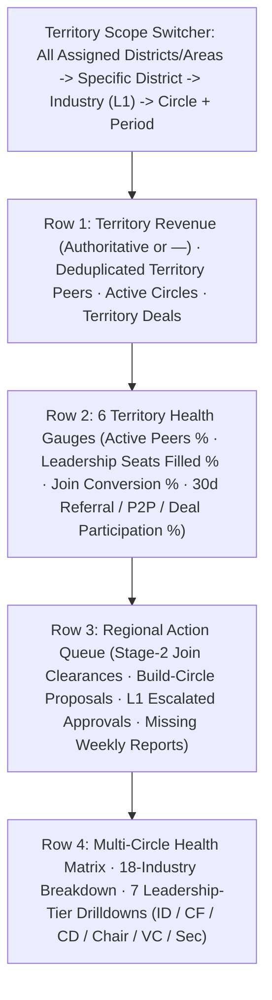

# 36 — District / Regional Executive Director Dashboard

**Document Group:** 06 — Analytics and Role-Wise Dashboards  
**Target Role:** `District Executive Director` (`districtExecDirector` / `ded`) — covering Area, District, and State territorial assignments  
**Related Documents:** [06-complete-role-hierarchy.md](./06-complete-role-hierarchy.md) · [09-organizational-data-scope-matrix.md](./09-organizational-data-scope-matrix.md) · [33-action-center-and-task-management.md](./33-action-center-and-task-management.md) · [35-global-admin-dashboard.md](./35-global-admin-dashboard.md) · [41-master-reporting-and-metrics-reference.md](./41-master-reporting-and-metrics-reference.md)

---

## 1. Architectural Bridge: `/api/v1/leader/*` vs `/api/v1/ded/*` & Territory Scope Rule

### 1.1 Dual API Stack Reconciliation (`Enhance, Never Duplicate`)
**FACT:** The Laravel 12 backend currently contains **two separate API families** built for District Executive Directors:
1. **`/api/v1/leader/*` (`routes/leader.php`, `auth:sanctum` + `leader.user`)**: Authenticates `App\Models\User` tokens and powers the Flutter Leadership App (`LeaderDashboardService`, `LeaderTeamsService`, `LeaderFinanceService`, `LeaderReportsService`, `PendingRequestAdminController`).
2. **`/api/v1/ded/*` (`[routes/api.php](file:///c:/Users/malic/OneDrive/Documents/GitHub/unity-app-new/routes/api.php#L465-L554)`, `auth:sanctum` + `ensure.ded.api`)**: Authenticates **`App\Models\AdminUser`** tokens (`DedAuthController`) and exposes rich district health scores, 4 KPI drilldowns (`active-members`, `leadership-spots`, `membership-conversion`, `referral-activity`), 18-industry breakdowns, and **7 role-tier drilldowns** (`/ded/leadership/{industry-directors,founders,directors,chairs,vice-chairs,secretaries,members}`) implemented in `[DistrictAnalyticsService.php](file:///c:/Users/malic/OneDrive/Documents/GitHub/unity-app-new/app/Services/Api/Ded/DistrictAnalyticsService.php#L29-L1305)`.

**CRITICAL FINDING (`Implemented but Not Integrated`):** Because Flutter Leadership App sessions hold an `App\Models\User` Sanctum token (`EnsureLeaderUser` rejects `AdminUser`, whereas `EnsureDedApiAccess` rejects `User`!), a DED logged into the Flutter Leadership App **cannot call `/api/v1/ded/*` today** (`403 Forbidden`), leaving `DistrictAnalyticsService`'s rich health scores and 7 leadership-tier drilldowns completely unreachable from the mobile app!

**RECOMMENDATION:** Do **NOT** rewrite `DistrictAnalyticsService` and do **NOT** create a second login flow. Update `DistrictScopeService` / `DistrictAnalyticsService` to accept a resolved Territory Scope DTO (from either `AdminUser` or `User` via `OrganizationalScopeService`), and expose `DistrictAnalyticsService`'s health scores and leadership-seat drilldowns under `/api/v1/leader/district/*` (guarded by `leader.can:regional_data`) or allow `EnsureDedApiAccess` to resolve the linked `User` ↔ `AdminUser` assignment safely.

### 1.2 Executive Director Territorial Scope Rule (Area / District / State)
**FACT:** On the public framework (`/leadership`), Stage 005 "Regional Builder" spans **Area → District → State → Country**, whereas `UserRoleResolverService` defines `districtExecDirector` and `countryDirector`, and `[OrganizationalScopeService.php](file:///c:/Users/malic/OneDrive/Documents/GitHub/unity-app-new/app/Shared/OrganizationalScope/OrganizationalScopeService.php)` already supports `area` (`city_ids`), `district` (`district_ids`), `state` (`state_names`), and `country`!
- **Hard Rule:** Preserve existing backend role keys (`districtExecDirector`, `ded`). Never infer territory size from the role title; resolve the exact assigned `city_ids` (Area), `district_ids` (District — note `LeaderPermissionService.php:526` bug that only reads a **single** `.value('district_id')` instead of `.pluck('district_id')` for multi-district DEDs!), or `state_names` (State) from `user_organizational_assignments` + `admin_ded_districts` + `circles.ded_user_id`.
- **CRITICAL IDOR Fix Required (`P0`):** In `[LeaderTeamsService::resolveDedDistrictId()](file:///c:/Users/malic/OneDrive/Documents/GitHub/unity-app-new/app/Leader/Services/LeaderTeamsService.php#L28-L40)`, lines 30–31 execute `if ($districtId && Str::isUuid($districtId)) { return $districtId; }` **before** verifying `$user`'s assigned districts — allowing any DED to pass `?district_id=<other_district_uuid>` and read another DED's entire territory! Intersect every requested `district_id` and `circle_id` with the DED's authorized scope set (`403` on mismatch).

---

## 2. DED Dashboard Architecture & Hierarchy View

---

## 3. Complete 8-Question Audit Specification for Every DED Metric & Report (Prompt §15)

### Metric D-01: Territory Health Scores (6-Gauge Executive Strip)
1. **Who can access it?** `districtExecDirector` (`ded`) for assigned Area/District/State (and `countryDirector` / `superAdmin` when drilling into a district) via `can_view_regional_scope` (`regional_data`).
2. **What data is included?** Six percentage health indicators already implemented in `[DistrictAnalyticsService::getHealthScores()](file:///c:/Users/malic/OneDrive/Documents/GitHub/unity-app-new/app/Services/Api/Ded/DistrictAnalyticsService.php#L29-L150)`:
   - `active_members_pct`: Active eligible Peers ÷ Total scoped Peers.
   - `leadership_filled_pct`: Chartered Circles with approved Core Leadership assigned ÷ Total scoped Circles.
   - `membership_conversion_pct`: Converted paid `circle_join_requests` (`status IN ('paid','circle_member')`) ÷ Total scoped `circle_join_requests`.
   - `referral_activity_pct`, `meeting_activity_pct`, `business_deal_activity_pct`: Distinct scoped Peers who logged `>= 1` referral / P2P meeting / business deal in trailing 30 days ÷ Total deduplicated scoped Peers.
3. **Which records are excluded?** Soft-deleted Circles/Users/Activities; Peers outside assigned `district_ids`/`city_ids`; unapproved/rejected `circle_members`.
4. **How is it calculated?**
   - *Current (`Requires Enhancement`):* `DistrictAnalyticsService::getHealthScores()` (`L58-73`) checks `has_chair >= 1 && has_vc >= 1 && has_sec >= 1` on `circle_members` (ignoring `circles.circle_director_user_id` and `circles.calendar.leadership` JSON!) and counts `distinct('from_user_id')` on referrals/deals (excluding receivers).
   - *Corrected Authoritative Formula:* Check leadership seats across **both** `circles` leader columns/`calendar` JSON (`CD` + `Chair` + `VC` + `Secretary`) and `circle_members` (`status = 'approved'`); divide active 30-day unique contributors by **deduplicated eligible Territory Peers**.
5. **What is the time period?** Point-in-time for `active_members_pct` & `leadership_filled_pct`; trailing 30 days (or selected `timeframe`) for conversion and activity participation rates.
6. **What is the authoritative source?** `circles`, `circle_members`, `circle_join_requests`, `referrals`, `p2p_meetings`, `business_deals`.
7. **Which API provides it?** Currently `GET /api/v1/ded/dashboard` & `GET /api/v1/ded/drilldowns/{active-members|leadership-spots|membership-conversion|referral-activity}` (`DedDashboardController`); bridge into `GET /api/v1/leader/dashboard/metrics` (or `/api/v1/leader/district/health`) for `User` tokens.
8. **Does the API enforce the correct scope?** **Yes on `/api/v1/ded/*`** (`DistrictScopeService` enforces `admin_ded_districts`), **but `EnsureDedApiAccess` blocks `User` tokens** and `AdminCircleScope::$cachedCircleIds` (`L184`) has a static cross-admin cache bug under persistent workers.

---

### Metric D-02: Deduplicated Territory Peers & Circle Coverage (`total_peers`, `total_circles`, `industries_count`)
1. **Who can access it?** `districtExecDirector` (`regional_data`, `access_teams`).
2. **What data is included?** Total active Circles in assigned district(s)/cities, distinct L1 industries represented (`circle_category_mappings`), and **deduplicated** eligible Peers across all Circles in territory.
3. **Which records are excluded?** Soft-deleted/archived Circles; visitors; rejected/pending joiners; duplicate counts of `multi_circle_peer`s who belong to two Circles in the same District.
4. **How is it calculated?**
   - `total_circles`: `COUNT(DISTINCT circles.id)` where `circles.district_id IN $assignedDistrictIds` OR `circles.ded_user_id = $user->id`.
   - `unique_territory_peers`: `COUNT(DISTINCT circle_members.user_id)` where `circle_id IN $scopedCircleIds` AND `circle_members.status = 'approved'` AND `circle_members.deleted_at IS NULL` (note: `DistrictScopeService` also includes non-circle `users` matching `users.district_id` — separate `"Circle Peers"` vs `"All Territory Unity Peers"` explicitly!).
5. **What is the time period?** Point-in-time + period net growth (`timeframe`).
6. **What is the authoritative source?** `circles`, `circle_members`, `users`, `admin_ded_districts`, `circle_category_mappings`.
7. **Which API provides it?** `GET /api/v1/leader/teams/summary`, `GET /api/v1/leader/teams/circles`, `GET /api/v1/leader/teams/industries`, and `GET /api/v1/ded/dashboard`.
8. **Does the API enforce the correct scope?** **No (`Implemented but Incorrect` on `/api/v1/leader/*`).** `LeaderTeamsService::resolveDedDistrictId()` (`L30`) has a `?district_id=<uuid>` IDOR, `LeaderPeersService::listPeers()` (`L288`) has a `?scope=global` bypass, and `LeaderPermissionService::resolveManagedCircles()` (`L526`) only loads a single district ID instead of all rows in `admin_ded_districts`.

---

### Metric D-03: Territory Authoritative Revenue, Collections & Milestones (`total_revenue`, `revenue_contribution`, `milestones`)
1. **Who can access it?** `districtExecDirector` (`access_finance`, `manage_finance`, `track_milestones`, `can_export_financial_data`).
2. **What data is included?** Authoritative `payments` (`circle_id IN $scopedCircleIds` and verified status), active `circle_subscriptions.amount` (`DistrictAnalyticsService::getRevenueCount`, `L280-296`), `finance_leader_tenures` (`role_code = 'DED'`), and `finance_leader_bonus_awards`.
3. **Which records are excluded?** Synthetic `5%` of `business_deals` (`LeaderDashboardService.php:733`), cross-district payments pulled in by `orWhereHas('user.circleMembers')` (`LeaderFinanceService.php:77`), global `circle_budget` wallet sums (`LeaderFinanceService.php:339`), and unverified offline entries. If authoritative district payment attribution is unavailable, display **`—` (`Unavailable`)**.
4. **How is it calculated?**
   - *Authoritative Territory Revenue:* `SUM(payments.base_amount)` where `payments.circle_id IN $scopedCircleIds` AND `LOWER(payments.status) IN ('paid','success','completed','captured')` within `timeframe` (reconciled with `CircleSubscription::whereIn('circle_id', $scopedCircleIds)->where('status', 'active')->sum('amount')`).
5. **What is the time period?** Monthly trend (`YYYY-MM`) + selected `timeframe`.
6. **What is the authoritative source?** `payments`, `circle_subscriptions`, `finance_ledger_transactions`, `finance_leader_tenures`, `finance_leader_bonus_awards`.
7. **Which API provides it?** `GET /api/v1/leader/finance/metrics`, `GET /api/v1/leader/finance/transactions`, `GET /api/v1/ded/dashboard`.
8. **Does the API enforce the correct scope?** **No (`Implemented but Incorrect`).** `LeaderFinanceService` leaks global `circle_budget` when `?circle_id` is omitted (`L339`), allows arbitrary `?circle_id=<uuid>` IDOR, and double-counts multi-circle users via `orWhereHas`.

---

### Metric D-04: 7-Tier District Leadership Roster & Performance Drilldowns
1. **Who can access it?** `districtExecDirector` (`regional_data`, `access_teams`).
2. **What data is included?** Paginated roster + performance summary (`total_count`, `circles_covered`, `members_managed`, `revenue_contribution` from active `circle_subscriptions`, P2P/referral/deal counts) across all 7 roles in territory: **Industry Directors, Circle Founders, Circle Directors, Chairs, Vice Chairs, Secretaries, and Peers**.
3. **Which records are excluded?** Leaders and Circles outside the DED's assigned districts; unapproved/expired leadership assignments.
4. **How is it calculated?** Queries `circles` leader FKs + `circle_members` (`status = 'approved'`) scoped via `DedScopeService::applyCirclesScope($circleSubquery, $admin)` (`[DistrictAnalyticsService.php](file:///c:/Users/malic/OneDrive/Documents/GitHub/unity-app-new/app/Services/Api/Ded/DistrictAnalyticsService.php#L1042-L1305)`). *(Enhancement: include `circles.calendar.leadership` JSON committee chairs so all 3 Committee Chairs appear accurately).*
5. **What is the time period?** Active assignments + optional `?date_from` & `?date_to` for activity/subscription aggregates.
6. **What is the authoritative source?** `circles`, `circle_members`, `user_organizational_assignments`, `circle_subscriptions`, `referrals`, `p2p_meetings`, `business_deals`.
7. **Which API provides it?** `GET /api/v1/ded/leadership/{industry-directors|founders|directors|chairs|vice-chairs|secretaries|members}` (all 7 verified in `[routes/api.php](file:///c:/Users/malic/OneDrive/Documents/GitHub/unity-app-new/routes/api.php#L489-L495)`).
8. **Does the API enforce the correct scope?** **Yes** (`DedScopeService` enforces district scope), **but `Implemented but Not Integrated` with Flutter Leadership App** due to the `AdminUser` vs `User` guard split (`ensure.ded.api`).

---

### Metric D-05: District Circle Report Compliance, Attendance & Regional Pending Approvals
1. **Who can access it?** `districtExecDirector` (`view_reports`, `can_review_pending_peers`, `can_export_peer_data`).
2. **What data is included?**
   - Submitted vs Missing `leader_reports` per Circle in territory (`attendance_percentage`, highlights, challenges, PDF download).
   - Stage-2 Circle Join Clearances (`pending_id_approval` / `/ded-approve`), Build-Your-Own-Circle requests in district, Visitor Registrations, Cross-Circle Event Join Requests, Coin Claims, Pending Impacts, and L1 SLA-escalated Circle items (`> 48h`).
   - All-Circles Territory Report Roster (deduplicated unique Peers + Circle memberships array) and Activity CSV export (`GET /activities/export`).
3. **Which records are excluded?** Global admin queues (`account_deletion_requests`, national `ad_booking_requests`), Circles outside territory, and fabricated `LeaderReportsService::submitReport` fallback numbers (`94.5%`, `'₹18.5L'`, `'₹24.0L'` at `L157-179`).
4. **How is it calculated?** Exact counts from `PendingRequestAdminController` (`resolveLeaderScope`) + `circles LEFT JOIN leader_reports ON period` compliance ratio (`submitted_circles / total_active_circles`).
5. **What is the time period?** Weekly / Monthly reporting period + real-time pending queue.
6. **What is the authoritative source?** `leader_reports`, `circle_join_requests`, `user_circle_requests`, `visitor_registrations`, `event_registration_requests`, `coin_claim_requests`, `impacts`.
7. **Which API provides it?** `GET /api/v1/leader/reports`, `GET /api/v1/leader/pending-requests`, `GET /api/v1/ded/reports/{referrals|activities|coins|pending-requests}`.
8. **Does the API enforce the correct scope?** **Partial (`Implemented but Incorrect` on Reports).** `PendingRequestAdminController` scopes DED requests, but `LeaderReportsService::listReports` (`L48-49`) has a `?circle_id=<uuid>` bypass and `downloadReportPdf` (`L429`) omits `$user` completely.
