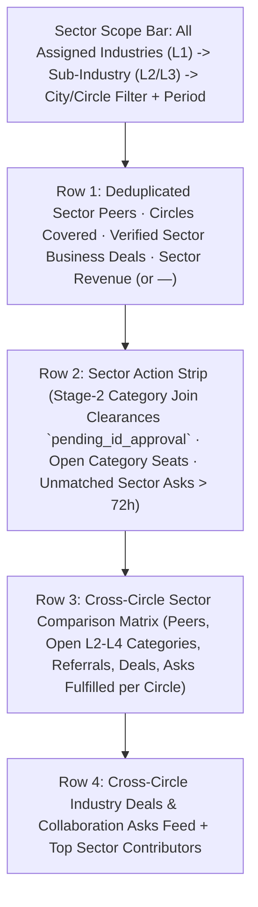

# 37 — Industry Director Sector Dashboard

**Document Group:** 06 — Analytics and Role-Wise Dashboards  
**Target Role:** `Industry Director` (`industryDirector` / `industry_director` — Stage 004 City/Vertical Sector Owner)  
**Related Documents:** [06-complete-role-hierarchy.md](./06-complete-role-hierarchy.md) · [09-organizational-data-scope-matrix.md](./09-organizational-data-scope-matrix.md) · [31-master-actionable-notification-catalogue.md](./31-master-actionable-notification-catalogue.md) · [33-action-center-and-task-management.md](./33-action-center-and-task-management.md) · [41-master-reporting-and-metrics-reference.md](./41-master-reporting-and-metrics-reference.md)

---

## 1. Industry Director Governance Model & L1–L4 Category Scope Architecture

### 1.1 Official Role & Capability Profile
**FACT:** In `[UserRoleResolverService.php](file:///c:/Users/malic/OneDrive/Documents/GitHub/unity-app-new/app/Shared/Services/UserRoleResolverService.php#L22)` and `[LeaderPermissionService.php](file:///c:/Users/malic/OneDrive/Documents/GitHub/unity-app-new/app/Leader/Services/LeaderPermissionService.php#L156-L166)`, `industryDirector` (rank `85` in `UserRoleResolverService`, `70` in `LeaderPermissionService`) holds **7 default capabilities**:
- **Enabled (`7`):** `access_dashboard`, `access_teams`, `access_finance`, `regional_data`, `view_peers`, `request_actions`, `view_reports` (plus `can_review_pending_peers = true`, `can_export_peer_data = true`, `can_view_regional_scope = true`).
- **Disabled (`6`):** `manage_peers` (`false` — cannot edit Peer PII or delete Peer posts), `track_milestones` (`false` by default; toggleable in `finance_bonus_role_configs` for `ID`), `manage_finance` (`false`), `coin_payouts` (`false`), `manage_roles` (`false`), `system_configs` (`false`).

### 1.2 L1–L4 Category Hierarchy & Verified Scope Bugs
**FACT:** Peers Global organizes business categories into a 4-level taxonomy (`circle_categories`: `L1` Macro Industry → `L2` Sub-Industry → `L3` Specialization → `L4` Micro-Category), linked to Circles via `circle_category_mappings` and `circles.industry_tags`, and to Peers via `circle_members.level_1_category_id..level_4_category_id`, `joined_circle_categories`, and `users.main_business_category_id` / `business_category_id`. `IndustryDirectorScopeService` resolves assigned L1 `industry_id`s from `industry_director_assignments` (`admin_user_id`, `industry_id`, `is_active = true`) down through L2–L4 descendant categories.

**Verified Scope & Schema Bugs (`Implemented but Incorrect`):**
1. **`industry_director_assignments` Missing `user_id` Column:** `[industry_director_assignments.sql](file:///c:/Users/malic/OneDrive/Documents/GitHub/unity-app-new/database/sql/industry_director_assignments.sql)` keys assignments by `admin_user_id` (`bigint`/`uuid` FK to `admin_users`), whereas mobile Leadership App sessions authenticate `App\Models\User`! If an Industry Director's `users.email` does not match an `admin_users` row, `IndustryDirectorScopeService::assignedIndustryIdsForAdmin()` returns `[]`, causing `[LeaderDashboardService.php](file:///c:/Users/malic/OneDrive/Documents/GitHub/unity-app-new/app/Leader/Services/LeaderDashboardService.php#L158-L203)` to fall back to the leader's personal `users.main_business_category_id`!
2. **Substring `LIKE '%$indId%'` False-Positive Bug (`P1` Scope Leak):** `[LeaderPermissionService::resolveManagedCircles()](file:///c:/Users/malic/OneDrive/Documents/GitHub/unity-app-new/app/Leader/Services/LeaderPermissionService.php#L558)` matches `circles.industry_tags LIKE "%{$indId}%"` — so an Industry Director assigned to Industry ID `1` accidentally matches Industry IDs `10`, `11`, `12`..`19`, `21`, etc.! Must use PostgreSQL JSONB containment (`whereJsonContains('industry_tags', $indId)`).
3. **Circle-Wide vs Sector-Peer Confusion:** In a general (multi-industry) Circle, `circle_category_mappings` may include `"Technology"` (1 Peer) alongside 35 Peers in Construction, Retail, and Finance. Currently, once a Circle is in `$scopedCircleIds`, `LeaderDashboardService` includes **all 36 Peers** in that Circle rather than distinguishing **(a) Sector Peers across Circles** (Peers in L1–L4 categories) from **(b) Industry-Dedicated Circles** (`circles.industry_director_user_id = $user->id`)!
   - **Zero-Leakage Rule:** An Industry Director's Peer Directory, Peer 360°, Stage-2 Join Approvals (`pending_id_approval`), and Sector KPIs MUST scope to Peers whose L1–L4 category falls within `$assignedCategoryTreeIds` (plus Circles where the user is explicitly assigned `circles.industry_director_user_id`), and must **never** expose unrelated categories' private Circle join applications or unrelated Circles via `?circle_id=<uuid>` IDOR.

---

## 2. Industry Director Dashboard Layout & Modules

---

## 3. Complete 8-Question Audit Specification for Every Industry Metric & Report (Prompt §15)

### Metric I-01: Deduplicated Sector Peers & L1–L4 Category Seat Occupancy
1. **Who can access it?** `industryDirector` (`view_peers`, `access_teams`, `regional_data`), plus `districtExecDirector` / `countryDirector` / `superAdmin` when filtering by industry.
2. **What data is included?**
   - `unique_sector_peers`: Distinct active Peers (`COUNT(DISTINCT users.id)`) holding an approved L1–L4 category seat (`circle_members.level_1_category_id..level_4_category_id IN $assignedCategoryIds` with `status = 'approved'`) or belonging to an Industry-specific Circle (`circles.industry_director_user_id = $user->id`).
   - `open_vs_occupied_subcategories`: Count of occupied vs open L2–L4 subcategories across Circles in the Industry Director's city/region (`CircleCategoryUsageController` / `LeaderTeamsService::getSubIndustries`).
3. **Which records are excluded?** Soft-deleted users/circles; `pending`/`rejected` join requests; Peers in unrelated L1 industries who happen to sit in the same multi-industry Circle; duplicate counts of `multi_circle_peer`s holding the same industry seat in two Circles.
4. **How is it calculated?**
   - `unique_sector_peers = COUNT(DISTINCT cm.user_id)` where `cm.status = 'approved'` AND `cm.deleted_at IS NULL` AND (`cm.level_1_category_id IN $l1Ids` OR `cm.level_2_category_id IN $l2Ids` OR `cm.level_3_category_id IN $l3Ids` OR `cm.level_4_category_id IN $l4Ids` OR `c.industry_director_user_id = $user->id`).
5. **What is the time period?** Point-in-time active occupancy + net new sector Peers onboarded in `timeframe`.
6. **What is the authoritative source?** `industry_director_assignments`, `circle_categories`, `circle_category_mappings`, `circle_members`, `circles`.
7. **Which API provides it?** `GET /api/v1/leader/dashboard/metrics`, `GET /api/v1/leader/teams/industries`, `GET /api/v1/leader/teams/circles/{id}/sub-industries`, and Web Admin `/admin/industry-director/*` (`IndustryDirectorDashboardController`).
8. **Does the API enforce the correct scope?** **No (`Implemented but Incorrect`).** `LeaderPermissionService.php:558` uses buggy substring `LIKE '%$indId%'`, `getSubIndustries` (`LeaderTeamsService.php:1322-1327`) has zero scope check (and falls back to `Circle::first()`!), and `LeaderPeersService::listPeers` allows `?scope=global` bypass.

---

### Metric I-02: Stage-2 Category Classification & Join Clearances (`pending_id_approval`)
1. **Who can access it?** `industryDirector` (`can_review_pending_peers`), co-governed with `districtExecDirector`.
2. **What data is included?** All `circle_join_requests` currently at `status = 'pending_id_approval'` (after Stage-1 Circle Director approval) where `level1_category_id..level4_category_id` maps to the Industry Director's assigned industries or `circles.industry_director_user_id = $user->id`, plus conversion turnaround time (`id_approved_at - cd_approved_at`).
3. **Which records are excluded?** Stage-1 requests still awaiting Circle Director (`pending_cd_approval` — shown as read-only pipeline count, not actionable until CD approves), and join requests for unrelated L1 industries.
4. **How is it calculated?** `COUNT(*)` of `circle_join_requests` where `status = 'pending_id_approval'` within assigned L1–L4 scope.
5. **What is the time period?** Real-time pending queue + historical approval/rejection counts within `timeframe`.
6. **What is the authoritative source?** `circle_join_requests` (`CircleJoinRequestService`).
7. **Which API provides it?** `GET /api/v1/leader/pending-requests?category=circle_joining_requests`, `GET /api/v1/leader/pending-requests/summary`, `POST /api/v1/leader/pending-requests/circle_joining_requests/{id}/approve|reject`.
8. **Does the API enforce the correct scope?** **Yes (Partially).** `PendingRequestAdminController` filters `circle_joining_requests` to `pending_id_approval` for Industry Directors and enforces `resolveLeaderScope()`, though `user_organizational_assignments` (`industry_id`) must be unified with `industry_director_assignments`.

---

### Metric I-03: Intra-Sector & Cross-Circle Business Deals, Referrals & Collaboration Asks
1. **Who can access it?** `industryDirector` (`access_dashboard`, `request_actions`).
2. **What data is included?**
   - Verified `business_deals` (`SUM(deal_amount)` & `COUNT(*)`) where `from_user_id` or `to_user_id` is an approved Sector Peer, segmented into **Intra-Circle** vs **Cross-Circle Sector Collaborations** (`giver_circle_id != receiver_circle_id`).
   - `referrals` given/received by Sector Peers and open category nominations (`POST /teams/circles/{id}/refer-category`).
   - Unified `asks` (`collaboration`, `referral`, `help`) posted by Sector Peers or targeting the Industry Director's `industry_id` (`collaboration_posts.industry_id` / `ask_answers`), highlighting unmatched `published` Asks older than `72h`.
3. **Which records are excluded?** Soft-deleted records, `draft` Asks, fabricated `60%/25%/15%` Ask splits (`LeaderDashboardService.php:784-786`), and deals/asks with zero nexus to the assigned industry.
4. **How is it calculated?**
   - `sector_deals_value = SUM(business_deals.deal_amount)` deduplicated by `business_deals.id` where `from_user_id IN $sectorPeerIds OR to_user_id IN $sectorPeerIds`.
   - `real_asks_by_status = COUNT(DISTINCT asks.id) GROUP BY asks.status` for `$sectorPeerIds` + industry-targeted Asks.
5. **What is the time period?** Filtered by `timeframe` (`deal_date`, `referral_date`, `published_at`).
6. **What is the authoritative source?** `business_deals`, `referrals`, `circle_peer_referrals`, `asks`, `ask_responses`.
7. **Which API provides it?** `GET /api/v1/leader/dashboard/metrics`, `GET /api/v1/leader/business-deals`, `GET /api/v1/leader/referrals`, `GET /api/v1/leader/asks/summary`.
8. **Does the API enforce the correct scope?** **Partial (`Implemented but Incorrect` on Asks).** `LeaderActivitiesService` scopes deals/referrals to `$scopedPeerIds`, whereas `LeaderAskFlowService` (`GET /leader/asks/summary`) is completely unscoped globally.

---

### Metric I-04: Sector Authoritative Revenue & Industry Director Tenure Milestones
1. **Who can access it?** `industryDirector` (`access_finance`, and `track_milestones` when enabled for `ID`).
2. **What data is included?**
   - **Industry-Dedicated Circle Revenue:** Verified `payments` / active `circle_subscriptions` strictly for Circles where `circles.industry_director_user_id = $user->id` (or Sector Peer `circle_join_fee` / `circle_subscriptions` explicitly attributed to the Sector Peer's `circle_member` seat).
   - **Personal ID Tenure & Bonus Progress:** Active `finance_leader_tenures` (`role_code = 'ID'`) and `finance_leader_bonus_awards` (where `finance_bonus_role_configs` is activated for `ID`).
3. **Which records are excluded?** Synthetic `5%` of `business_deals` (`LeaderDashboardService.php:733`), `(circle_price ?? 120000) * peers` (`LeaderTeamsService.php:478`), `orWhereHas` payments of unrelated Peers in multi-industry Circles, and global `circle_budget` sums (`LeaderFinanceService.php:339`). **Authoritative Finance Rule:** Where per-category payment attribution is not stored on `payments`, display **`—` (`Unavailable`)** rather than attributing an entire multi-industry Circle's revenue to one Industry Director!
4. **How is it calculated?**
   - For Industry-dedicated Circles: `SUM(payments.base_amount)` where `circle_id IN $industryOwnedCircleIds` AND verified paid status.
   - For cross-circle Sector Peers: `SUM(circle_subscriptions.amount)` joined to `circle_members` where `circle_members.level_1_category_id IN $l1Ids` AND `circle_subscriptions.status = 'active'` (or `null` → `—` if unavailable).
5. **What is the time period?** Selected `timeframe` + active tenure window (`counting_started_at..deadline_at`).
6. **What is the authoritative source?** `payments`, `circle_subscriptions`, `finance_leader_tenures`, `finance_leader_bonus_awards`.
7. **Which API provides it?** `GET /api/v1/leader/finance/metrics` and `GET /api/v1/leader/finance/milestones`.
8. **Does the API enforce the correct scope?** **No (`Implemented but Incorrect`).** Today `LeaderFinanceService` attributes 100% of every payment in any Circle touched by `$targetCircleIds` (plus global `circle_budget`), grossly overstating revenue for an Industry Director in multi-industry Circles, and `resolveCapabilitiesFromDynamicRbac()` silently drops `track_milestones`.

---

### Metric I-05: Sector Reports & Deduplicated Sector Peer Export
1. **Who can access it?** `industryDirector` (`view_reports`, `can_submit_reports`, `can_export_peer_data`).
2. **What data is included?** Sector performance reports (`leader_reports` for assigned Circles / Sector summary), deduplicated Sector Peer roster (`unique_peers` vs `qualifying_memberships`), and scoped Sector Activity CSV export (`GET /api/v1/leader/activities/export`).
3. **Which records are excluded?** Reports and Peers from unassigned industries; incomplete All-Circles rosters; fabricated default report strings (`LeaderReportsService.php:157-179`).
4. **How is it calculated?** Deduplicated by `users.id` across `$sectorPeerIds` with `memberships[]` array listing each Peer's Circle and L1–L4 category.
5. **What is the time period?** Weekly / Monthly / Quarterly `period` filter.
6. **What is the authoritative source?** `leader_reports`, `users`, `circle_members`, `circle_categories`.
7. **Which API provides it?** `GET /api/v1/leader/reports`, `POST /api/v1/leader/reports/submit`, `GET /api/v1/leader/reports/roster`, `GET /api/v1/leader/activities/export`.
8. **Does the API enforce the correct scope?** **No (`Implemented but Incorrect`).** `LeaderReportsService::listReports` (`L48`) and `downloadReportPdf` (`L429`) allow cross-circle IDORs, and `submitReport` (`L118`) assigns the first random Circle in PostgreSQL when `circle_id` is omitted!
