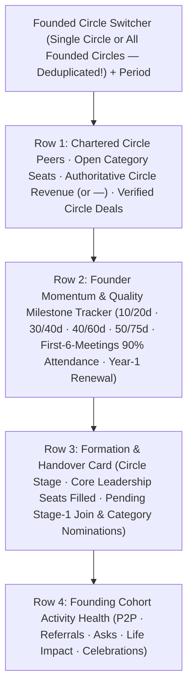

# 38 — Circle Founder Dashboard & Charter Growth Analytics

**Document Group:** 06 — Analytics and Role-Wise Dashboards  
**Target Role:** `Circle Founder` (`circleFounder` / `circle_founder` / `founder`)  
**Related Documents:** [06-complete-role-hierarchy.md](./06-complete-role-hierarchy.md) · [07-role-wise-responsibilities.md](./07-role-wise-responsibilities.md) · [33-action-center-and-task-management.md](./33-action-center-and-task-management.md) · [39-circle-director-dashboard.md](./39-circle-director-dashboard.md) · [41-master-reporting-and-metrics-reference.md](./41-master-reporting-and-metrics-reference.md)

---

## 1. Circle Founder Role Identity, Scope & Verified Code Quirks

### 1.1 Official Role & Capability Profile
**FACT:** On the public Peers Global leadership framework (`/leadership/circle-founder`), **Circle Founder** ("creates the possibility — Role 03 of 05", outside the numbered 6-stage ladder) charters a new Circle, recruits founding Peers across open business categories, establishes early attendance culture across the first 6 meetings, and collaborates with / hands over monthly operational governance to the **Circle Director**.
- In `[UserRoleResolverService.php](file:///c:/Users/malic/OneDrive/Documents/GitHub/unity-app-new/app/Shared/Services/UserRoleResolverService.php#L25)` (rank `50`) and `[LeaderPermissionService.php](file:///c:/Users/malic/OneDrive/Documents/GitHub/unity-app-new/app/Leader/Services/LeaderPermissionService.php#L143-L154)` (rank `60`), `circleFounder` holds **8 default capabilities**:
  - **Enabled (`8`):** `access_dashboard`, `access_teams`, `access_finance`, `track_milestones`, `view_peers`, `manage_peers`, `request_actions`, `view_reports` (plus `can_review_pending_peers = true`, `can_assign_circle_chair = true`, `can_submit_reports = true`, `can_export_peer_data = true`).
  - **Disabled (`5`):** `regional_data` (`false`), `manage_finance` (`false`), `coin_payouts` (`false`), `manage_roles` (`false`), `system_configs` (`false`).

### 1.2 Verified Backend & UI Bugs Specific to Circle Founders
1. **Own-Circle Scope Contamination Bug (`Implemented but Incorrect`):**
   - **FACT:** `[LeaderPermissionService::resolveManagedCircles()](file:///c:/Users/malic/OneDrive/Documents/GitHub/unity-app-new/app/Leader/Services/LeaderPermissionService.php#L564-L573)` resolves a Founder's Circles via `founder_user_id` / `circle_founder_user_id`, **AND** `orWhereHas('members', status != 'rejected')` (`L571`). If a Founder of Circle A is also a regular Peer `member` (or `pending` applicant) in Circle B, Circle B is erroneously injected into `managed_circles`! Scope MUST require `circle_members.role IN ('founder','director',...) AND status = 'approved'` or explicit `circles.founder_user_id` / `circle_founder_user_id = $user->id`.
2. **`Global Founder` (`global_founder`) Resolver Bug (`Implemented but Incorrect`):**
   - **FACT:** While `AdminAccess::SUPER_ROLE_KEYS` recognizes `'global_founder'`, `[UserRoleResolverService::normalizeRoleKey()](file:///c:/Users/malic/OneDrive/Documents/GitHub/unity-app-new/app/Shared/Services/UserRoleResolverService.php#L34-L55)` has no branch for `'global_founder'`, returning `is_leader = false` (`403 NOT_A_LEADER`) if the mobile `User` lacks an `AdminUser` fast-path! (`global_founder` maps to Executive/Global stewardship in Doc 35, distinct from `circleFounder`).
3. **`track_milestones` Dropped by Dynamic RBAC (`Implemented but Incorrect`):**
   - **FACT:** `[LeaderPermissionService::resolveCapabilitiesFromDynamicRbac()](file:///c:/Users/malic/OneDrive/Documents/GitHub/unity-app-new/app/Leader/Services/LeaderPermissionService.php#L384-L464)` has **zero mapping** for `track_milestones` — whenever `DynamicRbacSeeder` populates `role_module_access` for `circle_founder`, `track_milestones` is silently stripped from Circle Founders!
4. **Circle Details UI Misbucketing (`Implemented but Incorrect`):**
   - **FACT:** `[circle_leadership_card.dart](file:///D:/office%20project/LeaderApp-Fornt-end-/lib/features/circle_details/view/widgets/circle_leadership_card.dart#L30-L67)` groups `circle.founders` and `circle.directors` under the heading **"Regional Leaders"** with the hardcoded invented designation `"Founder & CEO"`! Circle Founders are Circle-level charter leaders, not regional directors; display actual `users.designation` + `"Circle Founder"`.
5. **Synthetic Circle Revenue Estimate in Teams (`Implemented but Incorrect`):**
   - **FACT:** `[LeaderTeamsService::calculateCircleRevenue()](file:///c:/Users/malic/OneDrive/Documents/GitHub/unity-app-new/app/Leader/Services/LeaderTeamsService.php#L478-L500)` estimates Circle revenue as `($circlePriceAmount ?? 120000) * $approvedPeersCount`! Under the **Authoritative Finance Rule**, never display `price * peers` as revenue — use verified `payments` / `circle_subscriptions` or display **`—` (`Unavailable`)**.

---

## 2. Seeded Circle Founder Bonus & Milestone Rules (`finance_bonus_rules`)

**FACT:** Migration `[2026_11_02_151500_create_finance_leader_bonus_tables.php](file:///c:/Users/malic/OneDrive/Documents/GitHub/unity-app-new/database/migrations/2026_11_02_151500_create_finance_leader_bonus_tables.php#L119-L250)` seeds **6 active bonus rules** specifically enabled for `role_code = 'CF'` (`finance_bonus_role_configs`), tracked per tenure in `finance_leader_bonus_awards`:

| Rule Code | Category | Metric Type | Target & Window | Seeded Reward (`INR` + Perks) |
|---|---|---|---|---|
| `SPEED_10M_20D` | `speed_bonus` | `NEW_MEMBERS_IN_DAYS` | `10` new paid Peers within `20` days | `₹10,000` |
| `CF_SPEED_30M_40D` | `speed_bonus` | `NEW_MEMBERS_IN_DAYS` | `30` paid Peers within `40` days | `₹25,000` |
| `CF_SPEED_40M_60D` | `speed_bonus` | `NEW_MEMBERS_IN_DAYS` | `40` paid Peers within `60` days | `₹40,000` |
| `CF_SPEED_50M_75D` | `speed_bonus` | `NEW_MEMBERS_IN_DAYS` | `50` paid Peers within `75` days | `₹50,000` + *Founder Dinner / Retreat* |
| `CF_QUALITY_ATTENDANCE_90_FIRST6` | `quality_bonus` | `MEETING_ATTENDANCE_RATE` | `90%+` avg attendance across **first 6** Circle meetings (`first_n`) | `₹15,000` + *Award* |
| `QUALITY_RENEWAL_90_YEAR1` | `quality_bonus` | `ANNUAL_RENEWAL_RATE` | `90%+` Peer renewal rate at Year 1 (`365` days) | `₹25,000` + *Award* |

---

## 3. Circle Founder Dashboard Layout & Modules

---

## 4. Complete 8-Question Audit Specification for Every Circle Founder Metric & Report (Prompt §15)

### Metric CF-01: Chartered Circle Strength & Multi-Founded-Circle Deduplicated Peers (`total_peers`)
1. **Who can access it?** `circleFounder` for Circle(s) where they hold an active Founder assignment (`view_peers`, `access_dashboard`).
2. **What data is included?** Approved active `circle_members` (`status = 'approved'`, `deleted_at IS NULL`, `left_at IS NULL`) in the selected founded Circle; when viewing `"All Circles"` (for a Founder who founded `>= 2` Circles), **deduplicated unique Peers (`COUNT(DISTINCT user_id)`)** alongside total qualifying Circle memberships.
3. **Which records are excluded?** `pending`, `rejected`, or `left` rows; event `visitor`s; Peers in Circles where the Founder is only a regular `member`.
4. **How is it calculated?**
   - Single Circle: `COUNT(DISTINCT cm.user_id)` where `cm.circle_id = :circleId AND cm.status = 'approved' AND cm.deleted_at IS NULL`.
   - All Founded Circles: `COUNT(DISTINCT cm.user_id)` across `$foundedCircleIds` (never `SUM(circle.peers_count)`).
5. **What is the time period?** Point-in-time active strength + net paid additions during `timeframe` / since `counting_started_at`.
6. **What is the authoritative source?** `circle_members` + `circles`.
7. **Which API provides it?** `GET /api/v1/leader/dashboard/metrics`, `GET /api/v1/leader/teams/circles/{id}`, `GET /api/v1/leader/teams/circles/{circle_id}/peers`.
8. **Does the API enforce the correct scope?** **No (`Implemented but Incorrect`).** `GET /teams/circles/{id}` and `/peers` have zero scope validation, `GET /peers?scope=global` leaks all platform users, and `resolveManagedCircles()` includes non-leadership Circles.

---

### Metric CF-02: Founder Tenure, Speed & Quality Bonus Progress (`active_tenures`, `milestones`)
1. **Who can access it?** The earning `circleFounder` (`leader_user_id = auth()->id()`, `track_milestones`, `access_finance`), plus `countryDirector` / `superAdmin`.
2. **What data is included?** Active `finance_leader_tenures` (`role_code = 'CF'`) and per-rule progress rows from `finance_leader_bonus_awards` (`current_metric_value`, `target_metric_value`, `progress_percentage`, `deadline_at`, `bonus_amount_inr`, `reward_perks`, `status` ∈ `in_progress|pending_approval|credited|expired|rejected`).
3. **Which records are excluded?** Other leaders' personal bonus awards; hardcoded client fallback `activeTenures ?? 42` (`[finance_model.dart](file:///D:/office%20project/LeaderApp-Fornt-end-/lib/features/finance/model/finance_model.dart)`); legacy generic `FinanceMilestoneConfig` when `finance_leader_bonus_awards` is authoritative.
4. **How is it calculated?**
   - Speed rules (`SPEED_10M_20D`, `CF_SPEED_30M_40D`, `40M_60D`, `50M_75D`): Count distinct paid `circle_members` joined between `counting_started_at` and `deadline_at`.
   - `CF_QUALITY_ATTENDANCE_90_FIRST6`: Mean attendance percentage across the **first 6** completed `circle_meetings` (`attendance_records`).
   - `QUALITY_RENEWAL_90_YEAR1`: Renewed paid Founding Peers at Day 365 ÷ Cohort size eligible for renewal.
5. **What is the time period?** Tenure-specific countdown window (`counting_started_at` → `deadline_at`).
6. **What is the authoritative source?** `finance_leader_tenures`, `finance_bonus_rules`, `finance_bonus_role_configs`, `finance_leader_bonus_awards`.
7. **Which API provides it?** `GET /api/v1/leader/finance/milestones` and `GET /api/v1/leader/finance/metrics`.
8. **Does the API enforce the correct scope?** **Partial (`Implemented but Incorrect`).** `LeaderFinanceService.php:280-288` currently compares `$activePeersCount` against `FinanceMilestoneConfig` rather than reading `finance_leader_bonus_awards` for `$user->id`, and `L319-331` leaks global `active_tenures` if `$targetCircleIds` is empty!

---

### Metric CF-03: Open Business Category Availability & Prospect Pipeline (`sub-industries`, `circle_peer_referrals`)
1. **Who can access it?** `circleFounder` (`access_teams`, `can_review_pending_peers`).
2. **What data is included?** Occupied vs Open L1–L4 business categories in the founded Circle (`171 open / 1 closed` category seats), pending `circle_peer_referrals` / `peer_recommendations` (`POST /teams/circles/{id}/refer-category`), and Stage-1 `circle_join_requests` (`pending_cd_approval`).
3. **Which records are excluded?** Category seats and nominations from unrelated Circles; silent fallback to `Circle::first()` when `circle_id` is invalid (`LeaderTeamsService.php:1325-1327`).
4. **How is it calculated?** Total configured Circle categories minus categories occupied by `circle_members` (`status = 'approved'`, `deleted_at IS NULL`).
5. **What is the time period?** Real-time seat availability + pending pipeline.
6. **What is the authoritative source?** `circle_categories`, `circle_category_mappings`, `circle_members`, `circle_peer_referrals`, `circle_join_requests`.
7. **Which API provides it?** `GET /api/v1/leader/teams/circles/{id}/sub-industries`, `POST /api/v1/leader/teams/circles/{id}/refer-category`, `GET /api/v1/leader/pending-requests`.
8. **Does the API enforce the correct scope?** **No on `sub-industries` & `refer-category` (`Implemented but Incorrect`).** Both endpoints in `LeaderTeamsController` lack `$scopedCircleIds` checks.

---

### Metric CF-04: Authoritative Founded-Circle Revenue & Commission Ledger (`circle_revenue`, `commission_due`)
1. **Who can access it?** `circleFounder` (`access_finance`, `can_view_overall_revenue`).
2. **What data is included?** Verified `payments` (`circle_id IN $foundedCircleIds` and `LOWER(status) IN ('paid','success','completed','captured')`), `finance_wallets` (`wallet_type = 'circle_budget'` for `$foundedCircleIds`), and posted Founder commission entries in `finance_ledger_transactions` (`user_id = $user->id`).
3. **Which records are excluded?**
   - `overall_revenue = $dealsSum * 0.05` (`LeaderDashboardService.php:733`).
   - `(circle_price ?? 120000) * peers` (`LeaderTeamsService.php:478`).
   - Cross-circle payments of multi-circle Peers via `orWhereHas('user.circleMembers')` (`LeaderFinanceService.php:77`).
   - Synthetic `commission_due = collections * 15%` (`LeaderFinanceService.php:302`) when actual `finance_ledger_transactions` / `leader_wallet` exists; if unavailable, display **`—` (`Unavailable`)**.
4. **How is it calculated?** `SUM(payments.base_amount)` where `payments.circle_id IN $foundedCircleIds` AND verified paid status, deduplicated by `payments.id`.
5. **What is the time period?** Monthly trend (`YYYY-MM`) + selected `timeframe`.
6. **What is the authoritative source?** `payments`, `circle_subscriptions`, `finance_ledger_transactions`, `finance_wallets`.
7. **Which API provides it?** `GET /api/v1/leader/finance/metrics` and `GET /api/v1/leader/finance/transactions`.
8. **Does the API enforce the correct scope?** **No (`Implemented but Incorrect`).** Suffers from `orWhereHas` multi-circle over-attribution, unscoped global `circle_budget` (`L339`), and `?circle_id` IDOR.

---

### Metric CF-05: Circle Formation Handover, Attendance & Reports (`leader_reports`, `attendance`)
1. **Who can access it?** `circleFounder` (`view_reports`, `can_submit_reports`, `can_assign_circle_chair`).
2. **What data is included?** Circle stage (`circles.circle_stage` / `status`), assigned Circle Director & Committee Chairs (`circles` FKs + `calendar.leadership`), meeting attendance percentages (`circle_meetings` / `attendance_records` + `leader_reports`), and Circle Report PDFs / Peer roster exports.
3. **Which records are excluded?** Fabricated default attendance `94.5%` and fake revenue strings in `LeaderReportsService::submitReport` (`L157-179`); dummy hardcoded UUID exclusions in client (`ReportModel.isDummyPeer`).
4. **How is it calculated?** Per-meeting `checked_in_approved_peers / total_approved_circle_peers * 100`; All-Founded-Circles roster deduplicated by `users.id`.
5. **What is the time period?** First 6 meetings (formation benchmark) + ongoing Weekly / Monthly periods.
6. **What is the authoritative source?** `circles`, `circle_meetings`, `attendance_records`, `leader_reports`.
7. **Which API provides it?** `GET /api/v1/leader/teams/circles/{id}`, `GET /api/v1/leader/reports`, `POST /api/v1/leader/reports/submit`. *(Note: Chair assignment endpoint is `Missing` in `app/Leader/` despite `can_assign_circle_chair = true`!).*
8. **Does the API enforce the correct scope?** **No (`Implemented but Incorrect`).** `LeaderReportsService` has `?circle_id` list IDOR (`L48`), omitted-circle random assignment (`L118`), and unauthenticated PDF file download (`FileController.php:685`).
