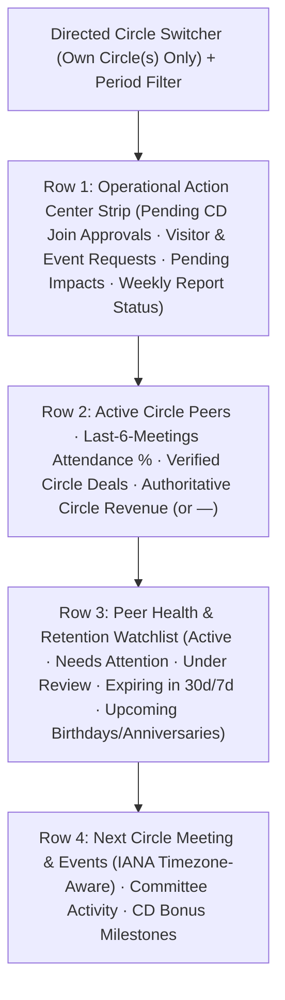

# 39 — Circle Director Operational Dashboard

**Document Group:** 06 — Analytics and Role-Wise Dashboards  
**Target Role:** `Circle Director` (`circleDirector` / `circle_director` / `director` — Stage 003 Monthly Circle Leadership)  
**Related Documents:** [07-role-wise-responsibilities.md](./07-role-wise-responsibilities.md) · [24-member-management-flow.md](./24-member-management-flow.md) · [26-events-and-attendance-flow.md](./26-events-and-attendance-flow.md) · [33-action-center-and-task-management.md](./33-action-center-and-task-management.md) · [41-master-reporting-and-metrics-reference.md](./41-master-reporting-and-metrics-reference.md)

---

## 1. Circle Director Operational Mandate & Verified Capabilities

**FACT:** On the public Peers Global leadership ladder (`/leadership/circle-director`), **Circle Director** occupies **Stage 003 ("Monthly Leadership")** and owns day-to-day Circle health: Stage-1 Peer join vetting, attendance governance & participation standards, Peer retention (`needs_attention` / renewal follow-ups), visitor & cross-circle event clearances, Life Impact verification, Circle committee coordination, and timely Weekly/Monthly Leadership Report submission.

- **Canonical Role Keys:** `circleDirector` (`UserRoleResolverService` rank `60`; `LeaderPermissionService` rank `55`), `roles.key = 'circle_director'`, `circle_members.role = 'director'`.
- **Default Capabilities (`8` in `[LeaderPermissionService.php](file:///c:/Users/malic/OneDrive/Documents/GitHub/unity-app-new/app/Leader/Services/LeaderPermissionService.php#L143-L154)`):** `access_dashboard`, `access_teams`, `access_finance`, `track_milestones`, `view_peers`, `manage_peers`, `request_actions`, `view_reports` (`can_review_pending_peers = true`, `can_add_edit_peer = true`, `can_assign_circle_chair = true`, `can_submit_reports = true`, `can_export_peer_data = true`).
- **Seeded Circle Director Bonus Rules (`[2026_11_02_151500_create_finance_leader_bonus_tables.php](file:///c:/Users/malic/OneDrive/Documents/GitHub/unity-app-new/database/migrations/2026_11_02_151500_create_finance_leader_bonus_tables.php#L120-L249)`):**
  1. `CD_SPEED_10M_10D`: `10` new paid Peers in `10` days → `₹25,000`
  2. `SPEED_10M_20D`: `10` new paid Peers in `20` days → `₹10,000`
  3. `CD_QUALITY_ATTENDANCE_90_LAST6`: `90%+` average attendance in **last 6** Circle meetings (`last_n`) → `₹15,000`
  4. `QUALITY_RENEWAL_90_YEAR1`: `90%+` annual renewal rate at Year 1 → `₹25,000` + *Award*

### 1.1 Critical Bugs Impacting the Circle Director Experience
1. **Unrouted Peer Edit & Chair Assignment (`Implemented but Not Integrated` / `Missing`):**
   - `can_add_edit_peer` is `true`, and `[LeaderPeersController::update()](file:///c:/Users/malic/OneDrive/Documents/GitHub/unity-app-new/app/Leader/Controllers/LeaderPeersController.php#L183-L261)` exists, **but zero `PUT/PATCH /peers/{id}` route is registered in `routes/leader.php`**!
   - `can_assign_circle_chair` is `true`, **but zero Chair/Committee assignment endpoint exists in `app/Leader/`**!
2. **Membership Status vs Peer Health Status Vocabulary Conflict (`Implemented but Incorrect`):**
   - PostgreSQL `circle_members.status` uses `circle_member_status_enum` (`'pending'`, `'approved'`, `'rejected'`, plus manual DDL `'needs_attention'`, `'under_review'`), whereas `GET /leader/peers` computes display health strings (`'Active'`, `'Needs Attention'`, `'At Risk'`, `'Pending'`). Because `[LeaderMemberController::flagStatus()](file:///c:/Users/malic/OneDrive/Documents/GitHub/unity-app-new/app/Leader/Controllers/LeaderMemberController.php#L395-L455)` writes `'needs_attention'` / `'under_review'` directly into `circle_members.status`, flagging an approved Peer **overwrites `status = 'approved'`**, which can accidentally drop that Peer out of queries filtering `WHERE circle_members.status = 'approved'`!
   - **Recommended Fix:** Keep `circle_members.status = 'approved'` as the authoritative membership eligibility state, and store operational health flags in a dedicated `health_status` column (`normal` | `needs_attention` | `under_review` | `at_risk`) or `metadata` JSON!
3. **Privacy Bypass in Peer Directory (`HIGH-4`):**
   - `[LeaderPeersService::formatPeerCard()](file:///c:/Users/malic/OneDrive/Documents/GitHub/unity-app-new/app/Leader/Services/LeaderPeersService.php#L616-L617)` ignores `users.hide_phone` and `users.hide_email` in list responses, and `GET /peers/{id}` lacks circle-scope validation (`manage_peers` exposes private contact info of Peers in **other** Circles!).
4. **Empty `attendance-trend` Stub (`Implemented but Incorrect`):**
   - `[LeaderReportsService::getAttendanceTrend()](file:///c:/Users/malic/OneDrive/Documents/GitHub/unity-app-new/app/Leader/Services/LeaderReportsService.php#L352-L356)` is a hardcoded `return [];` stub, leaving the tested `ReportsTrendCard` / `ReportsSplineChart` widget unmounted on the client.

---

## 2. Circle Director Operational Dashboard Layout

---

## 3. Complete 8-Question Audit Specification for Every Circle Director Metric & Report (Prompt §15)

### Metric CD-01: Operational Pending Approvals & Action Queue (`pending_requests_count` & Breakdown)
1. **Who can access it?** `circleDirector` (`can_review_pending_peers`) for directed Circle(s).
2. **What data is included?** Scoped pending count and actionable cards across:
   - `circle_joining_requests` (`status = 'pending_cd_approval'`)
   - `visitor_registrations` (`status = 'pending'` for host Peers in Circle)
   - `event_joining_requests` (`status = 'pending'` for Circle's events)
   - `pending_impacts` (`status = 'pending'` for Circle Peers)
   - `circle_peer_referrals` (`status = 'pending'` for Circle open categories)
   - `introduction_requests` (`status = 'pending'` involving Circle Peers)
3. **Which records are excluded?** Stage-2 `pending_id_approval` items (already approved by CD and awaiting ID/DED), global `account_deletion_requests`, global `ad_booking_requests`, and items from other Circles.
4. **How is it calculated?** Sum of scoped pending items returned by `GET /api/v1/leader/pending-requests/summary?status=pending` (`[dashboard_remote_datasource.dart](file:///D:/office%20project/LeaderApp-Fornt-end-/lib/data/datasources/remote/dashboard_remote_datasource.dart#L81-L97)` already fetches this exact scoped summary for non-global roles!).
5. **What is the time period?** Real-time current pending backlog (with SLA age indicator `created_at` → `48h`).
6. **What is the authoritative source?** `circle_join_requests`, `visitor_registrations`, `event_registration_requests`, `impacts`, `circle_peer_referrals`, `introduction_requests`.
7. **Which API provides it?** `GET /api/v1/leader/pending-requests/summary`, `GET /api/v1/leader/pending-requests`, `POST /api/v1/leader/pending-requests/{category}/{id}/approve|reject`.
8. **Does the API enforce the correct scope?** **Partially (`Requires Enhancement`).** `PendingRequestAdminController` scopes by `$scopedCircleIds`, but must exclude `account_deletion_requests` / `ad_booking_requests` for CDs and fix the `coin_claims` vs `coin_claim_requests` table mismatch.

---

### Metric CD-02: Circle Attendance Rate & 6-Meeting Trend (`attendance_percentage`, `attendance-trend`)
1. **Who can access it?** `circleDirector` (`view_reports`, `access_teams`).
2. **What data is included?** Per-meeting check-in percentage (`event_registrations.checkin_status = 'checked_in'` / `attendance_records`), substitute attendance (`substitute_logs`), absence warnings (`absence_warnings`), and 6-meeting / 6-month `attendance-trend` series (`YYYY-MM` or meeting date).
3. **Which records are excluded?** Event `visitor`s (`registration_type = 'visitor'` — tracked separately as Visitor Attendance, never inflating Peer attendance %), `pending`/`rejected`/`left` `circle_members`, and fabricated `94.5%` default in `LeaderReportsService::submitReport` (`L158`).
4. **How is it calculated?**
   - Per Meeting: `(Approved Circle Peers Checked-In + Approved Substitutes) / Total Approved Circle Peers on Meeting Date * 100`.
   - All Directed Circles (when CD directs `>= 2` Circles): Weighted average across meetings or per-Circle series (explicitly labeled).
5. **What is the time period?** Last 6 meetings (drives `CD_QUALITY_ATTENDANCE_90_LAST6` bonus!) + selected `timeframe`.
6. **What is the authoritative source?** `circle_meetings`, `attendance_records`, `substitute_logs`, `event_registrations`, `leader_reports`.
7. **Which API provides it?** `GET /api/v1/leader/reports/attendance-trend` (currently stubbed `[]`!), `GET /api/v1/leader/teams/circles/{id}/events`, `GET /api/v1/leader/members/{member_id}/attendance`.
8. **Does the API enforce the correct scope?** **No (`Implemented but Incorrect`).** `getAttendanceTrend` returns `[]` unconditionally, and `GET /teams/circles/{id}/events` has zero circle-scope check.

---

### Metric CD-03: Peer Participation Health & Retention Segmentation (`Active` / `Needs Attention` / `Under Review` / `Expiring`)
1. **Who can access it?** `circleDirector` (`view_peers`, `manage_peers`).
2. **What data is included?** All approved Circle Peers segmented by:
   - Manual Leader Flag (`normal` vs `needs_attention` vs `under_review` + leader coaching notes from `POST /members/{id}/add-note`).
   - Automated Activity/Attendance Risk (`At Risk` when `0` P2P/referrals in 30 days or `>= 2` consecutive unexcused meeting absences).
   - Upcoming Circle Renewal (`circle_members.paid_ends_at` / `expires_at` within `30d` or `7d`).
   - Upcoming Celebrations (`GET /leader/peers/celebrations` within 30 days + `leader_wishes` status).
3. **Which records are excluded?** Unapproved/rejected joiners; Peers in other Circles; unmasked phone/email when `hide_phone` / `hide_email = true` unless explicitly permitted by governance policy. **All-Circles Rule:** Deduplicated by `users.id` if CD directs multiple Circles, intersecting `circleMembers` with `$scopedCircleIds` (fixing `LeaderPeersService.php:497` `$u->circleMembers->first()` multi-circle label bug!).
4. **How is it calculated?** Distinct counts per health state over approved `circle_members` in `$directedCircleIds`.
5. **What is the time period?** Rolling 30-day participation window + forward 30-day renewal/celebration window.
6. **What is the authoritative source?** `circle_members`, `users`, `p2p_meetings`, `referrals`, `attendance_records`, `leader_wishes`.
7. **Which API provides it?** `GET /api/v1/leader/peers`, `GET /api/v1/leader/teams/circles/{circle_id}/peers`, `GET /api/v1/leader/members/{member_id}/overview`, `PATCH /api/v1/leader/members/{member_id}/flag-status`, `POST /api/v1/leader/members/{member_id}/add-note|send-reminder`, `GET /api/v1/leader/peers/celebrations`.
8. **Does the API enforce the correct scope?** **Mixed (`LeaderMember360Service` = Yes; `LeaderPeersService` & `LeaderTeamsService` = No).** `LeaderMember360Service::resolveMember()` (`L34-82`) properly enforces `403` outside `$scopedCircleIds`, whereas `GET /peers` (`?scope=global` / `?circle_id`), `GET /peers/{id}`, and `GET /teams/circles/{circle_id}/peers` lack scope enforcement!

---

### Metric CD-04: Circle Contributions — Deals, P2P, Referrals, Testimonials, Asks & Life Impact
1. **Who can access it?** `circleDirector` (`access_dashboard`, `request_actions`).
2. **What data is included?** Verified Circle Peer `business_deals`, `p2p_meetings`, `referrals`, `testimonials`, `asks` (real `published`/`in_progress`/`fulfilled` counts), and approved `impacts` / `life_impacted_count`.
3. **Which records are excluded?** Unapproved `pending` impacts, soft-deleted records, fake `60%/25%/15%` Ask splits, and fictional `top_impacters`.
4. **How is it calculated?** Deduplicated `COUNT(DISTINCT id)` and `SUM(business_deals.deal_amount)` where `giver IN $circlePeerIds OR receiver IN $circlePeerIds` within `timeframe`.
5. **What is the time period?** Selected `timeframe` (`this_week`, `this_month`, `this_quarter`, `all_time`).
6. **What is the authoritative source?** `business_deals`, `p2p_meetings`, `referrals`, `testimonials`, `asks`, `impacts`.
7. **Which API provides it?** `GET /api/v1/leader/dashboard/metrics`, `GET /api/v1/leader/dashboard/top-impacters`, `GET /api/v1/leader/activities/{type}`.
8. **Does the API enforce the correct scope?** **Yes on `LeaderDashboardService` & `LeaderActivitiesService` list queries** (validates `?circle_id` against `$scopedCircleIds` at `LeaderDashboardService.php:73`), **except** `GET /activities/{type}/{id}` (`showDetail`) lacks a scope check and `LeaderDashboardService` injects synthetic Ask/Cert/Circular/Impacter numbers.

---

### Metric CD-05: Circle Authoritative Finance, Offline Collections & Weekly Report Submission
1. **Who can access it?** `circleDirector` (`access_finance`, `track_milestones`, `view_reports`, `can_submit_reports`, `can_export_peer_data`). *(Note: `can_modify_finance_settings = false` — CDs cannot alter commission rates; whether CDs may call `record-offline` requires `**BUSINESS DECISION REQUIRED:**`, see Doc 43).*
2. **What data is included?**
   - Authoritative `payments` (`circle_id = :circleId`, verified paid status), Circle budget wallet (`FinanceWallet` scoped strictly to `$directedCircleIds`), and personal CD bonus progress (`finance_leader_bonus_awards` where `leader_user_id = $user->id`).
   - Weekly / Monthly `leader_reports` submission with **real** Circle Peer roster metrics (fixing `LeaderReportsService.php:310-325` which reads non-existent `$user->attendance_rate` / `$user->p2p_meetings_count` properties that always evaluate to `0`!).
3. **Which records are excluded?** `5%` deal-based revenue (`LeaderDashboardService.php:733`), `price * peers` (`LeaderTeamsService.php:478`), `orWhereHas` multi-circle payment bleed (`LeaderFinanceService.php:77`), global `circle_budget` leak (`L339`), and fabricated report fallbacks (`94.5%`, `'₹18.5L'`, `'₹24.0L'`). Display **`—` (`Unavailable`)** whenever authoritative payment data is absent.
4. **How is it calculated?** `SUM(payments.base_amount)` for `payments.circle_id IN $directedCircleIds`; Report Roster aggregates real SQL subqueries per approved Circle Peer (`attendance %`, `P2P count`, `referrals given`, `deals value`) without capping at `->take(20)` (`LeaderReportsService.php:285`)!
5. **What is the time period?** Weekly / Monthly `period` + 6-month financial trend.
6. **What is the authoritative source?** `payments`, `finance_wallets`, `finance_leader_bonus_awards`, `leader_reports`, `circle_peer_memberships`.
7. **Which API provides it?** `GET /api/v1/leader/finance/metrics`, `GET /api/v1/leader/reports/roster`, `POST /api/v1/leader/reports/submit`, `GET /api/v1/leader/reports/{id}/file`.
8. **Does the API enforce the correct scope?** **No (`Implemented but Incorrect`).** Requires fixing Finance `orWhereHas` / `circle_budget` / `?circle_id` IDORs and Reports `?circle_id` / PDF download IDORs.
