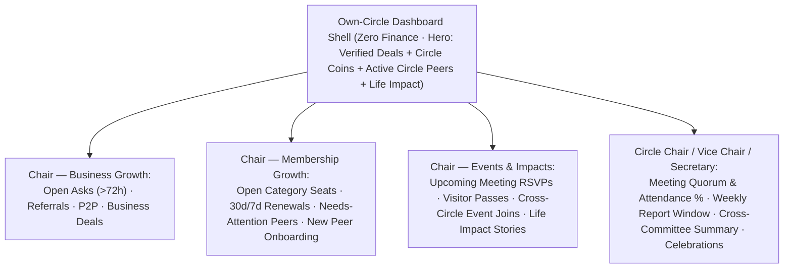

# 40 — Circle Chair, Committee Chairs, Vice Chair & Secretary Dashboards

**Document Group:** 06 — Analytics and Role-Wise Dashboards  
**Target Roles:** `Circle Chair` (`circleChair`), `Chair — Business Growth` (`chairBusinessGrowth`), `Chair — Membership Growth` (`chairMembership`), `Chair — Events & Impacts` (`chairEventsPrograms`), `Vice Chair` (`viceChair`), `Secretary` (`secretary`), and `Committee Leader` (`committee_leader`)  
**Related Documents:** [06-complete-role-hierarchy.md](./06-complete-role-hierarchy.md) · [08-master-role-permission-matrix.md](./08-master-role-permission-matrix.md) · [10-role-wise-screen-access.md](./10-role-wise-screen-access.md) · [39-circle-director-dashboard.md](./39-circle-director-dashboard.md) · [41-master-reporting-and-metrics-reference.md](./41-master-reporting-and-metrics-reference.md)

---

## 1. Powerhouse Role Architecture, Configurable Committees & Zero-Finance Rule

### 1.1 Role Keys, Capabilities & Verified Resolver Bugs
**FACT:** Inside each Circle ("The Powerhouse" — Stage 002), leadership responsibilities are shared across the Circle Chair, Committee Chairs, Vice Chair, Secretary, and configurable Committee Leaders (`[UserRoleResolverService.php](file:///c:/Users/malic/OneDrive/Documents/GitHub/unity-app-new/app/Shared/Services/UserRoleResolverService.php#L26-L32)` & `[LeaderPermissionService.php](file:///c:/Users/malic/OneDrive/Documents/GitHub/unity-app-new/app/Leader/Services/LeaderPermissionService.php#L120-L142)`):

| Role (`camelCase` / `roles.key`) | Default Capabilities | Finance Tab? | Teams Tab? | Submit Reports? | Verified Resolver / Scope Bugs |
|---|---|:---:|:---:|:---:|---|
| **`circleChair`** (`chair`) | `5`: `access_dashboard`, `access_teams`, `view_peers`, `request_actions`, `view_reports` | **NO** | Yes | Yes | **Unreachable Key Bug (`L50, L321`)**: `normalizeRoleKey('chair')` & `circles.chair_user_id` map to `chairBusinessGrowth` instead of `circleChair`, and `getRoleLabel('circleChair')` returns `'Chair - Business Growth Committee'` (`L109`)! |
| **`chairBusinessGrowth`** (`chair_business_growth_committee`) | `5`: `access_dashboard`, `access_teams`, `view_peers`, `request_actions`, `view_reports` | **NO** | Yes | Yes | `resolveManagedCircles()` (`L564-570`) forgets to check `circles.business_growth_committee_chair_user_id` and `circles.calendar.leadership` JSON! |
| **`chairMembership`** (`chair_membership_growth_committee`) | `5`: `access_dashboard`, `access_teams`, `view_peers`, `request_actions`, `view_reports` | **NO** | Yes | Yes | Same missing column/`calendar` check in `resolveManagedCircles()`! |
| **`chairEventsPrograms`** (`chair_events_impacts_committee`) | `5`: `access_dashboard`, `access_teams`, `view_peers`, `request_actions`, `view_reports` | **NO** | Yes | Yes | Same missing column/`calendar` check in `resolveManagedCircles()`! |
| **`viceChair`** (`vice_chair`) | `4`: `access_dashboard`, `view_peers`, `request_actions`, `view_reports` | **NO** | **NO** *(Default)* | **NO** *(`L495`)* | `resolveManagedCircles()` ignores `circles.vice_chair_user_id` & `calendar.leadership.vice_chair_user_id`! |
| **`secretary`** (`secretary`) | `4`: `access_dashboard`, `view_peers`, `request_actions`, `view_reports` | **NO** | **NO** *(Default)* | **NO** *(`L495`)* | `resolveManagedCircles()` ignores `circles.secretary_user_id`; **BUSINESS DECISION REQUIRED:** Secretaries typically draft/submit Weekly Circle Minutes & Reports (`can_submit_reports` currently excludes `viceChair` & `secretary` at `L495`!). |
| **`committee_leader`** (`committee_leader`) | Seeded at Level 8 in `RoleHierarchySeeder` (`circle` / `committee` scope) | **NO** | **NO** | **NO** | **CRITICAL (`403` Login Failure):** Missing from `UserRoleResolverService::normalizeRoleKey()` & `isLeaderRole()`, so `EnsureLeaderUser` blocks `committee_leader` from logging into the Leader App! |

### 1.2 Hard Governance Rules for All Chair, Vice Chair, Secretary & Committee Roles
1. **Strict Zero-Finance Boundary (Mandatory):**
   - `access_finance = false`, `manage_finance = false`, `can_view_overall_revenue = false`, `can_access_finance_tab = false`, `can_export_financial_data = false`.
   - **UI Behavior (Already Verified in `[dashboard_hero_card.dart](file:///D:/office%20project/LeaderApp-Fornt-end-/lib/features/dashboard/view/widgets/dashboard_hero_card.dart)`):** Bottom-nav Tab 3 (`Finance`) is hidden; Dashboard Hero Card replaces `"Total Revenue"` with **"Total Coins"** (`metrics.coins`) alongside `"Business Deals"` (`metrics.deals` — Peer business exchange value, NOT platform subscription revenue!).
   - **Server Enforcement Required (`P0`):** Backend `GET /api/v1/leader/dashboard/metrics` MUST strip/null `overall_revenue` when `!$permissions->hasCapability($user, 'access_finance')`, and `/api/v1/leader/finance/*` MUST be wrapped in `leader.can:access_finance` (`403`) so a Chair/Secretary cannot query revenue or call `record-offline` via API!
   - **Fix `DynamicRbacSeeder` `coin_payouts` Leak (`P1`):** Remove `coins -> coin_payouts` auto-grant in `[LeaderPermissionService.php](file:///c:/Users/malic/OneDrive/Documents/GitHub/unity-app-new/app/Leader/Services/LeaderPermissionService.php#L441-L443)` so Chairs/VC/Secretary do not accidentally inherit `can_issue_coins = true`.
2. **Configurable Committees Rule:**
   - Never hardcode `"3 Committees × 3 Leaders = 12"` or `"14 Powerhouse roles"`. Render committee context dynamically from `user_organizational_assignments` (`committee_key`, `role_id`) and `circles.calendar.leadership_roles[]`.
3. **Read/Coordinate vs Destructive Moderation Boundary:**
   - Because `manage_peers = false`, `[LeaderMemberController::deletePost()](file:///c:/Users/malic/OneDrive/Documents/GitHub/unity-app-new/app/Leader/Controllers/LeaderMemberController.php#L221)` and `deleteCreative()` (`L273`) MUST enforce `leader.can:manage_peers` (`403`) so Chairs, Vice Chairs, and Secretaries cannot delete Circle Peers' timeline posts or creatives!

---

## 2. Role-Tailored Dashboard Focus Within Shared Shell

Rather than maintaining 6 separate Flutter screens (`Enhance, Never Duplicate`), the existing `DashboardView` + `Action Center` adapts its **Priority Focus Strip** inside the leader's Own Circle (`circle_id IN $approvedLeadershipCircleIds`) based on resolved `canonical_role` / `committee_key`:

---

## 3. Complete 8-Question Audit Specification for Chair / VC / Secretary Metrics & Reports (Prompt §15)

### Metric CH-01: Own-Circle Active Peers, Celebrations & Coins (`total_peers`, `coins`, `celebrations`)
1. **Who can access it?** All Circle Chairs, Committee Chairs, Vice Chair, Secretary, and Committee Leaders (`access_dashboard`, `view_peers`, `can_send_wishes`).
2. **What data is included?**
   - Deduplicated active approved Peers (`circle_members.status = 'approved'`) in the leader's assigned Circle(s).
   - Aggregate Circle Peer `coins_balance` (`Total Coins` hero tile replacing `Total Revenue`).
   - Upcoming 30-day Peer birthdays & anniversaries (`GET /leader/peers/celebrations` + `POST /leader/peers/{id}/wishes`).
3. **Which records are excluded?** Platform/Circle subscription revenue (`overall_revenue` MUST be `null`/omitted on server), payment history (`circle_peer_memberships.amount_paid`), Peers from any other Circle, and unmasked phone/email where `users.hide_phone` / `hide_email = true`.
4. **How is it calculated?**
   - `total_peers`: `COUNT(DISTINCT cm.user_id)` where `cm.circle_id IN $ownLeadershipCircleIds AND cm.status = 'approved' AND cm.deleted_at IS NULL`.
   - `coins`: `SUM(users.coins_balance)` across those deduplicated Circle Peers.
5. **What is the time period?** Point-in-time active Circle roster + 30-day forward celebration window.
6. **What is the authoritative source?** `circle_members`, `users`, `coins_ledger`, `leader_wishes`.
7. **Which API provides it?** `GET /api/v1/leader/dashboard/metrics`, `GET /api/v1/leader/peers`, `GET /api/v1/leader/peers/celebrations`, `POST /api/v1/leader/peers/{id}/wishes`.
8. **Does the API enforce the correct scope?** **Partially (`Implemented but Incorrect`).** `getCelebrations()` properly scopes to `$scopedCircleIds` (`LeaderPeersService.php:822-851`), **but** `GET /dashboard/metrics` still leaks synthetic `overall_revenue` in JSON, `GET /peers` has `?scope=global` & `?circle_id` bypasses, and `resolveManagedCircles()` omits committee chair / VC / Secretary columns on `circles`!

---

### Metric CH-02: Business Growth Committee Focus — Deals, Referrals, P2P & Ask Matching (`chairBusinessGrowth`, `circleChair`)
1. **Who can access it?** `chairBusinessGrowth`, `circleChair` (primary focus), and readable across Circle leadership (`access_dashboard`, `request_actions`).
2. **What data is included?**
   - Circle `business_deals` (`SUM(deal_amount)` & `COUNT(*)`), `referrals` (`inside` vs `outside`, lead conversion status from `referral_status`), and `p2p_meetings` (`COUNT(*)` & % of Circle Peers who completed `>= 1` P2P this month).
   - Circle `asks` (`collaboration`, `referral`, `help`) broken down by **real** `asks.status` (`published`, `in_progress`, `fulfilled`), spotlighting open Circle Asks older than `72h` with `0` responses.
3. **Which records are excluded?** `draft`/`cancelled` Asks, fabricated `60%/25%/15%` Ask splits (`LeaderDashboardService.php:784-786`), and global Asks outside the Circle (`visibility_circle_id` / Circle Peer authors).
4. **How is it calculated?** Exact `COUNT(DISTINCT id)` and `SUM(deal_amount)` for `$circlePeerIds` within `timeframe`.
5. **What is the time period?** Selected `timeframe` (`this_week`, `this_month`, `this_quarter`).
6. **What is the authoritative source?** `business_deals`, `referrals`, `referral_status`, `p2p_meetings`, `asks`, `ask_responses`.
7. **Which API provides it?** `GET /api/v1/leader/dashboard/metrics`, `GET /api/v1/leader/business-deals`, `GET /api/v1/leader/referrals`, `GET /api/v1/leader/p2p-meetings`, `GET /api/v1/leader/asks/summary` (needs circle scoping!).
8. **Does the API enforce the correct scope?** **Yes on `LeaderActivitiesService` lists; No on `LeaderAskFlowService`** (`GET /leader/asks/summary` returns global platform totals).

---

### Metric CH-03: Membership Growth Committee Focus — Category Seats, Onboarding & Retention (`chairMembership`)
1. **Who can access it?** `chairMembership` (`access_teams`, `view_peers`), plus `circleChair`, `circleDirector`, `circleFounder` (and read-only summary for `viceChair`).
2. **What data is included?**
   - Open vs Occupied L1–L4 category seats in the Circle (`GET /teams/circles/{id}/sub-industries`) + ability to nominate prospects (`POST /teams/circles/{id}/refer-category`).
   - New Peers joined in last 30 days (onboarding P2P completion status).
   - Peers with `needs_attention` health status or Circle membership expiring in `30d` / `7d` (`circle_members.paid_ends_at` — **dates only, zero rupee amounts!**).
3. **Which records are excluded?** Subscription rupee amounts (`amount_paid`, `payments`), Stage-1 `approve`/`reject` mutation buttons unless `can_review_pending_peers` is explicitly granted to `chairMembership`, and Peers outside the Circle.
4. **How is it calculated?** Counts of open `circle_category_mappings`, `circle_members` joined `>= now() - 30d`, `health_status = 'needs_attention'`, and `paid_ends_at BETWEEN now() AND now() + 30d`.
5. **What is the time period?** Rolling 30-day onboarding & 30-day forward renewal window.
6. **What is the authoritative source?** `circle_members`, `circle_category_mappings`, `circle_peer_referrals`.
7. **Which API provides it?** `GET /api/v1/leader/teams/circles/{id}/sub-industries`, `POST /api/v1/leader/teams/circles/{id}/refer-category`, `GET /api/v1/leader/teams/circles/{circle_id}/peers`, `POST /api/v1/leader/members/{member_id}/send-reminder|add-note`.
8. **Does the API enforce the correct scope?** **No on `sub-industries`, `refer-category`, and `circles/{id}/peers` (`Implemented but Incorrect`).** Must intersect `{id}` with `$ownLeadershipCircleIds`.

---

### Metric CH-04: Events & Impacts Committee Focus — Meetings, Visitors & Verified Impact (`chairEventsPrograms`)
1. **Who can access it?** `chairEventsPrograms` (`access_teams`, `access_dashboard`), plus `circleChair`, `viceChair`, `secretary`, `circleDirector`, `circleFounder`.
2. **What data is included?**
   - Upcoming Circle meetings & events (`events`, `event_occurrences`, `circle_meetings`) rendered in Circle IANA timezone (`EventTimeDisplay`), RSVP counts (`event_rsvps`), check-in counts (`event_registrations.checkin_status = 'checked_in'`), and `substitute_logs`.
   - Circle `visitor_registrations` and cross-circle `event_registration_requests`.
   - Circle `impacts` (`approved` vs `pending`), `users.life_impacted_count`, and real `top_impacters` (top 5 Circle Peers with `life_impacted_count > 0`).
3. **Which records are excluded?** Paid event revenue/GST ledger totals (`access_finance = false`), unconfirmed self-declared impacts from verified totals, and fabricated `top_impacters` scores (`LeaderDashboardService.php:924`).
4. **How is it calculated?** Per-occurrence RSVPs, check-ins, visitors, and `SUM(users.life_impacted_count)` over approved Circle Peers.
5. **What is the time period?** Upcoming scheduled occurrences + trailing `timeframe`.
6. **What is the authoritative source?** `events`, `event_occurrences`, `event_registrations`, `event_rsvps`, `visitor_registrations`, `impacts`, `life_impact_histories`.
7. **Which API provides it?** `GET /api/v1/leader/teams/circles/{id}/events`, `GET /api/v1/leader/activities/visitor-registrations`, `GET /api/v1/leader/impacts`, `GET /api/v1/leader/dashboard/top-impacters`. *(Note: `viceChair` and `secretary` have `access_teams = false` by default, so Circle Meeting schedule summary should be included in `GET /dashboard/metrics` or `GET /reports` for them).*
8. **Does the API enforce the correct scope?** **Partial.** `impacts` and `top-impacters` scope to Circle, whereas `GET /teams/circles/{id}/events` lacks circle-scope validation.

---

### Metric CH-05: Circle Weekly / Monthly Report & Attendance Roster (`leader_reports` — Chairs, VC & Secretary)
1. **Who can access it?** `circleChair`, `chairBusinessGrowth`, `chairMembership`, `chairEventsPrograms`, `viceChair`, and `secretary` (`view_reports`; **BUSINESS DECISION REQUIRED:** confirm enabling `can_submit_reports = true` for `secretary` and `viceChair` in `[LeaderPermissionService.php](file:///c:/Users/malic/OneDrive/Documents/GitHub/unity-app-new/app/Leader/Services/LeaderPermissionService.php#L495)`!).
2. **What data is included?**
   - Own-Circle submitted `leader_reports` history (`attendance_percentage`, `deals_closed_value` [Peer business deals, NOT platform revenue!], `highlights`, `challenges_faced`, `action_items`) and PDF view/download.
   - Own-Circle Peer Activity Roster (`GET /reports/roster?circle_id=<own_circle_id>`) **excluding** `total_revenue` and `circle_peer_memberships` payment columns (`payment_status` / `amount_paid` redacted for non-finance roles!).
3. **Which records are excluded?**
   - Platform/Circle subscription `total_revenue` field on `leader_reports` (must be hidden/omitted for roles without `access_finance`!).
   - Reports from any other Circle (`?circle_id` IDOR blocked).
   - `can_export_peer_data = false` bulk PII CSV export (Chairs/VC/Secretary can view/submit Circle reports, not export raw Peer PII spreadsheets).
4. **How is it calculated?** Real SQL subqueries per approved Circle Peer (`attendance %`, `P2P count`, `referrals`, `business deals`), never hardcoded `94.5%` / `'₹18.5L'` (`LeaderReportsService.php:157-179`).
5. **What is the time period?** Weekly / Monthly `period`.
6. **What is the authoritative source?** `leader_reports`, `circle_members`, `attendance_records`, `p2p_meetings`, `referrals`, `business_deals`.
7. **Which API provides it?** `GET /api/v1/leader/reports`, `GET /api/v1/leader/reports/roster`, `POST /api/v1/leader/reports/submit`, `GET /api/v1/leader/reports/{id}`.
8. **Does the API enforce the correct scope?** **No (`Implemented but Incorrect`).** Today `LeaderReportsService` allows cross-circle `?circle_id` listing (`L48`), unauthenticated PDF downloads (`L429`), and returns `total_revenue` and `payment_status` to non-finance roles!
