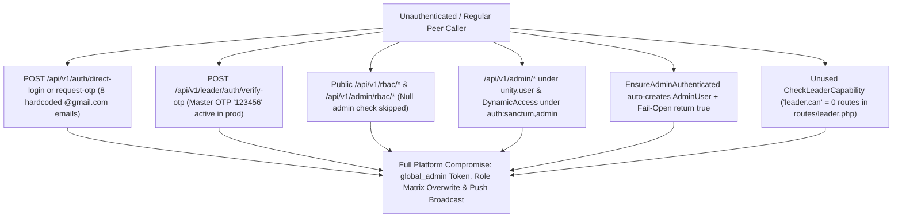

# 42 — RBAC, Authentication & Role Governance Security Audit

> **Audit Group:** 07 — Security and Data Access Audit  
> **Scope:** Laravel 12 Backend (`unity-app-new`), Flutter Leadership App (`LeaderApp-Fornt-end-`), Dynamic RBAC, Sanctum & Session Guards  
> **Related Deliverables:** [06-complete-role-hierarchy.md](./06-complete-role-hierarchy.md) · [08-master-role-permission-matrix.md](./08-master-role-permission-matrix.md) · [20-authentication-and-role-resolution-flow.md](./20-authentication-and-role-resolution-flow.md) · [43-sensitive-data-and-finance-access.md](./43-sensitive-data-and-finance-access.md) · [44-api-and-organizational-scope-security.md](./44-api-and-organizational-scope-security.md) · [50-final-implementation-roadmap.md](./50-final-implementation-roadmap.md)

---

## 1. Executive Security Summary

**FACT:** Static read-only code inspection of the `unity-app-new` Laravel 12 repository and the `LeaderApp-Fornt-end-` Flutter client uncovered **6 Critical (`P0`)**, **6 High (`P1`)**, and **4 Medium (`P2`)** RBAC, authentication, and token lifecycle vulnerabilities. Together, these defects allow unauthenticated callers or regular non-leader Peers to take over `Super Admin` (`global_admin`) accounts, rewrite the live permission matrix, self-assign organizational roles, broadcast push notifications to all Leaders, and retain indefinite access via non-expiring Bearer tokens.

> [!CAUTION]
> **Phase 0 Emergency Remediation Gate:** Findings `RBAC-SEC-01` through `RBAC-SEC-07` are active in production code paths without `app()->environment()` guards and require immediate server-side lockdown in Phase 0 before any mobile release (see [50-final-implementation-roadmap.md](./50-final-implementation-roadmap.md)).

---

## 2. Master Security Findings Index (All 9 Mandatory Fields)

**FACT:** Every verified RBAC and authentication vulnerability below is catalogued with all nine mandatory audit dimensions. Detailed technical breakdowns follow in Section 3.

| ID | Severity | Affected Role(s) | Affected Endpoint(s) | Affected Screen(s) | Root Cause (Exact File & Line) | Business Impact | Existing Protection | Required Enhancement | Recommended Test |
|---|---|---|---|---|---|---|---|---|---|
| `RBAC-SEC-01` | **CRITICAL (`P0`)** | Unauthenticated public callers; impacts all Admin & Leader roles | `/api/v1/rbac/*`, `/api/v1/admin/rbac/*`, `POST/DELETE /api/v1/tutorials` | React Admin RBAC Matrix, Role Hierarchy, Leader Role Management | [routes/api.php](file:///c:/Users/malic/OneDrive/Documents/GitHub/unity-app-new/routes/api.php#L312-L390) outside `auth:sanctum`; [RoleHierarchyController.php](file:///c:/Users/malic/OneDrive/Documents/GitHub/unity-app-new/app/Http/Controllers/Admin/Rbac/RoleHierarchyController.php#L1584-L1590) skips `if ($admin && ...)` when `$admin` is `null` | Unauthenticated caller can list all admin accounts, rewrite `role_data_scope` to `global`, mutate permissions, and assign `global_admin` to any user UUID | Only `GET /my-permissions` (`L376`) has `auth:sanctum`; 7 other RBAC controllers have zero auth | Wrap `/v1/rbac` & `/v1/admin/rbac` in `['auth:sanctum', 'admin.auth', 'admin.role:global_admin']`; fail-closed `abort_unless($admin, 401)` in `checkEditPermission()` | Feature test asserting `401` for guest and `403` for non-super-admin on all `/api/v1/rbac/*` & `/api/v1/admin/rbac/*` routes |
| `RBAC-SEC-02` | **CRITICAL (`P0`)** | Unauthenticated public callers impersonating `Super Admin` (`global_admin`) | `POST /api/v1/auth/request-otp`, `/verify-otp`, `/direct-login`, Admin `requestOtp` | Member App Login, Web Admin Login, Leader App Session (via shared token/account) | [AuthController.php](file:///c:/Users/malic/OneDrive/Documents/GitHub/unity-app-new/app/Http/Controllers/Api/AuthController.php#L1484-L1641) (`L1497` `\|\| true`; `L1208,1240` `'Harsh@123'`); [AdminAuthService.php](file:///c:/Users/malic/OneDrive/Documents/GitHub/unity-app-new/app/Services/Admin/Auth/AdminAuthService.php#L196-L245) & `L397, L1069-L1108` (8 `@gmail.com` emails) | Zero-OTP, zero-password `admin_panel` Sanctum Bearer token (`permissions: ['*']`) minted on `request-otp` for 8 hardcoded `@gmail.com` accounts in production | Only the 9th email (`L207`) checks `app()->environment('local')`; client headers `X-Environment` & `bypass_otp` are trusted | Delete `isSpecialBypassUser()`, `handleSpecialDirectLogin()`, hardcoded emails, and `'Harsh@123'`; revoke existing `admin_panel` tokens in `personal_access_tokens` | Feature test posting each of the 8 emails + `X-Environment: local` in `APP_ENV=production` and asserting no token is returned on `request-otp` |
| `RBAC-SEC-03` | **CRITICAL (`P0`)** | Unauthenticated attackers targeting any Leader, Super Admin, Juror, or Candidate | `POST /api/v1/leader/auth/verify-otp` (`/login`), Store OTP verify/validate, Jury login, Leadership result verify | Leader App `LoginView` / `OtpView`, Jury Web Portal, Candidate Results, Store Wallet | [LeaderAuthService.php](file:///c:/Users/malic/OneDrive/Documents/GitHub/unity-app-new/app/Leader/Services/LeaderAuthService.php#L156-L159); [StoreOtpService.php](file:///c:/Users/malic/OneDrive/Documents/GitHub/unity-app-new/app/Services/Store/StoreOtpService.php#L49-L87); [JuryWebController.php](file:///c:/Users/malic/OneDrive/Documents/GitHub/unity-app-new/app/Http/Controllers/Admin/Web/JuryWebController.php#L180); [VerificationService.php](file:///c:/Users/malic/OneDrive/Documents/GitHub/unity-app-new/app/Services/Leadership/VerificationService.php#L380) | Instant account takeover of **any** Leader or `superAdmin` knowing only their email or phone number using `'123456'` without even calling `send-otp`; forged `'store_otp_tok_*'` bypasses Store OTP | `throttle:20,1` on `/leader/auth/verify-otp`; zero environment guard on `'123456'` | Remove `'123456'` branches across all 4 services (or strictly gate behind `app()->environment('local', 'testing')` with explicit config flag `false` by default); bind `StoreOtpChallenge` to `(id, user_id, purpose)` | Feature test submitting `otp: '123456'` for a seeded `circleDirector` & `superAdmin` in `production` env and asserting `422 INVALID_OTP` |
| `RBAC-SEC-04` | **CRITICAL (`P0`)** | Any authenticated regular Peer (`member`, `free_trial_peer`) | `/api/v1/admin/*` (`leadership/*`, `forms/leader-interest/*`, `circles/{id}/assign-*`, `leads/*`, `posts/*`, `pending-requests/*`) | Leader App `DashboardRemoteDataSource` (calls `/admin/*`), React Admin Web | [routes/api.php](file:///c:/Users/malic/OneDrive/Documents/GitHub/unity-app-new/routes/api.php#L701-L1305) mounts `/api/v1/admin/*` under `['auth:sanctum', 'unity.user']` with no admin role/permission middleware | Any mobile Peer can approve leadership applications, assign Circle Founders/Directors/Chairs, read all leads, moderate posts, or approve pending requests | `auth:sanctum` + `unity.user` (which actually **requires** `App\Models\User` and blocks `AdminUser`!) | Split Leader-legitimate scoped reads to `/api/v1/leader/*` and enforce explicit role/capability middleware (`admin.role` or `EnsureAdminApiAuthorized`) on `/api/v1/admin/*` | Feature test calling `PATCH /api/v1/admin/circles/{id}/assign-founder` and `GET /api/v1/admin/pending-requests` as a regular `member` and asserting `403` |
| `RBAC-SEC-05` | **CRITICAL (`P0`)** | Any authenticated regular Peer (`App\Models\User`) | `/api/v1/admin/access/*`, `POST /api/v1/admin/organizational-assignments` (duplicated route groups) | Admin DynamicAccess / Organizational Assignment Screens | [routes/api.php](file:///c:/Users/malic/OneDrive/Documents/GitHub/unity-app-new/routes/api.php#L2319-L2450) (`L2319` & `L2388`) uses `auth:sanctum,admin` (OR semantics); all 5 FormRequests return `authorize(): true` | Any newly registered Peer can call `POST /api/v1/admin/access/user-roles` or `organizational-assignments` to self-assign `global_admin` + `global` scope | `auth:sanctum,admin` only verifies caller is logged in to *either* guard | Deduplicate route blocks (`L2319-L2450`) and enforce `['auth:sanctum', 'admin.auth', 'admin.role:global_admin']` + Policy checks | Feature test calling `POST /api/v1/admin/access/user-roles` with a `member` Sanctum token and asserting `403` |
| `RBAC-SEC-06` | **CRITICAL (`P0`)** | Any authenticated mobile Peer (`User`) & unroled `AdminUser` accounts | All routes under `admin.auth`, including `/api/v1/leadership/admin/*` (`DELETE .../nominations/bulk`) | Web Admin Portal, Leadership Election Admin Portal | [EnsureAdminAuthenticated.php](file:///c:/Users/malic/OneDrive/Documents/GitHub/unity-app-new/app/Http/Middleware/EnsureAdminAuthenticated.php#L32-L53) runs `AdminUser::firstOrCreate`; [AdminAccess.php](file:///c:/Users/malic/OneDrive/Documents/GitHub/unity-app-new/app/Support/AdminAccess.php#L545) (`L545, L590`) & [PermissionService.php](file:///c:/Users/malic/OneDrive/Documents/GitHub/unity-app-new/app/Services/Admin/PermissionService.php#L153) (`L153, L209, L289`) fail-open `return true`; [LeaderPermissionService.php](file:///c:/Users/malic/OneDrive/Documents/GitHub/unity-app-new/app/Leader/Services/LeaderPermissionService.php#L289-L298) treats any `AdminUser` as `superAdmin` | Mobile Peer hitting an `admin.auth` route auto-creates an `AdminUser` with empty roles, passes fail-open `AdminAccess` checks, and can wipe all election nominations (`delete_all: true`) | `web` session + `admin.auth` (bypassed when Sanctum Bearer token is supplied) | Remove `AdminUser::firstOrCreate` from `EnsureAdminAuthenticated`; change empty-role and `catch (\Throwable)` fallbacks in `AdminAccess` & `PermissionService` to `return false`; add `admin.role` to `routes/leadership.php:155` | Unit + feature tests verifying (a) mobile `User` token gets `403` on `admin.auth`, (b) `AdminUser` with `0` roles gets `403`, and (c) simulated DB exception in `PermissionService::can()` returns `false` |
| `RBAC-SEC-07` | **HIGH (`P1`)** | Low-rank Leaders (`secretary`, `viceChair`, `chair*`, or `pending` leader rows) | `PUT /roles/matrix`, `POST/PUT/DELETE /roles/*`, `/leader/admin/notifications/*`, `POST /finance/transactions/record-offline`, `DELETE /leader/members/{id}/posts\|creatives/*` | `RoleManagementView`, `FinanceView` (`RecordPaymentBottomSheet`), `PeerProfileView`, Push Broadcast Console | [bootstrap/app.php](file:///c:/Users/malic/OneDrive/Documents/GitHub/unity-app-new/bootstrap/app.php#L84) registers `'leader.can'` ([CheckLeaderCapability.php](file:///c:/Users/malic/OneDrive/Documents/GitHub/unity-app-new/app/Leader/Middleware/CheckLeaderCapability.php#L1-L61)) on **0 routes** in [routes/leader.php](file:///c:/Users/malic/OneDrive/Documents/GitHub/unity-app-new/routes/leader.php#L54-L301); `LeaderRoleMatrixService::deleteRole` (`L174`) lacks `is_system_role` guard | A `secretary` can enable all 13 capabilities for `secretary`, delete system roles, broadcast FCM pushes labeled `"Super Admin Broadcast"` to 500 leaders, insert `'Paid'` rows into `payments`, or delete Peer posts | `EnsureLeaderUser` (`leader.user`) checks `is_leader == true` only; UI hides buttons client-side | Attach `leader.can:<capability>` across `routes/leader.php`; enforce `superAdmin` check on `/roles/*` mutations & `/leader/admin/notifications/*`; guard `is_system_role` in `deleteRole()` | Feature test matrix exercising every write route in `routes/leader.php` as `secretary` and asserting `403` with `required_capabilities` |
| `RBAC-SEC-08` | **HIGH (`P1`)** | Unapproved/former Circle Leaders (`pending`, `rejected`, `left`) & expired `admin_user_roles` holders | All `/api/v1/leader/*`, `/api/v1/leadership/*` (44–50), and Web Admin endpoints | Leader App Login (`OtpView` -> `DashboardView`), Web Admin | [UserRoleResolverService.php](file:///c:/Users/malic/OneDrive/Documents/GitHub/unity-app-new/app/Shared/Services/UserRoleResolverService.php#L328-L350) omits `status = 'approved'` & `left_at IS NULL` on `circle_members`; `L191-L230` + `AdminAccess` + `PermissionService` never check `admin_user_roles.expires_at` | Unapproved/removed circle leaders retain full Leader App portal access; expired term assignments keep active privileges indefinitely | Soft-delete check `whereNull('deleted_at')` only | Filter `circle_members` by `status = 'approved'` and `whereNull('left_at')`; filter `admin_user_roles` & `user_organizational_assignments` by `(expires_at IS NULL OR expires_at > NOW())` | Feature test verifying a `circle_members` row with `role='director', status='pending'` or `left_at=now()` receives `403` from `EnsureLeaderUser` |
| `RBAC-SEC-09` | **HIGH (`P1`)** | Seeded Leader roles (`ded`, `industry_director`, `circle_director`, `circle_founder`, `chair`, `vice_chair`, `secretary`, `committee_leader`, `global_founder`) | `GET /leader/auth/me`, `POST /leader/auth/verify-otp`, `EnsureLeaderUser` | `FinanceView`, `RoleManagementView`, `ProfileView`, `OtpView` | [DynamicRbacSeeder.php](file:///c:/Users/malic/OneDrive/Documents/GitHub/unity-app-new/database/seeders/DynamicRbacSeeder.php#L170-L183) + [LeaderPermissionService.php](file:///c:/Users/malic/OneDrive/Documents/GitHub/unity-app-new/app/Leader/Services/LeaderPermissionService.php#L421-L443) (`coins` -> `coin_payouts`; `finance` -> `manage_finance`; drops `track_milestones`; hardcoded `in_array` overrides at `L476-L501`); `UserRoleResolverService` omits `committee_leader` & `global_founder` | Every seeded leader down to `secretary` receives `coin_payouts`; read-only finance grants `manage_finance`; `committee_leader` & mobile-only `global_founder` get `403 NOT_A_LEADER`; disabling capabilities in Role Matrix fails to revoke 5 hardcoded boolean flags | `leader_role_capabilities` table overrides Dynamic RBAC only *after* a manual matrix save | Fix `resolveCapabilitiesFromDynamicRbac()` read vs write mapping; remove hardcoded `in_array($role, ...)` overrides in `resolvePermissionMatrix()`; add `committeeLeader` & `global_founder -> superAdmin` in `UserRoleResolverService` | Unit tests on `LeaderPermissionService` & `UserRoleResolverService` across all 19 seeded `roles.key` values |
| `RBAC-SEC-10` | **HIGH (`P1`)** | Mobile `User` accounts registering unverified Admin emails or colliding 10-digit phones | `POST /api/v1/auth/register`, `POST /api/v1/leader/auth/send-otp`, WhatsApp OTP login | Member App Registration, Leader App `LoginView` | [AuthController.php](file:///c:/Users/malic/OneDrive/Documents/GitHub/unity-app-new/app/Http/Controllers/Api/AuthController.php#L991-L994) leaves `email_verified_at = null`; [UserRoleResolverService.php](file:///c:/Users/malic/OneDrive/Documents/GitHub/unity-app-new/app/Shared/Services/UserRoleResolverService.php#L140-L143) links `AdminUser` by `LOWER(email)`; [LeaderAuthService.php](file:///c:/Users/malic/OneDrive/Documents/GitHub/unity-app-new/app/Leader/Services/LeaderAuthService.php#L318-L322) uses `LIKE "%{$short}"` suffix phone match | Pre-registering an unverified `User` with an `AdminUser`'s email inherits their RBAC role; international numbers sharing last 10 digits or `secondary_mobile` resolve to the wrong account | Email uniqueness only within `users` table (not cross-checked against `admin_users` or `email_verified_at`) | Require `email_verified_at IS NOT NULL` (or explicit `admin_users.user_id` FK) before bridging `User` <-> `AdminUser`; match E.164 normalized phone first before unambiguous national fallback | Feature test registering unverified email matching an `AdminUser` and asserting `resolveUserRole()` returns `member` until verified |
| `RBAC-SEC-11` | **HIGH (`P1`)** | Scoped Web/API Admins (`AdminUser`) sharing PHP worker / Octane / Queue processes | All endpoints calling `AdminCircleScope::resolveScopedCircleIds()` | Web Admin & DED / Circle Admin Dashboards | [AdminCircleScope.php](file:///c:/Users/malic/OneDrive/Documents/GitHub/unity-app-new/app/Support/AdminCircleScope.php#L184) (`L184, L192-L195`) declares `private static ?array $cachedCircleIds = null;` without keying by `$admin->id` | Cross-admin scope cache poisoning: Admin B inherits Admin A's `$cachedCircleIds` inside long-lived workers, queues, or multi-admin flows | None (static class property persists across calls in same PHP process) | Change `$cachedCircleIds` to `private static array $cachedCircleIdsByAdmin = [];` keyed by `(string) $admin->id` + clear on role mutation | Unit test calling `AdminCircleScope::resolveScopedCircleIds()` sequentially for two different `AdminUser` instances and asserting distinct circle sets |
| `RBAC-SEC-12` | **HIGH (`P1`)** | All Leader App & Admin Sanctum token holders | `POST /leader/auth/verify-otp`, `POST /leader/auth/logout`, `POST /api/v1/auth/logout`, `POST /api/v1/auth/reset-password` | Leader App `SplashView`, `ProfileSignOutBottomSheet`, `ApiClient` | [config/sanctum.php](file:///c:/Users/malic/OneDrive/Documents/GitHub/unity-app-new/config/sanctum.php#L53) (`'expiration' => null`); [LeaderAuthService.php](file:///c:/Users/malic/OneDrive/Documents/GitHub/unity-app-new/app/Leader/Services/LeaderAuthService.php#L180-L181) discards `$refreshToken`; [OnlineStatusService.php](file:///c:/Users/malic/OneDrive/Documents/GitHub/unity-app-new/app/Services/OnlineStatusService.php#L39) throws `TypeError` on `AdminUser` logout; Flutter [profile_bloc.dart](file:///D:/office%20project/LeaderApp-Fornt-end-/lib/features/profile/bloc/profile_bloc.dart) clears local storage without calling `POST /leader/auth/logout` | Compromised tokens never expire; local sign-out leaves server token active; `AdminUser` API logout crashes with `500 TypeError` before deleting token; password reset leaves old tokens valid | Local `SecureStorageService.clearAll()` on voluntary mobile sign-out only | Configure Sanctum token TTL + stored hashed refresh tokens (`POST /leader/auth/refresh`), wire Flutter sign-out to `POST /leader/auth/logout`, guard `$user instanceof User` before `OnlineStatusService::markOffline`, and revoke tokens on password/role revocation | Feature tests for token TTL, `/leader/auth/logout` revocation, `AdminUser` `/api/v1/auth/logout` (`200`), and password-reset token purge |
| `RBAC-SEC-13` | **MEDIUM (`P2`)** | All Leader App users on debug/QA builds & any caller triggering `500` API exceptions | All HTTP calls through Flutter `ApiClient`; all Laravel `/api/*` `500` responses | All Flutter screens (ADB/console logs); all JSON error responses | [api_client.dart](file:///D:/office%20project/LeaderApp-Fornt-end-/lib/core/network/api_client.dart#L68-L82) logs raw `Authorization: Bearer <token>` and full PII payloads in `kDebugMode`; [bootstrap/app.php](file:///c:/Users/malic/OneDrive/Documents/GitHub/unity-app-new/bootstrap/app.php#L125-L139) returns `exception`, `file`, `line`, and raw SQL `$e->getMessage()` unconditionally | Device logs leak live `superAdmin` / Leader Bearer tokens; production `500` responses leak server filesystem paths, class names, and PostgreSQL schema details | `kDebugMode` gate in Flutter; zero `config('app.debug')` gate in `bootstrap/app.php` | Redact `Authorization` header & OTP/token fields in `ApiClient._printRequestLog`; gate `exception`/`file`/`line`/raw message behind `config('app.debug') === true` in `bootstrap/app.php` | Flutter unit test verifying `Authorization` header redaction; Laravel feature test verifying `APP_DEBUG=false` `500` response omits `file`, `line`, and SQL details |
| `RBAC-SEC-14` | **MEDIUM (`P2`)** | Flutter Leader App users with custom roles containing `"admin"` or missing enum roles (`viceChair`, `secretary`, `committeeLeader`) | Client-side permission & role resolution (`SessionManager`, `UserRole`) | Bottom Nav tabs, `DashboardView`, `RoleManagementView`, `FinanceView` | [session_manager.dart](file:///D:/office%20project/LeaderApp-Fornt-end-/lib/core/helpers/session_manager.dart#L241-L245) checks `customRoleLabel?.toLowerCase().contains('admin')` -> `LeaderPermissions.allGranted`; [user_role.dart](file:///D:/office%20project/LeaderApp-Fornt-end-/lib/core/enums/user_role.dart#L37-L74) lacks `viceChair`, `secretary`, `committeeLeader` and falls back to `UserRole.circleChair` (`L62`) | Custom role named e.g. `"Circle Membership Admin"` unlocks every Super Admin UI control on mobile; `secretary` & `viceChair` silently become `circleChair` (gaining `canAccessTeamsTab: true` fallback) | Backend `403` only where server checks exist (currently missing per `RBAC-SEC-07`) | Match `isSuperAdmin` strictly against canonical `role_key == 'superAdmin'`; add `viceChair`, `secretary`, `committeeLeader` to `UserRole` and parse canonical `role` key before fuzzy label matching | Dart unit tests on `UserRole.fromLabel` & `SessionManager.isSuperAdmin` for all 13 backend role keys + `"Membership Admin"` |
| `RBAC-SEC-15` | **MEDIUM (`P2`)** | All Leader App logins (`UserRoleResolverService` uncached path) | `POST /leader/auth/send-otp`, `POST /leader/auth/verify-otp`, `GET /leader/auth/me` | `LoginView`, `OtpView`, `SplashView` | [UserRoleResolverService.php](file:///c:/Users/malic/OneDrive/Documents/GitHub/unity-app-new/app/Shared/Services/UserRoleResolverService.php#L283) executes `Circle::query()->whereNull('deleted_at')->get()` loading **all active `Circle` rows into PHP memory** to scan `calendar` JSONB | Memory spike and O(N) latency amplification under concurrent login bursts (DoS vector on `throttle:20,1` auth endpoints) | `throttle:20,1` per IP | Replace full-table hydration in `UserRoleResolverService.php:283` with targeted PostgreSQL JSONB queries (`whereJsonContains` / `->>` predicates) on indexed columns | Performance/query-count test asserting `resolveUserRole()` executes bounded SQL queries and hydrates `0` unrelated `Circle` models |

---

## 3. Detailed Vulnerability Analysis

### 3.1 `RBAC-SEC-01` — Unauthenticated Public Access to Full RBAC Administration APIs
- **Severity:** CRITICAL (`P0`)
- **Affected Role(s):** Unauthenticated public callers (impacts `global_admin` and every platform role)
- **Affected Endpoint(s):**
  - `Route::prefix('v1/rbac')` ([routes/api.php](file:///c:/Users/malic/OneDrive/Documents/GitHub/unity-app-new/routes/api.php#L312-L343))
  - `Route::prefix('v1/admin/rbac')` ([routes/api.php](file:///c:/Users/malic/OneDrive/Documents/GitHub/unity-app-new/routes/api.php#L345-L380))
  - `POST /api/v1/tutorials` & `DELETE /api/v1/tutorials/{id}` ([routes/api.php](file:///c:/Users/malic/OneDrive/Documents/GitHub/unity-app-new/routes/api.php#L389-L390))
- **Affected Screen(s):** React Admin Web RBAC Role Hierarchy, Permission Matrix, Module Access, Data Scope, and Workflow Rules pages; indirectly corrupts Flutter `RoleManagementView`.
- **Root Cause:** **FACT:** Both `v1/rbac` (`L312`) and `v1/admin/rbac` (`L345`) are registered at the top level of `routes/api.php` outside `auth:sanctum` and `admin.auth` (only `GET /my-permissions` at `L376` attaches `auth:sanctum`). Inside [RoleHierarchyController.php](file:///c:/Users/malic/OneDrive/Documents/GitHub/unity-app-new/app/Http/Controllers/Admin/Rbac/RoleHierarchyController.php#L1584-L1590), `checkEditPermission()` evaluates `if ($admin && ! AdminAccess::isEditAllowed($admin))` — when unauthenticated, `$admin` is `null`, causing the guard condition to evaluate to `false` and silently pass! None of the other seven controllers (`RolePermissionMatrixController`, `RoleDataScopeController`, `RoleModuleAccessController`, `AdminModuleController`, `AdminPageController`, `PageGroupController`, `WorkflowApprovalRuleController`) check authentication at all.
- **Business Impact:** Any anonymous internet user can enumerate admin emails (`GET /api/v1/rbac/roles/{id}/assignments`), create or delete roles, rewrite `role_data_scope` to `global`, modify module/page permissions, and assign `global_admin` to any account (`POST /api/v1/rbac/roles/{id}/assign`).
- **Existing Protection:** None on 95%+ of routes in both prefixes.
- **Required Enhancement:** **RECOMMENDATION:** Move both route groups inside `Route::middleware(['auth:sanctum', 'admin.auth', 'admin.role:global_admin'])` (keeping `GET /my-permissions` under `['auth:sanctum', 'admin.auth']`), protect `POST/DELETE /api/v1/tutorials` with admin middleware, and update `RoleHierarchyController::checkEditPermission()` to fail-closed (`if (! $admin || ! AdminAccess::isEditAllowed($admin)) { abort(403); }`).
- **Recommended Test:** PHPUnit feature test iterating all routes in `v1/rbac` and `v1/admin/rbac` with (1) no token -> `401`, (2) `member` token -> `403`, (3) `ded` admin token -> `403` on mutations, and (4) `global_admin` token -> `200`.

---

### 3.2 `RBAC-SEC-02` — Production Hardcoded `@gmail.com` Super-Admin Zero-OTP & Password Bypasses
- **Severity:** CRITICAL (`P0`)
- **Affected Role(s):** Unauthenticated callers; compromises `Super Admin` (`global_admin`)
- **Affected Endpoint(s):** `POST /api/v1/auth/request-otp`, `POST /api/v1/auth/verify-otp`, `POST /api/v1/auth/direct-login`, and Web/API Admin `POST /admin/auth/request-otp`
- **Affected Screen(s):** Member App Login, React/Blade Admin Login, and cross-guard Sanctum endpoints
- **Root Cause:** **FACT:**
  1. [AuthController.php](file:///c:/Users/malic/OneDrive/Documents/GitHub/unity-app-new/app/Http/Controllers/Api/AuthController.php#L1484-L1641): `isSpecialBypassUser()` ends at `L1497` with `return $isLocalOrDev || $hasDevHeader || $bypassFlag || true;` — evaluating to `true` unconditionally in production while also trusting client-supplied `X-Environment` headers and `bypass_otp` body flags. Submitting `harsh@gmail.com` auto-creates an `AdminUser` + `global_admin` role and returns an unexpiring `admin_panel` Bearer token with `permissions: ['*']`.
  2. [AdminAuthService.php](file:///c:/Users/malic/OneDrive/Documents/GitHub/unity-app-new/app/Services/Admin/Auth/AdminAuthService.php#L196-L245) & [L1069-L1108](file:///c:/Users/malic/OneDrive/Documents/GitHub/unity-app-new/app/Services/Admin/Auth/AdminAuthService.php#L1069-L1108) + [AdminAuthController.php](file:///c:/Users/malic/OneDrive/Documents/GitHub/unity-app-new/app/Http/Controllers/Admin/Auth/AdminAuthController.php#L90-L110): Eight personal `@gmail.com` addresses (`hardik@gmail.com`, `harsh@gmail.com`, `urvashi@gmail.com`, `dhruvil@gmail.com`, `chirag@gmail.com`, `mohit@gmail.com`, `rahul@gmail.com`, `vinit@gmail.com`) lack `app()->environment()` checks. Calling `requestOtp` with `Accept: application/json` auto-provisions a `global_admin` `AdminUser` and returns a live Sanctum `admin_panel` token directly in the `request-otp` response.
  3. Hardcoded plaintext password `'Harsh@123'` is embedded in [AuthController.php](file:///c:/Users/malic/OneDrive/Documents/GitHub/unity-app-new/app/Http/Controllers/Api/AuthController.php#L1208) (`L1208`, `L1240`) and [AdminAuthService.php](file:///c:/Users/malic/OneDrive/Documents/GitHub/unity-app-new/app/Services/Admin/Auth/AdminAuthService.php#L397).
- **Business Impact:** Total, unauthenticated Super Admin takeover in production via a single curl call.
- **Existing Protection:** None.
- **Required Enhancement:** **RECOMMENDATION:** Permanently delete `isSpecialBypassUser()`, `handleSpecialDirectLogin()`, the 8 hardcoded email bypasses in `AdminAuthService`, and all hardcoded `'Harsh@123'` literals; purge existing `admin_panel` tokens in `personal_access_tokens` during deployment.
- **Recommended Test:** Feature test verifying `POST /api/v1/auth/request-otp`, `/direct-login`, and `/admin/auth/request-otp` with `harsh@gmail.com` and `X-Environment: local` never return an access token and require real OTP verification.

---

### 3.3 `RBAC-SEC-03` — Unconditional `'123456'` Master OTP Backdoor Across 4 Subsystems
- **Severity:** CRITICAL (`P0`)
- **Affected Role(s):** All 12 Leader roles (`superAdmin` down to `secretary`), Store buyers, Leadership Election Jurors, Leadership Candidates
- **Affected Endpoint(s):** `POST /api/v1/leader/auth/verify-otp` (alias `/leader/auth/login`), Store OTP verify/validate endpoints, `POST /jury/auth/verify-otp` / Jury Web login, Candidate private result verification
- **Affected Screen(s):** Flutter Leader App `LoginView` & `OtpView`, Jury Portal, Candidate Results SPA, Store Checkout/Redemption
- **Root Cause:** **FACT:**
  1. [LeaderAuthService.php](file:///c:/Users/malic/OneDrive/Documents/GitHub/unity-app-new/app/Leader/Services/LeaderAuthService.php#L156-L159): `if ($otp === '123456') { $isValid = true; }` executes unconditionally in all environments without checking `app()->environment()`.
  2. [StoreOtpService.php](file:///c:/Users/malic/OneDrive/Documents/GitHub/unity-app-new/app/Services/Store/StoreOtpService.php#L49-L87): `L65` accepts `$otp === '123456'` unconditionally; `L51` falls back to `StoreOtpChallenge::latest()->first()` (another user's challenge!) or returns `verified => true` if the table is empty (`L53-L60`); `validateToken()` (`L85-L86`) returns `true` for any string prefixed with `'store_otp_tok_'`.
  3. [JuryWebController.php](file:///c:/Users/malic/OneDrive/Documents/GitHub/unity-app-new/app/Http/Controllers/Admin/Web/JuryWebController.php#L180): `if ($otp === $cachedOtp || $otp === '123456')` is active in production.
  4. [VerificationService.php](file:///c:/Users/malic/OneDrive/Documents/GitHub/unity-app-new/app/Services/Leadership/VerificationService.php#L380): `L380` accepts `'123456'` unconditionally in production (`L107` also enables `'123456'` when `APP_DEBUG=true` or `staging`).
- **Business Impact:** Any attacker who knows a Leader's or Super Admin's phone number or email can log straight into the Flutter Leadership App in production without triggering an OTP email/SMS, read all scoped/global PII and financials, or manipulate Jury election scores and Store coin redemptions.
- **Existing Protection:** Route rate limit `throttle:20,1` only.
- **Required Enhancement:** **RECOMMENDATION:** Remove `'123456'` from all four services. If QA requires a test account for Play Store / App Store review, restrict it to a single dedicated review account controlled via `config('services.leader_review.enabled') === true` (strictly `false` in production after store review) and never allow it for `superAdmin` or real Peer accounts. Fix `StoreOtpService` to query strictly by `where('user_id', $userId)->where('id', $challengeId)` and cryptographically hash/verify tokens in DB.
- **Recommended Test:** Feature tests across all 4 endpoints asserting `'123456'` is rejected with `422` when `APP_ENV=production` and `store_otp_tok_fake123` fails `validateToken()`.

---

### 3.4 `RBAC-SEC-04` & `RBAC-SEC-05` — Unprotected `/api/v1/admin/*` & DynamicAccess Self-Escalation
- **Severity:** CRITICAL (`P0`)
- **Affected Role(s):** Any authenticated regular mobile `User` (`member`)
- **Affected Endpoint(s):**
  - `/api/v1/admin/*` ([routes/api.php](file:///c:/Users/malic/OneDrive/Documents/GitHub/unity-app-new/routes/api.php#L701-L1305)), including `/api/v1/admin/leadership/*` (`L1135-L1146`), `/api/v1/admin/forms/leader-interest/*` (`L1276-L1279`), `/api/v1/admin/circles/{id}/assign-*` (`L881+`)
  - `/api/v1/admin/access/*` & `/api/v1/admin/organizational-assignments` ([routes/api.php](file:///c:/Users/malic/OneDrive/Documents/GitHub/unity-app-new/routes/api.php#L2319-L2450), duplicated at `L2319` and `L2388`)
- **Affected Screen(s):** Leader App `DashboardView` (which currently calls `/admin/leads/counts`, `/admin/pending-requests*`, `/admin/posts` in [dashboard_remote_datasource.dart](file:///D:/office%20project/LeaderApp-Fornt-end-/lib/data/datasources/remote/dashboard_remote_datasource.dart#L116-L203)), React Admin Web
- **Root Cause:** **FACT:**
  1. `routes/api.php:701` wraps `/api/v1/admin/*` in `['auth:sanctum', 'unity.user']` with zero admin role middleware. Paradoxically, `EnsureUnityUser` (`unity.user`) requires `App\Models\User` and rejects `AdminUser`, meaning **every** regular Member App user token passes middleware!
  2. `routes/api.php:2319-2450` uses `auth:sanctum,admin` (which passes if *either* guard authenticates), and all 5 `DynamicAccess` FormRequests return `authorize(): true` with no controller policy checks, letting any mobile `User` call [OrganizationalAssignmentSyncService.php](file:///c:/Users/malic/OneDrive/Documents/GitHub/unity-app-new/app/Modules/DynamicAccess/Services/OrganizationalAssignmentSyncService.php#L38-L119) to self-assign `global_admin`.
- **Business Impact:** Horizontal and vertical privilege escalation from any free-trial mobile user to `global_admin` and full Circle/Leadership administration.
- **Existing Protection:** Authentication (`auth:sanctum`) only; zero authorization.
- **Required Enhancement:** **RECOMMENDATION:**
  1. Before locking `/api/v1/admin/*`, eliminate the 4 `/admin/*` enrichment calls inside `DashboardRemoteDataSource` by returning accurate counts directly from `GET /api/v1/leader/dashboard/summary` (see [46-mobile-app-enhancement-recommendations.md](./46-mobile-app-enhancement-recommendations.md) & [47-api-enhancement-recommendations.md](./47-api-enhancement-recommendations.md)).
  2. Attach strict admin authorization middleware verifying `AdminAccess` / `superAdmin` on `/api/v1/admin/*` and `/api/v1/admin/access/*`, and delete the duplicate route block at `routes/api.php:2388-2450`.
- **Recommended Test:** Feature test suite verifying a standard `member` `User` token receives `403` on `/api/v1/admin/leadership/assignments`, `/api/v1/admin/circles/{id}/assign-founder`, and `/api/v1/admin/access/user-roles`.

---

### 3.5 `RBAC-SEC-06` — `EnsureAdminAuthenticated` Auto-Provisioning & Fail-Open Permission Helpers
- **Severity:** CRITICAL (`P0`)
- **Affected Role(s):** Any authenticated `User`, unroled `AdminUser`, and circle/functional `AdminUser` (`read_only`, `content_team`)
- **Affected Endpoint(s):** All `admin.auth` routes, `/api/v1/leadership/admin/*` ([routes/leadership.php](file:///c:/Users/malic/OneDrive/Documents/GitHub/unity-app-new/routes/leadership.php#L155-L303)), `LeaderPermissionService::resolveUserRole`
- **Affected Screen(s):** Leadership Nomination/Election Admin Portal, Web Admin Portal
- **Root Cause:** **FACT:**
  1. [EnsureAdminAuthenticated.php](file:///c:/Users/malic/OneDrive/Documents/GitHub/unity-app-new/app/Http/Middleware/EnsureAdminAuthenticated.php#L32-L53) (`L39-L47`) executes `AdminUser::firstOrCreate` whenever a request carries a mobile `User` Bearer token!
  2. [AdminAccess.php](file:///c:/Users/malic/OneDrive/Documents/GitHub/unity-app-new/app/Support/AdminAccess.php#L545) (`isSectionAllowed` `L545`, `isEditAllowed` `L590`) returns `true` when `roleKeys($admin)` is empty!
  3. [PermissionService.php](file:///c:/Users/malic/OneDrive/Documents/GitHub/unity-app-new/app/Services/Admin/PermissionService.php#L153) (`canAccessRoute` `L153`, `hasPageAccess` `L209`, `can` `L289`) catches `\Throwable` and returns `true` (fail-open)!
  4. [LeaderPermissionService.php](file:///c:/Users/malic/OneDrive/Documents/GitHub/unity-app-new/app/Leader/Services/LeaderPermissionService.php#L289-L298) returns `role => 'superAdmin'` unconditionally for any `AdminUser` model!
  5. `/api/v1/leadership/admin/*` (`routes/leadership.php:155-303`) checks `['web', 'admin.auth']` with zero role checks — allowing destructive actions like `DELETE /api/v1/leadership/admin/nominations/bulk` (`delete_all: true` in [AdminNominationController.php](file:///c:/Users/malic/OneDrive/Documents/GitHub/unity-app-new/app/Http/Controllers/Api/V1/Leadership/AdminNominationController.php#L172-L179)).
- **Business Impact:** Any mobile Peer can auto-provision an `AdminUser`, pass fail-open permission gates, and manipulate or wipe leadership elections.
- **Existing Protection:** None once a valid `User` Sanctum token is presented.
- **Required Enhancement:** **RECOMMENDATION:** Remove `AdminUser::firstOrCreate` from `EnsureAdminAuthenticated` (require pre-existing `is_active = true` `AdminUser` with ≥1 non-expired role); flip all empty-role and `\Throwable` fallbacks in `AdminAccess` and `PermissionService` to `return false` (with `Log::error`); delegate `LeaderPermissionService::resolveUserRole(AdminUser)` to `UserRoleResolverService`; add `admin.role:global_admin,eed,ded` / `admin.permission` to `routes/leadership.php:155`.
- **Recommended Test:** Unit tests for `AdminAccess` (empty roles -> `false`), `PermissionService` (DB error -> `false`), and feature test asserting `DELETE /api/v1/leadership/admin/nominations/bulk` returns `403` for non-super-admin tokens.

---

### 3.6 `RBAC-SEC-07` — Unused `CheckLeaderCapability` (`leader.can`) & Missing Super-Admin Guards in `routes/leader.php`
- **Severity:** HIGH (`P1`)
- **Affected Role(s):** `secretary`, `viceChair`, `chairBusinessGrowth`, `chairMembership`, `chairEventsPrograms`, `circleDirector`, `circleFounder`, `industryDirector`
- **Affected Endpoint(s):**
  - `POST /roles`, `PUT /roles/matrix`, `PUT /roles/{id}`, `DELETE /roles/{id}` ([LeaderRoleManagementController.php](file:///c:/Users/malic/OneDrive/Documents/GitHub/unity-app-new/app/Leader/Controllers/LeaderRoleManagementController.php#L19-L93))
  - `GET|POST /leader/admin/notifications/config`, `GET .../leaders`, `POST .../send`, `GET .../logs` ([LeaderNotificationsController.php](file:///c:/Users/malic/OneDrive/Documents/GitHub/unity-app-new/app/Leader/Controllers/LeaderNotificationsController.php#L892-L1505))
  - `GET /finance/summary`, `GET /finance/transactions`, `POST /finance/transactions/record-offline` ([LeaderFinanceController.php](file:///c:/Users/malic/OneDrive/Documents/GitHub/unity-app-new/app/Leader/Controllers/LeaderFinanceController.php#L24-L183))
  - `DELETE /leader/members/{member_id}/posts/{post_id}` & `DELETE .../creatives/{creative_id}` ([LeaderMemberController.php](file:///c:/Users/malic/OneDrive/Documents/GitHub/unity-app-new/app/Leader/Controllers/LeaderMemberController.php#L221-L305))
  - `POST /leader/pending-requests/{category}/{id}/approve|reject` ([PendingRequestAdminController.php](file:///c:/Users/malic/OneDrive/Documents/GitHub/unity-app-new/app/Http/Controllers/Api/Admin/PendingRequestAdminController.php#L75-L205))
- **Affected Screen(s):** `RoleManagementView`, `FinanceView`, `RecordPaymentBottomSheet`, `PeerProfileView`, `LeaderActivitiesView`
- **Root Cause:** **FACT:** `'leader.can' => CheckLeaderCapability::class` is aliased in [bootstrap/app.php](file:///c:/Users/malic/OneDrive/Documents/GitHub/unity-app-new/bootstrap/app.php#L84), **but applied to 0 routes in `routes/leader.php`**. Only `LeaderFinanceController::updateCommissionRates` (`L68`) manually checks `isSuperAdmin($user)`. Even `LeaderRoleMatrixService::deleteRole()` ([L174-L194](file:///c:/Users/malic/OneDrive/Documents/GitHub/unity-app-new/app/Leader/Services/LeaderRoleMatrixService.php#L174-L194)) lacks an `is_system_role` check.
- **Business Impact:** Any `secretary` can grant `secretary` all 13 capabilities, delete core roles, send `"Super Admin Broadcast"` FCM pushes to 500 leaders, fabricate `'Paid'` payment rows, or delete circle Peers' timeline posts/creatives.
- **Existing Protection:** Client-side UI hiding only (`SessionManager().permissions`).
- **Required Enhancement:** **RECOMMENDATION:** Apply `leader.can` middleware systematically across `routes/leader.php`:
  - `/roles/*` mutations & `/leader/admin/notifications/*` -> `leader.can:manage_roles` + explicit `$this->permissions->isSuperAdmin($user)` gate; block `deleteRole` when `is_system_role === true`.
  - `/finance/summary`, `/finance/commission-rates` (`GET`), `/finance/transactions` -> `leader.can:access_finance`.
  - `POST /finance/transactions/record-offline` -> `leader.can:manage_finance`.
  - `DELETE /leader/members/{member_id}/posts/*` & `creatives/*`, `PATCH .../flag-status`, `PUT /peers/{id}` -> `leader.can:manage_peers`.
  - `/teams/*` -> `leader.can:access_teams`; `/reports/*` -> `leader.can:view_reports`.
- **Recommended Test:** Automated capability matrix test in `tests/Feature/Leader/LeaderCapabilityEnforcementTest.php`.

---

### 3.7 `RBAC-SEC-08` through `RBAC-SEC-15` — Role Sync, Pending Membership Escalation, Static Cache, & Token Lifecycle Defects

1. **Pending/Left Circle Membership Grants Leader Access (`RBAC-SEC-08`):**
   - **FACT:** [UserRoleResolverService.php](file:///c:/Users/malic/OneDrive/Documents/GitHub/unity-app-new/app/Shared/Services/UserRoleResolverService.php#L328-L350) queries `circle_members` with `whereNull('deleted_at')` only, omitting `where('status', 'approved')` and `whereNull('left_at')`. Similarly, `admin_user_roles.expires_at` ([2026_08_07_000001_add_columns_to_admin_user_roles.php](file:///c:/Users/malic/OneDrive/Documents/GitHub/unity-app-new/database/migrations/2026_08_07_000001_add_columns_to_admin_user_roles.php)) is never checked in `UserRoleResolverService`, `AdminAccess`, or `PermissionService`.
2. **Dynamic RBAC Seeder Sync Bugs & Missing Roles (`RBAC-SEC-09`):**
   - **FACT:** Running [DynamicRbacSeeder.php](file:///c:/Users/malic/OneDrive/Documents/GitHub/unity-app-new/database/seeders/DynamicRbacSeeder.php#L170-L183) makes the `coins` module visible for all leader roles down to `secretary`, which [LeaderPermissionService.php](file:///c:/Users/malic/OneDrive/Documents/GitHub/unity-app-new/app/Leader/Services/LeaderPermissionService.php#L441-L443) translates into `coin_payouts` (`can_issue_coins = true`). Visibility on `finance-analytics` (`L421-L424`) grants both `access_finance` and `manage_finance`; `track_milestones` has no Dynamic RBAC mapping and is silently dropped; `committee_leader` (`OrganizationalAssignmentSyncService.php:293`) and `global_founder` (`Role.php:182`) are missing from `UserRoleResolverService::normalizeRoleKey()`.
   - **BUSINESS DECISION REQUIRED:** Confirm whether `Committee Leader` (`committee_leader`) should receive Leader App login access (`is_leader = true` with read-only committee scope) or remain Member App only (tracked in [51-open-business-decisions.md](./51-open-business-decisions.md)).
3. **Unverified Email Linking & Phone Suffix Collision (`RBAC-SEC-10`):**
   - **FACT:** `AuthController::register()` (`L991-L994`) sets `email_verified_at = null`, while `UserRoleResolverService` (`L140-L143`) links `User` to `AdminUser` by `LOWER(email)`. Meanwhile, `LeaderAuthService.php:318-322` matches phone numbers via `LIKE "%{$short}"` across `phone` and `secondary_mobile`.
4. **Cross-Request Static Cache Poisoning (`RBAC-SEC-11`):**
   - **FACT:** `AdminCircleScope::$cachedCircleIds` (`AdminCircleScope.php:184`) is a single static array not keyed by `$admin->id`, poisoning subsequent admin checks in Octane, queue workers, and batch jobs.
5. **Token Expiration, Unused `refresh_token`, & Broken Logout (`RBAC-SEC-12`):**
   - **FACT:** `config/sanctum.php:53` sets `'expiration' => null`; `LeaderAuthService::verifyOtp()` (`L180-L181`) generates `$refreshToken = Str::random(40)` without persisting it; `AuthController::logout()` (`L1928`) passes `$user` to `OnlineStatusService::markOffline(User $user)` (`L39`), throwing a fatal `TypeError` when `$user` is an `AdminUser`; `AuthController::resetPassword()` (`L1894`) does not revoke existing tokens; and Flutter's sign-out flow clears `SecureStorageService` without calling `POST /leader/auth/logout`.
6. **Debug Bearer Token Logging & Prod 500 Stack Disclosure (`RBAC-SEC-13`):**
   - **FACT:** [api_client.dart](file:///D:/office%20project/LeaderApp-Fornt-end-/lib/core/network/api_client.dart#L71) prints raw `Authorization: Bearer <token>` headers to device logs under `kDebugMode`, while [bootstrap/app.php](file:///c:/Users/malic/OneDrive/Documents/GitHub/unity-app-new/bootstrap/app.php#L130-L139) exposes `exception`, `file`, `line`, and raw SQL error messages on every `500` JSON error even when `APP_DEBUG=false`.
7. **Client-Side `contains('admin')` Super-Admin Escalation & Role Fallback (`RBAC-SEC-14`):**
   - **FACT:** [session_manager.dart](file:///D:/office%20project/LeaderApp-Fornt-end-/lib/core/helpers/session_manager.dart#L242-L245) grants `LeaderPermissions.allGranted` whenever `customRoleLabel` contains `'admin'`, and [user_role.dart](file:///D:/office%20project/LeaderApp-Fornt-end-/lib/core/enums/user_role.dart#L37-L74) lacks `viceChair` and `secretary` (falling back to `circleChair` at `session_manager.dart:62`).
8. **Full-Table `Circle::get()` Hydration on Role Resolution (`RBAC-SEC-15`):**
   - **FACT:** `UserRoleResolverService.php:283` loads every active `Circle` model into PHP memory on every uncached role check, creating an avoidable memory/CPU amplification vector on login.

---

## 4. Implementation Status Update (2026-11-25 — Phase 1 & Phase 1.1)

> **Verification Basis:** Static diff review, `php -l`, Laravel Pint, and `AuthHardeningUnitTest` (`4/4` unit tests, `15` assertions). DB-backed `LeaderHardeningTest` (`7/7`) could **not** run because live PostgreSQL (`127.0.0.1:5432`) is offline and `:memory:` SQLite `migrate:fresh` fails on missing baseline table `cities` (`2026_09_22_154612_add_state_code_to_cities_table.php`).

| Finding ID | Original Severity | Current Status | Files Changed / Evidence | Tests Executed vs. Not Executed | Remaining Dependencies & Rollout Notes |
|---|---|---|---|---|---|
| `RBAC-SEC-01` | **CRITICAL (`P0`)** | **CONFIRMED OPEN** | Unmodified (`routes/api.php:312-390`, `RoleHierarchyController.php:1584-1590`) | None executed | Deferred to `REM-02` (next batch). |
| `RBAC-SEC-02` | **CRITICAL (`P0`)** | **FIX IMPLEMENTED — TESTING PENDING** *(Unit-verified for `directLogin`)* | [AuthController.php:1484-1498](file:///c:/Users/malic/OneDrive/Documents/GitHub/unity-app-new/app/Http/Controllers/Api/AuthController.php#L1484-L1498) (`isSpecialBypassUser` returns `false`), [AdminAuthService.php:196-328](file:///c:/Users/malic/OneDrive/Documents/GitHub/unity-app-new/app/Services/Admin/Auth/AdminAuthService.php#L196-L328) (8 Gmail bypasses & `'Harsh@123'` removed) | **Executed:** `AuthHardeningUnitTest::test_direct_login_rejects_former_gmail_bypass_account` (`PASS`). **Not Executed:** `AdminAuthService` DB OTP tests | `unity-admin-web/src/services/authService.ts:586` (`bypass_otp: true`) now receives `403`; coordinate removal in Admin Panel. |
| `RBAC-SEC-03` | **CRITICAL (`P0`)** | **FIX IMPLEMENTED — TESTING PENDING** | **Phase 1/1.1:** [LeaderAuthService.php:154-170](file:///c:/Users/malic/OneDrive/Documents/GitHub/unity-app-new/app/Leader/Services/LeaderAuthService.php#L154-L170), [StoreOtpService.php:47-95](file:///c:/Users/malic/OneDrive/Documents/GitHub/unity-app-new/app/Services/Store/StoreOtpService.php#L47-L95), [JuryWebController.php:180](file:///c:/Users/malic/OneDrive/Documents/GitHub/unity-app-new/app/Http/Controllers/Admin/Web/JuryWebController.php#L180). **Batch 2A (2026-11-25):** [VerificationService.php:51-385](file:///c:/Users/malic/OneDrive/Documents/GitHub/unity-app-new/app/Services/Leadership/VerificationService.php#L51-L385), [LeadershipCandidateLedgerController.php:143-235](file:///c:/Users/malic/OneDrive/Documents/GitHub/unity-app-new/app/Http/Controllers/LeadershipCandidateLedgerController.php#L143-L235), [LeadershipForm2Controller.php:169-260](file:///c:/Users/malic/OneDrive/Documents/GitHub/unity-app-new/app/Http/Controllers/LeadershipForm2Controller.php#L169-L260) | **Executed:** `AuthHardeningUnitTest::test_batch_2a_files_contain_no_hardcoded_123456_host_bypass_or_plaintext_otp_logs` (`PASS`). **Not Executed:** `LeaderHardeningTest`, `Batch2AOtpHardeningTest` (PostgreSQL offline) | All Election Portal, Store, Jury, and Leader OTP paths now require real generated OTP challenges. |
| `RBAC-SEC-04` | **CRITICAL (`P0`)** | **CONFIRMED OPEN** | Unmodified (`routes/api.php:701-1305` on `unity.user`) | None executed | Deferred to `REM-02`; requires removing 7 `/admin/*` calls from Flutter `DashboardRemoteDataSource`. |
| `RBAC-SEC-05` | **CRITICAL (`P0`)** | **CONFIRMED OPEN** | Unmodified (`routes/api.php:2319-2450` `auth:sanctum,admin`) | None executed | Deferred to `REM-02`. |
| `RBAC-SEC-06` | **CRITICAL (`P0`)** | **CONFIRMED OPEN** | Unmodified (`EnsureAdminAuthenticated.php`, `AdminAccess.php`, `PermissionService.php`) | None executed | Deferred to `REM-02`. |
| `RBAC-SEC-07` | **HIGH (`P1`)** | **FIX IMPLEMENTED — TESTING PENDING** | [routes/leader.php](file:///c:/Users/malic/OneDrive/Documents/GitHub/unity-app-new/routes/leader.php) (`leader.can` applied across `/roles*`, `/finance/*`, `/reports*`, `/leader/admin/notifications/*`, `/leader/members/*`, `/pending-requests*`) | **Executed:** `AuthHardeningUnitTest::test_default_role_capabilities_deny_privileged_actions_to_secretary_and_vice_chair` (`PASS`) & `artisan route:list`. **Not Executed:** `LeaderHardeningTest` HTTP `403` assertions | Note: existing `LeaderMember360Test` uses a `chair_user_id` fixture for `deletePost`/`deleteCreative` and will need updating to `circleDirector` (`manage_peers`). |
| `RBAC-SEC-08`..`15` | **HIGH/MED (`P1/P2`)** | **CONFIRMED OPEN** | Deferred to `REM-06` / later phases | None executed | See [50-final-implementation-roadmap.md](./50-final-implementation-roadmap.md). |

### Newly Discovered Related Authentication Vulnerabilities (2026-11-25 — Batch 2A Update)
1. **Spoofable `Host` Header OTP Bypass & Plaintext OTP Log (`AdvertiserApplicationService.php:249-319`):** **FACT:** `isDevHost` trusted `request()->getHost()` (`dev.`, `staging.`, `localhost`, `127.0.0.1`) to enable `'123456'`, and `L260` logged `Advertiser verification OTP generated: {$plainOtp}` in plaintext. **New Status (Batch 2A):** `FIX IMPLEMENTED — TESTING PENDING` ([AdvertiserApplicationService.php:249-310](file:///c:/Users/malic/OneDrive/Documents/GitHub/unity-app-new/app/Services/Advertiser/AdvertiserApplicationService.php#L249-L310); `AuthHardeningUnitTest` passed, DB-backed `Batch2AOtpHardeningTest` pending PostgreSQL).
2. **Staging/Debug `'123456'` Bypasses (`LeadershipCandidateLedgerController.php:203`, `LeadershipForm2Controller.php:227`, `VerificationService.php:107,263,380`):** **New Status (Batch 2A):** `FIX IMPLEMENTED — TESTING PENDING` (all `'123456'` & `'otp_plain'` branches removed; `AuthHardeningUnitTest` passed, DB-backed `Batch2AOtpHardeningTest` pending PostgreSQL).

---

## P0 Batch 1 Update — Leadership App Dashboard & Activities API Decoupling (2026-11-25)

1. **Decoupled Leadership App from `/api/v1/admin/*`:**
   - [api_endpoints.dart](file:///D:/office%20project/LeaderApp-Fornt-end-/lib/core/constants/api_endpoints.dart), [dashboard_remote_datasource.dart](file:///D:/office%20project/LeaderApp-Fornt-end-/lib/data/datasources/remote/dashboard_remote_datasource.dart), and [activities_remote_datasource.dart](file:///D:/office%20project/LeaderApp-Fornt-end-/lib/data/datasources/remote/activities_remote_datasource.dart) no longer invoke `/admin/leads/counts`, `/admin/leads/{type}`, `/admin/pending-requests`, `/admin/pending-requests/summary`, or `/admin/posts`.
   - All Dashboard & Activities flows now target `/api/v1/leader/*` (`leader/leads/counts`, `leader/leads/{type}`, `leader/pending-requests`, `leader/pending-requests/summary`, `leader/posts`).
2. **Backend Capability & Scope Enforcement:**
   - [LeaderLeadsController.php](file:///c:/Users/malic/OneDrive/Documents/GitHub/unity-app-new/app/Leader/Controllers/LeaderLeadsController.php) added and wired to `GET /leader/leads/counts` and `GET /leader/leads/{type}` in [routes/leader.php](file:///c:/Users/malic/OneDrive/Documents/GitHub/unity-app-new/routes/leader.php) behind `leader.can:view_peers`.
   - `GET /leader/posts` (`LeaderActivitiesController@posts`) added using `LeaderDashboardService::resolveLeaderScope()`.
3. **Readiness for `REM-02` (`/api/v1/admin/*` Lockdown):**
   - **READY** for Leadership App Dashboard & Activities: zero active `/api/v1/admin/*` calls remain in `DashboardRemoteDataSource` or `ActivitiesRemoteDataSource`. `REM-02` can lock `/api/v1/admin/*` to admin roles once Web Admin (`unity-admin-web`) and any remaining legacy callers are verified.

### Batch 1.1 Verification Update (2026-11-25)
- **Endpoint Authorization Audit:**
  - `/api/v1/leader/posts` & `/api/v1/leaders/posts` were hardened beyond `auth:sanctum` + `leader.user`: added `leader.can:access_dashboard` middleware in [routes/leader.php](file:///c:/Users/malic/OneDrive/Documents/GitHub/unity-app-new/routes/leader.php) and an explicit `guest` role `abort(403)` guard inside [LeaderActivitiesService.php](file:///c:/Users/malic/OneDrive/Documents/GitHub/unity-app-new/app/Leader/Services/LeaderActivitiesService.php) (`getScopedPostsPaginated`).
  - `/api/v1/leader/leads/counts` and `/api/v1/leader/leads/{type}` verified with `auth:sanctum` + `leader.user` + `leader.can:view_peers`.
  - `/api/v1/leader/pending-requests` and `/api/v1/leader/pending-requests/summary` verified with `auth:sanctum` + `leader.user` + `leader.can:can_review_pending_peers`.
- **UI & Test Verification:**
  - Zero UI/widget/BLoC files altered in Batch 1/1.1; all 3 Dart changes are isolated to [api_endpoints.dart](file:///D:/office%20project/LeaderApp-Fornt-end-/lib/core/constants/api_endpoints.dart), [dashboard_remote_datasource.dart](file:///D:/office%20project/LeaderApp-Fornt-end-/lib/data/datasources/remote/dashboard_remote_datasource.dart), and [activities_remote_datasource.dart](file:///D:/office%20project/LeaderApp-Fornt-end-/lib/data/datasources/remote/activities_remote_datasource.dart).
  - `flutter test --no-pub`: **275 / 275 passed**.
  - Full-project `flutter analyze --no-pub`: **0 errors**, 3 pre-existing warnings in `teams_model.dart`, 273 SDK deprecation infos; **0 issues** in Batch 1 files.
  - Visual verification: **Not performed** (no Android emulator/device attached via `adb devices`).
  - Laravel DB feature tests (`Batch1LeaderApiDecouplingTest.php`): **Blocked** by offline PostgreSQL (`127.0.0.1:5432`). `AuthHardeningUnitTest.php`: **5 / 5 passed (31 assertions)**; `pint`: **passed**.

### Batch 1.2 Isolated Backend Integration Verification (2026-11-25)
- **PostgreSQL / Docker Infrastructure Check:** Docker not installed, WSL unavailable, no Windows `postgres` service running, `C:\Program Files\PostgreSQL\18` has no `bin\` server binaries (`pg_ctl.exe` / `psql.exe`).
- **Passed (Static & Unit/Flutter):**
  - `php vendor\bin\phpunit tests\Unit\AuthHardeningUnitTest.php`: **5 / 5 passed, 31 assertions**.
  - `flutter test --no-pub`: **275 / 275 passed**.
  - `flutter analyze --no-pub`: **0 errors**, **3 pre-existing warnings** (`teams_model.dart:269,271,273`), 273 SDK deprecation infos.
- **Failed:** **0** code/logic failures.
- **Blocked (Actual DB-backed Verification):**
  - `Batch1LeaderApiDecouplingTest.php`, `LeaderHardeningTest.php`, `LeaderMember360Test.php`: **31 / 31 errored (0 assertions)** — `SQLSTATE[08006] Connection refused` at `127.0.0.1:5432`. Actual DB-backed integration verification remains **pending** until an isolated `peers_leadership_test` PostgreSQL instance is provisioned.

---

## Batch 2 — Complete Role Resolution & Permission Alignment (2026-11-25)

1. **Backend Role Resolution ([UserRoleResolverService.php](file:///c:/Users/malic/OneDrive/Documents/GitHub/unity-app-new/app/Shared/Services/UserRoleResolverService.php) & [LeaderPermissionService.php](file:///c:/Users/malic/OneDrive/Documents/GitHub/unity-app-new/app/Leader/Services/LeaderPermissionService.php)):**
   - Added canonical `globalFounder` (`global_founder`, rank `100`, `Global Scope`, full 12 capabilities) and `committeeLeader` (`committee_leader`, rank `32`, `Own Circle`, 5 capabilities).
   - Preserved distinct Chair roles (`chairBusinessGrowth`, `chairMembership`, `chairEventsPrograms`, `circleChair`) without collapsing `circle_chair` into `chairBusinessGrowth`.
   - Removed loose `str_contains` privilege matching on `super admin` / `global admin` / `global founder` so untrusted strings like `fake_super_admin_wannabe` cannot escalate.
   - Filtered `circle_members` queries to exclude pending, rejected, and departed (`left_at IS NOT NULL`) memberships.
   - Extended global scope checks in [LeaderDashboardService.php](file:///c:/Users/malic/OneDrive/Documents/GitHub/unity-app-new/app/Leader/Services/LeaderDashboardService.php) and [LeaderPeersService.php](file:///c:/Users/malic/OneDrive/Documents/GitHub/unity-app-new/app/Leader/Services/LeaderPeersService.php) to include `globalFounder`.
2. **Flutter Role Representation & Privilege Hardening:**
   - Updated [user_role.dart](file:///D:/office%20project/LeaderApp-Fornt-end-/lib/core/enums/user_role.dart) with `globalFounder`, `viceChair`, `secretary`, and `committeeLeader`; removed loose `.contains()` fallback on privileged roles.
   - Removed substring `contains('admin')` escalation in [session_manager.dart](file:///D:/office%20project/LeaderApp-Fornt-end-/lib/core/helpers/session_manager.dart) (`isSuperAdmin` now checks `UserRole.superAdmin || UserRole.globalFounder` only; `UserSession.fromJson` prioritizes authoritative `role` over `custom_role_label`).
   - Updated exhaustive switches in [dashboard_welcome_header.dart](file:///D:/office%20project/LeaderApp-Fornt-end-/lib/features/dashboard/view/widgets/dashboard_welcome_header.dart), [dashboard_performance_section.dart](file:///D:/office%20project/LeaderApp-Fornt-end-/lib/features/dashboard/view/widgets/dashboard_performance_section.dart), and [report_submit_section.dart](file:///D:/office%20project/LeaderApp-Fornt-end-/lib/features/reports/view/widgets/report_submit_section.dart).
3. **Batch 2 Verification:**
   - `php vendor\bin\phpunit tests\Unit\UserRoleResolverUnitTest.php tests\Unit\AuthHardeningUnitTest.php`: **9 / 9 passed (122 assertions)**.
   - `flutter test --no-pub`: **280 / 280 passed**.
   - `flutter analyze --no-pub`: **0 errors** (3 pre-existing warnings in `teams_model.dart:269,271,273`).
   - DB-backed [Batch2RoleResolverTest.php](file:///c:/Users/malic/OneDrive/Documents/GitHub/unity-app-new/tests/Feature/Leader/Batch2RoleResolverTest.php): **Pending PostgreSQL CI/staging** (blocked locally by offline `127.0.0.1:5432`).

---

## Accelerated Completion Program (Phases 1–4) Update (2026-11-25)

- **Phase 1 (Finance, Reports, Peers & Ask Flow):**
  - [LeaderFinanceService.php](file:///c:/Users/malic/OneDrive/Documents/GitHub/unity-app-new/app/Leader/Services/LeaderFinanceService.php): Fixed cross-circle payment over-attribution (`circle_id` checked first; `circleMembers` fallback only when `circle_id IS NULL`), scoped `circle_budget` to authorized `$targetCircleIds`, and persisted validated `circle_id` in `recordOfflinePayment()`.
  - [LeaderReportsService.php](file:///c:/Users/malic/OneDrive/Documents/GitHub/unity-app-new/app/Leader/Services/LeaderReportsService.php): Removed random `Circle::first()` fallback (throws `ValidationException` when no authorized circle exists), removed fabricated defaults (`94.5`, `'₹18.5L'`, `'₹24.0L'`, demo text), and removed `take(20)` roster limit while filtering departed/inactive members.
  - [routes/leader.php](file:///c:/Users/malic/OneDrive/Documents/GitHub/unity-app-new/routes/leader.php) & [LeaderPeersController.php](file:///c:/Users/malic/OneDrive/Documents/GitHub/unity-app-new/app/Leader/Controllers/LeaderPeersController.php): Registered `PUT /leader/peers/{id}` & `PUT /peers/{id}` behind `leader.can:manage_peers`, enforced organizational scope on peer updates, and fixed silent/false-success error handling in [edit_peer_bottom_sheet.dart](file:///D:/office%20project/LeaderApp-Fornt-end-/lib/features/peer_profile/view/widgets/edit_peer_bottom_sheet.dart).
  - [AskFlowHubController.php](file:///c:/Users/malic/OneDrive/Documents/GitHub/unity-app-new/app/Http/Controllers/Api/V1/Ask/AskFlowHubController.php): Enforced organizational scope (`403` on out-of-scope `user_id` or `Ask`) on `/leader/asks/*` routes.
- **Phase 2 & Phase 3 (Circulars, Logout & Session Security):**
  - Wired `GET`/`POST /leader/circulars` to [LeaderCircularsController.php](file:///c:/Users/malic/OneDrive/Documents/GitHub/unity-app-new/app/Leader/Controllers/LeaderCircularsController.php) (with `globalFounder` publisher support).
  - Added `POST /leader/auth/logout` in [LeaderAuthController.php](file:///c:/Users/malic/OneDrive/Documents/GitHub/unity-app-new/app/Leader/Controllers/LeaderAuthController.php) to revoke Sanctum tokens, wired push-token + logout revocation into [profile_bloc.dart](file:///D:/office%20project/LeaderApp-Fornt-end-/lib/features/profile/bloc/profile_bloc.dart), and redacted `Authorization` headers in [api_client.dart](file:///D:/office%20project/LeaderApp-Fornt-end-/lib/core/network/api_client.dart).
  - `/api/v1/admin/*` routes remain intentionally unlocked pending Admin Panel (`unity-admin-web`) consumer verification (`REM-02`).

### Phase 2 — Operational Workflows & Data Integrity (2026-11-25)
- **Action Center & Coin Claims ([PendingRequestAdminController.php](file:///c:/Users/malic/OneDrive/Documents/GitHub/unity-app-new/app/Http/Controllers/Api/Admin/PendingRequestAdminController.php)):** Fixed `fetchCoinClaims()` table mismatch so `coin_claim_requests` is queried before `coin_claims`, matching `getSummaryData()` and `resolveCategoryTable()`.
- **Circle & Committee Role Assignments ([LeaderTeamsController.php](file:///c:/Users/malic/OneDrive/Documents/GitHub/unity-app-new/app/Leader/Controllers/LeaderTeamsController.php), [LeaderTeamsService.php](file:///c:/Users/malic/OneDrive/Documents/GitHub/unity-app-new/app/Leader/Services/LeaderTeamsService.php), [LeaderAssignCircleRoleRequest.php](file:///c:/Users/malic/OneDrive/Documents/GitHub/unity-app-new/app/Leader/Requests/LeaderAssignCircleRoleRequest.php)):** Implemented `POST /leader/teams/circles/{id}/assign-role` and `PUT /leader/teams/circles/{id}/roles` (`leader.can:access_teams`), enforcing organizational scope, active circle membership, and duplicate-role prevention for `chair`, `vice_chair`, `secretary`, and `committee_leader`. Connected to Flutter UI via [assign_circle_role_bottom_sheet.dart](file:///D:/office%20project/LeaderApp-Fornt-end-/lib/features/circle_details/view/widgets/assign_circle_role_bottom_sheet.dart), [circle_details_view.dart](file:///D:/office%20project/LeaderApp-Fornt-end-/lib/features/circle_details/view/circle_details_view.dart), [circle_details_bloc.dart](file:///D:/office%20project/LeaderApp-Fornt-end-/lib/features/circle_details/bloc/circle_details_bloc.dart), and [teams_repository.dart](file:///D:/office%20project/LeaderApp-Fornt-end-/lib/data/repositories/teams_repository.dart) gated by `canAssignCircleChair || isSuperAdmin`.
- **Dashboard & Teams Data Integrity ([LeaderDashboardService.php](file:///c:/Users/malic/OneDrive/Documents/GitHub/unity-app-new/app/Leader/Services/LeaderDashboardService.php), [LeaderTeamsService.php](file:///c:/Users/malic/OneDrive/Documents/GitHub/unity-app-new/app/Leader/Services/LeaderTeamsService.php)):** Removed fabricated Top Impacter fallback scores (`max(50 - rank*8, 5)` / `max(1400 - rank*220, 200)`), artificial Ask/certification percentages (`0.6/0.25/0.15`, `0.7/0.3`), hardcoded `'circulars' => 5`, default `health_score ?: 92`, hardcoded fallback tags, synthetic `$unitPrice * $peersCount` revenue, and `registration_limit ?: 25` event attendee counts (replaced with real `event_registrations` counts/attendees).

---

## Accelerated Completion Program (Phases 1–3) Update (2026-11-25)

1. **Phase 1 — Finance, Reports, Peers & Ask Flow Hardening:**
   - [LeaderFinanceService.php](file:///c:/Users/malic/OneDrive/Documents/GitHub/unity-app-new/app/Leader/Services/LeaderFinanceService.php): Fixed cross-circle payment over-attribution (`orWhereHas('user.circleMembers')` restricted to `circle_id IS NULL` legacy payments), scoped `circle_budget` wallets to authorized circles, and persisted validated `circle_id` in `recordOfflinePayment()`.
   - [LeaderReportsService.php](file:///c:/Users/malic/OneDrive/Documents/GitHub/unity-app-new/app/Leader/Services/LeaderReportsService.php): Removed random circle fallback (now validates via `resolveLeaderScope` / throws `422`), removed fabricated defaults (`94.5`, `₹18.5L`, `₹24.0L`, demo text), and removed `take(20)` roster cap while excluding `left_at` / non-active members.
   - [routes/leader.php](file:///c:/Users/malic/OneDrive/Documents/GitHub/unity-app-new/routes/leader.php), [LeaderPeersController.php](file:///c:/Users/malic/OneDrive/Documents/GitHub/unity-app-new/app/Leader/Controllers/LeaderPeersController.php), [edit_peer_bottom_sheet.dart](file:///D:/office%20project/LeaderApp-Fornt-end-/lib/features/peer_profile/view/widgets/edit_peer_bottom_sheet.dart): Wired `PUT /leader/peers/{id}` and `PUT /peers/{id}` behind `leader.can:manage_peers`, enforced organizational scope in `update()`, and fixed false-success/silent failure in `EditPeerBottomSheet`.
   - [AskFlowHubController.php](file:///c:/Users/malic/OneDrive/Documents/GitHub/unity-app-new/app/Http/Controllers/Api/V1/Ask/AskFlowHubController.php): Enforced organizational scope on `/leader/asks/*` (`myAllAsks`, `myAsks`, `userAsks`, `showAsk`) without breaking Member App `/asks/*`.
2. **Phase 2 & 3 — Circulars, Logout Revocation & Log Redaction:**
   - Wired `GET/POST /leader/circulars` to [LeaderCircularsController.php](file:///c:/Users/malic/OneDrive/Documents/GitHub/unity-app-new/app/Leader/Controllers/LeaderCircularsController.php) (with `globalFounder` publisher support).
   - Added `POST /leader/auth/logout` in [LeaderAuthController.php](file:///c:/Users/malic/OneDrive/Documents/GitHub/unity-app-new/app/Leader/Controllers/LeaderAuthController.php) revoking Sanctum tokens, wired remote logout + push-token deletion in [profile_bloc.dart](file:///D:/office%20project/LeaderApp-Fornt-end-/lib/features/profile/bloc/profile_bloc.dart), and redacted `Authorization` headers in [api_client.dart](file:///D:/office%20project/LeaderApp-Fornt-end-/lib/core/network/api_client.dart).
   - `/api/v1/admin/*` routes were NOT locked down yet because Web Admin (`unity-admin-web`) compatibility migration is outside this Leadership App workspace.
