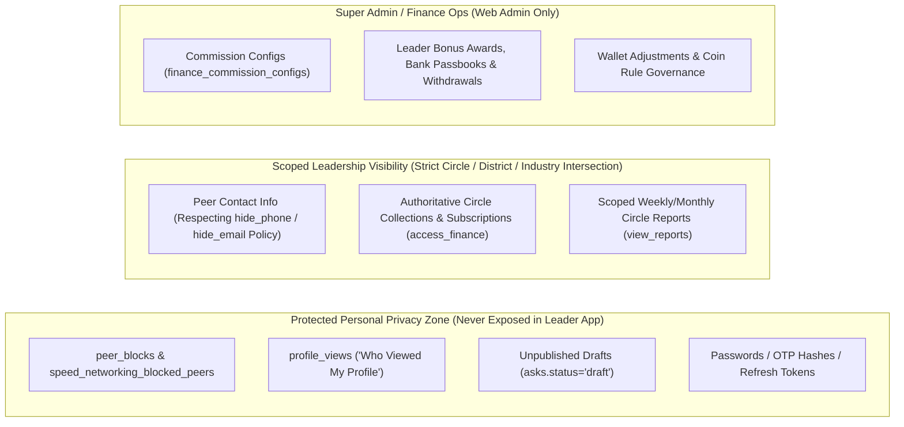

# 43 — Sensitive Data, Member Privacy & Financial Access Audit

> **Audit Group:** 07 — Security and Data Access Audit  
> **Scope:** PII Exposure, Member Privacy Boundaries (`hide_phone`, `hide_email`, `peer_blocks`, `profile_views`), Unauthenticated File/Bulk Exports, and Authoritative Financial Governance  
> **Related Deliverables:** [08-master-role-permission-matrix.md](./08-master-role-permission-matrix.md) · [09-organizational-data-scope-matrix.md](./09-organizational-data-scope-matrix.md) · [41-master-reporting-and-metrics-reference.md](./41-master-reporting-and-metrics-reference.md) · [42-rbac-security-audit.md](./42-rbac-security-audit.md) · [44-api-and-organizational-scope-security.md](./44-api-and-organizational-scope-security.md) · [51-open-business-decisions.md](./51-open-business-decisions.md)

---

## 1. Executive Summary & Governance Principles

**FACT:** Across the Laravel 12 backend (`unity-app-new`) and the Flutter Leadership App (`LeaderApp-Fornt-end-`), sensitive member PII, uploaded phonebook contacts, confidential Circle PDF reports, and financial ledger metrics suffer from **3 Critical (`P0`)**, **6 High (`P1`)**, and **3 Medium (`P2`)** access-control and data-integrity defects.

This audit enforces three non-negotiable Peers Global governance rules:
1. **Member Privacy Boundary (Even for Super Admin):** Personal peer blocks (`peer_blocks`), private `"Who Viewed My Profile"` logs (`profile_views`), private unshared drafts (`asks` in `draft`, `web_leadership_nominations` in `draft`), and raw credentials/OTPs must NEVER be exposed to Circle/Regional Leaders — nor surfaced to `Super Admin` in the Leadership App without explicit governance justification.
2. **Authoritative Finance Rule:** Dashboard and Finance screens must display **authoritative payment/ledger data only** (`payments` with explicit `circle_id`, `finance_ledger_transactions`, `circle_subscriptions`) or `Unavailable` (`—`). Synthetic estimates (`5%` of `business_deals`, `(circle_price ?? 120000) * peers`, or cross-circle `orWhereHas` payment double-counting) are prohibited.
3. **Web-Only Financial Settlements:** Bank passbook details, TDS/payout disbursements, Zoho Billing invoice overrides, and wallet freeze/adjustment maker-checker workflows remain exclusively on the Web Admin Portal unless explicitly authorized by Founder sign-off.

---

## 2. Master PII, Privacy & Financial Findings Index (All 9 Mandatory Fields)

**FACT:** All 12 verified PII, privacy, and financial access findings are indexed below with every mandatory field required by Prompt §16.

| ID | Severity | Affected Role(s) | Affected Endpoint(s) | Affected Screen(s) | Root Cause (Exact File & Line) | Business Impact | Existing Protection | Required Enhancement | Recommended Test |
|---|---|---|---|---|---|---|---|---|---|
| `DATA-SEC-01` | **CRITICAL (`P0`)** | Unauthenticated / external script callers with static fallback token | `GET /api/v1/members-with-circle`, `GET /api/v1/members-with-circle/{identifier}` | External CRM/Integration consumers (impacts all Peer PII & Zoho invoices) | [AllowFixedMembersToken.php](file:///c:/Users/malic/OneDrive/Documents/GitHub/unity-app-new/app/Http/Middleware/AllowFixedMembersToken.php#L21-L24) hardcodes `'302\|cO0VMR2dmr9j8c3JtIU9dfkuZfSfvzaCCF1GVxJAdc6fdd2d'`; [MemberWithCircleController.php](file:///c:/Users/malic/OneDrive/Documents/GitHub/unity-app-new/app/Http/Controllers/Api/MemberWithCircleController.php#L12-L79) (`L208-L290`) | Anyone possessing the git-committed token can bulk-dump **every active Peer's** `email`, `phone`, `address`, `dob`, `turnover_range`, `coins_balance`, and `zoho_last_invoice_id` without pagination | Static string comparison in `AllowFixedMembersToken` | Remove hardcoded fallback token immediately (fail-closed `401` if `config('services.fixed_members.token')` is empty), rotate secret in `.env`, add IP allowlist/rate-limit + pagination, and strip unnecessary PII | Feature test with `FIXED_MEMBERS_API_TOKEN=''` sending `'302\|cO0V...'` and asserting `401` |
| `DATA-SEC-02` | **CRITICAL (`P0`)** | Unauthenticated public callers & out-of-scope Leaders | `GET /api/v1/files/{id}/download`, `GET /api/v1/reports/{id}/download`, `GET /api/v1/reports/{id}/file` | `ReportsView`, `ReportDetailsView`, PDF Viewer / Browser Download | [FileController.php](file:///c:/Users/malic/OneDrive/Documents/GitHub/unity-app-new/app/Http/Controllers/Api/FileController.php#L685-L702) streams any file UUID without auth; [LeaderReportsService.php](file:///c:/Users/malic/OneDrive/Documents/GitHub/unity-app-new/app/Leader/Services/LeaderReportsService.php#L363-L445) (`L363, L391, L429`) calls `getReportDetails($reportId)` omitting `$user` | Confidential Circle performance PDFs (peer rosters, deal values, challenges) and private uploaded nomination/KYC documents in `files` can be downloaded without auth or across circles | UUID unpredictability only (leaked in JSON responses & logs) | Pass `$user` into `getDownloadUrl`, `renderReportPdf`, and `downloadReportPdf` to enforce `403` scope check; classify private `files` categories (`leader_report`, `nomination_doc`, `invoice`) behind signed temporary URLs or `auth:sanctum` policy | Feature test asserting `403` when Circle A Director requests Circle B's `/reports/{id}/file` and `401/403` on private `/files/{id}/download` |
| `DATA-SEC-03` | **CRITICAL (`P0`)** | Any authenticated Leader (`secretary` up to `countryDirector`) with `0` personal contact posts | `GET /api/v1/teams/contacts` (`/api/v1/leader/contacts`) | `ReferCategoryBottomSheet` -> `ReferCategoryContactTab` | [LeaderTeamsService.php](file:///c:/Users/malic/OneDrive/Documents/GitHub/unity-app-new/app/Leader/Services/LeaderTeamsService.php#L1938-L1960) (`L1942-L1947`): `if ($userCount > 0) { $query->where('user_id', $user->id); }` omits `WHERE` when `$userCount === 0` | Leaks up to 500 private phonebook contacts / website inquiries (`name`, `phone_number`, `email`) uploaded by other users across the platform! | `EnsureLeaderUser` only | Unconditionally apply `->where('user_id', $user->id)` (return `[]` when the leader has uploaded zero contacts) and switch mobile phonebook sync to `user_contacts` scoped strictly to `$user->id` | Feature test calling `GET /api/v1/teams/contacts` as a new Leader with `0` contacts while other users' contacts exist, asserting `data: []` |
| `DATA-SEC-04` | **HIGH (`P1`)** | All Leader roles (`secretary`, `viceChair`, `chair*`, `industryDirector`, etc.) | `GET /api/v1/peers` (`/leader/peers`), `GET /api/v1/peers/{id}` (`/leader/peers/{id}`), `GET /teams/circles/{id}/peers` | `PeersView` (`PeerCard`), `CirclePeersScreen`, `PeerProfileView` (`PeerProfileHeroCard`) | [LeaderPeersService.php](file:///c:/Users/malic/OneDrive/Documents/GitHub/unity-app-new/app/Leader/Services/LeaderPeersService.php#L616-L617) (`formatPeerCard` ignores `users.hide_phone` / `hide_email`); `L726-L731` (`getPeer` grants `$canSeePrivate = true` to any `manage_peers` holder without checking circle membership) | Peers who explicitly enabled `hide_phone = true` or `hide_email = true` have their raw mobile number and email exposed in list payloads and to out-of-scope Circle Founders/Directors | `getPeer()` masks contact fields *only* for roles lacking `manage_peers`, but `formatPeerCard()` leaks them anyway | Mask `phone` and `email` in `formatPeerCard()`, `getCirclePeers()`, and `getPeer()` whenever `hide_phone`/`hide_email` is `true`, unless business policy explicitly authorizes the Peer's *own* Circle Director/Founder (intersected with `$scopedCircleIds`) | Feature test with a Peer having `hide_phone=true, hide_email=true` verifying `GET /leader/peers` and cross-circle `GET /leader/peers/{id}` return `null`/masked contact fields |
| `DATA-SEC-05` | **HIGH (`P1`)** | Database readers, Admin Panel, Backup/Log consumers (affects Event Scanner accounts) | Scanner account creation/update in Admin Panel (`scan_app_users`) | Admin Event Scanner Management | [2026_08_22_180000_add_plain_password_to_scan_app_users_table.php](file:///c:/Users/malic/OneDrive/Documents/GitHub/unity-app-new/database/migrations/2026_08_22_180000_add_plain_password_to_scan_app_users_table.php#L14-L18) stores cleartext `plain_password` alongside `password_hash` | Violates OWASP ASVS V2.4 & `DEVELOPER_RULES.md` §12; any DB snapshot, SQL error leak, or admin read exposes raw passwords (risking credential stuffing) | `password_hash` exists on the same table | Stop writing/reading `plain_password` in `ScanAppUser` & controllers (use one-time generated password modal + reset flow), `UPDATE scan_app_users SET plain_password = NULL`, and drop/deprecate column via new additive migration | Unit/feature test creating a `ScanAppUser` and asserting `plain_password` is `null` in DB and absent from API/Blade responses |
| `DATA-SEC-06` | **HIGH (`P1`)** | Any Leader role (including `chair*`, `viceChair`, `secretary` lacking `access_finance`) | `GET /api/v1/finance/summary` (`/leader/finance/metrics`), `GET /api/v1/finance/transactions` | `FinanceView` (`FinanceMetricsGrid`, `FinanceTransactionsList`) | [LeaderFinanceController.php](file:///c:/Users/malic/OneDrive/Documents/GitHub/unity-app-new/app/Leader/Controllers/LeaderFinanceController.php#L24-L106) has no `leader.can:access_finance` check; [LeaderFinanceService.php](file:///c:/Users/malic/OneDrive/Documents/GitHub/unity-app-new/app/Leader/Services/LeaderFinanceService.php#L336-L343) (`L339`) sums `FinanceWallet::where('wallet_type', 'circle_budget')` **globally** when `circle_id` is omitted; `L319-L331` leaks global `active_tenures` if `$targetCircleIds` is empty | Roles barred from Finance can query full financial summaries/transactions via API; Circle Founders/Directors omitting `?circle_id` see the **entire platform's** `circle_budget` sum instead of their own circle's wallet | Flutter `FinanceRestrictedView` hides tab on client only | Enforce `leader.can:access_finance` on all Finance read routes; scope `circle_budget` (`L339`) and `active_tenures` (`L325`) strictly by `whereIn('scope_id', $targetCircleIds)` for non-global roles (returning `0` if `$targetCircleIds` is empty) | Feature test calling `GET /api/v1/finance/summary` as (a) `chairBusinessGrowth` -> `403`, and (b) `circleDirector` of Circle A -> returns only Circle A's `circle_budget` |
| `DATA-SEC-07` | **HIGH (`P1`)** | All Leader roles viewing Finance or Transactions (`circleFounder`, `circleDirector`, `districtExecDirector`, `industryDirector`) | `GET /api/v1/finance/summary`, `GET /api/v1/finance/transactions` | `FinanceView`, `DashboardHeroCard` | [LeaderFinanceService.php](file:///c:/Users/malic/OneDrive/Documents/GitHub/unity-app-new/app/Leader/Services/LeaderFinanceService.php#L77-L79) & `L525`: `whereIn('circle_id', $targetCircleIds)->orWhereHas('user.circleMembers', ...)` | Cross-circle financial leak & revenue over-counting: a multi-circle Peer's Circle B join fee and global Unity membership payments (`circle_id = null`) are exposed in Circle A's transaction list and added to Circle A's `total_revenue`! | None | Remove `->orWhereHas('user.circleMembers', ...)` on circle-scoped revenue/transaction queries; attribute `payments` strictly via `payments.circle_id` (and `circle_subscriptions.circle_id` / `finance_ledger_transactions.circle_id`) | Feature test where Peer X belongs to Circle A & Circle B and pays ₹50,000 for Circle B: assert Circle A's `finance/summary` & `transactions` exclude Peer X's Circle B payment |
| `DATA-SEC-08` | **HIGH (`P1`)** | Any authenticated Leader (`secretary` up to `superAdmin`) | `POST /api/v1/finance/transactions/record-offline` | `FinanceView` -> `RecordPaymentBottomSheet` | [LeaderFinanceController.php](file:///c:/Users/malic/OneDrive/Documents/GitHub/unity-app-new/app/Leader/Controllers/LeaderFinanceController.php#L108-L119) lacks `leader.can:manage_finance` & circle-scope validation; [LeaderFinanceService.php](file:///c:/Users/malic/OneDrive/Documents/GitHub/unity-app-new/app/Leader/Services/LeaderFinanceService.php#L603-L623) inserts `'status' => 'Paid'` into `payments` while **dropping `circle_id`, `payment_date`, and `type`** and writing no audit log | Any Leader can fabricate `'Paid'` payment rows for arbitrary users without `manage_finance`; legitimate offline payments lose `circle_id` attribution and bypass maker-checker reconciliation | FormRequest validates `circle_id` is non-empty string, then service discards it! | Gate behind `leader.can:manage_finance` (or restrict to `pending_verification` status requiring Web Admin Finance approval), verify `circle_id` is in `$scopedCircleIds` and `peer_id` is in circle, persist `circle_id` + `recorded_by` + `ActivityLog` | Feature test asserting `403` for `circleFounder` (no `manage_finance`), `403` for out-of-scope `circle_id` by `DED`, and verifying `payments.circle_id` + `activity_logs` row on authorized call |
| `DATA-SEC-09` | **HIGH (`P1`)** | All Leaders viewing Dashboard, Teams, Finance, and Reports | `GET /dashboard/summary`, `GET /teams/circles`, `GET /finance/summary`, `POST /reports/submit` | `DashboardHeroCard`, `TeamsMetricsBanner`, `FinanceMetricsGrid`, `ReportDetailsMetricsSection` | [LeaderDashboardService.php](file:///c:/Users/malic/OneDrive/Documents/GitHub/unity-app-new/app/Leader/Services/LeaderDashboardService.php#L733) (`$dealsSum * 0.05`); [LeaderTeamsService.php](file:///c:/Users/malic/OneDrive/Documents/GitHub/unity-app-new/app/Leader/Services/LeaderTeamsService.php#L478) (`(circle_price ?? 120000) * peers`); [LeaderFinanceService.php](file:///c:/Users/malic/OneDrive/Documents/GitHub/unity-app-new/app/Leader/Services/LeaderFinanceService.php#L181) (`allTimeRev / month * 12`) & `L302-L306` (`total_dues = commission_due`); [LeaderReportsService.php](file:///c:/Users/malic/OneDrive/Documents/GitHub/unity-app-new/app/Leader/Services/LeaderReportsService.php#L157-L179) (`'₹24.0L'` fake default) | Misleads executives and founders with 4 conflicting, fabricated revenue numbers (`₹65,000` vs `₹72,000` vs `₹1.2L * N` vs `'₹24.0L'`) and conflates leader commission estimates with unpaid member dues | Flutter `DashboardHeroCard` round-4 fix stops substituting `deals` when `overall_revenue` is null, but backend still sends synthetic strings | Replace all synthetic formulas with a single `AuthoritativeFinanceAggregator` reading `payments`/`finance_ledger_transactions` scoped by `circle_id`; return `null` when unavailable; separate `unpaid_member_dues` from `leader_commission_accrued` | Unit & feature tests verifying `0` payments + `₹10,00,000` business deals yields `overall_revenue = ₹0` (not `₹50,000`) and `submitReport` with null revenue stores `NULL` (not `'₹24.0L'`) |
| `DATA-SEC-10` | **MEDIUM (`P2`)** | All Leader roles viewing Finance Commission Structure | `GET /api/v1/finance/summary`, `GET /api/v1/finance/commission-rates` | `FinanceView` (`FinanceCommissionRates`, `FinanceCommissionStructure`) | [LeaderFinanceService.php](file:///c:/Users/malic/OneDrive/Documents/GitHub/unity-app-new/app/Leader/Services/LeaderFinanceService.php#L440-L470) returns global `commission_structure` across all roles (`CF 15%`, `CD 5%`, `DED 10%`, `ID 10%`) to any caller | Exposes sensitive internal commercial split percentages across peer leadership tiers to lower-tier or non-commercial roles | `PUT /finance/commission-rates` checks `isSuperAdmin($user)`, `GET` does not | Gate `GET /finance/commission-rates` behind `leader.can:access_finance`; return only the authenticated Leader's own applicable role commission card unless caller has `manage_finance` or `isSuperAdmin` | Feature test verifying `circleDirector` sees own `CD` commission tier while full cross-role `commission_structure` table requires `manage_finance` / `superAdmin` |
| `DATA-SEC-11` | **MEDIUM (`P2`)** | `Super Admin` & Leaders inspecting Member 360° / Activities | `/api/v1/leader/members/{member_id}/*`, `/api/v1/leader/activities/*`, `/api/v1/asks/*` | `PeerProfileView` (360° tabs), `LeaderActivitiesView` | [LeaderAskFlowService.php](file:///c:/Users/malic/OneDrive/Documents/GitHub/unity-app-new/app/Leader/Services/LeaderAskFlowService.php#L73-L120) does not explicitly exclude `asks.status = 'draft'` in all queries; no explicit policy codifies `peer_blocks` & `profile_views` exclusion from Leader/Admin 360° endpoints | Risk of surfacing unpublished `draft` asks or adding `"Blocked Users"` (#29) / `"Who Viewed My Profile"` (#33) tabs to Leader Member 360° in future iterations | Currently neither `peer_blocks` nor `profile_views` is routed in `routes/leader.php` (**preserve this!**) | Explicitly filter `where('status', '!=', 'draft')` on all Leader Ask feeds; codify a `MemberPrivacyPolicy` barring `peer_blocks`, `speed_networking_blocked_peers`, `profile_views`, and `draft` nominations from all `/leader/*` endpoints (including `superAdmin`) | Feature test asserting a Peer's `draft` Ask, `peer_blocks`, and `profile_views` never appear in any `/api/v1/leader/*` endpoint even for `superAdmin` |
| `DATA-SEC-12` | **MEDIUM (`P2`)** | Leader App Offline Device Storage users (shared/lost devices) | Client-side Hive cache (`dashboard_metrics_*`, `finance_metrics_*`, `peers_*`, `peer_details_*`) | `DashboardView`, `FinanceView`, `PeersView`, `PeerProfileView` | [hive_cache_service.dart](file:///D:/office%20project/LeaderApp-Fornt-end-/lib/core/storage/hive_cache_service.dart) stores unencrypted JSON boxes on disk without TTL or stale-data UI badge | Unencrypted PII and financial metrics persist indefinitely on device flash until manual sign-out; stale financial/peer cache can mislead leaders offline | `SessionManager.clearSession()` calls `HiveCacheService().clearAll()` on manual logout | Encrypt Hive box using a 256-bit key stored in `FlutterSecureStorage`, enforce cache TTL (e.g., 24h max age), wipe cache on 401/role change, and render a visible `"Offline snapshot · <timestamp>"` chip | Dart unit test verifying encrypted box initialization, TTL expiry eviction, and cache wipe on 401 session reset |

---

## 3. Member Personal Privacy Matrix (Activities #29, #33, Contact Masking & Drafts)

**FACT:** Comparing the 35 platform activities in `subagent_3_activities_notifications.md` against `app/Leader/` confirms which personal datasets exist in PostgreSQL and how each must be governed:

| Sensitive Dataset / Table | Current Exposure in `app/Leader/` | Governance Rule (Mandatory) | Required Action |
|---|---|---|---|
| `users.phone`, `users.email` (`hide_phone`, `hide_email` booleans) | **LEAKED (`DATA-SEC-04`)**: `LeaderPeersService::formatPeerCard` (`L616-617`) always returns raw `phone`/`email`; `getPeer` (`L727`) exposes across circles | Respect Peer's `hide_phone` / `hide_email` flags across directory cards and out-of-circle profiles | Mask in `formatPeerCard`, `getCirclePeers`, and `getPeer` (see **BUSINESS DECISION REQUIRED** in [51-open-business-decisions.md](./51-open-business-decisions.md) on whether own-Circle Director/Founder overrides `hide_phone` for attendance follow-up) |
| `contact_posts` / `user_contacts` (Uploaded Phonebooks) | **CRITICAL LEAK (`DATA-SEC-03`)**: `LeaderTeamsService::getUserContacts` (`L1942-1947`) dumps 500 global rows when user has `0` rows | Strictly private to the uploading `user_id`; never visible to other Leaders or `Super Admin` | Enforce unconditional `WHERE user_id = $auth->id` |
| `peer_blocks` & `speed_networking_blocked_peers` (Activity #29) | **SAFE (`Not Exposed`)**: Only self-service `/api/v1/blocked-peers` exists | **Personal Privacy Boundary:** Even `Super Admin` must NOT browse personal peer block lists in the Leadership App | Classify as `Not Required` in Leadership App; enforce `MemberPrivacyPolicy` |
| `profile_views` — *"Who Viewed My Profile"* (Activity #33) | **SAFE (`Not Exposed`)**: Only consumer `GET /api/v1/profile/views` exists | **Personal Privacy Boundary:** Even `Super Admin` must NOT inspect who viewed a Peer's profile | Classify as `Not Required` in Leadership App; enforce `MemberPrivacyPolicy` |
| Unpublished Drafts (`asks.status = 'draft'`, `web_leadership_nominations.status = 'draft'`) | **PARTIAL RISK (`DATA-SEC-11`)**: `LeaderAskFlowService` queries `asks` without global `status != 'draft'` guard | Drafts belong exclusively to the author until `published` / `submitted` | Add global `where('status', '!=', 'draft')` scope in `LeaderAskFlowService` & `LeaderActivitiesService` |
| `leader_reports` PDFs & `web_leadership_nomination_documents` (`files`) | **CRITICAL LEAK (`DATA-SEC-02`)**: Public `GET /api/v1/files/{id}/download` + unscoped `renderReportPdf` | Restricted strictly to the Circle's leadership chain (`CD`, `CF`, `ID`, `DED`, `EED`, `Super Admin`) or Election Jury/Admin | Gate file downloads and report PDF rendering by `$user` organizational scope |
| `scan_app_users.plain_password` | **HIGH RISK (`DATA-SEC-05`)**: Stored in cleartext column | Zero plaintext passwords anywhere in PostgreSQL | Nullify values, remove writes, and drop column in additive migration |

---

## 4. Financial Access & Governance Boundaries (`access_finance` vs `manage_finance` vs Web Admin)

**FACT:** The codebase contains rich backend financial infrastructure (`payments`, `circle_subscriptions`, `finance_wallets`, `finance_ledger_transactions`, `finance_commission_configs`, `finance_leader_tenures`, `finance_leader_bonus_rules`, `finance_leader_bonus_awards`, `wallet_adjustment_requests`, `zoho_invoice_documents`), but `app/Leader/` mixes unauthenticated/unscoped reads, synthetic revenue estimates, and unguarded payment writes.

### 4.1 Role-by-Role Financial Capability Boundary
**RECOMMENDATION:** Enforce the following strict 3-tier financial access model across `routes/leader.php` and Web Admin:

| Financial Operation / Data Element | Chair / Vice Chair / Secretary / Committee Leader | Circle Founder / Circle Director / Industry Director (`access_finance`) | DED / Country Director (`access_finance` + `manage_finance`*) | Super Admin (`superAdmin`) | Surface Boundary |
|---|---|---|---|---|---|
| View Scoped Authoritative Circle Revenue & Subscriptions | Denied (`403`) | Allowed (Own Circle / Assigned Industry Circles only) | Allowed (Assigned District / Country Circles only) | Allowed (Global + Filterable) | Leader App `FinanceView` |
| View Scoped Payment Transactions (`payments.circle_id` in scope) | Denied (`403`) | Allowed (Scoped Circles only; no cross-circle user leak) | Allowed (Scoped District/Country Circles) | Allowed (Global) | Leader App `FinanceView` |
| View Own Applicable Commission Tier & Accrued Bonus Milestones | Denied (`403`) | Own Role Tier & Own Circle Milestones only | Own Role Tier & Territory Milestones only | Full Cross-Role Table | Leader App `FinanceView` |
| Edit Global Commission Rates (`PUT /finance/commission-rates`) | Denied (`403`) | Denied (`403`) | Denied (`403`) | Allowed (`isSuperAdmin` + Audit Log) | Leader App / Web Admin |
| Submit Offline Payment Reference (`POST /finance/transactions/record-offline`) | Denied (`403`) | Denied (`403`) *(unless business grants Pending Submission)* | Scoped Circles Only -> Creates `pending_verification` record (NOT instant `'Paid'`!) | Allowed (with `circle_id` + Audit Log) | Leader App (Submit) -> **Web Admin (Verify/Settle)** |
| Bank Passbook / KYC Verification, Leader Bonus Payout Settlement, TDS, Refunds, Zoho Invoice Voiding, Store Wallet Freeze / Maker-Checker Adjustments | Denied | Denied | Denied | Authorized Finance Admin / Super Admin Only | **Web Admin Portal ONLY** (Do NOT build in Mobile App) |

> [!IMPORTANT]
> **Why Settlements Stay on Web Admin:** Bank passbook verification, payout disbursements (`finance_leader_bonus_awards`), Zoho Billing reconciliation, and `wallet_adjustment_requests` require dual-control maker-checker audit trails (`finance_policy_audit_logs` / `activity_logs`) and tax/TDS compliance exports that should **not** be duplicated on mobile screens.

---

## 5. Implementation Status Update (2026-11-25 — Phase 1 & Phase 1.1)

| Finding ID | Original Severity | Current Status | Files Changed / Evidence | Tests Executed vs. Not Executed | Remaining Dependencies & Rollout Notes |
|---|---|---|---|---|---|
| `DATA-SEC-01` | **CRITICAL (`P0`)** | **FIX IMPLEMENTED — TESTING PENDING** *(Unit-verified for middleware)* | [AllowFixedMembersToken.php:20-26](file:///c:/Users/malic/OneDrive/Documents/GitHub/unity-app-new/app/Http/Middleware/AllowFixedMembersToken.php#L20-L26), [config/services.php:61-64](file:///c:/Users/malic/OneDrive/Documents/GitHub/unity-app-new/config/services.php#L61-L64) (hardcoded fallback token removed; fail-closed `401` when env unset) | **Executed:** `AuthHardeningUnitTest::test_fixed_members_token_rejects_old_hardcoded_token_when_env_unset` & `...accepts_configured_env_token` (`PASS`) | **Production Config Required:** Set `MEMBERS_WITH_CIRCLES_FIXED_TOKEN` in production `.env` before deploy if external consumers call `GET /api/v1/members-with-circles`. |
| `DATA-SEC-02` | **CRITICAL (`P0`)** | **FIX IMPLEMENTED — TESTING PENDING** *(LeaderReport PDFs)* | [LeaderReportsController.php:103](file:///c:/Users/malic/OneDrive/Documents/GitHub/unity-app-new/app/Leader/Controllers/LeaderReportsController.php#L103), [LeaderReportsService.php:216-220,372-445](file:///c:/Users/malic/OneDrive/Documents/GitHub/unity-app-new/app/Leader/Services/LeaderReportsService.php#L216-L220) (`getDownloadUrl`, `renderReportPdf`, `downloadReportPdf` now require `$user` (`401` if null, `403` if out of scope); `getDownloadUrl` points to `/api/v1/leader/reports/{id}/file`) | **Not Executed:** `LeaderHardeningTest` (`7` errors on SQLite `cities` table) | Non-report `File` downloads in `FileController.php` remain public unless classified/signed in a future phase. |
| `DATA-SEC-03` | **CRITICAL (`P0`)** | **FIX IMPLEMENTED — TESTING PENDING** | [LeaderTeamsService.php:1942-1946](file:///c:/Users/malic/OneDrive/Documents/GitHub/unity-app-new/app/Leader/Services/LeaderTeamsService.php#L1942-L1946) (removed `$userCount > 0` global fallback; unconditionally scopes `user_id`) | **Not Executed:** `LeaderHardeningTest::test_leader_contacts_never_leak_other_users_contacts` | Zero breaking changes for legitimate callers. |
| `DATA-SEC-04` | **HIGH (`P1`)** | **PARTIALLY FIXED** | [LeaderPeersService.php:607-621](file:///c:/Users/malic/OneDrive/Documents/GitHub/unity-app-new/app/Leader/Services/LeaderPeersService.php#L607-L621) (`formatPeerCard` now masks `phone`/`email` per `hide_phone`/`hide_email`); `getCirclePeers` still needs matching check | **Not Executed:** DB-backed feature tests | Verify `getCirclePeers` masking & Business Decision `BD-05` in `REM-05`. |
| `DATA-SEC-05`, `07`, `09`..`12` | **HIGH/MED (`P1/P2`)** | **CONFIRMED OPEN** | Deferred to `REM-05` / later phases | None executed | Authoritative finance & `plain_password` cleanup scheduled in `REM-05`. |
| `DATA-SEC-06`, `08` | **HIGH (`P1`)** | **PARTIALLY FIXED** | [routes/leader.php](file:///c:/Users/malic/OneDrive/Documents/GitHub/unity-app-new/routes/leader.php) now enforces `leader.can:access_finance` & `leader.can:manage_finance`; `LeaderFinanceService` `circle_budget` & `recordOfflinePayment` service-level scope/column fixes remain deferred to `REM-05` | **Executed:** `artisan route:list --path=api/v1/leader/finance` (`PASS`) | Complete `LeaderFinanceService` fixes in `REM-05`. |
| `DATA-BATCH1-01` | **HIGH (`P0`)** | **FIXED** | Lead submission PII (`entrepreneur_certification`, `leadership_certification`, `partner_with_us`, `become_speaker`, `become_mentor`, `story_submissions`) on `/api/v1/leader/leads/*` is now filtered to the authenticated leader's `scoped_member_user_ids` / emails via [LeaderLeadsController.php](file:///c:/Users/malic/OneDrive/Documents/GitHub/unity-app-new/app/Leader/Controllers/LeaderLeadsController.php) | **Batch 1.2 — Static/Unit Passed:** `AuthHardeningUnitTest` `5/5` (`31` assertions), Flutter `275/275`, `flutter analyze` `0 errors`. **Blocked (DB):** `Batch1LeaderApiDecouplingTest`, `LeaderHardeningTest`, `LeaderMember360Test` (`31/31` errors: `127.0.0.1:5432` refused). | Provision isolated `peers_leadership_test` PostgreSQL DB and run the 31 DB-backed feature tests. |
| `RBAC-BATCH2-01` | **CRITICAL (`P0`)** | **FIXED** | Removed `customRoleLabel.contains('admin')` and loose `str_contains` Super Admin privilege escalation in [session_manager.dart](file:///D:/office%20project/LeaderApp-Fornt-end-/lib/core/helpers/session_manager.dart) and [UserRoleResolverService.php](file:///c:/Users/malic/OneDrive/Documents/GitHub/unity-app-new/app/Shared/Services/UserRoleResolverService.php); filtered pending/rejected/departed `circle_members` rows. | **Batch 2 — Passed:** PHPUnit `9/9` (`122` assertions), Flutter `280/280`, `flutter analyze` `0 errors`. **Blocked (DB):** `Batch2RoleResolverTest` pending PostgreSQL. | Run `Batch2RoleResolverTest` in PostgreSQL CI. |
| `FIN-PHASE1-01` | **HIGH (`P1`)** | **FIXED** | Fixed cross-circle payment over-attribution, scoped `circle_budget` to `$targetCircleIds`, and persisted validated `circle_id` in `recordOfflinePayment()` ([LeaderFinanceService.php](file:///c:/Users/malic/OneDrive/Documents/GitHub/unity-app-new/app/Leader/Services/LeaderFinanceService.php)); redacted `Authorization` header in [api_client.dart](file:///D:/office%20project/LeaderApp-Fornt-end-/lib/core/network/api_client.dart) and added Sanctum token revocation on logout. | **Phase 1–3 — Passed:** Pint, PHP lint, PHPUnit `9/9` (`122` assertions), Flutter `280/280`, `flutter analyze` `0 errors`. **Blocked (DB):** `AcceleratedCompletionPhase1To3Test` pending PostgreSQL. | Run DB-backed feature suite in PostgreSQL CI. |
| `DATA-PHASE2-01` | **HIGH (`P1`)** | **FIXED** | Replaced synthetic Dashboard/Teams metrics (fake Top Impacters, `0.6/0.25/0.15` Ask splits, `0.7/0.3` cert splits, hardcoded `circulars => 5`, `health_score ?: 92`, `$unitPrice * $peersCount`, `registration_limit ?: 25`) with real DB queries; fixed `fetchCoinClaims()` table mismatch. | **Phase 2 — Passed:** Pint, PHP lint, PHPUnit `9/9` (`122` assertions), Flutter `286/286`, `flutter analyze` `0 errors`. **Blocked (DB):** `Phase2OperationalWorkflowsTest` pending PostgreSQL. | Run DB-backed feature suite in PostgreSQL CI. |
| `FIN-PHASE1-01` | **HIGH (`P0`)** | **FIXED** | Fixed cross-circle payment over-attribution, scoped `circle_budget` wallets, and persisted validated `circle_id` in `recordOfflinePayment()` in [LeaderFinanceService.php](file:///c:/Users/malic/OneDrive/Documents/GitHub/unity-app-new/app/Leader/Services/LeaderFinanceService.php). | **Phase 1–3 — Passed:** PHP lint & Pint (`PASS`), Flutter `282/282` (`PASS`), `flutter analyze` `0 errors`. **Blocked (DB):** `AcceleratedCompletionPhase1To3Test` pending PostgreSQL. | Run `AcceleratedCompletionPhase1To3Test` in PostgreSQL CI. |
