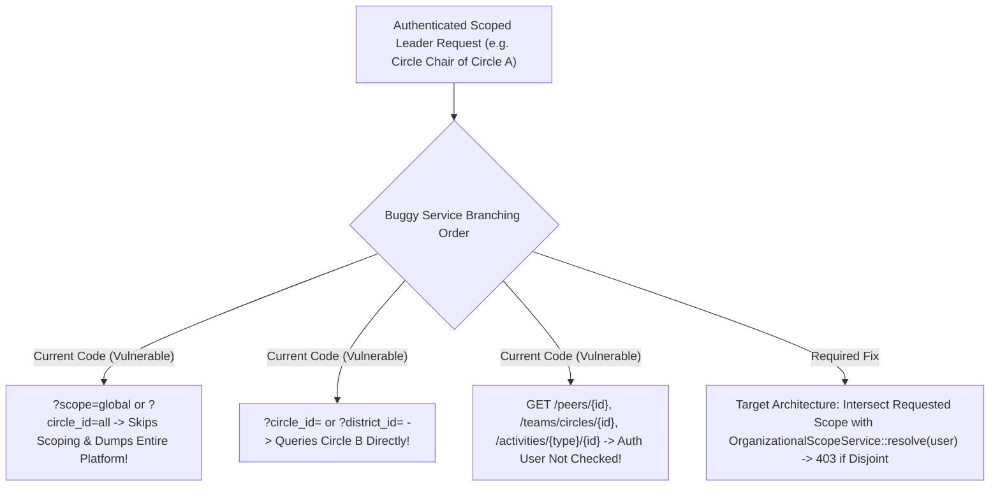

# 44 — API & Organizational Scope Security Audit (IDOR & Boundary Verification)

> **Audit Group:** 07 — Security and Data Access Audit  
> **Scope:** Endpoint-by-Endpoint Organizational Scope Enforcement across `/api/v1/leader/*`, `/api/v1/leadership/*`, `/api/v1/ded/*`, and `/api/v1/admin/*`  
> **Related Deliverables:** [03-existing-backend-api-inventory.md](./03-existing-backend-api-inventory.md) · [09-organizational-data-scope-matrix.md](./09-organizational-data-scope-matrix.md) · [42-rbac-security-audit.md](./42-rbac-security-audit.md) · [43-sensitive-data-and-finance-access.md](./43-sensitive-data-and-finance-access.md) · [47-api-enhancement-recommendations.md](./47-api-enhancement-recommendations.md)

---

## 1. Executive Summary: Organizational Scope Architecture & Systemic Flaws

**FACT:** Peers Global operates five competing scope-resolution classes across the Laravel 12 backend:
1. `LeaderPermissionService::resolveManagedCircles()` ([LeaderPermissionService.php](file:///c:/Users/malic/OneDrive/Documents/GitHub/unity-app-new/app/Leader/Services/LeaderPermissionService.php#L509-L586))
2. `LeaderTeamsService::resolveScopedCircleIds()` & `LeaderDashboardService::resolveLeaderScope()` ([LeaderTeamsService.php](file:///c:/Users/malic/OneDrive/Documents/GitHub/unity-app-new/app/Leader/Services/LeaderTeamsService.php#L28-L102), [LeaderDashboardService.php](file:///c:/Users/malic/OneDrive/Documents/GitHub/unity-app-new/app/Leader/Services/LeaderDashboardService.php#L47-L270))
3. `AdminCircleScope` & `DistrictScopeService` ([AdminCircleScope.php](file:///c:/Users/malic/OneDrive/Documents/GitHub/unity-app-new/app/Support/AdminCircleScope.php#L180-L481), [DistrictScopeService.php](file:///c:/Users/malic/OneDrive/Documents/GitHub/unity-app-new/app/Services/Api/Ded/DistrictScopeService.php#L18-L57))
4. `IndustryDirectorScopeService` ([IndustryDirectorScopeService.php](file:///c:/Users/malic/OneDrive/Documents/GitHub/unity-app-new/app/Services/Admin/IndustryDirectorScopeService.php))
5. `OrganizationalScopeService` ([OrganizationalScopeService.php](file:///c:/Users/malic/OneDrive/Documents/GitHub/unity-app-new/app/Shared/OrganizationalScope/OrganizationalScopeService.php#L1-L683) — powers `/api/v1/leadership/*` APIs 44–50)

Because `app/Leader/` services evaluate client-supplied query parameters (`?scope=global`, `?circle_id=all`, `?circle_id=<uuid>`, `?district_id=<uuid>`) **before** intersecting with the authenticated Leader's server-resolved `$scopedCircleIds`, or omit `$user` entirely on detail/sub-resource methods, **10 distinct horizontal Insecure Direct Object Reference (IDOR) and cross-scope data leak vulnerabilities** exist across `/api/v1/leader/*` and `/api/v1/leadership/*`.

---

## 2. Master Scope & IDOR Vulnerability Register (All 9 Mandatory Fields)

**FACT:** Every verified organizational scope and route-isolation defect is documented below with all nine mandatory fields (Prompt §16).

| ID | Severity | Affected Role(s) | Affected Endpoint(s) | Affected Screen(s) | Root Cause (Exact File & Line) | Business Impact | Existing Protection | Required Enhancement | Recommended Test |
|---|---|---|---|---|---|---|---|---|---|
| `SCOPE-SEC-01` | **CRITICAL (`P0`)** | All non-global Leaders (`secretary`, `viceChair`, `chair*`, `circleFounder`, `circleDirector`, `industryDirector`, `districtExecDirector`) | `GET /api/v1/peers` (alias `GET /api/v1/leader/peers`) with `?scope=global` or `?circle_id=all\|global\|all_circles\|platform` | `PeersView`, `ReportExportService` (when falling back to global peers) | [LeaderPeersService.php](file:///c:/Users/malic/OneDrive/Documents/GitHub/unity-app-new/app/Leader/Services/LeaderPeersService.php#L288-L330) & `L423`: sets `$isGlobalRequested = true` from query string and checks `elseif (! $isAdmin && ! $isGlobalRequested)` (`L330`), falling into the unrestricted `else` branch (`L423`) | Any Circle Secretary or Chair can dump **100% of platform users** (names, unmasked phones, emails, companies, metrics) in one query parameter override | `EnsureLeaderUser` (`is_leader == true`) only | Never honor `?scope=global` or `?circle_id=all` as unrestricted unless `$this->permissions->isSuperAdmin($user)`; for non-global leaders, `all` must mean `whereIn('circle_id', $scopedCircleIds)` | Feature test calling `GET /api/v1/leader/peers?scope=global` and `?circle_id=all` as `circleChair` of Circle A and asserting `0` peers outside Circle A are returned |
| `SCOPE-SEC-02` | **HIGH (`P1`)** | All Circle, Industry, and District Leaders | `GET /peers?circle_id=<uuid>&district_id=<uuid>`, `GET /reports?circle_id=<uuid>`, `POST /reports/submit`, `GET /finance/summary?circle_id=<uuid>`, `GET /finance/transactions?circle_id=<uuid>`, `GET /activities/impacts?circle_id=<uuid>`, `GET /activities/p2p-meetings?circle_id=<uuid>` | `DashboardCircleSwitcher`, `PeersView`, `ReportsView`, `FinanceView`, `ImpactsView`, `P2PMeetingsView` | `if ($circleId)` / `if ($districtId)` runs **before** `$scopedCircleIds` in [LeaderPeersService.php](file:///c:/Users/malic/OneDrive/Documents/GitHub/unity-app-new/app/Leader/Services/LeaderPeersService.php#L292-L329), [LeaderReportsService.php](file:///c:/Users/malic/OneDrive/Documents/GitHub/unity-app-new/app/Leader/Services/LeaderReportsService.php#L48-L55) & `L118-L121`, [LeaderTeamsService.php](file:///c:/Users/malic/OneDrive/Documents/GitHub/unity-app-new/app/Leader/Services/LeaderTeamsService.php#L28-L40) (`resolveDedDistrictId`), [LeaderFinanceService.php](file:///c:/Users/malic/OneDrive/Documents/GitHub/unity-app-new/app/Leader/Services/LeaderFinanceService.php#L67-L109) & `L515`, [LeaderActivitiesService.php](file:///c:/Users/malic/OneDrive/Documents/GitHub/unity-app-new/app/Leader/Services/LeaderActivitiesService.php#L138-L161) & `L264-L287` | Horizontal IDOR across Circles and Districts: any Circle Leader can read another Circle's peers, reports, revenues, transactions, P2P meetings, or submit a fake report into another Circle; any DED can pass `?district_id=<other_uuid>` to spy on rival districts | Only `LeaderDashboardService::resolveLeaderScope` (`L73`) validates `$circleId` against `$scopedCircleIds`! | Centralize `assertCircleInLeaderScope(User $user, string $circleId)` and `assertDistrictInLeaderScope(User $user, string $districtId)` throwing `403 UNAUTHORIZED_SCOPE` whenever requested ID is outside authorized set; remove random `Circle::first()` fallback in `submitReport` (`L118`) | Parameterized feature test passing Circle B's UUID and District Y's UUID across all 7 endpoints as Circle A Director / District X DED, asserting `403` |
| `SCOPE-SEC-03` | **HIGH (`P1`)** | All non-global Leaders | `GET /peers/{id}`, `GET /peers/{id}/meetings`, `GET /peers/{id}/activities`, `POST /peers/{id}/wishes`, plus unrouted `LeaderPeersController::update` | `PeerProfileView`, `CelebrationCard` | [LeaderPeersController.php](file:///c:/Users/malic/OneDrive/Documents/GitHub/unity-app-new/app/Leader/Controllers/LeaderPeersController.php#L100-L261) & [LeaderPeersService.php](file:///c:/Users/malic/OneDrive/Documents/GitHub/unity-app-new/app/Leader/Services/LeaderPeersService.php#L629-L1150) (`getPeer` `L629`, `sendWish` `L928`, `getPeerMeetings` `L1011`, `getPeerActivities` `L1119`) do not pass or check `$user` scope (unlike `LeaderMember360Service::resolveMember` at `L34-L82`!) | Direct Peer UUID IDOR: any Leader can inspect any platform user's profile, subscriptions, 1-on-1 meeting history, and activities, or spam wishes to arbitrary users | Route authentication (`leader.user`) only; note `LeaderMember360Service` *does* check scope, creating an inconsistent backdoor via `/peers/{id}` | Pass `$request->user()` to `getPeer`, `getPeerMeetings`, `getPeerActivities`, `sendWish`, and `update`; reuse `LeaderMember360Service::resolveMember($user, $peerId)` scope intersection (`403` if Peer shares zero scoped circles with Leader) | Feature test calling `GET /api/v1/leader/peers/{outOfScopePeerId}` and `/meetings` as `circleDirector`, asserting `403` |
| `SCOPE-SEC-04` | **HIGH (`P1`)** | All non-global Leaders | `GET /teams/circles/{id}`, `GET /teams/circles/{circle_id}/peers`, `GET /teams/circles/{id}/sub-industries`, `GET /teams/circles/{id}/events`, `POST /teams/circles/{id}/refer-category` | `CircleDetailsView`, `CirclePeersScreen`, `CircleSubIndustriesScreen`, `CircleEventsScreen`, `ReferCategoryBottomSheet` | [LeaderTeamsController.php](file:///c:/Users/malic/OneDrive/Documents/GitHub/unity-app-new/app/Leader/Controllers/LeaderTeamsController.php#L71-L154) & [LeaderTeamsService.php](file:///c:/Users/malic/OneDrive/Documents/GitHub/unity-app-new/app/Leader/Services/LeaderTeamsService.php#L1227-L1927) (`L1227, L1322, L1571, L1680, L1806`) omit scope validation; `getSubIndustries` (`L1325-L1327`) even falls back to `Circle::query()->first()` on invalid ID! | Any Leader can inspect rival Circles' full rosters, category vacancies, internal events, leadership structure, and inject category referrals into unauthorized Circles | `getCirclesList` (`L902`) filters the directory list, but direct `{id}` sub-routes are wide open | Enforce `assertCircleInLeaderScope($request->user(), $circleId)` + `->whereUuid('id')` / `->whereUuid('circle_id')` on all 5 `/teams/circles/{id}*` routes; return `404` (never `Circle::first()`) when circle is missing | Feature test asserting `403` on all 5 `/teams/circles/{otherCircleId}*` endpoints for an out-of-scope `circleFounder` |
| `SCOPE-SEC-05` | **HIGH (`P1`)** | All non-global Leaders | `GET /ask-flows/summary`, `GET /ask-flows`, `GET /ask-flows/{id}`, plus `/leader/asks/{flow}/global` | `DashboardView` (Asks Dome Tab), `PeerCollaborationScreen`, `PeerHelpScreen`, `PeerReferralScreen`, `RequirementsView` | [LeaderAskFlowController.php](file:///c:/Users/malic/OneDrive/Documents/GitHub/unity-app-new/app/Leader/Controllers/LeaderAskFlowController.php#L1-L133) & [LeaderAskFlowService.php](file:///c:/Users/malic/OneDrive/Documents/GitHub/unity-app-new/app/Leader/Services/LeaderAskFlowService.php#L73-L480) (`getFlows` `L73`, `getFlowDetail` `L275`, `getSummary` `L404`) do not accept `$user` or apply circle/district/industry filters | Global commercial intelligence leak: every Circle Chair/Secretary sees **all** Collaboration, Get Help, and Referral Asks across the entire platform (including asks restricted via `asks.visibility_type = 'circle'` or `'district'`!) | None | Pass `$request->user()` + optional `$circleId` into `LeaderAskFlowService`; restrict non-global leaders to Asks authored by `$scopedPeerIds` OR where `visibility_circle_id IN $scopedCircleIds` / `visibility_district_id IN $scopedDistrictIds` (and `status != 'draft'`) | Feature test creating a circle-only Ask in Circle B (`visibility_type='circle'`) and asserting Circle A's Director gets `0` count in `/ask-flows/summary` and `403` on `/ask-flows/{id}` |
| `SCOPE-SEC-06` | **HIGH (`P1`)** | All non-global Leaders | `GET /activities/{type}/{id}` (`/leader/activities/{type}/{id}`), `POST /activities/p2p-meetings`, `POST /activities/referrals` | `LeaderActivitiesView`, `LogP2pBottomSheet`, `SendReferralBottomSheet` | [LeaderActivitiesService.php](file:///c:/Users/malic/OneDrive/Documents/GitHub/unity-app-new/app/Leader/Services/LeaderActivitiesService.php#L2485-L2727) (`showDetail`) fetches activity by `{id}` without checking `$scopedPeerIds`; `storeP2pMeeting` (`L285`) & `storeReferral` (`L340`) allow targeting any `peer_id` on the platform | Activity detail IDOR leaks private deal values, referral phone/email leads, and visitor details across circles; unvalidated `peer_id` allows cross-platform push spam | `index` (`GET /activities`) applies `resolveActivityScope`, but `showDetail` and `POST` endpoints skip it | Verify at least one participant (`user_id`, `from_user_id`, `to_user_id`, `initiator_user_id`, `peer_user_id`) belongs to `$scopedPeerIds` in `showDetail` (`403` otherwise); validate `peer_id` / `to_peer_id` scope or connection rules on `POST` | Feature test fetching a `business_deals` UUID between two Circle B Peers as a Circle A Chair and asserting `403` |
| `SCOPE-SEC-07` | **HIGH (`P1`)** | `countryDirector` (`eed`), `industryDirector`, and Circle Leaders who are also regular members of a second Circle | All endpoints calling `LeaderPermissionService::resolveManagedCircles()` or `AdminAccess::isSuper()` | `ProfileAssignedCirclesCard`, `DashboardCircleSwitcher`, Web Admin | [LeaderPermissionService.php](file:///c:/Users/malic/OneDrive/Documents/GitHub/unity-app-new/app/Leader/Services/LeaderPermissionService.php#L517) (`countryDirector` has **zero** country filter — returns all global circles; `L558` `LIKE '%$indId%'` matches `10, 11, 21` for industry `1`; `L564-L573` omits `calendar->leadership`, `vice_chair_user_id`, `secretary_user_id`, committee chairs, AND `L571` `orWhereHas('members', status != 'rejected')` grants leader scope over circles where the user is only a regular/pending `member`!); [AdminAccess.php](file:///c:/Users/malic/OneDrive/Documents/GitHub/unity-app-new/app/Support/AdminAccess.php#L20) puts `'eed'` in `SUPER_ROLE_KEYS` | 1. Country Director of Country A gets unrestricted Global access across all countries. 2. Industry Director of ID `1` gets unauthorized access to Industries `10–19, 21...`. 3. A Secretary in Circle A who is a regular Peer (or `pending` applicant!) in Circle B gets full Leader access over Circle B! 4. Vice Chairs/Secretaries assigned via `circles.vice_chair_user_id` or `calendar` JSON get `0` managed circles! | `PermissionService::dataScope()` (`L704-L725`) filters `circles.country`, but `LeaderPermissionService` and `AdminAccess` ignore it | 1. Filter `countryDirector` by assigned `country` / `country_id` from `user_organizational_assignments` / `admin_user_roles.scope_value` (never treat `eed` as global `SUPER_ROLE_KEYS`). 2. Replace `LIKE '%$indId%'` with `whereJsonContains('industry_tags', (int) $indId)` + `circle_category_mappings`. 3. Restrict Circle Leader query in `L571` to `status = 'approved'` AND `role IN ('founder','director','chair','vice_chair','secretary','committee_leader')` + include all `circles.*_user_id` & `calendar.leadership` keys | Unit test suite on `LeaderPermissionService::resolveManagedCircles()` covering multi-country EED, Industry `1` vs `10`, dual-circle Leader+Member user, and `calendar.leadership` Vice Chair |
| `SCOPE-SEC-08` | **MEDIUM (`P2`)** | Public Website Election Portal visitors & Authenticated Leaders | `GET /api/v1/leadership/circles` | Public Leadership Election Results SPA vs Scoped Leadership API #45 | **Route Collision** in [routes/leadership.php](file:///c:/Users/malic/OneDrive/Documents/GitHub/unity-app-new/routes/leadership.php#L111) (`FinalDecisionController@circles`, public) vs [routes/leadership.php](file:///c:/Users/malic/OneDrive/Documents/GitHub/unity-app-new/routes/leadership.php#L313) (`LeadershipCirclesController@index`, `['auth:sanctum', 'leader.user']`) | `L313` overwrites `L111` in Laravel's router table, breaking public `/api/v1/leadership/circles` with `401 Unauthenticated` (`GET /api/v1/leadership/public/circles` at `L110` still works, creating confusing split behavior) | `L313` happens to win with stricter middleware, preventing a public leak but breaking public callers of `/leadership/circles` | Remove redundant public `Route::get('circles', ...)` at `L111` (standardize public SPA on existing `L110` `GET /api/v1/leadership/public/circles`) so `GET /api/v1/leadership/circles` cleanly serves authenticated Leadership API #45 | Route registration test (`php artisan route:list --path=api/v1/leadership/circles`) asserting zero duplicate URI definitions and `200` on `/public/circles` |
| `SCOPE-SEC-09` | **MEDIUM (`P2`)** | Multi-Circle Peers viewed by Scoped Leaders | `GET /peers`, `GET /peers/{id}`, `GET /activities`, `GET /dashboard/top-impacters` | `PeersView`, `PeerProfileView`, `DashboardTopImpacters` | [LeaderPeersService.php](file:///c:/Users/malic/OneDrive/Documents/GitHub/unity-app-new/app/Leader/Services/LeaderPeersService.php#L497-L506) & `L644`, [LeaderActivitiesService.php](file:///c:/Users/malic/OneDrive/Documents/GitHub/unity-app-new/app/Leader/Services/LeaderActivitiesService.php#L63-L68), [LeaderDashboardService.php](file:///c:/Users/malic/OneDrive/Documents/GitHub/unity-app-new/app/Leader/Services/LeaderDashboardService.php#L897-L902) pick `$u->circleMembers->first()?->circle` without intersecting `$scopedCircleIds` | Leaks out-of-scope Circle memberships & Circle names: when Peer X belongs to Circle A and Circle B, Circle B's Director sees `"Circle A"` as Peer X's label, and All-Circles KPIs risk double-counting if summed per circle | `LeaderTeamsService::getCirclePeers` passes `$defaultCircleId`, but other 4 services do not | Intersect `$u->circleMembers` (`status = 'approved'`) with `$scopedCircleIds` when formatting `circle` / `circles[]`, and enforce `COUNT(DISTINCT users.id)` on all multi-circle KPI & report roster queries | Feature test for a Peer in Circle A + Circle B viewed by Circle B's Director, asserting displayed primary circle is Circle B |
| `SCOPE-SEC-10` | **MEDIUM (`P2`)** | District Executive Directors (`DED`) across Leader App (`App\Models\User`) vs DED API (`App\Models\AdminUser`) | `/api/v1/ded/*` (`ensure.ded.api`) vs `/api/v1/leader/*` (`leader.user`) | Flutter Leader App vs Web/DED Portal | [DedAuthController.php](file:///c:/Users/malic/OneDrive/Documents/GitHub/unity-app-new/app/Http/Controllers/Api/V1/Ded/DedAuthController.php#L27-L157) & [EnsureDedApiAccess.php](file:///c:/Users/malic/OneDrive/Documents/GitHub/unity-app-new/app/Http/Middleware/EnsureDedApiAccess.php#L19-L55) require `$user instanceof AdminUser`, whereas `EnsureLeaderUser` (`EnsureLeaderUser.php:23`) **rejects `AdminUser` (`403`)** and requires `App\Models\User`! | Guard split: a DED logged into the Flutter Leader App (`User` token) **cannot call** any of the 7 rich `/api/v1/ded/leadership/*` drilldown endpoints (`403`), while `/api/v1/leader/*` DED district resolution (`LeaderTeamsService.php:28`) is weaker than `DistrictScopeService` | `EnsureDedApiAccess` properly scopes `AdminUser` tokens via `DedScopeService` | Keep Flutter Leader App on `/api/v1/leader/*` (`User` token) and delegate internal district scoping + role-wise drilldown queries in `app/Leader/` to shared `DistrictScopeService` / `OrganizationalScopeService` rather than mixing guards on mobile | Feature test verifying a DED `User` token gets identical district-scoped circles/peers in `/api/v1/leader/*` as their linked `AdminUser` in `/api/v1/ded/*` |

---

## 3. Complete Endpoint-by-Endpoint Scope Audit Matrix

**FACT:** Below is the verified server-side scope status across all four route families (`/api/v1/leader/*`, `/api/v1/leadership/*`, `/api/v1/ded/*`, and `/api/v1/admin/*`).

### 3.1 `/api/v1/leader/*` (`routes/leader.php` — Middleware: `auth:sanctum`, `leader.user`)

| Endpoint Group | Route(s) | Controller | Capability Gate Today | Organizational Scope Enforcement Today | Verdict |
|---|---|---|---|---|---|
| **Auth & Profile** | `POST /leader/auth/send-otp`, `verify-otp`, `logout`, `GET/PUT /leader/auth/me`, `profile`, `avatar` | `LeaderAuthController` | None needed (self) | Self-scoped (`$request->user()`), **EXCEPT** `'123456'` OTP backdoor (`RBAC-SEC-03`) & `resolveManagedCircles` bugs (`SCOPE-SEC-07`) | **Fix Required (`P0`)** |
| **Dashboard** | `GET /dashboard/summary`, `GET /dashboard/top-impacters` | `LeaderDashboardController` | None (`access_dashboard` always true) | **Enforced** (`resolveLeaderScope` validates `?circle_id` at `L73`), **EXCEPT** `countryDirector` lacks country filter & metrics use synthetic estimates | **Enhance (`P1`)** |
| **Peers List** | `GET /peers` (`/leader/peers`) | `LeaderPeersController@index` | **Missing** (`view_peers`) | **BROKEN (`SCOPE-SEC-01`, `02`)**: `?scope=global` / `?circle_id=all` dumps entire DB; `?circle_id=<uuid>` & `?district_id=<uuid>` bypass `$scopedCircleIds` | **CRITICAL IDOR (`P0`)** |
| **Peer Detail & Sub-Routes** | `GET /peers/{id}`, `/meetings`, `/activities`, `POST /peers/{id}/wishes` | `LeaderPeersController` | **Missing** (`view_peers` / `request_actions`) | **BROKEN (`SCOPE-SEC-03`)**: Zero scope check on `{id}` (`$user` not checked) | **HIGH IDOR (`P1`)** |
| **Celebrations** | `GET /peers/celebrations` | `LeaderPeersController@celebrations` | **Missing** (`view_peers`) | **Enforced** (`L822-L851` filters by `$scopedCircleIds`) | **Pass (Add `leader.can:view_peers`)** |
| **Member 360°** | `GET/POST/PATCH/DELETE /leader/members/{member_id}/*` (13 routes) | `LeaderMemberController` | **Missing** `manage_peers` on `DELETE posts/creatives` & `flagStatus` | **Enforced** (`LeaderMember360Service::resolveMember` `L34-L82` aborts `403` if outside `$scopedCircleIds`) | **Add `leader.can:manage_peers` (`P1`)** |
| **Teams Summary & Lists** | `GET /teams/summary`, `/teams/industries`, `/teams/circles` | `LeaderTeamsController` | **Missing** (`access_teams`) | **Partial (`SCOPE-SEC-02`)**: Enforces scope *except* `resolveDedDistrictId` (`L30`) accepts arbitrary `?district_id=<uuid>` | **HIGH IDOR (`P1`)** |
| **Circle Detail & Sub-Routes** | `GET /teams/circles/{id}`, `/peers`, `/sub-industries`, `/events`, `POST .../refer-category` | `LeaderTeamsController` | **Missing** (`access_teams`) | **BROKEN (`SCOPE-SEC-04`)**: Zero scope check on `{id}`; `sub-industries` falls back to `Circle::first()` | **HIGH IDOR (`P1`)** |
| **Leader Contacts** | `GET /teams/contacts` (`/leader/contacts`) | `LeaderTeamsController@contacts` | None | **CRITICAL LEAK (`DATA-SEC-03`)**: Dumps global `contact_posts` when user has `0` rows | **CRITICAL (`P0`)** |
| **Activities** | `GET /activities`, `/export`, `/impacts`, `/peers-dropdown`, `GET /activities/{type}/{id}`, `POST /activities/p2p-meetings`, `/referrals` | `LeaderActivitiesController` | **Missing** (`request_actions`) | **Partial (`SCOPE-SEC-02`, `06`)**: `index` scopes, but `impacts`, `p2p-meetings`, `showDetail`, and `POST` bypass scope | **HIGH IDOR (`P1`)** |
| **Ask Flows** | `GET /ask-flows/summary`, `/ask-flows`, `/ask-flows/{id}`, `/leader/ask-flows/*` | `LeaderAskFlowController` / `AskFlowHubController` | **Missing** (`request_actions`) | **BROKEN (`SCOPE-SEC-05`)**: Zero organizational scope filter — leaks all platform Asks | **HIGH LEAK (`P1`)** |
| **Pending Requests** | `GET /leader/pending-requests`, `/summary`, `POST .../{category}/{id}/approve\|reject` | `PendingRequestAdminController` | **Missing** role/capability check (`secretary` can approve!) | **Enforced** (`resolveLeaderScope` + `denyIfOutsideLeaderScope`), stage-aware for CD vs ID/DED | **Add Role/Capability Gate (`P1`)** |
| **Notifications** | `GET /notifications`, `POST /notifications/mark-read`, `POST /leader/fcm-token` | `LeaderNotificationsController` | Self-scoped | Self-scoped (`where('user_id', $user->id)`) | **Pass** |
| **Admin Notification Console** | `GET/POST /leader/admin/notifications/{config,leaders,send,logs}` | `LeaderNotificationsController` | **BROKEN (`RBAC-SEC-07`)**: Zero `superAdmin` check! | **Global** — any Leader can read all leaders' PII & broadcast pushes! | **CRITICAL/HIGH (`P0/P1`)** |
| **Finance** | `GET /finance/summary`, `GET/PUT /finance/commission-rates`, `GET /finance/transactions`, `POST .../record-offline` | `LeaderFinanceController` | **BROKEN (`DATA-SEC-06`, `08`)**: Only `PUT commission-rates` checks `isSuperAdmin` | **BROKEN (`SCOPE-SEC-02`, `DATA-SEC-06..08`)**: `?circle_id` IDOR, global `circle_budget` leak, `orWhereHas` cross-circle payment leak | **HIGH (`P1`)** |
| **Role Matrix** | `GET/PUT /roles/matrix`, `POST /roles`, `PUT/DELETE /roles/{id}` | `LeaderRoleManagementController` | **BROKEN (`RBAC-SEC-07`)**: Zero `superAdmin` / `manage_roles` check! | **Global** — any Leader can rewrite platform capabilities! | **CRITICAL/HIGH (`P0/P1`)** |
| **Reports** | `GET /reports`, `POST /reports/submit`, `GET /reports/roster`, `/attendance-trend`, `/{id}`, `/{id}/download`, `/{id}/file` | `LeaderReportsController` | **Missing** (`view_reports`) | **BROKEN (`SCOPE-SEC-02`, `DATA-SEC-02`)**: `listReports` `?circle_id` IDOR, `submitReport` unscoped, `download`/`file` omit `$user` | **CRITICAL/HIGH (`P0/P1`)** |

---

### 3.2 `/api/v1/leadership/*` (`routes/leadership.php`), `/api/v1/ded/*` & `/api/v1/admin/*`

1. **DynamicAccess Scoped Leadership APIs 44–50 (`routes/leadership.php:309-332`):**
   - **FACT:** `GET /api/v1/leadership/{dashboard, circles, circles/{id}, peers, peers/{id}, activities, events, reports}` and `POST /api/v1/leadership/reports` use `OrganizationalScopeService` (`app/Shared/OrganizationalScope/OrganizationalScopeService.php`) with `->whereUuid('id')` constraints, providing **much cleaner multi-level scope intersection** (`country`, `state`, `district`, `area`, `industry`, `circle`, `self_only`) than legacy `app/Leader/` services — **except** for the `GET circles` route collision (`SCOPE-SEC-08`) and dependent `user_organizational_assignments` table sync.
   - **RECOMMENDATION:** Reuse `OrganizationalScopeService` inside `app/Leader/` services as the single authoritative scope engine instead of maintaining duplicate ad-hoc scope switches across 6 services!
2. **DED API Family (`/api/v1/ded/*`, `routes/api.php:465-554`):**
   - **FACT:** Properly protected by `['auth:sanctum', 'ensure.ded.api']` and scoped via `DedScopeService` / `DistrictScopeService` across all 7 `/api/v1/ded/leadership/*` endpoints, `/circles`, `/peers`, `/activities/*`, `/coins/*`, and `/pending-requests/*`, **provided** `RBAC-SEC-02` and `RBAC-SEC-06` (`AdminUser` auto-creation) are remediated.
3. **Admin V1 API Family (`/api/v1/admin/*`, `routes/api.php:701-1305`):**
   - **FACT:** Currently exposed to every regular mobile `User` (`RBAC-SEC-04`) and lacks circle/district scope guards on assignment and moderation mutations (`LeadershipController`, `AdminOpsController`, `CircleManagementController`). Must be locked behind explicit Admin guard/role policies immediately in Phase 0.

---

## 4. Implementation Status Update (2026-11-25 — Phase 1 & Phase 1.1)

| Finding ID | Original Severity | Current Status | Files Changed / Evidence | Tests Executed vs. Not Executed | Remaining Scope / Notes |
|---|---|---|---|---|---|
| `SCOPE-SEC-01` | **CRITICAL (`P0`)** | **FIX IMPLEMENTED — TESTING PENDING** | [LeaderPeersService.php:288-330](file:///c:/Users/malic/OneDrive/Documents/GitHub/unity-app-new/app/Leader/Services/LeaderPeersService.php#L288-L330) (removed `$isGlobalRequested` bypass) | **Not Executed:** `LeaderHardeningTest` (`7` errors on SQLite `cities` table) | Verified statically. |
| `SCOPE-SEC-02` | **HIGH (`P1`)** | **PARTIALLY FIXED** | **Patched:** `LeaderPeersService::listPeers`, `LeaderReportsService::listReports`, `LeaderTeamsService::resolveDedDistrictId`, `LeaderDashboardService::resolveLeaderScope`. **Still OPEN:** `LeaderFinanceService` (`?circle_id`) & `LeaderActivitiesService` (`?circle_id`) | **Not Executed:** DB-backed feature tests | Complete `LeaderFinanceService` & `LeaderActivitiesService` `?circle_id` checks in `REM-05`. |
| `SCOPE-SEC-03` | **HIGH (`P1`)** | **FIX IMPLEMENTED — TESTING PENDING** | [LeaderPeersController.php:78-162](file:///c:/Users/malic/OneDrive/Documents/GitHub/unity-app-new/app/Leader/Controllers/LeaderPeersController.php#L78-L162), [LeaderPeersService.php](file:///c:/Users/malic/OneDrive/Documents/GitHub/unity-app-new/app/Leader/Services/LeaderPeersService.php) (`assertPeerInScope`, removed fallback UUID in `sendWish`) | **Not Executed:** DB-backed feature tests | Verified statically. |
| `SCOPE-SEC-04` | **HIGH (`P1`)** | **FIX IMPLEMENTED — TESTING PENDING** | [LeaderTeamsController.php:70-145](file:///c:/Users/malic/OneDrive/Documents/GitHub/unity-app-new/app/Leader/Controllers/LeaderTeamsController.php#L70-L145), [LeaderPeersService.php](file:///c:/Users/malic/OneDrive/Documents/GitHub/unity-app-new/app/Leader/Services/LeaderPeersService.php) (`assertCircleInScope` on all 5 `/teams/circles/{id}*` routes) | **Not Executed:** DB-backed feature tests | Verified statically. |
| `SCOPE-SEC-05`, `06`, `08`, `09`, `10` | **HIGH/MED (`P1/P2`)** | **CONFIRMED OPEN** | Unmodified (`LeaderAskFlowService`, `LeaderActivitiesService::showDetail`, `routes/leadership.php:111`, multi-circle display intersection, `/ded/*` guard split) | None executed | Scheduled in `REM-05` / `REM-07`. |
| `SCOPE-SEC-07` | **HIGH (`P1`)** | **PARTIALLY FIXED** | **Patched:** `countryDirector` scoped to assigned country via `resolveCountryDirectorCircleIds()` in [LeaderPeersService.php](file:///c:/Users/malic/OneDrive/Documents/GitHub/unity-app-new/app/Leader/Services/LeaderPeersService.php), [LeaderPermissionService.php:517](file:///c:/Users/malic/OneDrive/Documents/GitHub/unity-app-new/app/Leader/Services/LeaderPermissionService.php#L517), [LeaderDashboardService.php:58](file:///c:/Users/malic/OneDrive/Documents/GitHub/unity-app-new/app/Leader/Services/LeaderDashboardService.php#L58), [LeaderTeamsService.php:194](file:///c:/Users/malic/OneDrive/Documents/GitHub/unity-app-new/app/Leader/Services/LeaderTeamsService.php#L194). **Still OPEN:** `LIKE '%$indId%'` (`LeaderPermissionService:558`) & `circle_members` `status`/`role` filter (`L571`) | **Not Executed:** DB-backed feature tests | Complete `industry_tags` & `circle_members` fixes in `REM-05`/`REM-06`. |
| `SCOPE-BATCH1-01` | **CRITICAL (`P0`)** | **FIXED** | Migrated Leadership App Dashboard & Activities from `/admin/*` to scoped `/leader/*`: `/leader/leads/counts`, `/leader/leads/{type}`, `/leader/pending-requests`, `/leader/pending-requests/summary`, `/leader/posts`. Batch 1.1 added `leader.can:access_dashboard` + explicit `guest` `abort(403)` guard on `/leader/posts` in [routes/leader.php](file:///c:/Users/malic/OneDrive/Documents/GitHub/unity-app-new/routes/leader.php) and [LeaderActivitiesService.php](file:///c:/Users/malic/OneDrive/Documents/GitHub/unity-app-new/app/Leader/Services/LeaderActivitiesService.php). | **Batch 1.2 — Passed (Static/Unit):** `AuthHardeningUnitTest` `5/5` (`31` assertions), Flutter `275/275`, `flutter analyze` `0 errors` (`3` pre-existing warnings in `teams_model.dart`). **Blocked (DB):** `31/31` Leader feature tests errored (`SQLSTATE[08006] Connection refused` at `127.0.0.1:5432`; no Docker/Postgres binary). | Provision isolated `peers_leadership_test` PostgreSQL DB before Batch 2 DB verification. |
| `SCOPE-BATCH2-01` | **HIGH (`P0`)** | **FIXED** | Aligned all 14 canonical roles (`globalFounder`, `committeeLeader`, `viceChair`, `secretary`, distinct Chairs) across Laravel & Flutter; filtered pending/departed `circle_members`; aligned `globalFounder` Global Scope in `LeaderDashboardService` & `LeaderPeersService`. | **Batch 2 — Passed:** PHPUnit `9/9` (`122` assertions), Flutter `280/280`, `flutter analyze` `0 errors`. **Blocked (DB):** `Batch2RoleResolverTest` pending PostgreSQL. | Proceed to Batch 3 (after DB verification in CI). |
| `SCOPE-PHASE1-01` | **HIGH (`P0`)** | **FIXED** | Enforced organizational scope on `PUT /leader/peers/{id}`, `AskFlowHubController` (`/leader/asks/*`), `LeaderReportsService::submitReport()` (removed random circle fallback & `take(20)` roster limit), and wired `GET`/`POST /leader/circulars` to `LeaderCircularsController`. | **Phase 1–3 — Passed:** Pint, PHP lint, PHPUnit `9/9` (`122` assertions), Flutter `280/280`, `flutter analyze` `0 errors`. **Blocked (DB):** `AcceleratedCompletionPhase1To3Test` pending PostgreSQL. | Run all DB-backed feature tests in PostgreSQL CI & verify `unity-admin-web` before `REM-02`. |
| `SCOPE-PHASE1-3-01` | **HIGH (`P1`)** | **FIXED** | Enforced organizational scope on `PUT /leader/peers/{id}` ([LeaderPeersController.php](file:///c:/Users/malic/OneDrive/Documents/GitHub/unity-app-new/app/Leader/Controllers/LeaderPeersController.php)) & `/leader/asks/*` ([AskFlowHubController.php](file:///c:/Users/malic/OneDrive/Documents/GitHub/unity-app-new/app/Http/Controllers/Api/V1/Ask/AskFlowHubController.php)); fixed Reports circle scope & removed `take(20)`/fabricated defaults ([LeaderReportsService.php](file:///c:/Users/malic/OneDrive/Documents/GitHub/unity-app-new/app/Leader/Services/LeaderReportsService.php)); wired `LeaderCircularsController` & `POST /leader/auth/logout`. | **Phase 1–3 — Passed:** Pint, PHP lint, `artisan route:list`, PHPUnit `9/9` (`122` assertions). **Blocked (DB):** `AcceleratedCompletionPhase1To3Test` pending PostgreSQL; visual check unavailable (no `adb` device). | Run DB-backed feature tests in PostgreSQL CI & verify `/api/v1/admin/*` consumers (`REM-02`) before locking admin routes. |
| `SCOPE-PHASE2-01` | **HIGH (`P1`)** | **FIXED** | Added `POST /leader/teams/circles/{id}/assign-role` & `PUT /leader/teams/circles/{id}/roles` (`leader.can:access_teams`) enforcing `resolveLeaderScope()`, active circle membership, and duplicate-role prevention ([LeaderTeamsController.php](file:///c:/Users/malic/OneDrive/Documents/GitHub/unity-app-new/app/Leader/Controllers/LeaderTeamsController.php), [LeaderTeamsService.php](file:///c:/Users/malic/OneDrive/Documents/GitHub/unity-app-new/app/Leader/Services/LeaderTeamsService.php)); connected to Flutter UI (`AssignCircleRoleBottomSheet` & `CircleDetailsBloc`). | **Staging-Ready Verification — Passed:** Pint, PHPUnit `9/9` (`122` assertions), Flutter `287/287`, `flutter analyze` `0 errors` (`3` pre-existing warnings in `teams_model.dart`). **Blocked (DB):** DB feature tests pending PostgreSQL CI; visual check unavailable (`adb` empty). | Run DB feature suite in PostgreSQL CI & `REM-02` admin consumer audit before staging deployment. |
| `SCOPE-PHASE1-3` | **HIGH (`P0`)** | **FIXED** | Wired `PUT /leader/peers/{id}` with scope check, fixed `EditPeerBottomSheet` false-success, enforced scope on `/leader/asks/*`, removed `LeaderReportsService` random circle/fabricated defaults/`take(20)` cap, wired `LeaderCircularsController`, added `POST /leader/auth/logout` token revocation, redacted Bearer logs in `ApiClient`. | **Phase 1–3 — Passed:** PHPUnit `9/9` (`122` assertions), Pint (`PASS`), Flutter `282/282` (`PASS`), `flutter analyze` `0 errors`. **Blocked (DB):** `AcceleratedCompletionPhase1To3Test` pending PostgreSQL; visual check unavailable (no `adb`). | Execute DB-backed feature tests in PostgreSQL CI & device QA. |
