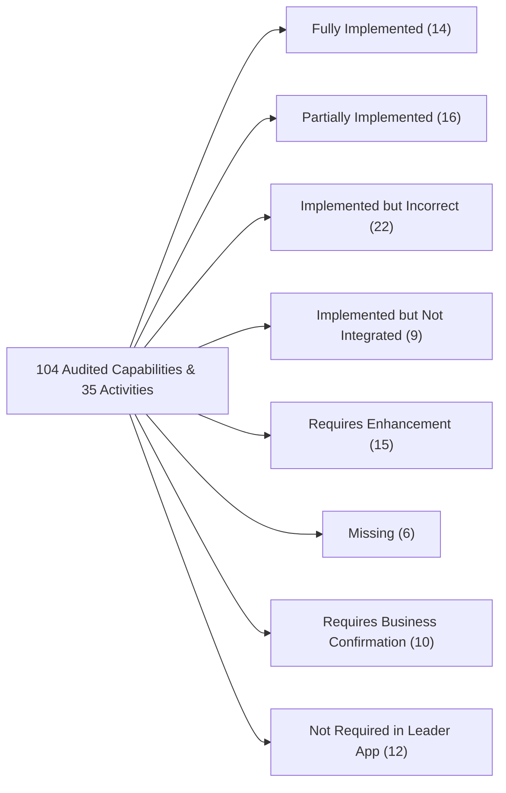

# 45 — Existing vs Required Feature Gap Analysis

> **Audit Group:** 08 — Enhancement Planning & Roadmap  
> **Principle:** **ENHANCE, NEVER DUPLICATE** — Classify every capability across Backend (`unity-app-new`), Flutter Leadership App (`LeaderApp-Fornt-end-`), Member App (`unity_app`), and Web Admin (`unity-admin-web`) before recommending changes.  
> **Related Deliverables:** [02-existing-leadership-app-audit.md](./02-existing-leadership-app-audit.md) · [12-master-35-activities-index.md](./12-master-35-activities-index.md) · [42-rbac-security-audit.md](./42-rbac-security-audit.md) · [46-mobile-app-enhancement-recommendations.md](./46-mobile-app-enhancement-recommendations.md) · [47-api-enhancement-recommendations.md](./47-api-enhancement-recommendations.md) · [51-open-business-decisions.md](./51-open-business-decisions.md)

---

## 1. Classification Taxonomy (Mandatory 8 Exact Labels)

Every capability in this gap analysis uses **strictly one** of the eight canonical classifications:
1. `Fully Implemented` — Works end-to-end across backend and frontend with proper auth and organizational scope.
2. `Partially Implemented` — Exists on backend and/or frontend, but lacks required depth, fields, or role coverage.
3. `Implemented but Incorrect` — Exists in source code, but contains security, calculation, enum, or scope defects.
4. `Implemented but Not Integrated` — Code exists on backend or frontend without end-to-end wiring (unrouted controllers/methods, unused middleware, orphaned Flutter sheets).
5. `Missing` — Genuinely absent across all repositories in the ecosystem.
6. `Requires Enhancement` — Works coarsely today and requires targeted, additive refinement.
7. `Requires Business Confirmation` — Product/workbook/website rules conflict or require Founder policy sign-off before coding.
8. `Not Required` — Consumer-only, personal-privacy, or Web-Admin-only settlement workflow that **must NOT** be duplicated in the Leadership App.

---

## 2. Core Platform Capabilities Gap Matrix (Domains 1–10)

**FACT:** All status assessments below are grounded in verified source code across `unity-app-new` and `LeaderApp-Fornt-end-`.

### 2.1 Authentication, Session Lifecycle & RBAC

| # | Capability | Backend Evidence (`unity-app-new`) | Mobile Evidence (`LeaderApp-Fornt-end-`) | Classification | Gap & Required Action |
|---:|---|---|---|---|---|
| 1 | Email & International E.164 Phone OTP Send | [LeaderAuthController.php](file:///c:/Users/malic/OneDrive/Documents/GitHub/unity-app-new/app/Leader/Controllers/LeaderAuthController.php#L23), `OtpService` | [login_bloc.dart](file:///D:/office%20project/LeaderApp-Fornt-end-/lib/features/login/bloc/login_bloc.dart), `PhoneNumberHelper` | `Requires Enhancement` | Backend suffix `LIKE "%{$short}"` phone lookup (`LeaderAuthService.php:318`) risks collision; prioritize exact E.164 match first. |
| 2 | OTP Verification & Leader Gate (`EnsureLeaderUser`) | [LeaderAuthService.php](file:///c:/Users/malic/OneDrive/Documents/GitHub/unity-app-new/app/Leader/Services/LeaderAuthService.php#L141-L208) | [otp_bloc.dart](file:///D:/office%20project/LeaderApp-Fornt-end-/lib/features/otp/bloc/otp_bloc.dart) | `Implemented but Incorrect` | **P0 Bug:** Hardcoded `'123456'` master OTP active in prod (`L156`); `OtpBloc` treats *every* HTTP `403` as `"Not a Leader"`. |
| 3 | Token Expiration, Rotation & 401 Session Handling | [config/sanctum.php](file:///c:/Users/malic/OneDrive/Documents/GitHub/unity-app-new/config/sanctum.php#L53) (`expiration => null`), fake `$refreshToken` (`L180`) | [api_client.dart](file:///D:/office%20project/LeaderApp-Fornt-end-/lib/core/network/api_client.dart#L267-L273) (unhandled `UnauthenticatedException`) | `Implemented but Not Integrated` | `refresh_token` is generated and stored in `SecureStorageService` (`session_manager.dart:118`), but never persisted on backend and no `/leader/auth/refresh` route or 401 interceptor exists. |
| 4 | Server-Side Sign-Out & Token Revocation | `POST /leader/auth/logout` (`routes/leader.php:57`), broken `AdminUser` logout (`OnlineStatusService.php:39`) | `SessionManager.clearSession()` (`session_manager.dart:248`) | `Implemented but Not Integrated` | Backend `POST /leader/auth/logout` exists, **but Flutter never calls it** on sign-out! Also `AdminUser` logout crashes with `TypeError`. |
| 5 | Canonical Role Resolution (12+ Leader Roles) | [UserRoleResolverService.php](file:///c:/Users/malic/OneDrive/Documents/GitHub/unity-app-new/app/Shared/Services/UserRoleResolverService.php#L16-L382) | [user_role.dart](file:///D:/office%20project/LeaderApp-Fornt-end-/lib/core/enums/user_role.dart#L1-L75) | `Implemented but Incorrect` | Backend grants `is_leader=true` to `pending`/`left` `circle_members` (`L328`), ignores `admin_user_roles.expires_at`, omits `committee_leader` & `global_founder`; Flutter `UserRole` omits `viceChair`, `secretary`, `committeeLeader`. |
| 6 | Route-Level Capability Enforcement (`leader.can`) | [CheckLeaderCapability.php](file:///c:/Users/malic/OneDrive/Documents/GitHub/unity-app-new/app/Leader/Middleware/CheckLeaderCapability.php#L1-L61) (`bootstrap/app.php:84`) | `LeaderPermissions` (`leader_permissions.dart`) | `Implemented but Not Integrated` | `CheckLeaderCapability` middleware is fully coded and registered, **but attached to 0 routes** in `routes/leader.php`! |
| 7 | Dynamic Role Capability Matrix CRUD | [LeaderRoleManagementController.php](file:///c:/Users/malic/OneDrive/Documents/GitHub/unity-app-new/app/Leader/Controllers/LeaderRoleManagementController.php#L19-L93) | [role_management_view.dart](file:///D:/office%20project/LeaderApp-Fornt-end-/lib/features/role_management/view/role_management_view.dart) | `Implemented but Incorrect` | Missing `superAdmin` / `manage_roles` gate on write routes; runtime `Schema::create('leader_role_capabilities')` in `ensureTableExists()`; `DynamicRbacSeeder` grants `coin_payouts` to `secretary`. |
| 8 | Special Roles (`Ambassador`, `State/Area Director`, `Project Chair`) | `ContributionMilestoneResolver.php:30`, `OrganizationalScopeService.php` | Absent in `UserRole` | `Requires Business Confirmation` | `Ambassador` is a 10-introduction milestone honour (plus typo `'ambassader'` in `RolePermissionMatrixController.php:76`); `state`/`area` are scope levels on Executive Director, not separate role keys. |

---

### 2.2 Organizational Scope, Multi-Assignment & Dashboards

| # | Capability | Backend Evidence | Mobile Evidence | Classification | Gap & Required Action |
|---:|---|---|---|---|---|
| 9 | Multi-Circle / Multi-Role Assignment Context (`assignments[]`) | `managed_circles` returns flat names/basic list (`LeaderPermissionService.php:509`); `OrganizationalScopeService` supports rich assignments | `ProfileAssignedCirclesCard` renders constant `'Active Leadership Assignment'` (`L115`) | `Partially Implemented` | Enhance `/leader/auth/me` to return structured `assignments[]` (`role_key`, `role_label`, `scope_type`, `circle_id`/`district_id`/`industry_id`, `starts_at`, `ends_at`). |
| 10 | Server-Side Scope Enforcement on Peers, Circles, Reports, Activities, Asks | `LeaderPeersService`, `LeaderTeamsService`, `LeaderReportsService`, `LeaderAskFlowService` | `DashboardCircleSwitcher` | `Implemented but Incorrect` | **10 IDOR / Global Leak bugs** (`?scope=global`, `?circle_id=<uuid>`, `?district_id=<uuid>`, direct `{id}` routes, unscoped `/ask-flows/*`, Country Director global leak, Industry `%1%` collision). |
| 11 | Unified Dashboard Metrics (`GET /dashboard/summary`) | [LeaderDashboardService.php](file:///c:/Users/malic/OneDrive/Documents/GitHub/unity-app-new/app/Leader/Services/LeaderDashboardService.php#L276-L862) | [dashboard_remote_datasource.dart](file:///D:/office%20project/LeaderApp-Fornt-end-/lib/data/datasources/remote/dashboard_remote_datasource.dart#L105-L204) | `Implemented but Incorrect` | Backend fabricates `overall_revenue = deals * 0.05`, fake `60/25/15%` Ask splits, `circulars = 5`, and fake Top Impacters; Flutter compensates with a 7-request parallel fan-out hitting `/admin/*` routes! |
| 12 | Role-Specific Leadership Dashboards (Global, DED, ID, CF, CD, Chair) | Single generic `/dashboard/summary` + 7 DED-only `/api/v1/ded/leadership/*` routes | Single `DashboardView` with 4 Dome Tabs | `Partially Implemented` | Compose role-tailored priority cards on `DashboardView` driven by `role` + `permissions` + authoritative backend KPIs (see Docs `35`–`40`). |

---

### 2.3 Peers Directory, Member 360°, Circles, Teams & Leadership Assignment

| # | Capability | Backend Evidence | Mobile Evidence | Classification | Gap & Required Action |
|---:|---|---|---|---|---|
| 13 | Scoped Peers Directory, Search & Health Filters | `GET /leader/peers` (`LeaderPeersController@index`) | `PeersView`, `PeersFilterBar` | `Implemented but Incorrect` | Scope bypasses (`SCOPE-SEC-01`, `02`), unmasked `hide_phone`/`hide_email` in `formatPeerCard` (`L616`), multi-circle peer collapses to `.first()` circle. |
| 14 | Birthdays & Anniversaries Wishes (`celebrations`, `sendWish`) | `LeaderPeersService::getCelebrations` (`L812`), `sendWish` (`L928`) | `CelebrationCard` (`peers_view.dart`) | `Requires Enhancement` | Celebration list is properly scoped, but `POST /peers/{id}/wishes` lacks scope check on `{id}`. |
| 15 | Edit Peer Profile (`PUT /leader/peers/{id}`) | [LeaderPeersController.php](file:///c:/Users/malic/OneDrive/Documents/GitHub/unity-app-new/app/Leader/Controllers/LeaderPeersController.php#L183-L261) (`update` + `LeaderUpdatePeerRequest`) | [edit_peer_bottom_sheet.dart](file:///D:/office%20project/LeaderApp-Fornt-end-/lib/features/peer_profile/view/widgets/edit_peer_bottom_sheet.dart#L123-L136) | `Implemented but Not Integrated` | Controller `update()` is **100% unrouted** (`404/405`), and `EditPeerBottomSheet` wraps `ApiClient().put(...)` in `catch (_) {}`, faking local UI success while saving nothing! |
| 16 | Member 360° Profile, Journey, Attendance, Notes & Status Flagging | `LeaderMemberController` (13 routes) + `LeaderMember360Service` | `PeerProfileView` (Overview, Activity, Testimonials, Events, Membership, Coins, Badges) | `Partially Implemented` | Backend has `addNote`, `sendReminder`, `flagStatus`, `unityJourney`, `circlePerformance`; mobile wires read tabs & post/creative delete, but lacks `manage_peers` guard on deletes and enum migration verification for `flagStatus`. |
| 17 | Circles & Industries Directory, Sub-Industries, Open Category Referral | `LeaderTeamsController` (`summary`, `industries`, `circles`, `subIndustries`, `referCategory`) | `TeamsView`, `CircleDetailsView`, `ReferCategoryBottomSheet` | `Implemented but Incorrect` | Sub-routes lack `{id}` scope checks; `contacts` leaks global `contact_posts` (`DATA-SEC-03`); `CircleLeadershipCard` buckets Circle Founders & Directors under `"Regional Leaders"` with fake `"Founder & CEO"` / `"Managing Director"` designations and `'90%'` attendance! |
| 18 | Circle Chair / Vice Chair / Secretary / Committee Assignment by Authorized Leader | `can_assign_circle_chair` flag exists (`LeaderPermissionService.php:490`); `OrganizationalAssignmentSyncService` exists in `DynamicAccess` | No assignment UI sheet in `CircleDetailsView` / `PeersView` | `Missing` | **Genuinely missing in `app/Leader/`**: add scoped `POST /api/v1/leader/teams/circles/{id}/assignments` delegating to `OrganizationalAssignmentSyncService` + role-gated assignment sheet on mobile. |
| 19 | Circle Event Timezone & Meeting Cadence Display | `LeaderTeamsService::getCircleEvents` returns local date/time strings without UTC/IANA timezone | `EventTimeZones` & `AppFormatters.eventTime` implemented in Round 5–6 (`event_time_display.dart`) | `Partially Implemented` | Mobile DST-safe formatter is ready and wired; backend needs additive `starts_at_utc`, `ends_at_utc`, and `timezone` fields in event/circle payloads. |

---

### 2.4 Approvals / Action Center, Tasks, SLAs, Notifications, Circulars, Finance & Reports

| # | Capability | Backend Evidence | Mobile Evidence | Classification | Gap & Required Action |
|---:|---|---|---|---|---|
| 20 | Scoped Pending Approvals Queue (10 Categories, Stage-Aware CD -> ID/DED) | `PendingRequestAdminController` on `/api/v1/leader/pending-requests*` | `LeaderActivitiesView` (`pending-requests` mode) + `DashboardPendingPeersCard` | `Requires Enhancement` | Works for approve/reject! Needs capability gate (`can_review_pending_peers`), rejection-reason input modal on mobile, fix for `coin_claims` vs `coin_claim_requests` table check (`L810`), and dedicated Action Center prominence. |
| 21 | Ad-Hoc Task Management Engine (`tasks` CRUD) | Confirmed **absent** (`subagent_3_activities_notifications.md` §2.8) | Confirmed **absent** (`LEADER_APP_MASTER_AUDIT.md` §4) | `Requires Business Confirmation` | Zero `tasks` table/API exists. Recommend treating **Actionable Pending Approvals + Overdue Reports + Event Checklists** as the MVP Action Center rather than inventing a generic Jira-like task tracker without Founder sign-off. |
| 22 | Approval SLA Timers, Automated Reminders & Escalations | Passive `support_tickets.sla_due_at` & `web_leadership_jury_assignments.due_at` only; `WorkflowApprovalRule` is config-only (`0` runtime callers) | Absent | `Missing` | Add lightweight additive `due_at` / `escalated_at` tracking + daily idempotent Artisan reminder/escalation job for stale `circle_join_requests`, `impacts`, and `visitor_registrations`. |
| 23 | Official Circulars Feed & Role-Targeted Publishing | `GET /leader/circulars` -> `CircularController` (`circulars` table); `LeaderCircularsController::publish` (`system_settings` JSON) is **unrouted** | `CircularsView` + `PublishCircularBottomSheet` (`POST /circulars/publish` -> `404`) | `Implemented but Not Integrated` | Wire `POST /api/v1/leader/circulars` (`superAdmin` / `countryDirector`), persisting into the canonical `circulars` SQL table (not `system_settings` JSON!) and dispatching `LeaderNotificationDispatcherService::notifyCircularPublished`. |
| 24 | Leader Notifications Feed, Unread Badge & Deep Links | `LeaderNotificationsController` (`notifications` + `app_notifications`), `LeaderNotificationDispatcherService` | `NotificationsBloc`, `NotificationCountService`, `NotificationNavigator` (Round 5) | `Implemented but Incorrect` | Backend returns fake `ldr-welcome-1` sample items when empty (`L737`), server unread count diverges from client-filtered feed, `/leader/admin/notifications/*` is wide open to `secretary`, and FCM payloads need consistent `{entity_type, entity_id}` keys. |
| 25 | Authoritative Finance Analytics, Commission Tiers & Offline Payment Submission | `LeaderFinanceController` & `LeaderFinanceService` | `FinanceView`, `FinanceSplineChart` (monotone fixed), `RecordPaymentBottomSheet`, `CommissionSettingsBottomSheet` | `Implemented but Incorrect` | Fix `orWhereHas` cross-circle payment leak, global `circle_budget` leak, synthetic `projected_annual_revenue` & `total_dues = commission_due`, unguarded `recordOfflinePayment` dropping `circle_id`, and mobile `activeTenures ?? 42` fallback. |
| 26 | Bank Passbooks, Leader Bonus Payout Settlements, Refunds & Wallet Freeze | Web Admin (`AdminStoreWalletAdjustmentController`, `finance_leader_bonus_awards`) | Absent | `Not Required` | Keep financial disbursements, KYC/passbook verification, and maker-checker wallet adjustments strictly on Web Admin Portal. |
| 27 | Circle Reports Submission, Deduplicated All-Circles Roster & PDF Download | `LeaderReportsController`, `LeaderReportsService`, `LeaderReportPdfGenerator` | `ReportsView`, `ReportDetailsView`, `ReportExportService`, `ReportsTrendCard` (unmounted) | `Implemented but Incorrect` | Backend caps roster at `20`, reads non-existent `User` properties (`'0%'`, `'₹0'`), injects fake `'94.5%'` / `'₹24.0L'` defaults, returns `[]` on `attendance-trend`, and leaks PDFs without `$user` scope; mobile hardcodes `ReportModel.isDummyPeer` (`L245`). |

---

## 3. Complete 35 Platform Activities — Leadership App Gap Matrix

**FACT & WORKBOOK REQUIREMENT:** Cross-referencing `PEERS UNITY — MASTER ACTIVITY & ARCHITECTURE DIRECTORY.xlsx` (`workbook_dump.md`) against `subagent_3_activities_notifications.md` and `LeaderApp-Fornt-end-` establishes the exact Leadership App posture for all 35 activities. *(Note: Where the workbook names conceptual Node/AWS services such as `PdfGeneratorLambda`, `ElasticSearchIndexer`, `CollabRoomSocketService`, or `HlsVideoTranscoder`, the production Laravel 12 equivalents `CertificateGeneratorService`, PostgreSQL `ILIKE`, Laravel Reverb, and `File` storage are preserved per **Enhance, Never Duplicate**.)*

| Act # | Activity Name | Backend Table(s) & Existing API | Leadership App Status Today | Classification | Leadership App Role (Oversight vs Consumer) |
|---:|---|---|---|---|---|
| 1 | Business Deals (Given & Received) | `business_deals` · `GET /leader/activities/business-deals`, Member 360° | `BusinessDealsView`, `LeaderActivitiesView`, `PeerBusinessDealsScreen`; orphaned `CreateBusinessDealBottomSheet` | `Requires Enhancement` | Scoped read/oversight & analytics; remove or wire orphaned `CreateBusinessDealBottomSheet` per business confirmation (deals require peer logging in Member App). |
| 2 | P2P Meetings (1-on-1s) | `p2p_meetings`, `p2p_meeting_requests` · `GET/POST /leader/activities/p2p-meetings` | `P2PMeetingsView`, `PeerProfileView`; orphaned `CreateP2pMeetingBottomSheet` & unmounted `PeerProfileBottomActions` | `Implemented but Not Integrated` | Scoped oversight works (fix `circle_id` IDOR); decide whether Leaders log 1-on-1s from `PeerProfileBottomActions` (`LogP2pBottomSheet`). |
| 3 | Normal Referrals (Given & Received) | `referrals`, `referral_status`, `peer_referrals` · `GET/POST /leader/activities/referrals`, `PendingRequestAdminController` (`circle_peer_referrals`) | `ReferralsView`, `ReferCategoryBottomSheet`, `PeerBusinessReferralsScreen`; unmounted `SendReferralBottomSheet` | `Requires Enhancement` | Scoped oversight + Open Category Peer Referral (`refer-category`) + approval queue work; fix `{id}` scope check. |
| 4 | I Can Help Profiles & Tags | `users.i_can_help_with`, `i_am_looking_for`, `superpower`, `user_tags` · `GET /leader/members/{id}/profile`, `/admin/user-tags` | Partially shown in `PeerProfileOverviewSection` | `Partially Implemented` | Display `i_can_help_with`, `i_am_looking_for`, and `superpower` chips in `PeerProfileOverviewSection` so Leaders can broker introductions; tag catalog CRUD stays on Web Admin. |
| 5 | Collaboration Asks | `asks` (`flow='collaboration'`), `collaboration_posts` · `GET /ask-flows*`, `/leader/activities/collaboration-asks` | `LeaderActivitiesView`, `PeerCollaborationScreen`, `PeerCollaborationDetailScreen` | `Implemented but Incorrect` | Fix global data leak in `LeaderAskFlowService` (`SCOPE-SEC-05`) and exclude `status='draft'`. |
| 6 | Get Help Asks | `asks` (`flow='help'`), `requirements` · `GET /ask-flows*`, `/leader/activities/help-asks` | `LeaderActivitiesView`, `PeerHelpScreen`, `PeerHelpDetailScreen`, `RequirementsView` | `Implemented but Incorrect` | Same scope enforcement & `draft` exclusion in `LeaderAskFlowService`. |
| 7 | Referral Asks (Help Me Connect) | `asks` (`flow='referral'`) · `GET /ask-flows*`, `/leader/activities/referral-asks` | `LeaderActivitiesView`, `PeerReferralScreen`, `PeerReferralDetailScreen` | `Implemented but Incorrect` | Same scope enforcement & `draft` exclusion in `LeaderAskFlowService`. |
| 8 | Testimonials (Given & Received) | `testimonials` · `GET /leader/activities/testimonials`, Member 360° | `TestimonialsView`, `TestimonialDetailBottomSheet`, `PeerTestimonialsScreen` | `Fully Implemented` | Read/oversight UI complete; add `showDetail` scope check (`SCOPE-SEC-06`). |
| 9 | Entrepreneur Certification Form | `entrepreneur_certification_submissions`, `certification_submissions` · `/leader/activities/entrepreneur-certifications`, `pending-requests/certifications` | `LeaderActivitiesView` (list + approve/reject via `PendingRequestAdminController`) | `Requires Enhancement` | Replace fake `70%` dashboard split in `LeaderDashboardService.php:789` with real `WHERE certification_type = 'entrepreneur'` count! |
| 10 | Leadership Certification Form | `leadership_certification_submissions`, `certification_submissions` · `/leader/activities/leadership-certifications`, `pending-requests/certifications` | `LeaderActivitiesView` (list + approve/reject) | `Requires Enhancement` | Replace fake `30%` dashboard split (`L790`) with real `WHERE certification_type = 'leadership'` count! |
| 11 | Partner With Us Form | `partner_with_us_submissions` · `GET /leader/leads/partner_with_us` | Count fetched via `/admin/leads/counts` (global role); list in `LeaderActivitiesView` | `Partially Implemented` | Move scoped/global count into `LeaderDashboardService` so Flutter removes `/admin/leads/counts` call; lead CRM stays on Web Admin. |
| 12 | Brand Partner Form & Ads | `brand_partners`, `advertiser_applications`, `advertiser_campaigns`, `ads`, `ad_bookings` · `pending-requests/ad_booking_requests` | Peer `ad_booking_requests` surfaced in `pending-requests` queue | `Partially Implemented` | Full Advertiser/Brand Partner campaign management belongs on Web Admin (`Not Required` on mobile); confirm whether scoped Leaders or only Super Admin review `ad_booking_requests`. |
| 13 | Leadership Role Application Form | `leader_interest_submissions` + 23 `web_leadership_*` election tables · `/leader/activities/leadership-interests`, `/api/v1/leadership/*` | `LeaderActivitiesView` (`leadership-interests` read feed) | `Implemented but Incorrect` | Fix missing `status`, `admin_remarks`, `reviewed_by`, `reviewed_at` migration/fillable on `leader_interest_submissions` (`LeadershipController.php:35`); election form-builder/jury scoring stays on Web Portal. |
| 14 | Become a Speaker Form | `become_speaker_submissions` · `GET /leader/leads/become_speaker` | `DashboardView` KPI + `LeaderActivitiesView` | `Partially Implemented` | Include real scoped/global count in `LeaderDashboardService` (remove `/admin/leads/counts` client call). |
| 15 | Become a Mentor Form | `become_mentor_submissions` · `GET /leader/leads/become_mentor` | `DashboardView` KPI + `LeaderActivitiesView` | `Partially Implemented` | Include real scoped/global count in `LeaderDashboardService`. |
| 16 | Recommend a Peer Form | `peer_recommendations` · `POST /forms/recommend-peer`, `/leader/activities/peer-recommendations`, `pending-requests/circle_peer_referrals` | `ReferCategoryBottomSheet`, `LeaderActivitiesView` | `Fully Implemented` | Works end-to-end across submission, list, and pending-request review. |
| 17 | Register a Visitor Form | `visitor_registrations`, `visitor_leads` · `/leader/activities/visitor-registrations`, `pending-requests/visitor_registrations` | `LeaderActivitiesView` (list + approve/reject) | `Fully Implemented` | Scoped list and pending approval (with coin award) work; enforce `can_review_pending_peers` on approve/reject. |
| 18 | Vyapaar Jagat Story Form | `sme_business_story_submissions` · `/leader/activities/vyapaar-jagat` (`stories`), `/leader/leads/story_submissions` | `DashboardView` KPI + `LeaderActivitiesView` | `Partially Implemented` | Read oversight in Leader App; editorial approval (`story_link` publication) stays on Web Admin (`Admin\StorySubmissionsController`). |
| 19 | Joined Circles & Memberships | `circles`, `circle_members`, `circle_subscriptions` · `/leader/teams/circles*`, `/leader/members/{id}/circle-performance` | `TeamsView`, `CircleDetailsView`, `PeerMembershipScreen` | `Requires Enhancement` | Fix `{id}` scope checks (`SCOPE-SEC-04`), `CircleLeadershipCard` role bucketing, and multi-circle Peer representation. |
| 20 | Circle Membership Requests & Build Circle | `circle_join_requests` (CD -> ID/DED -> Fee), `user_circle_requests` · `/leader/pending-requests/circle_joining_requests` | `LeaderActivitiesView` (`pending-requests`), `DashboardPendingPeersCard` | `Partially Implemented` | `circle_join_requests` stage-aware CD/ID/DED approval works! `user_circle_requests` (*Build Your Own Circle*) is currently Admin-only (`/api/v1/admin/user-circle-requests`) — expose read/review to DED/Country Director/Super Admin if approved. |
| 21 | Attended Events & Registrations | `events`, `event_occurrences`, `event_registrations`, `event_registration_requests`, `attendance_records` · `/teams/circles/{id}/events`, `/leader/members/{id}/events\|attendance`, `pending-requests/event_joining_requests` | `CircleEventsScreen`, `CircleEventDetailScreen`, `PeerEventsAttendanceScreen`, `LeaderActivitiesView` | `Requires Enhancement` | Supply UTC + IANA `timezone` from backend; gate QR check-in scanning to dedicated `ScanApp` (do not rebuild scanner in Leader App). |
| 22 | Impact Activity & Life Impact Score | `impacts`, `impact_actions`, `life_impact_histories` · `/leader/impacts`, `pending-requests/pending_impacts` | `ImpactsView`, `LeaderActivitiesView` (approve/reject), `DashboardTopImpacters` | `Implemented but Incorrect` | Fix `LeaderDashboardService` `peer_user_id` vs `impacted_peer_id` bug (`L374`), remove fake Top Impacters (`L924-L970`), and clearly distinguish `pending` vs `approved` receiver-confirmed impacts. |
| 23 | Coins Activity, Wallet & History | `coins_ledger`, `coin_claim_requests`, `wallet_transactions` · `/leader/peers-by-coins`, `/leader/members/{id}/coins`, `pending-requests/coin_claims` | `PeersByCoinsView`, `PeerCoinsScreen`, `LeaderActivitiesView` | `Implemented but Incorrect` | Fix `PendingRequestAdminController::fetchCoinClaims()` table check (`coin_claims` vs `coin_claim_requests`, `L810`) and fix `DynamicRbacSeeder` granting `coin_payouts` to all roles (`RBAC-SEC-09`). |
| 24 | Timeline Posts Created | `posts`, `activity_creatives` · `/leader/members/{id}/posts\|creatives`, `/leader/activities/posts\|creatives` | `PeerProfileView` (`PeerPostCard`), `LeaderActivitiesView` | `Implemented but Incorrect` | Enforce `leader.can:manage_peers` on `DELETE /leader/members/{id}/posts/{post_id}` & `creatives/{creative_id}`; eliminate `/admin/posts` call from `DashboardRemoteDataSource`. |
| 25 | Deactivated / Hidden Posts | `posts` (deactivated), `post_reports` · `PostDeactivationService` (`/api/v1/admin/posts/{id}/deactivate\|restore`) | Not surfaced as a separate moderation queue in Leader App (`DELETE` soft-deletes without coin reversal preview) | `Requires Business Confirmation` | Decide whether `DELETE .../posts/{post_id}` by Circle Leaders should invoke `PostDeactivationService` (reversing coins/impact) or whether post report moderation remains strictly Web Admin. |
| 26 | User Shorts / Videos | `users.profile_video_id`, `intro_video_likes`, `activity_videos` · `intro_video_url` in Peer 360° | `AppVideoPlayer` on `PeerProfileView`, `EditPeerBottomSheet` (`intro_video_url`) | `Fully Implemented` | Peer intro video playback in 360° profile is sufficient; consumer Shorts feed (`/api/v1/intro-videos`) is `Not Required` in Leader App. |
| 27 | Invited Friends / Introduced Peers | `users.introduced_by`, `referraldata`, `introduction_requests`, `contact_invitations` · `/leader/members/{id}/introduced-peers`, `/leader/activities/introduced-peers`, `pending-requests/introduction_requests` | `PeerIntroducedByScreen`, `LeaderActivitiesView` | `Fully Implemented` | Read lineage + `introduction_requests` approval queue work end-to-end. |
| 28 | Badges Earned | `milestone_badges`, `user_milestone_badges` · `GET /leader/members/{member_id}/badges` | `PeerBadgeDetailScreen` (`peer_profile`) | `Fully Implemented` | Peer 360° badge display works; badge threshold CRUD stays on Web Admin. |
| 29 | Blocked Users | `peer_blocks`, `speed_networking_blocked_peers` · Self-service `/api/v1/blocked-peers` | Intentionally absent | `Not Required` | **Personal Privacy Boundary:** Never expose personal block lists in the Leadership App (even to `Super Admin`). |
| 30 | Submitted Feedback | `feedback`, `event_feedbacks` · `/api/v1/events/{eventId}/feedback-summary`, `/api/v1/admin/feedback` | Absent | `Partially Implemented` | General app feedback (`feedback`) is Web Admin only (`Not Required`); aggregate **Event Rating & Feedback Summary** (`event_feedbacks`) is a high-value enhancement for `CircleEventDetailScreen` (`CD`, `Chair - Events & Impacts`). |
| 31 | Help & Support Tickets | `support_tickets`, `support_requests` · `/leader/support/*` (`routes/leader.php:244-265`) | Routed on backend for Leader's own support queries; no UI tile in `ProfileView` | `Implemented but Not Integrated` | Leader's own `"Help & Support"` ticket submission can be linked from `ProfileView`; platform-wide support desk (`admin/support-tickets`) stays on Web Admin (`Not Required`). |
| 32 | Membership Plan & Subscriptions | `membership_plans`, `user_memberships`, `circle_subscriptions`, `payments` · `/leader/members/{id}/overview`, `/leader/finance/*` | `PeerMembershipScreen`, `FinanceView` | `Requires Enhancement` | Show accurate Peer membership & renewal status in `PeerMembershipScreen` and authoritative collections in `FinanceView`; plan pricing CRUD & Zoho checkout stay in Web Admin / Member App. |
| 33 | Who Viewed My Profile | `profile_views` · Consumer `GET /api/v1/profile/views` | Intentionally absent | `Not Required` | **Personal Privacy Boundary:** Strictly consumer self-service; never expose in Leadership App (even to `Super Admin`). |
| 34 | Profile Edit History & Last Updated | `users.updated_at`, `admin_audit_logs`, `activity_logs` · `/api/v1/admin/audit-logs` | `updated_at` available; no audit history drawer on mobile | `Not Required` | Write audit logs (`ActivityLog`) whenever a Leader edits a Peer (`PUT /leader/peers/{id}`) or flags status; forensic audit-log viewer remains on Web Admin. |
| 35 | Last Month Activity Summary | `LastMonthActivityService` (9 streams) · `GET /leader/members/{id}` & `/api/v1/users/{id}/activity-summary` | Covered via `PeerProfileActivitySection` & `DashboardMetricsModel` (`timeframe`) | `Requires Enhancement` | Add `?timeframe=last_30_days\|last_month` filter support cleanly on Peer 360° / Circle Report pre-fill reusing `LastMonthActivityService`. |
