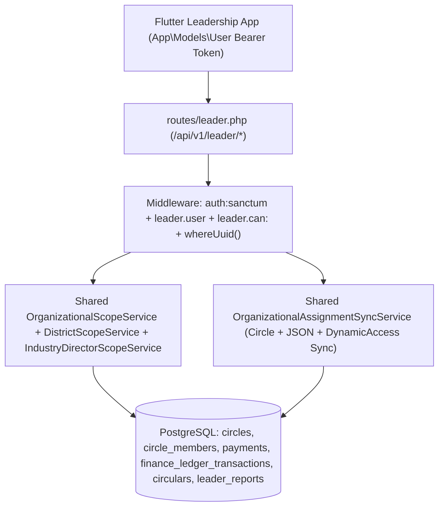

# 47 — Backend API Enhancement Recommendations (`unity-app-new`)

> **Audit Group:** 08 — Enhancement Planning & Roadmap  
> **Target Repository:** `c:\Users\malic\OneDrive\Documents\GitHub\unity-app-new` (PHP 8.2 · Laravel 12 · PostgreSQL)  
> **Mandatory Engineering Standards (`.agents/AGENTS.md` & `DEVELOPER_RULES.md`):**  
> - `declare(strict_types=1);` & full parameter/property/return typing on every touched/new PHP file  
> - Thin Controllers -> FormRequests (`app/Leader/Requests/`) -> Policies/Middleware (`leader.can`) -> Services (`app/Leader/Services/`) -> Controlled Resources  
> - Product Isolation: Keep Leader App domain code inside `app/Leader/` and `routes/leader.php` without breaking Member App, Scan App, DED, or Admin Panel  
> - Route Constraints: Controller class references + `->whereUuid('id')` on all UUID route parameters  
> - Canonical Peer Contract (`DEVELOPER_RULES.md` §9): Always expose `profile_photo_image` as the canonical Peer image key  
> - Formatting Gate: Run `./vendor/bin/pint` and `php artisan test` after every code change  
> **Related Deliverables:** [03-existing-backend-api-inventory.md](./03-existing-backend-api-inventory.md) · [42-rbac-security-audit.md](./42-rbac-security-audit.md) · [43-sensitive-data-and-finance-access.md](./43-sensitive-data-and-finance-access.md) · [44-api-and-organizational-scope-security.md](./44-api-and-organizational-scope-security.md) · [46-mobile-app-enhancement-recommendations.md](./46-mobile-app-enhancement-recommendations.md) · [48-database-enhancement-recommendations.md](./48-database-enhancement-recommendations.md)

---

## 1. Strategic API Architecture Decision: Reconciling `/api/v1/leader/*`, `/api/v1/leadership/*` & `/api/v1/ded/*`

**FACT:** Today the backend exposes **three overlapping leadership route prefixes**:
1. **`/api/v1/leader/*`** ([routes/leader.php](file:///c:/Users/malic/OneDrive/Documents/GitHub/unity-app-new/routes/leader.php#L1-L302)) — Consumed by **100% of the Flutter Leadership App** (`LeaderApp-Fornt-end-`), authenticated via `App\Models\User` Sanctum tokens (`['auth:sanctum', 'leader.user']`).
2. **`/api/v1/leadership/*` APIs 44–50** ([routes/leadership.php](file:///c:/Users/malic/OneDrive/Documents/GitHub/unity-app-new/routes/leadership.php#L309-L332)) — Scoped read/report endpoints powered by `OrganizationalScopeService` (`app/Shared/OrganizationalScope/OrganizationalScopeService.php`), sharing a file with the Website Election Portal (`L42-L303`).
3. **`/api/v1/ded/*`** ([routes/api.php](file:///c:/Users/malic/OneDrive/Documents/GitHub/unity-app-new/routes/api.php#L465-L554)) — Consumed by the DED Web/Portal view, requiring `App\Models\AdminUser` tokens (`ensure.ded.api`).

**RECOMMENDATION (Enhance, Never Duplicate):**
- **Keep `/api/v1/leader/*` (`routes/leader.php`) as the single mobile API contract** for the Flutter Leadership App so zero working mobile endpoints are broken (`DEVELOPER_RULES.md` §16).
- **Internally delegate organizational scoping** in `app/Leader/Services/*` to the shared `OrganizationalScopeService` and `DistrictScopeService` / `IndustryDirectorScopeService`, eliminating the 10 IDOR/scope divergences documented in [44-api-and-organizational-scope-security.md](./44-api-and-organizational-scope-security.md).
- **Add only 2 genuinely missing routes** (`POST /api/v1/leader/auth/refresh` and `POST|DELETE /api/v1/leader/teams/circles/{id}/assignments`) and **wire the 2 already-written unrouted controller actions** (`PUT /api/v1/leader/peers/{id}` and `POST /api/v1/leader/circulars`).

---

## 2. Master API Gap & Enhancement Matrix (Mandatory Prompt §18 Schema)

Every requirement below uses one of the five mandatory Prompt §18 classifications:
- `Reuse without change`
- `Enhance existing endpoint`
- `Fix existing endpoint`
- `Add endpoint only if genuinely missing`
- `Requires business decision`

| ID | Business Requirement | Existing API | Current Support | Missing Capability | Classification | Recommended Enhancement |
|---|---|---|---|---|---|---|
| `API-ENH-00` | Emergency P0 Auth, OTP & Admin Route Lockdown | `/api/v1/rbac/*`, `/api/v1/admin/rbac/*`, `/api/v1/auth/*`, `/api/v1/leader/auth/verify-otp`, `/api/v1/admin/*`, `/api/v1/admin/access/*`, `/api/v1/leadership/admin/*`, `/api/v1/members-with-circle`, `/api/v1/files/{id}/download` | Publicly exposed RBAC routes (`RBAC-SEC-01`), 8 hardcoded `@gmail.com` Super Admin bypasses (`RBAC-SEC-02`), `'123456'` master OTP (`RBAC-SEC-03`), unguarded `/admin/*` & `DynamicAccess` (`RBAC-SEC-04..06`), hardcoded `302\|cO0V...` token (`DATA-SEC-01`), public file download (`DATA-SEC-02`) | Production authentication, admin role authorization, fail-closed permission checks, and private file authorization | `Fix existing endpoint` | Lock `/v1/rbac` & `/v1/admin/rbac` behind `['auth:sanctum', 'admin.auth', 'admin.role:global_admin']`; remove all `@gmail.com` bypasses, `'Harsh@123'`, `'123456'` OTP branches, `AdminUser::firstOrCreate` in `EnsureAdminAuthenticated`, and fallback token in `AllowFixedMembersToken`; flip `AdminAccess`/`PermissionService` fallbacks to `return false`; gate `bootstrap/app.php` 500 stack info behind `config('app.debug')` |
| `API-ENH-01` | Leader Session Token TTL, Rotation & Logout Revocation | `POST /api/v1/leader/auth/verify-otp`, `POST /api/v1/leader/auth/logout`, `POST /api/v1/auth/logout` | `verify-otp` mints non-expiring Sanctum token and returns unpersisted random `refresh_token` (`LeaderAuthService.php:180`); `/leader/auth/logout` exists (`routes/leader.php:57`); `/api/v1/auth/logout` crashes on `AdminUser` (`OnlineStatusService.php:39`) | Token expiration (`expires_at`), persisted hashed refresh token rotation endpoint, and safe `AdminUser` logout | `Add endpoint only if genuinely missing` | Set explicit `$expiresAt` (`now()->addHours(24)`) on `leader-mobile-app` token creation; persist SHA-256 hashed refresh token and add **`POST /api/v1/leader/auth/refresh`** (`LeaderRefreshTokenRequest`) rotating token pair; guard `if ($user instanceof User)` before `OnlineStatusService::markOffline($user)` |
| `API-ENH-02` | Canonical Role Resolution, Expiry Check & Multi-Assignment Payload | `GET /api/v1/leader/auth/me` (aliases `/auth/me`, `/leader/profile`) | Returns single `role`, `regional_scope`, `managed_circles`, and 22 permission flags (`LeaderPermissionService.php`) | Grants `is_leader` to `pending`/`left` `circle_members`; ignores `admin_user_roles.expires_at`; omits `committee_leader` & `global_founder`; `countryDirector` lacks country filter; `industry_tags LIKE '%1%'` collides; lacks structured `assignments[]`; loads all `Circle::get()` into RAM (`L283`) | `Enhance existing endpoint` | Filter `circle_members` by `status = 'approved'` & `whereNull('left_at')`; filter `admin_user_roles` by non-expired `expires_at`; map `global_founder -> superAdmin` & `committee_leader -> committeeLeader`; fix `countryDirector` country filter & `whereJsonContains` industry filter; replace `Circle::get()` with JSONB SQL predicates; append additive `assignments[]` array while keeping `managed_circles` intact |
| `API-ENH-03` | Server-Side Capability Enforcement Across All Leader Routes | All routes in [routes/leader.php](file:///c:/Users/malic/OneDrive/Documents/GitHub/unity-app-new/routes/leader.php#L54-L301) (`CheckLeaderCapability` registered as `'leader.can'` in `bootstrap/app.php:84`) | `CheckLeaderCapability` is implemented (`app/Leader/Middleware/CheckLeaderCapability.php`) **but applied to 0 routes**! | Route-level vertical authorization (`manage_roles`, `access_finance`, `manage_finance`, `manage_peers`, `access_teams`, `view_peers`, `view_reports`, `request_actions`, `superAdmin`) | `Fix existing endpoint` | Attach `leader.can:<capability>` middleware to every route group in `routes/leader.php`; enforce `isSuperAdmin($user)` on `LeaderRoleManagementController` write methods (`store`, `updateMatrix`, `update`, `destroy` + block `is_system_role` deletion) and on all 5 `/leader/admin/notifications/*` routes; fix `DynamicRbacSeeder` mapping in `LeaderPermissionService` (`coins` read != `coin_payouts`; `finance` read != `manage_finance`; preserve `track_milestones`) |
| `API-ENH-04` | Single-Call Authoritative Scoped Dashboard Summary & Top Impacters | `GET /api/v1/leader/dashboard/summary` (alias `/leader/dashboard/metrics`), `GET /api/v1/leader/dashboard/top-impacters` | `LeaderDashboardService` scopes `?circle_id` (`L73`) and computes core counts, but fabricates `overall_revenue = deals * 0.05` (`L733`), fake `60/25/15%` Ask status splits (`L784`), fake `70/30%` certification splits (`L789`), `circulars = 5` (`L798`), and fictional Top Impacters (`L924-L970`) | Authoritative revenue from `LeaderFinanceService`, real SQL `GROUP BY status` on `asks`, real `certification_type` counts, real `circulars` count, real scoped leads/posts/creatives/pending counts | `Fix existing endpoint` | Replace all synthetic multipliers and hardcoded fallbacks in `LeaderDashboardService` with real scoped SQL aggregates (`impacts.impacted_peer_id`, `asks.status`, `certification_submissions.certification_type`, `circulars`, `PendingRequestAdminController` scoped summary, and authoritative `payments`/`finance_ledger_transactions` revenue) so Flutter removes its 7-call `/admin/*` fan-out (`MOB-ENH-03`) |
| `API-ENH-05` | Scoped Peer Directory, Contact Privacy Masking & Unrouted Peer Edit | `GET /api/v1/leader/peers`, `GET /api/v1/leader/peers/{id}`, `/meetings`, `/activities`, `POST .../wishes`, and unrouted `LeaderPeersController::update` | `LeaderPeersController` & `LeaderPeersService` exist, plus `LeaderUpdatePeerRequest` (`app/Leader/Requests/LeaderUpdatePeerRequest.php`) | `?scope=global` / `?circle_id=all` dumps entire DB (`SCOPE-SEC-01`); `?circle_id`/`?district_id` & `{id}` IDORs (`SCOPE-SEC-02, 03`); `formatPeerCard` ignores `hide_phone`/`hide_email` (`DATA-SEC-04`); `LeaderPeersController::update` has **no route**! | `Fix existing endpoint` | Register `Route::match(['put', 'patch'], '/peers/{id}', [LeaderPeersController::class, 'update'])->whereUuid('id')->middleware('leader.can:manage_peers')` (+ `/leader/peers/{id}` alias); enforce `OrganizationalScopeService` intersection on all `/peers*` routes; mask `phone`/`email` per `hide_phone`/`hide_email`; log edits to `ActivityLog` |
| `API-ENH-06` | Role-Targeted Official Circular Feed & Publishing | `GET /api/v1/leader/circulars` (`CircularController@index`), unrouted `LeaderCircularsController::publish` + `LeaderPublishCircularRequest` | `GET /leader/circulars` reads `circulars` table; `LeaderCircularsController::publish` (`L123`) writes to `system_settings` JSON and is **unrouted** | Routed `POST /api/v1/leader/circulars` writing to the canonical `circulars` table with role targeting & push dispatch | `Fix existing endpoint` | Route `POST /api/v1/leader/circulars` (and alias `/circulars/publish`) to `LeaderCircularsController::publish` gated by `leader.can:system_configs` (`superAdmin` / `countryDirector`); refactor `LeaderCircularsController` to persist into the `circulars` Eloquent model/table (instead of `system_settings` JSON!) so `GET /leader/circulars` and Member/Leader feeds read one source of truth, then trigger `LeaderNotificationDispatcherService::notifyCircularPublished` |
| `API-ENH-07` | Scoped Circle Chair, Vice Chair, Secretary & Committee Leader Assignment | Admin-only `PATCH /api/v1/admin/circles/{id}/assign-leadership-team` (`CircleManagementController.php:646`) & `OrganizationalAssignmentSyncService` (`app/Modules/DynamicAccess/Services/OrganizationalAssignmentSyncService.php`) | Backend sync service (`OrganizationalAssignmentSyncService::assign` / `revoke`) already synchronizes `user_organizational_assignments`, `circle_members.role` (normalized to `circle_member_role_enum`), `circles.*_user_id`, and `circles.calendar` JSONB! | **No endpoint exists in `app/Leader/`** for authorized Leaders (`CF`, `CD`, `DED`, `EED`, `Super Admin` with `can_assign_circle_chair`) to assign/revoke Circle Chairs or Committee Leaders within their scoped Circles | `Add endpoint only if genuinely missing` | Add `POST /api/v1/leader/teams/circles/{id}/assignments` (`LeaderAssignCircleRoleRequest`) and `DELETE /api/v1/leader/teams/circles/{id}/assignments/{assignmentId}` (`->whereUuid(['id', 'assignmentId'])`) in `LeaderTeamsController`, verifying caller holds `can_assign_circle_chair`, `id` is in caller's authorized scope, assignee is an `approved` Peer of that Circle, target role is strictly circle/committee tier (`< caller rank`), delegating persistence to `OrganizationalAssignmentSyncService` + `ActivityLoggerService` |
| `API-ENH-08` | Authoritative Circle Finance Summary, Transactions & Offline Payment Verification | `GET /api/v1/finance/summary`, `GET/PUT /api/v1/finance/commission-rates`, `GET /api/v1/finance/transactions`, `POST /api/v1/finance/transactions/record-offline` | Queries `payments`, `finance_ledger_transactions`, `finance_wallets`, `finance_commission_configs`, `finance_leader_tenures` | `?circle_id` IDOR; global `circle_budget` sum leak (`L339`); `orWhereHas('user.circleMembers')` cross-circle payment leak (`L77`); flawed `projected_annual_revenue` (`L181`) & `total_dues = commission_due` (`L306`); unguarded `recordOfflinePayment` dropping `circle_id` (`L603`) | `Fix existing endpoint` | Enforce `leader.can:access_finance` on reads and `leader.can:manage_finance` on `recordOfflinePayment`; validate `?circle_id` against `$targetCircleIds`; scope `circle_budget` & `active_tenures` strictly to `$targetCircleIds`; remove `orWhereHas('user.circleMembers')` so circle revenue only sums `payments.circle_id IN $targetCircleIds`; persist `circle_id`, `payment_date`, `recorded_by`, and `'status' => 'pending_verification'` (unless `superAdmin`) on offline payments |
| `API-ENH-09` | Scoped Reports, Deduplicated All-Circles Roster, Real Attendance Trend & Protected PDF Download | `GET /api/v1/reports`, `POST /reports/submit`, `GET /reports/roster`, `GET /reports/attendance-trend`, `GET /reports/{id}`, `GET /reports/{id}/download`, `GET /reports/{id}/file` | `LeaderReportsController`, `LeaderReportsService`, `LeaderReportPdfGenerator` | `listReports` & `submitReport` `?circle_id` IDOR + random `Circle::first()` fallback; fake `'94.5%'` / `'₹24.0L'` defaults (`L157`); `getPeersRoster` caps at `20`, omits `status='approved'`, and reads non-existent `User` props (`'0%'`, `'₹0'`); `getAttendanceTrend` returns `[]`; `download`/`file` omit `$user` scope check (`DATA-SEC-02`) | `Fix existing endpoint` | Pass `$request->user()` to all `LeaderReportsService` methods (`403` on out-of-scope report/circle); remove fake submission defaults; enhance `GET /reports/roster?circle_id=all\|<uuid>` to query `circle_members` (`status = 'approved'`, excluding visitors), deduplicate by `user_id` returning `memberships[]`, `unique_peers`, `qualifying_memberships`, `complete: true`, and real aggregated attendance/P2P/referral/deal counts; compute `attendance-trend` from `attendance_records` / `circle_meetings` grouped by `YYYY-MM` |
| `API-ENH-10` | Scoped Circles, Contacts Leak Fix, Event UTC/Timezone & Canonical `profile_photo_image` | `GET /teams/circles/{id}*`, `GET /teams/contacts`, `GET /leader/members/{member_id}/*`, `GET /ask-flows/*`, `GET /activities/{type}/{id}` | Full feature controllers exist in `app/Leader/` | `{id}` IDORs on `/teams/circles/{id}*` (`SCOPE-SEC-04`), `/ask-flows/*` (`SCOPE-SEC-05`), `/activities/{type}/{id}` (`SCOPE-SEC-06`); `getUserContacts` global phonebook leak (`DATA-SEC-03`); events lack `starts_at_utc`/`timezone`; Peer payloads mix `avatar_url`/`profile_photo_url` instead of canonical `profile_photo_image` (`DEVELOPER_RULES.md` §9) | `Enhance existing endpoint` | Enforce `assertCircleInLeaderScope` on `/teams/circles/{id}*`, `$scopedPeerIds` on `/ask-flows/*` & `/activities/{type}/{id}`, and unconditional `WHERE user_id = $user->id` on `getUserContacts`; add `starts_at_utc`, `ends_at_utc`, and `timezone` (from `events.start_at`/`circles.timezone`) to event responses; include canonical `profile_photo_image` on every Peer object across `app/Leader/` (retaining existing keys temporarily for backward compatibility per `DEVELOPER_RULES.md` §16) |
| `API-ENH-11` | Member 360° Content Moderation, Pending Request Fixes & Admin Leadership Enum Fixes | `DELETE /leader/members/{id}/posts/{post_id}`, `PendingRequestAdminController`, `/api/v1/admin/leadership/*` (`LeadershipController.php`) | Implemented in `LeaderMemberController`, `PendingRequestAdminController`, `LeadershipController` | Missing `leader.can:manage_peers` on post/creative delete; `PendingRequestAdminController::fetchCoinClaims` checks `coin_claims` instead of `coin_claim_requests` (`L810`); `LeadershipController` (`L63-L120`) crashes PostgreSQL writing `'circle_founder'`/`'inactive'` to `circle_member_role_enum`/`circle_member_status_enum` and writes unmigrated columns on `leader_interest_submissions` (`L35`) | `Fix existing endpoint` | Add `leader.can:manage_peers` on Member 360° mutations and `can_review_pending_peers` check on `/leader/pending-requests/{category}/{id}/approve\|reject`; fix `fetchCoinClaims()` to query `coin_claim_requests`; refactor `LeadershipController` assignments to delegate to `OrganizationalAssignmentSyncService` (using valid enum values); resolve route collision on `GET /api/v1/leadership/circles` (`routes/leadership.php:111` vs `L313`) |
| `API-ENH-12` | DED Role Drilldowns & Build-Your-Own-Circle Review Access on Mobile | `GET /api/v1/ded/leadership/*` (7 routes, `AdminUser` guard) & `/api/v1/admin/user-circle-requests` (`UserCircleRequestAdminController`) | Implemented for `AdminUser` / Admin Panel | DEDs on mobile hold `App\Models\User` tokens (`EnsureDedApiAccess` rejects `User` tokens); unclear whether DEDs/Country Directors review `user_circle_requests` on mobile | `Reuse without change` / `Requires business decision` | Keep `/api/v1/ded/*` untouched for Web/DED AdminUser consumers (`Reuse without change`); expose role-breakdown filter `?role=director\|founder\|chair...` on existing `GET /api/v1/leader/peers` reusing `DistrictAnalyticsService` query logic if mobile DED drilldown is desired; confirm `user_circle_requests` mobile moderation in `BD-05` ([51-open-business-decisions.md](./51-open-business-decisions.md)) |

---

## 3. Recommended `routes/leader.php` Capability Middleware Mapping

**RECOMMENDATION:** Activate the already-implemented [CheckLeaderCapability.php](file:///c:/Users/malic/OneDrive/Documents/GitHub/unity-app-new/app/Leader/Middleware/CheckLeaderCapability.php#L1-L61) (`leader.can`) across `routes/leader.php` with `->whereUuid(...)` parameter constraints:

| Route Group in `routes/leader.php` | Required Middleware Stack | Additional Controller / Policy Gate |
|---|---|---|
| `POST /leader/auth/send-otp`, `verify-otp` | `throttle:10,1` (tightened from `20,1` + per-identifier lockout) | Reject `'123456'` OTP in production |
| `POST /leader/auth/logout`, `refresh`, `GET/PUT /leader/auth/me`, `profile`, `avatar`, `POST /leader/fcm-token` | `auth:sanctum`, `leader.user` | Self-only (`$request->user()`) |
| `GET /dashboard/summary`, `/dashboard/top-impacters` | `auth:sanctum`, `leader.user`, `leader.can:access_dashboard` | `OrganizationalScopeService` circle/district/industry/country intersection |
| `GET /peers`, `/peers/celebrations`, `/peers/{id}`, `/peers/{id}/meetings`, `/peers/{id}/activities`, `GET /leader/members/{member_id}/*` (reads) | `auth:sanctum`, `leader.user`, `leader.can:view_peers` | `->whereUuid('id')` / `->whereUuid('member_id')` + scope intersection + `hide_phone`/`hide_email` policy |
| `PUT|PATCH /peers/{id}`, `DELETE /leader/members/{member_id}/posts/{post_id}`, `DELETE .../creatives/{creative_id}`, `PATCH .../flag-status`, `POST .../add-note` | `auth:sanctum`, `leader.user`, `leader.can:manage_peers` | `->whereUuid(...)` + scope intersection + `ActivityLoggerService::log()` |
| `POST /peers/{id}/wishes`, `POST /leader/members/{member_id}/send-reminder`, `GET/POST /activities/*`, `GET /ask-flows/*` | `auth:sanctum`, `leader.user`, `leader.can:request_actions,view_peers` | Scope intersection on `{id}`, `peer_id`, `circle_id`, and `asks` |
| `GET /teams/*`, `POST /teams/circles/{id}/refer-category` | `auth:sanctum`, `leader.user`, `leader.can:access_teams` | `->whereUuid('id')` + `assertCircleInLeaderScope()` |
| `POST|DELETE /teams/circles/{id}/assignments*` | `auth:sanctum`, `leader.user`, `leader.can:access_teams` | `can_assign_circle_chair == true` + `assertCircleInLeaderScope()` + rank hierarchy check |
| `GET /leader/pending-requests*`, `POST .../approve\|reject` | `auth:sanctum`, `leader.user` | Enforce `can_review_pending_peers` on `approve`/`reject` + `denyIfOutsideLeaderScope()` |
| `GET /finance/summary`, `GET /finance/commission-rates`, `GET /finance/transactions` | `auth:sanctum`, `leader.user`, `leader.can:access_finance` | Strict `payments.circle_id` & `scope_id` filtering |
| `POST /finance/transactions/record-offline` | `auth:sanctum`, `leader.user`, `leader.can:manage_finance` | `assertCircleInLeaderScope()` + `pending_verification` status + `ActivityLoggerService` |
| `PUT /finance/commission-rates` | `auth:sanctum`, `leader.user`, `leader.can:manage_finance` | Explicit `$this->permissions->isSuperAdmin($user)` |
| `GET /reports*`, `POST /reports/submit` | `auth:sanctum`, `leader.user`, `leader.can:view_reports` | Enforce `can_submit_reports` on `POST /reports/submit`; pass `$user` to PDF `download`/`file` |
| `POST /leader/circulars` (`/circulars/publish`) | `auth:sanctum`, `leader.user`, `leader.can:system_configs` | Restrict to `superAdmin` / `countryDirector` |
| `GET /roles/matrix` | `auth:sanctum`, `leader.user`, `leader.can:manage_roles` | Read-only matrix metadata |
| `PUT /roles/matrix`, `POST /roles`, `PUT /roles/{id}`, `DELETE /roles/{id}` | `auth:sanctum`, `leader.user`, `leader.can:manage_roles` | Explicit `$this->permissions->isSuperAdmin($user)` + forbid deleting `is_system_role` |
| `GET|POST /leader/admin/notifications/{config,leaders,send,logs}` | `auth:sanctum`, `leader.user`, `leader.can:manage_roles,system_configs` | Explicit `$this->permissions->isSuperAdmin($user)` |
