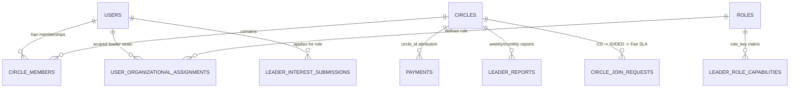

# 48 — Database Schema & Additive Migration Recommendations

> **Audit Group:** 08 — Enhancement Planning & Roadmap  
> **Target Database:** PostgreSQL (Laravel 12 Eloquent Models & Migrations in `c:\Users\malic\OneDrive\Documents\GitHub\unity-app-new\database\migrations\`)  
> **Non-Negotiable Database Rules (`.agents/AGENTS.md` & `DEVELOPER_RULES.md` §11):**  
> 1. **NEVER modify an already-executed migration.** Every schema change MUST be a brand-new, idempotent (`Schema::hasTable` / `Schema::hasColumn`) additive migration file.  
> 2. **Shared Table Discipline:** Treat `users`, `circles`, `circle_members`, `payments`, `events`, `notifications`, and `app_notifications` as cross-product contracts shared by Member App, Leader App, Admin Panel, Scan App, and DED. Never drop or rename shared columns without cross-product sign-off.  
> 3. **UUID Primary Keys:** Every new model/table must use `uuid('id')->primary()` with `protected $keyType = 'string'; public $incrementing = false;` and `Str::uuid()` in `booted()`.  
> 4. **Website Table Prefix (`web_`):** Any table belonging to website portal features MUST keep the `web_` prefix (e.g., `web_leadership_*`, `web_partnerships`, `web_messages`). Leader App / core tables do NOT use `web_`.  
> **Related Deliverables:** [01-existing-system-architecture.md](./01-existing-system-architecture.md) · [15-activity-database-and-metrics-mapping.md](./15-activity-database-and-metrics-mapping.md) · [43-sensitive-data-and-finance-access.md](./43-sensitive-data-and-finance-access.md) · [47-api-enhancement-recommendations.md](./47-api-enhancement-recommendations.md) · [50-final-implementation-roadmap.md](./50-final-implementation-roadmap.md)

---

## 1. Executive Summary of Schema Findings

**FACT:** Across the 35 platform activities, RBAC, finance, notifications, and leadership workflows, **95%+ of required PostgreSQL tables already exist in production**. Zero duplicate activity or circle tables are needed (**Enhance, Never Duplicate**). However, static code inspection identified **8 concrete schema/migration hygiene gaps** causing runtime DDL execution, PostgreSQL enum crashes, dropped foreign keys, or unmigrated pre-existing tables:

1. **Runtime DDL Anti-Pattern (`leader_role_capabilities`):** [LeaderRoleMatrixService.php](file:///c:/Users/malic/OneDrive/Documents/GitHub/unity-app-new/app/Leader/Services/LeaderRoleMatrixService.php#L218-L234) runs `Schema::create('leader_role_capabilities', ...)` dynamically inside `PUT /api/v1/leader/roles/matrix` (`ensureTableExists()`), and no migration file exists in `database/migrations/`! Furthermore, [LeaderRoleCapability.php](file:///c:/Users/malic/OneDrive/Documents/GitHub/unity-app-new/app/Leader/Models/LeaderRoleCapability.php#L18-L32) defines `enabled_capabilities` (JSON array per `role_key`), whereas `subagent_2_rbac_security.md` (§2.3) notes `LeaderPermissionService` also checks legacy/normalized columns if present.
2. **Missing Moderation Columns on `leader_interest_submissions`:** [LeadershipController.php](file:///c:/Users/malic/OneDrive/Documents/GitHub/unity-app-new/app/Http/Controllers/Api/V1/Admin/LeadershipController.php#L35-L61) and `AdminOpsController.php:636` write `status`, `admin_remarks`, `reviewed_by`, and `reviewed_at` when approving/rejecting `"Become a Leader"` submissions, while [LeaderActivitiesService.php](file:///c:/Users/malic/OneDrive/Documents/GitHub/unity-app-new/app/Leader/Services/LeaderActivitiesService.php#L2383) wraps `Schema::hasColumn('leader_interest_submissions', 'status')` because the baseline migration omitted those columns (and `LeaderInterestSubmission::$fillable` omits them).
3. **PostgreSQL Enum Drift (`circle_member_status_enum` & `circle_member_role_enum`):**
   - `circle_member_status_enum` base values are `'pending'`, `'approved'`, `'rejected'` ([config/circle.php](file:///c:/Users/malic/OneDrive/Documents/GitHub/unity-app-new/config/circle.php#L4-L5)); `LeaderMemberController::flagStatus` (`L395`) writes `'needs_attention'` and `'under_review'` (documented only as manual SQL in `LEADER_APP_COMPLETE_API_DOCUMENTATION.md:1432`), while `LeadershipController::assignmentDelete` (`L116`) writes invalid `'inactive'`!
   - `circle_member_role_enum` allows `('founder', 'director', 'chair', 'vice_chair', 'secretary', 'committee_leader', 'member')`, which `LeadershipController::assignmentStore` (`L63`) violates by writing `'circle_founder'`, `'circle_director'`, `'ded'`, `'id'`.
4. **Offline Payment Attribution Gap (`payments`):** `LeaderFinanceService::recordOfflinePayment` (`L603`) drops `circle_id`, `payment_date`, `payment_mode`, `reference_number`, and `recorded_by_user_id`.
5. **Pre-Existing Tables Without Tracked Migrations (`user_organizational_assignments`, `industry_director_assignments`, 23 `web_leadership_*` tables):** Present in live PostgreSQL (guarded by `Schema::hasTable` in services) or raw `.sql` (`database/sql/industry_director_assignments.sql`), risking fresh CI/staging test failures (`RefreshDatabase` in PHPUnit!).
6. **Plaintext Password Column (`scan_app_users.plain_password`):** Created in [2026_08_22_180000_add_plain_password_to_scan_app_users_table.php](file:///c:/Users/malic/OneDrive/Documents/GitHub/unity-app-new/database/migrations/2026_08_22_180000_add_plain_password_to_scan_app_users_table.php#L14-L18) (`DATA-SEC-05`).
7. **Missing Event/Circle Timezone Column (`circles.timezone`, `events.timezone`):** Needed for DST-safe `EventTimeZones` rendering on mobile (`MOB-ENH-11` / `API-ENH-10`).
8. **Missing Approval SLA & Refresh Token Persistence:** Needed for idempotent SLA reminders (`DOC-49`) and `POST /leader/auth/refresh` (`API-ENH-01`).

---

## 2. Recommended Additive Migrations (Zero Breaking Changes)

**RECOMMENDATION:** Create the following **8 strictly additive, idempotent Laravel 12 migrations** in `database/migrations/`, guarding every DDL statement with `Schema::hasTable()` / `Schema::hasColumn()` so they run cleanly on both existing production/dev databases and fresh PHPUnit test databases.

| Mig # | Proposed Migration Filename | Target Table(s) | Additive DDL Specification | Purpose & Linked Issue |
|---:|---|---|---|---|
| `DB-MIG-01` | `2026_12_01_000001_ensure_leader_role_capabilities_table.php` | `leader_role_capabilities` | `if (! Schema::hasTable('leader_role_capabilities'))`: `uuid('id')->primary()`, `string('role_key', 100)->unique()`, `string('role_label', 150)->nullable()`, `jsonb('enabled_capabilities')->default('[]')`, `boolean('is_system_role')->default(false)`, `uuid('updated_by_user_id')->nullable()->index()`, `timestamps()`. Remove runtime `Schema::create` from `LeaderRoleMatrixService::ensureTableExists()`. | Eliminates runtime DDL in `PUT /roles/matrix` and aligns `LeaderRoleCapability` with `LeaderPermissionService`. |
| `DB-MIG-02` | `2026_12_01_000002_add_moderation_columns_to_leader_interest_submissions.php` | `leader_interest_submissions` | Add nullable/defaulted columns via `Schema::hasColumn`: `string('status', 30)->default('pending')->index()`, `text('admin_remarks')->nullable()`, `text('rejection_reason')->nullable()`, `uuid('reviewed_by')->nullable()->index()`, `timestampTz('reviewed_at')->nullable()`. Update `LeaderInterestSubmission::$fillable` & `$casts`. | Fixes schema mismatch in `LeadershipController@applicationApprove/Reject` and `AdminOpsController@leaderInterestApprove/Reject` (Activity #13). |
| `DB-MIG-03` | `2026_12_01_000003_extend_circle_member_status_enum_safely.php` | PostgreSQL `circle_member_status_enum` (`circle_members.status`) | On `DB::getDriverName() === 'pgsql'`, run outside transaction (`public $withinTransaction = false;`): `ALTER TYPE circle_member_status_enum ADD VALUE IF NOT EXISTS 'needs_attention';` `ALTER TYPE circle_member_status_enum ADD VALUE IF NOT EXISTS 'under_review';` `ALTER TYPE circle_member_status_enum ADD VALUE IF NOT EXISTS 'left';` | Formalizes manual DDL note from `LEADER_APP_COMPLETE_API_DOCUMENTATION.md:1432` so `LeaderMemberController@flagStatus` never fails enum cast on staging/prod. *(Keep `circle_member_role_enum` unchanged — fix `LeadershipController` in PHP instead!)* |
| `DB-MIG-04` | `2026_12_01_000004_add_offline_audit_columns_to_payments_table.php` | `payments` | Add nullable columns (guarded by `Schema::hasColumn`): `uuid('circle_id')->nullable()->index()` *(if not already indexed)*, `string('payment_mode', 50)->nullable()`, `string('reference_number', 120)->nullable()`, `date('payment_date')->nullable()`, `uuid('recorded_by_user_id')->nullable()->index()`, `uuid('verified_by_admin_id')->nullable()`, `timestampTz('verified_at')->nullable()`. | Fixes `DATA-SEC-08` so offline payments submitted via `POST /finance/transactions/record-offline` preserve `circle_id`, reference, recorder, and maker-checker verification state. |
| `DB-MIG-05` | `2026_12_01_000005_create_leader_refresh_tokens_table.php` | `leader_refresh_tokens` | `uuid('id')->primary()`, `uuid('user_id')->index()`, `unsignedBigInteger('personal_access_token_id')->nullable()->index()`, `string('token_hash', 64)->unique()`, `string('family_id', 64)->index()`, `string('device_id', 191)->nullable()`, `timestampTz('expires_at')->index()`, `timestampTz('revoked_at')->nullable()`, `timestampTz('replaced_by_at')->nullable()`, `timestamps()`. | Enables secure SHA-256 refresh token persistence, rotation, and reuse detection for `POST /api/v1/leader/auth/refresh` (`RBAC-SEC-12`, `API-ENH-01`) without touching Member App auth tables. |
| `DB-MIG-06` | `2026_12_01_000006_add_timezone_to_circles_and_events_tables.php` | `circles`, `events` | Add `string('timezone', 64)->nullable()->default('Asia/Kolkata')` (or `nullable()` without region bias for new global circles, backfilling existing Indian circles to `'Asia/Kolkata'`) on `circles` and `events` if absent. | Supplies authoritative IANA timezone for `EventTimeZones` (`MOB-ENH-11`, `API-ENH-10`). |
| `DB-MIG-07` | `2026_12_01_000007_add_sla_tracking_to_pending_approval_tables.php` | `circle_join_requests`, `impacts`, `visitor_registrations` | Add nullable columns (guarded by `Schema::hasColumn`): `timestampTz('sla_due_at')->nullable()->index()`, `timestampTz('last_reminded_at')->nullable()`, `timestampTz('escalated_at')->nullable()`, `unsignedSmallInteger('escalation_level')->default(0)` + composite partial index on `(status, sla_due_at)`. | Powers idempotent SLA urgency pills in Action Center (`MOB-ENH-09`) and daily escalation reminders (`DOC-49`) without creating a duplicate `tasks` table. |
| `DB-MIG-08` | `2026_12_01_000008_drop_plain_password_from_scan_app_users.php` | `scan_app_users` | First ensure `ScanAppUser` model & controllers remove all references to `plain_password`, then execute `Schema::table('scan_app_users', fn (Blueprint $t) => $t->dropColumn('plain_password'))` guarded by `Schema::hasColumn`. | Remediates `DATA-SEC-05` cleartext password storage in PostgreSQL. |

---

## 3. Baseline Verification Migrations for Pre-Existing Live Tables (`Schema::hasTable` Guards)

**FACT & INFERENCE:** Three table groups are actively queried by Eloquent models in `unity-app-new` but have **no migration files** in `database/migrations/` (`subagent_2_rbac_security.md` §1.3 & §3.1):
1. **DynamicAccess Organizational Tables:** `user_organizational_assignments`, `role_scope_policies`, `user_permission_overrides`, `field_permissions` (currently guarded by `Schema::hasTable` in `OrganizationalScopeService` & `EffectiveAccessResolverService`).
2. **Industry Director Assignments:** `industry_director_assignments` (currently stored only as raw SQL in [industry_director_assignments.sql](file:///c:/Users/malic/OneDrive/Documents/GitHub/unity-app-new/database/sql/industry_director_assignments.sql); note `UserRoleResolverService.php:153` checks `Schema::hasColumn('industry_director_assignments', 'user_id')` which is absent from the raw SQL!).
3. **Website Leadership Election Portal Tables (23 `web_leadership_*` tables):** `web_leadership_campaigns`, `web_leadership_campaign_scopes`, `web_leadership_nominations`, `web_leadership_votes`, `web_leadership_jury_assignments`, `web_leadership_final_decisions`, etc.

**RECOMMENDATION:**
- Author idempotent baseline migrations (`if (! Schema::hasTable(...))`) for `user_organizational_assignments` and `industry_director_assignments` (adding nullable `uuid('user_id')->index()` to `industry_director_assignments` if missing) so `php artisan migrate` in automated CI/PHPUnit feature tests (`RefreshDatabase`) tests real DynamicAccess and Industry Director scoping!
- Preserve the `web_` prefix strictly on all 23 `web_leadership_*` tables per `.agents/AGENTS.md` §1; if baseline migrations are added for CI parity, wrap every table in `if (! Schema::hasTable('web_leadership_...'))`.

---

## 4. Performance Indexes & Shared-Table Cross-Product Impact Matrix

### 4.1 High-Value Composite Indexes for Scoped Leader Queries
**RECOMMENDATION:** Add non-blocking (`CREATE INDEX CONCURRENTLY IF NOT EXISTS` or guarded `Schema::table` index checks) for the hottest Leader App query paths:
- `circle_members (circle_id, status, deleted_at) INCLUDE (user_id, role)` — accelerates `resolveScopedCircleIds`, `listPeers`, and deduplicated All-Circles report rosters.
- `circle_members (user_id, status, left_at) WHERE deleted_at IS NULL` — accelerates `UserRoleResolverService::resolveUserRole()`.
- `payments (circle_id, status, created_at DESC)` — accelerates `LeaderFinanceService` revenue & transaction queries once `orWhereHas` is removed.
- `asks (status, visibility_circle_id, created_at DESC)` & `asks (user_id, status)` — accelerates scoped `LeaderAskFlowService` queries.
- `app_notifications (user_id, read_at, created_at DESC) WHERE deleted_at IS NULL` — accelerates `LeaderNotificationsController@unreadCount` and `index`.

### 4.2 Cross-Product Shared-Table Impact Matrix (`DEVELOPER_RULES.md` §2 & §11)

| Shared Table | Proposed Change | Member App Impact | Leader App Impact | Admin Panel / Web Impact | Scan App / DED Impact | Backward-Compatible? |
|---|---|---|---|---|---|---|
| `leader_role_capabilities` | Formalize `if (!hasTable)` migration (`DB-MIG-01`) | None (not read) | Stabilizes Role Matrix | Syncs cleanly with Dynamic RBAC | None | **100% Yes** |
| `leader_interest_submissions` | Nullable/default `status='pending'`, `admin_remarks`, `reviewed_by`, `reviewed_at` (`DB-MIG-02`) | `POST /forms/leader-interest` defaults `status='pending'` automatically | `leadership-interests` feed shows real status | Fixes 500 error on Admin approve/reject! | None | **100% Yes** |
| `circle_members` (`status` enum) | Add `'needs_attention'`, `'under_review'`, `'left'` enum labels (`DB-MIG-03`) | Existing `'approved'`/`'pending'` queries unaffected; verify Member App `myCircles` filters `status = 'approved'` | Enables Peer 360° `flagStatus` | Fixes status updates | DED counts filter `status = 'approved'` (unaffected) | **Yes** *(verify Member App `status` `WHERE` clauses keep `'approved'`)* |
| `payments` | Add nullable `payment_mode`, `reference_number`, `recorded_by_user_id`, `verified_by_admin_id` (`DB-MIG-04`) | Razorpay/Zoho checkouts leave nullable columns `NULL` | Preserves `circle_id` & audit trail on offline payment | Enables Finance Admin verification queue | DED uses `circle_subscriptions` (unaffected) | **100% Yes** |
| `circles`, `events` | Add nullable `timezone` (`DB-MIG-06`) | Optional field ignored by Member App until adopted | Enables DST-accurate `EventTimeZones` | Optional dropdown in Circle/Event form | Scan App uses `start_at` timestamps (unaffected) | **100% Yes** |
| `circle_join_requests`, `impacts`, `visitor_registrations` | Add nullable `sla_due_at`, `last_reminded_at`, `escalated_at`, `escalation_level` (`DB-MIG-07`) | Creation flows leave nullable or set default `+48h` | Powers Action Center SLA pills & reminders | Visible in Admin Pending Queue | DED Pending Queue unaffected | **100% Yes** |
| `scan_app_users` | Drop `plain_password` after removing model/Blade reads (`DB-MIG-08`) | None | None | Admin Scanner page shows `"Reset Password"` instead of cleartext | Scan App authenticates against `password_hash` (unaffected!) | **Yes** *(deploy PHP code cleanup immediately before migration)* |
