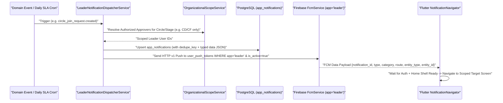

# 49 — Notification, Deep-Link & SLA Escalation Enhancement Recommendations

> **Audit Group:** 08 — Enhancement Planning & Roadmap  
> **Scope:** `LeaderNotificationsController`, `LeaderNotificationDispatcherService`, Dual-Table Inbox (`app_notifications` + `notifications`), FCM HTTP v1 (`FcmService`), Flutter `NotificationNavigator` & `NotificationCountService`, and Idempotent SLA Reminder Jobs  
> **Principle:** **ENHANCE, NEVER DUPLICATE** — Reuse existing `app_notifications`, `user_push_tokens` (`app = 'leader'`), `FcmService`, and Flutter `NotificationNavigator` (implemented in Round 5).  
> **Related Deliverables:** [28-notification-generation-and-delivery-flow.md](./28-notification-generation-and-delivery-flow.md) · [30-existing-notification-system-audit.md](./30-existing-notification-system-audit.md) · [31-master-actionable-notification-catalogue.md](./31-master-actionable-notification-catalogue.md) · [34-escalation-rules-and-ownership.md](./34-escalation-rules-and-ownership.md) · [42-rbac-security-audit.md](./42-rbac-security-audit.md) · [46-mobile-app-enhancement-recommendations.md](./46-mobile-app-enhancement-recommendations.md)

---

## 1. Summary of Verified Notification Defects

**FACT:** Static inspection of [LeaderNotificationsController.php](file:///c:/Users/malic/OneDrive/Documents/GitHub/unity-app-new/app/Leader/Controllers/LeaderNotificationsController.php#L1-L1658), `LeaderNotificationDispatcherService`, and Flutter's `lib/core/notifications/` + `lib/features/notifications/` identified **5 concrete defects** and **2 high-value operational gaps**:

1. **Critical Missing Auth Guard (`RBAC-SEC-07`):** All 5 `/api/v1/leader/admin/notifications/{config, leaders, send, logs}` endpoints (`routes/leader.php:155-159`) lack a `superAdmin` check — any `secretary` or `viceChair` can broadcast `"Super Admin Broadcast"` FCM pushes to 500 leaders, toggle global notification triggers, and read all leaders' contact info and delivery logs!
2. **Hardcoded Fake Welcome Notifications (`ldr-welcome-1`):** In `LeaderNotificationsController@index` (`subagent_3_activities_notifications.md` §2.2), when a Leader has `0` matching rows across `notifications` and `app_notifications`, the controller injects synthetic sample items with non-UUID IDs like `'ldr-welcome-1'`. Tapping or marking these read sends non-UUID IDs to `POST /notifications/{id}/read`, violating UUID expectations and confusing leaders.
3. **Three-Way Unread Badge Drift (`LEADER_APP_ARCHITECTURE_PROPOSALS.md` §1.8):**
   - Backend `unreadCount()` fetches up to `100` rows from `notifications` in PHP + counts `app_notifications` excluding `CONSUMER_EXCLUDED_TYPES` (38 types), **without** deduplicating dual-written events written to *both* `notifications` and `app_notifications`!
   - Flutter `NotificationsBloc` additionally filters items via `LeaderNotificationModel.isLeaderNotification`, causing the bell icon (`NotificationCountService`) to display `1–2` unread while `NotificationsView` renders an empty state!
   - Flutter `PushNotificationService` (`L307`) blindly adds `+1` locally on foreground FCM messages without re-syncing.
4. **Incomplete Deep-Link Entity Identifiers:** Flutter's Round-5 `NotificationNavigator` (`lib/core/notifications/notification_navigator.dart`) cleanly routes by `entity_type` + `entity_id` (`peer`, `circle`, `report`) with cold-start readiness and auth guards, **but** backend dispatches in `LeaderNotificationDispatcherService` do not consistently populate `entity_type`, `entity_id`, and canonical `route` inside FCM `data` and `app_notifications.data`.
5. **Zero SLA Reminder or Escalation Jobs:** None of the 25 scheduled commands in `routes/console.php` remind or escalate unapproved `circle_join_requests`, `pending_impacts`, `visitor_registrations`, or overdue Circle Reports (`subagent_3_activities_notifications.md` §2.8).

---

## 2. Target Architecture & Payload Contract



### 2.1 Canonical Actionable Notification Payload Contract
**RECOMMENDATION:** Standardize every row written by `LeaderNotificationDispatcherService` into `app_notifications.data` AND every FCM `data` map sent via `FcmService` (note FCM v1 requires string values in `data`):

```json
{
  "notification_id": "9d4e8a12-3c4b-4f8a-9b1c-2d3e4f5a6b7c",
  "app": "leader",
  "type": "circle_join_pending_cd",
  "category": "approvals",
  "priority": "high",
  "route": "/leader-activities",
  "activity_type": "pending-requests",
  "pending_category": "circle_joining_requests",
  "entity_type": "circle_join_request",
  "entity_id": "7f2a1b3c-4d5e-4f6a-8b9c-0d1e2f3a4b5c",
  "circle_id": "3a1b2c3d-4e5f-4a6b-8c7d-9e0f1a2b3c4d",
  "action_required": "true"
}
```

Closed `entity_type` routing map for `NotificationNavigator`:
- `peer` -> `AppRoutes.peerProfile` (`entity_id` = `user_id`)
- `circle` -> `AppRoutes.circleDetails` (`entity_id` = `circle_id`)
- `report` -> `AppRoutes.reportDetails` (`entity_id` = `report_id`)
- `circle_join_request` | `impact` | `visitor_registration` | `coin_claim` | `certification` | `peer_recommendation` | `introduction_request` -> `AppRoutes.leaderActivities` (`activityType: 'pending-requests'`, pre-selecting `pending_category` chip & highlighting `entity_id`)
- `circular` -> `AppRoutes.circulars` (`entity_id` = `circular_id`)
- `role_assignment` -> `AppRoutes.profile` (refreshing `SessionManager` via `GET /leader/auth/me`!)

---

## 3. Six Targeted Notification & SLA Enhancements

| ID | Component | Exact File(s) Affected | Recommended Minimum-Change Enhancement |
|---|---|---|---|
| `NOTIF-ENH-01` | **Lock Down Admin Broadcast Console (`P0`)** | [routes/leader.php](file:///c:/Users/malic/OneDrive/Documents/GitHub/unity-app-new/routes/leader.php#L155-L159), [LeaderNotificationsController.php](file:///c:/Users/malic/OneDrive/Documents/GitHub/unity-app-new/app/Leader/Controllers/LeaderNotificationsController.php#L892-L1505) | Add `leader.can:manage_roles` middleware AND an explicit `abort_unless($this->permissions->isSuperAdmin($request->user()), 403)` guard at the top of `adminGetConfig`, `adminSaveConfig`, `adminSearchLeaders`, `adminSendNotification`, and `adminGetLogs`; audit every manual broadcast via `ActivityLoggerService::log()`. |
| `NOTIF-ENH-02` | **Eliminate Fake `ldr-welcome-1` Rows & Dual-Table Double Counting** | [LeaderNotificationsController.php](file:///c:/Users/malic/OneDrive/Documents/GitHub/unity-app-new/app/Leader/Controllers/LeaderNotificationsController.php#L80-L360), `LeaderNotificationDispatcherService.php` | 1. Delete the synthetic `ldr-welcome-1` fallback array when `0` notifications exist — return honest `data: []`, `unread_count: 0` so `NotificationEmptyState` renders cleanly.<br>2. Make `app_notifications` (`WHERE data->>'app' = 'leader'` OR `type IN (LEADER_ALLOWED_TYPES)`) the **single primary source** for both `index()` and `unreadCount()` (tagging all `LeaderNotificationDispatcherService` writes with `data.app = 'leader'`), eliminating dual-table double counting (`notifications` + `app_notifications`) and removing the 100-row PHP memory slice. |
| `NOTIF-ENH-03` | **Strict Stage & Scope Recipient Resolution** | [LeaderNotificationDispatcherService.php](file:///c:/Users/malic/OneDrive/Documents/GitHub/unity-app-new/app/Leader/Services/LeaderNotificationDispatcherService.php#L1-L397) | Ensure every event fan-out resolves recipients strictly from approved leadership seats of the target Circle/District/Industry:<br>- `circle_join_requests` (`pending_cd_approval`) -> notify **only** that Circle's `Circle Director` & `Circle Founder` (NOT all CDs!).<br>- Once CD approves (`pending_id_approval`) -> notify **only** that Circle's assigned `Industry Director` & District's `DED`.<br>- `pending_impacts` / `visitor_registrations` -> notify Circle's `CD` / `CF` (and `Chair - Membership` / `Chair - Events & Impacts` as informational/review per matrix).<br>- Role/Assignment changes -> notify affected Leader + trigger silent/foreground session capability refresh. |
| `NOTIF-ENH-04` | **Strict Leader-App FCM Token Isolation (`app = 'leader'`)** | `App\Models\UserPushToken`, `LeaderNotificationsController@registerDeviceToken`, `App\Services\Notifications\FcmService` | Ensure `LeaderNotificationDispatcherService` dispatches push notifications **exclusively** to `user_push_tokens` where `user_id = $leaderId`, `app = 'leader'`, and `is_active = true` (with fallback to `users.leader_android_fcm_token` / `leader_ios_fcm_token` — **never** `users.android_fcm_token` used by the consumer Member App, preventing duplicate pushes across both apps on the same phone!). |
| `NOTIF-ENH-05` | **Extend Flutter `NotificationNavigator` for Action Center Deep Links** | [notification_destination.dart](file:///D:/office%20project/LeaderApp-Fornt-end-/lib/core/notifications/notification_destination.dart), [notification_navigator.dart](file:///D:/office%20project/LeaderApp-Fornt-end-/lib/core/notifications/notification_navigator.dart), [notifications_bloc.dart](file:///D:/office%20project/LeaderApp-Fornt-end-/lib/features/notifications/bloc/notifications_bloc.dart) | Add `ActionCenterDestination({String? pendingCategory, String? highlightEntityId})` and `CircularsDestination({String? circularId})` to `NotificationDestination`; replace blind `+1` foreground increment in `PushNotificationService` (`L307`) with debounced `NotificationCountService.instance.fetchUnreadCount()`. |
| `NOTIF-ENH-06` | **Idempotent Daily SLA Reminder & Escalation Command** | New `app/Leader/Console/SendLeaderSlaRemindersCommand.php` (`leader:send-sla-reminders`), scheduled daily at `09:30 IST` in `routes/console.php` | Query pending `circle_join_requests`, `impacts` (`requires_leadership_approval = true`), and `visitor_registrations` using additive `sla_due_at` / `escalation_level` columns (`DB-MIG-07`):<br>- **T + 48 hours (`escalation_level = 0 -> 1`):** Send actionable reminder push/in-app to primary approver (`CD` / `CF`), keyed by `dedupe_key = "sla_l1:{type}:{id}"`.<br>- **T + 96 hours (`escalation_level = 1 -> 2`):** Escalate actionable alert to regional supervisor (`Industry Director` & `DED` of that Circle), keyed by `dedupe_key = "sla_l2:{type}:{id}"`.<br>- **T + 7 days (`escalation_level = 2 -> 3`):** Escalate summary digest to `Country Director` / `Super Admin`.<br>*(Exact hour thresholds flagged for confirmation in `BD-09` of [51-open-business-decisions.md](./51-open-business-decisions.md).)* |
