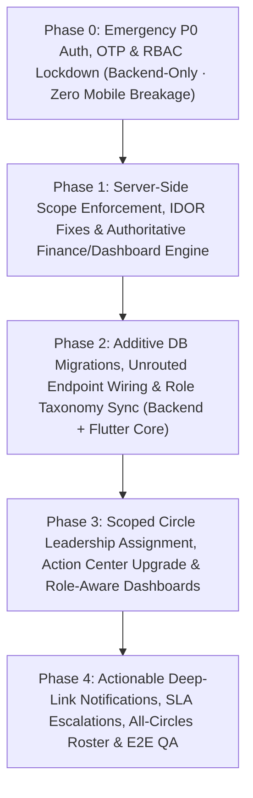

# 50 — Final Dependency-Ordered Implementation Roadmap

> **Audit Group:** 08 — Enhancement Planning & Roadmap  
> **Scope:** Coordinated Backend (`unity-app-new`) + Flutter Leadership App (`LeaderApp-Fornt-end-`) Delivery Plan  
> **Guiding Engineering Rules:**  
> - **Enhance, Never Duplicate** — Preserve Laravel 12 + PostgreSQL + Sanctum and Flutter MVP + BLoC  
> - **Zero Production Breakage (`DEVELOPER_RULES.md` §16)** — Sequence backend contract additions *before* mobile client switches, and decouple mobile `/admin/*` calls *before* locking `/api/v1/admin/*` against `User` tokens  
> - **Mandatory Quality Gates** — `./vendor/bin/pint` + `php artisan test` on Laravel; `flutter analyze --no-pub` + `flutter test --no-pub` on Flutter  
> **Related Deliverables:** [42-rbac-security-audit.md](./42-rbac-security-audit.md) · [45-existing-vs-required-feature-gap-analysis.md](./45-existing-vs-required-feature-gap-analysis.md) · [46-mobile-app-enhancement-recommendations.md](./46-mobile-app-enhancement-recommendations.md) · [47-api-enhancement-recommendations.md](./47-api-enhancement-recommendations.md) · [48-database-enhancement-recommendations.md](./48-database-enhancement-recommendations.md) · [49-notification-enhancement-recommendations.md](./49-notification-enhancement-recommendations.md) · [51-open-business-decisions.md](./51-open-business-decisions.md)

---

## 1. End-to-End Phase Dependency Graph

> [!WARNING]
> **Critical Backward-Compatibility Sequencing Note (Phase 0 -> Phase 1):**  
> Today, the live Flutter Leadership App's `DashboardRemoteDataSource` calls 4 `/api/v1/admin/*` endpoints (`/admin/leads/counts`, `/admin/pending-requests/summary`, `/admin/pending-requests`, `/admin/posts`) **only when logged in as `superAdmin` or `countryDirector`** (`dashboard_remote_datasource.dart:76-204`). Therefore, in **Phase 0**, lock `/api/v1/admin/*` so it rejects non-admin `member` / Circle Leader tokens (`403`) while temporarily permitting verified `superAdmin`/`countryDirector` tokens until `MOB-ENH-03` removes those 4 client calls in **Phase 2**! That guarantees **zero regression** for currently installed mobile builds.

---

## 2. Phased Implementation Plan

### Phase 0 — Emergency `P0` Auth, OTP & RBAC Lockdown (Backend-Only · Zero Mobile Breaking Changes)
**Goal:** Eliminate unauthenticated takeover, master OTP backdoors, and regular-Peer privilege escalation immediately on `unity-app-new` without requiring an app-store update.

| Task ID | Deliverable Ref | Exact Backend Scope (`unity-app-new`) | Risk | Verification Gate |
|---|---|---|---|---|
| `P0-1` | `RBAC-SEC-01` | Wrap `Route::prefix('v1/rbac')` (`routes/api.php:312`) and `Route::prefix('v1/admin/rbac')` (`L345`) in `['auth:sanctum', 'admin.auth', 'admin.role:global_admin']`; protect `POST/DELETE /v1/tutorials` (`L389`); fail-closed `abort_if(! $admin, 401)` in `RoleHierarchyController::checkEditPermission()` (`L1587`). | Low | `RbacRouteSecurityTest` (`401` guest, `403` member/DED, `200` `global_admin`) |
| `P0-2` | `RBAC-SEC-02` | Remove `isSpecialBypassUser()` (`AuthController.php:1497` `\|\| true`), `handleSpecialDirectLogin()`, the 8 hardcoded `@gmail.com` bypasses in `AdminAuthService.php:196-245`, and plaintext `'Harsh@123'`; revoke existing `admin_panel` tokens in `personal_access_tokens`. | Low | `AuthBypassRemovalTest` (`POST /auth/request-otp` & `/direct-login` never mint tokens without valid OTP) |
| `P0-3` | `RBAC-SEC-03` | Remove unconditional `'123456'` master OTP acceptance from `LeaderAuthService.php:156`, `StoreOtpService.php:65` (+ `'store_otp_tok_'` prefix bypass at `L85`), `JuryWebController.php:180`, and `VerificationService.php:380`. | Low | `MasterOtpDisabledTest` across all 4 endpoints in `APP_ENV=production` |
| `P0-4` | `RBAC-SEC-04`, `05`, `06` | Remove `AdminUser::firstOrCreate` from `EnsureAdminAuthenticated.php:39`; flip empty-role and `\Throwable` fallbacks in `AdminAccess.php` (`L545, 590`) & `PermissionService.php` (`L153, 209, 289`) to `return false`; deduplicate `DynamicAccess` routes (`routes/api.php:2319-2450`) and enforce `global_admin`; add role guard to `/api/v1/admin/*` & `/api/v1/leadership/admin/*`. | Medium | `AdminGuardPrivilegeEscalationTest` (`member` token -> `403` across all admin/DynamicAccess/election routes) |
| `P0-5` | `RBAC-SEC-07`, `11`, `13`, `DATA-SEC-01..03` | Enforce `isSuperAdmin($user)` on `/roles/*` writes (`LeaderRoleManagementController`) + `/leader/admin/notifications/*` (`LeaderNotificationsController`); fix `AdminCircleScope::$cachedCircleIds` keying by `$admin->id` (`L184`); remove hardcoded `302\|cO0V...` fallback in `AllowFixedMembersToken.php:21`; gate `FileController@download` (`L685`) for private files; fix `getUserContacts` `WHERE user_id = $user->id` (`LeaderTeamsService.php:1942`); gate `bootstrap/app.php:130` 500 stack info behind `config('app.debug')`. | Low | `./vendor/bin/pint --test` && `php artisan test --filter=LeaderPhase0SecurityTest` |

---

### Phase 1 — Server-Side Scope Enforcement, IDOR Remediation & Authoritative Finance/Dashboard Fixes
**Goal:** Close all 10 horizontal IDORs/scope leaks and make Backend KPIs & Financials 100% authoritative so every role receives honest, scoped numbers.

| Task ID | Deliverable Ref | Exact Backend Scope (`unity-app-new`) | Risk | Verification Gate |
|---|---|---|---|---|
| `P1-1` | `RBAC-SEC-08`, `09`, `10`, `15`, `SCOPE-SEC-07` | Fix `UserRoleResolverService` (`status = 'approved'` & `whereNull('left_at')` on `circle_members`; check `admin_user_roles.expires_at`; require verified email on `AdminUser` link; map `global_founder` & `committee_leader`; replace `Circle::get()` at `L283` with JSONB query). Fix `LeaderPermissionService` (`countryDirector` country filter; `whereJsonContains` industry filter; fix `DynamicRbacSeeder` `coin_payouts`/`manage_finance`/`track_milestones` mapping; remove hardcoded `in_array` overrides). | Medium | `UserRoleResolverTest` & `LeaderPermissionMatrixTest` across all 19 seeded roles |
| `P1-2` | `API-ENH-03`, `SCOPE-SEC-01..06`, `08`, `09` | Wire `'leader.can:<cap>'` middleware + `->whereUuid(...)` across `routes/leader.php` (`API-ENH-03` §3 table). Enforce `OrganizationalScopeService` intersection on `/peers*` (`?scope=global`, `?circle_id`, `{id}`), `/teams/circles/{id}*`, `/reports*` (`download`/`file`), `/finance*`, `/activities*`, and `/ask-flows*` (excluding `status='draft'`). Fix `GET /api/v1/leadership/circles` route collision (`routes/leadership.php:111`). | Medium | `LeaderScopeIdorMatrixTest` (Circle A vs Circle B, District X vs District Y, Industry 1 vs 10) |
| `P1-3` | `DATA-SEC-04`, `API-ENH-10` | Mask `phone` and `email` in `LeaderPeersService::formatPeerCard`, `getCirclePeers`, and `getPeer` per `users.hide_phone` / `hide_email` policy; emit canonical `profile_photo_image` on all Peer payloads (`DEVELOPER_RULES.md` §9). | Low | `PeerPrivacyAndContractTest` |
| `P1-4` | `DATA-SEC-06..09`, `API-ENH-04`, `08` | Fix `LeaderFinanceService`: remove `orWhereHas('user.circleMembers')` cross-circle payment leak (`L77`); scope `circle_budget` (`L339`) & `active_tenures` (`L325`) to `$targetCircleIds`; separate `unpaid_member_dues` from `commission_due`; fix `projected_annual_revenue`. Fix `LeaderDashboardService`: replace `deals * 0.05` (`L733`), fake `60/25/15%` Ask splits (`L784`), fake `70/30%` cert splits (`L789`), `circulars = 5` (`L798`), and fictional Top Impacters (`L924-L970`) with real scoped SQL counts. | Medium | `LeaderFinanceAccuracyTest` & `LeaderDashboardAccuracyTest` |

---

### Phase 2 — Additive DB Migrations, Unrouted Endpoint Wiring & Core Synchronization (Backend + Flutter)
**Goal:** Land additive PostgreSQL migrations (`DB-MIG-01..08`), wire unrouted endpoints, add token refresh/logout, and align Flutter core models/datasources.

| Task ID | Deliverable Ref | Backend (`unity-app-new`) & Mobile (`LeaderApp-Fornt-end-`) Scope | Risk | Verification Gate |
|---|---|---|---|---|
| `P2-1` | `DB-MIG-01..08` | Execute additive migrations: `leader_role_capabilities`, `leader_interest_submissions` moderation columns, `circle_member_status_enum` (`needs_attention`, `under_review`, `left`), `payments` offline columns, `leader_refresh_tokens`, `circles`/`events.timezone`, SLA columns, and `scan_app_users.plain_password` drop (after removing PHP reads/writes). | Low | `php artisan migrate` on staging copy + `RefreshDatabase` PHPUnit suite |
| `P2-2` | `API-ENH-01`, `05`, `06`, `11` | Add `POST /api/v1/leader/auth/refresh` + 24h Sanctum TTL + safe `AdminUser` logout; route `PUT /api/v1/leader/peers/{id}` (`LeaderPeersController@update`); route `POST /api/v1/leader/circulars` writing to `circulars` table (`LeaderCircularsController@publish`); fix `PendingRequestAdminController::fetchCoinClaims` (`coin_claim_requests`) & `LeadershipController` enum writes; append additive `assignments[]` on `/leader/auth/me`. | Low | Feature tests for refresh rotation, peer update, circular publish, and coin-claims queue |
| `P2-3` | `MOB-ENH-01..06` | Flutter Core & Data Cleanup: align `UserRole` (`viceChair`, `secretary`, `committeeLeader`) & strict `isSuperAdmin`; redact Bearer tokens in `ApiClient`, wire `POST /leader/auth/logout` & `401` refresh/login interceptor; simplify `DashboardRemoteDataSource` to 1 request (removing all `/admin/*` calls!); fix `EditPeerBottomSheet` error handling; wire `PublishCircularBottomSheet` to `/leader/circulars`; remove fabricated model defaults (`activeTenures ?? 42`, `'Aug 2026'`, `CircleLeadershipCard` fake titles/90%, `isDummyPeer`). | Medium | `flutter analyze --no-pub` (0 errors, 0 new warnings) && `flutter test --no-pub` |

---

### Phase 3 — Scoped Leadership Assignment, Action Center Integration & Role-Wise Dashboards
**Goal:** Deliver missing scoped Circle Chair/Committee management, unified Action Center moderation UX, multi-assignment switching, and Peer 360° polish.

| Task ID | Deliverable Ref | Backend & Mobile Scope | Risk | Verification Gate |
|---|---|---|---|---|
| `P3-1` | `API-ENH-07`, `MOB-ENH-08` | Backend: Add `POST|DELETE /api/v1/leader/teams/circles/{id}/assignments*` delegating to `OrganizationalAssignmentSyncService` + `ActivityLoggerService`. Mobile: Add role-gated `AssignCircleLeaderBottomSheet` in `CircleLeadershipCard` (`canAssignCircleChair`). | Medium | Backend hierarchy/scope tests + Flutter widget/BLoC tests |
| `P3-2` | `MOB-ENH-07`, `09`, `10`, `13` | Mobile UX Upgrades: Add category filter chips, `ConfirmModerationBottomSheet` (with required rejection reason), and SLA age pills to `LeaderActivitiesView(activityType: 'pending-requests')`; upgrade `ProfileAssignedCirclesCard` & header switcher to `assignments[]`; add `i_can_help_with` / `i_am_looking_for` / `superpower` chips & `profile_photo_image` support on `PeerProfileView`; mount `PeerProfileBottomActions` (subject to `BD-06`). | Low | Widget tests at `320/360/384 dp` × font scale `1.0/1.15/1.3` + `brand_vocabulary_test.dart` |
| `P3-3` | Docs `35`–`40` | Compose role-prioritized home sections on `DashboardView` (`Super Admin`, `DED`/`EED`, `Industry Director`, `Circle Founder`, `Circle Director`, `Committee Chair`) using existing modular cards gated by `LeaderPermissions` and `UserRole`. | Low | Per-role widget tests verifying visible/hidden cards |

---

### Phase 4 — Actionable Notifications, SLA Escalations, Deduplicated Reporting & E2E Regression Suite
**Goal:** Close operational feedback loops with single-source unread counts, SLA reminders, All-Circles deduplicated rosters, encrypted offline cache, and full cross-product QA.

| Task ID | Deliverable Ref | Backend & Mobile Scope | Risk | Verification Gate |
|---|---|---|---|---|
| `P4-1` | `NOTIF-ENH-02..06`, `MOB-ENH-12` | Backend: Remove `ldr-welcome-1`, standardize `app_notifications` single-source unread count, enforce `app='leader'` FCM isolation & stage-scoped recipient fan-out, schedule daily `leader:send-sla-reminders`. Mobile: Extend `NotificationNavigator` for `ActionCenterDestination` & `CircularsDestination`; debounce `fetchUnreadCount()` on foreground pushes. | Low | PHPUnit notification dispatch/dedupe tests + Flutter `notification_navigator_test.dart` |
| `P4-2` | `API-ENH-09`, `MOB-ENH-11`, `14` | Backend: Deduplicated All-Circles `GET /reports/roster?circle_id=all` (`unique_peers` vs `qualifying_memberships`, real metrics, `complete` flag) + real `YYYY-MM` `attendance-trend` from `attendance_records`. Mobile: Wire All-Circles roster summary, re-mount `ReportsTrendCard` when `>= 2` points exist, and enable `HiveAesCipher` + 24h TTL + `"Saved snapshot"` banner in `HiveCacheService`. | Medium | `report_roster_rules_test.dart`, `reports_spline_chart_test.dart`, encrypted cache unit tests |
| `P4-3` | Cross-Product QA | Full regression pass across **Leader App**, **Member App**, **Admin Panel**, **DED Portal**, and **Scan App** verifying shared tables (`users`, `circles`, `circle_members`, `payments`, `app_notifications`) have zero regressions. | Low | `./vendor/bin/pint --test` + `php artisan test` + `flutter analyze --no-pub` + `flutter test --no-pub` + device matrix (`360×800`, `384×853`, `411×914`) |

---

## 3. Effort, Risk & Rollback Summary Matrix

| Phase | Primary Owner | Relative Complexity | Breaking-Change Risk | Rollback Strategy | Mandatory Exit Gate |
|---|---|---|---|---|---|
| **Phase 0** | Backend Security | Small (Focused guards & deletions) | **None** for legitimate OTP logins | Revert individual route middleware commit if an undocumented external integration breaks | 100% pass on `P0` Auth/RBAC exploit regression tests + `./vendor/bin/pint` |
| **Phase 1** | Backend Core | Medium (6 Leader services + scope engine) | **Low** (response JSON shapes preserved; values become accurate) | Feature-flag `AuthoritativeFinanceAggregator` if reconciliation sign-off pending | Zero cross-circle/district IDORs + verified SQL query counts + `php artisan test` |
| **Phase 2** | Backend + Flutter Core | Medium (8 additive migrations + 6 mobile fixes) | **Low** (additive DB columns + backward-compatible `assignments[]`) | Additive nullable columns require **no** destructive down-migration on code rollback | Clean `migrate`, `pint`, `php artisan test`, `flutter analyze`, `flutter test` (`280+` tests) |
| **Phase 3** | Backend + Flutter UI | Medium (Chair assignment + Action Center + 360°) | **Low** (role-gated additive UI sheets) | Hide new assignment button via `can_assign_circle_chair` capability toggle in Role Matrix | Responsive widget tests (`320–411 dp`, scale `1.3`) + `brand_vocabulary_test.dart` |
| **Phase 4** | Backend + Flutter Ops | Medium (SLA cron + All-Circles roster + encrypted cache) | **Low** (`leader:send-sla-reminders` gated by `config('leader.sla_reminders_enabled')`) | Disable cron config flag instantly without redeploy if reminder volume needs tuning | Full 5-product shared-table smoke suite + physical Android/iOS device sign-off |
