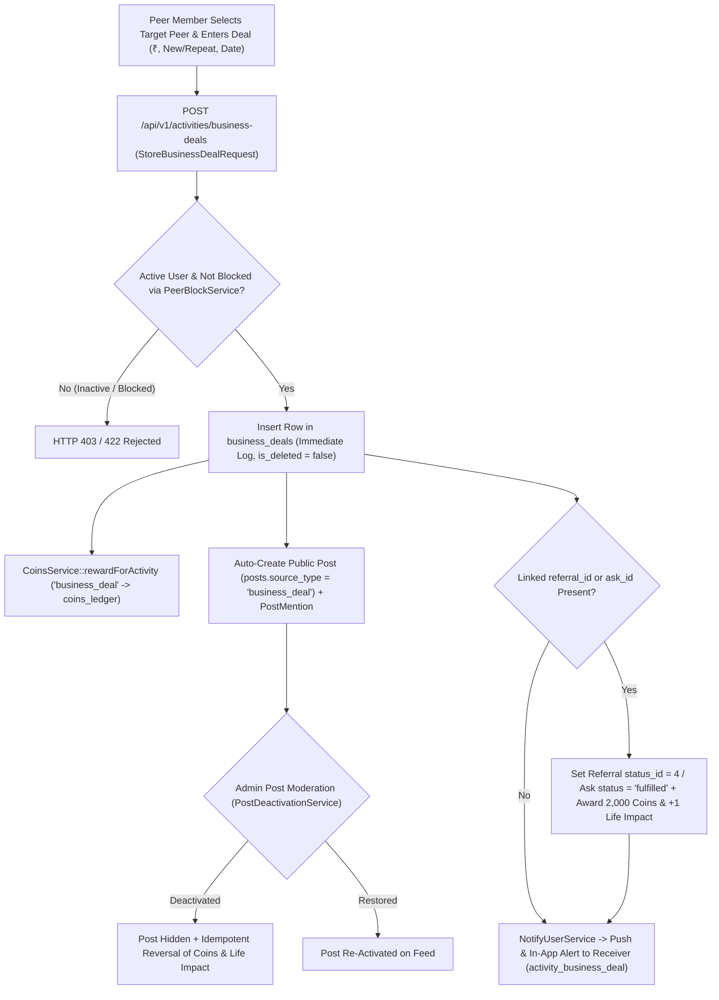

# Activity 01: Business Deals (Given & Received)

| Attribute | Verified Specification |
|---|---|
| **Workbook Activity #** | `1.0` |
| **Exact Workbook Name** | `Business Deals (Given & Received)` |
| **Domain Category** | `Revenue & Networking` (Sheet 1 & 2) / `Revenue / Transactions` (Sheet 3) |
| **Activity Governance Tier** | `Leadership Oversight` (Workbook specifies peer verification; actual backend logs immediately with Leadership/DED/Admin read oversight and Admin post-deactivation reversal) |
| **Overall Implementation Status** | `Partially Implemented` (Core Member logging, referral/ask handoff rewards, Leader/DED/Admin read feeds work; Workbook peer verification & proof receipt upload are `Missing`; Leader App `CreateBusinessDealBottomSheet` is `Implemented but Not Integrated`; Dashboard `5%` revenue calculation is `Implemented but Incorrect`) |
| **Master Index & Cross-Links** | [12-master-35-activities-index.md](../12-master-35-activities-index.md) · [19-activity-to-role-access-matrix.md](../19-activity-to-role-access-matrix.md) · [25-activity-workflow-reference.md](../25-activity-workflow-reference.md) · [13-activity-input-forms-and-validation.md](../13-activity-input-forms-and-validation.md) · [15-activity-database-and-metrics-mapping.md](../15-activity-database-and-metrics-mapping.md) · [16-activity-api-and-backend-mapping.md](../16-activity-api-and-backend-mapping.md) |

---

## 1. Business Purpose (§9.1)

- **Why It Exists & Business Outcome:**
  - **WORKBOOK REQUIREMENT:** Enables peers to log monetary business deals closed with fellow Peers Global members (`₹ INR`, `New` vs `Repeat` business) to celebrate mutual commercial ROI, track chapter economic velocity, unlock Deal Milestone Creative Cards, and trigger Verified Deal Badges.
  - **FACT:** In the Laravel 12 backend ([BusinessDealController.php](file:///c:/Users/malic/OneDrive/Documents/GitHub/unity-app-new/app/Http/Controllers/Api/BusinessDealController.php#L135-L250)), logging a Business Deal records a transaction row in `business_deals`, awards activity Coins to the deal giver via `CoinsService::rewardForActivity('business_deal')`, auto-publishes a public timeline celebration post (`posts.source_type = 'business_deal'`), notifies the receiving peer (`activity_business_deal`), and—when linked to a `referral_id` or `ask_id`—automatically closes the originating Referral (`status_id = 4` "Got The Business") or Ask (`status = 'fulfilled'`, `outcome_status = 'got_the_business'`) while awarding **2,000 bonus Coins** to both peers and **+1 Life Impact** to the receiving peer.
- **Role Partitioning (Member vs Leadership vs Admin):**
  - **Peer Member (`FACT`):** Logs deals given (`from_user_id` = caller) in the Flutter Member App ([add_business_deal_screen.dart](file:///D:/office%20project/peers-unity/unity_app/lib/features/business_deal/presentation/screens/add_business_deal_screen.dart)), views Given/Received deal history, views peer deal histories and the Business Deals Leaderboard.
  - **Circle / Regional Leadership (`FACT`):** Views circle- or district-scoped deal feeds, ranked deal contributors, and Member 360° deal logs in the Flutter Leadership App ([business_deals_view.dart](file:///D:/office%20project/LeaderApp-Fornt-end-/lib/features/business_deals/view/business_deals_view.dart), [leader_activities_view.dart](file:///D:/office%20project/LeaderApp-Fornt-end-/lib/features/leader_activities/view/leader_activities_view.dart), [peer_business_deals_screen.dart](file:///D:/office%20project/LeaderApp-Fornt-end-/lib/features/peer_profile/view/peer_business_deals_screen.dart)) and DED endpoints (`/api/v1/ded/activities/business-deals`). Although `POST /api/v1/leader/business-deals` exists in [routes/leader.php](file:///c:/Users/malic/OneDrive/Documents/GitHub/unity-app-new/routes/leader.php#L144), the Leadership App's [create_business_deal_bottom_sheet.dart](file:///D:/office%20project/LeaderApp-Fornt-end-/lib/features/business_deals/view/widgets/create_business_deal_bottom_sheet.dart) is orphaned (`Implemented but Not Integrated`).
  - **Super Admin / Web Admin (`FACT`):** Audits and exports global/scoped Business Deals via `/admin/activities/business-deals` ([ActivitiesBusinessDealsController.php](file:///c:/Users/malic/OneDrive/Documents/GitHub/unity-app-new/app/Http/Controllers/Admin/ActivitiesBusinessDealsController.php)) and React Admin ([ActivitiesPage.tsx](file:///D:/office%20project/unity-admin-web/src/features/activities/ActivitiesPage.tsx)), and can deactivate/restore the linked timeline post via `PostDeactivationService`, which idempotently reverses awarded Coins and Life Impact points.

---

## 2. Sub-Activities Catalogue (§9.2)

| # | Sub-Activity / Operation | Member App (`unity_app`) | Leadership App (`LeaderApp`) | Admin Web (`unity-admin-web` & Blade) | Backend (`unity-app-new`) | Classification |
|---|---|---|---|---|---|---|
| 2.1 | **Select Target Peer for Deal** | Wired via peer selector on [add_business_deal_screen.dart](file:///D:/office%20project/peers-unity/unity_app/lib/features/business_deal/presentation/screens/add_business_deal_screen.dart) & [selected_peer_card.dart](file:///D:/office%20project/peers-unity/unity_app/lib/features/business_deal/presentation/widgets/add_business_deal/selected_peer_card.dart) | Orphaned sheet uses raw UUID `TextField` (`Peer User ID *`); `GET /api/v1/leader/activities/peers-dropdown` exists on backend | Read-only peer filter | Validated via `exists:users,id` + active check + `PeerBlockService::isBlockedEitherWay()` | `Partially Implemented` |
| 2.2 | **Create / Submit Business Deal** | Wired (`POST /api/v1/activities/business-deals`) with [business_deal_amount_input.dart](file:///D:/office%20project/peers-unity/unity_app/lib/features/business_deal/presentation/widgets/add_business_deal/business_deal_amount_input.dart) | [CreateBusinessDealBottomSheet](file:///D:/office%20project/LeaderApp-Fornt-end-/lib/features/business_deals/view/widgets/create_business_deal_bottom_sheet.dart#L5-L171) exists in codebase but has **zero callers** in [business_deals_view.dart](file:///D:/office%20project/LeaderApp-Fornt-end-/lib/features/business_deals/view/business_deals_view.dart) | Not applicable (audit-only) | `BusinessDealController@store` & `LeaderActivitiesController@storeBusinessDeal` | `Implemented but Not Integrated` (Leader App) / `Fully Implemented` (Member App) |
| 2.3 | **Attach Proof Receipt** | **Not present** in Member App deal submission payload | **Not present** in Leader App | **Not present** | **No column** on `business_deals`; comment at `BusinessDealController.php:50` states `// Right now business deals have no media` | `Missing` |
| 2.4 | **Link Deal to Referral / Ask Handoff** | Supported when converting a Referral or closing an Ask (`referral_id`, `ask_id`) | Supported via `/api/v1/leader/ask-flows/{id}/convert-to-deal` | Visible via linked Referral/Ask status | Auto-sets `referrals.status_id = 4`, `asks.status = 'fulfilled'`, awards 2,000 Coins + 1 Life Impact (`BusinessDealController.php:196-237`) | `Fully Implemented` |
| 2.5 | **Counter-Party Peer Verification** | **Not present** (no Accept/Dispute UI for `to_user_id`) | **Not present** | **Not present** | **No status/verification column** on `business_deals`; deals take effect immediately | `Missing` |
| 2.6 | **View Given / Received Deal History** | Wired ([business_deals_screen.dart](file:///D:/office%20project/peers-unity/unity_app/lib/features/business_deal/presentation/screens/business_deals_screen.dart), [peer_business_deals_screen.dart](file:///D:/office%20project/peers-unity/unity_app/lib/features/business_deal/presentation/screens/peer_business_deals_screen.dart), [activity_summary_screen.dart](file:///D:/office%20project/peers-unity/unity_app/lib/features/menu/presentation/screens/activity_summary_screen.dart)) | Wired ([business_deals_view.dart](file:///D:/office%20project/LeaderApp-Fornt-end-/lib/features/business_deals/view/business_deals_view.dart), [peer_business_deals_screen.dart](file:///D:/office%20project/LeaderApp-Fornt-end-/lib/features/peer_profile/view/peer_business_deals_screen.dart), [peer_business_deals_sheet.dart](file:///D:/office%20project/LeaderApp-Fornt-end-/lib/features/peer_profile/view/widgets/peer_business_deals_sheet.dart)) — amounts render unformatted (`100000`) on activity list | Wired (`/admin/activities/business-deals` & Peer Detail Drawer `ActivitiesTab.tsx`) | `BusinessDealController@index`, `LeaderActivitiesController@businessDeals`, `LeaderMemberController@businessDeals`, `DedActivitiesController` | `Requires Enhancement` |
| 2.7 | **View Business Deals Leaderboard** | Wired (`GET /api/v1/leaderboards/business-deals` in [leaderboard_screen.dart](file:///D:/office%20project/peers-unity/unity_app/lib/features/leaderboard/presentation/screens/leaderboard_screen.dart)) | Ranked Contributors tab in [leader_activities_view.dart](file:///D:/office%20project/LeaderApp-Fornt-end-/lib/features/leader_activities/view/leader_activities_view.dart) (`activitiesByType('business-deals')`) | Dashboard & Reports | `TopPeersController@businessDeals`, `LeaderActivitiesService::getRankedPeersByActivityType` | `Fully Implemented` |
| 2.8 | **Auto-Post Timeline Creative & Moderation Reversal** | Auto-creates public `posts` row + `activity_creatives` | Leader Member 360° `DELETE /leader/members/{member_id}/creatives/{creative_id}` (**missing `manage_peers` check**) | Admin post deactivation reverses Coins & Life Impact (`DeactivatePostModal.tsx`) | `BusinessDealController::createPostForBusinessDeal()`, `PostDeactivationService` | `Implemented but Incorrect` (Leader delete lacks capability check) |
| 2.9 | **Export Business Deals CSV** | Not applicable | `GET /api/v1/activities/export?type=deals` (backend exists; not wired to a dedicated button on `BusinessDealsView`) | Wired (`GET /admin/activities/business-deals/export`) | `LeaderActivitiesController@export` (capped at 500 rows), `ActivitiesBusinessDealsController@export` | `Partially Implemented` |

---

## 3. Input Form & Field Validation Mapping (§9.3)

**FACT:** Validated against Workbook Sheets 1–2 Row 9/8, Member App `StoreBusinessDealRequest` ([StoreBusinessDealRequest.php](file:///c:/Users/malic/OneDrive/Documents/GitHub/unity-app-new/app/Http/Requests/Activity/StoreBusinessDealRequest.php#L14-L25)), Leader API `LeaderActivitiesController::storeBusinessDeal` ([LeaderActivitiesController.php](file:///c:/Users/malic/OneDrive/Documents/GitHub/unity-app-new/app/Leader/Controllers/LeaderActivitiesController.php#L258-L300)), and orphaned Leader sheet [create_business_deal_bottom_sheet.dart](file:///D:/office%20project/LeaderApp-Fornt-end-/lib/features/business_deals/view/widgets/create_business_deal_bottom_sheet.dart).

| Field Name | Data Type | Required / Optional | Validation (Backend + Client) | Default | Input Widget | Data Source | Visibility | Who Enters | Who Edits | Who Views | Sensitive? | Backend Request Key |
|---|---|---|---|---|---|---|---|---|---|---|---|---|
| **Target Peer** | `UUID (string)` | Required | **Backend (Member):** `required\|uuid\|exists:users,id` + active peer check + `PeerBlockService` check. **Backend (Leader):** `nullable\|string` across aliases, manual 422 if all empty (no `exists:users,id` or circle scope check!). **Client (Member):** Peer selector required. **Client (Leader sheet):** Non-empty raw string. | `null` | Member: `CommonPeerSelectorSheet` + `selected_peer_card.dart`; Leader sheet: raw `TextField` (`Peer User ID *`) | `/api/v1/members/limited` (Member); manual text (Leader) | Public on feed post & activity history | Peer Member (`from_user_id`) / Leader | Immutable after creation | Giver, Receiver, Scoped Leaders, DED, Admin, Peer Profile viewers | No | Member: `to_user_id`; Leader: `to_peer_id` / `with_peer_id` / `peer_id` |
| **Deal Amount (₹ INR)** | `decimal(15,2)` | Required | **Backend (Member):** `required\|numeric\|min:0` (allows `0`! `Requires Confirmation` whether `gt:0` should be enforced). **Backend (Leader):** `nullable\|numeric\|min:0`, manual 422 if null. **Client (Leader sheet):** `double.tryParse > 0`. | `null` | Member: `business_deal_amount_input.dart`; Leader sheet: decimal `TextField` (`prefixText: '₹ '`) | User keyboard input | Public in celebration post & deal cards | Peer Member / Leader | Immutable | Giver, Receiver, Scoped Leaders, DED, Admin | Commercial (`₹` value) | Member: `deal_amount`; Leader: `amount` / `deal_amount` |
| **Business Type** | `string (enum)` | Required (Member) / Optional (Leader) | **Backend (Member):** `required\|in:new,repeat`. **Backend (Leader):** `business_type` / `deal_type` accepted as free string; Leader sheet sends `'closed'\|'in_progress'\|'referred'` (**MISMATCH** with `'new'\|'repeat'`!). | Member: `'new'`; Leader sheet: `'closed'` | Member: Segmented choice (`New` / `Repeat`); Leader sheet: `DropdownButtonFormField` | Static enum options | Visible on deal history & admin export | Peer Member / Leader | Immutable | Giver, Receiver, Scoped Leaders, DED, Admin | No | `business_type` (Leader alias: `deal_type`) |
| **Deal Date** | `date (Y-m-d)` | Required (Member) / Optional (Leader) | **Backend (Member):** `required\|date_format:Y-m-d` (no `before_or_equal:today` rule — `Requires Confirmation`). **Backend (Leader):** defaults to `now()->toDateString()` if omitted. | Today (`YYYY-MM-DD`) | Member: Date picker; Leader sheet: **omitted** | Device calendar | Public on deal card | Peer Member | Immutable | All authorized viewers | No | `deal_date` |
| **Remarks / Description** | `text` | Optional | **Backend (Member):** `nullable\|string` (no max length — `Requires Confirmation`). **Backend (Leader):** `nullable\|string`. | `null` | Multiline `TextField` | User keyboard input | Visible on deal detail & admin export | Peer Member / Leader | Immutable | Giver, Receiver, Scoped Leaders, DED, Admin | Potentially (client contract notes) | Member: `comment`; Leader: `notes` / `comment` |
| **Linked Referral ID** | `UUID (string)` | Optional | **Backend (Member):** `nullable\|uuid\|exists:referrals,id` (Note: does not verify caller is party to `referral_id`! `Requires Confirmation`). | `null` | Hidden contextual parameter when converting a Referral | `referrals.id` | Internal link | System / Member App conversion flow | Immutable | Giver, Receiver, Admin | No | `referral_id` |
| **Linked Ask ID** | `UUID (string)` | Optional | **Backend (Member):** `nullable\|uuid\|exists:asks,id`. | `null` | Hidden contextual parameter when closing an Ask | `asks.id` | Internal link (`asks` outcome) | System / Member App Ask closure flow | Immutable | Ask Owner, Responder, Admin | No | `ask_id` |
| **Proof Receipt Attachment** | `file` *(Workbook only)* | Workbook: Required/Optional; Code: **Absent** | **NOT IMPLEMENTED:** No validation rule, request key, or DB column exists. `Requires Confirmation`. | N/A | **NOT IMPLEMENTED** | N/A | N/A | N/A | N/A | N/A | Yes (if invoices uploaded in future) | *None (`NOT IMPLEMENTED`)* |

---

## 4. Workflow, Lifecycle & Mermaid Diagram (§9.4)

### Workbook vs Actual Lifecycle Comparison
- **WORKBOOK REQUIREMENT (Sheet 1 & 3 Col 13/8):** `Deal Submitted -> Peer Verification -> Milestone Badge Triggered` (implies a 2-step bilateral confirmation state machine where `to_user_id` verifies the deal before badges/metrics finalize).
- **FACT (Actual PostgreSQL & Laravel Implementation):**
  - `business_deals` has **no `status` or `verified_at` column** — only `is_deleted` (`boolean`, default `false`) and `deleted_at` (`timestamp`, `SoftDeletes`).
  - Every submitted deal is **immediately active/counted** upon `POST /api/v1/activities/business-deals`, immediately mints Coins into `coins_ledger`, immediately publishes a `posts` row (`moderation_status = 'approved'`), and immediately updates any linked `Referral` (`status_id = 4`) or `Ask` (`status = 'fulfilled'`).
  - Reversal occurs only if an Admin deactivates the generated timeline post via `PostDeactivationService` (or soft-deletes the record), which writes compensating negative entries to `coins_ledger` and `life_impact_histories`.

---

## 5. Outputs & Deliverables (§9.5)

| Output / Deliverable | Status & Evidence (`FACT` vs `WORKBOOK REQUIREMENT`) |
|---|---|
| **Member App History & Detail Screens** | **FACT (`Fully Implemented`):** [business_deals_screen.dart](file:///D:/office%20project/peers-unity/unity_app/lib/features/business_deal/presentation/screens/business_deals_screen.dart) (`Given` / `Received` tabs), [peer_business_deals_screen.dart](file:///D:/office%20project/peers-unity/unity_app/lib/features/business_deal/presentation/screens/peer_business_deals_screen.dart), and [activity_summary_screen.dart](file:///D:/office%20project/peers-unity/unity_app/lib/features/menu/presentation/screens/activity_summary_screen.dart). |
| **Leadership App Views & Ranked Contributors** | **FACT (`Partially Implemented`):** Hero KPI tile on [dashboard_view.dart](file:///D:/office%20project/LeaderApp-Fornt-end-/lib/features/dashboard/view/dashboard_view.dart), list view in [business_deals_view.dart](file:///D:/office%20project/LeaderApp-Fornt-end-/lib/features/business_deals/view/business_deals_view.dart), unified activity & contributor ranking in [leader_activities_view.dart](file:///D:/office%20project/LeaderApp-Fornt-end-/lib/features/leader_activities/view/leader_activities_view.dart), and Member 360° deals in [peer_business_deals_screen.dart](file:///D:/office%20project/LeaderApp-Fornt-end-/lib/features/peer_profile/view/peer_business_deals_screen.dart). *(Amounts in unified activity cards appear unformatted, e.g., `100000`.)* |
| **Timeline Celebration Post & Creative Card** | **FACT (`Partially Implemented`):** Auto-publishes a public feed post (`posts.source_type = 'business_deal'`) and exposes creative templates via `/api/v1/activity-creatives` (`ActivityCreativeController`). **WORKBOOK REQUIREMENT:** Dedicated WhatsApp-shareable Deal Milestone Creative Card via `CreativeCardGenerator` / `WhatsAppShareIntent` — partially covered by generic feed/creative sharing, no deal-specific proof badge. |
| **Verified Deal Badge** | **NOT IMPLEMENTED (`Workbook-Only`):** Workbook specifies a `Verified Deal Badge` upon peer verification; current `milestone_badges` (`MilestoneBadge.php`) only tracks `life_impact`, `coins`, and `member_introduction` types—not verified deal count/value. |
| **Notifications (In-App + FCM Push)** | **FACT (`Fully Implemented`):** Dispatches `activity_business_deal` notification to `to_user_id` via `NotifyUserService` into `app_notifications`, `notifications`, and FCM HTTP v1 (`FcmService`). |
| **Coins & Life Impact Ledger Credits** | **FACT (`Fully Implemented`):** Credits standard `business_deal` coins to `from_user_id`, plus `2,000` bonus coins to both peers and `+1` Life Impact on referral/ask conversion. |
| **Admin / Leader CSV Exports** | **FACT (`Fully Implemented` on Web Admin / `Implemented but Not Integrated` on Leader App):** `/admin/activities/business-deals/export` and `/api/v1/activities/export?type=deals`. |

---

## 6. Database & Metrics Mapping (§9.6)

### Primary Table & Eloquent Model
- **Model:** [BusinessDeal.php](file:///c:/Users/malic/OneDrive/Documents/GitHub/unity-app-new/app/Models/BusinessDeal.php) (`App\Models\BusinessDeal`, uses `HasUuids`, `SoftDeletes`)
- **PostgreSQL Table:** `business_deals`
  - **Columns:** `id` (`uuid` PK), `from_user_id` (`uuid`, FK → `users.id` — deal giver/logger), `to_user_id` (`uuid`, FK → `users.id` — deal receiver), `deal_date` (`date`), `deal_amount` (`decimal(15,2)`), `business_type` (`varchar` — `'new'` | `'repeat'`), `comment` (`text`, nullable), `referral_id` (`uuid`, nullable FK → `referrals.id`), `is_deleted` (`boolean`, default `false`), `created_at`, `updated_at`, `deleted_at`.
  - **Relationships:** `fromUser()` / `givenByUser()` (`belongsTo User`), `toUser()` / `receivedByUser()` (`belongsTo User`), `referral()` (`belongsTo Referral`), polymorphic/source link from `posts` (`source_type = 'business_deal'`, `source_id = id`), `coins_ledger` (`source_type = 'business_deal'`), `life_impact_histories` (`activity_type = 'business_deal'`).
  - **Organizational Scope Attribution:** `business_deals` has **no `circle_id` column**! Circle/District/Industry scoping in `LeaderDashboardService` (`L446-466`), `LeaderActivitiesService`, and `DedApiService` dynamically filters where `from_user_id IN ($scopedMemberIds) OR to_user_id IN ($scopedMemberIds)`—meaning a deal by a multi-circle peer appears under every circle that peer belongs to unless circle attribution is captured at deal creation.
  - **Audit History:** Creation dispatches `App\Events\ActivityCreated`; post deactivation/restoration logs to `admin_audit_logs`.

### Workbook Sheet 3 Metric Keys vs Actual Backend Schema
| Workbook Metric Key (Sheet 1–3) | Actual Backend / API Computation (`FACT`) | Discrepancy / Bug Note |
|---|---|---|
| `businessDealsCount` | `COUNT(*)` on `business_deals` where `(from_user_id = $uid OR to_user_id = $uid)` and `is_deleted = false` and `deleted_at IS NULL` | Accurate for single peer; in All-Circles Leader views, `LeaderActivitiesController@activitiesByType` (`L357`) uses `$totalItemsCount` directly to avoid double-counting both parties. |
| `dealsGiven` | `COUNT(*)` where `from_user_id = $uid` (`BusinessDealController@stats`, `LastMonthActivityService`) | Matches workbook. |
| `dealsReceived` | `COUNT(*)` where `to_user_id = $uid` | Matches workbook. |
| `totalDealValueINR` / `Total Deal Value (₹ INR)` | `SUM(deal_amount)` (`overall_deals_closed` in `LeaderDashboardService.php:456`) | **CRITICAL BUG (`Implemented but Incorrect`):** [LeaderDashboardService.php](file:///c:/Users/malic/OneDrive/Documents/GitHub/unity-app-new/app/Leader/Services/LeaderDashboardService.php#L733) fabricates `overall_revenue = $dealsSum * 0.05` (5% of peer-to-peer deal value!), violating the Authoritative Finance Rule. Furthermore, [dashboard_hero_card.dart](file:///D:/office%20project/LeaderApp-Fornt-end-/lib/features/dashboard/view/widgets/dashboard_hero_card.dart#L60-L67) falls back to displaying `deals` text under `"Total Revenue"` when `overall_revenue` is zero/null! |

---

## 7. API & Backend Service Mapping (§9.7)

### API Endpoint Inventory
| Layer | Method & Endpoint | Controller & Action | Service / FormRequest | Auth Middleware | Scope Enforcement & Security Audit (`FACT`) | Client Integration |
|---|---|---|---|---|---|---|
| **Member API** | `POST /api/v1/activities/business-deals` (alias `POST /api/v1/business-deals`) | [BusinessDealController.php](file:///c:/Users/malic/OneDrive/Documents/GitHub/unity-app-new/app/Http/Controllers/Api/BusinessDealController.php#L135) `@store` | `StoreBusinessDealRequest`, `CoinsService`, `NotifyUserService`, `PeerBlockService` | `auth:sanctum`, `unity.user` | Enforces active status & `PeerBlockService`; lacks self-deal guard (`from_user_id !== to_user_id` not in `StoreBusinessDealRequest`) | Wired in Member App (`ApiEndpoints.businessDeals`) |
| **Member API** | `GET /api/v1/activities/business-deals` (`?filter=given\|received\|all`) | `BusinessDealHistoryController@index` / `BusinessDealController@index` | `OtherUserDetailsResolver` | `auth:sanctum`, `unity.user` | Scoped strictly to `$request->user()->id` | Wired in Member App |
| **Member API** | `GET /api/v1/activities/business-deals/{id}` | `BusinessDealController@show` | — | `auth:sanctum`, `unity.user` | **IDOR check needed:** verify if non-party can read private `comment` | Wired (`ApiEndpoints.singleBusinessDeal`) |
| **Member API** | `GET /api/v1/users/{user_id}/business-deals` & `.../stats` | `BusinessDealController` | — | `auth:sanctum`, `unity.user` | Public peer profile history (excludes soft-deleted) | Wired (`ApiEndpoints.userBusinessDeals`) |
| **Member API** | `GET /api/v1/leaderboards/business-deals` | `TopPeersController@businessDeals` | — | `auth:sanctum`, `unity.user` | Platform/circle leaderboard | Wired (`ApiEndpoints.leaderboardBusinessDeals`) |
| **Leader API** | `GET /api/v1/leader/business-deals` & `GET /api/v1/leader/activities/business-deals` | [LeaderActivitiesController.php](file:///c:/Users/malic/OneDrive/Documents/GitHub/unity-app-new/app/Leader/Controllers/LeaderActivitiesController.php#L142) `@businessDeals`, `@activitiesByType` | `LeaderActivitiesService` | `auth:sanctum`, `leader.user` | Scoped via `resolveActivityScope($user, $circleId, $districtId)`; `leader.can` unused | Wired in Leader App (`BusinessDealsBloc` & `LeaderActivitiesBloc`) |
| **Leader API** | `POST /api/v1/leader/business-deals` | `LeaderActivitiesController@storeBusinessDeal` (`L258`) | `LeaderActivitiesService::createBusinessDeal` | `auth:sanctum`, `leader.user` | **Missing circle scope & `PeerBlock` check**; inline validation allows arbitrary `to_peer_id` | **Orphaned** (`CreateBusinessDealBottomSheet` never invoked) |
| **Leader API** | `GET /api/v1/activities/deals/{id}` | `LeaderActivitiesController@showDetail` (`L219`) | `LeaderActivitiesService` (`L2485`) | `auth:sanctum`, `leader.user` | **HIGH IDOR BUG:** Fetches deal by UUID without checking `$scopedPeerIds`! | Partial |
| **Leader 360°** | `GET /api/v1/leader/members/{member_id}/business-deals` | [LeaderMemberController.php](file:///c:/Users/malic/OneDrive/Documents/GitHub/unity-app-new/app/Leader/Controllers/LeaderMemberController.php) `@businessDeals` | `LeaderMember360Service` | `auth:sanctum`, `leader.user` | Properly enforces `resolveMember()` circle scope (`403` outside scope) | Wired in Leader App (`peer_business_deals_screen.dart`) |
| **DED API** | `GET /api/v1/ded/activities/business-deals` & `.../{id}` | `DedActivitiesController` | `DedApiService`, `DistrictScopeService` | `auth:sanctum`, `ensure.ded.api` | Enforces DED district scope (`AdminUser` token) | Backend ready (Admin/DED portal) |
| **Admin Web** | `GET /admin/activities/business-deals` & `.../export` | `ActivitiesBusinessDealsController` | `AdminCircleScope` | `web`, `admin.auth` | Enforces `AdminCircleScope` & RBAC module permissions | Wired in Blade & React Admin |

### Workbook Cloud Services vs Actual Laravel Services
- **WORKBOOK REQUIREMENT:** `DealNotificationService`, `CreativeCardGenerator`, `WhatsAppShareIntent`.
- **FACT:** Implemented in Laravel 12 monolith via `App\Services\Notifications\NotifyUserService` + `App\Services\Firebase\FcmService` (notifications), `BusinessDealController::createPostForBusinessDeal` + `ActivityCreative` (feed post/creatives), `App\Services\Coins\CoinsService` (rewards), and client-side Flutter `share_plus` / `url_launcher` for WhatsApp sharing.

---

## 8. Role-Wise Access Governance (§9.8)

| Role | View Activity | Create Record | Edit Own | Edit Others | Submit for Review | Verify | Approve | Reject | Assign | Manage | Delete | View Aggregated Reports |
|---|---|---|---|---|---|---|---|---|---|---|---|---|
| **Super Admin** (`superAdmin` / `global_admin`) | Allowed (Global) | Allowed (via Member/Leader app as `User`) | DENIED — Immutable ledger | DENIED — Immutable ledger | Not Applicable (Immediate log) | UNVERIFIED — Requires backend/business confirmation (Workbook peer verification not built) | Not Applicable | Not Applicable | DENIED — No permission under the verified backend authorization model | Allowed (Deactivate/restore deal post via Admin API/Web) | Allowed (Soft-delete / post-deactivation with coin reversal) | Allowed (Global Admin & Leader Dashboards + CSV Export) |
| **Country Director** (`countryDirector` / `eed`) | Allowed (Country Scope intended; **BUG:** currently Global in `LeaderPermissionService.php:517`) | Allowed (as Peer/Leader) | DENIED — Immutable ledger | DENIED — Immutable ledger | Not Applicable | UNVERIFIED — Requires backend/business confirmation | Not Applicable | Not Applicable | DENIED — No permission under the verified backend authorization model | DENIED — No permission under the verified backend authorization model | DENIED — No permission under the verified backend authorization model *(Note: Leader 360° creative delete lacks guard)* | Allowed (Country Scope intended; CSV export allowed) |
| **DED** (`districtExecDirector` / `ded`) | Allowed (Assigned District Scope via `/leader/*` & `/ded/*`) | Allowed (as Peer/Leader) | DENIED — Immutable ledger | DENIED — Immutable ledger | Not Applicable | UNVERIFIED — Requires backend/business confirmation | Not Applicable | Not Applicable | DENIED — No permission under the verified backend authorization model | DENIED — No permission under the verified backend authorization model | DENIED — No permission under the verified backend authorization model *(Bug: `deleteCreative` unguarded)* | Allowed (District Scope + DED Reports) |
| **Industry Director** (`industryDirector`) | Allowed (Assigned Industry Scope) | Allowed (as Peer/Leader) | DENIED — Immutable ledger | DENIED — Immutable ledger | Not Applicable | UNVERIFIED — Requires backend/business confirmation | Not Applicable | Not Applicable | DENIED — No permission under the verified backend authorization model | DENIED — No permission under the verified backend authorization model | DENIED — No permission under the verified backend authorization model *(Bug: `deleteCreative` unguarded)* | Allowed (Industry Scope) |
| **Circle Founder** (`circleFounder`) | Allowed (Own Circle(s)) | Allowed (as Peer/Leader) | DENIED — Immutable ledger | DENIED — Immutable ledger | Not Applicable | UNVERIFIED — Requires backend/business confirmation | Not Applicable | Not Applicable | DENIED — No permission under the verified backend authorization model | DENIED — No permission under the verified backend authorization model | DENIED — No permission under the verified backend authorization model *(Bug: `deleteCreative` unguarded)* | Allowed (Own Circle Reports & CSV) |
| **Circle Director** (`circleDirector`) | Allowed (Own Circle(s)) | Allowed (as Peer/Leader) | DENIED — Immutable ledger | DENIED — Immutable ledger | Not Applicable | UNVERIFIED — Requires backend/business confirmation | Not Applicable | Not Applicable | DENIED — No permission under the verified backend authorization model | DENIED — No permission under the verified backend authorization model | DENIED — No permission under the verified backend authorization model *(Bug: `deleteCreative` unguarded)* | Allowed (Own Circle Reports & CSV) |
| **Chair / Committee Chairs** (`chairBusinessGrowth`, `chairMembership`, `chairEventsPrograms`, `circleChair`) | Allowed (Own Circle) | Allowed (as Peer/Leader) | DENIED — Immutable ledger | DENIED — Immutable ledger | Not Applicable | UNVERIFIED — Requires backend/business confirmation | Not Applicable | Not Applicable | DENIED — No permission under the verified backend authorization model | DENIED — No permission under the verified backend authorization model | DENIED — No permission under the verified backend authorization model *(Bug: `deleteCreative` unguarded)* | Allowed (Own Circle Dashboard & Weekly Report submission) |
| **Vice Chair** (`viceChair`) | Allowed (Own Circle) | Allowed (as Peer/Leader) | DENIED — Immutable ledger | DENIED — Immutable ledger | Not Applicable | UNVERIFIED — Requires backend/business confirmation | Not Applicable | Not Applicable | DENIED — No permission under the verified backend authorization model | DENIED — No permission under the verified backend authorization model | DENIED — No permission under the verified backend authorization model *(Bug: `deleteCreative` unguarded)* | Allowed (Own Circle Read-Only Reports) |
| **Secretary** (`secretary`) | Allowed (Own Circle) | Allowed (as Peer/Leader) | DENIED — Immutable ledger | DENIED — Immutable ledger | Not Applicable | UNVERIFIED — Requires backend/business confirmation | Not Applicable | Not Applicable | DENIED — No permission under the verified backend authorization model | DENIED — No permission under the verified backend authorization model | DENIED — No permission under the verified backend authorization model *(Bug: `deleteCreative` unguarded)* | Allowed (Own Circle Read-Only Reports) |
| **Committee Leader** (`committee_leader`) | Allowed in Web RBAC (Own Circle); **BROKEN (`403`)** in Leader App (`UserRoleResolverService` omits `committee_leader`) | Allowed in Member App | DENIED — Immutable ledger | DENIED — Immutable ledger | Not Applicable | UNVERIFIED — Requires backend/business confirmation | Not Applicable | Not Applicable | DENIED — No permission under the verified backend authorization model | DENIED — No permission under the verified backend authorization model | DENIED — No permission under the verified backend authorization model | DENIED in Leader App (`403`); Own Circle in Web Admin if granted |
| **Peer Member** (`member`) | Allowed (Own Given/Received + Public Peer Deal Stats + Leaderboard; `403` on `/leader/*`) | Allowed (`POST /api/v1/activities/business-deals` when `status = 'active'`) | DENIED — No permission under the verified backend authorization model | DENIED — No permission under the verified backend authorization model | Not Applicable | UNVERIFIED — Workbook specifies Receiver Peer Verification (`Missing` in code) | DENIED — No permission under the verified backend authorization model | DENIED — No permission under the verified backend authorization model | DENIED — No permission under the verified backend authorization model | DENIED — No permission under the verified backend authorization model | DENIED — No permission under the verified backend authorization model | DENIED — Only personal `LastMonthActivityScreen` & public Leaderboard |

---

## 9. Existing Implementation Summary, Gaps & Minimum-Change Enhancement Recommendations

### Summary of Verified Limitations & Bugs
1. **Fabricated `5%` Revenue Calculation (`P0` Authoritative Finance Violation):** [LeaderDashboardService.php](file:///c:/Users/malic/OneDrive/Documents/GitHub/unity-app-new/app/Leader/Services/LeaderDashboardService.php#L733) computes `overall_revenue = $dealsSum * 0.05`, and [dashboard_hero_card.dart](file:///D:/office%20project/LeaderApp-Fornt-end-/lib/features/dashboard/view/widgets/dashboard_hero_card.dart#L60-L67) falls back to showing `deals` value as `"Total Revenue"`.
2. **Orphaned & Schema-Mismatched Leader Bottom Sheet (`Implemented but Not Integrated`):** [create_business_deal_bottom_sheet.dart](file:///D:/office%20project/LeaderApp-Fornt-end-/lib/features/business_deals/view/widgets/create_business_deal_bottom_sheet.dart) is never invoked, asks for a raw UUID instead of a searchable peer picker, and sends `'closed'|'in_progress'|'referred'` instead of `'new'|'repeat'`.
3. **Missing Self-Deal & Amount `> 0` Validation:** [StoreBusinessDealRequest.php](file:///c:/Users/malic/OneDrive/Documents/GitHub/unity-app-new/app/Http/Requests/Activity/StoreBusinessDealRequest.php#L17-L20) allows `deal_amount = 0` and does not block `to_user_id === auth()->id()`.
4. **IDOR on Leader Activity Detail & Unchecked Creative Delete:** `GET /api/v1/activities/deals/{id}` (`LeaderActivitiesService.php:2485`) skips `$scopedPeerIds` verification, and `DELETE /api/v1/leader/members/{member_id}/creatives/{creative_id}` lacks a `manage_peers` / Super Admin check.
5. **Workbook Divergences (`Requires Business Confirmation`):** Receiver peer verification (`pending_peer_verification -> verified | disputed`), optional proof receipt upload (`receipt_file_id`), and `circle_id` attribution on `business_deals`.

### Minimum-Change Enhancement Recommendations
- **RECOMMENDATION 1 (Fix Finance Separation Immediately):** Remove `$dealsSum * 0.05` from [LeaderDashboardService.php](file:///c:/Users/malic/OneDrive/Documents/GitHub/unity-app-new/app/Leader/Services/LeaderDashboardService.php#L733) and remove the `deals` fallback in [dashboard_hero_card.dart](file:///D:/office%20project/LeaderApp-Fornt-end-/lib/features/dashboard/view/widgets/dashboard_hero_card.dart#L60-L67); display `overall_deals_closed` strictly under **Business Deals Value** and source **Revenue** exclusively from authoritative `payments`/`finance_ledger_transactions` (or `—` when unavailable).
- **RECOMMENDATION 2 (Harden Validation & Scope):** Update `StoreBusinessDealRequest` and `LeaderActivitiesController::storeBusinessDeal` to enforce `gt:0` on `deal_amount`, `different` from authenticated user ID, `in:new,repeat`, `PeerBlockService`, and `$scopedPeerIds` authorization on `LeaderActivitiesService::showDetail`. Add `circle_id` (nullable UUID FK → `circles.id`) via a **new** migration so multi-circle peer deals attribute cleanly without over-counting.
- **RECOMMENDATION 3 (Leader App Formatting & Sheet Cleanup):** Format raw deal amounts in `leader_activity_item_card.dart` using `money.dart` (`AppFormatters`), and either wire `CreateBusinessDealBottomSheet` to `GET /api/v1/leader/activities/peers-dropdown` with `business_type ∈ {'new','repeat'}` or remove the dead widget if leaders should log personal deals strictly in the Member App (`Not Required` duplication check).
- **BUSINESS DECISION REQUIRED:** Confirm with Founders whether Business Deals should remain **trust-based immediate logs** (current production behavior) or require **counter-party peer confirmation + optional invoice receipt** before minting Coins/Badges.
  - *Dependencies & Regression Risks:* Gating deals on counter-party confirmation would delay `CoinsService` rewards, timeline celebration posts, and Referral/Ask `2,000`-coin handoff triggers; if introduced, default existing rows to `verified` via a non-breaking new migration.
