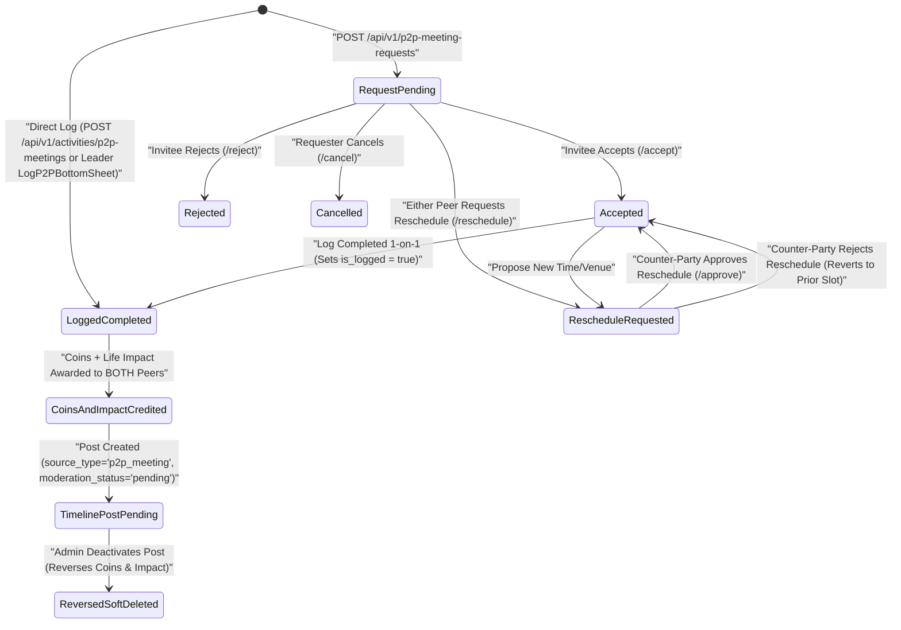

# Activity 02: P2P Meetings (1-on-1s)

| Attribute | Verified Specification |
|---|---|
| **Workbook Activity #** | `2.0` |
| **Exact Workbook Name** | `P2P Meetings (1-on-1s)` |
| **Domain Category** | `Relationship Building` (Sheet 1 & 2) / `Social / Networking` (Sheet 3) |
| **Activity Governance Tier** | `Leadership Oversight` (Bilateral peer scheduling/rescheduling + completed 1-on-1 logging with Circle/District Leadership & Admin monitoring, plus Leader-initiated P2P logging from Peer Profile) |
| **Overall Implementation Status** | `Partially Implemented` (Rich 3-table backend for Scheduling, Rescheduling, Completed Logs, and Speed Networking P2Ps works; Leader App `LogP2PBottomSheet` on Peer Profile is wired, whereas `CreateP2PMeetingBottomSheet` on `P2PMeetingsView` is `Implemented but Not Integrated`; Leader detail/peer meeting endpoints have scope IDORs) |
| **Master Index & Cross-Links** | [12-master-35-activities-index.md](../12-master-35-activities-index.md) · [19-activity-to-role-access-matrix.md](../19-activity-to-role-access-matrix.md) · [25-activity-workflow-reference.md](../25-activity-workflow-reference.md) · [13-activity-input-forms-and-validation.md](../13-activity-input-forms-and-validation.md) · [15-activity-database-and-metrics-mapping.md](../15-activity-database-and-metrics-mapping.md) · [16-activity-api-and-backend-mapping.md](../16-activity-api-and-backend-mapping.md) |

---

## 1. Business Purpose (§9.1)

- **Why It Exists & Business Outcome:**
  - **WORKBOOK REQUIREMENT:** Enables members to schedule and log face-to-face or virtual 1-on-1 discovery meetings (`P2P`) with fellow peers, attach a meeting selfie/photo, build deeper trust prior to passing referrals, and generate a dual-avatar P2P Creative Card.
  - **FACT:** The backend implements a comprehensive **three-stage P2P architecture** plus **Speed Networking integration**:
    1. **Scheduled Invitations (`p2p_meeting_requests`):** Peers send calendar-style 1-on-1 invitations (`pending` → `accepted` / `rejected` / `cancelled` / `reschedule_requested`).
    2. **Reschedule Negotiations (`p2p_meeting_reschedule_requests`):** Either participant proposes a new time/place (`pending` → `approved` / `rejected`).
    3. **Completed 1-on-1 Logs (`p2p_meetings`):** Logging a completed P2P ([P2pMeetingController.php](file:///c:/Users/malic/OneDrive/Documents/GitHub/unity-app-new/app/Http/Controllers/Api/P2pMeetingController.php#L107-L250)) links and marks any matching `P2PMeetingRequest` as `is_logged = true`, credits `p2p_meeting` Coins **and** Life Impact points to **both** the initiator and the peer (`L181-250`), creates a timeline post (`posts.source_type = 'p2p_meeting'`, `moderation_status = 'pending'`), and notifies the peer. Speed Networking rounds (`SpeedNetworkingP2pService`) also auto-complete P2P logs.
- **Role Partitioning (Member vs Leadership vs Admin):**
  - **Peer Member (`FACT`):** Schedules 1-on-1 requests, accepts/rejects/reschedules inbox invites, and logs completed 1-on-1s with optional selfie/photo attachments in the Flutter Member App ([p2p_meetings_screen.dart](file:///D:/office%20project/peers-unity/unity_app/lib/features/p2p_meetings/presentation/screens/p2p_meetings_screen.dart), [add_p2p_meeting_screen.dart](file:///D:/office%20project/peers-unity/unity_app/lib/features/p2p_meetings/presentation/screens/add_p2p_meeting_screen.dart)).
  - **Circle / Regional Leadership (`FACT`):** Monitors circle/district P2P velocity in [p2p_meetings_view.dart](file:///D:/office%20project/LeaderApp-Fornt-end-/lib/features/p2p_meetings/view/p2p_meetings_view.dart) and [leader_activities_view.dart](file:///D:/office%20project/LeaderApp-Fornt-end-/lib/features/leader_activities/view/leader_activities_view.dart), and can **directly log a 1-on-1 coaching/check-in P2P with a peer** from `PeerProfileView` via the wired [log_p2p_bottom_sheet.dart](file:///D:/office%20project/LeaderApp-Fornt-end-/lib/features/peer_profile/view/widgets/log_p2p_bottom_sheet.dart) (`POST /api/v1/leader/peers/p2p-meetings` / `POST /api/v1/activities/p2p-meetings`). Conversely, [create_p2p_meeting_bottom_sheet.dart](file:///D:/office%20project/LeaderApp-Fornt-end-/lib/features/p2p_meetings/view/widgets/create_p2p_meeting_bottom_sheet.dart) is orphaned.
  - **Super Admin / Web Admin (`FACT`):** Reviews global/scoped P2P logs and exports CSV via `/admin/activities/p2p-meetings` ([ActivitiesP2PMeetingsController.php](file:///c:/Users/malic/OneDrive/Documents/GitHub/unity-app-new/app/Http/Controllers/Admin/ActivitiesP2PMeetingsController.php)), moderates pending P2P timeline posts, and can reverse Coins/Impact via post deactivation.

---

## 2. Sub-Activities Catalogue (§9.2)

| # | Sub-Activity / Operation | Member App (`unity_app`) | Leadership App (`LeaderApp`) | Admin Web (`unity-admin-web` & Blade) | Backend (`unity-app-new`) | Classification |
|---|---|---|---|---|---|---|
| 2.1 | **Send 1-on-1 Meeting Request (Schedule)** | Wired (`POST /api/v1/p2p-meeting-requests` via `p2p_meetings_remote_datasource.dart`) | [CreateP2PMeetingBottomSheet](file:///D:/office%20project/LeaderApp-Fornt-end-/lib/features/p2p_meetings/view/widgets/create_p2p_meeting_bottom_sheet.dart#L5-L209) exists ("Schedule P2P 1-on-1 Meeting", raw UUID input) but has **zero callers** in [p2p_meetings_view.dart](file:///D:/office%20project/LeaderApp-Fornt-end-/lib/features/p2p_meetings/view/p2p_meetings_view.dart) | Not applicable | `P2PMeetingRequestController@store` (`P2PMeetingRequestService`) | `Implemented but Not Integrated` (Leader App) / `Fully Implemented` (Member App) |
| 2.2 | **Accept / Reject / Cancel Meeting Request** | Wired (`/inbox`, `/sent`, `/{id}/accept`, `/{id}/reject`, `/{id}/cancel`) | Not exposed in Leader App | Not applicable | `P2PMeetingRequestController` | `Fully Implemented` (Member App) |
| 2.3 | **Propose & Approve/Reject Reschedule** | Wired (`POST /p2p-meeting-requests/{id}/reschedule`, `/p2p-meeting-reschedule-requests/{id}/approve\|reject`) | Not exposed in Leader App | Not applicable | `P2PMeetingRescheduleController` | `Fully Implemented` (Member App) |
| 2.4 | **Log Completed 1-on-1 Meeting (with Photo)** | Wired ([add_p2p_meeting_screen.dart](file:///D:/office%20project/peers-unity/unity_app/lib/features/p2p_meetings/presentation/screens/add_p2p_meeting_screen.dart), [meeting_date_picker_field.dart](file:///D:/office%20project/peers-unity/unity_app/lib/features/p2p_meetings/presentation/widgets/add_p2p_meeting/meeting_date_picker_field.dart), [meeting_photo_picker.dart](file:///D:/office%20project/peers-unity/unity_app/lib/features/p2p_meetings/presentation/widgets/add_p2p_meeting/meeting_photo_picker.dart)) | **Wired** on Peer Profile via [LogP2PBottomSheet](file:///D:/office%20project/LeaderApp-Fornt-end-/lib/features/peer_profile/view/widgets/log_p2p_bottom_sheet.dart#L7-L211) (Date, Place, Remarks — no photo picker in Leader sheet) | Read-only | `P2pMeetingController@store`, `LeaderActivitiesController@storeP2pMeeting`, `LeaderPeersController@storeP2pMeeting` | `Fully Implemented` (Member) / `Partially Implemented` (Leader lacks photo & date picker widget) |
| 2.5 | **Create P2P from Ask / Speed Networking** | Speed Networking wired (`POST /api/v1/speed-networking/events/{eventId}/complete-p2p`) | Route `POST /api/v1/leader/ask-flows/{id}/create-p2p` exists in `routes/leader.php` | Speed Networking Live Admin | `SpeedNetworkingP2pService`, `AskFlowHubController@createP2pFromAsk` | `Fully Implemented` |
| 2.6 | **View Completed P2P History (Initiated / Received / Peer)** | Wired ([p2p_meetings_screen.dart](file:///D:/office%20project/peers-unity/unity_app/lib/features/p2p_meetings/presentation/screens/p2p_meetings_screen.dart), `ActivitySummaryScreen`) | Wired ([p2p_meetings_view.dart](file:///D:/office%20project/LeaderApp-Fornt-end-/lib/features/p2p_meetings/view/p2p_meetings_view.dart), `leader_activities_view.dart`, `PeerProfileView`) — note Backend leaks `[sn_match:<uuid>]` raw tag in Speed Networking remarks (`LEADER_APP_SCREEN_BY_SCREEN_AUDIT.md §6`) | Wired (`/admin/activities/p2p-meetings` & `MeetingsTab.tsx` in Peer Drawer) | `P2pMeetingController@index`, `LeaderActivitiesController@p2pMeetings`, `LeaderPeersController@meetings` (**unscoped IDOR**), `LeaderMemberController@p2pMeetings` (scoped), `DedActivitiesController` | `Implemented but Incorrect` (`GET /peers/{id}/meetings` lacks scope check; raw `[sn_match:...]` tag in UI) |
| 2.7 | **P2P Leaderboard & Export** | Wired (`GET /api/v1/leaderboards/p2p-meetings`) | Contributors ranking tab in `leader_activities_view.dart`; CSV export endpoint `/api/v1/activities/export?type=p2p` | Wired (`/admin/activities/p2p-meetings/export`) | `TopPeersController@p2pMeetings`, `LeaderActivitiesController@export` | `Fully Implemented` |

---

## 3. Input Form & Field Validation Mapping (§9.3)

**FACT:** Verified across Workbook Row 10/9, [StoreP2pMeetingRequest.php](file:///c:/Users/malic/OneDrive/Documents/GitHub/unity-app-new/app/Http/Requests/Activity/StoreP2pMeetingRequest.php#L67-L78) (completed log), [LeaderCreateP2pMeetingRequest.php](file:///c:/Users/malic/OneDrive/Documents/GitHub/unity-app-new/app/Leader/Requests/LeaderCreateP2pMeetingRequest.php#L15-L30) (leader log), `P2PMeetingRequestController` (scheduling), and Flutter widgets [log_p2p_bottom_sheet.dart](file:///D:/office%20project/LeaderApp-Fornt-end-/lib/features/peer_profile/view/widgets/log_p2p_bottom_sheet.dart) & [add_p2p_meeting_screen.dart](file:///D:/office%20project/peers-unity/unity_app/lib/features/p2p_meetings/presentation/screens/add_p2p_meeting_screen.dart).

| Field Name | Data Type | Required / Optional | Validation (Backend + Client) | Default | Input Widget | Data Source | Visibility | Who Enters | Who Edits | Who Views | Sensitive? | Backend Request Key |
|---|---|---|---|---|---|---|---|---|---|---|---|---|
| **Target Peer** | `UUID (string)` | Required | **Backend (Member Log):** `required\|uuid\|exists:users,id` (merges alias `to_user_id`), active user check, `PeerBlockService` check. **Backend (Leader Log):** `peer_id` `required\|string` (no circle-scope or `PeerBlock` check!). **Client (Leader `LogP2PBottomSheet`):** Pre-bound from `widget.peer.id`. | `null` (or viewed `peer.id`) | Member: `common_peer_selector_sheet.dart` + `selected_peer_card.dart`; Leader: pre-selected on `PeerProfileView` | `/api/v1/members/limited` or `PeerModel` | Public on feed post & P2P cards | Initiator Peer / Leader | Immutable | Both Peers, Scoped Leaders, DED, Admin | No | Member Log: `peer_user_id` (`to_user_id`); Schedule: `invitee_id`; Leader: `peer_id` |
| **Meeting Date (Completed Log)** | `date (Y-m-d)` | Required (Member) / Optional (Leader) | **Backend (Member):** `required\|date_format:Y-m-d` (merges `date`; lacks `before_or_equal:today` — `Requires Confirmation`). **Backend (Leader):** `nullable\|date`. **Client (`LogP2PBottomSheet`):** Plain `TextField` (no date picker!). | Today (`YYYY-MM-DD`) | Member: `meeting_date_picker_field.dart`; Leader: `TextField` | Device date | Public on P2P card | Initiator Peer / Leader | Immutable | Both Peers, Scoped Leaders, DED, Admin | No | `meeting_date` (alias `date`) |
| **Scheduled Date & Time (Invite / Reschedule)** | `datetime` | Required (Scheduling) | **Backend (`P2PMeetingRequest`):** `required\|date` (future datetime for `scheduled_at` / `new_scheduled_at`). | Tomorrow `15:30:00` (in orphaned Leader sheet) | Member: Date & Time pickers | Device calendar | Visible to Requester & Invitee | Requester / Rescheduler | Editable via Reschedule approval flow | Requester, Invitee, Admin | No | `scheduled_at` / `new_scheduled_at` |
| **Meeting Type (In-Person / Virtual)** | `string` | Workbook: Required; Backend Log: Optional/Merged | **WORKBOOK vs CODE:** `p2p_meetings` has **no separate `meeting_type` column** (`Requires Confirmation`); Member/Leader apps pass venue or URL into `meeting_place` (`place`). Orphaned `CreateP2PMeetingBottomSheet` has `ChoiceChip` (`online` / `in_person`). | `'online'` (orphaned sheet) | Choice chips / combined with Location | Static options | Visible on card | Initiator Peer | Editable via Reschedule (before logging) | Both Peers, Leaders, Admin | No | Combined into `meeting_place` / `place` (`mode` in orphaned sheet) |
| **Location / Meet URL** | `string (max:255)` | Required (Member Log & `LogP2PBottomSheet`) / Optional (`LeaderCreateP2pMeetingRequest`) | **Backend (Member):** `required\|string\|max:255` (merges `place`). **Backend (Leader):** `nullable\|string\|max:255`. **Client (`LogP2PBottomSheet`):** Non-empty check (`Please enter meeting place/venue`). | `''` (`'Google Meet'` in orphaned sheet) | `TextField` (`Meeting Location / Venue`) | User input | Visible on P2P log & schedule invite | Initiator Peer / Leader | Editable via Reschedule (before logging) | Both Peers, Scoped Leaders, DED, Admin | Minor (private office address / Meet URL) | `meeting_place` (alias `place`) |
| **Discussion Agenda / Remarks** | `text` | Required (Member Log) / Optional (Leader Log) | **Backend (Member):** `required\|string` (merges `notes`). **Backend (Leader):** `nullable\|string\|max:1000`. | `''` | Multiline `TextField` | User input (or auto-generated by Speed Networking) | Visible in history & Leader/Admin detail | Initiator Peer / Leader | Immutable | Both Peers, Scoped Leaders, DED, Admin | Potentially (private business notes) | `remarks` (alias `notes`, `message` on request) |
| **Meeting Selfie / Photo** | `UUID[]` (`json` in DB) | Optional (`sometimes`) | **Backend (Member):** `sometimes\|array`, `media_file_ids.*` → `uuid\|exists:files,id` (uploaded first via `POST /api/v1/files/upload`; merges `media_file_id` / `media`). **Leader App:** Not supported in `LogP2PBottomSheet`. | `[]` | Member: `meeting_photo_picker.dart`; Leader: **absent** | Camera / Gallery → `files` table | Visible in P2P history & Admin view (note: `createPostForP2pMeeting` currently sets `posts.media = []` at `P2pMeetingController.php:40`!) | Initiator Peer | Immutable | Both Peers, Leaders, Admin | Personal photo | `media_file_ids` (aliases `media_file_id`, `media`) |
| **Linked Meeting Request ID** | `UUID (string)` | Optional | **Backend:** `nullable\|uuid\|exists:p2p_meeting_requests,id` (auto-matched by backend if omitted!). | Auto-resolved | Hidden contextual ID | `p2p_meeting_requests.id` | Internal link | System / Member App | System-managed | Both Peers | No | `p2p_meeting_request_id` (`meeting_request_id`, `request_id`) |

---

## 4. Workflow, Lifecycle & Mermaid Diagram (§9.4)

### Workbook vs Actual Lifecycle Comparison
- **WORKBOOK REQUIREMENT:** `Meeting Completed -> Photo Uploaded -> Verified Peer Log`.
- **FACT:** The actual PostgreSQL lifecycle spans **two phases**:
  1. **Optional Pre-Meeting Request & Reschedule State Machine (`p2p_meeting_requests.status` & `p2p_meeting_reschedule_requests.status`):** `pending` → `accepted` | `rejected` | `cancelled` | `reschedule_requested` (with child reschedule `pending` → `approved` | `rejected`), culminating in `is_logged = true` once either peer logs the completed meeting.
  2. **Completed P2P Log (`p2p_meetings`):** Has **no approval status column** (`is_deleted = false` immediately); rewards Coins & Life Impact to **both** peers immediately. However, the auto-generated timeline post (`P2pMeetingController.php:46`) is created with `moderation_status = 'pending'` (unlike `business_deals` which sets `'approved'`) and omits `$meeting->media` (`media => []` bug at `L40`)!

---

## 5. Outputs & Deliverables (§9.5)

| Output / Deliverable | Status & Evidence (`FACT` vs `WORKBOOK REQUIREMENT`) |
|---|---|
| **Member App P2P Hub (Completed + Inbox + Sent + Reschedules)** | **FACT (`Fully Implemented`):** [p2p_meetings_screen.dart](file:///D:/office%20project/peers-unity/unity_app/lib/features/p2p_meetings/presentation/screens/p2p_meetings_screen.dart) displays Initiated/Received completed meetings alongside scheduled request inbox/sent queues and reschedule approvals. |
| **Leadership App P2P Monitoring & Coaching Log** | **FACT (`Partially Implemented`):** Dashboard tile → [p2p_meetings_view.dart](file:///D:/office%20project/LeaderApp-Fornt-end-/lib/features/p2p_meetings/view/p2p_meetings_view.dart) & [leader_activities_view.dart](file:///D:/office%20project/LeaderApp-Fornt-end-/lib/features/leader_activities/view/leader_activities_view.dart); Peer Profile → [log_p2p_bottom_sheet.dart](file:///D:/office%20project/LeaderApp-Fornt-end-/lib/features/peer_profile/view/widgets/log_p2p_bottom_sheet.dart). |
| **Dual-Avatar P2P Creative Card & Feed Post** | **FACT (`Implemented but Incorrect`):** `P2pMeetingController::createPostForP2pMeeting` creates a `posts` row with `PostMention` for the second peer, and `ActivityCreativeController` serves creative templates, **but `P2pMeetingController.php:40` hardcodes `'media' => []`**, dropping the uploaded selfie from the timeline post! **WORKBOOK REQUIREMENT:** `DualAvatarCanvasService` rendering both member avatars + chapter tag onto a shareable card (`Requires Enhancement`). |
| **Bilateral Coins & Life Impact Credits** | **FACT (`Fully Implemented`):** Both `initiator_user_id` and `peer_user_id` receive Coins (`CoinsService::rewardForActivity('p2p_meeting')`) and Life Impact (`increaseLifeImpact`) upon completion (`P2pMeetingController.php:181-250`). |
| **Push & In-App Notifications** | **FACT (`Fully Implemented`):** Sent on meeting request, accept/reject, reschedule request/response, and completed P2P log (`NotifyUserService` + `LeaderNotificationDispatcherService` when logged by a Leader). |
| **Admin Web Audit & CSV Export** | **FACT (`Fully Implemented`):** `/admin/activities/p2p-meetings`, `/admin/activities/p2p-meetings/export`, and React Admin `MeetingsTab.tsx`. |

---

## 6. Database & Metrics Mapping (§9.6)

### Primary Tables & Eloquent Models
1. **`p2p_meetings`** — [P2pMeeting.php](file:///c:/Users/malic/OneDrive/Documents/GitHub/unity-app-new/app/Models/P2pMeeting.php) (`SoftDeletes`)
   - **Columns:** `id` (`uuid` PK), `initiator_user_id` (`uuid` FK → `users.id`), `peer_user_id` (`uuid` FK → `users.id`), `p2p_meeting_request_id` (`uuid`, nullable FK → `p2p_meeting_requests.id`), `meeting_date` (`date`), `meeting_place` (`varchar(255)`), `remarks` (`text`), `media` (`jsonb` — array of `{id, type, url}`), `is_deleted` (`bool`), `created_at`, `updated_at`, `deleted_at`.
2. **`p2p_meeting_requests`** — [P2PMeetingRequest.php](file:///c:/Users/malic/OneDrive/Documents/GitHub/unity-app-new/app/Models/P2PMeetingRequest.php)
   - **Columns:** `id` (`uuid` PK), `requester_id`, `invitee_id`, `scheduled_at` (`timestamp`), `place`, `message`, `status` (`pending` | `accepted` | `rejected` | `cancelled` | `reschedule_requested`), `responded_at`, `is_logged` (`bool`), `logged_at`, `logged_by_user_id`, `p2p_meeting_id`.
3. **`p2p_meeting_reschedule_requests`** — [P2PMeetingRescheduleRequest.php](file:///c:/Users/malic/OneDrive/Documents/GitHub/unity-app-new/app/Models/P2PMeetingRescheduleRequest.php)
   - **Columns:** `id` (`uuid` PK), `p2p_meeting_request_id`, `requested_by_user_id`, `requested_to_user_id`, `old_scheduled_at`, `new_scheduled_at`, `old_place`, `new_place`, `reason`, `status` (`pending` | `approved` | `rejected`), `approved_at`, `rejected_at`, `responded_by_user_id`.
- **Organizational Scope Attribution:** No `circle_id` column on `p2p_meetings`. Scoped dynamically via participant membership (`initiator_user_id IN ($scopedPeerIds) OR peer_user_id IN ($scopedPeerIds)`). Note: `LeaderActivitiesController@activitiesByType` (`L355-357`) explicitly uses `$totalItemsCount` instead of summing per-peer `metric_count` to prevent 2× double-counting when both participants belong to the same circle!

### Workbook Sheet 3 Metric Keys vs Actual Backend Schema
| Workbook Metric Key (Sheet 1–3) | Actual Backend / API Computation (`FACT`) | Discrepancy / Bug Note |
|---|---|---|
| `p2pMeetingsCount` | `COUNT(*)` on `p2p_meetings` where `(initiator_user_id = $uid OR peer_user_id = $uid)` and not deleted | Note: `LeaderReportsService.php:314` reads non-existent `$user?->p2p_meetings_count` without `withCount`, returning `0` on Weekly Report rosters! |
| `p2p_last_30_days` / `Total 1-on-1s logged in Last 30 Days` | Computed dynamically in `LastMonthActivityService` (`meeting_date >= now()->subDays(30)`) | Matches workbook. |
| `p2pMeetingHistory` | Paginated `P2pMeeting` items via `P2pMeetingController@index` / `P2pMeetingHistoryController` | Speed networking logs embed raw `[sn_match:<uuid>]` strings in `remarks`. |

---

## 7. API & Backend Service Mapping (§9.7)

### API Endpoint Inventory
| Layer | Method & Endpoint | Controller & Action | Service / FormRequest | Auth Middleware | Scope Enforcement & Security Audit (`FACT`) | Client Integration |
|---|---|---|---|---|---|---|
| **Member API** | `GET\|POST /api/v1/activities/p2p-meetings` (alias `/api/v1/p2p-meetings`) | [P2pMeetingController.php](file:///c:/Users/malic/OneDrive/Documents/GitHub/unity-app-new/app/Http/Controllers/Api/P2pMeetingController.php) `@index`, `@store` | `StoreP2pMeetingRequest`, `CoinsService`, `PeerBlockService`, `NotifyUserService` | `auth:sanctum`, `unity.user` | Active check + `PeerBlockService`; lacks `different:auth()->id()` rule in `StoreP2pMeetingRequest` | Wired (`ApiEndpoints.activitiesP2pMeetings`) |
| **Member API** | `GET /api/v1/activities/p2p-meetings/{id}` & `GET /api/v1/p2p-meetings/user/{userId}` | `P2pMeetingController@show`, `@userMeetings` | — | `auth:sanctum`, `unity.user` | Peer profile P2P list | Wired (`ApiEndpoints.singleP2pMeeting`, `userP2pMeetings`) |
| **Member API** | `POST /api/v1/p2p-meeting-requests`, `GET .../inbox\|sent\|{id}`, `POST .../{id}/accept\|reject\|cancel\|reschedule` | `P2PMeetingRequestController` | `P2PMeetingRequestService` | `auth:sanctum`, `unity.user` | Enforces requester/invitee ownership | Wired (`ApiEndpoints.p2pMeetingRequests*`) |
| **Member API** | `GET /api/v1/p2p-meeting-reschedule-requests/pending-received`, `POST .../{id}/approve\|reject` | `P2PMeetingRescheduleController` | `P2PMeetingRequestService` | `auth:sanctum`, `unity.user` | Enforces `requested_to_user_id` ownership | Wired (`ApiEndpoints.*RescheduleRequest*`) |
| **Leader API** | `GET /api/v1/leader/p2p-meetings` & `GET /api/v1/leader/activities/p2p-meetings` | `LeaderActivitiesController@p2pMeetings`, `@activitiesByType` | `LeaderActivitiesService` | `auth:sanctum`, `leader.user` | Scoped to leader's circles/district/industry | Wired (`P2PMeetingsBloc`, `LeaderActivitiesBloc`) |
| **Leader API** | `POST /api/v1/leader/peers/p2p-meetings` & `POST /api/v1/activities/p2p-meetings` & `POST /api/v1/leader/p2p-meetings` | `LeaderPeersController@storeP2pMeeting` / `LeaderActivitiesController@storeP2pMeeting` | `LeaderCreateP2pMeetingRequest`, `LeaderActivitiesService` | `auth:sanctum`, `leader.user` | **Missing circle scope & `PeerBlock` check** (can log P2P with any user UUID on platform) | **Wired** via `LogP2PBottomSheet` on `PeerProfileView`; `CreateP2PMeetingBottomSheet` is **orphaned** |
| **Leader API** | `GET /api/v1/peers/{id}/meetings` & `GET /api/v1/activities/p2p/{id}` | `LeaderPeersController@meetings`, `LeaderActivitiesController@showDetail` | `LeaderPeersService::getPeerMeetings` (`L1011`) | `auth:sanctum`, `leader.user` | **HIGH IDOR BUG:** Neither method checks `$scopedCircleIds` or `$scopedPeerIds`! | Wired in Leader App |
| **Leader 360°** | `GET /api/v1/leader/members/{member_id}/p2p-meetings` | `LeaderMemberController@p2pMeetings` | `LeaderMember360Service` | `auth:sanctum`, `leader.user` | Properly enforces `resolveMember()` circle scope (`403`) | Available |
| **DED API** | `GET /api/v1/ded/activities/p2p-meetings` & `.../{id}` | `DedActivitiesController` | `DedApiService` | `auth:sanctum`, `ensure.ded.api` | Enforces DED district scope | Backend ready |
| **Admin Web** | `GET /admin/activities/p2p-meetings` & `.../export` | `ActivitiesP2PMeetingsController` | `AdminCircleScope` | `web`, `admin.auth` | Enforces `AdminCircleScope` | Wired in Blade & React Admin |

### Workbook Cloud Services vs Actual Laravel Services
- **WORKBOOK REQUIREMENT:** `MeetingAuditService`, `DualAvatarCanvasService`, `FeedSyncService`.
- **FACT:** Implemented via `P2PMeetingRequestService` + `P2pMeetingController` + `SpeedNetworkingP2pService`, `Post::create` (`posts` table feed), `CoinsService`, and `NotifyUserService`. No server-side `DualAvatarCanvasService` image compositor exists (`ActivityCreative` templates are rendered client-side).

---

## 8. Role-Wise Access Governance (§9.8)

| Role | View Activity | Create Record | Edit Own | Edit Others | Submit for Review | Verify | Approve | Reject | Assign | Manage | Delete | View Aggregated Reports |
|---|---|---|---|---|---|---|---|---|---|---|---|---|
| **Super Admin** | Allowed (Global) | Allowed (as `User` in Member/Leader App) | Allowed only for pre-log Schedule/Reschedule; Completed log immutable | DENIED — Completed logs immutable | Not Applicable (Completed P2P post enters `moderation_status = 'pending'`) | Not Applicable | Allowed (Approve pending P2P timeline posts in Admin) | Allowed (Reject/Deactivate P2P timeline posts in Admin) | DENIED — No permission under the verified backend authorization model | Allowed (Post moderation & soft-delete) | Allowed (Deactivate post / soft-delete with coin & impact reversal) | Allowed (Global Dashboards & CSV Export) |
| **Country Director** | Allowed (Country Scope intended; currently Global in Leader App) | Allowed (Leader `LogP2PBottomSheet` & Member App) | Pre-log reschedule only | DENIED — Immutable ledger | Not Applicable | Not Applicable | DENIED — Only Peer invitee approves meeting/reschedule requests | DENIED — Only Peer invitee rejects meeting/reschedule requests | DENIED — No permission under the verified backend authorization model | DENIED — No permission under the verified backend authorization model | DENIED — No permission under the verified backend authorization model | Allowed (Scoped Reports & CSV) |
| **DED** | Allowed (Assigned District Scope) | Allowed (Leader `LogP2PBottomSheet` & Member App) | Pre-log reschedule only | DENIED — Immutable ledger | Not Applicable | Not Applicable | DENIED — Peer-to-peer invitee action only | DENIED — Peer-to-peer invitee action only | DENIED — No permission under the verified backend authorization model | DENIED — No permission under the verified backend authorization model | DENIED — No permission under the verified backend authorization model | Allowed (District Dashboard, DED Reports, CSV) |
| **Industry Director** | Allowed (Assigned Industry Scope) | Allowed (Leader `LogP2PBottomSheet` & Member App) | Pre-log reschedule only | DENIED — Immutable ledger | Not Applicable | Not Applicable | DENIED — Peer-to-peer invitee action only | DENIED — Peer-to-peer invitee action only | DENIED — No permission under the verified backend authorization model | DENIED — No permission under the verified backend authorization model | DENIED — No permission under the verified backend authorization model | Allowed (Industry Scope) |
| **Circle Founder** | Allowed (Own Circle(s)) | Allowed (Leader `LogP2PBottomSheet` & Member App) | Pre-log reschedule only | DENIED — Immutable ledger | Not Applicable | Not Applicable | DENIED — Peer-to-peer invitee action only | DENIED — Peer-to-peer invitee action only | DENIED — No permission under the verified backend authorization model | DENIED — No permission under the verified backend authorization model | DENIED — No permission under the verified backend authorization model | Allowed (Own Circle Reports & CSV) |
| **Circle Director** | Allowed (Own Circle(s)) | Allowed (Leader `LogP2PBottomSheet` & Member App) | Pre-log reschedule only | DENIED — Immutable ledger | Not Applicable | Not Applicable | DENIED — Peer-to-peer invitee action only | DENIED — Peer-to-peer invitee action only | DENIED — No permission under the verified backend authorization model | DENIED — No permission under the verified backend authorization model | DENIED — No permission under the verified backend authorization model | Allowed (Own Circle Reports & CSV) |
| **Chair / Committee Chairs** | Allowed (Own Circle) | Allowed (Leader `LogP2PBottomSheet` & Member App) | Pre-log reschedule only | DENIED — Immutable ledger | Not Applicable | Not Applicable | DENIED — Peer-to-peer invitee action only | DENIED — Peer-to-peer invitee action only | DENIED — No permission under the verified backend authorization model | DENIED — No permission under the verified backend authorization model | DENIED — No permission under the verified backend authorization model | Allowed (Own Circle Dashboard & Weekly Report) |
| **Vice Chair** | Allowed (Own Circle) | Allowed (Leader `LogP2PBottomSheet` & Member App) | Pre-log reschedule only | DENIED — Immutable ledger | Not Applicable | Not Applicable | DENIED — Peer-to-peer invitee action only | DENIED — Peer-to-peer invitee action only | DENIED — No permission under the verified backend authorization model | DENIED — No permission under the verified backend authorization model | DENIED — No permission under the verified backend authorization model | Allowed (Own Circle Read-Only Reports) |
| **Secretary** | Allowed (Own Circle) | Allowed (Leader `LogP2PBottomSheet` & Member App) | Pre-log reschedule only | DENIED — Immutable ledger | Not Applicable | Not Applicable | DENIED — Peer-to-peer invitee action only | DENIED — Peer-to-peer invitee action only | DENIED — No permission under the verified backend authorization model | DENIED — No permission under the verified backend authorization model | DENIED — No permission under the verified backend authorization model | Allowed (Own Circle Read-Only Reports) |
| **Committee Leader** | Allowed in Web RBAC (Own Circle); **BROKEN (`403`)** in Leader App | Allowed in Member App | Pre-log reschedule only | DENIED — Immutable ledger | Not Applicable | Not Applicable | DENIED — Peer-to-peer invitee action only | DENIED — Peer-to-peer invitee action only | DENIED — No permission under the verified backend authorization model | DENIED — No permission under the verified backend authorization model | DENIED — No permission under the verified backend authorization model | DENIED in Leader App (`403`) |
| **Peer Member** | Allowed (Own Initiated/Received P2Ps, Inbox/Sent Requests, Public Peer P2Ps, Leaderboard) | Allowed (`POST /api/v1/p2p-meeting-requests` & `POST /api/v1/activities/p2p-meetings` when active) | Pre-log cancel/reschedule only | DENIED — No permission under the verified backend authorization model | Not Applicable | UNVERIFIED — Invitee accepts schedule/reschedule, but completed P2P log requires no second-peer verification | Allowed **only** on own received `P2PMeetingRequest` / `P2PMeetingRescheduleRequest` | Allowed **only** on own received `P2PMeetingRequest` / `P2PMeetingRescheduleRequest` | DENIED — No permission under the verified backend authorization model | DENIED — No permission under the verified backend authorization model | DENIED — May only cancel own pending `P2PMeetingRequest` | DENIED — Personal `LastMonthActivityScreen` & Leaderboard only |

---

## 9. Existing Implementation Summary, Gaps & Minimum-Change Enhancement Recommendations

### Summary of Verified Limitations & Bugs
1. **Dropped Selfie Media on Auto-Generated Timeline Post (`Implemented but Incorrect`):** [P2pMeetingController.php](file:///c:/Users/malic/OneDrive/Documents/GitHub/unity-app-new/app/Http/Controllers/Api/P2pMeetingController.php#L40) passes `'media' => []` instead of `$meeting->media` when creating the feed post, and sets `moderation_status => 'pending'` (hiding P2P posts until manually approved, inconsistent with `business_deals` which sets `'approved'`).
2. **Scope IDORs in Leader API (`P1` Security):** `GET /api/v1/peers/{id}/meetings` (`LeaderPeersService.php:1011`) and `GET /api/v1/activities/p2p/{id}` (`LeaderActivitiesService.php:2485`) do not validate `$scopedCircleIds` / `$scopedPeerIds`.
3. **Weekly Report Roster `0` Count Bug:** [LeaderReportsService.php](file:///c:/Users/malic/OneDrive/Documents/GitHub/unity-app-new/app/Leader/Services/LeaderReportsService.php#L314) reads `$user?->p2p_meetings_count` without computing/eager-loading it, always outputting `0` in circle rosters.
4. **Raw `[sn_match:<uuid>]` Tag Leak & Orphaned Sheet in Leader App:** Speed Networking P2P descriptions expose internal `[sn_match:<uuid>]` markers in Leader App activity feeds (`LEADER_APP_SCREEN_BY_SCREEN_AUDIT.md §6`), `LogP2PBottomSheet` uses a plain text field instead of `showDatePicker`, and `CreateP2PMeetingBottomSheet` is dead code.

### Minimum-Change Enhancement Recommendations
- **RECOMMENDATION 1 (Fix Post Media & Sanitize Remarks):** In [P2pMeetingController.php](file:///c:/Users/malic/OneDrive/Documents/GitHub/unity-app-new/app/Http/Controllers/Api/P2pMeetingController.php#L40), pass `$meeting->media ?? []` to `Post::create(...)`, strip `[sn_match:...]` metadata into a JSON column or clean display formatter in `LeaderMember360Service` / `LeaderActivitiesService`, and prevent self-P2P (`peer_user_id !== auth()->id()`).
- **RECOMMENDATION 2 (Close Scope IDORs & Fix Report Roster Counts):** Enforce `$scopedPeerIds` in `LeaderPeersService::getPeerMeetings()` and `LeaderActivitiesService::showDetail()`, and compute real per-peer P2P counts in `LeaderReportsService::buildPeersRosterForCircle()`.
- **RECOMMENDATION 3 (Leader UX Polish):** Add native `showDatePicker` + optional `Online / In-Person` chip to [log_p2p_bottom_sheet.dart](file:///D:/office%20project/LeaderApp-Fornt-end-/lib/features/peer_profile/view/widgets/log_p2p_bottom_sheet.dart), and either wire a searchable peer dropdown (`GET /api/v1/leader/activities/peers-dropdown`) to an action button on `P2PMeetingsView` or delete the orphaned `CreateP2PMeetingBottomSheet`.
- **BUSINESS DECISION REQUIRED:** Confirm whether P2P timeline posts should auto-publish (`moderation_status = 'approved'`) like Business Deals or remain queued (`'pending'`), and whether `meeting_type` (`in_person` | `virtual`) should be stored as a dedicated column on `p2p_meetings` via a new migration.
