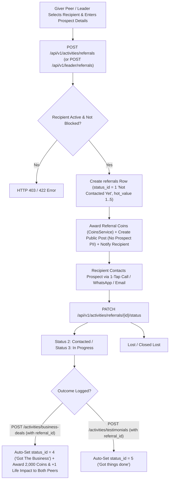

# Activity 03: Normal Referrals (Given & Received Leads)

| Attribute | Verified Specification |
|---|---|
| **Workbook Activity #** | `3.0` |
| **Exact Workbook Name** | `Normal Referrals (Given & Received Leads)` |
| **Domain Category** | `Lead Generation` (Sheet 1 & 2) / `CRM / Lead Flow` (Sheet 3) |
| **Activity Governance Tier** | `Leadership Oversight` (Peer-to-peer commercial lead passing in `referrals` has dynamic receiver-driven status updates + Leadership/DED/Admin reporting; adjacent Open-Category Circle Candidate Referrals in `peer_referrals` / `circle_peer_referrals` sit in `Verification & Approval`) |
| **Overall Implementation Status** | `Fully Implemented` (End-to-end Member App Given/Received leads, dynamic `referral_status` pipeline, 1-to-5 `hot_value`, Business Deal conversion trigger, Leader App `ReferralsView` + wired `SendReferralBottomSheet` + Circle `ReferCategoryBottomSheet`, DED Referral Reports, and Admin CSV exports all work — with targeted `Requires Enhancement` items on Leader scope & field parity) |
| **Master Index & Cross-Links** | [12-master-35-activities-index.md](../12-master-35-activities-index.md) · [19-activity-to-role-access-matrix.md](../19-activity-to-role-access-matrix.md) · [25-activity-workflow-reference.md](../25-activity-workflow-reference.md) · [13-activity-input-forms-and-validation.md](../13-activity-input-forms-and-validation.md) · [15-activity-database-and-metrics-mapping.md](../15-activity-database-and-metrics-mapping.md) · [16-activity-api-and-backend-mapping.md](../16-activity-api-and-backend-mapping.md) |

---

## 1. Business Purpose (§9.1)

- **Why It Exists & Business Outcome:**
  - **WORKBOOK REQUIREMENT:** Enables members to pass qualified commercial client prospects (`referrals`) to fellow peers with contact details, lead hotness, and referral type, track real-time conversion stages (`Pending -> Contacted -> In Discussion -> Closed Won / Closed Lost`), and convert won leads into Business Deals.
  - **FACT:** The backend implements two complementary referral flows:
    1. **Core Commercial Lead Referrals (`referrals` + `referral_status`):** Handled by [ReferralController.php](file:///c:/Users/malic/OneDrive/Documents/GitHub/unity-app-new/app/Http/Controllers/Api/ReferralController.php) and `ReferralService`. Passing a lead rewards Coins (`CoinsService::rewardForActivity('referral')`), creates a celebration post (`posts.source_type = 'referral'`), notifies `to_user_id`, and lets the recipient advance `status_id` across dynamic `referral_status` rows (including automatic transition to `status_id = 4` "Got The Business" + **2,000 bonus Coins** & **+1 Life Impact** when linked to a Business Deal in `BusinessDealController.php:199-237`, or `status_id = 5` "Got things done" when linked to a Testimonial in `TestimonialController.php:185-191`).
    2. **Open-Category Circle Candidate Referrals (`peer_referrals` / `circle_peer_referrals`):** Handled by `PeerReferralsApiController`, `LeaderTeamsController@referCategory` ([refer_category_bottom_sheet.dart](file:///D:/office%20project/LeaderApp-Fornt-end-/lib/features/circle_details/view/widgets/refer_category_bottom_sheet.dart)), and moderated by Leaders/Admins via `PendingRequestAdminController` (`category = circle_peer_referrals`).
- **Role Partitioning (Member vs Leadership vs Admin):**
  - **Peer Member (`FACT`):** Passes commercial leads via [add_referral_screen.dart](file:///D:/office%20project/peers-unity/unity_app/lib/features/referrals/presentation/screens/add_referral_screen.dart) (with phonebook picker [contact_picker_sheet.dart](file:///D:/office%20project/peers-unity/unity_app/lib/core/widgets/contact_picker_sheet.dart)), tracks `Given` and `Received` leads in [referrals_screen.dart](file:///D:/office%20project/peers-unity/unity_app/lib/features/referrals/presentation/screens/referrals_screen.dart), updates lead status on received leads (`PATCH /api/v1/activities/referrals/{id}/status`), and converts won leads into Business Deals or Testimonials.
  - **Circle / Regional Leadership (`FACT`):** Monitors circle/district referral velocity in [referrals_view.dart](file:///D:/office%20project/LeaderApp-Fornt-end-/lib/features/referrals/view/referrals_view.dart), [peer_business_referrals_screen.dart](file:///D:/office%20project/LeaderApp-Fornt-end-/lib/features/peer_profile/view/peer_business_referrals_screen.dart), and DED Referral Reports (`GET /api/v1/ded/referral-report`), **sends commercial leads directly from a peer's profile** via wired [send_referral_bottom_sheet.dart](file:///D:/office%20project/LeaderApp-Fornt-end-/lib/features/peer_profile/view/widgets/send_referral_bottom_sheet.dart), nominates prospects for open circle sub-industries via [refer_category_bottom_sheet.dart](file:///D:/office%20project/LeaderApp-Fornt-end-/lib/features/circle_details/view/widgets/refer_category_bottom_sheet.dart), and approves/rejects `circle_peer_referrals` in Pending Approvals.
  - **Super Admin / Web Admin (`FACT`):** Audits all referrals and conversion funnels via `/admin/activities/referrals`, `/admin/referral-report`, `/admin/peer-referrals`, and CSV exports.

---

## 2. Sub-Activities Catalogue (§9.2)

| # | Sub-Activity / Operation | Member App (`unity_app`) | Leadership App (`LeaderApp`) | Admin Web (`unity-admin-web` & Blade) | Backend (`unity-app-new`) | Classification |
|---|---|---|---|---|---|---|
| 2.1 | **Select Recipient Peer & Pick Prospect Contact** | Wired ([add_referral_screen.dart](file:///D:/office%20project/peers-unity/unity_app/lib/features/referrals/presentation/screens/add_referral_screen.dart), [selected_peer_card.dart](file:///D:/office%20project/peers-unity/unity_app/lib/features/referrals/presentation/widgets/add_referral/selected_peer_card.dart), [contact_picker_sheet.dart](file:///D:/office%20project/peers-unity/unity_app/lib/core/widgets/contact_picker_sheet.dart)) | Pre-bound to viewed peer in wired [SendReferralBottomSheet](file:///D:/office%20project/LeaderApp-Fornt-end-/lib/features/peer_profile/view/widgets/send_referral_bottom_sheet.dart#L7-L256) | Read-only | `StoreReferralRequest` resolves UUID, `CircleMember.id`, `public_profile_slug`, or 10-digit phone (`L24-69`) | `Fully Implemented` |
| 2.2 | **Submit Commercial Referral Lead** | Wired (`POST /api/v1/activities/referrals`) | **Wired** (`POST /api/v1/activities/referrals` / `POST /api/v1/leader/referrals` via `ReferralsRepositoryImpl.createReferralLead`) | Not applicable | `ReferralController@store`, `LeaderActivitiesController@storeReferral` (`LeaderCreateReferralRequest`) | `Fully Implemented` |
| 2.3 | **Fetch Dynamic Referral Statuses** | Wired (`GET /api/v1/activities/referrals/statuses`) | Filtered via [referrals_filter_bar.dart](file:///D:/office%20project/LeaderApp-Fornt-end-/lib/features/referrals/view/widgets/referrals_filter_bar.dart) | Status filter in Admin | `ReferralController@statuses` (`referral_status` table where `is_active = true`) | `Fully Implemented` |
| 2.4 | **Update Received Referral Status** | Wired (`PATCH /api/v1/activities/referrals/{id}/status`) | Read-only in Leader App | Read-only for commercial leads; mutable for `peer_referrals` | `ReferralController@updateStatus` | `Fully Implemented` |
| 2.5 | **Convert Won Referral to Business Deal / Testimonial** | Wired (passes `referral_id` to `POST /activities/business-deals` or `POST /activities/testimonials`) | Supported on Ask Flow (`convertAskToDeal`), not on Leader `ReferralCard` | Visible via updated status | Auto-sets `status_id = 4` (Deal) or `5` (Testimonial) + awards 2,000 bonus Coins & +1 Life Impact | `Fully Implemented` |
| 2.6 | **Refer Candidate for Open Circle Category** | Wired (`POST /api/v1/peer-referrals`) | **Wired** ([refer_category_bottom_sheet.dart](file:///D:/office%20project/LeaderApp-Fornt-end-/lib/features/circle_details/view/widgets/refer_category_bottom_sheet.dart) → `POST /api/v1/teams/circles/{id}/refer-category`) | Moderated in Pending Requests (`circle_peer_referrals`) & `/admin/peer-referrals` | `PeerReferralsApiController`, `LeaderTeamsController@referCategory`, `PendingRequestAdminController` | `Fully Implemented` |
| 2.7 | **View Given / Received Referral History & Direct Call/WhatsApp/Email** | Wired ([referrals_screen.dart](file:///D:/office%20project/peers-unity/unity_app/lib/features/referrals/presentation/screens/referrals_screen.dart) — note workbook's `referral_detail_card.dart` filename does not exist verbatim; widgets live under `referrals/presentation/widgets/`) | Wired ([referrals_view.dart](file:///D:/office%20project/LeaderApp-Fornt-end-/lib/features/referrals/view/referrals_view.dart), [peer_business_referrals_screen.dart](file:///D:/office%20project/LeaderApp-Fornt-end-/lib/features/peer_profile/view/peer_business_referrals_screen.dart), [peer_business_referrals_sheet.dart](file:///D:/office%20project/LeaderApp-Fornt-end-/lib/features/peer_profile/view/widgets/peer_business_referrals_sheet.dart)) | Wired (`/admin/activities/referrals`, `/admin/referral-report`) | `ReferralHistoryController@index`, `LeaderActivitiesController@referrals`, `LeaderMemberController@referrals`, `DedActivitiesController`, `DedReportController` | `Fully Implemented` |
| 2.8 | **Referrals Leaderboard & CSV Export** | Wired (`GET /api/v1/leaderboards/referrals`) | Ranked Contributors tab in `leader_activities_view.dart`; `/api/v1/activities/export?type=referrals` | Wired (`/admin/activities/referrals/export`) | `TopPeersController@referrals`, `LeaderActivitiesController@export`, `ActivitiesReferralsController@export` | `Fully Implemented` |

---

## 3. Input Form & Field Validation Mapping (§9.3)

**FACT:** Verified against Workbook Row 11/10, Member App [StoreReferralRequest.php](file:///c:/Users/malic/OneDrive/Documents/GitHub/unity-app-new/app/Http/Requests/Activity/StoreReferralRequest.php#L81-L114), Leader API [LeaderCreateReferralRequest.php](file:///c:/Users/malic/OneDrive/Documents/GitHub/unity-app-new/app/Leader/Requests/LeaderCreateReferralRequest.php#L15-L31), and Leader UI [send_referral_bottom_sheet.dart](file:///D:/office%20project/LeaderApp-Fornt-end-/lib/features/peer_profile/view/widgets/send_referral_bottom_sheet.dart).

| Field Name | Data Type | Required / Optional | Validation (Backend + Client) | Default | Input Widget | Data Source | Visibility | Who Enters | Who Edits | Who Views | Sensitive? | Backend Request Key |
|---|---|---|---|---|---|---|---|---|---|---|---|---|
| **Recipient Peer** | `UUID (string)` | Required | **Backend (Member):** `required\|string` + custom resolver (UUID, `CircleMember.id`, `public_profile_slug`, or phone) + `User::where('id', $v)->exists()` + active & `PeerBlockService` checks. **Backend (Leader):** `to_peer_id` `required\|string`. | `null` (or viewed `peer.id`) | Member: Peer selector + `selected_peer_card.dart`; Leader: pre-bound from `PeerProfileView` | `/api/v1/members/limited` or `PeerModel` | Public on celebration post (peer names only; prospect PII hidden from public feed) | Giver Peer / Leader | Immutable | Giver, Receiver, Scoped Leaders, DED, Admin | No | Member: `to_user_id`; Leader: `to_peer_id` |
| **Referral Type** | `string (enum)` | Required (Member) / Auto-defaulted (Leader) | **WORKBOOK vs CODE:** Workbook says `Inside / Outside`; **FACT (`StoreReferralRequest.php:96-104`):** `required\|in:customer_referral,b2b_referral,b2g_referral,collaborative_projects,referral_partnerships,vendor_referrals,others`. Leader sheet omits this and backend defaults to `'b2b_referral'` / `'others'`. | `'customer_referral'` (Member) | Dropdown / Chip selector (Member); omitted in `SendReferralBottomSheet` | Static enum list | Visible to Giver, Receiver, Leaders, Admin | Giver Peer | Immutable | Giver, Receiver, Scoped Leaders, DED, Admin | No | `referral_type` |
| **Referral Date** | `date (Y-m-d)` | Required (Member) / Auto-defaulted (Leader) | **Backend (Member):** `required\|date_format:Y-m-d`. **Backend (Leader):** defaults to `now()->toDateString()`. | Today (`YYYY-MM-DD`) | Date picker (Member); auto-filled (Leader) | Device date | Visible on referral card | Giver Peer | Immutable | Giver, Receiver, Scoped Leaders, DED, Admin | No | `referral_date` |
| **Prospect Name** | `string (max:255)` | Required | **Backend (Member):** `required\|string`. **Backend (Leader):** `required\|string\|max:255`. **Client (`SendReferralBottomSheet`):** Non-empty check. | `''` | `TextField` + `contact_picker_sheet.dart` (Member) | Manual or device contacts | Private to Giver, Receiver, Scoped Leaders, DED, Admin (NOT shown on public timeline post) | Giver Peer / Leader | Immutable | Giver, Receiver, Scoped Leaders, DED, Admin | **Yes** (3rd-party PII) | Member: `referral_of`; Leader: `prospect_name` |
| **Prospect Company** | `string (max:255)` | Optional | **WORKBOOK vs CODE:** Workbook lists `Company`; `referrals` table has **no standalone `company` column** (`StoreReferralRequest` omits it; `LeaderActivitiesService` appends `prospect_company` into `remarks`!). | `null` | `TextField` (`Prospect Company` in Leader sheet) | Manual input | Private to parties & Leaders/Admin | Giver Peer / Leader | Immutable | Giver, Receiver, Scoped Leaders, DED, Admin | Commercial | Leader: `prospect_company` (merged into `remarks`) |
| **Prospect Phone** | `string (max:30/50)` | Required (Member) / Optional (Leader) | **Backend (Member):** `required\|string\|max:30`. **Backend (Leader):** `nullable\|string\|max:50`. | `''` | Phone `TextField` / Contact picker | Manual or device contacts | Private to Giver, Receiver, Scoped Leaders, DED, Admin | Giver Peer / Leader | Immutable | Giver, Receiver, Scoped Leaders, DED, Admin | **Yes** (3rd-party Phone PII) | Member: `phone`; Leader: `prospect_phone` |
| **Prospect Email** | `string (email)` | Optional | **Backend (Member):** `nullable\|email` (empty string normalized to `null`). **Backend (Leader):** `nullable\|email\|max:255`. | `null` | Email `TextField` | Manual or device contacts | Private to Giver, Receiver, Scoped Leaders, DED, Admin | Giver Peer / Leader | Immutable | Giver, Receiver, Scoped Leaders, DED, Admin | **Yes** (3rd-party Email PII) | Member: `email`; Leader: `prospect_email` |
| **Prospect Address** | `text` | Optional | **Backend (Member):** `nullable\|string`. Omitted in Leader sheet. | `null` | `TextField` | Manual input | Private to Giver, Receiver, Leaders, Admin | Giver Peer | Immutable | Giver, Receiver, Scoped Leaders, DED, Admin | **Yes** (Address PII) | `address` |
| **Lead Hotness (`hot_value`)** | `integer (1..5)` | Required (Member) / Defaulted (Leader) | **WORKBOOK vs CODE:** Workbook says `Warm / Hot / Super Hot`; **FACT (`StoreReferralRequest.php:111`):** `required\|integer\|min:1\|max:5` (1-to-5 flame/star scale). Leader sheet omits it (backend defaults `3`). | `3` | 1–5 Hotness selector (Member) | Static 1–5 scale | Visible on referral card | Giver Peer | Immutable | Giver, Receiver, Scoped Leaders, DED, Admin | No | `hot_value` |
| **Estimated Deal Value** | `string (max:100)` | Optional *(Leader sheet extra)* | **Backend (Leader):** `nullable\|string\|max:100` (appended into `remarks` since `referrals` lacks an `estimated_value` column). | `null` | `TextField` (`Estimated Deal Value`) | Manual input | Visible in remarks | Leader | Immutable | Giver, Receiver, Leaders, Admin | Commercial | `estimated_deal_value` |
| **Description / Remarks** | `text` | Optional | **Backend (Member):** `nullable\|string`. **Backend (Leader):** `nullable\|string\|max:1000`. | `null` | Multiline `TextField` | Manual input | Visible on referral detail | Giver Peer / Leader | Updated when Deal conversion overwrites/appends `remarks` | Giver, Receiver, Scoped Leaders, DED, Admin | Potentially | Member: `remarks`; Leader: `notes` |
| **Lead Status Update** | `int/uuid` (`status_id`) | Required on status `PATCH` | **Backend:** `exists:referral_status,id` via `PATCH /api/v1/activities/referrals/{id}/status`. | Initial status (`1` — Not Contacted Yet) | Status bottom sheet / dropdown on Received Lead card | `GET /api/v1/activities/referrals/statuses` (`referral_status` table) | Visible to Giver, Receiver, Leaders, DED, Admin | Receiver Peer (`to_user_id`) | Receiver Peer (or auto-updated by Deal/Testimonial) | Giver, Receiver, Scoped Leaders, DED, Admin | No | `status_id` |

---

## 4. Workflow, Lifecycle & Mermaid Diagram (§9.4)

### Workbook vs Actual Lifecycle Comparison
- **WORKBOOK REQUIREMENT:** `Pending -> Contacted -> In Discussion -> Closed Won / Closed Lost`.
- **FACT:** Stored dynamically via foreign key `referrals.status_id -> referral_status.id` (`is_active = true`, ordered by `sort_order`), seeded with stages including `1: Not Contacted Yet`, `2: Contacted`, `3: In Progress / In Discussion`, `4: Got The Business` (Closed Won — auto-set by `BusinessDealController@store`), `5: Got things done` (auto-set by `TestimonialController@store`), and `Lost / Not Interested`.
- Separately, Open-Category Circle Referrals (`peer_referrals`) use string `status` (`'pending'` → `'approved'` | `'rejected'` | `'contacted'`).

---

## 5. Outputs & Deliverables (§9.5)

| Output / Deliverable | Status & Evidence (`FACT` vs `WORKBOOK REQUIREMENT`) |
|---|---|
| **Member App Given & Received Lead Cards** | **FACT (`Fully Implemented`):** [referrals_screen.dart](file:///D:/office%20project/peers-unity/unity_app/lib/features/referrals/presentation/screens/referrals_screen.dart) renders Given/Received tabs with status badges, 1–5 hotness indicator, and direct Call / WhatsApp / Email actions. |
| **Leadership App Referral Views & Lead Passing** | **FACT (`Fully Implemented`):** [referrals_view.dart](file:///D:/office%20project/LeaderApp-Fornt-end-/lib/features/referrals/view/referrals_view.dart), [referral_card.dart](file:///D:/office%20project/LeaderApp-Fornt-end-/lib/features/referrals/view/widgets/referral_card.dart), [send_referral_bottom_sheet.dart](file:///D:/office%20project/LeaderApp-Fornt-end-/lib/features/peer_profile/view/widgets/send_referral_bottom_sheet.dart), and open-category nomination [refer_category_bottom_sheet.dart](file:///D:/office%20project/LeaderApp-Fornt-end-/lib/features/circle_details/view/widgets/refer_category_bottom_sheet.dart). |
| **Timeline Celebration Post (Privacy-Safe)** | **FACT (`Fully Implemented`):** Auto-posts peer-to-peer referral recognition (`posts.source_type = 'referral'`) mentioning the recipient **without** exposing 3rd-party prospect phone/email on the public feed. |
| **DED & Admin Referral Conversion Reports** | **FACT (`Fully Implemented`):** Dedicated `GET /api/v1/ded/referral-report`, `GET /api/v1/ded/reports/referrals`, Web `/admin/referral-report` (`ReferralReportController`), and CSV exports. |
| **Coins & Conversion Handoff Rewards** | **FACT (`Fully Implemented`):** Base coins on referral creation + `2,000` bonus coins & `+1` Life Impact to both peers when converted to a Business Deal. |

---

## 6. Database & Metrics Mapping (§9.6)

### Primary Tables & Eloquent Models
1. **`referrals`** — [Referral.php](file:///c:/Users/malic/OneDrive/Documents/GitHub/unity-app-new/app/Models/Referral.php) (`SoftDeletes`)
   - **Columns:** `id` (`uuid` PK), `from_user_id` (`uuid` FK → `users.id`), `to_user_id` (`uuid` FK → `users.id`), `referral_type` (`varchar` — 7 B2B/customer enum values), `referral_date` (`date`), `referral_of` (`varchar` — prospect name), `phone` (`varchar(30)`), `email` (`varchar`, nullable), `address` (`text`, nullable), `hot_value` (`int` 1–5), `remarks` (`text`, nullable), `status_id` (`int/uuid` FK → `referral_status.id`), `is_deleted` (`bool`), `created_at`, `updated_at`, `deleted_at`.
2. **`referral_status`** — [ReferralStatus.php](file:///c:/Users/malic/OneDrive/Documents/GitHub/unity-app-new/app/Models/ReferralStatus.php) (`id`, `name`, `sort_order`, `is_active`).
3. **`peer_referrals`** — [PeerReferral.php](file:///c:/Users/malic/OneDrive/Documents/GitHub/unity-app-new/app/Models/PeerReferral.php) (`id`, `referrer_user_id`, `referred_name`, `referred_phone`, `referred_email`, `referred_company_name`, `referred_designation`, `main_circle_id`, `circle_id`, `open_category_id`, `message`, `status`).
- **Organizational Scope Attribution:** `referrals` has no `circle_id` column; scoped dynamically by `from_user_id` / `to_user_id` membership. (`peer_referrals` explicitly stores `circle_id` and `main_circle_id`.)

### Workbook Sheet 3 Metric Keys vs Actual Backend Schema
| Workbook Metric Key (Sheet 1–3) | Actual Backend / API Computation (`FACT`) | Discrepancy / Bug Note |
|---|---|---|
| `referralsCount` | `total_referrals = referrals_given + referrals_received` (`ReferralController@stats`, `L151`) | Note: `AskFlowHubService::getGlobalFeed('referral')` merges `referrals` rows with `asks` (`flow='referral'`), which can conflate Leads Given with Referral Asks if not labeled clearly. |
| `referralsGiven` | `COUNT(*)` on `referrals` where `from_user_id = $uid` | Note: `LeaderReportsService.php:315` reads non-existent `$user?->referrals_given_count` (`0` in roster). |
| `referralsReceived` | `COUNT(*)` on `referrals` where `to_user_id = $uid` | Matches workbook. |
| `leadsClosedWon` / `Closed Won count` | `COUNT(*)` on `referrals` where `status_id = 4` (`Got The Business`) or linked from `business_deals.referral_id` | Hardcoded `status_id = 4` / `5` in `BusinessDealController.php:202` & `TestimonialController.php:188` assumes fixed seed IDs in `referral_status`. |

---

## 7. API & Backend Service Mapping (§9.7)

| Layer | Method & Endpoint | Controller & Action | Service / FormRequest | Auth Middleware | Scope Enforcement & Security Audit (`FACT`) | Client Integration |
|---|---|---|---|---|---|---|
| **Member API** | `GET\|POST /api/v1/activities/referrals` | [ReferralController.php](file:///c:/Users/malic/OneDrive/Documents/GitHub/unity-app-new/app/Http/Controllers/Api/ReferralController.php) / `ReferralHistoryController` | `StoreReferralRequest`, `ReferralService` | `auth:sanctum`, `unity.user` | Active user + `PeerBlockService` enforced | Wired (`ApiEndpoints.activitiesReferrals`) |
| **Member API** | `GET /api/v1/activities/referrals/statuses` & `PATCH /api/v1/activities/referrals/{id}/status` | `ReferralController@statuses`, `@updateStatus` | `ReferralService` | `auth:sanctum`, `unity.user` | Recipient updates lead stage | Wired (`ApiEndpoints.referralStatuses`, `updateReferralStatus`) |
| **Member API** | `GET /api/v1/referrals/stats` & `GET /api/v1/users/{userId}/referrals/stats` | `ReferralController@stats`, `@statsByUser` (`L117, L174`) | `ActivityReferralResource` | `auth:sanctum`, `unity.user` | **PII Privacy Risk (`L174`):** `statsByUser` returns full `ActivityReferralResource` (including 3rd-party prospect `phone`/`email`) to any authenticated user querying another user's `userId`! | Wired (`ApiEndpoints.referralsStats`) |
| **Member API** | `GET\|POST /api/v1/peer-referrals` | `PeerReferralsApiController` | — | `auth:sanctum`, `unity.user` | Open-category circle candidate referral | Wired (`ApiEndpoints.peerReferrals`) |
| **Leader API** | `GET\|POST /api/v1/leader/referrals` & `POST /api/v1/activities/referrals` | `LeaderActivitiesController@referrals`, `@storeReferral` | `LeaderCreateReferralRequest`, `LeaderActivitiesService` | `auth:sanctum`, `leader.user` | `GET` is circle/district-scoped; `POST` lacks circle-scope & `PeerBlock` check; `GET /activities/referrals/{id}` (`showDetail`) has **IDOR** | Wired (`ReferralsBloc`, `SendReferralBottomSheet`) |
| **Leader API** | `POST /api/v1/teams/circles/{id}/refer-category` | `LeaderTeamsController@referCategory` | `LeaderTeamsService` (`L1806`) | `auth:sanctum`, `leader.user` | **Missing scope check** on `{id}` (`circle_id`) | Wired (`ReferCategoryBottomSheet`) |
| **Leader / Admin Queue** | `POST /api/v1/leader/pending-requests/circle_peer_referrals/{id}/approve\|reject` | `PendingRequestAdminController` | `PendingRequestModerationService` | `auth:sanctum`, `leader.user` (or `/admin/` — **missing admin guard** on `/api/v1/admin/*`!) | Leader route checks `denyIfOutsideLeaderScope`, but lacks `leader.can` capability gate (Vice Chair / Secretary can approve!) | Wired in Leader Pending Approvals & React Admin |
| **DED API** | `GET /api/v1/ded/activities/referrals[/{id}]`, `GET /api/v1/ded/referral-report`, `GET /api/v1/ded/reports/referrals` | `DedActivitiesController`, `DedReportsController` | `DedApiService` | `auth:sanctum`, `ensure.ded.api` | Enforces DED district scope | Backend ready |
| **Admin Web** | `GET /admin/activities/referrals[/export]`, `GET /admin/referral-report`, `GET /admin/peer-referrals` | `ActivitiesReferralsController`, `ReferralReportController`, `PeerReferralsController` | `AdminCircleScope` | `web`, `admin.auth` | Enforces `AdminCircleScope` | Wired in Blade & React Admin |

### Workbook Cloud Services vs Actual Laravel Services
- **WORKBOOK REQUIREMENT:** `LeadNotificationHandler`, `ContactSyncAdapter`, `DealConversionTrigger`.
- **FACT:** Implemented via `NotifyUserService` + `LeaderNotificationDispatcherService`, `UserContactController` (`POST /api/v1/contacts/sync`) + Flutter `flutter_contacts` (`contact_picker_sheet.dart`), and synchronous conversion logic inside `BusinessDealController@store` (`L199-237`).

---

## 8. Role-Wise Access Governance (§9.8)

| Role | View Activity | Create Record | Edit Own | Edit Others | Submit for Review | Verify | Approve | Reject | Assign | Manage | Delete | View Aggregated Reports |
|---|---|---|---|---|---|---|---|---|---|---|---|---|
| **Super Admin** | Allowed (Global — note prospect PII visible for audit) | Allowed (as `User`) | DENIED — Lead details immutable; recipient updates `status_id` | DENIED — Commercial lead fields immutable | Allowed (`peer_referrals` candidate nomination) | Allowed (`circle_peer_referrals`) | Allowed (`circle_peer_referrals` queue & `/admin/peer-referrals`) | Allowed (`circle_peer_referrals`) | DENIED — No permission under the verified backend authorization model | Allowed (`referral_status` lookup & post moderation) | Allowed (Soft-delete / post deactivation with coin reversal) | Allowed (Global Referral Report & CSV Export) |
| **Country Director** | Allowed (Country Scope intended; currently Global in Leader App) | Allowed (`SendReferralBottomSheet` & `ReferCategoryBottomSheet`) | DENIED — Lead details immutable | DENIED — Immutable | Allowed (`refer-category`) | Allowed (`circle_peer_referrals` in scope) | Allowed (`circle_peer_referrals` in scope) | Allowed (`circle_peer_referrals` in scope) | DENIED — No permission under the verified backend authorization model | DENIED — No permission under the verified backend authorization model | DENIED — No permission under the verified backend authorization model | Allowed (Scoped Reports & CSV) |
| **DED** | Allowed (Assigned District Scope) | Allowed (`SendReferralBottomSheet` & `ReferCategoryBottomSheet`) | DENIED — Immutable | DENIED — Immutable | Allowed (`refer-category`) | Allowed (`circle_peer_referrals` in district) | Allowed (`circle_peer_referrals` in district) | Allowed (`circle_peer_referrals` in district) | DENIED — No permission under the verified backend authorization model | DENIED — No permission under the verified backend authorization model | DENIED — No permission under the verified backend authorization model | Allowed (`/api/v1/ded/referral-report` & CSV) |
| **Industry Director** | Allowed (Assigned Industry Scope) | Allowed (`SendReferralBottomSheet` & `ReferCategoryBottomSheet`) | DENIED — Immutable | DENIED — Immutable | Allowed (`refer-category`) | Allowed (`circle_peer_referrals` in industry) | Allowed (`circle_peer_referrals` in industry) | Allowed (`circle_peer_referrals` in industry) | DENIED — No permission under the verified backend authorization model | DENIED — No permission under the verified backend authorization model | DENIED — No permission under the verified backend authorization model | Allowed (Industry Scope) |
| **Circle Founder** | Allowed (Own Circle(s)) | Allowed (`SendReferralBottomSheet` & `ReferCategoryBottomSheet`) | DENIED — Immutable | DENIED — Immutable | Allowed (`refer-category`) | Allowed (`circle_peer_referrals` in own circle) | Allowed (`circle_peer_referrals` in own circle) | Allowed (`circle_peer_referrals` in own circle) | DENIED — No permission under the verified backend authorization model | DENIED — No permission under the verified backend authorization model | DENIED — No permission under the verified backend authorization model | Allowed (Own Circle Reports & CSV) |
| **Circle Director** | Allowed (Own Circle(s)) | Allowed (`SendReferralBottomSheet` & `ReferCategoryBottomSheet`) | DENIED — Immutable | DENIED — Immutable | Allowed (`refer-category`) | Allowed (`circle_peer_referrals` in own circle) | Allowed (`circle_peer_referrals` in own circle) | Allowed (`circle_peer_referrals` in own circle) | DENIED — No permission under the verified backend authorization model | DENIED — No permission under the verified backend authorization model | DENIED — No permission under the verified backend authorization model | Allowed (Own Circle Reports & CSV) |
| **Chair / Committee Chairs** | Allowed (Own Circle) | Allowed (`SendReferralBottomSheet` & `ReferCategoryBottomSheet`) | DENIED — Immutable | DENIED — Immutable | Allowed (`refer-category`) | DENIED intended (`can_review_pending_peers = false`), **BUG:** `PendingRequestAdminController` lacks capability check! | DENIED intended (**BUG:** backend allows circle Chairs to approve `circle_peer_referrals`) | DENIED intended (**BUG:** backend allows circle Chairs to reject) | DENIED — No permission under the verified backend authorization model | DENIED — No permission under the verified backend authorization model | DENIED — No permission under the verified backend authorization model | Allowed (Own Circle Dashboard & Weekly Report) |
| **Vice Chair** | Allowed (Own Circle) | Allowed (`SendReferralBottomSheet` & Member App) | DENIED — Immutable | DENIED — Immutable | Allowed (`refer-category`) | DENIED intended (**BUG:** unguarded in `PendingRequestAdminController`) | DENIED intended (**BUG:** unguarded) | DENIED intended (**BUG:** unguarded) | DENIED — No permission under the verified backend authorization model | DENIED — No permission under the verified backend authorization model | DENIED — No permission under the verified backend authorization model | Allowed (Own Circle Read-Only Reports) |
| **Secretary** | Allowed (Own Circle) | Allowed (`SendReferralBottomSheet` & Member App) | DENIED — Immutable | DENIED — Immutable | Allowed (`refer-category`) | DENIED intended (**BUG:** unguarded in `PendingRequestAdminController`) | DENIED intended (**BUG:** unguarded) | DENIED intended (**BUG:** unguarded) | DENIED — No permission under the verified backend authorization model | DENIED — No permission under the verified backend authorization model | DENIED — No permission under the verified backend authorization model | Allowed (Own Circle Read-Only Reports) |
| **Committee Leader** | Allowed in Web RBAC (Own Circle); **BROKEN (`403`)** in Leader App | Allowed in Member App | DENIED — Immutable | DENIED — Immutable | Allowed (`POST /api/v1/peer-referrals`) | DENIED — No permission under the verified backend authorization model | DENIED — No permission under the verified backend authorization model | DENIED — No permission under the verified backend authorization model | DENIED — No permission under the verified backend authorization model | DENIED — No permission under the verified backend authorization model | DENIED — No permission under the verified backend authorization model | DENIED in Leader App (`403`) |
| **Peer Member** | Allowed (Own Given & Received Referrals; Leaderboard) | Allowed (`POST /api/v1/activities/referrals` & `POST /api/v1/peer-referrals`) | Allowed **only** to update `status_id` on Received Referrals (`to_user_id`) | DENIED — No permission under the verified backend authorization model | Allowed (`POST /api/v1/peer-referrals` for circle candidate) | DENIED — No permission under the verified backend authorization model | DENIED — No permission under the verified backend authorization model *(CRITICAL BUG: `/api/v1/admin/pending-requests/*` lacks admin middleware!)* | DENIED — No permission under the verified backend authorization model | DENIED — No permission under the verified backend authorization model | DENIED — No permission under the verified backend authorization model | DENIED — No permission under the verified backend authorization model | DENIED — Personal stats & Leaderboard only |

---

## 9. Existing Implementation Summary, Gaps & Minimum-Change Enhancement Recommendations

### Summary of Verified Limitations & Bugs
1. **3rd-Party Prospect PII Exposure in `statsByUser` (`P1` Privacy Leak):** [ReferralController.php](file:///c:/Users/malic/OneDrive/Documents/GitHub/unity-app-new/app/Http/Controllers/Api/ReferralController.php#L174-L250) returns full `ActivityReferralResource` rows (including prospect `phone`, `email`, `address`) for any `userId` queried by another peer.
2. **Missing Capability Gate on `circle_peer_referrals` Approvals (`P1`):** `PendingRequestAdminController` on `/api/v1/leader/pending-requests/*` checks circle scope but does **not** check `can_review_pending_peers`, letting Vice Chairs/Secretaries approve/reject candidate referrals; worse, `/api/v1/admin/pending-requests/*` in `routes/api.php` lacks `admin.auth`/`admin.role` middleware!
3. **Hardcoded `status_id = 4` / `5` & Missing `prospect_company` Column:** `BusinessDealController.php:202` and `TestimonialController.php:188` hardcode numeric status IDs; `referrals` lacks a dedicated `prospect_company` column.

### Minimum-Change Enhancement Recommendations
- **RECOMMENDATION 1 (Mask Prospect PII for Non-Parties):** Update `ActivityReferralResource` (or `ReferralController@statsByUser` and non-admin Leader views if required by privacy policy) so 3rd-party prospect `phone`, `email`, and `address` are only serialized when `auth()->id() === from_user_id || auth()->id() === to_user_id` or an authorized Leader/Admin role requires outreach verification.
- **RECOMMENDATION 2 (Enforce Approval & Scope Guards):** Guard `/api/v1/admin/*` with admin role middleware, enforce `can_review_pending_peers` (`CF`, `CD`, `ID`, `DED`, `Country Director`, `Super Admin`) on `PendingRequestAdminController::approve/reject`, and validate `$scopedCircleIds` on `LeaderTeamsService::referCategory()` and `LeaderActivitiesService::showDetail()`.
- **RECOMMENDATION 3 (Leader `SendReferralBottomSheet` Parity):** Add `referral_type` chip selector and `1–5` hotness selector to [send_referral_bottom_sheet.dart](file:///D:/office%20project/LeaderApp-Fornt-end-/lib/features/peer_profile/view/widgets/send_referral_bottom_sheet.dart) so Leader-created referrals capture structured `referral_type` and `hot_value` identically to Member App referrals.
