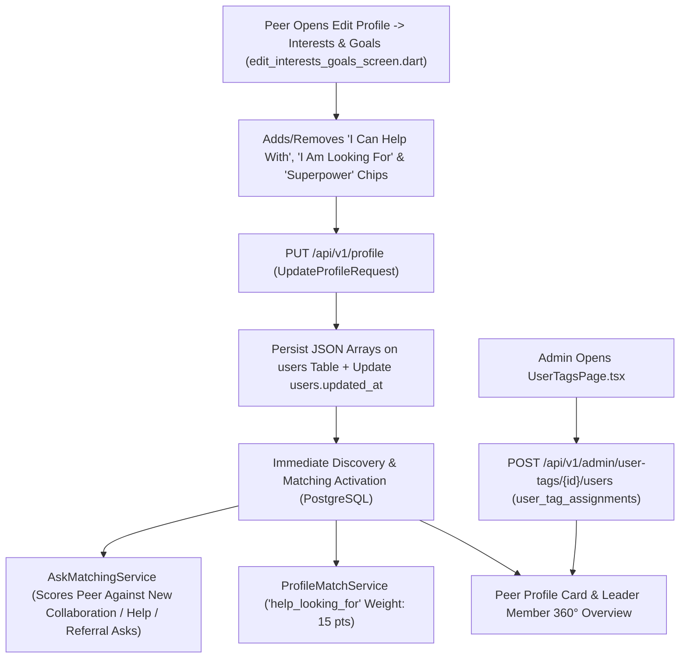

# Activity 04: I Can Help Profiles & Tags

| Attribute | Verified Specification |
|---|---|
| **Workbook Activity #** | `4.0` |
| **Exact Workbook Name** | `"I Can Help" Profiles & Tags` |
| **Domain Category** | `Peer Discovery` (Sheet 1 & 2) / `Discovery / Indexing` (Sheet 3) |
| **Activity Governance Tier** | `Member-Only` for self-service `"I Can Help With"` / `"I Am Looking For"` / `"Superpower"` profile tags + `Global Administration` for curated `UserTag` (`user_tags` / `user_tag_assignments`) badge governance |
| **Overall Implementation Status** | `Fully Implemented` (Member App modular profile editing, PostgreSQL JSON array storage on `users`, bidirectional AI/algorithmic scoring in `ProfileMatchService` & `AskMatchingService`, Leader App Peer Profile tag rendering, and Admin `UserTag` CRUD/assignment all work — note PostgreSQL JSON/ILIKE is used instead of Workbook's conceptual `ElasticSearchIndexer`) |
| **Master Index & Cross-Links** | [12-master-35-activities-index.md](../12-master-35-activities-index.md) · [19-activity-to-role-access-matrix.md](../19-activity-to-role-access-matrix.md) · [25-activity-workflow-reference.md](../25-activity-workflow-reference.md) · [13-activity-input-forms-and-validation.md](../13-activity-input-forms-and-validation.md) · [15-activity-database-and-metrics-mapping.md](../15-activity-database-and-metrics-mapping.md) · [34-profile-edit-history-and-last-updated.md](./34-profile-edit-history-and-last-updated.md) |

---

## 1. Business Purpose (§9.1)

- **Why It Exists & Business Outcome:**
  - **WORKBOOK REQUIREMENT:** Allows peers to declare their consulting domains, personal skills, and `"superpowers"` as structured `"I Can Help With"` (`iCanHelpWith`) tags on their profile so fellow peers can discover them via search and matching.
  - **FACT:** In the production Laravel 12 ecosystem, `"I Can Help"` powers **two distinct discovery & governance layers**:
    1. **Self-Service Peer Capability & Reciprocity Matching (`users` JSON columns):** Members edit `i_can_help_with`, `i_am_looking_for`, `superpower`, `skills`, `business_keywords`, and `collaboration_goals` via `ProfileController@update` ([ProfileController.php](file:///c:/Users/malic/OneDrive/Documents/GitHub/unity-app-new/app/Http/Controllers/Api/ProfileController.php#L62-L200)). These arrays directly drive `App\Services\ProfileMatchService` (where the `help_looking_for` dimension carries a **15-point weight** matching Peer A's `i_am_looking_for` against Peer B's `i_can_help_with`) and `App\Services\Ask\AskMatchingService` (auto-matching Peers to Collaboration, Get Help, and Referral Asks).
    2. **Admin-Curated System & Cohort Tags (`user_tags` & `user_tag_assignments`):** Super Admins / Operations Admins create and assign official classification tags (including the protected system tag `team_member`) via `UserTagAdminController` and React Admin [UserTagsPage.tsx](file:///D:/office%20project/unity-admin-web/src/features/userTags/UserTagsPage.tsx).
- **Role Partitioning (Member vs Leadership vs Admin):**
  - **Peer Member (`FACT`):** Adds/edits/removes their own `i_can_help_with`, `i_am_looking_for`, `superpower`, and `skills` tags in [edit_interests_goals_screen.dart](file:///D:/office%20project/peers-unity/unity_app/lib/features/profile/presentation/screens/edit_interests_goals_screen.dart), [edit_additional_info_screen.dart](file:///D:/office%20project/peers-unity/unity_app/lib/features/profile/presentation/screens/edit_additional_info_screen.dart), and [edit_professional_journey_screen.dart](file:///D:/office%20project/peers-unity/unity_app/lib/features/profile/presentation/screens/edit_professional_journey_screen.dart); views tags and `profile_match` compatibility on any visible peer profile.
  - **Circle / Regional Leadership (`FACT`):** Views a peer's `"I Can Help"`, skills, and industry tags on [peer_profile_overview_section.dart](file:///D:/office%20project/LeaderApp-Fornt-end-/lib/features/peer_profile/view/widgets/peer_profile_overview_section.dart) (`GET /api/v1/peers/{id}` / `GET /api/v1/leader/members/{member_id}`) to broker warm introductions and P2P pairings within their circle/district. Leaders cannot overwrite a peer's `i_can_help_with` tags from the Leadership App (`LeaderUpdatePeerRequest` is both unrouted and excludes `i_can_help_with`).
  - **Super Admin / Web Admin (`FACT`):** Can edit any peer's capability arrays via `PUT /api/v1/admin/peers/{id}` (`UserManagementController@update`, audited to `admin_audit_logs`) and manages curated `user_tags` & `user_tag_assignments` via `/api/v1/admin/user-tags/*` and `/admin/user-tags/*`.

---

## 2. Sub-Activities Catalogue (§9.2)

| # | Sub-Activity / Operation | Member App (`unity_app`) | Leadership App (`LeaderApp`) | Admin Web (`unity-admin-web` & Blade) | Backend (`unity-app-new`) | Classification |
|---|---|---|---|---|---|---|
| 2.1 | **Edit Own `"I Can Help With"` & `"I Am Looking For"` Chip Tags** | Wired in [edit_interests_goals_screen.dart](file:///D:/office%20project/peers-unity/unity_app/lib/features/profile/presentation/screens/edit_interests_goals_screen.dart) (reachable from [edit_profile_overview_screen.dart](file:///D:/office%20project/peers-unity/unity_app/lib/features/profile/presentation/screens/edit_profile_overview_screen.dart); note workbook's `i_can_help_tags_widget.dart` filename does not exist verbatim) | Leaders edit only basic bio/company on own `ProfileView` (`LeaderUpdateProfileRequest` omits `i_can_help_with`) | Admin edits peer tags in [InterestsSocialTab.tsx](file:///D:/office%20project/unity-admin-web/src/components/PeerDetailDrawer/tabs/InterestsSocialTab.tsx) / [PeerEditorPage.tsx](file:///D:/office%20project/unity-admin-web/src/features/users/PeerEditorPage.tsx) | `ProfileController@update` (`UpdateProfileRequest`), `UserManagementController@update` | `Fully Implemented` |
| 2.2 | **Edit `"My Superpower"` & `"Skills & Expertise"`** | Wired in [edit_additional_info_screen.dart](file:///D:/office%20project/peers-unity/unity_app/lib/features/profile/presentation/screens/edit_additional_info_screen.dart), [edit_personal_info_screen.dart](file:///D:/office%20project/peers-unity/unity_app/lib/features/profile/presentation/screens/edit_personal_info_screen.dart), and [edit_professional_journey_screen.dart](file:///D:/office%20project/peers-unity/unity_app/lib/features/profile/presentation/screens/edit_professional_journey_screen.dart) | Read-only on Peer Profile | Editable in Admin Peer Editor | `users.superpower`, `users.skills` (`UpdateProfileRequest`) | `Fully Implemented` |
| 2.3 | **View Capability Strip & Match Score on Peer Profile** | Wired in [peer_profile_screen.dart](file:///D:/office%20project/peers-unity/unity_app/lib/features/peers/presentation/screens/peer_profile_screen.dart) & [matches_screen.dart](file:///D:/office%20project/peers-unity/unity_app/lib/features/peers/presentation/screens/matches_screen.dart) | Wired in [peer_profile_overview_section.dart](file:///D:/office%20project/LeaderApp-Fornt-end-/lib/features/peer_profile/view/widgets/peer_profile_overview_section.dart) | Wired in `PeerDetailDrawer.tsx` (`OverviewBioTab.tsx` / `InterestsSocialTab.tsx`) | `MemberController@show` (`ProfileMatchService`), `LeaderPeersService::getPeer`, `LeaderMember360Service` | `Fully Implemented` |
| 2.4 | **Search & Match Peers / Asks by `"I Can Help"` Tags** | Wired in Peer Directory search & Ask Matches ([ask_matches_screen.dart](file:///D:/office%20project/peers-unity/unity_app/lib/features/asks/presentation/screens/ask_matches_screen.dart)) | Peer search in `PeersView` searches name/company/city/category (`LeaderPeersService`) | Global/Peer search in `UsersPage.tsx` | PostgreSQL JSON/ILIKE queries + `ProfileMatchService` + `AskMatchingService` (No Elasticsearch) | `Partially Implemented` (Leader peer search does not filter explicitly by `i_can_help_with` chips) |
| 2.5 | **Manage Curated `UserTag` Definitions & Assignments** | Read-only badge/tag display where exposed | Not exposed in Leader App | Wired in [UserTagsPage.tsx](file:///D:/office%20project/unity-admin-web/src/features/userTags/UserTagsPage.tsx) & Blade `/admin/user-tags/*` | `UserTagAdminController` & `Admin\UserTagController` (`user_tags`, `user_tag_assignments`) | `Fully Implemented` |

---

## 3. Input Form & Field Validation Mapping (§9.3)

**FACT:** Verified against Workbook Row 12/11, [UpdateProfileRequest.php](file:///c:/Users/malic/OneDrive/Documents/GitHub/unity-app-new/app/Http/Requests/Profile/UpdateProfileRequest.php#L100-L152), `UserTagAdminController`, and Member App screens `edit_interests_goals_screen.dart`, `edit_additional_info_screen.dart`, and `edit_professional_journey_screen.dart`.

| Field Name | Data Type | Required / Optional | Validation (Backend + Client) | Default | Input Widget | Data Source | Visibility | Who Enters | Who Edits | Who Views | Sensitive? | Backend Request Key |
|---|---|---|---|---|---|---|---|---|---|---|---|---|
| **I Can Help With** | `string[] (json)` | Optional (`sometimes\|nullable`) | **Backend (`UpdateProfileRequest.php:137-138`):** `sometimes\|nullable\|array`, `i_can_help_with.*` → `string\|max:150` (max array count unconstrained — `Requires Confirmation`). **Client:** Chip input trim & deduplication. | `[]` | Interactive Tag/Chip Input (`I Can Help With`, hint `e.g. Business Strategy, Pitching`) | Member free-text / chip entry | Respects `users.profile_visibility` (`everyone`, `connected_only`, `circle_only`, `hidden`) | Peer Member | Peer Member (self) & Super Admin (`PUT /admin/peers/{id}`) | Peers (per `profile_visibility`), Leaders, DED, Admin | No | `i_can_help_with` |
| **I Am Looking For** | `string[] (json)` | Optional (`sometimes\|nullable`) | **Backend (`L139-140`):** `sometimes\|nullable\|array`, `i_am_looking_for.*` → `string\|max:150`. | `[]` | Interactive Tag/Chip Input (`I Am Looking For`, hint `e.g. Co-Founders, Tech Talent`) | Member free-text / chip entry | Respects `profile_visibility` | Peer Member | Peer Member & Super Admin | Peers, Leaders, DED, Admin | No | `i_am_looking_for` |
| **My Superpower / Core Strength** | `string (max:100)` | Optional (`sometimes\|nullable`) | **Backend (`L136`):** `sometimes\|nullable\|string\|max:100`. | `null` | `TextField` (`My Superpower`, hint `e.g. Rapid Problem Solver, Master Networker`) | Member input | Public on profile card | Peer Member | Peer Member & Super Admin | Peers, Leaders, DED, Admin | No | `superpower` |
| **Skills & Expertise** | `string[] (json)` | Optional (`sometimes\|nullable`) | **Backend (`L100-101`):** `sometimes\|nullable\|array`, `skills.*` → `string\|max:100`. | `[]` | Tag/Chip Input (`Skills & Expertise`) | Member input | Respects `profile_visibility` | Peer Member | Peer Member & Super Admin | Peers, Leaders, DED, Admin | No | `skills` |
| **Business Keywords / Tags** | `string[] (json)` | Optional (`sometimes\|nullable`) | **Backend (`L141-142`):** `sometimes\|nullable\|array`, `business_keywords.*` → `string\|max:100`. | `[]` | Tag/Chip Input (`Business Keywords / Tags`) | Member input | Public in business directory | Peer Member | Peer Member & Super Admin | Peers, Leaders, DED, Admin | No | `business_keywords` |
| **Collaboration Goals** | `string[] (json)` | Optional | **Backend:** JSON array persisted via `ProfileController::profileUpdateFields()`. | `[]` | Tag/Chip Input (`Collaboration Goals`) | Member input | Respects `profile_visibility` | Peer Member | Peer Member & Super Admin | Peers, Leaders, DED, Admin | No | `collaboration_goals` |
| **Willing to Mentor / Open to Speaking / Cross-City** | `boolean` | Optional | **Backend:** Boolean flags on `users`. | `false` | `SwitchListTile` toggles on `edit_additional_info_screen.dart` | Member toggle | Public badge/filter indicator | Peer Member | Peer Member & Super Admin | Peers, Leaders, DED, Admin | No | `willing_to_mentor`, `open_to_speaking_at_events`, `open_to_cross_city_collaboration` |
| **Admin Curated User Tag (`UserTag`)** | `UUID` + `name`, `slug`, `is_active` | Required (when Admin creates/assigns tag) | **Backend (`UserTagAdminController`):** `name` required string, `slug` unique (`team_member` slug protected from deletion), `user_id` `exists:users,id`. | `is_active: true` | Admin modal & user search picker (`UserTagsPage.tsx`) | `user_tags` catalog | Admin directory & system badge | Super Admin / Ops Admin | Super Admin / Ops Admin | Admin (and Member badge where surfaced) | No | `name`, `slug`, `description`, `is_active`, `user_ids` |

---

## 4. Workflow, Lifecycle & Mermaid Diagram (§9.4)

### Workbook vs Actual Lifecycle Comparison
- **WORKBOOK REQUIREMENT:** `Profile Edit -> Tag Indexing -> Real-time Search Update` via `ElasticSearchIndexer` & `SkillRecommendationEngine`.
- **FACT:** There is **no approval queue** for member `"I Can Help"` tags (self-service immediate save on `users`), and **no Elasticsearch cluster** in the stack. Instead, `ProfileController@update` immediately persists JSONB/JSON arrays onto `users`, updates `users.updated_at`, awards profile-completion coins if thresholds are crossed, and makes tags immediately live for PostgreSQL JSON/ILIKE search, `ProfileMatchService` (reciprocity score), and `AskMatchingService`. Curated `user_tags` follow an Admin-managed `is_active` (`true` | `false`) + assignment (`attach` | `detach`) lifecycle.

---

## 5. Outputs & Deliverables (§9.5)

| Output / Deliverable | Status & Evidence (`FACT` vs `WORKBOOK REQUIREMENT`) |
|---|---|
| **`"I Can Help With"` Badge Strip on Peer Profile** | **FACT (`Fully Implemented`):** Rendered on Member App `peer_profile_screen.dart` (`UserProfileResource` / `MemberDetailResource`) and Leader App `peer_profile_overview_section.dart`. |
| **Reciprocal Peer Match Score (`profile_match`)** | **FACT (`Fully Implemented`):** `MemberController@show` computes and returns `profile_match` via `ProfileMatchService`, highlighting overlapping `i_can_help_with` ↔ `i_am_looking_for` tags. |
| **Automated Ask Responder Suggestions** | **FACT (`Fully Implemented`):** `AskMatchingService` ranks peers into `ask_matches` when another peer publishes an Ask matching their `i_can_help_with` / `skills` / `industry_tags`. |
| **Elasticsearch Keyword Index** | **NOT IMPLEMENTED (`Architectural Substitution`):** Workbook names `ElasticSearchIndexer`; actual backend uses PostgreSQL native JSON/ILIKE queries (`FACT`). |
| **Admin Curated Tag Assignments** | **FACT (`Fully Implemented`):** Managed in `UserTagsPage.tsx` (`user_tags`, `user_tag_assignments`). |

---

## 6. Database & Metrics Mapping (§9.6)

### Primary Tables & Eloquent Models
1. **`users`** — [User.php](file:///c:/Users/malic/OneDrive/Documents/GitHub/unity-app-new/app/Models/User.php)
   - **Capability & Discovery Columns:** `i_can_help_with` (`json`), `i_am_looking_for` (`json`), `superpower` (`varchar(100)`), `skills` (`json`), `interests` (`json`), `industry_tags` (`json`), `business_keywords` (`json`), `industries_of_interest` (`json`), `collaboration_goals` (`json`), `target_regions` (`json`), `target_business_categories` (`json`), `hobbies_interests` (`json`), `willing_to_mentor` (`bool`), `open_to_speaking_at_events` (`bool`), `open_to_cross_city_collaboration` (`bool`), `profile_visibility` (`varchar`), `updated_at` (`timestamp`).
2. **`user_tags` & `user_tag_assignments`** — [UserTag.php](file:///c:/Users/malic/OneDrive/Documents/GitHub/unity-app-new/app/Models/UserTag.php), [UserTagAssignment.php](file:///c:/Users/malic/OneDrive/Documents/GitHub/unity-app-new/app/Models/UserTagAssignment.php)
   - `user_tags`: `id` (`uuid`), `name`, `slug` (`team_member` protected), `description`, `is_active` (`bool`).
   - `user_tag_assignments`: `id` (`uuid`), `user_id` (`uuid` FK → `users.id`), `tag_id` (`uuid` FK → `user_tags.id`), `created_at`, `updated_at`.
3. **`tags`** — [Tag.php](file:///c:/Users/malic/OneDrive/Documents/GitHub/unity-app-new/app/Models/Tag.php) (`id`, `name`, `slug`, `category`, `is_approved`).
- **Audit History:** Member self-updates write `Log::info('profile_update_saved', ['user_id' => ..., 'updated_fields' => ...])`; Admin updates via `UserManagementController@update` write `old_values`/`new_values` diffs to `admin_audit_logs`.

### Workbook Sheet 3 Metric Keys vs Actual Backend Schema
| Workbook Metric Key (Sheet 1–3) | Actual Backend / API Computation (`FACT`) | Discrepancy / Bug Note |
|---|---|---|
| `iCanHelpWith (String[])` | Snake-case `i_can_help_with` JSON array on `users` (mapped to `iCanHelpWith` in Dart models) | Exact functional match (JSON naming convention `snake_case` in API). |
| `profileSkillsIndexedCount` | Computed client-side / in `ProfileCompletion` calculation (`count($user->i_can_help_with) + count($user->skills)`); no standalone `profile_skills_indexed_count` DB column | Derived dynamically; no dedicated counter column needed. |

---

## 7. API & Backend Service Mapping (§9.7)

| Layer | Method & Endpoint | Controller & Action | Service / FormRequest | Auth Middleware | Scope Enforcement & Security Audit (`FACT`) | Client Integration |
|---|---|---|---|---|---|---|
| **Member API** | `GET /api/v1/profile` & `PUT\|PATCH\|POST /api/v1/profile` (alias `/api/v1/user/profile`) | [ProfileController.php](file:///c:/Users/malic/OneDrive/Documents/GitHub/unity-app-new/app/Http/Controllers/Api/ProfileController.php) `@show`, `@update` | `UpdateProfileRequest`, `PublicProfileSlugService`, `UserProfileResource` | `auth:sanctum`, `unity.user` | Strictly updates `$request->user()` (self only) | Wired (`ApiEndpoints.profile`) |
| **Member API** | `GET /api/v1/members/{id}` | `MemberController@show` | `ProfileMatchService`, `ProfileVisibilityService`, `PeerBlockService` | `auth:sanctum`, `unity.user` | Enforces `PeerBlock` & `profile_visibility` | Wired (`ApiEndpoints.member`) |
| **Leader API** | `GET /api/v1/peers` & `GET /api/v1/peers/{id}` | `LeaderPeersController@index`, `@show` | `LeaderPeersService` | `auth:sanctum`, `leader.user` | **HIGH SCOPE BUGS:** `?scope=global` or `?circle_id=all` dumps all platform peers (`LeaderPeersService.php:288-330`), and `GET /peers/{id}` (`L629`) has **zero circle scope check**! | Wired (`PeersView`, `PeerProfileView`) |
| **Leader 360°** | `GET /api/v1/leader/members/{member_id}` (`/profile`) | `LeaderMemberController@show` / `@profile` | `LeaderMember360Service` | `auth:sanctum`, `leader.user` | Properly enforces `resolveMember()` circle scope (`403`) | Wired in Leader App |
| **Admin API** | `PUT\|PATCH /api/v1/admin/peers/{id}` | `UserManagementController@update` | `AdminPeerService`, `AdminAuditService` | `auth:sanctum`, `unity.user` (**CRITICAL BUG:** inside `/api/v1/admin/*` group lacking admin role guard in `routes/api.php`!) | Writes `admin_audit_logs`, but route group lacks `admin.auth` / `admin.role`! | Wired in React Admin (`PeerEditorPage.tsx`) |
| **Admin API & Web** | `GET\|POST /api/v1/admin/user-tags`, `GET\|PUT\|DELETE .../{id}`, `POST\|DELETE .../{id}/users[/{userId}]` & Web `/admin/user-tags/*` | `UserTagAdminController` & `Admin\UserTagController` | `UserTag`, `UserTagAssignment` | API: `auth:sanctum`, `unity.user` (**missing admin guard!**); Web: `web`, `admin.auth` | Web enforces `admin.auth`; API `/api/v1/admin/user-tags/*` needs `admin.auth`! | Wired in `UserTagsPage.tsx` & Blade |

---

## 8. Role-Wise Access Governance (§9.8)

| Role | View Activity | Create Record | Edit Own | Edit Others | Submit for Review | Verify | Approve | Reject | Assign | Manage | Delete | View Aggregated Reports |
|---|---|---|---|---|---|---|---|---|---|---|---|---|
| **Super Admin** | Allowed (Global) | Allowed (Own tags + Create `UserTag` definitions) | Allowed | Allowed (`PUT /admin/peers/{id}` audited to `admin_audit_logs`) | Not Applicable | Not Applicable | Allowed (Approve custom categories if triggered alongside profile update) | Allowed (Reject custom categories) | Allowed (Assign/detach `user_tags` to peers) | Allowed (Full `user_tags` CRUD except deleting protected `team_member`) | Allowed (Clear peer tags or delete custom `UserTag`) | Allowed (Global Profile Completion & Tag counts) |
| **Country Director** | Allowed (Scoped Peers) | Allowed (Own Member profile tags) | Allowed (Own Member profile) | DENIED — No permission under the verified backend authorization model | Not Applicable | Not Applicable | DENIED — No permission under the verified backend authorization model | DENIED — No permission under the verified backend authorization model | DENIED — No permission under the verified backend authorization model | DENIED — No permission under the verified backend authorization model | DENIED — No permission under the verified backend authorization model | Allowed (Scoped Peer Directory) |
| **DED** | Allowed (Assigned District Peers) | Allowed (Own Member profile tags) | Allowed (Own Member profile) | DENIED — No permission under the verified backend authorization model | Not Applicable | Not Applicable | DENIED — No permission under the verified backend authorization model | DENIED — No permission under the verified backend authorization model | DENIED — No permission under the verified backend authorization model | DENIED — No permission under the verified backend authorization model | DENIED — No permission under the verified backend authorization model | Allowed (District Peer Directory) |
| **Industry Director** | Allowed (Assigned Industry Peers) | Allowed (Own Member profile tags) | Allowed (Own Member profile) | DENIED — No permission under the verified backend authorization model | Not Applicable | Not Applicable | DENIED — No permission under the verified backend authorization model | DENIED — No permission under the verified backend authorization model | DENIED — No permission under the verified backend authorization model | DENIED — No permission under the verified backend authorization model | DENIED — No permission under the verified backend authorization model | Allowed (Industry Peer Directory) |
| **Circle Founder** | Allowed (Own Circle Peers) | Allowed (Own Member profile tags) | Allowed (Own Member profile) | DENIED — No permission under the verified backend authorization model | Not Applicable | Not Applicable | DENIED — No permission under the verified backend authorization model | DENIED — No permission under the verified backend authorization model | DENIED — No permission under the verified backend authorization model | DENIED — No permission under the verified backend authorization model | DENIED — No permission under the verified backend authorization model | Allowed (Own Circle Directory) |
| **Circle Director** | Allowed (Own Circle Peers) | Allowed (Own Member profile tags) | Allowed (Own Member profile) | DENIED — No permission under the verified backend authorization model | Not Applicable | Not Applicable | DENIED — No permission under the verified backend authorization model | DENIED — No permission under the verified backend authorization model | DENIED — No permission under the verified backend authorization model | DENIED — No permission under the verified backend authorization model | DENIED — No permission under the verified backend authorization model | Allowed (Own Circle Directory) |
| **Chair / Committee Chairs** | Allowed (Own Circle Peers) | Allowed (Own Member profile tags) | Allowed (Own Member profile) | DENIED — No permission under the verified backend authorization model | Not Applicable | Not Applicable | DENIED — No permission under the verified backend authorization model | DENIED — No permission under the verified backend authorization model | DENIED — No permission under the verified backend authorization model | DENIED — No permission under the verified backend authorization model | DENIED — No permission under the verified backend authorization model | Allowed (Own Circle Directory) |
| **Vice Chair** | Allowed (Own Circle Peers) | Allowed (Own Member profile tags) | Allowed (Own Member profile) | DENIED — No permission under the verified backend authorization model | Not Applicable | Not Applicable | DENIED — No permission under the verified backend authorization model | DENIED — No permission under the verified backend authorization model | DENIED — No permission under the verified backend authorization model | DENIED — No permission under the verified backend authorization model | DENIED — No permission under the verified backend authorization model | Allowed (Own Circle Directory) |
| **Secretary** | Allowed (Own Circle Peers) | Allowed (Own Member profile tags) | Allowed (Own Member profile) | DENIED — No permission under the verified backend authorization model | Not Applicable | Not Applicable | DENIED — No permission under the verified backend authorization model | DENIED — No permission under the verified backend authorization model | DENIED — No permission under the verified backend authorization model | DENIED — No permission under the verified backend authorization model | DENIED — No permission under the verified backend authorization model | Allowed (Own Circle Directory) |
| **Committee Leader** | Allowed in Web RBAC; **BROKEN (`403`)** in Leader App | Allowed (Own Member profile tags) | Allowed (Own Member profile) | DENIED — No permission under the verified backend authorization model | Not Applicable | Not Applicable | DENIED — No permission under the verified backend authorization model | DENIED — No permission under the verified backend authorization model | DENIED — No permission under the verified backend authorization model | DENIED — No permission under the verified backend authorization model | DENIED — No permission under the verified backend authorization model | DENIED in Leader App (`403`) |
| **Peer Member** | Allowed (Peers permitted by `profile_visibility` & `PeerBlock`) | Allowed (Add own `i_can_help_with` chips) | Allowed (`PUT /api/v1/profile`) | DENIED — No permission under the verified backend authorization model *(CRITICAL BUG: `/api/v1/admin/peers/{id}` & `/api/v1/admin/user-tags/*` lack admin guard!)* | Not Applicable | Not Applicable | DENIED — No permission under the verified backend authorization model | DENIED — No permission under the verified backend authorization model | DENIED — No permission under the verified backend authorization model | DENIED — No permission under the verified backend authorization model | Allowed **only** to remove own profile chips | DENIED — No permission under the verified backend authorization model |

---

## 9. Existing Implementation Summary, Gaps & Minimum-Change Enhancement Recommendations

### Summary of Verified Limitations & Bugs
1. **Unprotected `/api/v1/admin/peers/{id}` & `/api/v1/admin/user-tags/*` Routes (`P0` Security):** Mounted inside `['auth:sanctum', 'unity.user']` in [routes/api.php](file:///c:/Users/malic/OneDrive/Documents/GitHub/unity-app-new/routes/api.php#L701-L1305) without admin role enforcement.
2. **Cross-Circle Scope Bypass on Leader Peer Directory (`P1` Security):** Passing `?scope=global` or `?circle_id=all` to `GET /api/v1/peers` (`LeaderPeersService.php:288-330`) or calling `GET /api/v1/peers/{id}` (`L629`) bypasses circle scoping for non-admin leaders.
3. **Leader Peer Search Excludes `"I Can Help"` Tags (`Requires Enhancement`):** When a Circle Director or Business Growth Chair searches `PeersView` in the Leadership App to find a peer who can help with a specific domain (e.g. `"GST"`, `"Export"`, `"Fundraising"`), `LeaderPeersService::listPeers` does not match `users.i_can_help_with` or `users.superpower`.
4. **Unbounded Array Size in `UpdateProfileRequest`:** `i_can_help_with` validates `max:150` per tag string but has no `max:30` array item cap.

### Minimum-Change Enhancement Recommendations
- **RECOMMENDATION 1 (Lock Down Admin Routes & Leader Scope):** Add `admin.auth` / `admin.role` middleware to `/api/v1/admin/*`, remove the `?scope=global` bypass for non-global roles in `LeaderPeersService::listPeers()`, and enforce `$scopedCircleIds` in `LeaderPeersService::getPeer()`.
- **RECOMMENDATION 2 (Enable `"I Can Help"` Search in Leadership App):** Extend the search predicate in `LeaderPeersService::listPeers()` to include `i_can_help_with::text ILIKE ?` and `superpower ILIKE ?` (with a PostgreSQL GIN trigram index if needed — **do NOT introduce Elasticsearch**, preserving the existing PostgreSQL stack), enabling Chairs and Circle Directors to broker expertise matches effortlessly.
- **RECOMMENDATION 3 (Array Bounds Validation):** Add `'max:25'` to `i_can_help_with`, `i_am_looking_for`, `skills`, and `business_keywords` in [UpdateProfileRequest.php](file:///c:/Users/malic/OneDrive/Documents/GitHub/unity-app-new/app/Http/Requests/Profile/UpdateProfileRequest.php#L137-L142) to prevent oversized JSON payloads.
