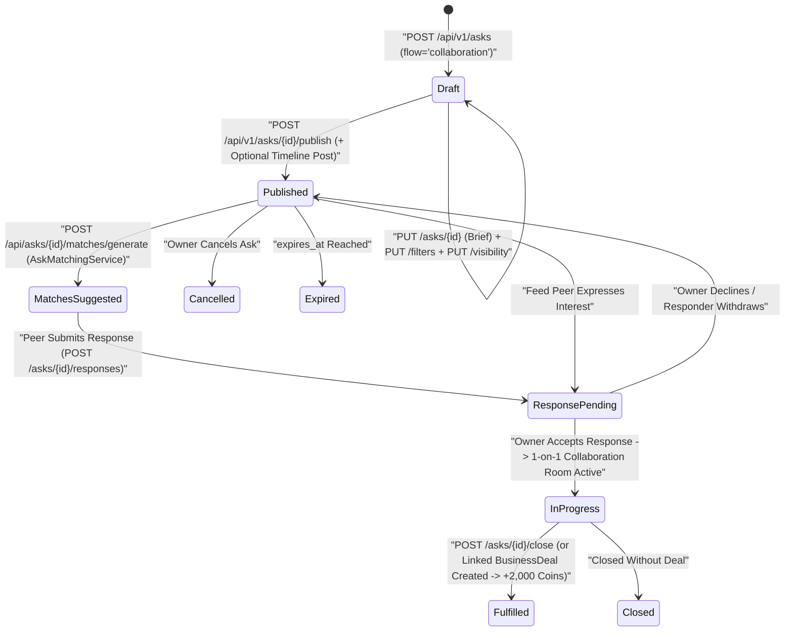

# Activity 05: Collaboration Asks

| Attribute | Verified Specification |
|---|---|
| **Workbook Activity #** | `5.0` |
| **Exact Workbook Name** | `Collaboration Asks` |
| **Domain Category** | `Asks & Opportunities` (Sheet 1 & 2) / `Asks & Marketplace` (Sheet 3) |
| **Activity Governance Tier** | `Leadership Oversight` (Peer-published via Unified Ask Engine `ask_flows.code = 'collaboration'` + legacy `collaboration_posts`; Leadership monitors, assigns owners, facilitates P2Ps/deals; Admin configures taxonomy & moderates asks) |
| **Overall Implementation Status** | `Partially Implemented` (Full 3-step dynamic Ask Engine, 13 collaboration subcategories, AI/rule matching, peer responses, collaboration room, and Admin taxonomy config work; however, Leader Dashboard fabricates `60%/25%/15%` Ask KPIs, `LeaderAskFlowService` leaks unscoped global asks, and `/api/admin/asks` lacks admin authorization middleware) |
| **Master Index & Cross-Links** | [12-master-35-activities-index.md](../12-master-35-activities-index.md) · [19-activity-to-role-access-matrix.md](../19-activity-to-role-access-matrix.md) · [25-activity-workflow-reference.md](../25-activity-workflow-reference.md) · [13-activity-input-forms-and-validation.md](../13-activity-input-forms-and-validation.md) · [06-get-help-asks.md](./06-get-help-asks.md) · [07-referral-asks.md](./07-referral-asks.md) |

---

## 1. Business Purpose (§9.1)

- **Why It Exists & Business Outcome:**
  - **WORKBOOK REQUIREMENT:** Enables members to publish structured requests for joint ventures, co-founders, strategic partnerships, manufacturing/distribution alliances, or subcontracting via a 3-Step Wizard, surface AI-scored peer matches, collaborate inside a dedicated 1-on-1 Collaboration Workspace, and track commercial outcomes.
  - **FACT:** Collaboration Asks run on the **Unified Ask Discovery Engine** ([routes/ask.php](file:///c:/Users/malic/OneDrive/Documents/GitHub/unity-app-new/routes/ask.php#L1-L184), [AskController.php](file:///c:/Users/malic/OneDrive/Documents/GitHub/unity-app-new/app/Http/Controllers/Api/V1/Ask/AskController.php)) with `ask_flows.code = 'collaboration'` and **13 seeded `ask_types`**: `joint_venture`, `co_founder`, `strategic_partner`, `technology_partner`, `manufacturing_partner`, `distribution_partner`, `vendor_service_partner`, `channel_partner`, `marketing_partner`, `implementation_partner`, `event_partner`, `cross_border_partner`, and `other`. A legacy `collaboration_posts` table (`CollaborationPostController`, expired daily at `00:10` by `collaborations:expire`) is also retained for backward compatibility.
- **Role Partitioning (Member vs Leadership vs Admin):**
  - **Peer Member (`FACT`):** Creates Collaboration Ask drafts, fills dynamic brief answers & targeting filters, sets visibility (`all_peers` | `district` | `circle`), publishes to Ask Hub & optionally Home Timeline, reviews matched peers (`ask_matches`), responds to peers' asks (`ask_responses`), enters 1-on-1 collaboration chat ([ask_collaboration_room_screen.dart](file:///D:/office%20project/peers-unity/unity_app/lib/features/asks/presentation/screens/ask_collaboration_room_screen.dart)), and closes the Ask with commercial outcome/deal handoff ([ask_collaboration_outcome_screen.dart](file:///D:/office%20project/peers-unity/unity_app/lib/features/asks/presentation/screens/ask_collaboration_outcome_screen.dart)).
  - **Circle / Regional Leadership (`FACT`):** Monitors Collaboration Asks on the Dashboard (`Asks` tab), [leader_activities_view.dart](file:///D:/office%20project/LeaderApp-Fornt-end-/lib/features/leader_activities/view/leader_activities_view.dart) (`collaboration-asks`), and Peer Profile ([peer_collaboration_screen.dart](file:///D:/office%20project/LeaderApp-Fornt-end-/lib/features/peer_profile/view/peer_collaboration_screen.dart), [peer_collaboration_detail_screen.dart](file:///D:/office%20project/LeaderApp-Fornt-end-/lib/features/peer_profile/view/peer_collaboration_detail_screen.dart)); DEDs view district collaborations via `GET /api/v1/ded/activities/find-build-collaborations`. Backend `/api/v1/leader/ask-flows/*` also exposes `assignOwner`, `convertAskToDeal`, and `createP2pFromAsk`.
  - **Super Admin / Web Admin (`FACT`):** Configures dynamic Ask flows, types, option groups, and options (`AskFlowConfigPage.tsx` / `AskManagementController`), monitors global Ask analytics (`AsksPage.tsx`), overrides Ask status, deletes abusive asks, and exports CSV reports.

---

## 2. Sub-Activities Catalogue (§9.2)

| # | Sub-Activity / Operation | Member App (`unity_app`) | Leadership App (`LeaderApp`) | Admin Web (`unity-admin-web` & Blade) | Backend (`unity-app-new`) | Classification |
|---|---|---|---|---|---|---|
| 2.1 | **Load Collaboration Types & Dynamic Form Config** | Wired (`GET /api/asks/flows/collaboration/types`, `GET /api/asks/form-config` in [ask_types_screen.dart](file:///D:/office%20project/peers-unity/unity_app/lib/features/asks/presentation/screens/ask_types_screen.dart)) | Exposed via `GET /api/v1/leader/asks/flows/collaboration` & `.../form-config` | Editable in [AskFlowConfigPage.tsx](file:///D:/office%20project/unity-admin-web/src/features/asks/AskFlowConfigPage.tsx) | `AskConfigController`, `LeaderAskFlowController`, `AskManagementController` | `Fully Implemented` |
| 2.2 | **Step 1–3 Wizard: Draft, Brief, Filters, Visibility & Publish** | Wired ([ask_step1_brief_screen.dart](file:///D:/office%20project/peers-unity/unity_app/lib/features/asks/presentation/screens/ask_step1_brief_screen.dart), [ask_step2_filters_screen.dart](file:///D:/office%20project/peers-unity/unity_app/lib/features/asks/presentation/screens/ask_step2_filters_screen.dart), [ask_step3_preview_screen.dart](file:///D:/office%20project/peers-unity/unity_app/lib/features/asks/presentation/screens/ask_step3_preview_screen.dart)) | Route `POST /api/v1/leader/ask-flows` exists (`AskFlowHubController@store`), not wired to a Leader wizard UI | Not applicable | `AskController@storeDraft`, `@saveDetails`, `@saveFilters`, `@setVisibility`, `@setTimelinePreference`, `@preview`, `@publish` | `Fully Implemented` (Member App) |
| 2.3 | **Generate & View Matched Peers (`ask_matches`)** | Wired ([ask_matches_screen.dart](file:///D:/office%20project/peers-unity/unity_app/lib/features/asks/presentation/screens/ask_matches_screen.dart) → `POST\|GET /api/asks/{ask}/matches`) | Not surfaced in Leader App | Summary counts in Admin | `AskMatchController` → `AskMatchingService` | `Fully Implemented` |
| 2.4 | **Express Interest / Respond & Enter Collaboration Room** | Wired ([ask_express_interest_screen.dart](file:///D:/office%20project/peers-unity/unity_app/lib/features/asks/presentation/screens/ask_express_interest_screen.dart), [ask_collaboration_room_screen.dart](file:///D:/office%20project/peers-unity/unity_app/lib/features/asks/presentation/screens/ask_collaboration_room_screen.dart), [ask_responses_list_screen.dart](file:///D:/office%20project/peers-unity/unity_app/lib/features/asks/presentation/screens/ask_responses_list_screen.dart)) | Backend `/api/v1/leader/ask-flows/{id}/interest` exists; Leader UI is read-only | Read-only inspection | `AskResponseController` (`AskResponseService`), Direct Chat / Reverb | `Fully Implemented` (Member App) |
| 2.5 | **Leader Facilitation: Assign Owner / Convert to Deal / Create P2P** | Member converts via `BusinessDealController` (`ask_id`) | Backend routes exist in `routes/leader.php:215-221` (`assignOwner`, `convertAskToDeal`, `createP2pFromAsk`), **not wired** in [peer_collaboration_detail_screen.dart](file:///D:/office%20project/LeaderApp-Fornt-end-/lib/features/peer_profile/view/peer_collaboration_detail_screen.dart) | Admin status override | `AskFlowHubController` | `Implemented but Not Integrated` (Leader App) |
| 2.6 | **Close Ask with Outcome Feedback & Congratulate** | Wired ([ask_collaboration_outcome_screen.dart](file:///D:/office%20project/peers-unity/unity_app/lib/features/asks/presentation/screens/ask_collaboration_outcome_screen.dart) → `POST /api/v1/asks/{ask}/close`, `/close-and-thank`, `/congratulate`) | Read-only | Admin `PATCH /api/admin/asks/{ask}/status` | `AskController@closeWithFeedback`, `AskFeedController@closeAndThank` | `Fully Implemented` |
| 2.7 | **View Ask Feeds, Peer Asks, Dashboard KPIs & Leaderboard** | Wired ([peers_asks_hub_screen.dart](file:///D:/office%20project/peers-unity/unity_app/lib/features/asks/presentation/screens/peers_asks_hub_screen.dart), [my_asks_screen.dart](file:///D:/office%20project/peers-unity/unity_app/lib/features/asks/presentation/screens/my_asks_screen.dart)) | Wired (`peer_collaboration_screen.dart`, `leader_activities_view.dart`), **BUGS:** Dashboard Asks KPIs use fake `60%/25%/15%` multipliers (`LeaderDashboardService.php:784-786`); `LeaderAskFlowService` is unscoped! | Wired ([AsksPage.tsx](file:///D:/office%20project/unity-admin-web/src/features/asks/AsksPage.tsx)) | `AskFlowHubController`, `LeaderAskFlowService`, `DedActivitiesController@findBuildCollaborations` | `Implemented but Incorrect` (Leader Dashboard & Scope) |

---

## 3. Input Form & Field Validation Mapping (§9.3)

**FACT:** Verified against Workbook Row 13/12, [CreateAskDraftRequest.php](file:///c:/Users/malic/OneDrive/Documents/GitHub/unity-app-new/app/Http/Requests/Ask/CreateAskDraftRequest.php), [SaveAskDetailsRequest.php](file:///c:/Users/malic/OneDrive/Documents/GitHub/unity-app-new/app/Http/Requests/Ask/SaveAskDetailsRequest.php), [SaveAskFiltersRequest.php](file:///c:/Users/malic/OneDrive/Documents/GitHub/unity-app-new/app/Http/Requests/Ask/SaveAskFiltersRequest.php), `AskController`, and Member App screens `ask_step1_brief_screen.dart` – `ask_step3_preview_screen.dart`.

| Field Name | Data Type | Required / Optional | Validation (Backend + Client) | Default | Input Widget | Data Source | Visibility | Who Enters | Who Edits | Who Views | Sensitive? | Backend Request Key |
|---|---|---|---|---|---|---|---|---|---|---|---|---|
| **Ask Flow** | `string` / `UUID` | Required | **Backend (`CreateAskDraftRequest`):** `flow_id` `required_without:flow\|string`, `flow` `sometimes\|string` (`'collaboration'`). | `'collaboration'` | Flow card ([ask_flow_selection_screen.dart](file:///D:/office%20project/peers-unity/unity_app/lib/features/asks/presentation/screens/ask_flow_selection_screen.dart)) | `GET /api/asks/flows` (`ask_flows`) | Public on Ask card | Peer Member | Immutable after draft | All authorized viewers | No | `flow` / `flow_id` |
| **Collaboration Subcategory (`type`)** | `string` / `UUID` | Required | **Backend:** `type_id` `required_without:type\|string`, `type` `sometimes\|string` (13 collaboration codes). | `null` | Category grid ([ask_types_screen.dart](file:///D:/office%20project/peers-unity/unity_app/lib/features/asks/presentation/screens/ask_types_screen.dart)) | `GET /api/asks/flows/collaboration/types` (`ask_types`) | Public on Ask card | Peer Member | Ask Owner (while draft/open) | All authorized viewers | No | `type` / `type_id` |
| **Ask Title** | `string (max:255)` | Required on Publish (Nullable on initial draft) | **Backend:** `nullable\|string\|max:255` on draft; required before `publish()`. **Client:** `"One line. Start with a verb."` | `null` | `TextField` (`ask_step1_brief_screen.dart`) | User input | Public within chosen visibility scope | Peer Member | Ask Owner | Viewers in `visibility_type` scope, Leaders, Admin | No | `title` |
| **Dynamic Brief Answers (Goal, What You Bring, What You Need, Commercials/Budget)** | `array` of answer objects | Required (`min:1` in `SaveAskDetailsRequest`) | **Backend (`SaveAskDetailsRequest`):** `answers` `required\|array\|min:1`, `answers.*.field_key` `required\|string\|max:100`, `value_text` `nullable\|string`, `value_number` `nullable\|numeric`, `option_id` / `option_ids`. | `[]` | Dynamic form controls driven by `form-config` (`ask_step1_brief_screen.dart`) | `GET /api/asks/form-config?flow=collaboration&type=...` | Visible on Ask Detail | Peer Member | Ask Owner | Viewers in `visibility_type` scope, Leaders, Admin | Commercial (`budget` / equity terms) | `answers[].{field_key, value_text, value_number, option_id, option_ids}` |
| **Target Industries** | `string[] / json` | Optional | **Backend (`SaveAskFiltersRequest`):** `industry` `nullable` (stored in `asks.metadata` / `ask_answers`). | Any (`[]`) | Multi-select chips (`Tech & Software`, `Manufacturing`, `Healthcare`, `Real Estate`, etc. on `ask_step2_filters_screen.dart`) | `ask_options` / static fallback | Visible on Ask card & used by `AskMatchingService` | Peer Member | Ask Owner | Scoped Peers, Leaders, Admin | No | `industry` (`filters.industry`) |
| **Target Geographies / Cities** | `string[] / json` | Optional | **Backend:** `geography` `nullable`. | `'Flexible'` / `'Pan-India'` | Multi-select chips (`My city`, `Pan-India`, `International`, `Flexible`) | `ask_options` / cities | Visible on Ask card & matching | Peer Member | Ask Owner | Scoped Peers, Leaders, Admin | No | `geography` (`filters.geography`) |
| **Partner Business Stage** | `string[] / json` | Optional | **Backend:** `business_stage` `nullable`. | `'Any stage'` | Chips (`Idea / Prototype`, `Early stage`, `Growth stage`, `Established`, `Any stage`) | `ask_options` | Visible on Ask card & matching | Peer Member | Ask Owner | Scoped Peers, Leaders, Admin | No | `business_stage` |
| **Urgency / Timeline** | `string` | Optional | **Backend:** `timeline` `nullable`. | `'1 - 3 months'` | Chips (`Immediate (< 1 mo)`, `1 - 3 months`, `3 - 6 months`, `Flexible`) | `ask_options` | Visible on Ask card | Peer Member | Ask Owner | Scoped Peers, Leaders, Admin | No | `timeline` |
| **Visibility Scope** | `string (enum)` | Optional (Defaults to `all_peers`) | **Backend (`SetAskVisibilityRequest`):** `visibility_type` ∈ `all_peers`, `district`, `circle` (+ `district_id`, `circle_id`). | `'all_peers'` | Scope selector (`ask_step3_preview_screen.dart`) | User's joined circles / district | Controls feed audience | Peer Member | Ask Owner | Audience in selected scope + Admin | No | `visibility_type`, `district_id`, `circle_id` |
| **Publish to Home Timeline** | `boolean` | Optional | **Backend:** `nullable\|boolean`. | `true` | Toggle switch (`ask_step3_preview_screen.dart`) | User toggle | Creates linked `posts` row via `ask_timeline_links` | Peer Member | Ask Owner | Public / Circle feed | No | `publish_to_timeline` (`post_to_timeline`) |
| **Peer Response (`response_type` & `message`)** | `enum` + `text` | Required when responding | **Backend (`AskResponseController@store`):** `response_type` ∈ `can_help_directly`, `can_introduce_peer`, `know_someone`, `not_relevant`; `message` string; optional `introduced_peer_id`. | `'can_help_directly'` | `ask_express_interest_screen.dart` | Responder input | Private between Ask Owner, Responder & Admin | Responder Peer | Responder (`withdraw`) / Owner (`accept`/`decline`) | Ask Owner, Responder, Admin | Commercial | `response_type`, `message`, `introduced_peer_id` |
| **Outcome Closure (`outcome_status`, `approx_deal_value`, `outcome_notes`)** | `string`, `decimal(15,2)`, `text` | Required on Close | **Backend (`AskController@closeWithFeedback`):** `outcome_status`, `approx_deal_value` (`nullable\|numeric\|min:0`), `outcome_notes` (`nullable\|string`). | `null` | `ask_collaboration_outcome_screen.dart` | Owner input | Summary visible on closed Ask; deal value feeds analytics | Ask Owner | Ask Owner / Admin | Ask Owner, Responder, Leaders, Admin | Commercial (`₹` value) | `outcome_status`, `approx_deal_value`, `outcome_notes` |

---

## 4. Workflow, Lifecycle & Mermaid Diagram (§9.4)

### Workbook vs Actual Lifecycle Comparison
- **WORKBOOK REQUIREMENT:** `Draft -> Published -> Peer Matched -> Room Created -> Closed`.
- **FACT:** Stored across **three coordinated state machines** with full audit trails (`ask_status_histories` & `ask_response_status_histories`):
  1. **`asks.status`:** `draft` → `published` → `in_progress` → `fulfilled` | `closed` | `cancelled` | `expired` (feed queries also accept aliases `open`/`active`).
  2. **`ask_matches.status`:** `suggested` → `viewed` → `interested` → `connected` | `dismissed` | `expired`.
  3. **`ask_responses.status`:** `pending` → `accepted` | `declined` → `in_progress` → `completed` | `closed` | `withdrawn`.
  - *(Legacy `collaboration_posts.status` uses `active` | `expired` | `deleted` with `completion_status` ∈ `incomplete` | `completed`.)*

---

## 5. Outputs & Deliverables (§9.5)

| Output / Deliverable | Status & Evidence (`FACT` vs `WORKBOOK REQUIREMENT`) |
|---|---|
| **Collaboration Ask Card & Ask Hub Feed** | **FACT (`Fully Implemented`):** Rendered in [peers_asks_hub_screen.dart](file:///D:/office%20project/peers-unity/unity_app/lib/features/asks/presentation/screens/peers_asks_hub_screen.dart) and optionally cross-posted to Home Timeline via `ask_timeline_links` (`posts.source_type = 'ask'`). |
| **Algorithmic Peer Match List (`ask_matches`)** | **FACT (`Fully Implemented`):** `AskMatchingService` scores peers by industry, geography, business stage, and `i_can_help_with` tags, displayed in [ask_matches_screen.dart](file:///D:/office%20project/peers-unity/unity_app/lib/features/asks/presentation/screens/ask_matches_screen.dart). |
| **Dedicated 1-on-1 Collaboration Workspace Chat** | **FACT (`Fully Implemented`):** [ask_collaboration_room_screen.dart](file:///D:/office%20project/peers-unity/unity_app/lib/features/asks/presentation/screens/ask_collaboration_room_screen.dart) pairs accepted responders with the Ask owner (backed by REST + Laravel Reverb WebSockets, rather than a standalone microservice named `CollabRoomSocketService`). |
| **Congratulate & Close-and-Thank Celebration** | **FACT (`Fully Implemented`):** `POST /api/v1/asks/{id}/congratulate` and `POST /api/v1/asks/{id}/close-and-thank` (`AskFeedController`). |
| **Leadership & Admin Dashboards + CSV Export** | **FACT (`Implemented but Incorrect` on Leader Dashboard / `Fully Implemented` on Admin Web):** Admin `GET /api/admin/asks/export` & `AsksPage.tsx` work; Leader Dashboard Asks counters are synthetically split `60% / 25% / 15%` (`LeaderDashboardService.php:784-786`). |

---

## 6. Database & Metrics Mapping (§9.6)

### Primary Tables & Eloquent Models (`app/Models/Ask/`)
- `asks` (`Ask`, `SoftDeletes`): `id` (`uuid`), `user_id`, `flow_id` (FK → `ask_flows.id`), `type_id` (FK → `ask_types.id`), `title`, `status`, `visibility_type` (`all_peers` | `district` | `circle`), `visibility_district_id`, `visibility_circle_id`, `publish_to_timeline` (`bool`), `published_at`, `expires_at`, `closed_at`, `fulfilled_at`, `outcome_status`, `approx_deal_value` (`decimal:2`), `outcome_notes`, `metadata` (`json`), `deleted_at`.
- Supporting tables: `ask_flows`, `ask_types`, `ask_answers`, `ask_option_groups`, `ask_options`, `ask_matches`, `ask_responses`, `ask_response_contacts`, `ask_status_histories`, `ask_response_status_histories`, `ask_timeline_links`.
- Legacy tables: `collaboration_posts`, `collaboration_post_interests`, `collaboration_post_meeting_requests`, `collaboration_types`.

### Workbook Sheet 3 Metric Keys vs Actual Backend Schema
| Workbook Metric Key (Sheet 1–3) | Actual Backend / API Computation (`FACT`) | Discrepancy / Bug Note |
|---|---|---|
| `listedRequirements` | Sum of `requirements` + `asks` for user (`LastMonthActivityService`, `UserProfileResource`) | Aggregates across all 3 Ask flows + legacy `requirements`. |
| `asksCollaborationOpen` | `COUNT(*)` on `asks` joined to `ask_flows.code = 'collaboration'` where `status IN ('published', 'in_progress')` | **CRITICAL BUG (`LeaderDashboardService.php:784-786`):** Dashboard computes `open_asks = round($allAsksCount * 0.6)`, `in_progress_asks = round($allAsksCount * 0.25)`, `fulfilled_asks = round($allAsksCount * 0.15)` instead of querying `GROUP BY status`! |
| `asksCollaborationClosed` | `COUNT(*)` where `status IN ('fulfilled', 'closed')` (`AskAdminController@stats`) | Accurate in `AskAdminController@stats`; fabricated on Leader Dashboard. |

---

## 7. API & Backend Service Mapping (§9.7)

| Layer | Method & Endpoint | Controller & Action | Service / FormRequest | Auth Middleware | Scope Enforcement & Security Audit (`FACT`) | Client Integration |
|---|---|---|---|---|---|---|
| **Member API** | `GET /api/v1/asks/flows`, `.../flows/{flow}/types`, `.../form-config` (also `/api/asks/*`) | `AskConfigController` | `AskService` | `auth:sanctum` | Read-only master config | Wired in Member App |
| **Member API** | `POST /api/v1/asks`, `PUT\|GET\|PATCH /api/v1/asks/{ask}`, `PUT .../filters\|visibility\|timeline-preference`, `GET .../preview\|history`, `POST .../publish\|close` | [AskController.php](file:///c:/Users/malic/OneDrive/Documents/GitHub/unity-app-new/app/Http/Controllers/Api/V1/Ask/AskController.php) | `AskService`, `CreateAskDraftRequest`, `SaveAskDetailsRequest`, `SaveAskFiltersRequest` | `auth:sanctum` | Mutations enforce `$this->authorizeOwner($user, $ask)`; `show()` (`L227`) has **no `visibility_type` check** (any authenticated user with UUID can read circle/district-restricted Ask!) | Wired in Member App |
| **Member API** | `GET /api/v1/asks/collaboration/global\|my\|user/{userId}\|leaderboard\|{id}`, `PATCH .../status` | `AskFlowHubController` | `AskFlowHubService` | `auth:sanctum` | Feed filters by visibility | Wired (`PeersAsksHubScreen`) |
| **Member API** | `POST\|GET /api/asks/{ask}/matches`, `POST\|GET /api/asks/{ask}/responses[/{response}]` | `AskMatchController`, `AskResponseController` | `AskMatchingService`, `AskResponseService` | `auth:sanctum` | Owner/responder checks enforced | Wired |
| **Leader API** | `GET /api/v1/leader/asks/summary\|all-data\|flows[/{flow}]` & `GET /api/v1/ask-flows[/{id}]` | `LeaderAskFlowController` | `LeaderAskFlowService` | `auth:sanctum`, `leader.user` | **HIGH DATA LEAK:** `LeaderAskFlowService` (`L73, 275, 404`) never receives `$user` and returns **all platform asks** regardless of leader circle/district! | Wired in Leader Dashboard & Peer Profile |
| **Leader API** | `POST /api/v1/leader/ask-flows/{id}/assign-owner\|convert-to-deal\|create-p2p` | `App\Http\Controllers\Api\V1\AskFlow\AskFlowHubController` | — | `auth:sanctum`, `leader.user` | Lacks `leader.can` & circle scope validation | **Not integrated** in Leader App UI |
| **DED API** | `GET /api/v1/ded/activities/find-build-collaborations` | `DedActivitiesController` | `DedApiService` | `auth:sanctum`, `ensure.ded.api` | Enforces DED district scope | Backend ready |
| **Admin API** | `GET /api/admin/asks`, `.../stats`, `.../config*`, `.../export`, `PATCH /api/admin/asks/{ask}/status`, `DELETE /api/admin/asks/{ask}` | `AskAdminController`, `AskManagementController` | `AskService` | `auth:sanctum` (**CRITICAL P0 BUG:** [routes/ask.php](file:///c:/Users/malic/OneDrive/Documents/GitHub/unity-app-new/routes/ask.php#L152-L184) has **NO `admin.auth` or `admin.role` middleware**!) | **Any regular member token can modify Ask taxonomy options or delete any peer's Ask!** | Wired in `AsksPage.tsx` & `AskFlowConfigPage.tsx` |

---

## 8. Role-Wise Access Governance (§9.8)

| Role | View Activity | Create Record | Edit Own | Edit Others | Submit for Review | Verify | Approve | Reject | Assign | Manage | Delete | View Aggregated Reports |
|---|---|---|---|---|---|---|---|---|---|---|---|---|
| **Super Admin** | Allowed (Global) | Allowed (as `User`) | Allowed | Allowed (`PATCH /api/admin/asks/{ask}/status`) | Not Applicable (Self-published) | Not Applicable | Not Applicable (Post-publication moderation) | Allowed (Close/Cancel/Deactivate abusive Ask) | Allowed (`assignOwner` & taxonomy management) | Allowed (Full `ask_flows` / `ask_types` / `ask_options` CRUD) | Allowed (`DELETE /api/admin/asks/{ask}`) | Allowed (Global Stats & CSV Export) |
| **Country Director** | Allowed (Country Scope intended; currently Global Leak in `LeaderAskFlowService`) | Allowed (Member App) | Allowed | DENIED — No permission under the verified backend authorization model | Not Applicable | Not Applicable | Not Applicable | DENIED — No permission under the verified backend authorization model | Allowed (`assignOwner` in scope — UI not wired) | DENIED — No permission under the verified backend authorization model | DENIED — No permission under the verified backend authorization model | Allowed (Scoped Dashboard & Reports) |
| **DED** | Allowed (District Scope on `/ded/*`; Global Leak on `/leader/asks/*`) | Allowed (Member App) | Allowed | DENIED — No permission under the verified backend authorization model | Not Applicable | Not Applicable | Not Applicable | DENIED — No permission under the verified backend authorization model | Allowed (`assignOwner` in district — UI not wired) | DENIED — No permission under the verified backend authorization model | DENIED — No permission under the verified backend authorization model | Allowed (DED Dashboard & Reports) |
| **Industry Director** | Allowed (Industry Scope intended; Global Leak on `/leader/asks/*`) | Allowed (Member App) | Allowed | DENIED — No permission under the verified backend authorization model | Not Applicable | Not Applicable | Not Applicable | DENIED — No permission under the verified backend authorization model | Allowed (`assignOwner` in industry — UI not wired) | DENIED — No permission under the verified backend authorization model | DENIED — No permission under the verified backend authorization model | Allowed (Industry Scope) |
| **Circle Founder** | Allowed (Own Circle intended; Global Leak on `/leader/asks/*`) | Allowed (Member App) | Allowed | DENIED — No permission under the verified backend authorization model | Not Applicable | Not Applicable | Not Applicable | DENIED — No permission under the verified backend authorization model | Allowed (`assignOwner` in circle — UI not wired) | DENIED — No permission under the verified backend authorization model | DENIED — No permission under the verified backend authorization model | Allowed (Own Circle Reports) |
| **Circle Director** | Allowed (Own Circle intended; Global Leak on `/leader/asks/*`) | Allowed (Member App) | Allowed | DENIED — No permission under the verified backend authorization model | Not Applicable | Not Applicable | Not Applicable | DENIED — No permission under the verified backend authorization model | Allowed (`assignOwner` in circle — UI not wired) | DENIED — No permission under the verified backend authorization model | DENIED — No permission under the verified backend authorization model | Allowed (Own Circle Reports) |
| **Chair / Committee Chairs** | Allowed (Own Circle — Business Growth Chair facilitates asks) | Allowed (Member App) | Allowed | DENIED — No permission under the verified backend authorization model | Not Applicable | Not Applicable | Not Applicable | DENIED — No permission under the verified backend authorization model | Allowed (`assignOwner` in circle — UI not wired) | DENIED — No permission under the verified backend authorization model | DENIED — No permission under the verified backend authorization model | Allowed (Own Circle Dashboard & Weekly Report) |
| **Vice Chair** | Allowed (Own Circle) | Allowed (Member App) | Allowed | DENIED — No permission under the verified backend authorization model | Not Applicable | Not Applicable | Not Applicable | DENIED — No permission under the verified backend authorization model | DENIED — Read/facilitate only | DENIED — No permission under the verified backend authorization model | DENIED — No permission under the verified backend authorization model | Allowed (Own Circle Read-Only Reports) |
| **Secretary** | Allowed (Own Circle) | Allowed (Member App) | Allowed | DENIED — No permission under the verified backend authorization model | Not Applicable | Not Applicable | Not Applicable | DENIED — No permission under the verified backend authorization model | DENIED — Read-only | DENIED — No permission under the verified backend authorization model | DENIED — No permission under the verified backend authorization model | Allowed (Own Circle Read-Only Reports) |
| **Committee Leader** | Allowed in Web RBAC; **BROKEN (`403`)** in Leader App | Allowed (Member App) | Allowed | DENIED — No permission under the verified backend authorization model | Not Applicable | Not Applicable | Not Applicable | DENIED — No permission under the verified backend authorization model | DENIED — No permission under the verified backend authorization model | DENIED — No permission under the verified backend authorization model | DENIED — No permission under the verified backend authorization model | DENIED in Leader App (`403`) |
| **Peer Member** | Allowed (Asks matching `visibility_type` + Own Asks) | Allowed (`POST /api/v1/asks` when active) | Allowed (`PUT/PATCH /api/v1/asks/{ask}` on own Ask) | DENIED — No permission under the verified backend authorization model *(CRITICAL P0 BUG: `/api/admin/asks/*` lacks admin middleware!)* | Not Applicable | Not Applicable | Allowed **only** on responses to own Ask (`AskResponse`) | Allowed **only** on responses to own Ask | DENIED — No permission under the verified backend authorization model | DENIED — No permission under the verified backend authorization model | Allowed **only** to cancel/withdraw own Ask/Response *(Bug: `/api/admin/asks/{ask}` DELETE unguarded!)* | DENIED — Leaderboard & personal stats only |

---

## 9. Existing Implementation Summary, Gaps & Minimum-Change Enhancement Recommendations

### Summary of Verified Limitations & Bugs
1. **Unprotected `/api/admin/asks` & `/api/v1/admin/asks` Endpoints (`P0` Security):** [routes/ask.php](file:///c:/Users/malic/OneDrive/Documents/GitHub/unity-app-new/routes/ask.php#L152-L184) applies only `auth:sanctum`—any authenticated member can mutate Ask configuration options or delete arbitrary asks.
2. **Fabricated `60% / 25% / 15%` Ask Breakdown on Leader Dashboard (`Implemented but Incorrect`):** [LeaderDashboardService.php](file:///c:/Users/malic/OneDrive/Documents/GitHub/unity-app-new/app/Leader/Services/LeaderDashboardService.php#L784-L786) multiplies total asks by `0.6`, `0.25`, and `0.15` instead of counting real `asks.status` values.
3. **Global Data Leak in `LeaderAskFlowService` & `AskController@show`:** `LeaderAskFlowService` (`L73, 275, 404`) ignores leader organizational scope, and `AskController@show` (`L227`) skips `visibility_type` checks (`circle` / `district`).
4. **Unwired Facilitation Actions in Leader App:** Backend endpoints `assignOwner`, `convertAskToDeal`, and `createP2pFromAsk` exist in `routes/leader.php` (`L218-220`) but have no buttons in [peer_collaboration_detail_screen.dart](file:///D:/office%20project/LeaderApp-Fornt-end-/lib/features/peer_profile/view/peer_collaboration_detail_screen.dart).

### Minimum-Change Enhancement Recommendations
- **RECOMMENDATION 1 (Secure Admin Ask Routes Immediately):** Add `'admin.auth'` / `'admin.role:global_admin,super_admin'` (or RBAC permission check) to both `admin/asks` groups in [routes/ask.php](file:///c:/Users/malic/OneDrive/Documents/GitHub/unity-app-new/routes/ask.php#L152-L184).
- **RECOMMENDATION 2 (Fix Real SQL Counts & Scope Filtering):** Replace the `0.6 / 0.25 / 0.15` multipliers in `LeaderDashboardService` with `SELECT status, COUNT(*) FROM asks WHERE user_id IN (...) GROUP BY status`; pass `$request->user()` into `LeaderAskFlowService` to filter by `$scopedCircleIds` / `$scopedMemberIds`; and enforce `visibility_type` in `AskController@show`.
- **RECOMMENDATION 3 (Wire Leader Facilitation Actions):** Surface `"Recommend Peer / Create P2P"` and `"Assign Committee Owner"` buttons on `PeerCollaborationDetailScreen` in the Leadership App for `Circle Director`, `Circle Founder`, and `Chair - Business Growth Committee` reusing existing `/api/v1/leader/ask-flows/{id}/*` endpoints.
- **RECOMMENDATION 4 (Scheduled Expiry Parity):** Extend the daily `collaborations:expire` command (currently expiring only legacy `collaboration_posts`) to also transition past-due `asks` (`expires_at < now()` and `status = 'published'`) to `'expired'`.
