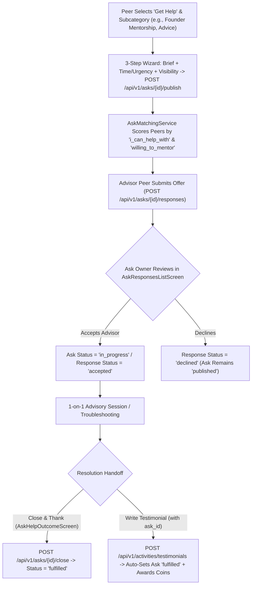

# Activity 06: Get Help Asks

| Attribute | Verified Specification |
|---|---|
| **Workbook Activity #** | `6.0` |
| **Exact Workbook Name** | `Get Help Asks` |
| **Domain Category** | `Asks & Opportunities` (Sheet 1 & 2) / `Asks & Marketplace` (Sheet 3) |
| **Activity Governance Tier** | `Leadership Oversight` (Peer-published via Unified Ask Engine `ask_flows.code = 'help'` + legacy `requirements`; Leadership monitors unresolved peer bottlenecks & facilitates mentor/advisor matching; Admin configures taxonomy & moderates asks) |
| **Overall Implementation Status** | `Partially Implemented` (End-to-end Member App creation wizard, 12 mentorship/advice subcategories, responder matching, response threads, and outcome feedback work; shares the Leader Dashboard `60%/25%/15%` synthetic count bug, `LeaderAskFlowService` global scope leak, and `/api/admin/asks` missing admin guard) |
| **Master Index & Cross-Links** | [12-master-35-activities-index.md](../12-master-35-activities-index.md) · [19-activity-to-role-access-matrix.md](../19-activity-to-role-access-matrix.md) · [25-activity-workflow-reference.md](../25-activity-workflow-reference.md) · [13-activity-input-forms-and-validation.md](../13-activity-input-forms-and-validation.md) · [05-collaboration-asks.md](./05-collaboration-asks.md) · [07-referral-asks.md](./07-referral-asks.md) |

---

## 1. Business Purpose (§9.1)

- **Why It Exists & Business Outcome:**
  - **WORKBOOK REQUIREMENT:** Allows peers to seek tactical advice, founder/industry mentorship, operational troubleshooting, or quick peer reviews from experienced members, receive structured advisor responses, accept a solution, and rate the help outcome.
  - **FACT:** Implemented on the **Unified Ask Discovery Engine** ([routes/ask.php](file:///c:/Users/malic/OneDrive/Documents/GitHub/unity-app-new/routes/ask.php)) under `ask_flows.code = 'help'` with **12 seeded `ask_types`**: `founder_mentorship`, `advice`, `industry_mentorship`, `mentorship`, `small_task`, `expert_guidance`, `introduction`, `accountability`, `capital_support`, `emotional_peer_support`, `review_feedback`, and `other` (alongside legacy `App\Models\Requirement` → `requirements` table). Closing a Get Help Ask via `TestimonialController@store` (`ask_id`) or `AskController@closeWithFeedback` marks `asks.status = 'fulfilled'` and rewards peer reciprocity.
- **Role Partitioning (Member vs Leadership vs Admin):**
  - **Peer Member (`FACT`):** Publishes Get Help Asks via the 3-step wizard (`flow = 'help'`), specifies time commitment (`15 min`, `1 hour`, `Half a day`, `Ongoing`) and urgency (`Today`, `This week`, `This month`, `No rush`), replies to peers' Help Asks via [ask_help_response_screen.dart](file:///D:/office%20project/peers-unity/unity_app/lib/features/asks/presentation/screens/ask_help_response_screen.dart), manages responses in [ask_responses_list_screen.dart](file:///D:/office%20project/peers-unity/unity_app/lib/features/asks/presentation/screens/ask_responses_list_screen.dart), and closes with outcome feedback in [ask_help_outcome_screen.dart](file:///D:/office%20project/peers-unity/unity_app/lib/features/asks/presentation/screens/ask_help_outcome_screen.dart).
  - **Circle / Regional Leadership (`FACT`):** Inspects open Get Help Asks in [peer_help_screen.dart](file:///D:/office%20project/LeaderApp-Fornt-end-/lib/features/peer_profile/view/peer_help_screen.dart), [peer_help_detail_screen.dart](file:///D:/office%20project/LeaderApp-Fornt-end-/lib/features/peer_profile/view/peer_help_detail_screen.dart), [requirements_view.dart](file:///D:/office%20project/LeaderApp-Fornt-end-/lib/features/requirements/view/requirements_view.dart), and [leader_activities_view.dart](file:///D:/office%20project/LeaderApp-Fornt-end-/lib/features/leader_activities/view/leader_activities_view.dart) (`help-asks`) so Circle Directors and Chairs can connect struggling peers with domain mentors. DEDs inspect district requirements via `GET /api/v1/ded/activities/requirements`.
  - **Super Admin / Web Admin (`FACT`):** Manages `help` subcategories and dynamic question options in `AskFlowConfigPage.tsx`, audits/moderates Help Asks in `AsksPage.tsx` and `/admin/activities/requirements`, and exports CSV reports.

---

## 2. Sub-Activities Catalogue (§9.2)

| # | Sub-Activity / Operation | Member App (`unity_app`) | Leadership App (`LeaderApp`) | Admin Web (`unity-admin-web` & Blade) | Backend (`unity-app-new`) | Classification |
|---|---|---|---|---|---|---|
| 2.1 | **Select Help Category (`ask_types` where `flow='help'`)** | Wired ([ask_types_screen.dart](file:///D:/office%20project/peers-unity/unity_app/lib/features/asks/presentation/screens/ask_types_screen.dart) → `GET /api/asks/flows/help/types`) | `GET /api/v1/leader/asks/flows/help` | Configurable in `AskFlowConfigPage.tsx` | `AskConfigController@getTypes` | `Fully Implemented` |
| 2.2 | **Create & Publish Get Help Ask (Brief + Time/Urgency Filters + Visibility)** | Wired (`ask_step1_brief_screen.dart`, `ask_step2_filters_screen.dart`, `ask_step3_preview_screen.dart`; plus legacy `highlights/presentation/screens/post_ask_screen.dart`) | Read-only in Leader App | Not applicable | `AskController@storeDraft`, `@saveDetails`, `@saveFilters`, `@setVisibility`, `@publish` (+ legacy `ActivitiesRequirementController@store`) | `Fully Implemented` |
| 2.3 | **Match Advisors / Mentors (`ask_matches`)** | Wired ([ask_matches_screen.dart](file:///D:/office%20project/peers-unity/unity_app/lib/features/asks/presentation/screens/ask_matches_screen.dart)) | Not surfaced in Leader UI | Stats only | `AskMatchingService` (scores `i_can_help_with`, `willing_to_mentor`, `skills`, `industry_tags`) | `Fully Implemented` |
| 2.4 | **Offer Help / Submit Advisor Response** | Wired ([ask_help_response_screen.dart](file:///D:/office%20project/peers-unity/unity_app/lib/features/asks/presentation/screens/ask_help_response_screen.dart) → `POST /api/v1/asks/{ask}/responses`) | Backend `/leader/ask-flows/{id}/interest` exists; not wired in `PeerHelpDetailScreen` | Read-only | `AskResponseController@store` (`AskResponseService`) | `Fully Implemented` (Member App) |
| 2.5 | **Review Responses & Accept / Decline Advisor** | Wired ([ask_responses_list_screen.dart](file:///D:/office%20project/peers-unity/unity_app/lib/features/asks/presentation/screens/ask_responses_list_screen.dart) → `PATCH /api/v1/asks/{ask}/responses/{response}`) | Read-only | Read-only | `AskResponseController@update`, `AskFlowHubController@updateResponseStatus` | `Fully Implemented` |
| 2.6 | **Close Help Ask with Outcome Rating / Testimonial Handoff** | Wired ([ask_help_outcome_screen.dart](file:///D:/office%20project/peers-unity/unity_app/lib/features/asks/presentation/screens/ask_help_outcome_screen.dart) — workbook calls this `HelpOutcomeFormDialog`; plus `POST /activities/testimonials` with `ask_id`) | Read-only | Admin `PATCH /api/admin/asks/{ask}/status` | `AskController@closeWithFeedback`, `AskFeedController@closeAndThank`, `TestimonialController@store` | `Fully Implemented` |
| 2.7 | **View Help Asks Hub, Peer Help List & Leader/DED Feeds** | Wired (`peers_asks_hub_screen.dart`, `my_asks_screen.dart`) | Wired ([peer_help_screen.dart](file:///D:/office%20project/LeaderApp-Fornt-end-/lib/features/peer_profile/view/peer_help_screen.dart), [requirements_view.dart](file:///D:/office%20project/LeaderApp-Fornt-end-/lib/features/requirements/view/requirements_view.dart), `leader_activities_view.dart`) — **unscoped `LeaderAskFlowService` bug** | Wired (`AsksPage.tsx`, `/admin/activities/requirements`) | `AskFlowHubController`, `LeaderAskFlowService`, `LeaderActivitiesController@requirements`, `DedActivitiesController` | `Implemented but Incorrect` (Leader scope & Dashboard synthetic KPIs) |

---

## 3. Input Form & Field Validation Mapping (§9.3)

**FACT:** Verified against Workbook Row 14/13, `CreateAskDraftRequest`, `SaveAskDetailsRequest`, `SaveAskFiltersRequest`, `AskResponseController`, and Member App screens `ask_step1_brief_screen.dart`, `ask_help_response_screen.dart`, and `ask_help_outcome_screen.dart`.

| Field Name | Data Type | Required / Optional | Validation (Backend + Client) | Default | Input Widget | Data Source | Visibility | Who Enters | Who Edits | Who Views | Sensitive? | Backend Request Key |
|---|---|---|---|---|---|---|---|---|---|---|---|---|
| **Ask Flow** | `string` / `UUID` | Required | **Backend:** `flow` = `'help'` (`required_without:flow_id`). | `'help'` | Flow card (`ask_flow_selection_screen.dart`) | `ask_flows` | Public on card | Peer Member | Immutable | Audience in scope | No | `flow` / `flow_id` |
| **Advice / Help Category (`type`)** | `string` / `UUID` | Required | **Backend:** `type` / `type_id` required (12 help codes: `founder_mentorship`, `advice`, `expert_guidance`, `small_task`, etc.). | `null` | Subcategory grid (`ask_types_screen.dart`) | `GET /api/asks/flows/help/types` | Public on card | Peer Member | Ask Owner | Audience in scope | No | `type` / `type_id` |
| **Help Title** | `string (max:255)` | Required on Publish | **Backend:** `nullable\|string\|max:255` on draft; required on `publish()`. | `null` | `TextField` (`"What do you need?"`) | User input | Visible within `visibility_type` | Peer Member | Ask Owner | Audience in `visibility_type`, Leaders, Admin | No | `title` |
| **Problem Description & Expected Definition of Done** | `array` (`ask_answers`) | Required (`min:1`) | **Backend (`SaveAskDetailsRequest`):** `answers` `required\|array\|min:1`, `field_key` `required\|string\|max:100`, `value_text` `nullable\|string`. | `[]` | Multiline `TextField`s (`"How you will know it is finished"`, problem context) | Dynamic `form-config` | Visible on Ask Detail | Peer Member | Ask Owner | Audience in `visibility_type`, Leaders, Admin | Potentially (`capital_support` / `emotional_peer_support` context) | `answers[].{field_key, value_text}` |
| **Time Needed / Consultation Mode** | `string` (`ask_answers` / `filters`) | Optional | **Backend:** Dynamic option answer (`15 min`, `1 hour`, `Half a day`, `Ongoing`; call / in-person / async review). | `'15 min'` | Single-select chips (`ask_step1_brief_screen.dart`) | `ask_options` | Visible on Ask card | Peer Member | Ask Owner | Audience in scope, Leaders, Admin | No | `answers[]` (`time_commitment` / `consultation_mode`) |
| **Urgency** | `string` | Optional | **Backend (`SaveAskFiltersRequest`):** `timeline` `nullable`. | `'This week'` | Single-select chips (`Today`, `This week`, `This month`, `No rush`) | `ask_options` | Visible on Ask card | Peer Member | Ask Owner | Audience in scope, Leaders, Admin | No | `timeline` |
| **Target Domain / Geography Filters** | `json` | Optional | **Backend:** `industry`, `geography` `nullable`. | Any | Multi-select chips (`ask_step2_filters_screen.dart`) | `ask_options` | Used by `AskMatchingService` | Peer Member | Ask Owner | Audience in scope | No | `industry`, `geography` |
| **Visibility Scope & Timeline Toggle** | `enum` + `bool` | Optional | **Backend:** `visibility_type` ∈ `all_peers`, `district`, `circle`; `publish_to_timeline` `boolean`. | `'all_peers'`, `true` | Scope picker & toggle (`ask_step3_preview_screen.dart`) | User circles / district | Controls feed visibility | Peer Member | Ask Owner | Selected scope + Admin | No | `visibility_type`, `circle_id`, `district_id`, `publish_to_timeline` |
| **Advisor Response (`response_type`, `message`)** | `enum` + `text` | Required on Reply | **Backend:** `response_type` ∈ `can_help_directly`, `can_introduce_peer`, `know_someone`, `not_relevant`; `message` required string. | `'can_help_directly'` | [ask_help_response_screen.dart](file:///D:/office%20project/peers-unity/unity_app/lib/features/asks/presentation/screens/ask_help_response_screen.dart) | Responder input | Private to Ask Owner, Responder & Admin | Advisor / Responder Peer | Responder / Owner | Ask Owner, Responder, Admin | Potentially | `response_type`, `message`, `introduced_peer_id` |
| **Help Outcome & Rating** | `string` + `text` (+ optional Testimonial `rating` 1–5) | Required on Close | **Backend (`AskController@closeWithFeedback`):** `outcome_status`, `outcome_notes` (`metadata` stores feedback/rating; or `TestimonialController@store` with `ask_id` + `rating` 1–5). *(Standalone `help_outcome_rating` column on `asks` is absent; stored in `metadata`/`outcome_notes` — `Requires Confirmation`.)* | `null` | [ask_help_outcome_screen.dart](file:///D:/office%20project/peers-unity/unity_app/lib/features/asks/presentation/screens/ask_help_outcome_screen.dart) | Ask Owner input | Summary on closed Ask | Ask Owner | Ask Owner | Ask Owner, Advisor, Leaders, Admin | No | `outcome_status`, `outcome_notes`, `metadata` |

---

## 4. Workflow, Lifecycle & Mermaid Diagram (§9.4)

### Workbook vs Actual Lifecycle Comparison
- **WORKBOOK REQUIREMENT:** `Posted -> Advisor Replied -> Solution Accepted -> Outcome Rated`.
- **FACT:** Mapped onto the Unified Ask Engine state machine:
  - `asks.status`: `draft` → `published` (*Posted*) → `in_progress` (*Advisor Accepted*) → `fulfilled` (*Solution Accepted / Outcome Rated / Testimonial Given*) | `closed` | `cancelled` | `expired`.
  - Legacy `requirements.status` (`App\Models\Requirement`): `open` → `in_progress` → `closed`.

---

## 5. Outputs & Deliverables (§9.5)

| Output / Deliverable | Status & Evidence (`FACT` vs `WORKBOOK REQUIREMENT`) |
|---|---|
| **Help Request Card & Ask Feed** | **FACT (`Fully Implemented`):** Displayed in `peers_asks_hub_screen.dart`, `my_asks_screen.dart`, and optionally Home Timeline (`posts.source_type = 'ask'`). |
| **Mentor / Advisor Match List** | **FACT (`Fully Implemented`):** `AskMatchingService` populates `ask_matches` using profile capability tags (`i_can_help_with`, `skills`, `willing_to_mentor`). |
| **Response Thread & Outcome Closure Screen** | **FACT (`Fully Implemented`):** `ask_responses_list_screen.dart` and `ask_help_outcome_screen.dart` (+ `close-and-thank` celebration). |
| **Leadership Oversight Views** | **FACT (`Partially Implemented`):** Leader App `peer_help_screen.dart`, `peer_help_detail_screen.dart`, `requirements_view.dart`, and `leader_activities_view.dart` (`help-asks`). |
| **Notifications** | **FACT (`Fully Implemented`):** Push & in-app alerts sent to matched peers, Ask owner on new response, and responder on acceptance/thank-you. |

---

## 6. Database & Metrics Mapping (§9.6)

### Primary Tables & Eloquent Models
- **Unified Engine:** `asks` (`flow.code = 'help'`), `ask_flows`, `ask_types` (12 help codes), `ask_answers`, `ask_matches`, `ask_responses`, `ask_status_histories`, `ask_response_status_histories`, `ask_timeline_links` (`app/Models/Ask/*`).
- **Legacy Table:** `requirements` ([Requirement.php](file:///c:/Users/malic/OneDrive/Documents/GitHub/unity-app-new/app/Models/Requirement.php), `SoftDeletes`: `id`, `user_id`, `subject`, `description`, `media`, `region_filter`, `category_filter`, `status` ∈ `open|in_progress|closed`, `is_deleted`, `deleted_at`) + `requirement_interests`.

### Workbook Sheet 3 Metric Keys vs Actual Backend Schema
| Workbook Metric Key (Sheet 1–3) | Actual Backend / API Computation (`FACT`) | Discrepancy / Bug Note |
|---|---|---|
| `getHelpAsksCount` | `COUNT(*)` on `asks` joined to `ask_flows.code = 'help'` (`AskFlowHubService`, `AskAdminController@stats`) | Leader Dashboard aggregates all Ask flows and applies fake `60%/25%/15%` status splits (`LeaderDashboardService.php:784-786`). |
| `helpResponsesReceived` | `COUNT(*)` on `ask_responses` for user's `help` asks | Tracked accurately in `ask_responses`. |
| `helpOutcomeRating` | Stored in `asks.outcome_status` / `asks.outcome_notes` / `asks.metadata` (or linked `testimonials.rating`) | No dedicated numeric `help_outcome_rating` column on `asks`; `Requires Business Confirmation` if numeric 1–5 star analytics are required on `asks` directly. |

---

## 7. API & Backend Service Mapping (§9.7)

| Layer | Method & Endpoint | Controller & Action | Service / FormRequest | Auth Middleware | Scope Enforcement & Security Audit (`FACT`) | Client Integration |
|---|---|---|---|---|---|---|
| **Member API** | `GET /api/v1/asks/help/global\|my\|user/{userId}\|leaderboard\|{id}`, `PATCH .../status` | `AskFlowHubController` | `AskFlowHubService` | `auth:sanctum` | Enforces `visibility_type` on global feed | Wired (`PeersAsksHubScreen`, `MyAsksScreen`) |
| **Member API** | `POST /api/v1/asks`, `PUT /api/v1/asks/{ask}[/filters\|/visibility]`, `POST .../publish\|close\|close-and-thank` | `AskController`, `AskFeedController` | `AskService`, `AskFeedService` | `auth:sanctum` | Mutations enforce owner check; `GET /api/v1/asks/{ask}` (`L227`) lacks `visibility_type` enforcement | Wired in Member App |
| **Member API** | `POST\|GET /api/v1/asks/{ask}/responses[/{response}]` | `AskResponseController` | `AskResponseService` | `auth:sanctum` | Enforces Ask owner / responder permissions | Wired (`AskHelpResponseScreen`, `AskResponsesListScreen`) |
| **Legacy API** | `GET\|POST /api/v1/activities/requirements`, `POST /api/v1/requirements/{id}/interest` | `ActivitiesRequirementController` | — | `auth:sanctum`, `unity.user` | Legacy requirements compatibility | Legacy support |
| **Leader API** | `GET /api/v1/leader/asks/help/global\|user/{userId}\|{id}`, `GET /api/v1/leader/activities/help-asks`, `GET /api/v1/leader/requirements`, `GET /api/v1/leader/members/{member_id}/requirements` | `AskFlowHubController`, `LeaderActivitiesController`, `LeaderMemberController` | `LeaderActivitiesService`, `LeaderMember360Service`, `LeaderAskFlowService` | `auth:sanctum`, `leader.user` | `LeaderMemberController` & `LeaderActivitiesService` scope to circle/district; **`LeaderAskFlowService` leaks all global asks**! | Wired (`PeerHelpScreen`, `RequirementsView`, `LeaderActivitiesView`) |
| **DED API** | `GET /api/v1/ded/activities/requirements` & `.../{id}` | `DedActivitiesController` | `DedApiService` | `auth:sanctum`, `ensure.ded.api` | Enforces DED district scope | Backend ready |
| **Admin API** | `GET /api/admin/asks?flow=help`, `PATCH /api/admin/asks/{ask}/status`, `DELETE /api/admin/asks/{ask}` | `AskAdminController`, `AskManagementController` | `AskService` | `auth:sanctum` (**CRITICAL P0 BUG:** missing `admin.auth` / `admin.role` middleware!) | Unprotected against regular member tokens! | Wired in `AsksPage.tsx` |

### Workbook Cloud Services vs Actual Laravel Services
- **WORKBOOK REQUIREMENT:** `MentorshipMatchEngine`, `ResponseThreadManager`.
- **FACT:** Implemented via `App\Services\Ask\AskMatchingService` (matching against `users.i_can_help_with`, `willing_to_mentor`, `skills`) and `App\Services\Ask\AskResponseService` (`ask_responses` + `ask_response_status_histories`).

---

## 8. Role-Wise Access Governance (§9.8)

| Role | View Activity | Create Record | Edit Own | Edit Others | Submit for Review | Verify | Approve | Reject | Assign | Manage | Delete | View Aggregated Reports |
|---|---|---|---|---|---|---|---|---|---|---|---|---|
| **Super Admin** | Allowed (Global) | Allowed (as `User`) | Allowed | Allowed (`PATCH /api/admin/asks/{ask}/status`) | Not Applicable | Not Applicable | Not Applicable | Allowed (Close/Deactivate abusive Ask) | Allowed (`assignOwner` & taxonomy config) | Allowed (`ask_types` / `ask_options` CRUD) | Allowed (`DELETE /api/admin/asks/{ask}`) | Allowed (Global Stats & CSV Export) |
| **Country Director** | Allowed (Scoped intended; Global Leak in `LeaderAskFlowService`) | Allowed (Member App) | Allowed | DENIED — No permission under the verified backend authorization model | Not Applicable | Not Applicable | Not Applicable | DENIED — No permission under the verified backend authorization model | Allowed (`assignOwner` — UI not wired) | DENIED — No permission under the verified backend authorization model | DENIED — No permission under the verified backend authorization model | Allowed (Scoped Reports) |
| **DED** | Allowed (District Scope on `/ded/activities/requirements`) | Allowed (Member App) | Allowed | DENIED — No permission under the verified backend authorization model | Not Applicable | Not Applicable | Not Applicable | DENIED — No permission under the verified backend authorization model | Allowed (`assignOwner` — UI not wired) | DENIED — No permission under the verified backend authorization model | DENIED — No permission under the verified backend authorization model | Allowed (District Reports) |
| **Industry Director** | Allowed (Assigned Industry Scope) | Allowed (Member App) | Allowed | DENIED — No permission under the verified backend authorization model | Not Applicable | Not Applicable | Not Applicable | DENIED — No permission under the verified backend authorization model | Allowed (`assignOwner` — UI not wired) | DENIED — No permission under the verified backend authorization model | DENIED — No permission under the verified backend authorization model | Allowed (Industry Reports) |
| **Circle Founder** | Allowed (Own Circle(s)) | Allowed (Member App) | Allowed | DENIED — No permission under the verified backend authorization model | Not Applicable | Not Applicable | Not Applicable | DENIED — No permission under the verified backend authorization model | Allowed (`assignOwner` — UI not wired) | DENIED — No permission under the verified backend authorization model | DENIED — No permission under the verified backend authorization model | Allowed (Own Circle Reports) |
| **Circle Director** | Allowed (Own Circle(s)) | Allowed (Member App) | Allowed | DENIED — No permission under the verified backend authorization model | Not Applicable | Not Applicable | Not Applicable | DENIED — No permission under the verified backend authorization model | Allowed (`assignOwner` — UI not wired) | DENIED — No permission under the verified backend authorization model | DENIED — No permission under the verified backend authorization model | Allowed (Own Circle Reports) |
| **Chair / Committee Chairs** | Allowed (Own Circle) | Allowed (Member App) | Allowed | DENIED — No permission under the verified backend authorization model | Not Applicable | Not Applicable | Not Applicable | DENIED — No permission under the verified backend authorization model | Allowed (`assignOwner` — UI not wired) | DENIED — No permission under the verified backend authorization model | DENIED — No permission under the verified backend authorization model | Allowed (Own Circle Dashboard & Weekly Report) |
| **Vice Chair** | Allowed (Own Circle) | Allowed (Member App) | Allowed | DENIED — No permission under the verified backend authorization model | Not Applicable | Not Applicable | Not Applicable | DENIED — No permission under the verified backend authorization model | DENIED — Read-only | DENIED — No permission under the verified backend authorization model | DENIED — No permission under the verified backend authorization model | Allowed (Own Circle Read-Only Reports) |
| **Secretary** | Allowed (Own Circle) | Allowed (Member App) | Allowed | DENIED — No permission under the verified backend authorization model | Not Applicable | Not Applicable | Not Applicable | DENIED — No permission under the verified backend authorization model | DENIED — Read-only | DENIED — No permission under the verified backend authorization model | DENIED — No permission under the verified backend authorization model | Allowed (Own Circle Read-Only Reports) |
| **Committee Leader** | Allowed in Web RBAC; **BROKEN (`403`)** in Leader App | Allowed (Member App) | Allowed | DENIED — No permission under the verified backend authorization model | Not Applicable | Not Applicable | Not Applicable | DENIED — No permission under the verified backend authorization model | DENIED — No permission under the verified backend authorization model | DENIED — No permission under the verified backend authorization model | DENIED — No permission under the verified backend authorization model | DENIED in Leader App (`403`) |
| **Peer Member** | Allowed (Asks in `visibility_type` + Own Asks) | Allowed (`POST /api/v1/asks` & responses) | Allowed (Own Ask) | DENIED — No permission under the verified backend authorization model *(P0 BUG: `/api/admin/asks` unguarded!)* | Not Applicable | Not Applicable | Allowed **only** on advisor responses to own Help Ask | Allowed **only** on advisor responses to own Help Ask | DENIED — No permission under the verified backend authorization model | DENIED — No permission under the verified backend authorization model | Allowed **only** to cancel own Ask | DENIED — Leaderboard & personal stats only |

---

## 9. Existing Implementation Summary, Gaps & Minimum-Change Enhancement Recommendations

### Summary of Verified Limitations & Bugs
1. **Shared Ask Engine Security & KPI Defects:** Inherits the unprotected `/api/admin/asks` routes (`routes/ask.php:152-184`), unscoped `LeaderAskFlowService`, unguarded `visibility_type` on `AskController@show`, and `60% / 25% / 15%` synthetic Dashboard Ask counts (`LeaderDashboardService.php:784-786`).
2. **Dual Legacy `requirements` vs Unified `asks` Fragmentation:** Leader App has both `RequirementsView` (reading legacy `requirements`) and `PeerHelpScreen` / `LeaderActivitiesView('help-asks')` (reading `asks` where `flow='help'`), which can confuse leaders if legacy vs new asks are shown in separate places.
3. **Unstructured Outcome Rating:** `asks` stores outcome notes/status textually without a dedicated integer `outcome_rating` (`1..5`) column on `asks` or `ask_responses`.

### Minimum-Change Enhancement Recommendations
- **RECOMMENDATION 1 (Apply Unified Ask Security & KPI Fixes):** Guard `/api/admin/asks*` with admin middleware, scope `LeaderAskFlowService` by `$user`, enforce `visibility_type` in `AskController@show`, and replace synthetic Dashboard percentages with real `GROUP BY status` counts (shared fix with Activities 05 & 07).
- **RECOMMENDATION 2 (Unify Legacy `requirements` & `help` Feed in Leader App):** Ensure `LeaderActivitiesService` (`requirements` / `help-asks`) presents a unified or clearly labeled read view so Circle Directors see all open peer help needs in one place, with a 1-tap `"Connect with Mentor / Create P2P"` action on `PeerHelpDetailScreen`.
- **BUSINESS DECISION REQUIRED:** Confirm whether a numeric `1–5` advisor helpfulness rating column (`outcome_rating` smallint via a new migration on `ask_responses` or `asks`) should be added to power Mentor/Advisor leaderboards directly.
