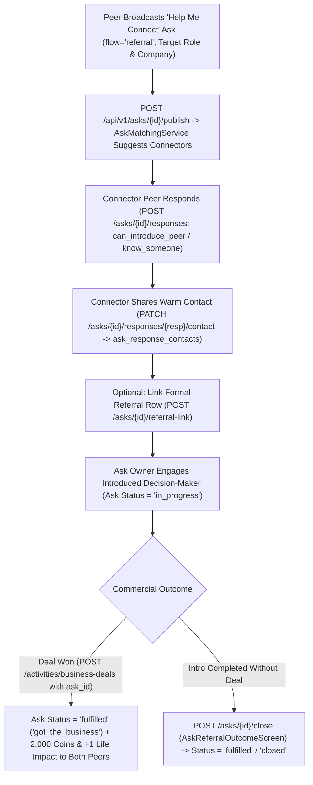

# Activity 07: Referral Asks (Help Me Connect)

| Attribute | Verified Specification |
|---|---|
| **Workbook Activity #** | `7.0` |
| **Exact Workbook Name** | `Referral Asks ("Help Me Connect")` |
| **Domain Category** | `Asks & Opportunities` (Sheet 1 & 2) / `Asks & Marketplace` (Sheet 3) |
| **Activity Governance Tier** | `Leadership Oversight` (Peer-broadcasted warm-introduction requests via Unified Ask Engine `ask_flows.code = 'referral'`; Leadership monitors & brokers introductions/deals; Admin configures taxonomy & moderates asks) |
| **Overall Implementation Status** | `Partially Implemented` (End-to-end Member App wizard, 12 target decision-maker subcategories, `AskResponseContact` warm-intro contact handoff, `linkReferral` & Business Deal `2,000`-coin conversion work; shares Leader Dashboard `60%/25%/15%` synthetic KPIs, `LeaderAskFlowService` global leak, `/api/admin/asks` missing admin guard, and `AskFlowHubService` feed conflation with Activity 03 `referrals`) |
| **Master Index & Cross-Links** | [12-master-35-activities-index.md](../12-master-35-activities-index.md) · [19-activity-to-role-access-matrix.md](../19-activity-to-role-access-matrix.md) · [25-activity-workflow-reference.md](../25-activity-workflow-reference.md) · [13-activity-input-forms-and-validation.md](../13-activity-input-forms-and-validation.md) · [03-normal-referrals.md](./03-normal-referrals.md) · [05-collaboration-asks.md](./05-collaboration-asks.md) |

---

## 1. Business Purpose (§9.1)

- **Why It Exists & Business Outcome:**
  - **WORKBOOK REQUIREMENT:** Whereas Activity 03 (*Normal Referrals*) pushes an outbound lead from Giver to Receiver, Activity 07 (*Referral Asks — "Help Me Connect"*) lets a peer **pull** warm introductions by broadcasting the specific enterprise decision-maker role, target company/sector, and商业 purpose they want to reach. Fellow peers who hold that relationship pass the warm contact (`ask_response_contacts` / linked `Referral`) and earn recognition + Coins upon conversion.
  - **FACT:** Implemented on the **Unified Ask Discovery Engine** ([routes/ask.php](file:///c:/Users/malic/OneDrive/Documents/GitHub/unity-app-new/routes/ask.php)) under `ask_flows.code = 'referral'` with **12 seeded `ask_types`**: `customer`, `client`, `dealer`, `distributor`, `buyer`, `supplier`, `strategic_partner`, `investor`, `international_contact`, `media_pr_contact`, `industry_expert`, and `other`. Uniquely among the 3 Ask flows, Referral Asks support structured **Contact Handoff** (`PATCH /api/v1/asks/{ask}/responses/{response}/contact` → `ask_response_contacts`), **Referral Linking** (`POST /api/v1/asks/{ask}/referral-link` → `AskController@linkReferral`), and **Deal Conversion** (`BusinessDealController@store` with `ask_id`, awarding **2,000 bonus Coins + 1 Life Impact** to both peers).
- **Role Partitioning (Member vs Leadership vs Admin):**
  - **Peer Member (`FACT`):** Publishes Referral Asks via the 3-step wizard (`flow = 'referral'`), reviews suggested peer connectors in [ask_matches_screen.dart](file:///D:/office%20project/peers-unity/unity_app/lib/features/asks/presentation/screens/ask_matches_screen.dart), passes warm contacts to peers' Referral Asks via [ask_referral_reason_screen.dart](file:///D:/office%20project/peers-unity/unity_app/lib/features/asks/presentation/screens/ask_referral_reason_screen.dart) & [ask_referral_contact_screen.dart](file:///D:/office%20project/peers-unity/unity_app/lib/features/asks/presentation/screens/ask_referral_contact_screen.dart), and closes fulfilled introductions via [ask_referral_outcome_screen.dart](file:///D:/office%20project/peers-unity/unity_app/lib/features/asks/presentation/screens/ask_referral_outcome_screen.dart).
  - **Circle / Regional Leadership (`FACT`):** Reviews peers' Referral Asks in [peer_referral_screen.dart](file:///D:/office%20project/LeaderApp-Fornt-end-/lib/features/peer_profile/view/peer_referral_screen.dart), [peer_referral_detail_screen.dart](file:///D:/office%20project/LeaderApp-Fornt-end-/lib/features/peer_profile/view/peer_referral_detail_screen.dart), and [leader_activities_view.dart](file:///D:/office%20project/LeaderApp-Fornt-end-/lib/features/leader_activities/view/leader_activities_view.dart) (`referral-asks`) so Business Growth Chairs and Circle Directors can broker introductions across circles. Backend also exposes `POST /api/v1/leader/ask-flows/{id}/convert-to-deal` (unwired in Leader UI).
  - **Super Admin / Web Admin (`FACT`):** Configures `referral` Ask types/options in `AskFlowConfigPage.tsx`, audits/moderates asks in `AsksPage.tsx`, and exports CSV reports.

---

## 2. Sub-Activities Catalogue (§9.2)

| # | Sub-Activity / Operation | Member App (`unity_app`) | Leadership App (`LeaderApp`) | Admin Web (`unity-admin-web` & Blade) | Backend (`unity-app-new`) | Classification |
|---|---|---|---|---|---|---|
| 2.1 | **Select Target Connection Type (`ask_types` where `flow='referral'`)** | Wired ([ask_types_screen.dart](file:///D:/office%20project/peers-unity/unity_app/lib/features/asks/presentation/screens/ask_types_screen.dart) → `GET /api/asks/flows/referral/types`) | `GET /api/v1/leader/asks/flows/referral` | Editable in `AskFlowConfigPage.tsx` | `AskConfigController@getTypes` | `Fully Implemented` |
| 2.2 | **Create & Broadcast Referral Ask (3-Step Wizard)** | Wired (`ask_step1_brief_screen.dart`, `ask_step2_filters_screen.dart`, `ask_step3_preview_screen.dart`) | Read-only | Not applicable | `AskController@storeDraft`, `@saveDetails`, `@saveFilters`, `@setVisibility`, `@publish` | `Fully Implemented` |
| 2.3 | **Match Network Connectors (`ask_matches`)** | Wired ([ask_matches_screen.dart](file:///D:/office%20project/peers-unity/unity_app/lib/features/asks/presentation/screens/ask_matches_screen.dart)) | Not surfaced in Leader UI | Stats only | `AskMatchingService` (scores industry, city, `business_keywords`, `target_business_categories`) | `Fully Implemented` |
| 2.4 | **Pass Warm Introduction & Contact Details** | Wired ([ask_referral_reason_screen.dart](file:///D:/office%20project/peers-unity/unity_app/lib/features/asks/presentation/screens/ask_referral_reason_screen.dart) & [ask_referral_contact_screen.dart](file:///D:/office%20project/peers-unity/unity_app/lib/features/asks/presentation/screens/ask_referral_contact_screen.dart) — workbook calls this `IntroPassSheet`) | Leader can pass a standard referral via `SendReferralBottomSheet`, not linked directly on `PeerReferralDetailScreen` | Read-only | `AskResponseController@store`, `AskResponseController@updateContact` (`ask_response_contacts`), `AskController@linkReferral` | `Fully Implemented` (Member App) |
| 2.5 | **Convert Referral Ask to Business Deal / Close Outcome** | Wired ([ask_referral_outcome_screen.dart](file:///D:/office%20project/peers-unity/unity_app/lib/features/asks/presentation/screens/ask_referral_outcome_screen.dart) & `POST /activities/business-deals` with `ask_id`) | Backend `POST /api/v1/leader/ask-flows/{id}/convert-to-deal` exists, **not wired** in Leader UI | Admin status update | `AskController@closeWithFeedback`, `BusinessDealController@store` (`L210-237`) | `Fully Implemented` (Member) / `Implemented but Not Integrated` (Leader convert button) |
| 2.6 | **View Referral Ask Feed, My Asks & Leader Oversight** | Wired (`peers_asks_hub_screen.dart`, `my_asks_screen.dart`) — note `AskFlowHubService::getGlobalFeed('referral')` merges `asks` (`flow='referral'`) with Activity 03 `referrals`! | Wired ([peer_referral_screen.dart](file:///D:/office%20project/LeaderApp-Fornt-end-/lib/features/peer_profile/view/peer_referral_screen.dart), [peer_referral_detail_screen.dart](file:///D:/office%20project/LeaderApp-Fornt-end-/lib/features/peer_profile/view/peer_referral_detail_screen.dart), `leader_activities_view.dart`) | Wired (`AsksPage.tsx`) | `AskFlowHubController`, `LeaderAskFlowService` (**unscoped**), `LeaderActivitiesService` | `Requires Enhancement` (Feed merges outbound `referrals` + inbound `asks`; Leader scope leak) |

---

## 3. Input Form & Field Validation Mapping (§9.3)

**FACT:** Verified against Workbook Row 15/14, `CreateAskDraftRequest`, `SaveAskDetailsRequest`, `SaveAskFiltersRequest`, `LinkReferralRequest`, `AskResponseController@updateContact`, and Member App screens `ask_referral_reason_screen.dart`, `ask_referral_contact_screen.dart`, and `ask_referral_outcome_screen.dart`.

| Field Name | Data Type | Required / Optional | Validation (Backend + Client) | Default | Input Widget | Data Source | Visibility | Who Enters | Who Edits | Who Views | Sensitive? | Backend Request Key |
|---|---|---|---|---|---|---|---|---|---|---|---|---|
| **Ask Flow** | `string` / `UUID` | Required | **Backend:** `flow` = `'referral'` (`required_without:flow_id`). | `'referral'` | Flow card (`ask_flow_selection_screen.dart`) | `ask_flows` | Public on card | Peer Member | Immutable | Audience in scope | No | `flow` / `flow_id` |
| **Target Connection Role / Type (`type`)** | `string` / `UUID` | Required | **Backend:** `type` / `type_id` required (12 referral ask codes: `customer`, `client`, `distributor`, `buyer`, `investor`, etc.). | `null` | Subcategory grid (`ask_types_screen.dart`) | `GET /api/asks/flows/referral/types` | Public on card | Peer Member | Ask Owner | Audience in scope | No | `type` / `type_id` |
| **Referral Ask Title** | `string (max:255)` | Required on Publish | **Backend:** `nullable\|string\|max:255` on draft; required on `publish()`. | `null` | `TextField` (`ask_step1_brief_screen.dart`) | User input | Visible within `visibility_type` | Peer Member | Ask Owner | Audience in `visibility_type`, Leaders, Admin | No | `title` |
| **Target Decision-Maker Role, Target Companies/Sectors & Purpose of Intro** | `array` (`ask_answers`) | Required (`min:1`) | **Backend (`SaveAskDetailsRequest`):** `answers` `required\|array\|min:1`, `field_key` `required\|string\|max:100`, `value_text` `nullable\|string`. | `[]` | Dynamic brief fields (`ask_step1_brief_screen.dart`) | `GET /api/asks/form-config?flow=referral&type=...` | Visible on Ask Detail | Peer Member | Ask Owner | Audience in `visibility_type`, Leaders, Admin | Commercial (target account names) | `answers[].{field_key, value_text, option_ids}` |
| **Target Industry, Geography & Timeline Filters** | `json` | Optional | **Backend (`SaveAskFiltersRequest`):** `industry`, `geography`, `business_stage`, `timeline` `nullable`. | Any | Multi-select chips (`ask_step2_filters_screen.dart`) | `ask_options` | Visible on Ask card & matching | Peer Member | Ask Owner | Audience in scope, Leaders, Admin | No | `industry`, `geography`, `business_stage`, `timeline` |
| **Visibility Scope & Timeline Toggle** | `enum` + `bool` | Optional | **Backend:** `visibility_type` ∈ `all_peers`, `district`, `circle`; `publish_to_timeline` `boolean`. | `'all_peers'`, `true` | Scope picker & toggle (`ask_step3_preview_screen.dart`) | User circles / district | Controls feed audience | Peer Member | Ask Owner | Selected scope + Admin | No | `visibility_type`, `circle_id`, `district_id`, `publish_to_timeline` |
| **Introducer Relationship / Reason** | `enum` + `text` | Required on Response | **Backend (`AskResponseController@store`):** `response_type` ∈ `can_help_directly`, `can_introduce_peer`, `know_someone`, `not_relevant`; `message` string; optional `introduced_peer_id`. | `'know_someone'` | [ask_referral_reason_screen.dart](file:///D:/office%20project/peers-unity/unity_app/lib/features/asks/presentation/screens/ask_referral_reason_screen.dart) | Introducer Peer input | Private to Ask Owner, Introducer & Admin | Introducer Peer | Introducer / Owner | Ask Owner, Introducer, Admin | No | `response_type`, `message`, `introduced_peer_id` |
| **Warm Intro Contact Details (`ask_response_contacts`)** | `object` (`name`, `phone`, `email`, `company`, `designation`, `notes`) | Required when passing external contact | **Backend (`AskResponseController@updateContact`):** Contact fields persisted in `ask_response_contacts` (`PATCH /api/v1/asks/{ask}/responses/{response}/contact`). | `null` | [ask_referral_contact_screen.dart](file:///D:/office%20project/peers-unity/unity_app/lib/features/asks/presentation/screens/ask_referral_contact_screen.dart) + phonebook picker | Introducer input / Contacts | **Strictly Private** to Ask Owner, Introducer & Admin | Introducer Peer | Introducer Peer | Ask Owner, Introducer, Admin | **Yes** (3rd-party Decision-Maker PII) | `contact_name`, `contact_phone`, `contact_email`, `company_name`, `designation`, `notes` |
| **Linked Outbound Referral ID** | `UUID` | Optional | **Backend (`LinkReferralRequest`):** `referral_id` `required\|uuid\|exists:referrals,id` (`POST /api/v1/asks/{ask}/referral-link`). | `null` | Contextual link | `referrals.id` | Internal link | Introducer / Owner | Immutable | Owner, Introducer, Admin | No | `referral_id` |
| **Outcome & Approx Deal Value (₹)** | `string`, `decimal(15,2)`, `text` | Required on Close | **Backend:** `outcome_status`, `approx_deal_value` (`nullable\|numeric\|min:0`), `outcome_notes`. | `null` | [ask_referral_outcome_screen.dart](file:///D:/office%20project/peers-unity/unity_app/lib/features/asks/presentation/screens/ask_referral_outcome_screen.dart) | Ask Owner input | Summary on closed Ask | Ask Owner | Ask Owner / Admin | Owner, Introducer, Leaders, Admin | Commercial (`₹` value) | `outcome_status`, `approx_deal_value`, `outcome_notes` |

---

## 4. Workflow, Lifecycle & Mermaid Diagram (§9.4)

### Workbook vs Actual Lifecycle Comparison
- **WORKBOOK REQUIREMENT:** `Broadcasted -> Introducer Connected -> Intro Delivered -> Verified`.
- **FACT:** Implemented via `asks.status` (`draft` → `published` [*Broadcasted*] → `in_progress` [*Introducer Connected*] → `fulfilled` [*Intro Delivered & Verified / Deal Closed*] | `closed` | `cancelled` | `expired`) paired with `ask_responses.status` (`pending` → `accepted` → `in_progress` → `completed`) and `ask_response_contacts` (warm contact record). When the Ask owner logs a `BusinessDeal` referencing `ask_id`, `BusinessDealController@store` (`L210-237`) automatically transitions `asks.status = 'fulfilled'`, sets `outcome_status = 'got_the_business'`, records `approx_deal_value`, and awards **2,000 Coins + 1 Life Impact** to both peers.

---

## 5. Outputs & Deliverables (§9.5)

| Output / Deliverable | Status & Evidence (`FACT` vs `WORKBOOK REQUIREMENT`) |
|---|---|
| **Referral Ask Broadcast Card** | **FACT (`Fully Implemented`):** Rendered in `peers_asks_hub_screen.dart` and Home Timeline (`ask_timeline_links`). |
| **Warm Contact Pass Card (`ask_response_contacts`)** | **FACT (`Fully Implemented`):** Private contact handoff card created via `ask_referral_contact_screen.dart` without exposing decision-maker PII on public feeds. |
| **Outcome Closure & Deal Conversion Bonus** | **FACT (`Fully Implemented`):** `ask_referral_outcome_screen.dart` + automatic `BusinessDeal` linkage minting `2,000` bonus Coins and `+1` Life Impact. |
| **Leadership Oversight Views** | **FACT (`Partially Implemented`):** `peer_referral_screen.dart`, `peer_referral_detail_screen.dart`, and `leader_activities_view.dart` (`referral-asks`). |

---

## 6. Database & Metrics Mapping (§9.6)

### Primary Tables & Eloquent Models
- `asks` (`flow.code = 'referral'`), `ask_types` (12 referral target codes), `ask_answers`, `ask_matches`, `ask_responses`, `ask_response_contacts` (`AskResponseContact` — stores decision-maker contact details privately per response), `ask_status_histories`, `ask_response_status_histories`, `ask_timeline_links`.

### Workbook Sheet 3 Metric Keys vs Actual Backend Schema
| Workbook Metric Key (Sheet 1–3) | Actual Backend / API Computation (`FACT`) | Discrepancy / Bug Note |
|---|---|---|
| `referralAsksCount` | `COUNT(*)` on `asks` joined to `ask_flows.code = 'referral'` | **Conflation Quirk:** `AskFlowHubService::getGlobalFeed('referral')` merges inbound `asks` (`flow='referral'`) with outbound `referrals` (Activity 03), inflating combined feed counts if not separated by item type; Leader Dashboard uses fake `60%/25%/15%` splits (`LeaderDashboardService.php:784-786`). |
| `introsReceivedCount` | `COUNT(*)` on `ask_responses` (and `ask_response_contacts`) for user's `referral` asks | Tracked in `ask_responses` / `ask_response_contacts`. |
| `askConversionRate` | Derived ratio `COUNT(status = 'fulfilled') / COUNT(published referral asks)` in `AskAdminController@stats` | Computed dynamically in Admin stats; not persisted as a static column. |

---

## 7. API & Backend Service Mapping (§9.7)

| Layer | Method & Endpoint | Controller & Action | Service / FormRequest | Auth Middleware | Scope Enforcement & Security Audit (`FACT`) | Client Integration |
|---|---|---|---|---|---|---|
| **Member API** | `GET /api/v1/asks/referral/global\|my\|user/{userId}\|leaderboard\|{id}` | `AskFlowHubController` | `AskFlowHubService` | `auth:sanctum` | Merges `asks` (`referral`) + `referrals` on global feed | Wired (`PeersAsksHubScreen`) |
| **Member API** | `POST /api/v1/asks`, `PUT /api/v1/asks/{ask}*`, `POST .../publish\|close\|referral-link` | `AskController` | `AskService`, `LinkReferralRequest` | `auth:sanctum` | Owner-checked on writes; `GET /asks/{ask}` lacks `visibility_type` check | Wired |
| **Member API** | `POST\|GET /api/v1/asks/{ask}/responses`, `PATCH .../{response}/contact` | `AskResponseController` | `AskResponseService` | `auth:sanctum` | Restricts `ask_response_contacts` PII to Ask owner & responder | Wired (`AskReferralContactScreen`) |
| **Leader API** | `GET /api/v1/leader/asks/referral/*`, `GET /api/v1/leader/activities/referral-asks`, `POST /api/v1/leader/ask-flows/{id}/convert-to-deal` | `AskFlowHubController`, `LeaderActivitiesController`, `LeaderAskFlowController` | `LeaderActivitiesService`, `LeaderAskFlowService` | `auth:sanctum`, `leader.user` | `LeaderActivitiesService` scopes to circle/district; **`LeaderAskFlowService` leaks all global asks**! | Read views wired (`PeerReferralScreen`); `convert-to-deal` **unwired** |
| **Admin API** | `GET /api/admin/asks?flow=referral`, `PATCH /api/admin/asks/{ask}/status`, `DELETE /api/admin/asks/{ask}` | `AskAdminController`, `AskManagementController` | `AskService` | `auth:sanctum` (**CRITICAL P0 BUG:** missing `admin.auth` / `admin.role` middleware!) | Unprotected against regular member tokens! | Wired in `AsksPage.tsx` |

### Workbook Cloud Services vs Actual Laravel Services
- **WORKBOOK REQUIREMENT:** `ConnectionGraphMatcher`, `WarmIntroRoutingService`.
- **FACT:** Implemented via `App\Services\Ask\AskMatchingService`, `App\Services\Ask\AskResponseService` (`ask_response_contacts`), and `AskController@linkReferral`.

---

## 8. Role-Wise Access Governance (§9.8)

| Role | View Activity | Create Record | Edit Own | Edit Others | Submit for Review | Verify | Approve | Reject | Assign | Manage | Delete | View Aggregated Reports |
|---|---|---|---|---|---|---|---|---|---|---|---|---|
| **Super Admin** | Allowed (Global) | Allowed (as `User`) | Allowed | Allowed (`PATCH /api/admin/asks/{ask}/status`) | Not Applicable | Not Applicable | Not Applicable | Allowed (Close/Deactivate abusive Ask) | Allowed (`assignOwner` & taxonomy config) | Allowed (`ask_types` / `ask_options` CRUD) | Allowed (`DELETE /api/admin/asks/{ask}`) | Allowed (Global Stats & CSV Export) |
| **Country Director** | Allowed (Scoped Ask summaries; **Privacy Rule:** `ask_response_contacts` 3rd-party PII should remain restricted unless escalated) | Allowed (Member App) | Allowed | DENIED — No permission under the verified backend authorization model | Not Applicable | Not Applicable | Not Applicable | DENIED — No permission under the verified backend authorization model | Allowed (`assignOwner` — UI not wired) | DENIED — No permission under the verified backend authorization model | DENIED — No permission under the verified backend authorization model | Allowed (Scoped Reports) |
| **DED** | Allowed (District Scope) | Allowed (Member App) | Allowed | DENIED — No permission under the verified backend authorization model | Not Applicable | Not Applicable | Not Applicable | DENIED — No permission under the verified backend authorization model | Allowed (`assignOwner` — UI not wired) | DENIED — No permission under the verified backend authorization model | DENIED — No permission under the verified backend authorization model | Allowed (District Reports) |
| **Industry Director** | Allowed (Assigned Industry Scope) | Allowed (Member App) | Allowed | DENIED — No permission under the verified backend authorization model | Not Applicable | Not Applicable | Not Applicable | DENIED — No permission under the verified backend authorization model | Allowed (`assignOwner` — UI not wired) | DENIED — No permission under the verified backend authorization model | DENIED — No permission under the verified backend authorization model | Allowed (Industry Scope) |
| **Circle Founder** | Allowed (Own Circle(s)) | Allowed (Member App) | Allowed | DENIED — No permission under the verified backend authorization model | Not Applicable | Not Applicable | Not Applicable | DENIED — No permission under the verified backend authorization model | Allowed (`assignOwner` — UI not wired) | DENIED — No permission under the verified backend authorization model | DENIED — No permission under the verified backend authorization model | Allowed (Own Circle Reports) |
| **Circle Director** | Allowed (Own Circle(s)) | Allowed (Member App) | Allowed | DENIED — No permission under the verified backend authorization model | Not Applicable | Not Applicable | Not Applicable | DENIED — No permission under the verified backend authorization model | Allowed (`assignOwner` — UI not wired) | DENIED — No permission under the verified backend authorization model | DENIED — No permission under the verified backend authorization model | Allowed (Own Circle Reports) |
| **Chair / Committee Chairs** | Allowed (Own Circle — Business Growth Chair brokers intros) | Allowed (Member App) | Allowed | DENIED — No permission under the verified backend authorization model | Not Applicable | Not Applicable | Not Applicable | DENIED — No permission under the verified backend authorization model | Allowed (`assignOwner` — UI not wired) | DENIED — No permission under the verified backend authorization model | DENIED — No permission under the verified backend authorization model | Allowed (Own Circle Dashboard & Weekly Report) |
| **Vice Chair** | Allowed (Own Circle) | Allowed (Member App) | Allowed | DENIED — No permission under the verified backend authorization model | Not Applicable | Not Applicable | Not Applicable | DENIED — No permission under the verified backend authorization model | DENIED — Read-only | DENIED — No permission under the verified backend authorization model | DENIED — No permission under the verified backend authorization model | Allowed (Own Circle Read-Only Reports) |
| **Secretary** | Allowed (Own Circle) | Allowed (Member App) | Allowed | DENIED — No permission under the verified backend authorization model | Not Applicable | Not Applicable | Not Applicable | DENIED — No permission under the verified backend authorization model | DENIED — Read-only | DENIED — No permission under the verified backend authorization model | DENIED — No permission under the verified backend authorization model | Allowed (Own Circle Read-Only Reports) |
| **Committee Leader** | Allowed in Web RBAC; **BROKEN (`403`)** in Leader App | Allowed (Member App) | Allowed | DENIED — No permission under the verified backend authorization model | Not Applicable | Not Applicable | Not Applicable | DENIED — No permission under the verified backend authorization model | DENIED — No permission under the verified backend authorization model | DENIED — No permission under the verified backend authorization model | DENIED — No permission under the verified backend authorization model | DENIED in Leader App (`403`) |
| **Peer Member** | Allowed (Asks in `visibility_type` + Own Asks) | Allowed (`POST /api/v1/asks` & warm-intro responses) | Allowed (Own Ask & own `ask_response_contacts`) | DENIED — No permission under the verified backend authorization model *(P0 BUG: `/api/admin/asks` unguarded!)* | Not Applicable | Allowed **only** as Ask Owner confirming intro/deal fulfillment | Allowed **only** on responses to own Ask | Allowed **only** on responses to own Ask | DENIED — No permission under the verified backend authorization model | DENIED — No permission under the verified backend authorization model | Allowed **only** to cancel own Ask | DENIED — Leaderboard & personal stats only |

---

## 9. Existing Implementation Summary, Gaps & Minimum-Change Enhancement Recommendations

### Summary of Verified Limitations & Bugs
1. **Shared Ask Engine Security & KPI Bugs:** Unprotected `/api/admin/asks*` (`routes/ask.php:152-184`), unscoped `LeaderAskFlowService`, unguarded `visibility_type` on `AskController@show`, and `60% / 25% / 15%` synthetic Dashboard Ask counts (`LeaderDashboardService.php:784-786`).
2. **Inbound Ask vs Outbound Referral Feed Conflation:** `AskFlowHubService::getGlobalFeed('referral')` merges `asks` (`flow='referral'`) with Activity 03 `referrals` rows, mixing inbound `"Help Me Connect"` requests with already-passed outbound leads.
3. **Unwired Leader Brokerage Actions:** `PeerReferralDetailScreen` in the Leadership App lacks a `"Send Referral / Broker Intro"` CTA linking directly to `SendReferralBottomSheet` + `POST /api/v1/asks/{ask}/referral-link` or `convert-to-deal`.

### Minimum-Change Enhancement Recommendations
- **RECOMMENDATION 1 (Apply Shared Ask Engine Security & KPI Fixes):** Enforce admin middleware on `/api/admin/asks*`, pass `$user` into `LeaderAskFlowService` for circle/district scoping, enforce `visibility_type` in `AskController@show`, and use real SQL `GROUP BY status` counts on the Leader Dashboard.
- **RECOMMENDATION 2 (Separate or Filter Merged Feed Items):** Add an optional `?include_outbound_referrals=false` parameter (default `false` for Leadership `"Referral Asks"` inspection) in `AskFlowHubService::getGlobalFeed('referral')` so Leaders inspecting open `"Help Me Connect"` asks see clean inbound requests distinct from Activity 03 leads.
- **RECOMMENDATION 3 (Wire `"Fulfill Referral Ask"` in Leader App):** Add a `"Pass Intro / Send Referral"` action button on [peer_referral_detail_screen.dart](file:///D:/office%20project/LeaderApp-Fornt-end-/lib/features/peer_profile/view/peer_referral_detail_screen.dart) reusing `SendReferralBottomSheet` + `POST /api/v1/asks/{ask}/referral-link` so Circle Directors and Business Growth Chairs can immediately fulfill a peer's Referral Ask.
