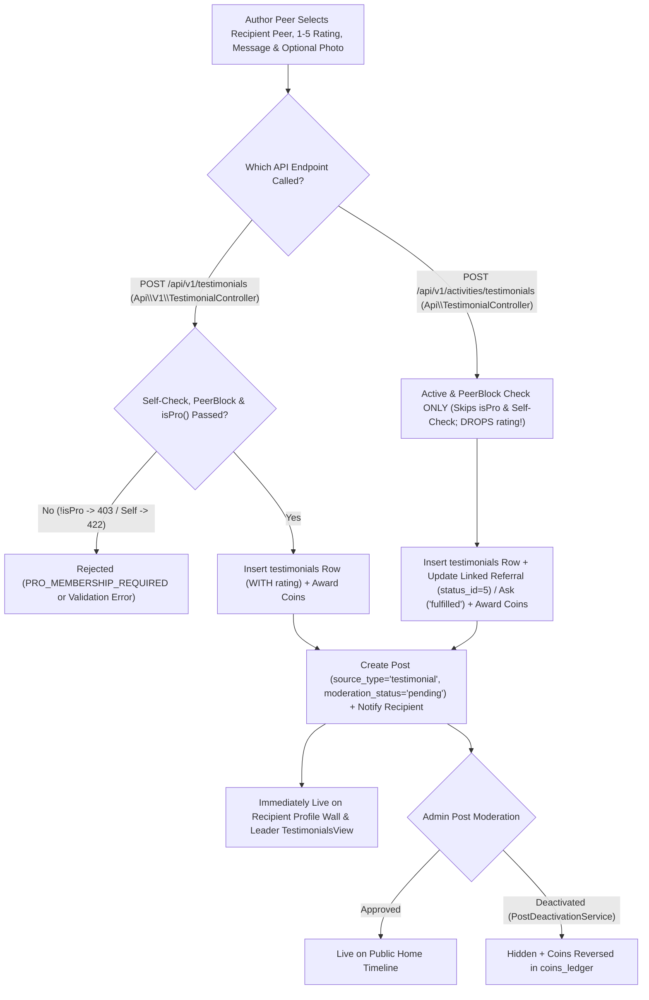

# Activity 08: Testimonials (Given & Received)

| Attribute | Verified Specification |
|---|---|
| **Workbook Activity #** | `8.0` |
| **Exact Workbook Name** | `Testimonials (Given & Received)` |
| **Domain Category** | `Social Proof & Reputation` (Sheet 1 & 2) / `Reputation / Trust` (Sheet 3) |
| **Activity Governance Tier** | `Leadership Oversight` (Immediate peer-to-peer record in `testimonials` + moderated public timeline post `posts.source_type = 'testimonial'` with `moderation_status = 'pending'`; Leadership/DED/Admin read oversight & Admin post-deactivation coin reversal) |
| **Overall Implementation Status** | `Implemented but Incorrect` (End-to-end Member App, Leader App `TestimonialsView` + `TestimonialDetailBottomSheet`, DED feeds, and Admin exports exist, **but** two parallel backend `TestimonialController` classes have divergent rules—one enforces a `403 PRO_MEMBERSHIP_REQUIRED` paywall, self-testimonial block, and `rating` 1–5 while the other skips all three and drops `rating`!) |
| **Master Index & Cross-Links** | [12-master-35-activities-index.md](../12-master-35-activities-index.md) · [19-activity-to-role-access-matrix.md](../19-activity-to-role-access-matrix.md) · [25-activity-workflow-reference.md](../25-activity-workflow-reference.md) · [13-activity-input-forms-and-validation.md](../13-activity-input-forms-and-validation.md) · [15-activity-database-and-metrics-mapping.md](../15-activity-database-and-metrics-mapping.md) · [16-activity-api-and-backend-mapping.md](../16-activity-api-and-backend-mapping.md) |

---

## 1. Business Purpose (§9.1)

- **Why It Exists & Business Outcome:**
  - **WORKBOOK REQUIREMENT:** Enables members to write public commendations and 1-to-5 star reviews validating a fellow peer's professional work quality, project delivery, and trustworthiness—building a verified reputation wall on the recipient's profile and rewarding community gratitude.
  - **FACT:** Submitting a Testimonial creates a row in `testimonials`, awards `testimonial` Coins to the author (`CoinsService::rewardForActivity('testimonial')`), creates a public timeline post (`posts.source_type = 'testimonial'`, `moderation_status = 'pending'`) with `PostMention`, notifies `to_user_id`, and—when linked via `referral_id` or `ask_id`—updates `referrals.status_id = 5` ("Got things done") or `asks.status = 'fulfilled'` (`outcome_status = 'testimonial_given'`).
- **Role Partitioning (Member vs Leadership vs Admin):**
  - **Peer Member (`FACT`):** Writes testimonials for fellow peers in the Flutter Member App (`testimonials` feature module), views `Given` and `Received` testimonials, views any peer's Testimonials Wall (`GET /api/v1/users/{user}/testimonials`), and views the Testimonials Leaderboard.
  - **Circle / Regional Leadership (`FACT`):** Reviews circle/district endorsements, average ratings, and top contributors in [testimonials_view.dart](file:///D:/office%20project/LeaderApp-Fornt-end-/lib/features/testimonials/view/testimonials_view.dart) ([testimonials_metrics_overview.dart](file:///D:/office%20project/LeaderApp-Fornt-end-/lib/features/testimonials/view/widgets/testimonials_metrics_overview.dart), [testimonial_detail_bottom_sheet.dart](file:///D:/office%20project/LeaderApp-Fornt-end-/lib/features/testimonials/view/widgets/testimonial_detail_bottom_sheet.dart)), [peer_testimonials_screen.dart](file:///D:/office%20project/LeaderApp-Fornt-end-/lib/features/peer_profile/view/peer_testimonials_screen.dart), and DED endpoints (`GET /api/v1/ded/activities/testimonials`). `POST /api/v1/leader/testimonials` also exists on backend (`LeaderActivitiesController@storeTestimonial`), though Leader App UI is currently read-only.
  - **Super Admin / Web Admin (`FACT`):** Audits and exports all testimonials via `/admin/activities/testimonials` ([ActivitiesTestimonialsController.php](file:///c:/Users/malic/OneDrive/Documents/GitHub/unity-app-new/app/Http/Controllers/Admin/ActivitiesTestimonialsController.php)) and React Admin `TestimonialsTab.tsx`, approves/rejects pending testimonial timeline posts (`moderation_status = 'pending'`), and reverses awarded Coins via `PostDeactivationService` if deactivated.

---

## 2. Sub-Activities Catalogue (§9.2)

| # | Sub-Activity / Operation | Member App (`unity_app`) | Leadership App (`LeaderApp`) | Admin Web (`unity-admin-web` & Blade) | Backend (`unity-app-new`) | Classification |
|---|---|---|---|---|---|---|
| 2.1 | **Select Target Peer & Write Testimonial (1–5 Rating + Photo)** | Wired in `lib/features/testimonials/` (`selected_peer_card.dart`; calls `POST /api/v1/testimonials` or `/api/v1/activities/testimonials`) | Backend `POST /api/v1/leader/testimonials` exists (`LeaderActivitiesController@storeTestimonial`), no write sheet in Leader UI | Not applicable | **SPLIT CONTROLLERS:** `Api\V1\TestimonialController@store` vs `Api\TestimonialController@store` vs `LeaderActivitiesController@storeTestimonial` | `Implemented but Incorrect` (Controller divergence — see §9) |
| 2.2 | **Link Testimonial to Referral / Ask Outcome** | Supported on `POST /api/v1/activities/testimonials` (`referral_id`, `ask_id`) | Not applicable | Visible via linked record | `Api\TestimonialController@store` (`L182-200`) sets `referrals.status_id = 5` & `asks.status = 'fulfilled'` (missing in `Api\V1\TestimonialController`!) | `Partially Implemented` |
| 2.3 | **View Given & Received Testimonials History** | Wired (`ApiEndpoints.receivedTestimonials`, `givenTestimonials`, `userTestimonials`) | Wired ([testimonials_view.dart](file:///D:/office%20project/LeaderApp-Fornt-end-/lib/features/testimonials/view/testimonials_view.dart), [testimonial_detail_bottom_sheet.dart](file:///D:/office%20project/LeaderApp-Fornt-end-/lib/features/testimonials/view/widgets/testimonial_detail_bottom_sheet.dart), [peer_testimonials_screen.dart](file:///D:/office%20project/LeaderApp-Fornt-end-/lib/features/peer_profile/view/peer_testimonials_screen.dart), [peer_profile_testimonials_section.dart](file:///D:/office%20project/LeaderApp-Fornt-end-/lib/features/peer_profile/view/widgets/peer_profile_testimonials_section.dart)) | Wired (`/admin/activities/testimonials` & Peer Drawer [TestimonialsTab.tsx](file:///D:/office%20project/unity-admin-web/src/components/PeerDetailDrawer/tabs/TestimonialsTab.tsx)) | `TestimonialHistoryController`, `Api\V1\TestimonialController`, `LeaderActivitiesController@testimonials`, `LeaderMemberController@testimonials`, `DedActivitiesController` | `Fully Implemented` |
| 2.4 | **Moderate Auto-Generated Testimonial Feed Post** | Post created with `moderation_status = 'pending'` | Leader 360° `DELETE /leader/members/{member_id}/creatives/{creative_id}` (**missing capability check**) | Admin approves/deactivates post in `PostsPage.tsx` / `/admin/posts` | `PostModerationController`, `PostDeactivationService` (reverses Coins on deactivation) | `Implemented but Incorrect` (Leader creative delete lacks guard) |
| 2.5 | **Testimonials Leaderboard & CSV Export** | Wired (`GET /api/v1/leaderboards/testimonials`) | Ranked Contributors tab in `leader_activities_view.dart`; CSV `/api/v1/activities/export?type=testimonials` | Wired (`/admin/activities/testimonials/export`) | `TopPeersController@testimonials`, `LeaderActivitiesController@export`, `ActivitiesTestimonialsController@export` | `Fully Implemented` |
| 2.6 | **Pin Testimonial to Profile Wall** | Chronological wall on Peer Profile; **no `is_pinned` toggle** | Read-only chronological list | No pin toggle | **No `is_pinned` column** on `testimonials` | `Missing` *(Workbook-only detail)* |

---

## 3. Input Form & Field Validation Mapping (§9.3)

**FACT:** Verified across Workbook Row 16/15, [StorePeerTestimonialRequest.php](file:///c:/Users/malic/OneDrive/Documents/GitHub/unity-app-new/app/Http/Requests/Api/V1/StorePeerTestimonialRequest.php) (`POST /api/v1/testimonials`), [StoreTestimonialRequest.php](file:///c:/Users/malic/OneDrive/Documents/GitHub/unity-app-new/app/Http/Requests/Activity/StoreTestimonialRequest.php) (`POST /api/v1/activities/testimonials`), and [LeaderActivitiesController.php](file:///c:/Users/malic/OneDrive/Documents/GitHub/unity-app-new/app/Leader/Controllers/LeaderActivitiesController.php#L305-L336) (`POST /api/v1/leader/testimonials`).

| Field Name | Data Type | Required / Optional | Validation (Backend + Client) | Default | Input Widget | Data Source | Visibility | Who Enters | Who Edits | Who Views | Sensitive? | Backend Request Key |
|---|---|---|---|---|---|---|---|---|---|---|---|---|
| **Target Peer** | `UUID (string)` | Required | **V1 Endpoint:** `given_to_user_id` `required\|uuid\|exists:users,id` + `$authUser->id !== $targetUserId` + active check + `PeerBlockService` + **`$authUser->isPro()` paywall check**! **Activities Endpoint:** `to_user_id` `required\|uuid\|exists:users,id` (**NO self-testimonial check, NO `isPro()` check**!). **Leader Endpoint:** `to_peer_id`\|`peer_user_id`\|`peer_id` string (no `exists`, no self-check, no `PeerBlock`!). | `null` | `CommonPeerSelectorSheet` + `selected_peer_card.dart` | `/api/v1/members/limited` | Public on Profile Wall & Feed | Author Peer (`from_user_id`) | Immutable | Public Peer Profile viewers, Leaders, DED, Admin | No | V1: `given_to_user_id`; Activities: `to_user_id`; Leader: `to_peer_id` |
| **Star Rating (1 to 5)** | `integer (1..5)` | Workbook: Required; Backend: Optional (`nullable`) | **V1 & Leader Endpoints:** `nullable\|integer\|min:1\|max:5`. **Activities Endpoint (`StoreTestimonialRequest`):** **OMITTED COMPLETELY** (`Api\TestimonialController@store` never saves `rating`!). | `5` (UI) / `null` (DB) | 5-Star interactive rating bar (`StarRatingDisplay` in Leader App) | User tap | Public on Testimonial Card | Author Peer | Immutable | All viewers | No | `rating` |
| **Testimonial Message** | `text` | Required | **WORKBOOK vs CODE:** Workbook specifies `min 20 chars`; **FACT:** Both `StorePeerTestimonialRequest` (`message` / `testimonial_text`) and `StoreTestimonialRequest` (`content`) validate `required\|string` with **no `min:20` or `max` rule** (`Requires Confirmation`). | `''` | Multiline `TextField` | User input | Public on Profile Wall & Feed | Author Peer | Immutable | All viewers | No | V1: `message` / `testimonial_text`; Activities & Leader: `content` |
| **Project Context** | `string` *(Workbook)* | Workbook: Listed; Backend: Merged | **FACT:** No standalone `project_context` column on `testimonials`; included inside `content` or linked via `referral_id` / `ask_id`. | `null` | Merged into message body | User input | Public | Author Peer | Immutable | All viewers | No | Merged into `content` |
| **Optional Photo (`media_id`)** | `UUID` (`json` in DB) | Optional | **Backend:** `media_id` `nullable\|uuid` (note: missing `exists:files,id` check in `StoreTestimonialRequest`, and missing from `StorePeerTestimonialRequest::rules()` even though `Api\V1\TestimonialController.php:113` reads `$request->input('media_id')`!). | `null` | Image picker → `POST /api/v1/files/upload` | Camera / Gallery | Public on Testimonial Card & Feed Post | Author Peer | Immutable | All viewers | Personal/project photo | `media_id` (Leader: `media` array) |
| **Linked Referral / Ask ID** | `UUID` | Optional | **Activities Endpoint:** `referral_id` `nullable\|uuid\|exists:referrals,id`, `ask_id` `nullable\|uuid\|exists:asks,id` (not handled in `Api\V1\TestimonialController`). | `null` | Contextual parameter | `referrals.id` / `asks.id` | Internal link | Author Peer | Immutable | Parties & Admin | No | `referral_id`, `ask_id` |

---

## 4. Workflow, Lifecycle & Mermaid Diagram (§9.4)

### Workbook vs Actual Lifecycle Comparison
- **WORKBOOK REQUIREMENT:** `Written -> Published -> Moderation Check -> Profile Wall Pin`.
- **FACT:**
  - The `testimonials` table itself has **no moderation status column** (`is_deleted = false`, `deleted_at = null`)—so the testimonial appears **immediately** on `GET /api/v1/users/{user}/testimonials` and mints Coins immediately.
  - However, the auto-generated timeline post (`posts.source_type = 'testimonial'`) is inserted with **`moderation_status = 'pending'`** (`TestimonialController.php:62`), holding it from the public Home Feed until Admin approval. If an Admin deactivates the post via `PostDeactivationService`, awarded Coins are reversed. Profile Wall Pinning is not implemented.

---

## 5. Outputs & Deliverables (§9.5)

| Output / Deliverable | Status & Evidence (`FACT` vs `WORKBOOK REQUIREMENT`) |
|---|---|
| **5-Star Testimonial Card & Profile Wall** | **FACT (`Fully Implemented`):** Rendered on Member App Peer Profile & `TestimonialsScreen`, and in Leader App [testimonial_card.dart](file:///D:/office%20project/LeaderApp-Fornt-end-/lib/features/testimonials/view/widgets/testimonial_card.dart), [testimonial_detail_bottom_sheet.dart](file:///D:/office%20project/LeaderApp-Fornt-end-/lib/features/testimonials/view/widgets/testimonial_detail_bottom_sheet.dart), and [peer_profile_testimonials_section.dart](file:///D:/office%20project/LeaderApp-Fornt-end-/lib/features/peer_profile/view/widgets/peer_profile_testimonials_section.dart). |
| **Leadership Metrics Overview (`Average Rating`, `Given`, `Received`)** | **FACT (`Fully Implemented`):** [testimonials_metrics_overview.dart](file:///D:/office%20project/LeaderApp-Fornt-end-/lib/features/testimonials/view/widgets/testimonials_metrics_overview.dart) & [testimonials_filter_chips.dart](file:///D:/office%20project/LeaderApp-Fornt-end-/lib/features/testimonials/view/widgets/testimonials_filter_chips.dart) in the Leadership App. |
| **Timeline Endorsement Post** | **FACT (`Fully Implemented`):** Created with `posts.source_type = 'testimonial'`, `moderation_status = 'pending'`, including uploaded image URLs. |
| **Profile Wall Pinning** | **NOT IMPLEMENTED (`Workbook-Only`):** No `is_pinned` column or pin endpoint exists. |
| **Notifications & Coins** | **FACT (`Fully Implemented`):** Recipient receives push + in-app alert (`activity_testimonial`); author receives Coins via `CoinsService`. |

---

## 6. Database & Metrics Mapping (§9.6)

### Primary Table & Eloquent Model
- **Model:** [Testimonial.php](file:///c:/Users/malic/OneDrive/Documents/GitHub/unity-app-new/app/Models/Testimonial.php) (`App\Models\Testimonial`, `HasUuids`, `SoftDeletes`)
- **PostgreSQL Table:** `testimonials`
  - **Columns:** `id` (`uuid` PK), `from_user_id` (`uuid` FK → `users.id` — giver), `to_user_id` (`uuid` FK → `users.id` — receiver), `content` (`text`), `media` (`json` — array of `{id, type}`), `rating` (`integer` 1–5, nullable), `referral_id` (`uuid`, nullable FK → `referrals.id`), `is_deleted` (`boolean`, default `false`), `created_at`, `updated_at`, `deleted_at`.
  - **Organizational Scope Attribution:** No `circle_id` column; scoped dynamically by `from_user_id` / `to_user_id` membership in `$scopedPeerIds`.

### Workbook Sheet 3 Metric Keys vs Actual Backend Schema
| Workbook Metric Key (Sheet 1–3) | Actual Backend / API Computation (`FACT`) | Discrepancy / Bug Note |
|---|---|---|
| `testimonialsCount` | Total testimonials (`given + received` or `received` depending on profile context) | Consistent across `UserProfileResource` and `LeaderMember360Service`. |
| `testimonialsGiven` | `COUNT(*)` on `testimonials` where `from_user_id = $uid` and not deleted | Tracked in `LastMonthActivityService` & `TestimonialHistoryController`. |
| `testimonialsReceived` | `COUNT(*)` on `testimonials` where `to_user_id = $uid` and not deleted | Matches workbook. |
| `averageRating` / `Average Star Rating` | `AVG(rating)` where `to_user_id = $uid` and `rating IS NOT NULL` | Skewed/missing for rows created via `POST /api/v1/activities/testimonials` because `Api\TestimonialController@store` omits `rating`! |

---

## 7. API & Backend Service Mapping (§9.7)

| Layer | Method & Endpoint | Controller & Action | Service / FormRequest | Auth Middleware | Scope Enforcement & Security Audit (`FACT`) | Client Integration |
|---|---|---|---|---|---|---|
| **Member API (V1)** | `POST /api/v1/testimonials` & `GET /api/v1/users/{user}/testimonials` | [Api\V1\TestimonialController.php](file:///c:/Users/malic/OneDrive/Documents/GitHub/unity-app-new/app/Http/Controllers/Api/V1/TestimonialController.php#L78) | `StorePeerTestimonialRequest`, `PeerBlockService`, `CoinsService` | `auth:sanctum`, `unity.user` | Enforces self-block, `PeerBlock`, and **`isPro()` (`403`)**; omits `referral_id`/`ask_id` handoff | Wired (`ApiEndpoints.testimonials`, `userTestimonials`) |
| **Member API (Activities)** | `GET\|POST /api/v1/activities/testimonials` & `GET .../{id}` | [Api\TestimonialController.php](file:///c:/Users/malic/OneDrive/Documents/GitHub/unity-app-new/app/Http/Controllers/Api/TestimonialController.php#L121) / `TestimonialHistoryController` | `StoreTestimonialRequest`, `PeerBlockService`, `CoinsService` | `auth:sanctum`, `unity.user` | **Bypasses `isPro()` & self-testimonial check!** Drops `rating`! Handles `referral_id` & `ask_id` | Wired (`ApiEndpoints.receivedTestimonials`, `givenTestimonials`) |
| **Member API** | `GET /api/v1/leaderboards/testimonials` | `TopPeersController@testimonials` | — | `auth:sanctum`, `unity.user` | Public leaderboard | Wired (`ApiEndpoints.leaderboardTestimonials`) |
| **Leader API** | `GET /api/v1/leader/testimonials`, `GET /api/v1/leader/activities/testimonials`, `POST /api/v1/leader/testimonials` | `LeaderActivitiesController@testimonials`, `@activitiesByType`, `@storeTestimonial` | `LeaderActivitiesService` | `auth:sanctum`, `leader.user` | `GET` list is scoped; `POST` lacks self-check, `PeerBlock`, & circle scope; `GET /activities/testimonials/{id}` (`showDetail`) has **IDOR** | `GET` wired (`TestimonialsBloc`, `LeaderActivitiesBloc`); `POST` unwired |
| **Leader 360°** | `GET /api/v1/leader/members/{member_id}/testimonials` | `LeaderMemberController@testimonials` | `LeaderMember360Service` | `auth:sanctum`, `leader.user` | Enforces `resolveMember()` circle scope (`403`) | Wired (`PeerTestimonialsScreen`) |
| **DED API** | `GET /api/v1/ded/activities/testimonials` & `.../{id}` | `DedActivitiesController` | `DedApiService` | `auth:sanctum`, `ensure.ded.api` | Enforces DED district scope | Backend ready |
| **Admin Web** | `GET /admin/activities/testimonials` & `.../export` | `ActivitiesTestimonialsController` | `AdminCircleScope` | `web`, `admin.auth` | Enforces `AdminCircleScope` | Wired in Blade & React Admin |

### Workbook Cloud Services vs Actual Laravel Services
- **WORKBOOK REQUIREMENT:** `ReputationScoreService`, `ProfileWallSyncService`.
- **FACT:** Implemented via Eloquent `Testimonial` queries, `CoinsService`, `Post::create` (`posts` moderation queue), and `NotifyUserService`.

---

## 8. Role-Wise Access Governance (§9.8)

| Role | View Activity | Create Record | Edit Own | Edit Others | Submit for Review | Verify | Approve | Reject | Assign | Manage | Delete | View Aggregated Reports |
|---|---|---|---|---|---|---|---|---|---|---|---|---|
| **Super Admin** | Allowed (Global) | Allowed (as `User`) | DENIED — Immutable | DENIED — Immutable | Not Applicable (Auto-post enters `pending` moderation) | Not Applicable | Allowed (Approve pending testimonial `Post` in Admin) | Allowed (Reject/Deactivate testimonial `Post`) | DENIED — No permission under the verified backend authorization model | Allowed (Post moderation) | Allowed (Deactivate post / soft-delete with coin reversal) | Allowed (Global Dashboards & CSV Export) |
| **Country Director** | Allowed (Country Scope intended; currently Global in Leader App) | Allowed (as Peer/Leader) | DENIED — Immutable | DENIED — Immutable | Not Applicable | Not Applicable | DENIED — Post moderation is Web Admin only | DENIED — Post moderation is Web Admin only | DENIED — No permission under the verified backend authorization model | DENIED — No permission under the verified backend authorization model | DENIED — No permission under the verified backend authorization model *(Bug: `deleteCreative` unguarded)* | Allowed (Scoped Reports & CSV) |
| **DED** | Allowed (Assigned District Scope) | Allowed (as Peer/Leader) | DENIED — Immutable | DENIED — Immutable | Not Applicable | Not Applicable | DENIED — Web Admin only | DENIED — Web Admin only | DENIED — No permission under the verified backend authorization model | DENIED — No permission under the verified backend authorization model | DENIED — No permission under the verified backend authorization model *(Bug: `deleteCreative` unguarded)* | Allowed (DED Dashboard & CSV) |
| **Industry Director** | Allowed (Assigned Industry Scope) | Allowed (as Peer/Leader) | DENIED — Immutable | DENIED — Immutable | Not Applicable | Not Applicable | DENIED — Web Admin only | DENIED — Web Admin only | DENIED — No permission under the verified backend authorization model | DENIED — No permission under the verified backend authorization model | DENIED — No permission under the verified backend authorization model *(Bug: `deleteCreative` unguarded)* | Allowed (Industry Scope) |
| **Circle Founder** | Allowed (Own Circle(s)) | Allowed (as Peer/Leader) | DENIED — Immutable | DENIED — Immutable | Not Applicable | Not Applicable | DENIED — Web Admin only | DENIED — Web Admin only | DENIED — No permission under the verified backend authorization model | DENIED — No permission under the verified backend authorization model | DENIED — No permission under the verified backend authorization model *(Bug: `deleteCreative` unguarded)* | Allowed (Own Circle Reports & CSV) |
| **Circle Director** | Allowed (Own Circle(s)) | Allowed (as Peer/Leader) | DENIED — Immutable | DENIED — Immutable | Not Applicable | Not Applicable | DENIED — Web Admin only | DENIED — Web Admin only | DENIED — No permission under the verified backend authorization model | DENIED — No permission under the verified backend authorization model | DENIED — No permission under the verified backend authorization model *(Bug: `deleteCreative` unguarded)* | Allowed (Own Circle Reports & CSV) |
| **Chair / Committee Chairs** | Allowed (Own Circle) | Allowed (as Peer/Leader) | DENIED — Immutable | DENIED — Immutable | Not Applicable | Not Applicable | DENIED — Web Admin only | DENIED — Web Admin only | DENIED — No permission under the verified backend authorization model | DENIED — No permission under the verified backend authorization model | DENIED — No permission under the verified backend authorization model *(Bug: `deleteCreative` unguarded)* | Allowed (Own Circle Dashboard & Weekly Report) |
| **Vice Chair** | Allowed (Own Circle) | Allowed (as Peer/Leader) | DENIED — Immutable | DENIED — Immutable | Not Applicable | Not Applicable | DENIED — Web Admin only | DENIED — Web Admin only | DENIED — No permission under the verified backend authorization model | DENIED — No permission under the verified backend authorization model | DENIED — No permission under the verified backend authorization model *(Bug: `deleteCreative` unguarded)* | Allowed (Own Circle Read-Only Reports) |
| **Secretary** | Allowed (Own Circle) | Allowed (as Peer/Leader) | DENIED — Immutable | DENIED — Immutable | Not Applicable | Not Applicable | DENIED — Web Admin only | DENIED — Web Admin only | DENIED — No permission under the verified backend authorization model | DENIED — No permission under the verified backend authorization model | DENIED — No permission under the verified backend authorization model *(Bug: `deleteCreative` unguarded)* | Allowed (Own Circle Read-Only Reports) |
| **Committee Leader** | Allowed in Web RBAC; **BROKEN (`403`)** in Leader App | Allowed (Member App) | DENIED — Immutable | DENIED — Immutable | Not Applicable | Not Applicable | DENIED — No permission under the verified backend authorization model | DENIED — No permission under the verified backend authorization model | DENIED — No permission under the verified backend authorization model | DENIED — No permission under the verified backend authorization model | DENIED — No permission under the verified backend authorization model | DENIED in Leader App (`403`) |
| **Peer Member** | Allowed (Own Given/Received, Public Peer Testimonials Wall, Leaderboard) | Allowed (`isPro()` required on `/v1/testimonials`, bypassed on `/v1/activities/testimonials` — **Requires Business Confirmation**) | DENIED — Immutable | DENIED — No permission under the verified backend authorization model | Not Applicable | Not Applicable | DENIED — No permission under the verified backend authorization model | DENIED — No permission under the verified backend authorization model | DENIED — No permission under the verified backend authorization model | DENIED — No permission under the verified backend authorization model | DENIED — No permission under the verified backend authorization model | DENIED — Personal stats & Leaderboard only |

---

## 9. Existing Implementation Summary, Gaps & Minimum-Change Enhancement Recommendations

### Summary of Verified Limitations & Bugs
1. **Conflicting Dual `TestimonialController` Implementations (`P1` Logic & Paywall Bypass):**
   - `POST /api/v1/testimonials` ([Api\V1\TestimonialController.php](file:///c:/Users/malic/OneDrive/Documents/GitHub/unity-app-new/app/Http/Controllers/Api/V1/TestimonialController.php#L83-L103)) blocks self-testimonials, requires `$authUser->isPro()`, and saves `rating`, **but** ignores `referral_id` and `ask_id`.
   - `POST /api/v1/activities/testimonials` ([Api\TestimonialController.php](file:///c:/Users/malic/OneDrive/Documents/GitHub/unity-app-new/app/Http/Controllers/Api/TestimonialController.php#L121-L200)) skips `$authUser->isPro()` and self-testimonial validation, **drops `rating`**, and updates `referral_id` / `ask_id`.
2. **Missing `min:20` & `media_id` Validation:** Workbook specifies minimum 20 characters (`min:20`), which neither FormRequest enforces; `StorePeerTestimonialRequest` also omits `media_id` from `rules()`.
3. **Leader IDOR & Unguarded Creative Deletion:** `GET /api/v1/activities/testimonials/{id}` skips `$scopedPeerIds` validation, and `DELETE /api/v1/leader/members/{member_id}/creatives/{creative_id}` lacks a `manage_peers` / Admin capability check.

### Minimum-Change Enhancement Recommendations
- **RECOMMENDATION 1 (Unify Testimonial Creation into One `TestimonialService`):** Extract a single `App\Services\Testimonials\TestimonialService` invoked by `Api\V1\TestimonialController@store`, `Api\TestimonialController@store`, and `LeaderActivitiesController@storeTestimonial` so all three consistently enforce `from_user_id !== to_user_id`, `PeerBlockService`, `rating` (`1..5`), `media_id` (`exists:files,id`), `min:20` message length, and `referral_id` / `ask_id` fulfillment updates.
- **RECOMMENDATION 2 (Enforce Scope & Capability Guards):** Add `$scopedPeerIds` verification to `LeaderActivitiesService::showDetail()` and restrict `LeaderMemberController@deleteCreative` to `Super Admin` or authorized circle moderators with confirmation + audit logging.
- **BUSINESS DECISION REQUIRED:** Confirm whether giving a Testimonial is gated behind **Pro/Paid Membership (`$user->isPro()`)** or open to **all active Peers** (since free/trial peers closing a Help Ask or Referral currently bypass `isPro()` via `/api/v1/activities/testimonials`).
