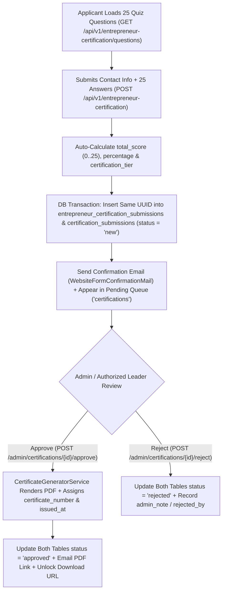

# Activity 09: Entrepreneur Certification Form

| Attribute | Verified Specification |
|---|---|
| **Workbook Activity #** | `9.0` |
| **Exact Workbook Name** | `Entrepreneur Certification Form` |
| **Domain Category** | `Accreditation & Credibility` (Sheet 1 & 2) / `Compliance / Accreditation` (Sheet 3) |
| **Activity Governance Tier** | `Verification & Approval` (Public/Member quiz submission → Admin/Leader Pending Queue review → Server-side PDF Certificate generation & email dispatch) |
| **Overall Implementation Status** | `Partially Implemented` (End-to-end 25-question Entrepreneur Quiz, dual-table atomic persistence, Admin moderation, and DomPDF certificate generation work; **major divergence** from Workbook's compliance/turnover document-upload spec, plus IDOR on submission detail, unguarded `/api/v1/admin/*` routes, and fabricated `70%` Dashboard KPI split) |
| **Master Index & Cross-Links** | [12-master-35-activities-index.md](../12-master-35-activities-index.md) · [19-activity-to-role-access-matrix.md](../19-activity-to-role-access-matrix.md) · [25-activity-workflow-reference.md](../25-activity-workflow-reference.md) · [13-activity-input-forms-and-validation.md](../13-activity-input-forms-and-validation.md) · [10-leadership-certification-form.md](./10-leadership-certification-form.md) · [27-approval-and-escalation-flow.md](../27-approval-and-escalation-flow.md) |

---

## 1. Business Purpose (§9.1)

- **Why It Exists & Business Outcome:**
  - **WORKBOOK REQUIREMENT:** Submit business turnover verification, operating years, legal incorporation documents, and a compliance declaration to earn official Peers Global Entrepreneur Accreditation and a downloadable high-resolution PDF Certificate.
  - **FACT (Critical Product vs Code Divergence):** Rather than legal/turnover document KYC, the production Laravel 12 + Flutter Member App implements a **25-Question Entrepreneurial Mindset, Financial Discipline & Business Systems Assessment Quiz** ([EntrepreneurCertificationSubmission.php](file:///c:/Users/malic/OneDrive/Documents/GitHub/unity-app-new/app/Models/EntrepreneurCertificationSubmission.php#L12-L66), [WebsiteFormsController.php](file:///c:/Users/malic/OneDrive/Documents/GitHub/unity-app-new/app/Http/Controllers/Api/V1/Forms/WebsiteFormsController.php#L236-L318)). Submissions are auto-scored (`total_score` out of 25, `percentage`, `certification_tier`), dual-written into `entrepreneur_certification_submissions` and `certification_submissions` (`status = 'new'`), and queued for approval. Upon Admin/Leader approval, `App\Services\Certifications\CertificateGeneratorService` generates an official numbered PDF certificate and emails it to the entrepreneur.
- **Role Partitioning (Member vs Leadership vs Admin):**
  - **Peer Member / Public Applicant (`FACT`):** Can complete the 25-question quiz either inside the Flutter Member App ([entrepreneur_certification_screen.dart](file:///D:/office%20project/peers-unity/unity_app/lib/features/highlights/presentation/screens/entrepreneur_certification_screen.dart)) or via the public website form (`POST /api/v1/entrepreneur-certification`), check application status (`GET /api/v1/entrepreneur-certification/my`, `GET /api/v1/my-certifications`), and download the issued PDF once approved.
  - **Circle / Regional Leadership (`FACT`):** Views entrepreneur certification submissions in [leader_activities_view.dart](file:///D:/office%20project/LeaderApp-Fornt-end-/lib/features/leader_activities/view/leader_activities_view.dart) (`entrepreneur-certifications`) and `/api/v1/leader/leads/entrepreneur_certification`, and scoped Leaders can approve/reject pending certifications via `/api/v1/leader/pending-requests/certifications/{id}/approve|reject` (`PendingRequestAdminController`).
  - **Super Admin / Web Admin (`FACT`):** Reviews quiz scores, approves (triggering PDF generation + email), rejects, or downloads certificates in React Admin ([CertificationSubmissionsView.tsx](file:///D:/office%20project/unity-admin-web/src/features/certifications/CertificationSubmissionsView.tsx)) and Blade (`/admin/pending-requests/certifications`).

---

## 2. Sub-Activities Catalogue (§9.2)

| # | Sub-Activity / Operation | Member App (`unity_app`) | Leadership App (`LeaderApp`) | Admin Web (`unity-admin-web` & Blade) | Backend (`unity-app-new`) | Classification |
|---|---|---|---|---|---|---|
| 2.1 | **Fetch 25 Entrepreneur Quiz Questions** | Wired (`GET /api/v1/entrepreneur-certification/questions` via `entrepreneur_certification_remote_datasource.dart`) | Not applicable | Not applicable | `WebsiteFormsController@entrepreneurCertificationQuestions` (`CertificationQuestionsService`) | `Fully Implemented` |
| 2.2 | **Submit Entrepreneur Certification Quiz** | Wired ([entrepreneur_certification_screen.dart](file:///D:/office%20project/peers-unity/unity_app/lib/features/highlights/presentation/screens/entrepreneur_certification_screen.dart) → `POST /api/v1/entrepreneur-certification`) | Not applicable | Public website form also posts to same endpoint | `WebsiteFormsController@submitEntrepreneurCertification` (`SubmitEntrepreneurCertificationRequest`) | `Fully Implemented` |
| 2.3 | **Upload Incorporation / Turnover KYC Documents** | **Absent** (`DocumentUploadWidget` mentioned in Workbook does not exist for this form) | **Absent** | **Absent** | **No file column** on `entrepreneur_certification_submissions` or `certification_submissions` | `Requires Business Confirmation` (Quiz vs KYC Doc model) |
| 2.4 | **View My Certification Status & Download PDF** | Wired (`GET /api/v1/entrepreneur-certification/my`, `GET /api/v1/my-certifications`) | Visible in `leader_activities_view.dart` & `/leader/leads/entrepreneur_certification` | Wired (`CertificationSubmissionsView.tsx` + `/download`) | `WebsiteFormsController@myCertifications`, `CertificationSubmissionController@download` | `Fully Implemented` |
| 2.5 | **Approve / Reject & Auto-Generate PDF Certificate** | Read-only | Exposed via `PendingRequestAdminController` (`category = certifications`) on Leader Pending Approvals | Wired (`POST /api/v1/admin/certifications/{id}/approve\|reject`) | `CertificationSubmissionController`, `PendingRequestModerationService`, `CertificateGeneratorService` | `Implemented but Incorrect` (Missing admin route guard & missing `leader.can` capability gate) |

---

## 3. Input Form & Field Validation Mapping (§9.3)

**FACT:** Verified against [SubmitEntrepreneurCertificationRequest.php](file:///c:/Users/malic/OneDrive/Documents/GitHub/unity-app-new/app/Http/Requests/Forms/SubmitEntrepreneurCertificationRequest.php#L33-L47), [EntrepreneurCertificationSubmission.php](file:///c:/Users/malic/OneDrive/Documents/GitHub/unity-app-new/app/Models/EntrepreneurCertificationSubmission.php#L12-L66), `CertificationSubmissionController`, and Workbook Row 17/16.

| Field Name | Data Type | Required / Optional | Validation (Backend + Client) | Default | Input Widget | Data Source | Visibility | Who Enters | Who Edits | Who Views | Sensitive? | Backend Request Key |
|---|---|---|---|---|---|---|---|---|---|---|---|---|
| **Full Name** | `string (max:255)` | Required | **Backend:** `required\|string\|max:255` (trimmed). | Pre-filled from auth user in app | `TextField` | Auth user profile / manual input | Printed on PDF Certificate & visible to Leaders/Admin | Applicant (Peer / Public) | Immutable | Applicant, Scoped Leaders, Admin | PII | `full_name` |
| **Business Name** | `string (max:255)` | Required | **Backend:** `required\|string\|max:255` (trimmed). | Pre-filled from `company_name` | `TextField` | Auth user profile / manual input | Printed on Certificate & visible to Leaders/Admin | Applicant | Immutable | Applicant, Scoped Leaders, Admin | No | `business_name` |
| **Email Address** | `string (email, max:255)` | Required | **Backend:** `required\|email\|max:255` (trimmed; used to link `user_id` if unauthenticated). | Pre-filled from `user.email` | Email `TextField` | Auth user / manual input | Private to Applicant & Admin/Leaders (**IDOR bug on `show`!**) | Applicant | Immutable | Applicant, Admin, Leaders | **Yes** (Email PII) | `email` |
| **Contact Number** | `string (max:30)` | Required | **Backend:** `required\|string\|max:30` (trimmed). | Pre-filled from `user.phone` | Phone `TextField` | Auth user / manual input | Private to Applicant & Admin/Leaders | Applicant | Immutable | Applicant, Admin, Leaders | **Yes** (Phone PII) | `contact_no` |
| **25 Entrepreneur Quiz Answers** (`business_start_reason`, `business_failure_reaction`, `finance_tracking_frequency`, `pricing_decision_method`, `business_systems_status`, ..., `future_mentorship_belief`) | `25 × string` (`json` in `certification_submissions.answers`) | All 25 Required | **Backend:** Each of the 25 `QUIZ_FIELDS` validated as `required\|string` (`SubmitEntrepreneurCertificationRequest.php:42-44`), scored against `CORRECT_ANSWERS` (`L40-66`). | `null` | 25 Multiple-Choice Radio / Option Cards (`entrepreneur_certification_screen.dart`) | `GET /api/v1/entrepreneur-certification/questions` | Visible to Applicant & Admin reviewer | Applicant | Immutable | Applicant, Admin | No | 25 snake_case keys in `EntrepreneurCertificationSubmission::QUIZ_FIELDS` |
| **Turnover / Operating Years / Incorporation Docs** *(Workbook only)* | *Workbook fields* | *Workbook only* | **NOT IMPLEMENTED:** Replaced by the 25-question assessment in production (`Requires Business Confirmation`). | N/A | **NOT IMPLEMENTED** | N/A | N/A | N/A | N/A | N/A | Yes (if financial KYC added) | *None* |
| **Admin Review Note / Rejection Reason** | `text` | Optional on Approve / Recommended on Reject | **Backend:** `admin_note` / `notes` `nullable\|string`. | `null` | Admin modal textarea (`CertificationSubmissionsView.tsx`) | Reviewer input | Visible to Admin & Applicant | Admin / Approving Leader | Admin | Applicant, Admin | No | `admin_note` / `notes` |

---

## 4. Workflow, Lifecycle & Mermaid Diagram (§9.4)

### Workbook vs Actual Lifecycle Comparison
- **WORKBOOK REQUIREMENT:** `Submitted -> Board Verification -> Approved -> PDF Generated` (metric statuses: `Pending, Approved, Issued`).
- **FACT:** Stored synchronously across `entrepreneur_certification_submissions.status` and `certification_submissions.status` using enum values **`'new'` | `'approved'` | `'rejected'`** (`CertificationSubmission::STATUS_NEW`, `STATUS_APPROVED`, `STATUS_REJECTED`). There is no separate `'issued'` state—approving a submission synchronously generates the PDF file, populates `certificate_number` + `certificate_download_url` + `issued_at`, sets `status = 'approved'`, and sends the certificate email.

---

## 5. Outputs & Deliverables (§9.5)

| Output / Deliverable | Status & Evidence (`FACT` vs `WORKBOOK REQUIREMENT`) |
|---|---|
| **Official Entrepreneur Certificate PDF** | **FACT (`Fully Implemented`):** Generated server-side via `App\Services\Certifications\CertificateGeneratorService` with unique `certificate_number`, `certification_level`/`certification_tier`, `issued_at`, stored on Laravel disk (`certificate_file_path`) and downloadable via `certificate_download_url` once `status === 'approved'`. |
| **Member App Status & Certificate View** | **FACT (`Fully Implemented`):** `entrepreneur_certification_screen.dart` and `GET /api/v1/my-certifications` (plus peer lookup `GET /api/v1/certifications/user/{userId}`). |
| **Confirmation & Approval Emails** | **FACT (`Fully Implemented`):** Submission confirmation (`WebsiteFormConfirmationMail`) and approval notification logged via `EmailLogService` (`email_logs`). |
| **Admin & Leader Moderation Queues** | **FACT (`Fully Implemented`):** React Admin `CertificationSubmissionsView.tsx`, Unified Pending Queue (`certifications`), and Leader Activity Feed (`entrepreneur-certifications`). |

---

## 6. Database & Metrics Mapping (§9.6)

### Primary Tables & Eloquent Models (Dual-Write Architecture)
1. **`entrepreneur_certification_submissions`** — [EntrepreneurCertificationSubmission.php](file:///c:/Users/malic/OneDrive/Documents/GitHub/unity-app-new/app/Models/EntrepreneurCertificationSubmission.php)
   - **Columns:** `id` (`uuid` PK), `full_name`, `business_name`, `email`, `contact_no`, `status` (`new` | `approved` | `rejected`), `notes`, 25 quiz answer string columns, `total_score` (`int`), `percentage` (`float`), `certification_tier` (`varchar`), `created_at`, `updated_at`.
2. **`certification_submissions`** — [CertificationSubmission.php](file:///c:/Users/malic/OneDrive/Documents/GitHub/unity-app-new/app/Models/CertificationSubmission.php)
   - **Columns:** `id` (shares exact UUID with #1), `certification_type` (`'entrepreneur'`), `user_id` (`uuid`, nullable FK → `users.id`), `full_name`, `business_name`, `email`, `contact_no`, `total_score`, `percentage`, `certification_level`, `certification_title`, `certificate_number`, `certificate_file_path`, `certificate_download_url`, `certificate_generated_at`, `issued_at`, `answers` (`json`), `status` (`new` | `approved` | `rejected`), `admin_note`, `approved_by`, `rejected_by`, `approved_at`, `rejected_at`.
- **Organizational Scope Attribution:** Linked to `users` via `certification_submissions.user_id` (or `LOWER(email)` match when submitted unauthenticated). Scoped dynamically in `PendingRequestAdminController` & `LeaderActivitiesService` via the applicant's circle memberships.

### Workbook Sheet 3 Metric Keys vs Actual Backend Schema
| Workbook Metric Key (Sheet 1–3) | Actual Backend / API Computation (`FACT`) | Discrepancy / Bug Note |
|---|---|---|
| `entrepreneurCertStatus` | `certification_submissions.status` (`new`, `approved`, `rejected`) | **CRITICAL BUG (`LeaderDashboardService.php:789`):** Dashboard computes `entrepreneur_certifications = round($certificationsCount * 0.7)` instead of filtering `WHERE certification_type = 'entrepreneur'`! |
| `certIssuedDate` | `certification_submissions.issued_at` / `approved_at` | Matches workbook. |
| `certDocStorageUrl` | `certification_submissions.certificate_download_url` (exposed only when `status === 'approved'`) | Matches workbook. |

---

## 7. API & Backend Service Mapping (§9.7)

| Layer | Method & Endpoint | Controller & Action | Service / FormRequest | Auth Middleware | Scope Enforcement & Security Audit (`FACT`) | Client Integration |
|---|---|---|---|---|---|---|
| **Public / Member API** | `GET /api/v1/entrepreneur-certification/questions` & `POST /api/v1/entrepreneur-certification` | [WebsiteFormsController.php](file:///c:/Users/malic/OneDrive/Documents/GitHub/unity-app-new/app/Http/Controllers/Api/V1/Forms/WebsiteFormsController.php) | `CertificationQuestionsService`, `SubmitEntrepreneurCertificationRequest` | Public (resolves optional Sanctum user if token present) | Public form — **ensure rate-limiting (`throttle`)** to prevent quiz spam | Wired in Member App & Website |
| **Member API** | `GET /api/v1/entrepreneur-certification[/my]`, `GET /api/v1/my-certifications`, `GET /api/v1/certifications/user/{userId}` | `WebsiteFormsController` (`L115, 236, 319`) | — | `auth:sanctum`, `unity.user` | `index` filters to caller unless `isUserAdmin`; **`GET /api/v1/entrepreneur-certification/{id}` (`L289`) has NO ownership check (IDOR leaking `email`, `contact_no`, answers)!** | Wired in Member App |
| **Leader API** | `GET /api/v1/leader/activities/entrepreneur-certifications` & `GET /api/v1/leader/leads/entrepreneur_certification[/{id}]` | `LeaderActivitiesController`, `LeadAdminApiController` | `LeaderActivitiesService` | `auth:sanctum`, `leader.user` | `LeadAdminApiController` on `/leader/leads/*` lacks circle scoping (leaks global leads to circle leaders!) | `activitiesByType` wired; `/leader/leads` available |
| **Leader / Admin Queue** | `POST /api/v1/leader/pending-requests/certifications/{id}/approve\|reject` | `PendingRequestAdminController` | `PendingRequestModerationService`, `CertificateGeneratorService` | `auth:sanctum`, `leader.user` | Enforces circle scope on `/leader/*`, **but lacks `can_review_pending_peers` capability gate** (Vice Chair/Secretary can approve!) | Wired in Leader Pending Approvals |
| **Admin API & Web** | `GET /api/v1/admin/certifications?type=entrepreneur`, `POST .../{id}/approve\|reject`, `GET .../{id}/download` & Web `/admin/pending-requests/certifications*` | `CertificationSubmissionController`, `Admin\CertificationSubmissionsController` | `CertificateGeneratorService` | Web: `web`, `admin.auth`; **API: `auth:sanctum`, `unity.user` (MISSING admin guard in `routes/api.php`!)** | **CRITICAL BUG:** Any regular member token can call `POST /api/v1/admin/certifications/{id}/approve` to self-approve their own certificate! | Wired in `CertificationSubmissionsView.tsx` & Blade |

### Workbook Cloud Services vs Actual Laravel Services
- **WORKBOOK REQUIREMENT:** `PdfGeneratorLambda`, `StorageBucketService`, `CertVerificationHook`.
- **FACT:** Implemented natively in Laravel via `App\Services\Certifications\CertificateGeneratorService` (DomPDF rendering to Laravel Storage), `CertificationSubmissionController`, and `EmailLogService`—no AWS Lambda required.

---

## 8. Role-Wise Access Governance (§9.8)

| Role | View Activity | Create Record | Edit Own | Edit Others | Submit for Review | Verify | Approve | Reject | Assign | Manage | Delete | View Aggregated Reports |
|---|---|---|---|---|---|---|---|---|---|---|---|---|
| **Super Admin** | Allowed (Global) | Allowed | DENIED — Quiz answers immutable | Allowed (`notes` / `status`) | Allowed | Allowed | Allowed (`POST /admin/certifications/{id}/approve` → generates PDF) | Allowed (`POST /admin/certifications/{id}/reject`) | DENIED — No permission under the verified backend authorization model | Allowed (`LeadAdminApiController` & Certification Portal) | Allowed (`DELETE /api/v1/admin/leads/entrepreneur_certification/{id}`) | Allowed (Global Counts & Export) |
| **Country Director** | Allowed (Country Scope intended) | Allowed | DENIED — Immutable | DENIED — No permission under the verified backend authorization model | Allowed | Allowed (In scope via `PendingRequestAdminController`) | Allowed (In scope — `Requires Business Confirmation` whether Board/Admin-only) | Allowed (In scope) | DENIED — No permission under the verified backend authorization model | DENIED — No permission under the verified backend authorization model | DENIED — No permission under the verified backend authorization model | Allowed (Scoped Dashboard) |
| **DED** | Allowed (District Scope) | Allowed | DENIED — Immutable | DENIED — No permission under the verified backend authorization model | Allowed | Allowed (In district via Leader Pending Queue) | Allowed (In district — `Requires Business Confirmation`) | Allowed (In district) | DENIED — No permission under the verified backend authorization model | DENIED — No permission under the verified backend authorization model | DENIED — No permission under the verified backend authorization model | Allowed (District Dashboard) |
| **Industry Director** | Allowed (Industry Scope) | Allowed | DENIED — Immutable | DENIED — No permission under the verified backend authorization model | Allowed | Allowed (In industry via Leader Pending Queue) | Allowed (In industry — `Requires Business Confirmation`) | Allowed (In industry) | DENIED — No permission under the verified backend authorization model | DENIED — No permission under the verified backend authorization model | DENIED — No permission under the verified backend authorization model | Allowed (Industry Dashboard) |
| **Circle Founder** | Allowed (Own Circle) | Allowed | DENIED — Immutable | DENIED — No permission under the verified backend authorization model | Allowed | Allowed (Own circle via Leader Pending Queue) | Allowed (Own circle — `Requires Business Confirmation`) | Allowed (Own circle) | DENIED — No permission under the verified backend authorization model | DENIED — No permission under the verified backend authorization model | DENIED — No permission under the verified backend authorization model | Allowed (Own Circle Dashboard) |
| **Circle Director** | Allowed (Own Circle) | Allowed | DENIED — Immutable | DENIED — No permission under the verified backend authorization model | Allowed | Allowed (Own circle via Leader Pending Queue) | Allowed (Own circle — `Requires Business Confirmation`) | Allowed (Own circle) | DENIED — No permission under the verified backend authorization model | DENIED — No permission under the verified backend authorization model | DENIED — No permission under the verified backend authorization model | Allowed (Own Circle Dashboard) |
| **Chair / Committee Chairs** | Allowed (Own Circle read feed) | Allowed | DENIED — Immutable | DENIED — No permission under the verified backend authorization model | Allowed | DENIED intended (**BUG:** `PendingRequestAdminController` lacks capability check) | DENIED intended (**BUG:** unguarded) | DENIED intended (**BUG:** unguarded) | DENIED — No permission under the verified backend authorization model | DENIED — No permission under the verified backend authorization model | DENIED — No permission under the verified backend authorization model | Allowed (Own Circle Dashboard) |
| **Vice Chair** | Allowed (Own Circle read feed) | Allowed | DENIED — Immutable | DENIED — No permission under the verified backend authorization model | Allowed | DENIED intended (**BUG:** unguarded) | DENIED intended (**BUG:** unguarded) | DENIED intended (**BUG:** unguarded) | DENIED — No permission under the verified backend authorization model | DENIED — No permission under the verified backend authorization model | DENIED — No permission under the verified backend authorization model | Allowed (Own Circle Read-Only) |
| **Secretary** | Allowed (Own Circle read feed) | Allowed | DENIED — Immutable | DENIED — No permission under the verified backend authorization model | Allowed | DENIED intended (**BUG:** unguarded) | DENIED intended (**BUG:** unguarded) | DENIED intended (**BUG:** unguarded) | DENIED — No permission under the verified backend authorization model | DENIED — No permission under the verified backend authorization model | DENIED — No permission under the verified backend authorization model | Allowed (Own Circle Read-Only) |
| **Committee Leader** | Allowed in Web RBAC; **BROKEN (`403`)** in Leader App | Allowed | DENIED — Immutable | DENIED — No permission under the verified backend authorization model | Allowed | DENIED — No permission under the verified backend authorization model | DENIED — No permission under the verified backend authorization model | DENIED — No permission under the verified backend authorization model | DENIED — No permission under the verified backend authorization model | DENIED — No permission under the verified backend authorization model | DENIED — No permission under the verified backend authorization model | DENIED in Leader App (`403`) |
| **Peer Member** | Allowed (Own submissions + Public peer approved certificates) | Allowed (`POST /api/v1/entrepreneur-certification`) | DENIED — Immutable | DENIED — No permission under the verified backend authorization model | Allowed | DENIED — No permission under the verified backend authorization model | DENIED — No permission under the verified backend authorization model *(CRITICAL BUG: `/api/v1/admin/certifications/{id}/approve` lacks admin guard!)* | DENIED — No permission under the verified backend authorization model | DENIED — No permission under the verified backend authorization model | DENIED — No permission under the verified backend authorization model | DENIED — No permission under the verified backend authorization model | DENIED — No permission under the verified backend authorization model |

---

## 9. Existing Implementation Summary, Gaps & Minimum-Change Enhancement Recommendations

### Summary of Verified Limitations & Bugs
1. **Self-Approval Privilege Escalation on `/api/v1/admin/certifications/*` (`P0` Security):** Because `/api/v1/admin/*` in `routes/api.php` lacks admin role middleware, any authenticated member can call `POST /api/v1/admin/certifications/{id}/approve` to self-issue an Entrepreneur Certificate PDF.
2. **IDOR on `GET /api/v1/entrepreneur-certification/{id}` & Unscoped `/leader/leads/*` (`P1` Privacy):** `WebsiteFormsController@showEntrepreneurCertification` (`L289`) does not verify caller ownership, and `/api/v1/leader/leads/entrepreneur_certification` leaks global submissions to circle-level leaders.
3. **Synthetic `70%` Dashboard Metric (`Implemented but Incorrect`):** [LeaderDashboardService.php](file:///c:/Users/malic/OneDrive/Documents/GitHub/unity-app-new/app/Leader/Services/LeaderDashboardService.php#L789) computes `entrepreneur_certifications = round($certificationsCount * 0.7)` instead of counting `certification_type = 'entrepreneur'`.

### Minimum-Change Enhancement Recommendations
- **RECOMMENDATION 1 (Lock Down Admin & Detail Endpoints):** Protect `/api/v1/admin/certifications*` and `/api/v1/admin/leads/*` with admin middleware, add caller ownership/admin verification to `WebsiteFormsController@showEntrepreneurCertification`, scope `LeadAdminApiController` on `/leader/leads/*` to `$scopedCircleIds`, and gate `PendingRequestAdminController` approvals behind explicit role policy.
- **RECOMMENDATION 2 (Fix Dashboard SQL Count):** Query `CertificationSubmission::where('certification_type', 'entrepreneur')` directly in `LeaderDashboardService` instead of multiplying total rows by `0.7`.
- **BUSINESS DECISION REQUIRED:**
  1. Confirm whether Entrepreneur Certification remains the **25-question assessment quiz** (update Workbook documentation to match production) or should add **optional GST/incorporation document upload** (`file_id`).
  2. Confirm whether **Circle Directors / DEDs** are authorized to approve Entrepreneur Certifications in the Leadership App or if certification issuance is strictly a **Global Admin / Accreditation Board** authority.
