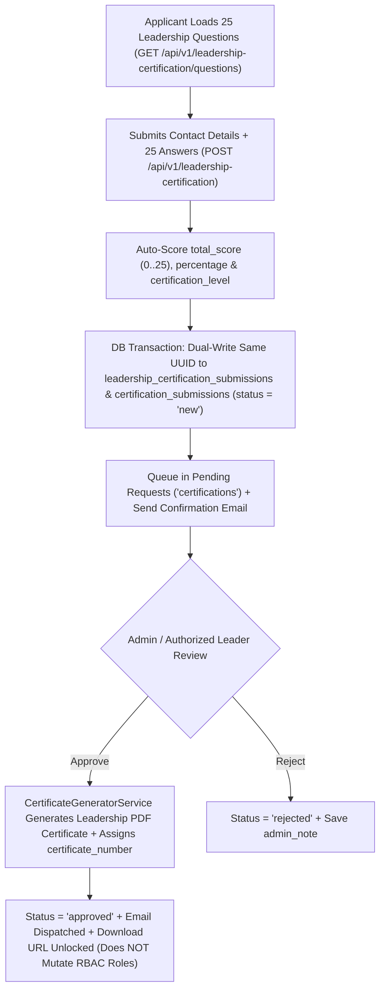

# Activity 10: Leadership Certification Form

| Attribute | Verified Specification |
|---|---|
| **Workbook Activity #** | `10.0` |
| **Exact Workbook Name** | `Leadership Certification Form` |
| **Domain Category** | `Accreditation & Credibility` (Sheet 1 & 2) / `Compliance / Accreditation` (Sheet 3) |
| **Activity Governance Tier** | `Verification & Approval` (Public/Member 25-question leadership assessment → Admin/Leader Pending Queue review → Server-side PDF Certificate generation & email dispatch) |
| **Overall Implementation Status** | `Partially Implemented` (End-to-end 25-question Leadership Quiz, dual-table atomic write, Admin moderation, and DomPDF certificate generation work; **major divergence** from Workbook's role/milestone audit spec, plus IDOR on submission detail, unguarded `/api/v1/admin/*` routes, and fabricated `30%` Dashboard KPI split) |
| **Master Index & Cross-Links** | [12-master-35-activities-index.md](../12-master-35-activities-index.md) · [19-activity-to-role-access-matrix.md](../19-activity-to-role-access-matrix.md) · [25-activity-workflow-reference.md](../25-activity-workflow-reference.md) · [13-activity-input-forms-and-validation.md](../13-activity-input-forms-and-validation.md) · [09-entrepreneur-certification-form.md](./09-entrepreneur-certification-form.md) · [13-leadership-role-application-form.md](./13-leadership-role-application-form.md) |

---

## 1. Business Purpose (§9.1)

- **Why It Exists & Business Outcome:**
  - **WORKBOOK REQUIREMENT:** Document community leadership roles held, chapter stewardships, and milestone completions (`MilestoneChecklistSheet`) to earn an official Leadership Certificate bearing a digital verification seal (`DigitalSealSignerService`).
  - **FACT (Critical Product vs Code Divergence & Governance Distinction):**
    1. **Quiz Assessment vs Role Audit:** Production implements a **25-Question Servant & Community Leadership Situational Quiz** ([LeadershipCertificationSubmission.php](file:///c:/Users/malic/OneDrive/Documents/GitHub/unity-app-new/app/Models/LeadershipCertificationSubmission.php#L12-L66), [WebsiteFormsController.php](file:///c:/Users/malic/OneDrive/Documents/GitHub/unity-app-new/app/Http/Controllers/Api/V1/Forms/WebsiteFormsController.php#L153-L234)), auto-scoring `total_score` (0–25), `percentage`, and `certification_level`, and dual-writing to `leadership_certification_submissions` and `certification_submissions` (`certification_type = 'leadership'`, `status = 'new'`).
    2. **Accreditation vs RBAC Authority:** Earning a Leadership Certificate **does NOT grant RBAC leadership permissions or access to the Peers Global Leadership App** (`EnsureLeaderUser`). Actual executive/chapter role candidacy and assignment are governed by Activity 13 ([13-leadership-role-application-form.md](./13-leadership-role-application-form.md)) and Admin Circle/Organizational Role Assignments.
- **Role Partitioning (Member vs Leadership vs Admin):**
  - **Peer Member / Public Applicant (`FACT`):** Completes the 25-question leadership assessment in the Flutter Member App ([leadership_certification_screen.dart](file:///D:/office%20project/peers-unity/unity_app/lib/features/highlights/presentation/screens/leadership_certification_screen.dart)) or public web form (`POST /api/v1/leadership-certification`), views status (`GET /api/v1/leadership-certification/my`), and downloads the generated PDF certificate upon approval.
  - **Circle / Regional Leadership (`FACT`):** Views leadership certification records in [leader_activities_view.dart](file:///D:/office%20project/LeaderApp-Fornt-end-/lib/features/leader_activities/view/leader_activities_view.dart) (`leadership-certifications`) and `/api/v1/leader/leads/leadership_certification`, and scoped Leaders can approve/reject via `/api/v1/leader/pending-requests/certifications/{id}/approve|reject`.
  - **Super Admin / Web Admin (`FACT`):** Moderates submissions, triggers PDF generation (`CertificateGeneratorService`), and downloads certificates via [CertificationSubmissionsView.tsx](file:///D:/office%20project/unity-admin-web/src/features/certifications/CertificationSubmissionsView.tsx) and `/admin/pending-requests/certifications`.

---

## 2. Sub-Activities Catalogue (§9.2)

| # | Sub-Activity / Operation | Member App (`unity_app`) | Leadership App (`LeaderApp`) | Admin Web (`unity-admin-web` & Blade) | Backend (`unity-app-new`) | Classification |
|---|---|---|---|---|---|---|
| 2.1 | **Fetch 25 Leadership Quiz Questions** | Wired (`GET /api/v1/leadership-certification/questions` via `leadership_certification_remote_datasource.dart`) | Not applicable | Not applicable | `WebsiteFormsController@leadershipCertificationQuestions` (`CertificationQuestionsService`) | `Fully Implemented` |
| 2.2 | **Submit Leadership Certification Quiz** | Wired ([leadership_certification_screen.dart](file:///D:/office%20project/peers-unity/unity_app/lib/features/highlights/presentation/screens/leadership_certification_screen.dart) → `POST /api/v1/leadership-certification`) | Not applicable | Public website form posts to same endpoint | `WebsiteFormsController@submitLeadershipCertification` (`SubmitLeadershipCertificationRequest`) | `Fully Implemented` |
| 2.3 | **Verify Chapter Roles & Audit Milestones (`MilestoneChecklistSheet`)** | **Absent** (`MilestoneChecklistSheet` in Workbook does not exist) | Leader milestones tracked separately under Finance (`FinanceMilestoneConfig`) & Profile (`profile_milestones_card.dart`), unlinked to this form | **Absent** | Not linked to `circles` / `circle_members` / `user_milestone_badges` | `Requires Business Confirmation` |
| 2.4 | **View Certification Status & Download PDF** | Wired (`GET /api/v1/leadership-certification/my`, `GET /api/v1/my-certifications`) | Read list in `leader_activities_view.dart` | Wired (`CertificationSubmissionsView.tsx`) | `WebsiteFormsController`, `CertificationSubmissionController@download` | `Fully Implemented` |
| 2.5 | **Approve / Reject & Generate PDF Certificate** | Read-only | Exposed via `PendingRequestAdminController` (`certifications`) | Wired (`POST /api/v1/admin/certifications/{id}/approve\|reject`) | `CertificationSubmissionController`, `PendingRequestModerationService`, `CertificateGeneratorService` | `Implemented but Incorrect` (Missing admin route guard & missing `leader.can` capability gate) |

---

## 3. Input Form & Field Validation Mapping (§9.3)

**FACT:** Verified against [SubmitLeadershipCertificationRequest.php](file:///c:/Users/malic/OneDrive/Documents/GitHub/unity-app-new/app/Http/Requests/Forms/SubmitLeadershipCertificationRequest.php#L33-L47), [LeadershipCertificationSubmission.php](file:///c:/Users/malic/OneDrive/Documents/GitHub/unity-app-new/app/Models/LeadershipCertificationSubmission.php#L12-L66), and Workbook Row 18/17.

| Field Name | Data Type | Required / Optional | Validation (Backend + Client) | Default | Input Widget | Data Source | Visibility | Who Enters | Who Edits | Who Views | Sensitive? | Backend Request Key |
|---|---|---|---|---|---|---|---|---|---|---|---|---|
| **Full Name** | `string (max:255)` | Required | **Backend:** `required\|string\|max:255` (trimmed). | Pre-filled from auth user | `TextField` | Auth user / manual input | Printed on PDF Certificate & visible to Admin/Leaders | Applicant | Immutable | Applicant, Scoped Leaders, Admin | PII | `full_name` |
| **Business Name** | `string (max:255)` | Required | **Backend:** `required\|string\|max:255` (trimmed). | Pre-filled from `company_name` | `TextField` | Auth user / manual input | Printed on Certificate & visible to Admin/Leaders | Applicant | Immutable | Applicant, Scoped Leaders, Admin | No | `business_name` |
| **Email Address** | `string (email, max:255)` | Required | **Backend:** `required\|email\|max:255` (trimmed; links to `users.id` if unauthenticated). | Pre-filled from `user.email` | Email `TextField` | Auth user / manual input | Private to Applicant & Admin/Leaders (**IDOR bug on `show`!**) | Applicant | Immutable | Applicant, Admin, Leaders | **Yes** (Email PII) | `email` |
| **Contact Number** | `string (max:30)` | Required | **Backend:** `required\|string\|max:30` (trimmed). | Pre-filled from `user.phone` | Phone `TextField` | Auth user / manual input | Private to Applicant & Admin/Leaders | Applicant | Immutable | Applicant, Admin, Leaders | **Yes** (Phone PII) | `contact_no` |
| **25 Leadership Quiz Answers** (`team_struggling_action`, `leader_definition`, `junior_challenged_idea`, `leader_when_wrong`, `team_motivation`, ..., `great_leader_opinion`) | `25 × string` (`json` in `certification_submissions.answers`) | All 25 Required | **Backend:** Each of the 25 `QUIZ_FIELDS` validated as `required\|string` (`SubmitLeadershipCertificationRequest.php:42-44`), scored against `CORRECT_ANSWERS` (`L40-66`). | `null` | 25 Multiple-Choice Option Cards (`leadership_certification_screen.dart`) | `GET /api/v1/leadership-certification/questions` | Visible to Applicant & Admin reviewer | Applicant | Immutable | Applicant, Admin | No | 25 snake_case keys in `LeadershipCertificationSubmission::QUIZ_FIELDS` |
| **Leadership Roles Held / Milestones Completed** *(Workbook only)* | *Workbook fields* | *Workbook only* | **NOT IMPLEMENTED:** Replaced by the 25-question leadership quiz (`Requires Business Confirmation`). | N/A | **NOT IMPLEMENTED** | N/A | N/A | N/A | N/A | N/A | No | *None* |
| **Admin Review Note** | `text` | Optional | **Backend:** `admin_note` / `notes` `nullable\|string`. | `null` | Admin modal textarea | Reviewer input | Visible to Admin & Applicant | Admin / Approving Leader | Admin | Applicant, Admin | No | `admin_note` / `notes` |

---

## 4. Workflow, Lifecycle & Mermaid Diagram (§9.4)

### Workbook vs Actual Lifecycle Comparison
- **WORKBOOK REQUIREMENT:** `Role Verified -> Milestones Audited -> Seal Generated` (statuses: `Active, Verified`).
- **FACT:** Identical dual-table state machine to Activity 09: `status` ∈ **`'new'` | `'approved'` | `'rejected'`** across `leadership_certification_submissions` and `certification_submissions` (`certification_type = 'leadership'`), with synchronous DomPDF certificate generation via `CertificateGeneratorService` on approval (visual seal graphic in PDF template, not cryptographic PKI `DigitalSealSignerService`).

---

## 5. Outputs & Deliverables (§9.5)

| Output / Deliverable | Status & Evidence (`FACT` vs `WORKBOOK REQUIREMENT`) |
|---|---|
| **Official Leadership Certificate PDF** | **FACT (`Fully Implemented`):** Generated by `CertificateGeneratorService` with `certificate_number`, `certification_level`, and `issued_at`, downloadable via `certificate_download_url` once `status === 'approved'`. |
| **Member App Certification Card** | **FACT (`Fully Implemented`):** `leadership_certification_screen.dart` & `GET /api/v1/my-certifications`. |
| **Cryptographic Digital Seal (`DigitalSealSignerService`)** | **NOT IMPLEMENTED (`Architectural Substitution`):** Uses visual badge/seal + unique `certificate_number` in DomPDF template rather than cryptographic PDF signing. |
| **Admin & Leader Moderation Queues** | **FACT (`Fully Implemented`):** `CertificationSubmissionsView.tsx`, `PendingRequestAdminController` (`certifications`), and `LeaderActivitiesController` (`leadership-certifications`). |

---

## 6. Database & Metrics Mapping (§9.6)

### Primary Tables & Eloquent Models
1. **`leadership_certification_submissions`** — [LeadershipCertificationSubmission.php](file:///c:/Users/malic/OneDrive/Documents/GitHub/unity-app-new/app/Models/LeadershipCertificationSubmission.php)
   - **Columns:** `id` (`uuid` PK), `full_name`, `business_name`, `email`, `contact_no`, `status` (`new` | `approved` | `rejected`), `notes`, 25 leadership quiz answer columns, `total_score` (`int`), `percentage` (`float`), `certification_level` (`varchar`), `created_at`, `updated_at`.
2. **`certification_submissions`** — [CertificationSubmission.php](file:///c:/Users/malic/OneDrive/Documents/GitHub/unity-app-new/app/Models/CertificationSubmission.php) (`certification_type = 'leadership'`, same schema as Activity 09).

### Workbook Sheet 3 Metric Keys vs Actual Backend Schema
| Workbook Metric Key (Sheet 1–3) | Actual Backend / API Computation (`FACT`) | Discrepancy / Bug Note |
|---|---|---|
| `leadershipCertStatus` | `certification_submissions.status` (`new`, `approved`, `rejected`) | **CRITICAL BUG (`LeaderDashboardService.php:790`):** Dashboard computes `leadership_certifications = round($certificationsCount * 0.3)` instead of filtering `WHERE certification_type = 'leadership'`! |
| `leadershipMilestonesCompleted` | Quiz stores `total_score` (`0..25`) and `certification_level`; actual Leader tenure milestones live separately in `finance_leader_tenures` / `finance_milestone_configs` | Unlinked across the two modules (`Requires Business Confirmation`). |

---

## 7. API & Backend Service Mapping (§9.7)

| Layer | Method & Endpoint | Controller & Action | Service / FormRequest | Auth Middleware | Scope Enforcement & Security Audit (`FACT`) | Client Integration |
|---|---|---|---|---|---|---|
| **Public / Member API** | `GET /api/v1/leadership-certification/questions` & `POST /api/v1/leadership-certification` | [WebsiteFormsController.php](file:///c:/Users/malic/OneDrive/Documents/GitHub/unity-app-new/app/Http/Controllers/Api/V1/Forms/WebsiteFormsController.php) | `CertificationQuestionsService`, `SubmitLeadershipCertificationRequest` | Public (optional Sanctum user) | Public submission — add rate-limiting (`throttle`) | Wired in Member App & Website |
| **Member API** | `GET /api/v1/leadership-certification[/my]`, `GET /api/v1/leadership-certification/{id}`, `GET /api/v1/my-certifications` | `WebsiteFormsController` (`L153, 215`) | — | `auth:sanctum`, `unity.user` | **`GET /api/v1/leadership-certification/{id}` (`L215`) has NO ownership check (IDOR leaking `email`, `contact_no`, quiz answers)!** | Wired in Member App |
| **Leader API** | `GET /api/v1/leader/activities/leadership-certifications` & `GET /api/v1/leader/leads/leadership_certification[/{id}]` | `LeaderActivitiesController`, `LeadAdminApiController` | `LeaderActivitiesService` | `auth:sanctum`, `leader.user` | `/leader/leads/*` lacks circle scoping | `activitiesByType` wired |
| **Leader / Admin Queue** | `POST /api/v1/leader/pending-requests/certifications/{id}/approve\|reject` | `PendingRequestAdminController` | `PendingRequestModerationService`, `CertificateGeneratorService` | `auth:sanctum`, `leader.user` | Enforces circle scope, **but lacks `leader.can` capability gate** | Wired in Leader Pending Approvals |
| **Admin API & Web** | `GET /api/v1/admin/certifications?type=leadership`, `POST .../{id}/approve\|reject`, `GET .../{id}/download` & Web `/admin/pending-requests/certifications*` | `CertificationSubmissionController`, `Admin\CertificationSubmissionsController` | `CertificateGeneratorService` | Web: `web`, `admin.auth`; **API: `auth:sanctum`, `unity.user` (MISSING admin guard!)** | **CRITICAL BUG:** Unprotected against self-approval by any regular member token! | Wired in `CertificationSubmissionsView.tsx` & Blade |

---

## 8. Role-Wise Access Governance (§9.8)

| Role | View Activity | Create Record | Edit Own | Edit Others | Submit for Review | Verify | Approve | Reject | Assign | Manage | Delete | View Aggregated Reports |
|---|---|---|---|---|---|---|---|---|---|---|---|---|
| **Super Admin** | Allowed (Global) | Allowed | DENIED — Quiz immutable | Allowed (`notes` / `status`) | Allowed | Allowed | Allowed (`POST /admin/certifications/{id}/approve` → generates PDF) | Allowed (`POST /admin/certifications/{id}/reject`) | DENIED — No permission under the verified backend authorization model | Allowed (`CertificationSubmissionsView.tsx`) | Allowed (`DELETE /api/v1/admin/leads/leadership_certification/{id}`) | Allowed (Global Counts) |
| **Country Director** | Allowed (Scoped) | Allowed | DENIED — Immutable | DENIED — No permission under the verified backend authorization model | Allowed | Allowed (In scope — `Requires Business Confirmation`) | Allowed (In scope — `Requires Business Confirmation`) | Allowed (In scope) | DENIED — No permission under the verified backend authorization model | DENIED — No permission under the verified backend authorization model | DENIED — No permission under the verified backend authorization model | Allowed (Scoped Dashboard) |
| **DED** | Allowed (District Scope) | Allowed | DENIED — Immutable | DENIED — No permission under the verified backend authorization model | Allowed | Allowed (In district — `Requires Business Confirmation`) | Allowed (In district — `Requires Business Confirmation`) | Allowed (In district) | DENIED — No permission under the verified backend authorization model | DENIED — No permission under the verified backend authorization model | DENIED — No permission under the verified backend authorization model | Allowed (District Dashboard) |
| **Industry Director** | Allowed (Industry Scope) | Allowed | DENIED — Immutable | DENIED — No permission under the verified backend authorization model | Allowed | Allowed (In industry — `Requires Business Confirmation`) | Allowed (In industry — `Requires Business Confirmation`) | Allowed (In industry) | DENIED — No permission under the verified backend authorization model | DENIED — No permission under the verified backend authorization model | DENIED — No permission under the verified backend authorization model | Allowed (Industry Dashboard) |
| **Circle Founder** | Allowed (Own Circle) | Allowed | DENIED — Immutable | DENIED — No permission under the verified backend authorization model | Allowed | Allowed (Own circle — `Requires Business Confirmation` whether circle leaders may approve Leadership Certificates!) | Allowed in code (`Requires Business Confirmation`) | Allowed in code | DENIED — No permission under the verified backend authorization model | DENIED — No permission under the verified backend authorization model | DENIED — No permission under the verified backend authorization model | Allowed (Own Circle Dashboard) |
| **Circle Director** | Allowed (Own Circle) | Allowed | DENIED — Immutable | DENIED — No permission under the verified backend authorization model | Allowed | Allowed in code (`Requires Business Confirmation`) | Allowed in code (`Requires Business Confirmation`) | Allowed in code | DENIED — No permission under the verified backend authorization model | DENIED — No permission under the verified backend authorization model | DENIED — No permission under the verified backend authorization model | Allowed (Own Circle Dashboard) |
| **Chair / Committee Chairs** | Allowed (Own Circle read feed) | Allowed | DENIED — Immutable | DENIED — No permission under the verified backend authorization model | Allowed | DENIED intended (**BUG:** unguarded in `PendingRequestAdminController`) | DENIED intended (**BUG:** unguarded) | DENIED intended (**BUG:** unguarded) | DENIED — No permission under the verified backend authorization model | DENIED — No permission under the verified backend authorization model | DENIED — No permission under the verified backend authorization model | Allowed (Own Circle Dashboard) |
| **Vice Chair** | Allowed (Own Circle read feed) | Allowed | DENIED — Immutable | DENIED — No permission under the verified backend authorization model | Allowed | DENIED intended (**BUG:** unguarded) | DENIED intended (**BUG:** unguarded) | DENIED intended (**BUG:** unguarded) | DENIED — No permission under the verified backend authorization model | DENIED — No permission under the verified backend authorization model | DENIED — No permission under the verified backend authorization model | Allowed (Own Circle Read-Only) |
| **Secretary** | Allowed (Own Circle read feed) | Allowed | DENIED — Immutable | DENIED — No permission under the verified backend authorization model | Allowed | DENIED intended (**BUG:** unguarded) | DENIED intended (**BUG:** unguarded) | DENIED intended (**BUG:** unguarded) | DENIED — No permission under the verified backend authorization model | DENIED — No permission under the verified backend authorization model | DENIED — No permission under the verified backend authorization model | Allowed (Own Circle Read-Only) |
| **Committee Leader** | Allowed in Web RBAC; **BROKEN (`403`)** in Leader App | Allowed | DENIED — Immutable | DENIED — No permission under the verified backend authorization model | Allowed | DENIED — No permission under the verified backend authorization model | DENIED — No permission under the verified backend authorization model | DENIED — No permission under the verified backend authorization model | DENIED — No permission under the verified backend authorization model | DENIED — No permission under the verified backend authorization model | DENIED — No permission under the verified backend authorization model | DENIED in Leader App (`403`) |
| **Peer Member** | Allowed (Own submissions + Public peer approved certificates) | Allowed (`POST /api/v1/leadership-certification`) | DENIED — Immutable | DENIED — No permission under the verified backend authorization model | Allowed | DENIED — No permission under the verified backend authorization model | DENIED — No permission under the verified backend authorization model *(CRITICAL BUG: `/api/v1/admin/certifications/{id}/approve` unguarded!)* | DENIED — No permission under the verified backend authorization model | DENIED — No permission under the verified backend authorization model | DENIED — No permission under the verified backend authorization model | DENIED — No permission under the verified backend authorization model | DENIED — No permission under the verified backend authorization model |

---

## 9. Existing Implementation Summary, Gaps & Minimum-Change Enhancement Recommendations

### Summary of Verified Limitations & Bugs
1. **Unprotected `/api/v1/admin/certifications/*` Self-Approval Bug (`P0` Security):** Identical to Activity 09—any authenticated member token can invoke `POST /api/v1/admin/certifications/{id}/approve`.
2. **IDOR on `GET /api/v1/leadership-certification/{id}` (`P1` Privacy):** `WebsiteFormsController@showLeadershipCertification` (`L215`) returns any submission's PII (`email`, `contact_no`, answers) by UUID without ownership verification.
3. **Synthetic `30%` Dashboard Metric (`Implemented but Incorrect`):** [LeaderDashboardService.php](file:///c:/Users/malic/OneDrive/Documents/GitHub/unity-app-new/app/Leader/Services/LeaderDashboardService.php#L790) computes `leadership_certifications = round($certificationsCount * 0.3)` instead of counting `certification_type = 'leadership'`.
4. **Potential Prerequisite Opportunity:** Currently unlinked to Activity 13 (`LeaderInterestSubmission` / `web_leadership_nominations`)—leaders/candidates are not automatically badged with whether they have passed the Leadership Certification quiz.

### Minimum-Change Enhancement Recommendations
- **RECOMMENDATION 1 (Secure Admin, Leader & Detail Endpoints):** Enforce admin guard on `/api/v1/admin/certifications*`, add caller/admin ownership check to `WebsiteFormsController@showLeadershipCertification`, scope `/leader/leads/*`, and restrict certification approvals in `PendingRequestAdminController` to authorized governance roles.
- **RECOMMENDATION 2 (Fix Dashboard Count & Surface Badge on Leader Profile):** Replace `round($certificationsCount * 0.3)` in `LeaderDashboardService` with `CertificationSubmission::where('certification_type', 'leadership')->count()`, and optionally surface an `"Accredited Leadership Certificate"` indicator on candidate cards in Activity 13 (`LeadershipPage.tsx` / `PeerProfileView`) when an approved `certification_submissions` row exists for that user.
- **BUSINESS DECISION REQUIRED:** Confirm whether Leadership Certification approval should be **Global Admin / Country Director / DED only** (preventing a Circle Director from approving their own circle peers' national Leadership Certificates).
