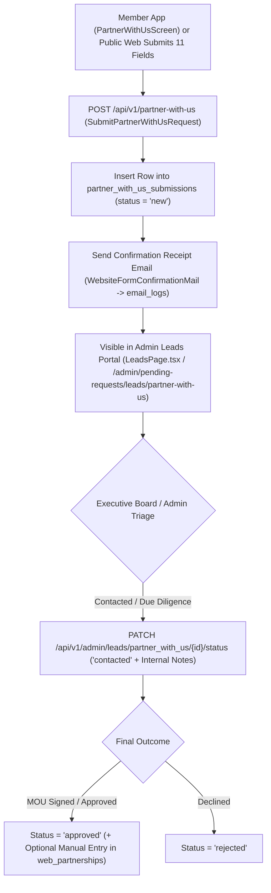

# Activity 11: Partner With Us Form

| Attribute | Verified Specification |
|---|---|
| **Workbook Activity #** | `11.0` |
| **Exact Workbook Name** | `Partner With Us Form` |
| **Domain Category** | `Strategic Partnerships` (Sheet 1 & 2) / `Corporate / B2B Alliances` (Sheet 3) |
| **Activity Governance Tier** | `Global Administration` (Corporate B2B alliance & sponsorship intake directed to Peers Global Executive Board / Global Admin; read-only lead visibility currently exposed in `/api/v1/leader/leads/partner_with_us`) |
| **Overall Implementation Status** | `Implemented but Incorrect` (Member App `PartnerWithUsScreen`, public website submission, email confirmation, and Admin Leads Portal work; **CRITICAL PII LEAK:** `GET /api/v1/partner-with-us` returns ALL global submissions to any regular member without filtering by user, `/api/v1/admin/leads/*` lacks admin middleware, `/api/v1/leader/leads/*` leaks global corporate leads to all circle leaders, and Workbook's pitch-deck upload is `Missing`) |
| **Master Index & Cross-Links** | [12-master-35-activities-index.md](../12-master-35-activities-index.md) · [19-activity-to-role-access-matrix.md](../19-activity-to-role-access-matrix.md) · [25-activity-workflow-reference.md](../25-activity-workflow-reference.md) · [13-activity-input-forms-and-validation.md](../13-activity-input-forms-and-validation.md) · [12-brand-partner-form-and-ads.md](./12-brand-partner-form-and-ads.md) · [44-api-and-organizational-scope-security.md](../44-api-and-organizational-scope-security.md) |

---

## 1. Business Purpose (§9.1)

- **Why It Exists & Business Outcome:**
  - **WORKBOOK REQUIREMENT:** Enables corporate entities, institutional sponsors, and ecosystem vendors to pitch strategic B2B alliances to the Peers Global Executive Board, upload a partnership pitch deck, receive a confirmation ticket, and progress through `Submitted -> Board Triage -> Due Diligence -> MOU Agreement`.
  - **FACT:** Implemented as a 11-field corporate partnership lead intake form ([SubmitPartnerWithUsRequest.php](file:///c:/Users/malic/OneDrive/Documents/GitHub/unity-app-new/app/Http/Requests/Forms/SubmitPartnerWithUsRequest.php), [WebsiteFormsController.php](file:///c:/Users/malic/OneDrive/Documents/GitHub/unity-app-new/app/Http/Controllers/Api/V1/Forms/WebsiteFormsController.php#L354-L382)) stored in `partner_with_us_submissions` (`PartnerWithUsSubmission`). Submissions trigger a confirmation email (`WebsiteFormConfirmationMail`) and land in the Admin Leads Portal (`LeadsPage.tsx` / `LeadAdminApiController` & Blade `/admin/pending-requests/leads/partner-with-us`). Once an MOU is signed externally, approved partner logos/listings for the public website are managed separately in `App\Models\Web\WebPartnership` (`web_partnerships`).
- **Role Partitioning (Member vs Leadership vs Admin):**
  - **Peer Member / Public Corporate Proposer (`FACT`):** Submits alliance proposals in the Flutter Member App ([partner_with_us_screen.dart](file:///D:/office%20project/peers-unity/unity_app/lib/features/highlights/presentation/screens/partner_with_us_screen.dart), [partner_with_us_form_fields.dart](file:///D:/office%20project/peers-unity/unity_app/lib/features/highlights/presentation/widgets/partner_with_us_form_fields.dart)) or public website (`POST /api/v1/partner-with-us`).
  - **Circle / Regional Leadership (`FACT`):** Corporate alliances are an Executive Board / HQ function (`Not Required` for Circle Chairs/Secretaries). Currently, `GET /api/v1/leader/leads/partner_with_us` (`routes/leader.php:234`) exposes read-only corporate leads to all leaders without scope filtering (`Implemented but Incorrect`).
  - **Super Admin / Executive Operations (`FACT`):** Triages leads, updates `status` (`new`, `contacted`, `approved`, `rejected`, etc.) and `notes` via [LeadsPage.tsx](file:///D:/office%20project/unity-admin-web/src/features/leads/LeadsPage.tsx) (`LeadAdminApiController`) and `/admin/pending-requests/leads/partner-with-us` (`LeadSubmissionsController`), and publishes showcase logos in `web_partnerships`.

---

## 2. Sub-Activities Catalogue (§9.2)

| # | Sub-Activity / Operation | Member App (`unity_app`) | Leadership App (`LeaderApp`) | Admin Web (`unity-admin-web` & Blade) | Backend (`unity-app-new`) | Classification |
|---|---|---|---|---|---|---|
| 2.1 | **Submit Corporate Partnership Proposal** | Wired ([partner_with_us_screen.dart](file:///D:/office%20project/peers-unity/unity_app/lib/features/highlights/presentation/screens/partner_with_us_screen.dart) → `POST /api/v1/partner-with-us`) | Not applicable (`Not Required` in Leader App) | Public website form posts to same endpoint | `WebsiteFormsController@submitPartnerWithUs` (`SubmitPartnerWithUsRequest`) | `Fully Implemented` |
| 2.2 | **Attach Partnership Pitch Deck (PDF/PPTX)** | **Absent** (`DeckUploadWidget` in Workbook does not exist) | Not applicable | **Absent** | **No file column** on `partner_with_us_submissions` | `Missing` |
| 2.3 | **View Own Submitted Proposals & Status** | Endpoint `GET /api/v1/partner-with-us` exists via `partner_with_us_remote_datasource.dart` | `GET /api/v1/leader/leads/partner_with_us` exists on backend (not wired to a dedicated Leader screen) | Wired in [LeadsPage.tsx](file:///D:/office%20project/unity-admin-web/src/features/leads/LeadsPage.tsx) | **`WebsiteFormsController@indexPartnerWithUs` (`L354`) & `@showPartnerWithUs` (`L369`) LACK USER FILTERING — leaks all global submissions!** | `Implemented but Incorrect` (`P0` Data Leak) |
| 2.4 | **Triage Lead Status & Record Internal Board Notes** | Not applicable | Not applicable | Wired (`PATCH /api/v1/admin/leads/partner_with_us/{id}/status`, `PUT .../{id}`) | `LeadAdminApiController`, `Admin\LeadSubmissionsController` | `Implemented but Incorrect` (`/api/v1/admin/leads/*` lacks admin guard) |
| 2.5 | **Publish Approved Ecosystem Partner on Website (`web_partnerships`)** | Not applicable | Not applicable | Managed in Web Admin (`WebMediaHubPage.tsx` / Web CMS) | `App\Models\Web\WebPartnership` (`web_partnerships`) | `Fully Implemented` (Disconnected from lead row) |

---

## 3. Input Form & Field Validation Mapping (§9.3)

**FACT:** Verified against [SubmitPartnerWithUsRequest.php](file:///c:/Users/malic/OneDrive/Documents/GitHub/unity-app-new/app/Http/Requests/Forms/SubmitPartnerWithUsRequest.php#L33-L48), [partner_with_us_form_fields.dart](file:///D:/office%20project/peers-unity/unity_app/lib/features/highlights/presentation/widgets/partner_with_us_form_fields.dart) (`member_app_forms_and_apis.json:384-396`), and Workbook Row 19/18.

| Field Name | Data Type | Required / Optional | Validation (Backend + Client) | Default | Input Widget | Data Source | Visibility | Who Enters | Who Edits | Who Views | Sensitive? | Backend Request Key |
|---|---|---|---|---|---|---|---|---|---|---|---|---|
| **First Name** | `string (max:255)` | Required | **Backend:** `required\|string\|max:255` (trimmed). **Client:** `First Name *` required. | Pre-filled if logged in | `TextField` (`First Name *`) | Auth user / manual input | Intended: Submitter & Admin (**BUG:** leaked on `GET /api/v1/partner-with-us`) | Proposer | Admin (`PUT /admin/leads/...`) | Submitter & Global Admin | PII | `first_name` |
| **Last Name** | `string (max:255)` | Required | **Backend:** `required\|string\|max:255` (trimmed). **Client:** `Last Name *` required. | Pre-filled if logged in | `TextField` (`Last Name *`) | Auth user / manual input | Submitter & Global Admin | Proposer | Admin | Submitter & Global Admin | PII | `last_name` |
| **Mobile Number** | `string (max:30)` | Required | **Backend:** `required\|string\|max:30` (trimmed). **Client:** `Mobile Number *` required. | Pre-filled if logged in | Phone `TextField` (`Mobile Number *`) | Auth user / manual input | Submitter & Global Admin | Proposer | Admin | Submitter & Global Admin | **Yes** (Phone PII) | `mobile_number` |
| **Email ID** | `string (email, max:255)` | Required | **Backend:** `required\|email\|max:255` (trimmed). **Client:** `Email ID *` required. | Pre-filled if logged in | Email `TextField` (`Email ID *`) | Auth user / manual input | Submitter & Global Admin | Proposer | Admin | Submitter & Global Admin | **Yes** (Email PII) | `email_id` |
| **City** | `string (max:150)` | Required | **Backend:** `required\|string\|max:150` (trimmed). **Client:** `City *` required. | `''` | `TextField` (`City *`) | Manual input | Submitter & Global Admin | Proposer | Admin | Submitter & Global Admin | No | `city` |
| **Brand / Company Name** | `string (max:255)` | Required | **Backend:** `required\|string\|max:255` (trimmed). **Client:** `Brand / Company Name *` required. | `''` | `TextField` (`Brand / Company Name *`) | Manual input | Submitter & Global Admin | Proposer | Admin | Submitter & Global Admin | Commercial | `brand_or_company_name` |
| **Website / Social Media Link** | `string (url, max:500)` | Backend: Optional (`nullable`); Flutter UI: Marked `*` | **Backend (`L42`):** `nullable\|url\|max:500` (requires `https://` scheme if provided!). **Client (`partner_with_us_form_fields.dart`):** Labeled `Website / Social Media Link *` (**UI vs Backend mismatch**; entering `www.acme.com` without `https://` triggers 422!). | `null` | URL `TextField` | Manual input | Submitter & Global Admin | Proposer | Admin | Submitter & Global Admin | No | `website_or_social_media_link` |
| **Industry** | `string (max:150)` | Required | **Backend:** `required\|string\|max:150`. **Client:** `Industry *` required. | `''` | `TextField` / Dropdown (`Industry *`) | Manual input | Submitter & Global Admin | Proposer | Admin | Submitter & Global Admin | No | `industry` |
| **About Your Business** | `text` | Required | **Backend:** `required\|string` (unbounded max length — `Requires Confirmation`). **Client:** `About Your Business *`. | `''` | Multiline `TextField` | Manual input | Submitter & Global Admin | Proposer | Admin | Submitter & Global Admin | Commercial | `about_your_business` |
| **Partnership Goal** | `text` | Required | **Backend:** `required\|string`. **Client:** `Partnership Goal *`. | `''` | Multiline `TextField` | Manual input | Submitter & Global Admin | Proposer | Admin | Submitter & Global Admin | **Yes** (Confidential B2B pitch) | `partnership_goal` |
| **Why Partner with Peers Global?** | `text` | Required | **Backend:** `required\|string`. **Client:** `Why Partner with Peers Global? *`. | `''` | Multiline `TextField` | Manual input | Submitter & Global Admin | Proposer | Admin | Submitter & Global Admin | Commercial | `why_partner_with_peers_global` |
| **Pitch Deck Upload** *(Workbook only)* | `file` *(Workbook)* | *Workbook only* | **NOT IMPLEMENTED:** No `deck_file_id` column or upload rule exists. | N/A | **NOT IMPLEMENTED** | N/A | N/A | N/A | N/A | N/A | Confidential Deck | *None (`NOT IMPLEMENTED`)* |
| **Lead Status & Internal Notes** | `string` + `text` | Admin Triage | **Backend (`LeadAdminApiController`):** `status` string (default `'new'`, e.g., `'contacted'`, `'in_discussion'`, `'approved'`, `'rejected'`), `notes` `nullable\|string`. | `'new'` | Status dropdown & notes textarea (`LeadsPage.tsx`) | Admin input | Admin only | Super Admin / Ops Admin | Super Admin / Ops Admin | Super Admin / Ops Admin | Confidential | `status`, `notes` |

---

## 4. Workflow, Lifecycle & Mermaid Diagram (§9.4)

### Workbook vs Actual Lifecycle Comparison
- **WORKBOOK REQUIREMENT:** `Submitted -> Board Triage -> Due Diligence -> MOU Agreement`.
- **FACT:** Stored in `partner_with_us_submissions.status` as an open string column defaulting to `'new'` and updated by Admin via `PATCH /api/v1/admin/leads/partner_with_us/{id}/status` (typically `'new'` → `'contacted'` / `'under_review'` → `'approved'` | `'rejected'`). No automated CRM webhook (`CrmSyncIntegration`) exists.

---

## 5. Outputs & Deliverables (§9.5)

| Output / Deliverable | Status & Evidence (`FACT` vs `WORKBOOK REQUIREMENT`) |
|---|---|
| **Confirmation Receipt Email & Toast** | **FACT (`Fully Implemented`):** Dispatches `WebsiteFormConfirmationMail` (logged in `email_logs`) and returns `201` confirmation receipt to `PartnerWithUsScreen`. |
| **Executive Board / Admin Triage Ticket** | **FACT (`Fully Implemented`):** Surfaced in React Admin [LeadsPage.tsx](file:///D:/office%20project/unity-admin-web/src/features/leads/LeadsPage.tsx) and Blade `/admin/pending-requests/leads/partner-with-us`. |
| **External CRM Sync (`CrmSyncIntegration`)** | **NOT IMPLEMENTED (`Workbook-Only`):** Managed directly inside the Unity Admin Leads table. |

---

## 6. Database & Metrics Mapping (§9.6)

### Primary Table & Eloquent Model
- **Model:** [PartnerWithUsSubmission.php](file:///c:/Users/malic/OneDrive/Documents/GitHub/unity-app-new/app/Models/PartnerWithUsSubmission.php) (`App\Models\PartnerWithUsSubmission`, `HasUuids`)
- **PostgreSQL Table:** `partner_with_us_submissions`
  - **Columns:** `id` (`uuid` PK), `first_name`, `last_name`, `mobile_number`, `email_id`, `city`, `brand_or_company_name`, `website_or_social_media_link`, `industry`, `about_your_business`, `partnership_goal`, `why_partner_with_peers_global`, `status` (default `'new'`), `notes`, `created_at`, `updated_at`.
  - *(Note: No `user_id` FK column exists on `partner_with_us_submissions`—submissions can only be matched to an authenticated `User` via `LOWER(email_id) = LOWER(users.email)` or `mobile_number`!)*
- **Adjacent Table:** `web_partnerships` (`App\Models\Web\WebPartnership` — `web_` prefixed website partner logo directory).

### Workbook Sheet 3 Metric Keys vs Actual Backend Schema
| Workbook Metric Key (Sheet 1–3) | Actual Backend / API Computation (`FACT`) | Discrepancy / Bug Note |
|---|---|---|
| `partnerProposalStatus` | `partner_with_us_submissions.status` (`'new'`, `'contacted'`, `'approved'`, `'rejected'`) | Matches workbook conceptually (free string rather than strict enum). |
| `partnerTicketId` | `partner_with_us_submissions.id` (`uuid`) | No human-readable `PWU-0001` sequence; uses UUID. |
| `proposalSubmissionDate` | `partner_with_us_submissions.created_at` | Matches workbook. |

---

## 7. API & Backend Service Mapping (§9.7)

| Layer | Method & Endpoint | Controller & Action | Service / FormRequest | Auth Middleware | Scope Enforcement & Security Audit (`FACT`) | Client Integration |
|---|---|---|---|---|---|---|
| **Public / Member API** | `POST /api/v1/partner-with-us` | [WebsiteFormsController.php](file:///c:/Users/malic/OneDrive/Documents/GitHub/unity-app-new/app/Http/Controllers/Api/V1/Forms/WebsiteFormsController.php) `@submitPartnerWithUs` | `SubmitPartnerWithUsRequest`, `EmailLogService` | Public | Public form — verify `throttle` rate-limiting | Wired (`ApiEndpoints.partnerWithUs`) |
| **Member API** | `GET /api/v1/partner-with-us` & `GET /api/v1/partner-with-us/{id}` | `WebsiteFormsController@indexPartnerWithUs` (`L354`), `@showPartnerWithUs` (`L369`) | — | `auth:sanctum`, `unity.user` | **CRITICAL P0 DATA LEAK:** Unlike `indexBecomeSpeaker` (`L38-45`), `indexPartnerWithUs` & `showPartnerWithUs` apply **ZERO user filtering**—any logged-in member can dump every corporate partnership pitch, phone, and email in PostgreSQL! | Referenced in `partner_with_us_remote_datasource.dart` |
| **Leader API** | `GET /api/v1/leader/leads/partner_with_us` & `.../{id}` | `LeadAdminApiController` | — | `auth:sanctum`, `leader.user` | **Unscoped Leak:** Exposes corporate HQ partnership pitches to all circle-level leaders (Vice Chair, Secretary, etc.) | Not wired to a Leader screen (`Not Required` for circle roles) |
| **Admin API & Web** | `GET\|PUT\|PATCH\|DELETE /api/v1/admin/leads/partner_with_us[/{id}\|/{id}/status]` & Web `/admin/pending-requests/leads/partner-with-us*` | `LeadAdminApiController`, `Admin\LeadSubmissionsController` | — | Web: `web`, `admin.auth`; **API: `auth:sanctum`, `unity.user` (MISSING admin guard!)** | **CRITICAL BUG:** Any regular member token can modify or `DELETE` corporate partnership leads via `/api/v1/admin/leads/partner_with_us/{id}`! | Wired in `LeadsPage.tsx` & Blade |

---

## 8. Role-Wise Access Governance (§9.8)

| Role | View Activity | Create Record | Edit Own | Edit Others | Submit for Review | Verify | Approve | Reject | Assign | Manage | Delete | View Aggregated Reports |
|---|---|---|---|---|---|---|---|---|---|---|---|---|
| **Super Admin** | Allowed (Global) | Allowed | Allowed | Allowed (`PUT /admin/leads/partner_with_us/{id}`) | Allowed | Allowed (Board Triage) | Allowed (`PATCH .../status`) | Allowed (`PATCH .../status`) | DENIED — No assignee column (`notes` only) | Allowed (`LeadsPage.tsx` + `web_partnerships`) | Allowed (`DELETE /admin/leads/partner_with_us/{id}`) | Allowed (`GET /admin/leads/counts`) |
| **Country Director** | UNVERIFIED — Requires backend/business confirmation (`Country Scope` vs HQ-only; currently unscoped `/leader/leads/partner_with_us` returns all) | Allowed (as Proposer) | DENIED — Immutable | DENIED — No permission under the verified backend authorization model | Allowed | DENIED — HQ/Admin triage only | DENIED — HQ/Admin only | DENIED — HQ/Admin only | DENIED — No permission under the verified backend authorization model | DENIED — No permission under the verified backend authorization model | DENIED — No permission under the verified backend authorization model | Allowed if Country-scoped (`Requires Confirmation`) |
| **DED** | DENIED recommended (`Not Required` for District role; **BUG:** currently readable via `/leader/leads/partner_with_us`) | Allowed (as Proposer) | DENIED — Immutable | DENIED — No permission under the verified backend authorization model | Allowed | DENIED — No permission under the verified backend authorization model | DENIED — No permission under the verified backend authorization model | DENIED — No permission under the verified backend authorization model | DENIED — No permission under the verified backend authorization model | DENIED — No permission under the verified backend authorization model | DENIED — No permission under the verified backend authorization model | DENIED — HQ metric |
| **Industry Director** | DENIED recommended (**BUG:** currently readable via `/leader/leads/partner_with_us`) | Allowed (as Proposer) | DENIED — Immutable | DENIED — No permission under the verified backend authorization model | Allowed | DENIED — No permission under the verified backend authorization model | DENIED — No permission under the verified backend authorization model | DENIED — No permission under the verified backend authorization model | DENIED — No permission under the verified backend authorization model | DENIED — No permission under the verified backend authorization model | DENIED — No permission under the verified backend authorization model | DENIED — HQ metric |
| **Circle Founder** | DENIED — No permission under the verified backend authorization model (**BUG:** `/leader/leads/partner_with_us` leaks globally) | Allowed (as Proposer) | DENIED — Immutable | DENIED — No permission under the verified backend authorization model | Allowed | DENIED — No permission under the verified backend authorization model | DENIED — No permission under the verified backend authorization model | DENIED — No permission under the verified backend authorization model | DENIED — No permission under the verified backend authorization model | DENIED — No permission under the verified backend authorization model | DENIED — No permission under the verified backend authorization model | DENIED — HQ metric |
| **Circle Director** | DENIED — No permission under the verified backend authorization model (**BUG:** `/leader/leads/partner_with_us` leaks globally) | Allowed (as Proposer) | DENIED — Immutable | DENIED — No permission under the verified backend authorization model | Allowed | DENIED — No permission under the verified backend authorization model | DENIED — No permission under the verified backend authorization model | DENIED — No permission under the verified backend authorization model | DENIED — No permission under the verified backend authorization model | DENIED — No permission under the verified backend authorization model | DENIED — No permission under the verified backend authorization model | DENIED — HQ metric |
| **Chair / Committee Chairs** | DENIED — No permission under the verified backend authorization model (**BUG:** `/leader/leads/partner_with_us` leaks globally) | Allowed (as Proposer) | DENIED — Immutable | DENIED — No permission under the verified backend authorization model | Allowed | DENIED — No permission under the verified backend authorization model | DENIED — No permission under the verified backend authorization model | DENIED — No permission under the verified backend authorization model | DENIED — No permission under the verified backend authorization model | DENIED — No permission under the verified backend authorization model | DENIED — No permission under the verified backend authorization model | DENIED — No permission under the verified backend authorization model |
| **Vice Chair** | DENIED — No permission under the verified backend authorization model (**BUG:** `/leader/leads/partner_with_us` leaks globally) | Allowed (as Proposer) | DENIED — Immutable | DENIED — No permission under the verified backend authorization model | Allowed | DENIED — No permission under the verified backend authorization model | DENIED — No permission under the verified backend authorization model | DENIED — No permission under the verified backend authorization model | DENIED — No permission under the verified backend authorization model | DENIED — No permission under the verified backend authorization model | DENIED — No permission under the verified backend authorization model | DENIED — No permission under the verified backend authorization model |
| **Secretary** | DENIED — No permission under the verified backend authorization model (**BUG:** `/leader/leads/partner_with_us` leaks globally) | Allowed (as Proposer) | DENIED — Immutable | DENIED — No permission under the verified backend authorization model | Allowed | DENIED — No permission under the verified backend authorization model | DENIED — No permission under the verified backend authorization model | DENIED — No permission under the verified backend authorization model | DENIED — No permission under the verified backend authorization model | DENIED — No permission under the verified backend authorization model | DENIED — No permission under the verified backend authorization model | DENIED — No permission under the verified backend authorization model |
| **Committee Leader** | DENIED — No permission under the verified backend authorization model | Allowed (as Proposer) | DENIED — Immutable | DENIED — No permission under the verified backend authorization model | Allowed | DENIED — No permission under the verified backend authorization model | DENIED — No permission under the verified backend authorization model | DENIED — No permission under the verified backend authorization model | DENIED — No permission under the verified backend authorization model | DENIED — No permission under the verified backend authorization model | DENIED — No permission under the verified backend authorization model | DENIED — No permission under the verified backend authorization model |
| **Peer Member** | Allowed **only** on own submissions (**CRITICAL P0 BUG:** `GET /api/v1/partner-with-us` currently returns ALL global submissions!) | Allowed (`POST /api/v1/partner-with-us`) | DENIED — Immutable | DENIED — No permission under the verified backend authorization model *(P0 BUG: `/api/v1/admin/leads/*` unguarded!)* | Allowed | DENIED — No permission under the verified backend authorization model | DENIED — No permission under the verified backend authorization model | DENIED — No permission under the verified backend authorization model | DENIED — No permission under the verified backend authorization model | DENIED — No permission under the verified backend authorization model | DENIED — No permission under the verified backend authorization model | DENIED — No permission under the verified backend authorization model |

---

## 9. Existing Implementation Summary, Gaps & Minimum-Change Enhancement Recommendations

### Summary of Verified Limitations & Bugs
1. **Unfiltered Corporate PII Dump on `GET /api/v1/partner-with-us` (`P0` Security):** [WebsiteFormsController.php](file:///c:/Users/malic/OneDrive/Documents/GitHub/unity-app-new/app/Http/Controllers/Api/V1/Forms/WebsiteFormsController.php#L354-L382) returns all `PartnerWithUsSubmission` rows (`mobile_number`, `email_id`, `partnership_goal`) to any authenticated member without filtering by `$request->user()->email` / `phone`!
2. **Unprotected `/api/v1/admin/leads/*` & Over-Exposed `/api/v1/leader/leads/partner_with_us`:** Regular members can mutate/delete leads via `/api/v1/admin/leads/*`, and circle-level leaders can read corporate HQ pitches via `/api/v1/leader/leads/partner_with_us`.
3. **URL Normalization UX Friction & Missing `user_id` / Deck Upload:** `SubmitPartnerWithUsRequest` rejects domain strings lacking `https://` even though Flutter labels `Website / Social Media Link *`, and no optional PDF deck attachment (`deck_file_id`) is supported.

### Minimum-Change Enhancement Recommendations
- **RECOMMENDATION 1 (Fix `P0` Leaks Immediately):** Filter `WebsiteFormsController@indexPartnerWithUs` and `@showPartnerWithUs` by `LOWER(email_id) = LOWER($user->email) OR mobile_number = $user->phone` (matching `indexBecomeSpeaker` at `L38-45`), enforce admin role middleware on `/api/v1/admin/leads/*`, and restrict `/api/v1/leader/leads/partner_with_us` to `superAdmin` / `countryDirector` (`Not Required` in Circle Leadership UI).
- **RECOMMENDATION 2 (Normalize URL Input & Optional Deck):** Auto-prepend `https://` in `SubmitPartnerWithUsRequest::prepareForValidation()` when a domain lacks a scheme, and optionally add `user_id` + `deck_file_id` (`nullable|uuid|exists:files,id`) via a new migration if Executive Board triage requires PDF decks.
