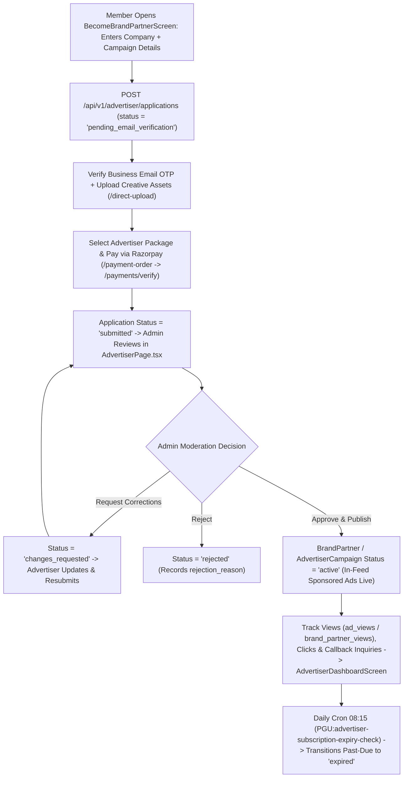

# Activity 12: Brand Partner Form & Ads

| Attribute | Verified Specification |
|---|---|
| **Workbook Activity #** | `12.0` |
| **Exact Workbook Name** | `Brand Partner Form & Ads` |
| **Domain Category** | `Marketing & Monetization` (Sheet 1 & 2) / `Advertising / Monetization` (Sheet 3) |
| **Activity Governance Tier** | `Global Administration` (Commercial brand directory, self-serve advertiser onboarding + Razorpay package billing + campaign ad serving, and peer ad bookings governed by Super Admin / Marketing Team; `Not Required` as a Circle Leadership App workflow except optional Admin/Global visibility on `ad_booking_requests`) |
| **Overall Implementation Status** | `Fully Implemented` (Comprehensive 3-pillar backend & Member/Admin UI across `brand_partners`, `advertiser_applications`/`advertiser_campaigns`/`advertiser_payments`, and `ads`/`ad_bookings` with impression/click/callback tracking and scheduled expiry crons — **except CRITICAL `P0` missing admin guard** on `/api/v1/admin/*` routes and over-exposed `ad_booking_requests` in Leader Pending Queue) |
| **Master Index & Cross-Links** | [12-master-35-activities-index.md](../12-master-35-activities-index.md) · [19-activity-to-role-access-matrix.md](../19-activity-to-role-access-matrix.md) · [25-activity-workflow-reference.md](../25-activity-workflow-reference.md) · [13-activity-input-forms-and-validation.md](../13-activity-input-forms-and-validation.md) · [15-activity-database-and-metrics-mapping.md](../15-activity-database-and-metrics-mapping.md) · [43-sensitive-data-and-finance-access.md](../43-sensitive-data-and-finance-access.md) |

---

## 1. Business Purpose (§9.1)

- **Why It Exists & Business Outcome:**
  - **WORKBOOK REQUIREMENT:** Enables enterprises and peers to onboard as Brand Partners, purchase advertising packages, launch sponsored in-feed banner/offer campaigns across target cities/categories, and track live impressions, clicks (`CTR %`), and member callback inquiries.
  - **FACT:** Production implements **three tightly integrated monetization & advertising subsystems**:
    1. **(A) Brand Partner Directory, Coupons & Callback Inquiries (`brand_partners`):** Curated/sponsored partner storefront with exclusive member discounts, coupon redemptions (`brand_partner_coupon_redemptions`), saved offers (`brand_partner_saved`), view/click telemetry (`brand_partner_views`, `brand_partner_clicks`), callback leads (`brand_partner_inquiries`), daily expiry alerts (`PGU:brand-partner-expiry-alerts` at `08:00`), and weekly partner analytics emails (`PGU:brand-partner-weekly-report` Mondays `09:00`).
    2. **(B) Self-Serve Advertiser Onboarding, Billing & Campaigns (`advertiser_*`):** Multi-step application with business email OTP verification (`advertiser_applications`), creative asset upload (`advertiser_application_assets`), Razorpay package checkout (`advertiser_packages`, `advertiser_payments`, `advertiser_subscriptions` monitored daily at `08:15` by `PGU:advertiser-subscription-expiry-check`), campaign builder (`advertiser_campaigns`, `advertiser_campaign_ads`), and live Advertiser Analytics Dashboard.
    3. **(C) Platform Banner Ads & Peer Ad Bookings (`ads` & `ad_bookings`):** Lightweight peer ad booking requests ([AdBookingController.php](file:///c:/Users/malic/OneDrive/Documents/GitHub/unity-app-new/app/Http/Controllers/Api/V1/AdBookingController.php)) that promote approved bookings into live `ads` slots (`timeline`, `dashboard`, `home`, `banner`, `popup`, `sidebar`) tracked via `ad_views` and `ad_clicks`.
- **Role Partitioning (Member vs Leadership vs Admin):**
  - **Peer Member / Advertiser (`FACT`):** Browses Brand Partners & redeems offers ([brand_partner_details_screen.dart](file:///D:/office%20project/peers-unity/unity_app/lib/features/home/presentation/screens/brand_partner_details_screen.dart)), applies to become a Brand Partner ([become_brand_partner_screen.dart](file:///D:/office%20project/peers-unity/unity_app/lib/features/brand_partner/presentation/screens/become_brand_partner_screen.dart)), pays via Razorpay ([brand_partner_paywall_screen.dart](file:///D:/office%20project/peers-unity/unity_app/lib/features/brand_partner/presentation/screens/brand_partner_paywall_screen.dart)), tracks applications & live ad metrics ([brand_partner_applications_list_screen.dart](file:///D:/office%20project/peers-unity/unity_app/lib/features/brand_partner/presentation/screens/brand_partner_applications_list_screen.dart), [advertiser_dashboard_screen.dart](file:///D:/office%20project/peers-unity/unity_app/lib/features/brand_partner/presentation/screens/advertiser_dashboard_screen.dart)), or submits a Peer Ad Booking (`POST /api/v1/ad-bookings`).
  - **Circle / Regional Leadership (`FACT`):** Commercial ad inventory and brand partner monetization are **platform-level (`Global Administration`)**, NOT circle-steward responsibilities (`Not Required` in Flutter Leadership App). Note: `PendingRequestAdminController` includes `ad_booking_requests`, which should be restricted to Global Admin / Marketing Team rather than Circle Leaders.
  - **Super Admin / Marketing Team (`FACT`):** Manages Brand Partners ([BrandPartnersPage.tsx](file:///D:/office%20project/unity-admin-web/src/features/partners/BrandPartnersPage.tsx)), Advertiser Packages/Applications/Subscriptions/Campaigns ([AdvertiserPage.tsx](file:///D:/office%20project/unity-admin-web/src/features/advertiser/AdvertiserPage.tsx)), and Ads/Ad Bookings ([AdsPage.tsx](file:///D:/office%20project/unity-admin-web/src/features/ads/AdsPage.tsx)).

---

## 2. Sub-Activities Catalogue (§9.2)

| # | Sub-Activity / Operation | Member App (`unity_app`) | Leadership App (`LeaderApp`) | Admin Web (`unity-admin-web` & Blade) | Backend (`unity-app-new`) | Classification |
|---|---|---|---|---|---|---|
| 2.1 | **Browse Brand Partners, Save Offers & Request Callback** | Wired (`ApiEndpoints.brandPartners`, `brandPartnerCallback`, `brand_partner_details_screen.dart`) | `Not Required` (Consumer/Member feature) | Managed in [BrandPartnersPage.tsx](file:///D:/office%20project/unity-admin-web/src/features/partners/BrandPartnersPage.tsx) | `BrandPartnerApiController` → `BrandPartnerService` | `Fully Implemented` |
| 2.2 | **Submit Brand Partner / Advertiser Application + Email OTP** | Wired ([become_brand_partner_screen.dart](file:///D:/office%20project/peers-unity/unity_app/lib/features/brand_partner/presentation/screens/become_brand_partner_screen.dart), `brand_partner_company_form.dart`, `brand_partner_campaign_form.dart`) | `Not Required` | Reviewed in [AdvertiserApplicationsTab.tsx](file:///D:/office%20project/unity-admin-web/src/features/advertiser/components/AdvertiserApplicationsTab.tsx) | `AdvertiserPublicApiController`, `AdvertiserMemberApiController` | `Fully Implemented` |
| 2.3 | **Upload Creative Banner / Video Assets** | Wired (`ApiEndpoints.advertiserUploadAsset`) | `Not Required` | Asset review in `ApplicationDetailModal.tsx` | `advertiser_application_assets`, `AdvertiserAdminApiController@reviewAsset` | `Fully Implemented` |
| 2.4 | **Select Advertiser Package & Pay via Razorpay** | Wired ([brand_partner_paywall_screen.dart](file:///D:/office%20project/peers-unity/unity_app/lib/features/brand_partner/presentation/screens/brand_partner_paywall_screen.dart) → `advertiserPaymentOrder`, `advertiserVerifyPayment`) | `Not Required` | [AdvertiserPackagesTab.tsx](file:///D:/office%20project/unity-admin-web/src/features/advertiser/components/AdvertiserPackagesTab.tsx), [AdvertiserPaymentsTab.tsx](file:///D:/office%20project/unity-admin-web/src/features/advertiser/components/AdvertiserPaymentsTab.tsx) | `AdvertiserPaymentApiController` | `Fully Implemented` |
| 2.5 | **Review, Request Corrections, Approve & Publish Campaigns** | Status & edits in `brand_partner_applications_list_screen.dart` | `Not Required` | Wired ([AdvertiserCampaignsTab.tsx](file:///D:/office%20project/unity-admin-web/src/features/advertiser/components/AdvertiserCampaignsTab.tsx), [CampaignReviewModal.tsx](file:///D:/office%20project/unity-admin-web/src/features/advertiser/components/CampaignReviewModal.tsx)) | `AdvertiserAdminApiController` (`start-review`, `request-corrections`, `approve`, `publish`, `pause`, `resume`, `reject`) | `Implemented but Incorrect` (Check admin middleware on `/api/v1/admin/advertiser/*`) |
| 2.6 | **Submit & Review Peer Ad Booking (`ad_bookings`)** | Backend ready (`POST /api/v1/ad-bookings`, `GET /api/v1/ad-bookings`) | Appears in `PendingRequestAdminController` (`ad_booking_requests`) | Wired ([AdBookingsTab.tsx](file:///D:/office%20project/unity-admin-web/src/features/ads/components/AdBookingsTab.tsx), [AdBookingActionModal.tsx](file:///D:/office%20project/unity-admin-web/src/features/ads/components/AdBookingActionModal.tsx)) | `AdBookingController`, `AdBookingAdminController` (`AdBookingService`) | `Implemented but Incorrect` (Unguarded `/api/v1/admin/*` + Leader Pending Queue exposure) |
| 2.7 | **Serve Timeline/App Ads & Track Impressions, Clicks & CTR** | Wired (`ApiEndpoints.ads`, `/brand-partners/{id}/view\|click`, [advertiser_dashboard_screen.dart](file:///D:/office%20project/peers-unity/unity_app/lib/features/brand_partner/presentation/screens/advertiser_dashboard_screen.dart)) | `Not Required` (No ads shown inside Leadership App) | Wired ([AdsAnalyticsTab.tsx](file:///D:/office%20project/unity-admin-web/src/features/ads/components/AdsAnalyticsTab.tsx), [AdvertiserDashboardTab.tsx](file:///D:/office%20project/unity-admin-web/src/features/advertiser/components/AdvertiserDashboardTab.tsx)) | `AdController`, `BrandPartnerApiController`, `AdvertiserMemberApiController@dashboard` | `Fully Implemented` |

---

## 3. Input Form & Field Validation Mapping (§9.3)

**FACT:** Verified across Workbook Row 20/19, Member App `brand_partner_company_form.dart` & `brand_partner_campaign_form.dart` (`member_app_forms_and_apis.json:164-186`), `AdvertiserApplication` / `AdvertiserCampaign` endpoints, and [StoreAdBookingRequest.php](file:///c:/Users/malic/OneDrive/Documents/GitHub/unity-app-new/app/Http/Requests/Api\V1\Ads\StoreAdBookingRequest.php#L16-L30).

| Field Name | Data Type | Required / Optional | Validation (Backend + Client) | Default | Input Widget | Data Source | Visibility | Who Enters | Who Edits | Who Views | Sensitive? | Backend Request Key |
|---|---|---|---|---|---|---|---|---|---|---|---|---|
| **Brand / Trade Name** | `string (max:255)` | Required (Advertiser App) | **Backend:** Required string on `advertiser_applications`. **Client:** `Brand / Trade Name` (`e.g. Apex Tech`). | `''` | `TextField` (`brand_partner_company_form.dart`) | Advertiser input | Public when Brand Partner/Ad published | Advertiser / Peer | Advertiser (when `draft` / `changes_requested`) & Admin | Public (once active), Admin | No | `brand_name` |
| **Company Legal Name** | `string (max:255)` | Required (Advertiser App) | **Backend:** Required string. **Client:** `Company Name` (`e.g. Apex Global Innovations LLP`). | Pre-filled from `user.company_name` | `TextField` | Advertiser input | Admin & Tax Invoice | Advertiser | Advertiser / Admin | Advertiser & Admin | Commercial | `company_name` |
| **GSTIN** | `string (max:30)` | Optional / Conditional | **WORKBOOK vs CODE:** Listed in Workbook; stored on `users.gst_number` / billing metadata for tax invoices (`Requires Confirmation` whether mandatory on `advertiser_applications`). | `null` | `TextField` | Advertiser input | Private to Advertiser & Finance Admin | Advertiser | Advertiser / Admin | Advertiser & Finance Admin | **Yes** (Tax ID) | `gst_number` / `gstin` |
| **Contact Person Name** | `string (max:255)` | Required | **Backend:** Required string. **Client:** `Contact Person Name`. | Auth user name | `TextField` | Advertiser input | Private to Admin | Advertiser | Advertiser / Admin | Advertiser & Admin | PII | `contact_person` |
| **Business Email (OTP Verified)** | `string (email)` | Required + OTP Verified | **Backend:** Valid email + 6-digit OTP confirmed via `/advertiser/applications/{id}/email-verification/confirm`. | Auth user email | Email `TextField` + OTP dialog | Advertiser input | Private to Advertiser & Admin | Advertiser | Advertiser (re-triggers OTP) | Advertiser & Admin | **Yes** (Email PII) | `email`, `otp` |
| **Contact Mobile Number** | `string (max:20)` | Required | **Backend:** Phone string. **Client:** `10-digit mobile number`. | Auth user phone | Phone `TextField` | Advertiser input | Private to Advertiser & Admin | Advertiser | Advertiser / Admin | Advertiser & Admin | **Yes** (Phone PII) | `phone` |
| **City / Geo-Targeting & Category** | `string` + `UUID/int` + `json` | Required (`city`, `category_id`) / Optional (`geo_targeting_rules`) | **Backend:** `city` string, `category_id` FK → `brand_partner_categories.id`, optional `geo_targeting_rules` JSON. | User city | Dropdowns / Target city chips | `/cities`, `brand_partner_categories` | Controls ad targeting & directory filter | Advertiser / Admin | Advertiser / Admin | Public directory & Admin | No | `city`, `category_id`, `geo_targeting_rules` |
| **Advertiser Package (`package_id`)** | `UUID` | Required before Checkout | **Backend:** `exists:advertiser_packages,id` (defines duration, placements, price; replaces Workbook's raw "Budget slider" with fixed/tiered packages!). | `null` | Package cards (`brand_partner_paywall_screen.dart`) | `GET /api/v1/advertiser/packages` | Visible on paywall & invoice | Advertiser | Selectable before payment | Advertiser & Admin | Commercial (`₹` price) | `package_id` |
| **Campaign Headline / Title** | `string (max:255)` | Required | **Backend (`StoreAdBookingRequest` & Campaign):** `required\|string\|max:255`. **Client:** `Campaign Headline / Title`. | `''` | `TextField` (`brand_partner_campaign_form.dart`) | Advertiser input | Public on Sponsored Banner / Offer | Advertiser / Peer | Editable in `draft` / `changes_requested` | All Members & Admin | No | `title` |
| **Campaign / Offer Description & Coupon** | `text` + `string` | Optional (`AdBooking`) / Required (`Advertiser`) | **Backend:** `description` `nullable\|string`; `BrandPartner` supports `offer_title`, `coupon_code`, `discount_type`, `discount_value`. | `null` | Multiline `TextField` | Advertiser input | Public on Brand Partner / Ad card | Advertiser / Admin | Advertiser / Admin | All Members & Admin | No | `description`, `subtitle`, `offer_title`, `coupon_code` |
| **Redirect / Landing Page URL & CTA Text** | `url (max:500)` + `string (max:100)` | Optional | **Backend (`StoreAdBookingRequest`):** `redirect_url` `nullable\|url\|max:500`, `button_text` `nullable\|string\|max:100`. | `null` | URL `TextField` (`Website / Landing Page (Optional)`) | Advertiser input | Public CTA destination | Advertiser / Peer | Advertiser / Admin | All Members & Admin | No | `redirect_url` (`website_url`), `button_text` |
| **Creative Banner / Media Upload** | `file (jpg,jpeg,png,webp)` | Required (Campaign) / Optional (`AdBooking` `max:2048` KB) | **Backend (`StoreAdBookingRequest`):** `nullable\|image\|mimes:jpg,jpeg,png,webp\|max:2048`; Advertiser assets uploaded via `/direct-upload`. | `null` | Image/Creative uploader | Gallery / Files → `files` / `advertiser_application_assets` | Public when ad is active | Advertiser / Peer | Replaceable on `changes_requested` | All Members (when live) & Admin | No | `image` / `assets` |
| **Placement & Schedule (`starts_at`, `ends_at`)** | `enum` + `date` | Optional | **Backend (`StoreAdBookingRequest`):** `placement` `nullable\|in:timeline,dashboard,home,banner,popup,sidebar`, `starts_at` `nullable\|date`, `ends_at` `nullable\|date\|after_or_equal:starts_at`. | `'timeline'` | Placement dropdown & date pickers | Static placement enum + calendar | Controls ad slot & schedule | Peer / Advertiser / Admin | Admin | Admin & Advertiser | No | `placement`, `page_name`, `starts_at`, `ends_at` |

---

## 4. Workflow, Lifecycle & Mermaid Diagram (§9.4)

### Workbook vs Actual Lifecycle Comparison
- **WORKBOOK REQUIREMENT:** `Campaign Created -> Budget Reserved -> Ad Live -> Metrics Tracked`.
- **FACT:** Implemented with **enterprise-grade multi-stage state machines** and audit history tables (`advertiser_application_status_histories`, `advertiser_campaign_status_histories`):
  1. **`advertiser_applications.status`:** `draft` → `pending_email_verification` → `submitted` → `under_review` ↔ `changes_requested` → `approved` → `active` (post-Razorpay payment) | `rejected` | `withdrawn`.
  2. **`advertiser_campaigns.status`:** `draft` → `pending_review` ↔ `changes_requested` → `approved` → `scheduled` → `active` ↔ `paused` → `completed` | `expired` | `rejected` | `cancelled`.
  3. **`ad_bookings.status`:** `pending` → `approved` (creates/links `ads.id`) | `rejected`.

---

## 5. Outputs & Deliverables (§9.5)

| Output / Deliverable | Status & Evidence (`FACT` vs `WORKBOOK REQUIREMENT`) |
|---|---|
| **Sponsored In-Feed Banner Ads & Brand Partner Directory** | **FACT (`Fully Implemented`):** Served via `GET /api/ads`, `GET /api/v1/ads/timeline`, and `GET /api/v1/brand-partners` into the Member App Home Feed and Brand Partner Directory. |
| **Live Advertiser Analytics Dashboard** | **FACT (`Fully Implemented`):** [advertiser_dashboard_screen.dart](file:///D:/office%20project/peers-unity/unity_app/lib/features/brand_partner/presentation/screens/advertiser_dashboard_screen.dart) (`GET /api/v1/advertiser/dashboard`) + weekly email report (`PGU:brand-partner-weekly-report`) showing impressions, clicks, CTR %, coupon redemptions, and callback inquiries. |
| **Admin Advertising & Monetization Consoles** | **FACT (`Fully Implemented`):** React Admin `BrandPartnersPage.tsx`, `AdvertiserPage.tsx` (6 tabs), and `AdsPage.tsx` (Dashboard, All Ads, Ad Bookings, Analytics). |

---

## 6. Database & Metrics Mapping (§9.6)

### Primary Tables & Eloquent Models (19 Tables Across 3 Subsystems)
1. **Brand Partners:** `brand_partners` (`BrandPartner`), `brand_partner_categories`, `brand_partner_inquiries`, `brand_partner_saved`, `brand_partner_views`, `brand_partner_clicks`, `brand_partner_coupon_redemptions`.
2. **Advertiser Onboarding & Campaigns:** `advertiser_applications` (`AdvertiserApplication`), `advertiser_application_assets`, `advertiser_application_status_histories`, `advertiser_packages` (`AdvertiserPackage`), `advertiser_subscriptions` (`AdvertiserSubscription`), `advertiser_payments` (`AdvertiserPayment`), `advertiser_campaigns` (`AdvertiserCampaign`), `advertiser_campaign_ads`, `advertiser_campaign_status_histories`.
3. **App Ads & Bookings:** `ads` (`Ad`), `ad_views` (`AdView`), `ad_clicks` (`AdClick`), `ads_banners` (`AdsBanner`), `ad_bookings` (`AdBooking`).

### Workbook Sheet 3 Metric Keys vs Actual Backend Schema
| Workbook Metric Key (Sheet 1–3) | Actual Backend / API Computation (`FACT`) | Discrepancy / Bug Note |
|---|---|---|
| `adCampaignId` | `advertiser_campaigns.id` (`uuid`) / `ads.id` (`uuid`) | Matches workbook. |
| `impressionsCount` | `COUNT(*)` on `ad_views` / `brand_partner_views` (`POST /ads/{id}/view`, `/brand-partners/{id}/view`) | Matches workbook. |
| `clicksCount` & `CTR %` | `COUNT(*)` on `ad_clicks` / `brand_partner_clicks`, with `CTR = (clicks / max(impressions, 1)) * 100` | Matches workbook. |
| `leadsCapturedCount` | `COUNT(*)` on `brand_partner_inquiries` (`POST /brand-partners/{id}/callback-request`) + `brand_partner_coupon_redemptions` | Matches workbook. |

---

## 7. API & Backend Service Mapping (§9.7)

| Layer | Method & Endpoint | Controller & Action | Service / FormRequest | Auth Middleware | Scope Enforcement & Security Audit (`FACT`) | Client Integration |
|---|---|---|---|---|---|---|
| **Member / Public API** | `GET /api/v1/brand-partners*`, `POST .../{id}/view\|click\|callback-request`, Auth `POST\|DELETE .../{id}/save` | `BrandPartnerApiController` | `BrandPartnerService` | Public read / `auth:sanctum` save | Public catalog & telemetry | Wired (`ApiEndpoints.brandPartners*`) |
| **Advertiser API** | `GET /api/v1/advertiser/packages`, `POST .../applications`, `POST .../email-verification/confirm`, Auth `GET .../my-applications\|dashboard\|subscriptions\|payments`, `POST .../payment-order`, `POST .../payments/verify` | `AdvertiserPublicApiController`, `AdvertiserMemberApiController`, `AdvertiserPaymentApiController` | Razorpay order/signature verification | Public onboarding / `auth:sanctum`, `unity.user` for portal | Enforces `user_id = auth()->id()` on member advertiser portal | Wired in Member App (`brand_partner` module) |
| **Member Ads API** | `GET /api/ads`, `GET /api/v1/ads/timeline`, `POST /api/v1/ads/{id}/view\|click`, `GET\|POST /api/v1/ad-bookings[/{id}]` | `AdController`, [AdBookingController.php](file:///c:/Users/malic/OneDrive/Documents/GitHub/unity-app-new/app/Http/Controllers/Api/V1/AdBookingController.php) | `StoreAdBookingRequest`, `AdBookingService` | `auth:sanctum`, `unity.user` | `AdBookingController` enforces `where('user_id', auth()->id())` | Ads wired; `ad-bookings` backend ready |
| **Leader Queue** | `GET\|POST /api/v1/leader/pending-requests/ad_booking_requests/{id}/approve\|reject` | `PendingRequestAdminController` | `PendingRequestModerationService` | `auth:sanctum`, `leader.user` | **Role Governance Issue:** Circle Leaders should NOT approve commercial `ad_booking_requests` (`Global Administration` / `Marketing Team` only!) | Exposed in generic Pending Approvals list |
| **Admin API & Web** | `/api/v1/admin/brand-partners/*`, `/api/v1/admin/advertiser/*`, `/api/v1/admin/ad-bookings/*` & Web `/admin/brand-partners/*`, `/admin/advertiser/*`, `/admin/ads/*` | `BrandPartnerApiController`, `AdvertiserAdminApiController`, `AdBookingAdminController` + Web controllers | `BrandPartnerService`, `AdBookingService` | Web: `web`, `admin.auth`; **API: verify `/api/v1/admin/*` guard in `routes/api.php`!** | **CRITICAL P0 BUG:** Any `/api/v1/admin/*` endpoint inside the unguarded `['auth:sanctum', 'unity.user']` block allows regular member tokens to approve their own ads/campaigns without paying! | Wired in `BrandPartnersPage.tsx`, `AdvertiserPage.tsx`, `AdsPage.tsx` |

### Workbook Cloud Services vs Actual Laravel Services
- **WORKBOOK REQUIREMENT:** `AdServingEngine`, `AnalyticsAggregationWorker`, `BillingGateway`.
- **FACT:** Implemented in Laravel via `AdController` + `BrandPartnerService` (serving), `ad_views`/`ad_clicks`/`brand_partner_views` + scheduled `PGU:brand-partner-weekly-report` (analytics), and Razorpay (`AdvertiserPaymentApiController`).

---

## 8. Role-Wise Access Governance (§9.8)

| Role | View Activity | Create Record | Edit Own | Edit Others | Submit for Review | Verify | Approve | Reject | Assign | Manage | Delete | View Aggregated Reports |
|---|---|---|---|---|---|---|---|---|---|---|---|---|
| **Super Admin** *(+ `marketing_team` in Web Admin)* | Allowed (Global) | Allowed (Create Ads, Packages, Brand Partners) | Allowed | Allowed | Allowed | Allowed (`reviewAsset`, `start-review`) | Allowed (Approve Applications, Campaigns, Ad Bookings) | Allowed (Reject / Request Corrections) | DENIED — No assignee workflow | Allowed (Pause/Resume/Publish Campaigns, Package Pricing) | Allowed (Delete Ads / Drafts) | Allowed (Global Ad CTR, Revenue & Weekly Reports) |
| **Country Director** | Allowed only as consumer viewing live Ads (`Not Required` in Leader App) | Allowed as Member/Advertiser | Allowed on own Advertiser draft | DENIED — No permission under the verified backend authorization model | Allowed as Advertiser | DENIED — Global Admin / Marketing Team only | DENIED — Global Admin / Marketing Team only (**BUG:** `ad_booking_requests` exposed in `PendingRequestAdminController`) | DENIED — Global Admin / Marketing Team only | DENIED — No permission under the verified backend authorization model | DENIED — No permission under the verified backend authorization model | DENIED — No permission under the verified backend authorization model | DENIED — Commercial Ad revenue is HQ Admin only (`Requires Confirmation`) |
| **DED** | Consumer view only (`Not Required` in Leader App) | Allowed as Member/Advertiser | Own draft only | DENIED — No permission under the verified backend authorization model | Allowed as Advertiser | DENIED — No permission under the verified backend authorization model | DENIED — Global Admin only (**BUG:** `ad_booking_requests` in Leader queue) | DENIED — Global Admin only | DENIED — No permission under the verified backend authorization model | DENIED — No permission under the verified backend authorization model | DENIED — No permission under the verified backend authorization model | DENIED — No permission under the verified backend authorization model |
| **Industry Director** | Consumer view only | Allowed as Member/Advertiser | Own draft only | DENIED — No permission under the verified backend authorization model | Allowed as Advertiser | DENIED — No permission under the verified backend authorization model | DENIED — Global Admin only (**BUG:** `ad_booking_requests` in Leader queue) | DENIED — Global Admin only | DENIED — No permission under the verified backend authorization model | DENIED — No permission under the verified backend authorization model | DENIED — No permission under the verified backend authorization model | DENIED — No permission under the verified backend authorization model |
| **Circle Founder** | Consumer view only | Allowed as Member/Advertiser | Own draft only | DENIED — No permission under the verified backend authorization model | Allowed as Advertiser | DENIED — No permission under the verified backend authorization model | DENIED — Global Admin only (**BUG:** `ad_booking_requests` in Leader queue) | DENIED — Global Admin only | DENIED — No permission under the verified backend authorization model | DENIED — No permission under the verified backend authorization model | DENIED — No permission under the verified backend authorization model | DENIED — No permission under the verified backend authorization model |
| **Circle Director** | Consumer view only | Allowed as Member/Advertiser | Own draft only | DENIED — No permission under the verified backend authorization model | Allowed as Advertiser | DENIED — No permission under the verified backend authorization model | DENIED — Global Admin only (**BUG:** `ad_booking_requests` in Leader queue) | DENIED — Global Admin only | DENIED — No permission under the verified backend authorization model | DENIED — No permission under the verified backend authorization model | DENIED — No permission under the verified backend authorization model | DENIED — No permission under the verified backend authorization model |
| **Chair / Committee Chairs** | Consumer view only | Allowed as Member/Advertiser | Own draft only | DENIED — No permission under the verified backend authorization model | Allowed as Advertiser | DENIED — No permission under the verified backend authorization model | DENIED — Global Admin only | DENIED — Global Admin only | DENIED — No permission under the verified backend authorization model | DENIED — No permission under the verified backend authorization model | DENIED — No permission under the verified backend authorization model | DENIED — No permission under the verified backend authorization model |
| **Vice Chair** | Consumer view only | Allowed as Member/Advertiser | Own draft only | DENIED — No permission under the verified backend authorization model | Allowed as Advertiser | DENIED — No permission under the verified backend authorization model | DENIED — Global Admin only | DENIED — Global Admin only | DENIED — No permission under the verified backend authorization model | DENIED — No permission under the verified backend authorization model | DENIED — No permission under the verified backend authorization model | DENIED — No permission under the verified backend authorization model |
| **Secretary** | Consumer view only | Allowed as Member/Advertiser | Own draft only | DENIED — No permission under the verified backend authorization model | Allowed as Advertiser | DENIED — No permission under the verified backend authorization model | DENIED — Global Admin only | DENIED — Global Admin only | DENIED — No permission under the verified backend authorization model | DENIED — No permission under the verified backend authorization model | DENIED — No permission under the verified backend authorization model | DENIED — No permission under the verified backend authorization model |
| **Committee Leader** | Consumer view only | Allowed as Member/Advertiser | Own draft only | DENIED — No permission under the verified backend authorization model | Allowed as Advertiser | DENIED — No permission under the verified backend authorization model | DENIED — No permission under the verified backend authorization model | DENIED — No permission under the verified backend authorization model | DENIED — No permission under the verified backend authorization model | DENIED — No permission under the verified backend authorization model | DENIED — No permission under the verified backend authorization model | DENIED — No permission under the verified backend authorization model |
| **Peer Member** | Allowed (View active Ads/Brand Partners + Own Advertiser Dashboard & Bookings) | Allowed (`POST /advertiser/applications` & `POST /ad-bookings`) | Allowed on own `draft` / `changes_requested` application | DENIED — No permission under the verified backend authorization model *(P0 BUG: verify `/api/v1/admin/*` guard!)* | Allowed | DENIED — No permission under the verified backend authorization model | DENIED — No permission under the verified backend authorization model | DENIED — No permission under the verified backend authorization model | DENIED — No permission under the verified backend authorization model | Allowed **only** to `withdraw` own application or extend own subscription | DENIED — No permission under the verified backend authorization model | Allowed **only** on own `AdvertiserDashboardScreen` |

---

## 9. Existing Implementation Summary, Gaps & Minimum-Change Enhancement Recommendations

### Summary of Verified Limitations & Bugs
1. **Unprotected `/api/v1/admin/*` Monetization Endpoints (`P0` Security):** Any `/api/v1/admin/brand-partners/*`, `/api/v1/admin/advertiser/*`, or `/api/v1/admin/ad-bookings/*` routes mounted inside the unguarded `['auth:sanctum', 'unity.user']` block in `routes/api.php` must be locked behind `admin.auth` / `admin.role:global_admin,marketing_team` immediately to prevent unpaid ad self-approval.
2. **`ad_booking_requests` Leaked into Circle Leader Pending Queue:** `PendingRequestAdminController` includes `ad_booking_requests` for `/api/v1/leader/pending-requests`, exposing platform ad moderation to circle-level leaders unless filtered to Super Admin.
3. **Correctly Excluded from Leadership App (`Not Required`):** Do **NOT** build Brand Partner / Ad Campaign management screens inside the Flutter Leadership App—keep commercial ad operations in `unity-admin-web` (`BrandPartnersPage.tsx`, `AdvertiserPage.tsx`, `AdsPage.tsx`) and self-serve advertiser analytics in the Member App (`advertiser_dashboard_screen.dart`).

### Minimum-Change Enhancement Recommendations
- **RECOMMENDATION 1 (Enforce Admin & Marketing RBAC Guard):** Require `admin.auth` + `admin.permission` (`ads` / `advertiser` / `brand-partners` modules) on all `/api/v1/admin/advertiser/*`, `/api/v1/admin/brand-partners/*`, and `/api/v1/admin/ad-bookings/*` endpoints.
- **RECOMMENDATION 2 (Exclude `ad_booking_requests` for Non-Super-Admin Leaders):** In `PendingRequestAdminController`, exclude `ad_booking_requests` when `$request->is('api/v1/leader*')` unless `$this->permissions->isSuperAdmin($user)` is true.
