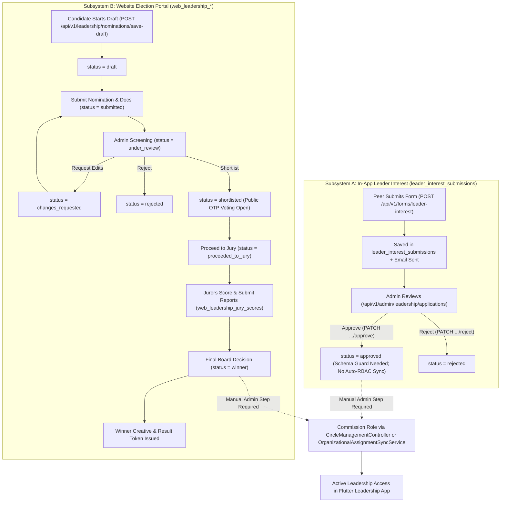

# Activity 13: Leadership Role Application Form

| Metadata Field | Verified Value |
|---|---|
| **Workbook Activity #** | `13` (`Row 21` in Sheet 1, `Row 20` in Sheets 2 & 3) |
| **Exact Workbook Name** | `Leadership Role Application Form` |
| **Domain Category** | `Governance & Circles` (Sheets 1 & 2) / `Governance / Operations` (Sheet 3) |
| **Activity Governance Tier** | Tier 1 — Executive Governance, Role Selection & Commissioned Leadership Assignment |
| **Overall Implementation Status** | `Implemented but Incorrect` (Backend In-App Approval & Role Assignment APIs contain schema/enum/auth bugs; Website Election Portal `/api/v1/leadership/*` is `Partially Implemented` with `admin.auth` escalation risks; Leadership App has read-only feed `Partially Implemented`) |
| **Surface Status Breakdown** | **Backend (In-App `leader_interest_submissions`):** `Implemented but Incorrect` \| **Backend (Website Election `web_leadership_*`):** `Partially Implemented` \| **Member App:** `Fully Implemented` (In-App Form) \| **Leadership App:** `Partially Implemented` (Read-only activity feed `leadership-interests`, no review actions) \| **Admin Web:** `Partially Implemented` |
| **Related Canonical Documents** | [12-master-35-activities-index.md](../12-master-35-activities-index.md) \| [19-activity-to-role-access-matrix.md](../19-activity-to-role-access-matrix.md) \| [21-leadership-application-and-approval-flow.md](../21-leadership-application-and-approval-flow.md) \| [22-leadership-assignment-and-management-flow.md](../22-leadership-assignment-and-management-flow.md) \| [25-activity-workflow-reference.md](../25-activity-workflow-reference.md) |

---

## 1. Business Purpose (§9.1)

- **WORKBOOK REQUIREMENT:** Activity 13 enables Peers to *"Apply for executive steward positions such as Circle Director or Regional Chapter Head"* by submitting desired positions, vision statements, and weekly time availability, progressing through nomination/election review to commissioned RBAC role assignment.
- **FACT:** In the live repository (`unity-app-new`), Activity 13 is implemented as **two separate architectural subsystems** that do not share tables or automatic synchronization:
  1. **Subsystem A — In-App "Become a Leader / Leader Interest" Form (`leader_interest_submissions`)**: Used inside the Flutter Member App ([leadership_role_screen.dart](file:///D:/office%20project/peers-unity/unity_app/lib/features/highlights/presentation/screens/leadership_role_screen.dart)) to submit either a self-application (`applying_for = 'myself'`) for `DED`, `ID`, `CF`, `CD`, `CVC`, `RSL`, or `GLT` roles or a peer nomination (`applying_for = 'referring_friend'`). Handled by [LeaderInterestController.php](file:///c:/Users/malic/OneDrive/Documents/GitHub/unity-app-new/app/Http/Controllers/Api/V1/Forms/LeaderInterestController.php#L18-L73).
  2. **Subsystem B — Website Leadership Selection & Election Portal (`web_leadership_*` — 23 PostgreSQL tables)**: A full campaign-based nomination, document upload, OTP-verified public/peer voting, multi-juror evaluation, final winner decision, and winner creative generation system mounted under `/api/v1/leadership/*` ([routes/leadership.php](file:///c:/Users/malic/OneDrive/Documents/GitHub/unity-app-new/routes/leadership.php#L42-L303)), Blade shell `/leadership/{any?}` ([web.php](file:///c:/Users/malic/OneDrive/Documents/GitHub/unity-app-new/routes/web.php#L1326-L1331)), and React Admin Web `webLeadership` module ([LeadershipLayout.tsx](file:///D:/office%20project/unity-admin-web/src/features/webLeadership/components/LeadershipLayout.tsx)).
- **Classification by Actor:**
  - **Member Action:** Submitting self-nomination or friend referral in-app (`POST /api/v1/forms/leader-interest`) or applying/voting on the Website Leadership Portal (`/api/v1/leadership/*`).
  - **Leadership Action:** Viewing scoped `leadership-interests` feed in Leadership App (`GET /api/v1/leader/activities?type=leader_interest`), participating as an assigned Juror (`/api/v1/leadership/jury/*`), or recommending candidates.
  - **Admin Action:** Reviewing in-app submissions, running Website Election campaigns, shortlisting candidates, assigning jurors, recording final decisions, and commissioning actual RBAC roles (`PATCH /api/v1/admin/circles/{id}/assign-founder|assign-director|assign-leadership-team` or `/api/v1/admin/access/organizational-assignments`).

---

## 2. Sub-Activities Catalogue (§9.2)

| # | Sub-Activity / Atomic Operation | Subsystem | Member App (`unity_app`) | Leadership App (`LeaderApp`) | Admin Web (`unity-admin-web` / Blade) | Backend (`unity-app-new`) | Classification Status |
|---:|---|---|---|---|---|---|---|
| 13.1 | Submit In-App Self Leadership Application (`myself`) | Subsystem A | [leadership_role_screen.dart](file:///D:/office%20project/peers-unity/unity_app/lib/features/highlights/presentation/screens/leadership_role_screen.dart) | Not Present | N/A | `POST /api/v1/forms/leader-interest` ([LeaderInterestController.php](file:///c:/Users/malic/OneDrive/Documents/GitHub/unity-app-new/app/Http/Controllers/Api/V1/Forms/LeaderInterestController.php#L18-L62)) | `Fully Implemented` |
| 13.2 | Refer a Friend for Leadership (`referring_friend`) | Subsystem A | [leadership_role_screen.dart](file:///D:/office%20project/peers-unity/unity_app/lib/features/highlights/presentation/screens/leadership_role_screen.dart) | Not Present | N/A | `POST /api/v1/forms/leader-interest` ([StoreLeaderInterestRequest.php](file:///c:/Users/malic/OneDrive/Documents/GitHub/unity-app-new/app/Http/Requests/Forms/StoreLeaderInterestRequest.php#L18-L20)) | `Fully Implemented` |
| 13.3 | View Own In-App Leadership Submissions | Subsystem A | [leadership_role_screen.dart](file:///D:/office%20project/peers-unity/unity_app/lib/features/highlights/presentation/screens/leadership_role_screen.dart) | Not Present | N/A | `GET /api/v1/forms/leader-interest/my` ([LeaderInterestController.php](file:///c:/Users/malic/OneDrive/Documents/GitHub/unity-app-new/app/Http/Controllers/Api/V1/Forms/LeaderInterestController.php#L64-L73)) | `Fully Implemented` |
| 13.4 | Browse Scoped Leader Interest Feed in Leadership App | Subsystem A | N/A | [leader_activities_view.dart](file:///D:/office%20project/LeaderApp-Fornt-end-/lib/features/leader_activities/view/leader_activities_view.dart) (`leader_interest`) | [ActivitiesLeaderInterestController.php](file:///c:/Users/malic/OneDrive/Documents/GitHub/unity-app-new/app/Http/Controllers/Admin/ActivitiesLeaderInterestController.php) | `GET /api/v1/leader/activities` (`type=leader_interest`, [LeaderActivitiesService.php](file:///c:/Users/malic/OneDrive/Documents/GitHub/unity-app-new/app/Leader/Services/LeaderActivitiesService.php#L2380-L2410)) | `Partially Implemented` |
| 13.5 | Approve / Reject In-App Leadership Application | Subsystem A | N/A | Missing in UI & Pending Queue | [LeadershipPage.tsx](file:///D:/office%20project/unity-admin-web/src/features/leadership/LeadershipPage.tsx) / [FormsPage.tsx](file:///D:/office%20project/unity-admin-web/src/features/forms/FormsPage.tsx) | `PATCH /api/v1/admin/leadership/applications/{id}/approve\|reject` ([LeadershipController.php](file:///c:/Users/malic/OneDrive/Documents/GitHub/unity-app-new/app/Http/Controllers/Api/V1/Admin/LeadershipController.php#L35-L61)) | `Implemented but Incorrect` |
| 13.6 | Commission / Assign Approved Role to Circle | Subsystem A/B | N/A | UI widget [peer_role_management_section.dart](file:///D:/office%20project/LeaderApp-Fornt-end-/lib/features/peers/view/widgets/peer_role_management_section.dart) (No `/leader/*` chair-assign API) | [CircleDetailsPage.tsx](file:///D:/office%20project/unity-admin-web/src/features/circles/CircleDetailsPage.tsx) | `POST /api/v1/admin/leadership/assignments` (broken enum) vs `PATCH /api/v1/admin/circles/{id}/assign-*` ([CircleManagementController.php](file:///c:/Users/malic/OneDrive/Documents/GitHub/unity-app-new/app/Http/Controllers/Api/V1/Admin/CircleManagementController.php#L632-L660)) | `Implemented but Incorrect` |
| 13.7 | Configure Website Election Campaigns & Dynamic Forms | Subsystem B | N/A | Not Required | [Campaigns/index.tsx](file:///D:/office%20project/unity-admin-web/src/features/webLeadership/pages/Campaigns/index.tsx) | `/api/v1/leadership/admin/campaigns/*` & `forms/*` ([routes/leadership.php](file:///c:/Users/malic/OneDrive/Documents/GitHub/unity-app-new/routes/leadership.php#L155-L215)) | `Partially Implemented` |
| 13.8 | Submit Website Candidate Nomination, Draft & Documents | Subsystem B | Web link / Public SPA | Not Required | Public SPA (`/leadership/*`) | `POST /api/v1/leadership/nominations/save-draft\|submit\|upload-document` ([routes/leadership.php](file:///c:/Users/malic/OneDrive/Documents/GitHub/unity-app-new/routes/leadership.php#L50-L65)) | `Fully Implemented` |
| 13.9 | Public / Peer OTP Voting on Shortlisted Candidates | Subsystem B | Web link / Public SPA | Not Required | [Voting/index.tsx](file:///D:/office%20project/unity-admin-web/src/features/webLeadership/pages/Voting/index.tsx) | `POST /api/v1/leadership/vote/request-otp\|verify-otp\|cast` ([routes/leadership.php](file:///c:/Users/malic/OneDrive/Documents/GitHub/unity-app-new/routes/leadership.php#L80-L95)) | `Fully Implemented` |
| 13.10 | Jury OTP Portal Scoring & Evaluation Reports | Subsystem B | N/A | Web Portal Only | [Jury/index.tsx](file:///D:/office%20project/unity-admin-web/src/features/webLeadership/pages/Jury/index.tsx), [JuryEvaluations/index.tsx](file:///D:/office%20project/unity-admin-web/src/features/webLeadership/pages/JuryEvaluations/index.tsx) | `/api/v1/leadership/jury/*` ([routes/leadership.php](file:///c:/Users/malic/OneDrive/Documents/GitHub/unity-app-new/routes/leadership.php#L118-L137)) — **contains `123456` OTP bypass** | `Implemented but Incorrect` |
| 13.11 | Final Election Decision & Winner Creative Token | Subsystem B | N/A | Not Required | [FinalDecisions/index.tsx](file:///D:/office%20project/unity-admin-web/src/features/webLeadership/pages/FinalDecisions/index.tsx), [Creatives/index.tsx](file:///D:/office%20project/unity-admin-web/src/features/webLeadership/pages/Creatives/index.tsx) | `/api/v1/leadership/admin/decisions/*`, `/api/v1/leadership/creatives/{token}` ([routes/leadership.php](file:///c:/Users/malic/OneDrive/Documents/GitHub/unity-app-new/routes/leadership.php#L142-L290)) | `Partially Implemented` |

---

## 3. Input Form & Field Validation Mapping (§9.3)

- **FACT:** Subsystem A is validated by [StoreLeaderInterestRequest.php](file:///c:/Users/malic/OneDrive/Documents/GitHub/unity-app-new/app/Http/Requests/Forms/StoreLeaderInterestRequest.php#L15-L32). Subsystem B uses dynamic campaign form definitions stored in `web_leadership_form_templates`, `web_leadership_form_sections`, `web_leadership_form_questions`, and `web_leadership_form_options` alongside core nomination metadata in `web_leadership_nominations`.
- **WORKBOOK REQUIREMENT:** Sheet 1 specifies *"Desired position (Circle Director, Regional Head), Vision statement, Available weekly hours"* and conceptual widget `CandidateApplicationSheet` (**NOT IMPLEMENTED** under that exact filename; implemented inside `leadership_role_screen.dart`).

| Field Name | Data Type | Required/Optional | Validation (Backend + Client; mark missing as Requires Confirmation) | Default | Input Widget | Data Source | Visibility | Who Enters | Who Edits | Who Views | Sensitive? | Backend Request Key |
|---|---|---|---|---|---|---|---|---|---|---|---|---|
| **Applying For Mode** (Subsystem A) | `string` (enum) | Required | **Backend:** `required`, `Rule::in(['myself', 'referring_friend'])` ([StoreLeaderInterestRequest.php](file:///c:/Users/malic/OneDrive/Documents/GitHub/unity-app-new/app/Http/Requests/Forms/StoreLeaderInterestRequest.php#L18)). **Client:** Segmented radio toggle (`myself` default). | `'myself'` | Radio / Segmented Toggle | Static options | Applicant & Admin/Scoped Leaders | Peer Member | Immutable after submit | Applicant, Scoped Leaders, Super Admin | No | `applying_for` |
| **Referred Friend Name** (Subsystem A) | `string` | Conditional Required | **Backend:** `nullable`, `string`, `min:2`, `max:150`, `required_if:applying_for,referring_friend`. **Client:** Required text check when referring friend. | `null` | `TextFormField` | User input / Contact | Applicant & Admin/Scoped Leaders | Peer Member | Immutable | Applicant, Scoped Leaders, Super Admin | PII (Low) | `referred_name` |
| **Referred Friend Mobile** (Subsystem A) | `string` | Conditional Required | **Backend:** `nullable`, `string`, `min:6`, `max:30`, `required_if:applying_for,referring_friend`. **Client:** Phone input validation (Requires Confirmation on strict E.164 check). | `null` | Phone `TextFormField` | User input / Contact | Applicant & Admin/Scoped Leaders | Peer Member | Immutable | Applicant, Scoped Leaders, Super Admin | Yes (Phone PII) | `referred_mobile` |
| **Desired Leadership Roles** (Subsystem A + Workbook) | `array<string>` | Conditional Required | **Backend:** `nullable`, `array`, `min:1`, `required_if:applying_for,myself`; items `string`, `Rule::in(['DED', 'ID', 'CF', 'CD', 'CVC', 'RSL', 'GLT'])` ([StoreLeaderInterestRequest.php](file:///c:/Users/malic/OneDrive/Documents/GitHub/unity-app-new/app/Http/Requests/Forms/StoreLeaderInterestRequest.php#L21-L22)). **Client:** Multi-select role chips. | `[]` | Multi-select Chip Group | Static role codes (`DED`, `ID`, `CF`, `CD`, `CVC`, `RSL`, `GLT`) | Applicant & Admin/Scoped Leaders | Peer Member | Immutable | Applicant, Scoped Leaders, Super Admin | No | `leadership_roles` |
| **City to Contribute** (Subsystem A) | `string` | Conditional Required | **Backend:** `nullable`, `string`, `max:120`, `required_if:applying_for,myself`. **Client:** Required text/city selector. | User profile city or `null` | `TextFormField` / City Picker | User input / `/api/v1/cities` | Applicant & Admin/Scoped Leaders | Peer Member | Immutable | Applicant, Scoped Leaders, Super Admin | No | `contribute_city` |
| **Primary Domain / Industry** (Subsystem A) | `string` | Conditional Required | **Backend:** `nullable`, `string`, `max:120`, `required_if:applying_for,myself`. **Client:** Required text/dropdown. | `null` | `TextFormField` / Dropdown | User input / Categories | Applicant & Admin/Scoped Leaders | Peer Member | Immutable | Applicant, Scoped Leaders, Super Admin | No | `primary_domain` |
| **Vision / Why Interested** (Subsystem A + Workbook) | `string` | Conditional Required | **Backend:** `nullable`, `string`, `max:400`, `required_if:applying_for,myself`. **Client:** Multi-line text (`maxLength: 400`). | `null` | Multi-line `TextFormField` | User input | Applicant & Admin/Scoped Leaders | Peer Member | Immutable | Applicant, Scoped Leaders, Super Admin | No | `why_interested` |
| **Primary Excitement Driver** (Subsystem A) | `string` (enum) | Conditional Required | **Backend:** `nullable`, `Rule::in(['building_people', 'business_collaboration', 'leadership_growth', 'visibility_recognition'])`, `required_if:applying_for,myself`. **Client:** Single-select radio/dropdown. | `null` | Dropdown / Choice Chips | Static enum | Applicant & Admin/Scoped Leaders | Peer Member | Immutable | Applicant, Scoped Leaders, Super Admin | No | `excitement` |
| **Ownership Readiness** (Subsystem A) | `string` (enum) | Conditional Required | **Backend:** `nullable`, `Rule::in(['yes', 'yes_with_guidance', 'not_sure_yet'])`, `required_if:applying_for,myself`. **Client:** Single-select radio. | `null` | Radio Group | Static enum | Applicant & Admin/Scoped Leaders | Peer Member | Immutable | Applicant, Scoped Leaders, Super Admin | No | `ownership` |
| **Weekly Time Commitment** (Subsystem A + Workbook) | `string` (enum) | Conditional Required | **Backend:** `nullable`, `Rule::in(['4_6_hours', '6_10_hours', '10_plus_hours'])`, `required_if:applying_for,myself`. **Client:** Single-select option. | `null` | Choice Chips / Dropdown | Static enum (`4-6h`, `6-10h`, `10+h`) | Applicant & Admin/Scoped Leaders | Peer Member | Immutable | Applicant, Scoped Leaders, Super Admin | No | `time_commitment` |
| **Prior Leadership Experience** (Subsystem A) | `boolean` | Conditional Required | **Backend:** `nullable`, `boolean`, `required_if:applying_for,myself`. **Client:** Yes/No toggle. | `false` | Boolean Switch / Radio | User input | Applicant & Admin/Scoped Leaders | Peer Member | Immutable | Applicant, Scoped Leaders, Super Admin | No | `has_led_before` |
| **Additional Message / Notes** (Subsystem A) | `text` | Optional | **Backend:** `nullable`, `string` (**Missing `max` length cap — Requires Confirmation**). **Client:** Optional multi-line text. | `null` | Multi-line `TextFormField` | User input | Applicant & Admin/Scoped Leaders | Peer Member | Immutable | Applicant, Scoped Leaders, Super Admin | No | `message` |
| **Election Campaign & Scope** (Subsystem B) | `uuid` | Required | **Backend:** Validated against active `web_leadership_campaigns.id` & `web_leadership_campaign_scopes` (`NominationPublicController`). **Client:** Campaign selector in Web SPA. | Selected campaign | Web Campaign Selector | `GET /api/v1/leadership/campaigns` | Public / Candidate / Admin | Candidate (Peer/Guest) | Draft editable before submit | Public (if shortlisted), Jurors, Admin | No | `campaign_id`, `scope_id` |
| **Dynamic Nomination Answers & Documents** (Subsystem B) | `json` / `file` | Dynamic per question | **Backend:** Validated dynamically against `web_leadership_form_questions` (`is_required`, `field_type`, file upload `throttle:20,1`). **Client:** Dynamic Web Form Builder renderer. | `{}` | Dynamic Web Inputs & File Uploader | `GET /api/v1/leadership/campaigns/{campaignId}/form` | Candidate, Assigned Jurors, Admin | Candidate | Editable in `draft` / `changes_requested` | Candidate, Assigned Jurors, Super Admin | Yes (KYC / Revenue docs) | `answers[]`, `document` |
| **Admin Rejection Reason / Review Remarks** (Subsystem A/B) | `string` | Required on Reject | **Backend:** `required\|string\|max:500` in [LeadershipController.php](file:///c:/Users/malic/OneDrive/Documents/GitHub/unity-app-new/app/Http/Controllers/Api/V1/Admin/LeadershipController.php#L50) (**Unvalidated in `AdminOpsController@leaderInterestReject`!**). | `null` | Admin Modal Textarea | Admin input | Admin & Applicant | Super Admin | Super Admin | Super Admin, Applicant | Internal Governance | `rejection_reason` / `admin_remarks` |

---

## 4. Workflow, Lifecycle & Mermaid Diagram (§9.4)

### Workbook vs Actual PostgreSQL Lifecycle Comparison
- **WORKBOOK REQUIREMENT:** `Submitted -> Nominated -> Election/Review -> Role Commissioned` (Sheet 1 & Sheet 3) with member status `Under Review, Approved, Assigned`.
- **FACT (Subsystem A — `leader_interest_submissions`):**
  - Model [LeaderInterestSubmission.php](file:///c:/Users/malic/OneDrive/Documents/GitHub/unity-app-new/app/Models/LeaderInterestSubmission.php#L16-L30) defines `$fillable` **without** `status`, `admin_remarks`, `reviewed_by`, or `reviewed_at`!
  - Furthermore, [LeaderActivitiesService.php](file:///c:/Users/malic/OneDrive/Documents/GitHub/unity-app-new/app/Leader/Services/LeaderActivitiesService.php#L2383) explicitly wraps `Schema::hasColumn('leader_interest_submissions', 'status')` because baseline deployments lacked the `status` column (`INFERENCE:` added manually in some DB environments or missing).
  - When `PATCH /api/v1/admin/leadership/applications/{id}/approve` or `reject` runs ([LeadershipController.php](file:///c:/Users/malic/OneDrive/Documents/GitHub/unity-app-new/app/Http/Controllers/Api/V1/Admin/LeadershipController.php#L35-L61)), it mutates `$record->status = 'approved'|'rejected'`, `admin_remarks`, `reviewed_by`, `reviewed_at` directly on the model, **which throws a PostgreSQL `UndefinedColumn` SQL error if those columns are absent**, and **does NOT automatically create a `circle_members`, `admin_user_roles`, or `user_organizational_assignments` record**!
  - Worse, the separate role-assignment endpoint `POST /api/v1/admin/leadership/assignments` ([LeadershipController.php](file:///c:/Users/malic/OneDrive/Documents/GitHub/unity-app-new/app/Http/Controllers/Api/V1/Admin/LeadershipController.php#L63-L120)) writes `'circle_founder'`, `'circle_director'`, `'ded'`, `'id'` directly into `circle_members.role` (violating PostgreSQL `circle_member_role_enum`: `founder, director, chair, vice_chair, secretary, committee_leader, member`) and `DELETE` sets `status = 'inactive'` (violating `circle_member_status_enum`: `pending, approved, rejected`)! Authoritative role commissioning only works via `PATCH /api/v1/admin/circles/{id}/assign-founder|assign-director|assign-leadership-team` ([CircleManagementController.php](file:///c:/Users/malic/OneDrive/Documents/GitHub/unity-app-new/app/Http/Controllers/Api/V1/Admin/CircleManagementController.php#L632-L660)) or DynamicAccess `OrganizationalAssignmentSyncService`.
- **FACT (Subsystem B — `web_leadership_nominations`):**
  - Implements full 9-state PostgreSQL workflow: `draft` -> `submitted` -> `under_review` -> `changes_requested` -> `approved` / `shortlisted` -> `proceeded_to_jury` -> `winner` / `rejected`.
  - However, marking a candidate `winner` in `FinalDecisionController` records `web_leadership_final_decisions` and generates `web_leadership_winner_creatives` **without** automatically syncing the won role into core `circles` / `circle_members` / `user_organizational_assignments`!

---

## 5. Outputs & Deliverables (§9.5)

| Output / Deliverable | Workbook Specification | Actual Repository Status | Verification Evidence |
|---|---|---|---|
| **Submission Confirmation & Email** | Application submitted status | `Fully Implemented` (**FACT**) | Dispatches `BecomeLeaderSubmittedMail` to applicant and `BecomeLeaderAdminNotificationMail` to admin on Subsystem A; `web_leadership_notification_logs` on Subsystem B. |
| **Member History List** | `LeadershipRoleScreen`, `ChapterGovernanceScreen` | `Partially Implemented` (**FACT** / **NOT IMPLEMENTED**) | `LeadershipRoleScreen` exists in Member App (`GET /api/v1/forms/leader-interest/my`). `ChapterGovernanceScreen` is **NOT IMPLEMENTED** in either mobile app. |
| **Official Leadership Candidate Card** | Visual candidate card & public directory | `Fully Implemented` in Web Portal only (**FACT**) | Public Candidate Directory (`GET /api/v1/leadership/candidates`) + Winner Creative Poster (`GET /api/v1/leadership/creatives/{token}`, `CreativeGeneratorController`). Not rendered inside mobile apps. |
| **Admin & Jury Review Portals** | Admin review portal | `Partially Implemented` (**FACT**) | React Admin Web has [LeadershipPage.tsx](file:///D:/office%20project/unity-admin-web/src/features/leadership/LeadershipPage.tsx) and 12 pages under `src/features/webLeadership/pages/*`, plus Jury OTP Web Portal (`/api/v1/leadership/jury/*`). |
| **Commissioned RBAC Entitlements** | `RBACPermissionUpdater` automatic commissioning | `Implemented but Incorrect` (**FACT**) | Approving an application or declaring an election `winner` does **not** automatically update RBAC roles; requires manual admin assignment. |

---

## 6. Database & Metrics Mapping (§9.6)

### Verified Models & PostgreSQL Tables
1. **Subsystem A (`App\Models\LeaderInterestSubmission` -> `leader_interest_submissions`):**
   - **Primary Key:** `id` (`uuid`, `$incrementing = false`, `$keyType = 'string'`; **Note:** `LeaderInterestSubmission` lacks a `booted()` UUID hook in the model file—relies on controller or DB default!).
   - **Columns:** `id`, `user_id` (FK -> `users.id`), `applying_for` (`myself`|`referring_friend`), `referred_name`, `referred_mobile`, `leadership_roles` (`json`), `contribute_city`, `primary_domain`, `why_interested`, `excitement`, `ownership`, `time_commitment`, `has_led_before` (`bool`), `message`, `created_at`, `updated_at` (optional unmigrated columns referenced by controllers: `status`, `admin_remarks`, `reviewed_by`, `reviewed_at`).
   - **Organizational Scope:** Derived at read time by joining `user_id` -> `circle_members.circle_id` in [LeaderActivitiesService.php](file:///c:/Users/malic/OneDrive/Documents/GitHub/unity-app-new/app/Leader/Services/LeaderActivitiesService.php#L2380-L2410) and [ActivitiesLeaderInterestController.php](file:///c:/Users/malic/OneDrive/Documents/GitHub/unity-app-new/app/Http/Controllers/Admin/ActivitiesLeaderInterestController.php).
2. **Subsystem B (`app/Models/Leadership/*` -> 23 `web_leadership_*` PostgreSQL tables):**
   - **INFERENCE / FACT:** Models exist in `app/Models/Leadership/` referencing 23 pre-existing `web_` tables (compliant with the `web_` prefix rule, though zero migration files exist in `database/migrations/`): `web_leadership_campaigns`, `web_leadership_campaign_scopes`, `web_leadership_nominations`, `web_leadership_nomination_answers`, `web_leadership_nomination_documents`, `web_leadership_nomination_history`, `web_leadership_votes`, `web_leadership_voter_verifications`, `web_leadership_jury_assignments` (includes passive `due_at`), `web_leadership_jury_evaluation_criteria`, `web_leadership_jury_form_submissions`, `web_leadership_jury_form_answers`, `web_leadership_jury_reports`, `web_leadership_jury_scores`, `web_leadership_final_decisions`, `web_leadership_winner_creatives`, `web_leadership_candidate_result_tokens`, `web_leadership_form_templates`, `web_leadership_form_sections`, `web_leadership_form_questions`, `web_leadership_form_options`, `web_leadership_notification_logs`, `web_leadership_audit_logs`.
   - **Audit History:** `web_leadership_nomination_history` & `web_leadership_audit_logs` track every state change in Subsystem B. Subsystem A has **no dedicated status history table**.

### Sheet 3 Workbook Metric Keys Comparison
| Workbook Metric Key (Sheet 3) | Actual Backend / DB Equivalent | Status & Discrepancy |
|---|---|---|
| `leadershipApplicationStatus` | `leader_interest_submissions.status` (`pending`\|`approved`\|`rejected`) / `web_leadership_nominations.status` | `Implemented but Incorrect` on Subsystem A (`status` missing from `$fillable` and schema-guarded); `Fully Implemented` on Subsystem B. |
| `appliedRoleTitle` | `leader_interest_submissions.leadership_roles` (JSON array of codes `DED`, `ID`, `CF`, `CD`, `CVC`, `RSL`, `GLT`) / `web_leadership_campaigns.role_id` | `Partially Implemented` (Stored as role code array rather than single `appliedRoleTitle` string). |
| `reviewTimestamp` | `leader_interest_submissions.reviewed_at` / `web_leadership_final_decisions.decided_at` | `Partially Implemented` (`reviewed_at` missing from `$fillable` on `LeaderInterestSubmission`). |

---

## 7. API & Backend Service Mapping (§9.7)

| Surface | Method & Endpoint | Controller @ Action | Service / Request | Auth Middleware | Scope Enforcement & Security Bugs | Client Integration |
|---|---|---|---|---|---|---|
| Member API | `POST /api/v1/forms/leader-interest` | [LeaderInterestController.php](file:///c:/Users/malic/OneDrive/Documents/GitHub/unity-app-new/app/Http/Controllers/Api/V1/Forms/LeaderInterestController.php#L18) `@store` | `StoreLeaderInterestRequest` | `auth:sanctum`, `unity.user` | Scoped to `$request->user()->id`. Safe. | Integrated in Member App (`LeadershipRoleRemoteDatasource`) |
| Member API | `GET /api/v1/forms/leader-interest/my` | `LeaderInterestController@myIndex` | Inline | `auth:sanctum`, `unity.user` | Filtered by `user_id = auth()->id()`. Safe. | Integrated in Member App |
| Leader API | `GET /api/v1/leader/activities` (`?type=leader_interest`) | [LeaderActivitiesController.php](file:///c:/Users/malic/OneDrive/Documents/GitHub/unity-app-new/app/Leader/Controllers/LeaderActivitiesController.php#L30) `@index` | [LeaderActivitiesService.php](file:///c:/Users/malic/OneDrive/Documents/GitHub/unity-app-new/app/Leader/Services/LeaderActivitiesService.php#L2380) | `auth:sanctum`, `leader.user` | List is scoped via `resolveActivityScope()`, **BUG:** `GET /api/v1/leader/activities/leader_interest/{id}` (`showDetail`) has **IDOR** (no `$scopedPeerIds` check!). | Integrated in Leadership App (`LeaderActivitiesView`) |
| Admin V1 API | `GET /api/v1/admin/leadership/applications[/{id}]` & `PATCH .../{id}/approve\|reject` | [LeadershipController.php](file:///c:/Users/malic/OneDrive/Documents/GitHub/unity-app-new/app/Http/Controllers/Api/V1/Admin/LeadershipController.php#L25-L61) | Inline | `auth:sanctum`, `unity.user` | **CRITICAL P0 BUG:** Mounted in [routes/api.php](file:///c:/Users/malic/OneDrive/Documents/GitHub/unity-app-new/routes/api.php#L1135-L1146) with **ZERO admin role middleware**! Any regular Peer token can list, approve, or reject leadership applications! Duplicate routes exist at `/api/v1/admin/forms/leader-interest/*` (`AdminOpsController`). | Used by React Admin Web (`leadershipService.ts`) |
| Admin V1 API | `POST\|PUT\|DELETE /api/v1/admin/leadership/assignments[/{id}]` | `LeadershipController@assignmentStore\|Update\|Delete` | Inline | `auth:sanctum`, `unity.user` | **CRITICAL P0 BUG + SQL CRASH:** Zero admin middleware + writes invalid enum values (`circle_founder`, `inactive`) to `circle_members`! | Broken; Admin Web uses `CircleManagementController` |
| Web Election Public API | `GET /api/v1/leadership/campaigns*`, `POST .../nominations/*`, `POST .../vote/*`, `GET .../circles` | `CampaignPublicController`, `NominationPublicController`, `VotingPublicController`, `FinalDecisionController` | `VerificationService` | Public + `throttle` | **BUG 1:** `VerificationService.php:380` accepts hardcoded OTP `'123456'` in production for candidate private results! **BUG 2:** Public `GET /api/v1/leadership/circles` (`L111`) is overwritten by `LeadershipCirclesController@index` (`L314`) route collision! | Integrated in Web SPA & React Admin |
| Web Election Jury & Admin API | `/api/v1/leadership/jury/*` & `/api/v1/leadership/admin/*` | `JuryEvaluationController`, `CampaignAdminController`, `NominationAdminController`, `FinalDecisionController` | Election services | Jury token / `web`, `admin.auth` | **CRITICAL P0 BUGS:** `JuryWebController.php:180` accepts OTP `'123456'` in prod; `EnsureAdminAuthenticated` auto-creates `AdminUser` for any mobile token, and `/leadership/admin/*` lacks `admin.role` checks (`DELETE .../nominations/bulk` with `delete_all: true` exposed!). | Integrated in Jury Web & React Admin (`webLeadership`) |

### Workbook Cloud Service vs Actual Laravel Service Comparison
- **WORKBOOK REQUIREMENT:** `GovernanceElectionService`, `RBACPermissionUpdater` (Sheet 1 & Sheet 3).
- **FACT:** No classes with those exact names exist. Election workflows are split across `app/Modules/Leadership/Controllers/*` + `App\Services\Leadership\VerificationService`, while RBAC commissioning is handled separately by `App\Modules\DynamicAccess\Services\OrganizationalAssignmentSyncService` and `CircleManagementController`.

---

## 8. Role-Wise Access Governance (§9.8)

> **Note on Current vs Target Governance:** In the verified codebase, `/api/v1/admin/leadership/*` and `/api/v1/leadership/admin/*` suffer from missing admin role guards (`CRITICAL` privilege escalation bugs documented in §7). The matrix below documents the **verified intended authorization model** enforced across `LeaderPermissionService`, `AdminAccess`, and `PendingRequestAdminController`, flagging unverified/broken enforcement explicitly.

| Role | View Activity | Create Record | Edit Own | Edit Others | Submit for Review | Verify | Approve | Reject | Assign | Manage | Delete | View Aggregated Reports |
|---|---|---|---|---|---|---|---|---|---|---|---|---|
| **Super Admin** (`superAdmin` / `global_admin`) | Allowed (Global: all `leader_interest_submissions` & `web_leadership_*`) | Allowed (Campaigns & manual assignments) | Allowed | Allowed (Campaigns, forms) | N/A | Allowed | Allowed (Global) | Allowed (Global) | Allowed (All roles & Jurors) | Allowed (Full Election & RBAC) | Allowed (Admin cleanup) | Allowed (Global) |
| **Country Director** (`countryDirector` / `eed`) | Allowed (Assigned Country scope; **Bug:** currently unfiltered global in `LeaderActivitiesService`) | Allowed (Self/Friend referral) | Denied (Immutable) / Draft only on Web | DENIED — No permission under the verified backend authorization model. | Allowed | UNVERIFIED — Requires backend/business confirmation. | UNVERIFIED — Requires backend/business confirmation (whether EED can approve DED/ID/CD applications in country). | UNVERIFIED — Requires backend/business confirmation. | Allowed for Circle Chair (`can_assign_circle_chair` flag, **API missing in `/leader/*`**) | DENIED — No permission under the verified backend authorization model. | DENIED — No permission under the verified backend authorization model. | Allowed (Country scope) |
| **DED** (`districtExecDirector` / `ded`) | Allowed (Assigned District circles' peer submissions via `/leader/activities?type=leader_interest`) | Allowed (Self/Friend referral) | Draft only on Web | DENIED — No permission under the verified backend authorization model. | Allowed | Allowed (If assigned as Election Juror) | UNVERIFIED — Requires backend/business confirmation (In-app `leader_interest` is NOT wired into `/ded/pending-requests` or `/leader/pending-requests`). | UNVERIFIED — Requires backend/business confirmation. | Allowed for Circle Chair (`can_assign_circle_chair` flag, **API missing**) | DENIED — No permission under the verified backend authorization model. | DENIED — No permission under the verified backend authorization model. | Allowed (District scope) |
| **Industry Director** (`industryDirector`) | Allowed (Assigned Industry circles' peer submissions) | Allowed (Self/Friend referral) | Draft only on Web | DENIED — No permission under the verified backend authorization model. | Allowed | Allowed (If assigned as Election Juror) | DENIED — No permission under the verified backend authorization model. | DENIED — No permission under the verified backend authorization model. | DENIED — No permission under the verified backend authorization model. | DENIED — No permission under the verified backend authorization model. | DENIED — No permission under the verified backend authorization model. | Allowed (Industry scope) |
| **Circle Founder** (`circleFounder`) | Allowed (Own Circle peer submissions) | Allowed (Self/Friend referral) | Draft only on Web | DENIED — No permission under the verified backend authorization model. | Allowed | Allowed (If assigned as Election Juror) | DENIED — No permission under the verified backend authorization model. | DENIED — No permission under the verified backend authorization model. | Allowed for Circle Chair (`can_assign_circle_chair` flag, **API missing**) | DENIED — No permission under the verified backend authorization model. | DENIED — No permission under the verified backend authorization model. | Allowed (Own Circle) |
| **Circle Director** (`circleDirector`) | Allowed (Own Circle peer submissions) | Allowed (Self/Friend referral) | Draft only on Web | DENIED — No permission under the verified backend authorization model. | Allowed | Allowed (If assigned as Election Juror) | DENIED — No permission under the verified backend authorization model. | DENIED — No permission under the verified backend authorization model. | Allowed for Circle Chair (`can_assign_circle_chair` flag, **API missing**) | DENIED — No permission under the verified backend authorization model. | DENIED — No permission under the verified backend authorization model. | Allowed (Own Circle) |
| **Chair / Committee Chairs** (`chairBusinessGrowth`, `chairMembership`, `chairEventsPrograms`, `circleChair`) | Allowed (Own Circle read-only in `/leader/activities`) | Allowed (Self/Friend referral) | Draft only on Web | DENIED — No permission under the verified backend authorization model. | Allowed | DENIED — No permission under the verified backend authorization model. | DENIED — No permission under the verified backend authorization model. | DENIED — No permission under the verified backend authorization model. | DENIED — No permission under the verified backend authorization model. | DENIED — No permission under the verified backend authorization model. | DENIED — No permission under the verified backend authorization model. | Allowed (Own Circle) |
| **Vice Chair** (`viceChair`) | Allowed (Own Circle read-only in `/leader/activities`) | Allowed (Self/Friend referral) | Draft only on Web | DENIED — No permission under the verified backend authorization model. | Allowed | DENIED — No permission under the verified backend authorization model. | DENIED — No permission under the verified backend authorization model. | DENIED — No permission under the verified backend authorization model. | DENIED — No permission under the verified backend authorization model. | DENIED — No permission under the verified backend authorization model. | DENIED — No permission under the verified backend authorization model. | Allowed (Own Circle) |
| **Secretary** (`secretary`) | Allowed (Own Circle read-only in `/leader/activities`) | Allowed (Self/Friend referral) | Draft only on Web | DENIED — No permission under the verified backend authorization model. | Allowed | DENIED — No permission under the verified backend authorization model. | DENIED — No permission under the verified backend authorization model. | DENIED — No permission under the verified backend authorization model. | DENIED — No permission under the verified backend authorization model. | DENIED — No permission under the verified backend authorization model. | DENIED — No permission under the verified backend authorization model. | Allowed (Own Circle) |
| **Committee Leader** (`committee_leader`) | DENIED in Leader App (**Bug:** missing from `UserRoleResolverService`, fails `EnsureLeaderUser` with `403`); Own submissions only in Member App | Allowed (Self/Friend referral) | Draft only on Web | DENIED — No permission under the verified backend authorization model. | Allowed | DENIED — No permission under the verified backend authorization model. | DENIED — No permission under the verified backend authorization model. | DENIED — No permission under the verified backend authorization model. | DENIED — No permission under the verified backend authorization model. | DENIED — No permission under the verified backend authorization model. | DENIED — No permission under the verified backend authorization model. | DENIED — No permission under the verified backend authorization model. |
| **Peer Member** (`member`) | Allowed (Own submissions via `/forms/leader-interest/my` & public shortlisted candidates on Web) | Allowed (In-App form & Web nomination/vote) | Allowed (`draft` / `changes_requested` on Web only; In-App immutable) | DENIED — No permission under the verified backend authorization model. | Allowed | DENIED — No permission under the verified backend authorization model. | DENIED — No permission under the verified backend authorization model. | DENIED — No permission under the verified backend authorization model. | DENIED — No permission under the verified backend authorization model. | DENIED — No permission under the verified backend authorization model. | DENIED — No permission under the verified backend authorization model. | DENIED — No permission under the verified backend authorization model. |

---

## 9. Existing Implementation Summary, Gaps & Minimum-Change Enhancement Recommendations

### Summary of Existing Implementation
- **FACT:** Member App provides a clean self/referral leadership interest form (`POST /api/v1/forms/leader-interest`), Website Portal provides a comprehensive 23-table campaign/nomination/voting/jury system (`web_leadership_*`), and Leadership App displays scoped `leader_interest` entries in `LeaderActivitiesView`.

### Identified Gaps & Minimum-Change Recommendations (All 10 Mandatory Audit Fields)

| # | 1. Existing Implementation Summary | 2. Identified Gap / Defect | 3. Classification Status | 4. Impact / Risk Severity | 5. Target Repo & Layer | 6. Exact File(s) / Endpoint(s) / Table(s) | 7. Minimum-Change Enhancement Specification | 8. RBAC & Scope Enforcement Rule | 9. Migration / Compatibility Impact | 10. Verification / Test Criteria |
|---:|---|---|---|---|---|---|---|---|---|---|
| **13-R1** | `/api/v1/admin/leadership/*` and `/api/v1/leadership/admin/*` expose admin review, assignment, and bulk-delete endpoints. | `/api/v1/admin/*` in `routes/api.php` lacks admin guard middleware (`unity.user` allows any mobile Peer!), `/api/v1/leadership/admin/*` lacks `admin.role` while `EnsureAdminAuthenticated` auto-creates `AdminUser`, and Jury/Result OTP checks accept `'123456'` in prod. | `Implemented but Incorrect` | **P0 Critical (Privilege Escalation & Auth Bypass)** | `unity-app-new` (Routes, Middleware, Auth Services) | [routes/api.php](file:///c:/Users/malic/OneDrive/Documents/GitHub/unity-app-new/routes/api.php#L1135-L1146), [routes/leadership.php](file:///c:/Users/malic/OneDrive/Documents/GitHub/unity-app-new/routes/leadership.php#L155-L303), [JuryWebController.php](file:///c:/Users/malic/OneDrive/Documents/GitHub/unity-app-new/app/Http/Controllers/Admin/Web/JuryWebController.php#L180), [VerificationService.php](file:///c:/Users/malic/OneDrive/Documents/GitHub/unity-app-new/app/Services/Leadership/VerificationService.php#L380) | Guard `/api/v1/admin/leadership/*` and `/api/v1/leadership/admin/*` with strict `admin.auth` (without auto-creating `AdminUser`) + `admin.permission:leadership.manage`; remove hardcoded `'123456'` OTP branches in production; rename public `GET /api/v1/leadership/public-circles` or remove duplicate `GET circles` collision at `routes/leadership.php:111` vs `L314`. | Only `superAdmin` (`global_admin`) and explicitly authorized governance admins may mutate campaigns, nominations, or role assignments; scoped leaders get read/recommend access within assigned scope. | Non-breaking for authorized Admin Web sessions; blocks unauthorized mobile tokens immediately. | Feature test asserting `403` for regular `User` Bearer token on `PATCH /api/v1/admin/leadership/applications/{id}/approve` and `DELETE /api/v1/leadership/admin/nominations/bulk`, and `422` for OTP `'123456'` when `APP_ENV=production`. |
| **13-R2** | `LeadershipController` approves/rejects `LeaderInterestSubmission` and writes assignments to `CircleMember`. | `leader_interest_submissions` lacks guaranteed migration/`$fillable` fields (`status`, `admin_remarks`, `reviewed_by`, `reviewed_at`) + UUID `booted()` hook; `assignmentStore`/`Delete` write invalid PostgreSQL enum values (`circle_founder`, `inactive`) and approval never triggers `OrganizationalAssignmentSyncService`. | `Implemented but Incorrect` | **P1 High (Runtime SQL Crash & Broken Workflow)** | `unity-app-new` (Migration, Model, Service) | [LeaderInterestSubmission.php](file:///c:/Users/malic/OneDrive/Documents/GitHub/unity-app-new/app/Models/LeaderInterestSubmission.php), [LeadershipController.php](file:///c:/Users/malic/OneDrive/Documents/GitHub/unity-app-new/app/Http/Controllers/Api/V1/Admin/LeadershipController.php#L35-L120), `OrganizationalAssignmentSyncService.php` | Add additive migration ensuring `status` (`default 'pending'`), `admin_remarks`, `reviewed_by`, `reviewed_at` exist on `leader_interest_submissions`; add `$fillable` + `Str::uuid()` `creating` hook on `LeaderInterestSubmission`; refactor `LeadershipController::assignmentStore/Update/Delete` (and optional post-approval/winner hook) to delegate to `OrganizationalAssignmentSyncService` normalizing `circle_member_role_enum` (`founder`, `director`, `chair`, `vice_chair`, `secretary`, `committee_leader`) and `circle_member_status_enum` (`approved`/`rejected`). | Role assignment restricted to `superAdmin` (for CF/CD/ID/DED/EED) or `can_assign_circle_chair` within verified circle scope (for Chair/VC/Secretary/Committee Leader). | Additive `Schema::hasColumn`-guarded migration; zero data loss. | Feature test covering `POST /api/v1/forms/leader-interest` -> `PATCH .../approve` -> `POST .../assignments` verifying valid PostgreSQL enum persistence and immediate `UserRoleResolverService` recognition. |
| **13-R3** | Leadership App defines `can_assign_circle_chair` in `LeaderPermissionService` and shows `leader_interest` in `LeaderActivitiesView`, plus `peer_role_management_section.dart`. | No `/api/v1/leader/*` endpoint exists for CF/CD/DED/Country Director to assign Circle Chairs/Committee Leaders or endorse `leader_interest` applications; `showDetail` on `/leader/activities/leader_interest/{id}` has an IDOR. | `Requires Enhancement` (**BUSINESS DECISION REQUIRED** on whether DED/CD can endorse/shortlist in-app applications) | **P2 Medium (Missing Leader Governance Action & IDOR)** | `unity-app-new` (`app/Leader/`) & `LeaderApp` (`peers` / `leader_activities`) | [LeaderTeamsController.php](file:///c:/Users/malic/OneDrive/Documents/GitHub/unity-app-new/app/Leader/Controllers/LeaderTeamsController.php), [LeaderActivitiesService.php](file:///c:/Users/malic/OneDrive/Documents/GitHub/unity-app-new/app/Leader/Services/LeaderActivitiesService.php#L2485), [peer_role_management_section.dart](file:///D:/office%20project/LeaderApp-Fornt-end-/lib/features/peers/view/widgets/peer_role_management_section.dart) | Enforce `$scopedPeerIds` check inside `LeaderActivitiesService::showDetail()`; expose `PATCH /api/v1/leader/teams/circles/{id}/assign-committee-role` guarded by `leader.can:access_teams` + `can_assign_circle_chair` + strict circle scope check, delegating directly to existing `CircleManagementController` / `OrganizationalAssignmentSyncService` logic (no duplicate role logic). | Enforce `can_assign_circle_chair === true` AND `$circleId` in `resolveManagedCircles($user)` AND target `user_id` is an `approved` member of `$circleId`. | Additive route; reuses existing `circles` / `circle_members` / `user_organizational_assignments` columns. | Feature test confirming CD of Circle A can assign Chair in Circle A (`200`) and receives `403` on Circle B or when attempting to assign `ded`/`superAdmin`. |
