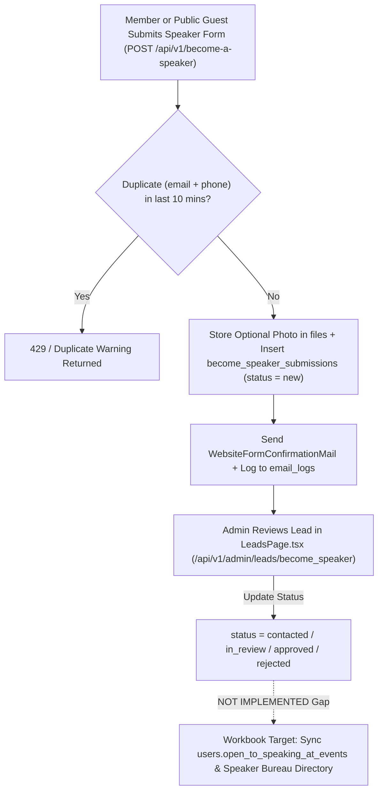

# Activity 14: Become a Speaker Form

| Metadata Field | Verified Value |
|---|---|
| **Workbook Activity #** | `14` (`Row 22` in Sheet 1, `Row 21` in Sheets 2 & 3) |
| **Exact Workbook Name** | `Become a Speaker Form` |
| **Domain Category** | `Thought Leadership` (Sheets 1 & 2) / `Community / Talent Bureau` (Sheet 3) |
| **Activity Governance Tier** | Tier 3 — Thought Leadership Lead Intake & Talent Curation |
| **Overall Implementation Status** | `Partially Implemented` (Intake form, headshot upload, duplicate guard, confirmation email, and Admin/Leader lead viewers exist; Workbook's Public Speaker Bureau Directory, Video Showreel validator, and `summitsDeliveredCount` tracking are not implemented; Admin/Leader Leads API has P0 auth/scope flaws) |
| **Surface Status Breakdown** | **Backend:** `Implemented but Incorrect` (Public intake works; `/api/v1/admin/leads/become_speaker` lacks admin auth guard & `/api/v1/leader/leads/become_speaker` lacks circle/district scoping) \| **Member App:** `Fully Implemented` (Form + status list) \| **Leadership App:** `Missing` (Backend `/api/v1/leader/leads/become_speaker` exists but no Flutter screen consumes it) \| **Admin Web:** `Fully Implemented` ([LeadsPage.tsx](file:///D:/office%20project/unity-admin-web/src/features/leads/LeadsPage.tsx) & Blade `/admin/pending-requests/leads/become-speaker`) |
| **Related Canonical Documents** | [12-master-35-activities-index.md](../12-master-35-activities-index.md) \| [19-activity-to-role-access-matrix.md](../19-activity-to-role-access-matrix.md) \| [25-activity-workflow-reference.md](../25-activity-workflow-reference.md) \| [44-api-and-organizational-scope-security.md](../44-api-and-organizational-scope-security.md) |

---

## 1. Business Purpose (§9.1)

- **WORKBOOK REQUIREMENT:** Enables members and external domain experts to *"Apply to join the national speaker roster for summits, masterclasses, and chapter events"*, culminating in audition review and listing in a *"Public Speaker Bureau Directory for national/regional summits"* with tracked `summitsDeliveredCount`.
- **FACT:** In the existing codebase, Activity 14 operates as a **Speaker Lead Submission & Admin Triage Form** (`become_speaker_submissions`) rather than a public searchable Speaker Bureau catalog. Additionally, a separate boolean flag `users.open_to_speaking_at_events` exists on member profiles ([edit_additional_info_screen.dart](file:///D:/office%20project/peers-unity/unity_app/lib/features/profile/presentation/screens/edit_additional_info_screen.dart)) for peer-to-peer discovery, completely decoupled from `become_speaker_submissions`.
- **Classification by Actor:**
  - **Member / Public Guest Action:** Submitting a speaker application (`POST /api/v1/become-a-speaker` — public endpoint usable both inside the Flutter Member App and on the public website) and viewing own submissions (`GET /api/v1/become-a-speaker` when authenticated, matched by `email` or `phone`).
  - **Leadership Action:** Viewing speaker applications via `/api/v1/leader/leads/become_speaker` (backend route exists in `LeadAdminApiController`, though unintegrated in Leadership App UI and unscoped).
  - **Admin Action:** Reviewing speaker applications, updating lead `status` and internal `notes`, or exporting/deleting entries in React Admin Web ([LeadsPage.tsx](file:///D:/office%20project/unity-admin-web/src/features/leads/LeadsPage.tsx)) and Blade Admin (`LeadSubmissionsController`).

---

## 2. Sub-Activities Catalogue (§9.2)

| # | Sub-Activity / Atomic Operation | Member App (`unity_app`) | Leadership App (`LeaderApp`) | Admin Web (`unity-admin-web` / Blade) | Backend (`unity-app-new`) | Classification Status |
|---:|---|---|---|---|---|---|
| 14.1 | Submit Speaker Application (with optional headshot upload) | [become_speaker_screen.dart](file:///D:/office%20project/peers-unity/unity_app/lib/features/highlights/presentation/screens/become_speaker_screen.dart), [become_speaker_form_fields.dart](file:///D:/office%20project/peers-unity/unity_app/lib/features/highlights/presentation/widgets/become_speaker_form_fields.dart) | Not Required | Public Website Form | `POST /api/v1/become-a-speaker` ([WebsiteFormsController.php](file:///c:/Users/malic/OneDrive/Documents/GitHub/unity-app-new/app/Http/Controllers/Api/V1/Forms/WebsiteFormsController.php)) | `Fully Implemented` |
| 14.2 | View Own Past Speaker Applications & Status | [become_speaker_screen.dart](file:///D:/office%20project/peers-unity/unity_app/lib/features/highlights/presentation/screens/become_speaker_screen.dart) | Not Required | N/A | `GET /api/v1/become-a-speaker`, `GET /api/v1/become-a-speaker/{id}` ([WebsiteFormsController.php](file:///c:/Users/malic/OneDrive/Documents/GitHub/unity-app-new/app/Http/Controllers/Api/V1/Forms/WebsiteFormsController.php#L34-L83)) | `Implemented but Incorrect` (Unauthenticated call to `GET /api/v1/become-a-speaker` has no `else` clause when `$request->user()` is null if ever exposed without `auth:sanctum`; authenticated calls filter by `email`/`phone`) |
| 14.3 | Toggle "Open to Speaking at Events" on Member Profile | [edit_additional_info_screen.dart](file:///D:/office%20project/peers-unity/unity_app/lib/features/profile/presentation/screens/edit_additional_info_screen.dart) | Read-only in Peer Profile | [PeerEditorPage.tsx](file:///D:/office%20project/unity-admin-web/src/features/users/PeerEditorPage.tsx) | `PUT /api/v1/profile` (`users.open_to_speaking_at_events`) | `Fully Implemented` (Decoupled from Activity 14 form) |
| 14.4 | Leader View of Speaker Applications | N/A | **Missing UI** | N/A | `GET /api/v1/leader/leads/become_speaker[/{id}]` (`LeadAdminApiController`) | `Implemented but Not Integrated` (Backend route exists without Flutter screen and lacks circle/district scoping) |
| 14.5 | Admin Triage, Status Update & Notes on Speaker Leads | N/A | Not Required | [LeadsPage.tsx](file:///D:/office%20project/unity-admin-web/src/features/leads/LeadsPage.tsx) & Blade `/admin/pending-requests/leads/become-speaker` | `GET\|PUT\|PATCH\|DELETE /api/v1/admin/leads/become_speaker[/{id}\|/{id}/status]` (`LeadAdminApiController`) | `Implemented but Incorrect` (Mounted under `unity.user` without admin role middleware) |
| 14.6 | Public Speaker Bureau Directory & Showreel Embeds | **Missing** (`SpeakerBureauDirectoryScreen`, `VideoReelEmbedField`) | **Missing** | **Missing** | **NOT IMPLEMENTED** (`SpeakerBureauCatalogService`) | `Missing` (**BUSINESS DECISION REQUIRED**) |

---

## 3. Input Form & Field Validation Mapping (§9.3)

- **FACT:** Backend validation is defined in [SubmitBecomeSpeakerRequest.php](file:///c:/Users/malic/OneDrive/Documents/GitHub/unity-app-new/app/Http/Requests/Forms/SubmitBecomeSpeakerRequest.php#L37-L51), while Flutter Member App UI labels are verified in [become_speaker_form_fields.dart](file:///D:/office%20project/peers-unity/unity_app/lib/features/highlights/presentation/widgets/become_speaker_form_fields.dart).
- **Important Client-Backend Mismatches Found:**
  1. Flutter Member App displays `"Designation / Role *"` and `"Topics to Speak On *"` as required (`*`), whereas `SubmitBecomeSpeakerRequest` makes `topics_to_speak_on` `nullable` and **does NOT validate or persist `designation` at all** (`become_speaker_submissions` has no `designation` column!).
  2. Flutter Member App marks `"Brief Bio"` without `*`, whereas backend requires `'brief_bio' => ['required', 'string']`!
  3. Workbook Sheet 1 fields *"Speaking experience"*, *"Video showreel links"*, and *"Target audience"* are **NOT IMPLEMENTED** in either Flutter or Laravel.

| Field Name | Data Type | Required/Optional | Validation (Backend + Client; mark missing as Requires Confirmation) | Default | Input Widget | Data Source | Visibility | Who Enters | Who Edits | Who Views | Sensitive? | Backend Request Key |
|---|---|---|---|---|---|---|---|---|---|---|---|---|
| **First Name** | `string` | Required | **Backend:** `required`, `string`, `max:100` (trimmed). **Client:** `"First Name *"` non-empty validator. | Pre-filled from `User.first_name` in app | `TextFormField` | User profile / input | Applicant, Admin, Leader API | Peer Member or Public Guest | Admin (`PUT /admin/leads/become_speaker/{id}`) | Applicant, Leaders (via API), Admin | No | `first_name` |
| **Last Name** | `string` | Required | **Backend:** `required`, `string`, `max:100` (trimmed). **Client:** `"Last Name *"` non-empty validator. | Pre-filled from `User.last_name` | `TextFormField` | User profile / input | Applicant, Admin, Leader API | Peer Member or Public Guest | Admin | Applicant, Leaders, Admin | No | `last_name` |
| **Email Address** | `string` | Required | **Backend:** `required`, `email`, `max:255` (trimmed). **Client:** `"Email Address *"` email format check. | Pre-filled from `User.email` | `TextFormField` (`emailAddress`) | User profile / input | Applicant, Admin, Leader API | Peer Member or Public Guest | Admin | Applicant, Leaders, Admin | Yes (Email PII) | `email` |
| **Phone Number** | `string` | Required | **Backend:** `required`, `string`, `max:30` (trimmed; no regex check — Requires Confirmation). **Client:** `"Phone Number *"` phone input. | Pre-filled from `User.phone` | Phone `TextFormField` | User profile / input | Applicant, Admin, Leader API | Peer Member or Public Guest | Admin | Applicant, Leaders, Admin | Yes (Phone PII) | `phone` |
| **City** | `string` | Required | **Backend:** `required`, `string`, `max:150` (trimmed). **Client:** `"City *"` required text. | Pre-filled from `User.city` | `TextFormField` | User profile / input | Applicant, Admin, Leader API | Peer Member or Public Guest | Admin | Applicant, Leaders, Admin | No | `city` |
| **Company Name** | `string` | Required | **Backend:** `required`, `string`, `max:255` (trimmed). **Client:** `"Company *"` required text. | Pre-filled from `User.company_name` | `TextFormField` | User profile / input | Applicant, Admin, Leader API | Peer Member or Public Guest | Admin | Applicant, Leaders, Admin | No | `company_name` |
| **Designation / Role** (Client UI Mismatch) | `string` | Required in UI / **Dropped in Backend** | **Backend:** **NOT VALIDATED OR STORED** (`SubmitBecomeSpeakerRequest` omits `designation`). **Client:** `"Designation / Role *"` required field. | Pre-filled from `User.designation` | `TextFormField` | User input | Dropped on submit | Peer Member | N/A | N/A | No | `designation` (unpersisted) |
| **LinkedIn Profile URL** | `string` (URL) | Optional in Backend / Required `*` in UI | **Backend:** `nullable`, `url`, `max:500` (trimmed). **Client:** `"LinkedIn Profile URL *"`. | `User.linkedin_url` or `null` | `TextFormField` (`url`) | User input | Applicant, Admin, Leader API | Peer Member or Public Guest | Admin | Applicant, Leaders, Admin | No | `linkedin_profile_url` |
| **Brief Bio** | `text` | Required in Backend / Optional label in UI | **Backend:** `required`, `string` (no `max` cap — Requires Confirmation). **Client:** `"Brief Bio"` multi-line field. | `null` | Multi-line `TextFormField` | User input | Applicant, Admin, Leader API | Peer Member or Public Guest | Admin | Applicant, Leaders, Admin | No | `brief_bio` |
| **Keynote / Topics to Speak On** | `text` | Optional in Backend / Required `*` in UI | **Backend:** `nullable`, `string` (no `max` cap). **Client:** `"Topics to Speak On *"`. | `null` | Multi-line `TextFormField` | User input | Applicant, Admin, Leader API | Peer Member or Public Guest | Admin | Applicant, Leaders, Admin | No | `topics_to_speak_on` |
| **Speaker Photo / Headshot** | `file` (`uuid` FK) | Optional | **Backend:** `nullable`, `file`, `mimes:jpg,jpeg,png,webp`, `max:5120` (5 MB; stored in `files` -> `image_file_id`). **Client:** Image picker. | `null` | Image Picker | Camera / Gallery | Applicant, Admin, Leader API | Peer Member or Public Guest | Admin | Applicant, Leaders, Admin | No | `image` |
| **Speaking Experience / Video Showreel / Target Audience** (Workbook Only) | `string` / `url` | Workbook Only | **NOT IMPLEMENTED** in backend or mobile UI (**Requires Business Confirmation**). | N/A | Workbook: `VideoReelEmbedField` (Absent) | N/A | N/A | N/A | N/A | N/A | No | N/A (`NOT IMPLEMENTED`) |
| **Admin Lead Status & Internal Notes** | `string` / `text` | Admin Optional | **Backend:** `status` (`string`, e.g. `new`, `contacted`, `approved`, `rejected`), `notes` (`nullable\|string`) in `LeadAdminApiController`. | `status = 'new'` | Admin Dropdown & Textarea | Admin input | Admin & Applicant (`status` only) | Admin | Admin | Admin (`notes` internal), Applicant (`status`) | Internal Notes | `status`, `notes` |

---

## 4. Workflow, Lifecycle & Mermaid Diagram (§9.4)

### Workbook vs Actual PostgreSQL Lifecycle Comparison
- **WORKBOOK REQUIREMENT:** `Profile Submitted -> Audition Review -> Accredited Speaker` -> Listed in `SpeakerBureauDirectoryScreen`.
- **FACT:** `become_speaker_submissions` initializes `status = 'new'` (with a 10-minute duplicate submission block on `(email, phone)` in `WebsiteFormsController@submitBecomeSpeaker`), sends `WebsiteFormConfirmationMail` logged via `EmailLogService`, and sits in the Admin Leads table (`LeadAdminApiController` / `LeadSubmissionsController`) where an admin can update `status` (`new` -> `in_review` / `contacted` / `approved` / `rejected`). Approving a lead does **not** publish a Speaker Bureau profile or set `users.open_to_speaking_at_events = true`.

---

## 5. Outputs & Deliverables (§9.5)

| Output / Deliverable | Workbook Specification | Actual Repository Status | Verification Evidence |
|---|---|---|---|
| **Submission Receipt & Email** | Confirmation on submit | `Fully Implemented` (**FACT**) | JSON `201` response + `WebsiteFormConfirmationMail` recorded in `email_logs`. |
| **Member Application History** | `BecomeSpeakerScreen` | `Fully Implemented` (**FACT**) | `GET /api/v1/become-a-speaker` rendered inside [become_speaker_screen.dart](file:///D:/office%20project/peers-unity/unity_app/lib/features/highlights/presentation/screens/become_speaker_screen.dart). |
| **Public Speaker Bureau Directory** | `SpeakerBureauDirectoryScreen` listing accredited speakers for summits | `Missing` (**NOT IMPLEMENTED**) | Confirmed absent across all 1,956 Member App Dart files, 423 Leadership App Dart files, and backend routes. |
| **Keynote Engagements Counter** | `summitsDeliveredCount` | `Missing` (**NOT IMPLEMENTED**) | No speaker-event attribution column or counter exists on `users` or `events`. |

---

## 6. Database & Metrics Mapping (§9.6)

- **Eloquent Model:** `App\Models\BecomeSpeakerSubmission` ([BecomeSpeakerSubmission.php](file:///c:/Users/malic/OneDrive/Documents/GitHub/unity-app-new/app/Models/BecomeSpeakerSubmission.php)) -> PostgreSQL table `become_speaker_submissions`.
- **Columns:** `id` (`uuid` PK), `first_name`, `last_name`, `email`, `phone`, `city`, `linkedin_profile_url`, `company_name`, `brief_bio`, `topics_to_speak_on`, `image_file_id` (`uuid` FK -> `files.id`), `status` (`varchar`, default `'new'`), `notes` (`text`), `created_at`, `updated_at`.
- **Ownership & Organizational Scope Caveat:** **FACT:** `become_speaker_submissions` has **NO `user_id` or `circle_id` column**! Ownership in `WebsiteFormsController@indexBecomeSpeaker` (`L38-45`) is inferred by matching `email = $user->email OR phone = $user->phone`. Consequently, `GET /api/v1/leader/leads/become_speaker` in `LeadAdminApiController` does not scope leads by circle/district/industry!
- **PII Logging Bug:** [SubmitBecomeSpeakerRequest.php](file:///c:/Users/malic/OneDrive/Documents/GitHub/unity-app-new/app/Http/Requests/Forms/SubmitBecomeSpeakerRequest.php#L17-L22) logs `$this->headers->all()` (including raw `Authorization: Bearer ...` tokens!) and `$this->all()` (full PII) into application logs on every request!

### Sheet 3 Workbook Metric Keys Comparison
| Workbook Metric Key (Sheet 3) | Actual Backend / DB Equivalent | Status |
|---|---|---|
| `speakerStatus` | `become_speaker_submissions.status` (`'new'`, etc.) + `users.open_to_speaking_at_events` (`bool`) | `Partially Implemented` (Two disconnected fields) |
| `speakerTopicsList` | `become_speaker_submissions.topics_to_speak_on` (free-text `text`, not array) | `Partially Implemented` |
| `summitsDeliveredCount` | None | `Missing` (`NOT IMPLEMENTED`) |

---

## 7. API & Backend Service Mapping (§9.7)

| Surface | Method & Endpoint | Controller @ Action | Request / Service | Auth Middleware | Scope Enforcement & Security Bugs | Client Integration |
|---|---|---|---|---|---|---|
| Public / Member API | `POST /api/v1/become-a-speaker` | [WebsiteFormsController.php](file:///c:/Users/malic/OneDrive/Documents/GitHub/unity-app-new/app/Http/Controllers/Api/V1/Forms/WebsiteFormsController.php) `@submitBecomeSpeaker` | `SubmitBecomeSpeakerRequest` | Public (`api`) | **Security Bug:** `SubmitBecomeSpeakerRequest` logs raw `Authorization` headers to disk (`L18`). | Integrated in Member App (`SpeakerRemoteDatasource`) & Website |
| Member API | `GET /api/v1/become-a-speaker`, `GET /api/v1/become-a-speaker/{id}` | `WebsiteFormsController@indexBecomeSpeaker`, `@showBecomeSpeaker` | Inline | `auth:sanctum`, `unity.user` | Matches `email` or `phone` against `$request->user()`. (No `user_id` FK). | Integrated in Member App |
| Leader API | `GET /api/v1/leader/leads/become_speaker[/{id}]` | `LeadAdminApiController@index`, `@show` | Inline | `auth:sanctum`, `leader.user` | **Scope Leak:** Returns global website/app speaker leads without filtering by leader's circles, district, or industry! | **Not Integrated** in Flutter Leadership App |
| Admin V1 API | `GET\|POST\|PUT\|PATCH\|DELETE /api/v1/admin/leads/become_speaker[/{id}\|/{id}/status]` | `LeadAdminApiController` | Inline | `auth:sanctum`, `unity.user` | **CRITICAL P0 BUG:** Mounted inside `/api/v1/admin/*` without admin role middleware—any regular Peer token can read, edit, or delete all speaker leads! | Integrated in React Admin Web (`leadService.ts`) |
| Admin Web | `GET /admin/pending-requests/leads/become-speaker`, `GET\|PATCH .../{id}` | `Admin\LeadSubmissionsController` | Blade | `web`, `admin.auth` | Enforces web admin session. | Blade Admin Panel |

### Workbook Cloud Service vs Actual Laravel Service Comparison
- **WORKBOOK REQUIREMENT:** `SpeakerBureauCatalogService`, `MediaEmbedValidator`.
- **FACT:** **NOT IMPLEMENTED.** Handled directly by `WebsiteFormsController` + `FileModel` local/disk upload + `EmailLogService`.

---

## 8. Role-Wise Access Governance (§9.8)

| Role | View Activity | Create Record | Edit Own | Edit Others | Submit for Review | Verify | Approve | Reject | Assign | Manage | Delete | View Aggregated Reports |
|---|---|---|---|---|---|---|---|---|---|---|---|---|
| **Super Admin** | Allowed (Global) | Allowed | Allowed | Allowed (`/admin/leads/become_speaker/{id}`) | Allowed | Allowed | Allowed (`PATCH .../status`) | Allowed (`PATCH .../status`) | DENIED — No speaker-to-event assignment workflow exists. | Allowed (Full Lead CRUD) | Allowed (`DELETE .../become_speaker/{id}`) | Allowed (Global) |
| **Country Director** | Allowed (Country scope intended; **currently unscoped global via `/leader/leads/become_speaker`**) | Allowed | DENIED — Immutable to submitter | DENIED — No permission under the verified backend authorization model. | Allowed | UNVERIFIED — Requires backend/business confirmation. | DENIED — Read-only on `/leader/leads/*`. | DENIED — Read-only on `/leader/leads/*`. | DENIED — No permission under the verified backend authorization model. | DENIED — No permission under the verified backend authorization model. | DENIED — No permission under the verified backend authorization model. | UNVERIFIED — Requires backend/business confirmation. |
| **DED** | Allowed (District scope intended; **currently unscoped in `/leader/leads/become_speaker`**) | Allowed | DENIED | DENIED — No permission under the verified backend authorization model. | Allowed | UNVERIFIED — Requires backend/business confirmation. | DENIED — Read-only on `/leader/leads/*`. | DENIED — Read-only on `/leader/leads/*`. | DENIED — No permission under the verified backend authorization model. | DENIED — No permission under the verified backend authorization model. | DENIED — No permission under the verified backend authorization model. | UNVERIFIED — Requires backend/business confirmation. |
| **Industry Director** | Allowed (Industry scope intended; **currently unscoped**) | Allowed | DENIED | DENIED — No permission under the verified backend authorization model. | Allowed | DENIED — No permission under the verified backend authorization model. | DENIED — No permission under the verified backend authorization model. | DENIED — No permission under the verified backend authorization model. | DENIED — No permission under the verified backend authorization model. | DENIED — No permission under the verified backend authorization model. | DENIED — No permission under the verified backend authorization model. | DENIED — No permission under the verified backend authorization model. |
| **Circle Founder** | Allowed for Own Circle Peers (intended; **currently unscoped**) | Allowed | DENIED | DENIED — No permission under the verified backend authorization model. | Allowed | DENIED — No permission under the verified backend authorization model. | DENIED — No permission under the verified backend authorization model. | DENIED — No permission under the verified backend authorization model. | DENIED — No permission under the verified backend authorization model. | DENIED — No permission under the verified backend authorization model. | DENIED — No permission under the verified backend authorization model. | DENIED — No permission under the verified backend authorization model. |
| **Circle Director** | Allowed for Own Circle Peers (intended; **currently unscoped**) | Allowed | DENIED | DENIED — No permission under the verified backend authorization model. | Allowed | DENIED — No permission under the verified backend authorization model. | DENIED — No permission under the verified backend authorization model. | DENIED — No permission under the verified backend authorization model. | DENIED — No permission under the verified backend authorization model. | DENIED — No permission under the verified backend authorization model. | DENIED — No permission under the verified backend authorization model. | DENIED — No permission under the verified backend authorization model. |
| **Chair / Committee Chairs** (`chairEventsPrograms`, etc.) | UNVERIFIED — Requires backend/business confirmation (Events & Impacts Chair may need approved circle speakers list). | Allowed | DENIED | DENIED — No permission under the verified backend authorization model. | Allowed | DENIED — No permission under the verified backend authorization model. | DENIED — No permission under the verified backend authorization model. | DENIED — No permission under the verified backend authorization model. | DENIED — No permission under the verified backend authorization model. | DENIED — No permission under the verified backend authorization model. | DENIED — No permission under the verified backend authorization model. | DENIED — No permission under the verified backend authorization model. |
| **Vice Chair** | DENIED (Intended; **currently exposed via `/leader/leads/become_speaker`**) | Allowed | DENIED | DENIED — No permission under the verified backend authorization model. | Allowed | DENIED — No permission under the verified backend authorization model. | DENIED — No permission under the verified backend authorization model. | DENIED — No permission under the verified backend authorization model. | DENIED — No permission under the verified backend authorization model. | DENIED — No permission under the verified backend authorization model. | DENIED — No permission under the verified backend authorization model. | DENIED — No permission under the verified backend authorization model. |
| **Secretary** | DENIED (Intended; **currently exposed via `/leader/leads/become_speaker`**) | Allowed | DENIED | DENIED — No permission under the verified backend authorization model. | Allowed | DENIED — No permission under the verified backend authorization model. | DENIED — No permission under the verified backend authorization model. | DENIED — No permission under the verified backend authorization model. | DENIED — No permission under the verified backend authorization model. | DENIED — No permission under the verified backend authorization model. | DENIED — No permission under the verified backend authorization model. | DENIED — No permission under the verified backend authorization model. |
| **Committee Leader** | DENIED — No permission under the verified backend authorization model. | Allowed | DENIED | DENIED — No permission under the verified backend authorization model. | Allowed | DENIED — No permission under the verified backend authorization model. | DENIED — No permission under the verified backend authorization model. | DENIED — No permission under the verified backend authorization model. | DENIED — No permission under the verified backend authorization model. | DENIED — No permission under the verified backend authorization model. | DENIED — No permission under the verified backend authorization model. | DENIED — No permission under the verified backend authorization model. |
| **Peer Member** | Allowed (Own submissions only via `GET /api/v1/become-a-speaker`) | Allowed | DENIED (Immutable after submit) | DENIED — No permission under the verified backend authorization model. | Allowed | DENIED — No permission under the verified backend authorization model. | DENIED — No permission under the verified backend authorization model. | DENIED — No permission under the verified backend authorization model. | DENIED — No permission under the verified backend authorization model. | DENIED — No permission under the verified backend authorization model. | DENIED — No permission under the verified backend authorization model. | DENIED — No permission under the verified backend authorization model. |

---

## 9. Existing Implementation Summary, Gaps & Minimum-Change Enhancement Recommendations

| # | 1. Existing Implementation Summary | 2. Identified Gap / Defect | 3. Classification Status | 4. Impact / Risk Severity | 5. Target Repo & Layer | 6. Exact File(s) / Endpoint(s) / Table(s) | 7. Minimum-Change Enhancement Specification | 8. RBAC & Scope Enforcement Rule | 9. Migration / Compatibility Impact | 10. Verification / Test Criteria |
|---:|---|---|---|---|---|---|---|---|---|---|
| **14-R1** | `SubmitBecomeSpeakerRequest` logs full request headers/body; `/api/v1/admin/leads/become_speaker` lacks admin middleware; `/api/v1/leader/leads/become_speaker` is unscoped. | Raw Bearer tokens are written to Laravel logs; any mobile Peer can access/delete speaker leads via `/api/v1/admin/leads/become_speaker`; any leader can read global leads. | `Implemented but Incorrect` | **P0 Critical (Token Leak, Privilege Escalation & PII Leak)** | `unity-app-new` (Request, Routes, Controller) | [SubmitBecomeSpeakerRequest.php](file:///c:/Users/malic/OneDrive/Documents/GitHub/unity-app-new/app/Http/Requests/Forms/SubmitBecomeSpeakerRequest.php#L17-L22), `LeadAdminApiController.php`, `routes/api.php` | Strip `$this->headers->all()` from `Log::info`; protect `/api/v1/admin/leads/*` with `admin.auth` + `admin.permission:leads.view`; scope `/api/v1/leader/leads/become_speaker` by joining `user_id` (or matching `LOWER(email)` against scoped circle members) to `resolveManagedCircles($user)`. | Admin CRUD restricted to `superAdmin` / `marketing_team` / `content_team`; Leader read restricted to `CD`, `CF`, `chairEventsPrograms`, `ID`, `DED`, `countryDirector` within organizational scope. | Zero breaking change for authorized clients. | Test asserting `Authorization` header never appears in log context, `403` for Peer token on `/admin/leads/become_speaker`, and scoped filtering on `/leader/leads/become_speaker`. |
| **14-R2** | Member App collects `Designation / Role *` and marks `Topics *` required & `Brief Bio` optional, while `become_speaker_submissions` lacks `user_id` and `designation`. | `designation` is silently discarded; UI `*` indicators contradict backend `required`/`nullable` rules; approved speaker leads do not update `users.open_to_speaking_at_events`. | `Requires Enhancement` | **P2 Medium (Data Loss & Form Validation Mismatch)** | `unity-app-new` & `unity_app` | `become_speaker_submissions` (new additive migration), [SubmitBecomeSpeakerRequest.php](file:///c:/Users/malic/OneDrive/Documents/GitHub/unity-app-new/app/Http/Requests/Forms/SubmitBecomeSpeakerRequest.php#L39-L50), [become_speaker_form_fields.dart](file:///D:/office%20project/peers-unity/unity_app/lib/features/highlights/presentation/widgets/become_speaker_form_fields.dart) | Add nullable `user_id` (`uuid`) and `designation` (`varchar(150)`) columns to `become_speaker_submissions`; capture `auth('sanctum')->id()` when submitted from Member App; align `*` required markers on `Brief Bio *` and `Topics to Speak On`; when admin sets `status = 'approved'` and a linked `User` exists, sync `users.open_to_speaking_at_events = true`. | Self-submission binds `user_id = auth()->id()`; status approval restricted to authorized Admin. | Additive nullable columns; backward-compatible with public guest website submissions (`user_id = null`). | Submit from Member App with `designation` -> verify DB persistence and `user_id` link; approve in Admin -> verify `users.open_to_speaking_at_events === true`. |
| **14-R3** | Workbook specifies `SpeakerBureauDirectoryScreen`, `VideoReelEmbedField`, and `summitsDeliveredCount`. | No Speaker Bureau directory or showreel URL exists; Leadership App has no Speaker roster view for Event Chairs/CDs planning chapter events. | `Requires Business Confirmation` (**BUSINESS DECISION REQUIRED**) | **P3 Low (Product Scope Decision)** | Product / Cross-Repo | `become_speaker_submissions`, Member App & Leadership App | Confirm with Product Owner whether speaker sourcing for chapter events should remain a lightweight filter on Peer Directory (`open_to_speaking_at_events = true`, **Recommended — Not Required to build separate bureau**) or whether a dedicated Speaker Bureau module with `video_reel_url` is required in a future phase. | If peer filter is reused, respect standard Peer Directory scope and `hide_phone`/`hide_email` privacy flags. | None if reusing `open_to_speaking_at_events` filter. | Product sign-off documented in [51-open-business-decisions.md](../51-open-business-decisions.md). |
